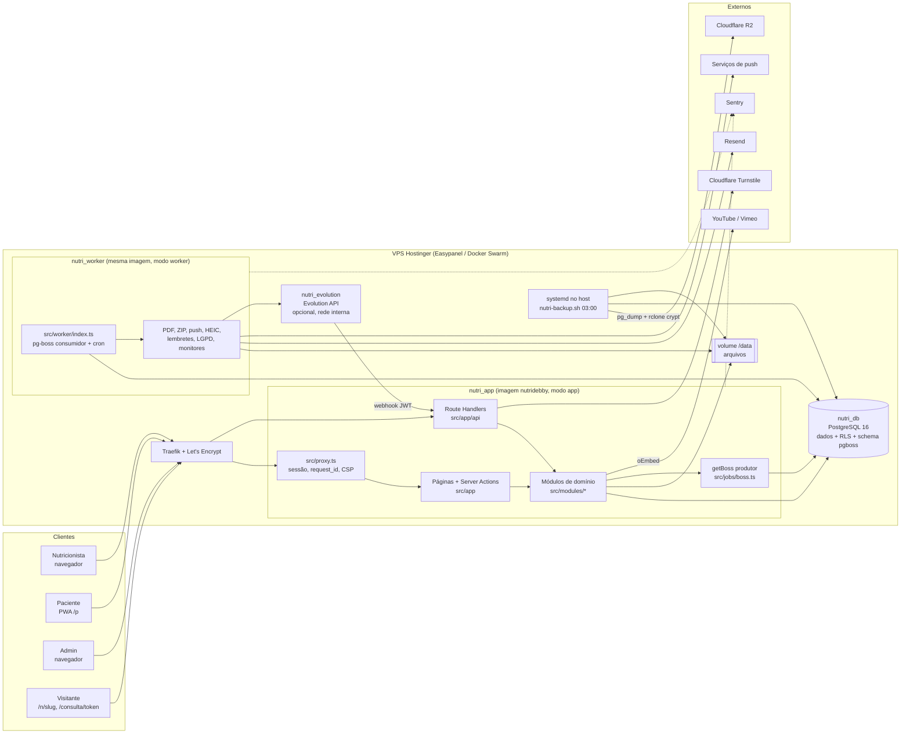
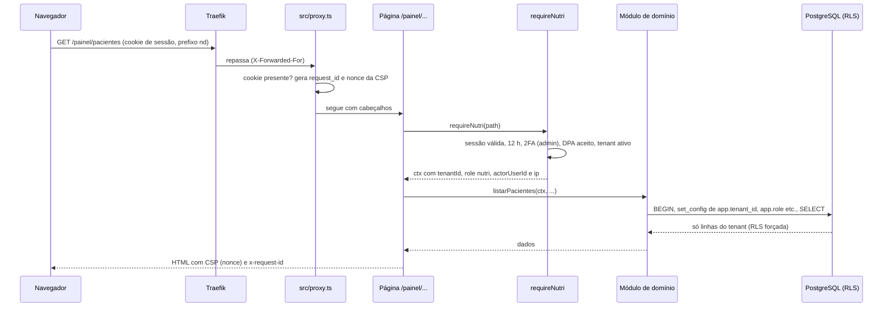
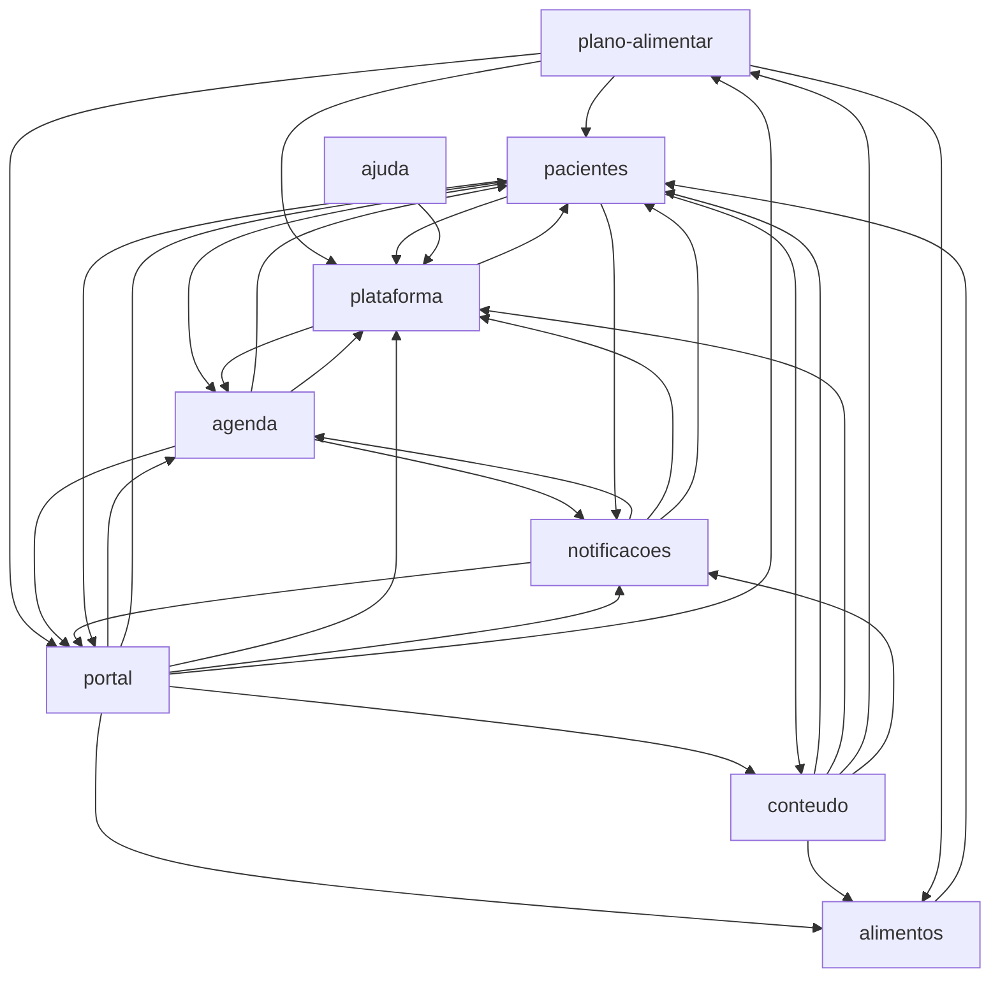
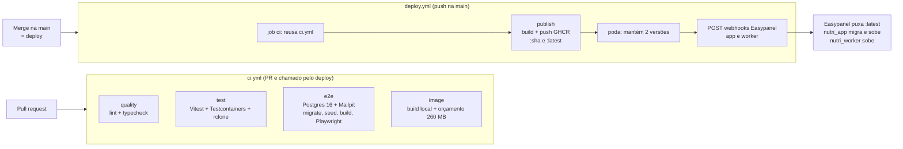

# Capítulo 1 — Visão geral e arquitetura

> **Manual técnico do NutriDebby.** Este capítulo é a porta de entrada para quem vai manter o sistema sem ter
> participado do projeto. Ele explica o que existe, por que foi feito assim e onde cada coisa mora no código.
> Os capítulos seguintes detalham banco e RLS, autenticação, módulos de domínio, worker, operação e testes
> (índice, glossário e divergências consolidadas no [README do manual](README.md)).

| Item | Valor |
|---|---|
| Conferido contra | `main` em `62615b9` (merge do PR #15, 04/10/2026), worktree `docs-manual-tecnico` |
| Data da conferência | 05/10/2026 |
| Spec de referência | `docs/superpowers/specs/2026-09-27-nutridebby-mvp-design.md` v1.11 e `…-mvp-historias.md` |
| Ordem de autoridade | **código** > spec > planos e backlog (`docs/superpowers/plans/`) > runbooks (`docs/operacao/`) > `CLAUDE.md` |
| Segredos | Este manual só cita **nomes** de variáveis. Nenhum valor. |

Convenções de citação: `arquivo:linha` aponta para a linha no commit acima; "Plano NN, Dx" é a decisão "Dx" da tabela
"Decisões de desenho" do plano NN em `docs/superpowers/plans/`; "§x" é a seção da spec de design.

---

## 1.1 O produto

O NutriDebby é um **SaaS multi-tenant de gestão de consultório de nutrição**, com um portal do paciente em PWA
(spec §1). Cada consultório (uma nutricionista) é um **tenant**. A primeira cliente é a Debby, piloto do produto
(spec §1, D-01). O onboarding é **manual**: o admin da plataforma cria cada conta de nutricionista (spec §1, D-06).
Não há cobrança nem autocadastro no MVP (spec §2.2, §10).

O sistema guarda **dado de saúde** (prontuário, exames, diário alimentar). Por isso a LGPD molda boa parte da
arquitetura: isolamento no banco, auditoria automática, minimização de dados em logs e no Sentry, exportação e
exclusão a pedido do titular (spec RNF-07, RNF-08, RNF-11; `CLAUDE.md` do projeto, regras 1, 3 e 8).

Situação em 05/10/2026: Planos 01 a 08 em produção em `https://nutri.wsscloud.tech`, com 89 migrations
(`drizzle/0000_…` a `drizzle/0088_…`) e o **MVP completo no código**, exceto os textos legais definitivos
(Plano 08, Tarefa 8, bloqueada no item externo E-09) — ver `docs/superpowers/plans/2026-09-27-nutridebby-backlog.md`,
"Resumo", e o índice dos planos (`…-00-indice.md`, linha do Plano 08). O go-live com pacientes reais depende do
checklist `docs/operacao/go-live.md`.

### Módulos funcionais do MVP

| ID | Módulo | Conteúdo (resumo da spec §2.1) | Módulos de código |
|---|---|---|---|
| M1 | Plataforma & acesso | Multi-tenant, login, 2FA, recuperação de senha, admin, marca, auditoria, tema e manual guiado | `plataforma`, `ajuda` |
| M2 | Pacientes & prontuário | Cadastro, convite, etiquetas, anamnese, antropometria, gasto energético, exames, atendimentos, evolução, LGPD | `pacientes` |
| M3 | Plano alimentar | TACO + alimentos próprios, refeições, cálculo, substituições, modelos, publicação, PDF | `alimentos`, `plano-alimentar` |
| M4 | Agenda | Horários, consultas, página pública, lembretes por e-mail/WhatsApp/push, confirmação, presença, cota | `agenda`, `notificacoes` |
| M5 | Portal do paciente (PWA) | Plano offline, push, diário com foto, evolução, lista de compras, agenda, direitos do titular | `portal` |
| M6 | Biblioteca de conteúdo | Vídeos, receitas, orientações, audiência, aba "Conteúdos", métricas | `conteudo` |

Critérios de sucesso do MVP (CS-01 a CS-03, spec §1.1) são calculados por `metricasDeSucesso`
(`src/modules/plataforma/metricas-sucesso.ts`) e aparecem no Início do painel e na tela do admin (Plano 08, D15).

---

## 1.2 Perfis de acesso

O login é global por e-mail e cada conta tem **um único papel** (`appRole`): `admin`, `nutri` ou `paciente`
(`src/lib/session-rules.ts:1`; spec §3, "Modelo de identidade"). O **visitante** não tem conta: usa páginas
públicas ou links assinados. No banco, o "papel" que vale para a RLS é outro conceito: o `TenantRole` passado ao
`withTenant` (`src/db/tenant.ts:14`: `nutri`, `paciente`, `worker`, `publico`), mais o contexto `conta` do
`withConta` (`src/db/tenant.ts:99`).

| Perfil | Como entra | Área | Contexto no banco | Regras principais | Onde está no código |
|---|---|---|---|---|---|
| **Admin da plataforma** | E-mail + senha + **2FA obrigatório** | `/admin` | **Nunca** usa `withTenant`: `admin` não está em `ROLES` (`src/db/tenant.ts:15`, recusa em `:47`). Métricas só por funções `SECURITY DEFINER` que devolvem contagens (`admin_tenant_metrics`, `drizzle/0012_metricas_admin.sql:7`; `admin_metricas_sucesso`, migration 0087) | Sem 2FA, toda página manda para `/conta/seguranca` (`evaluateSession`, `src/lib/session-rules.ts:57`). Sessão expira com 12 h sem atividade (`STAFF_IDLE_MS`, `:5`). Nunca lê dado de saúde (spec §3) | `src/app/admin/`, `requireUser(['admin'], …)` (`src/app/admin/page.tsx:39`); guarda `src/app/admin/sem-tabelas-tenant.test.ts` |
| **Nutricionista** (dona do tenant) | Convite de 72 h criado pelo admin; 2FA opcional | `/painel` | `withTenant` com `role: 'nutri'`, `actorUserId` e `ip` obrigatórios (`src/db/tenant.ts:60`) | Precisa aceitar o DPA da versão atual antes de usar o painel (`requireNutri`, `src/lib/tenant-session.ts:22`); tenant suspenso vai para `/indisponivel` (RN-15); 12 h de inatividade | `src/lib/tenant-session.ts` (`requireNutri`, `requireApiNutri`) |
| **Paciente** | Convite de 7 dias da nutricionista (ou cadastro pela página pública) | `/p` (PWA) | `withTenant` com `role: 'paciente'` e `patientId`; para achar os vínculos, `withConta` (contexto `conta`, Plano 06, D2) | Pode ser paciente de vários consultórios; o vínculo escolhido fica no cookie `nd_vinculo`, reconferido a cada requisição (Plano 06, D3; `src/lib/paciente-session.ts:21`). Precisa aceitar a versão atual do termo naquele consultório (Plano 06, D25). Sessão de 30 dias (`PATIENT_SESSION_MS`, `src/lib/session-rules.ts:6`). Escrita negada por padrão no banco (Plano 06, D1) | `requirePaciente` (`src/lib/paciente-session.ts:111`), `requireApiPaciente` (`:165`) |
| **Visitante** (sem conta) | Nenhum login | `/n/<slug>`, `/consulta/<token>`, `/convite/…`, `/definir-senha`, `/esqueci-senha` | Página pública: `role: 'publico'`, sem ator, negado por padrão no banco (Plano 05, D11). Link da consulta, resposta do WhatsApp e leitura do convite: `role: 'paciente'` com `semConta: true`, só nos três arquivos de `SEM_CONTA_PERMITIDOS` (`src/db/tenant.ts:34`) | Turnstile + código por e-mail na página pública (Plano 05, D12); link da consulta assinado por HMAC com validade até o início da consulta (Plano 05, D20) | `src/modules/agenda/agendamento-publico.ts`, `src/modules/agenda/acoes-link.ts`, `src/modules/pacientes/convite-paciente.ts` |

Dois "atores técnicos" completam o quadro:

- **Worker**: jobs rodam com `withTenant({ role: 'worker' })` e o mesmo role de banco da aplicação, sem
  `BYPASSRLS`; varreduras entre tenants partem da tabela `tenants` (spec §4.1, "Worker").
- **Evolution API** (WhatsApp): chama `POST /api/webhooks/whatsapp`, autenticada por JWT HS256 com chave derivada por
  instância (Plano 05, D4; `src/app/api/webhooks/whatsapp/route.ts`).

Para onde cada papel vai depois do login: `homeFor` (`src/lib/session-rules.ts:15`) — `admin` → `/admin`,
`nutri` → `/painel`, `paciente` → `/p/inicio`. A rota `/inicio` faz esse desvio (`src/app/inicio/page.tsx`).

---

## 1.3 Stack

Versões conferidas em `package.json` (dependências fixadas; `^` indica faixa). Node ≥ 24 (`engines`) e
`packageManager: pnpm@12.6.0`.

### Dependências de produção

| Camada | Pacote | Versão | Para quê / observação |
|---|---|---|---|
| Framework web | `next` | 16.3.6 | App Router, Server Components, Server Actions, Route Handlers; `src/proxy.ts` no lugar do `middleware.ts` |
| UI | `react`, `react-dom` | 19.2.8 | Também renderiza os e-mails (`react-dom/server`, Plano 02, "Modelos de e-mail") |
| Banco | `pg` | 8.23.0 | Pool de conexões (`src/db/client.ts:39`, `max: 10`) |
| ORM | `drizzle-orm` | 0.45.3 | Consultas tipadas; o erro do Drizzle é sanitizado antes de subir (`src/db/client.ts`, topo) |
| Fila | `pg-boss` | 12.34.0 | Fila e agendamento dentro do Postgres, schema `pgboss` (sem Redis; spec §4) |
| Autenticação | `better-auth` | 1.7.6 | E-mail/senha, sessões no Postgres, plugin `twoFactor` (`src/lib/auth.ts:172`), prefixo de cookie `nd` (`:151`) |
| Hash de senha | `@node-rs/argon2` | 2.2.1 | Argon2id (`src/lib/password.server.ts`; RNF-06) |
| Validação | `zod` | 4.6.5 | Variáveis de ambiente (`src/env.ts`) e formulários |
| Logs | `pino` | 10.3.1 | JSON com `redact` de segredos (`src/lib/logger.ts`) |
| Erros | `@sentry/node` | 11.4.0 | Só servidor e worker; sem SDK no navegador (Plano 08, D1) |
| PWA | `@serwist/turbopack`, `serwist` | 9.5.12 | Service worker em `/serwist/sw.js` (`src/app/serwist/[path]/route.ts`, `src/app/sw.ts`; P-14 resolvida) |
| Push | `web-push` | 3.6.7 | VAPID; **só no worker** (Plano 05, D19) |
| E-mail | `resend` | 6.30.0 | Transporte de produção (`src/email/transport.ts:27`) |
| PDF | `@react-pdf/renderer` | 4.9.0 | Prontuário e plano alimentar; **só no worker** (Plano 03, "PDF e ZIP") |
| ZIP | `fflate` | 0.8.3 | Exportação do paciente; **só no worker** |
| Imagem | `sharp` | 0.35.4 | Logo, capa e foto do diário (JPEG sem metadados, `src/lib/jpeg.ts`) |
| HEIC | `heic-decode` | 2.1.0 | Foto do iPhone; **só no worker** (Plano 06, D10) |
| QR code | `qrcode` | ^1.5.4 | QR do 2FA |
| Runtime TS | `tsx` | 4.23.15 | Dependência **de produção**: o worker, as migrations e o `admin:criar` rodam TypeScript direto (`node --import tsx`, `docker-entrypoint.sh:9-15`) |
| Marcador | `server-only` | ^0.0.1 | Impede importar módulos de servidor no cliente |

### Dependências de desenvolvimento

| Pacote | Versão | Para quê |
|---|---|---|
| `typescript` | ^5 | `strict: true` (`tsconfig.json:7`) |
| `drizzle-kit` | 0.31.11 | Gera migrations SQL (`pnpm db:generate`) |
| `tailwindcss`, `@tailwindcss/postcss` | ^4 | Estilos; tokens `--nd-*` por tema (spec §4.3) |
| `vitest` | 5.0.2 | Testes unitários e de banco |
| `@testcontainers/postgresql` | 12.1.0 | Postgres real nos testes (RLS, isolamento) |
| `@playwright/test` | 1.63.0 | E2E (projetos `chromium`, `celular`, `painel`, `playwright.config.ts:11-16`) |
| `@axe-core/playwright` | 4.13.0 | Acessibilidade (RNF-10) |
| `eslint`, `eslint-config-next` | ^9, 16.3.6 | Lint |
| `prettier` | ^3.9.9 | Formatação |
| `esbuild` | ^0.28.2 | Build do service worker pelo Serwist (`useNativeEsbuild: true`) |
| `otpauth` | ^9.5.2 | Gera códigos TOTP nos testes de 2FA (`e2e/helpers.ts`, `src/lib/two-factor.test.ts`) |
| `xlsx` | tarball do SheetJS | Lê a planilha da TACO no seed (`scripts/seeds/planilhas.ts:1`) |

Fora do `package.json`: **PostgreSQL 16** (imagem `postgres:16` em produção; `postgres:16-alpine` no dev e no CI),
com as extensões `citext`, `pg_trgm`, `unaccent` e `btree_gist` (`drizzle/0000_base_roles_e_rls.sql:1-7`);
Mailpit no dev e no CI; k6 por imagem Docker e Lighthouse por `pnpm dlx` só na pilha de carga (spec §9.1).

`pnpm-workspace.yaml` poda `@sentry/bundler-plugins` por `overrides` (só os caminhos de bundler do SDK o usam) para a
imagem caber no orçamento de 260 MB do CI (spec §9.1, "Logs / erros").

---

## 1.4 Arquitetura: monólito modular + worker

### Visão em uma frase

Um repositório, **uma imagem Docker**, três processos possíveis — **app** (Next.js), **worker** (pg-boss) e
**admin:criar** (CLI) — e **um banco PostgreSQL** que guarda os dados, a fila e o isolamento entre consultórios
(spec §4; Plano 01, "Architecture").

### Por que assim

| Decisão | Motivo | Fonte |
|---|---|---|
| Monólito modular em Next.js, não microsserviços | Um dev, uma VPS compartilhada, deploy simples; módulos por domínio mantêm a separação | Spec §4, §4.1; D-04 |
| Worker na **mesma imagem** | Mesmo código de domínio no app e nos jobs; uma imagem só no GHCR gratuito (500 MB para 2 versões) | Plano 01, "Architecture"; `.github/workflows/ci.yml:107-114` |
| Fila no **Postgres** (pg-boss), sem Redis | Um serviço a menos; o envio do job entra na **mesma transação** da escrita (`enqueueEmail(msg, { tx })`) | Spec §4; Plano 02, "Fila de e-mail" |
| Isolamento por **RLS forçada** no banco | Um erro de código não expõe outro consultório nem outro paciente | RNF-07; Plano 01, Global Constraints |
| Código pesado **só no worker** (PDF, ZIP, web-push, HEIC) | Mantém o grafo do Next leve e evita processamento longo na requisição | Plano 03, "PDF e ZIP"; Plano 05, D19; Plano 06, D10 |
| Backup **no host** (systemd), não no worker | Imagem menor e o worker continua sem privilégio para ler todos os tenants | Plano 02, "Onde roda o backup" |
| Build da imagem **fora da VPS** | Não consumir CPU e memória do CRM que divide a VPS | RNF-03; §9.7 |

### O processo app (Next.js 16)

- **App Router** em `src/app/`. Páginas são Server Components; formulários usam Server Actions; uploads, PDF, PWA e
  integrações usam Route Handlers em `src/app/api/` (§1.6 abaixo).
- **`src/proxy.ts`** é o interceptador do Next 16 (substitui o `middleware.ts`; Plano 01, Global Constraints). Ele:
  1. redireciona para `/entrar?volta=…` quem acessa `/admin`, `/painel`, `/p`, `/conta` ou `/inicio` **sem cookie**
     de sessão (`src/proxy.ts:7`, `:22-27`) — só confere a **presença** do cookie; a autorização de verdade é feita
     em cada página por `requireUser`/`requireNutri`/`requirePaciente` (o layout não é barreira de segurança, spec §4.1);
  2. gera um `x-request-id` novo, ignorando o do cliente (Plano 08, D2; `:19`);
  3. monta a **CSP com nonce** por requisição (Plano 08, D7; `:29-45`, `src/lib/csp.ts`).
- O `matcher` **exclui `/api/*`**, `/serwist/*` e estáticos (`src/proxy.ts:55`). Motivo (Plano 08, D2): o Next copia
  para a memória o corpo de toda requisição que passa pelo proxy, com corte silencioso em 10 MB; o upload de exame
  (até 20 MB) chegaria cortado. Consequência: rotas de API fazem a própria checagem de sessão
  (`requireApiNutri`, `requireApiPaciente`, `requireApiUser`) e de origem (`mesmaOrigem`, `src/lib/mesma-origem.ts`).
- **Cabeçalhos globais** de segurança vêm de `next.config.ts` (`CABECALHOS_SEGURANCA`, `src/lib/csp.ts:43`: HSTS sem
  `includeSubDomains`, `nosniff`, `X-Frame-Options: DENY`, `Referrer-Policy`, `Permissions-Policy`), com
  `poweredByHeader: false` e `pg-boss` como pacote externo do servidor (`next.config.ts:7-8`).
- **`src/instrumentation.ts`** liga o Sentry no runtime Node e registra todo erro de requisição com o `request_id`
  (`register`, `onRequestError`).
- O app **produz** jobs mas não os processa: `getBoss()` (`src/jobs/boss.ts:18`) abre um pg-boss com pool próprio de
  2 conexões, `supervise: false` e `schedule: false`.

### O processo worker (pg-boss)

`startWorker` (`src/worker/index.ts:42`) valida o ambiente do worker, conecta o pg-boss ao schema `pgboss`
(`createSchema: false`: o schema é criado pela migration com dono = role da aplicação, `src/db/migrate.ts:81`),
cria/atualiza as filas declaradas em `QUEUES` (`src/jobs/queues.ts:9`) e registra cada consumidor por
`workSemDetalhe` (o erro devolvido ao pg-boss leva só fila e código; `src/worker/sem-detalhe.ts`).

Agendamentos (todos no fuso `America/Sao_Paulo`; a VPS roda em UTC):

| Fila | Quando | O que faz | Linha |
|---|---|---|---|
| `heartbeat` | a cada minuto | Grava a batida em `system_heartbeat`; o `/api/health` responde 503 se passar de 10 min (`src/worker/heartbeat.ts:5`) | `src/worker/index.ts:58` |
| `notificacoes` | a cada minuto (e sob demanda por tenant) | Motor de lembretes e avisos: e-mail, WhatsApp e push (Plano 05, D6) | `:85` |
| `agenda-limpeza` | 04:30 | Apaga pedidos da página pública, contadores de limite e `access_events` vencidos | `:103` |
| `retencao-lgpd` | 04:00 | Anonimiza bloqueados no fim do prazo de guarda; apaga exportações vencidas | `:140` |
| `monitor-backup` | 07:00 | Confere em `backup_runs` se o backup do host rodou e alerta os admins | `:118` |
| `monitor-disco` | a cada hora | Alerta com o disco de `/data` em 70% (RNF-13) | `:128` |
| `expirar-diario-foto`, `expirar-plano-pdf` | a cada 15 min | Recupera fotos e PDFs presos em "processando"/"pendente" | `:190`, `:194` |
| `limpar-tmp` | 04:00 | Remove `.tmp` órfãos de `DATA_DIR` | `:198` |

Filas sem agendamento, disparadas pelo app: `email`, `agenda-tenant`, `whatsapp-evento`, `exportacao-paciente`,
`expirar-exportacao`, `exclusao-atendida`, `plano-pdf`, `diario-foto` (`src/worker/index.ts:64-187`). As opções de
novas tentativas e expiração de cada fila estão em `src/jobs/queues.ts`.

**Guarda de arquitetura:** testes percorrem o grafo de imports a partir das raízes do Next (`src/app`, `proxy`,
`instrumentation`, `next.config`) e falham se ele alcançar código exclusivo do worker —
`push.ts`, `enviar.ts`, `diario-foto-job.ts`, `web-push`, `heic-decode` (`src/modules/notificacoes/push.test.ts:433`)
e `exportacao-job.ts`, `prontuario-pdf.tsx`, `plano-pdf*.tsx`, `@react-pdf/renderer`, `fflate`
(`src/modules/pacientes/exportacao.test.ts`, teste "o PDF e o ZIP ficam fora do grafo do Next"). O grafo é montado
por `test/grafo-de-imports.ts`.

### O banco (PostgreSQL 16)

- Dois roles (Plano 01, "Architecture"; `CLAUDE.md`, regra 7): o **migrator** (dono do schema, roda migrations,
  `DATABASE_URL_MIGRATOR`) e o **app** (`nutri_app`, membro de `nutri_app_role`, `NOSUPERUSER NOBYPASSRLS`;
  `drizzle/0000_base_roles_e_rls.sql:10-19`). O role de login do app é criado e conferido a cada `migrate`
  (`ensureAppLogin`, `src/db/migrate.ts:21`).
- Toda consulta a tabela com `tenant_id` passa por **`withTenant(ctx, fn)`** (`src/db/tenant.ts:71`), que abre uma
  transação e define `app.tenant_id`, `app.role`, `app.patient_id`, `app.user_id` e `app.ip` com `set_config(…, true)`
  (local à transação; `:79-84`). As políticas RLS leem esses valores. `app_enable_tenant_rls` liga e **força** a RLS
  (`drizzle/0000_base_roles_e_rls.sql:30-34`).
- O detalhe de RLS, auditoria e guardas de CI fica no capítulo de banco de dados.

### Diagrama de componentes

Notas do diagrama: o Sentry só recebe eventos com `SENTRY_DSN` configurada; a Evolution só existe com as variáveis
`EVOLUTION_*` (sem elas, o WhatsApp fica desligado e os lembretes seguem por e-mail e push — `src/env.ts`, comentário
D1, e Plano 08, D16). Em 05/10/2026, `docker service ls` mostra só `nutri_app`, `nutri_worker` e `nutri_db`.

### Caminho de uma requisição do painel

---

## 1.5 Mapa de `src/` e da raiz do repositório

| Caminho | Responsabilidade |
|---|---|
| `src/app/` | Rotas do App Router: páginas, layouts, Server Actions, Route Handlers (`api/`), PWA (`manifest.ts`, `sw.ts`, `serwist/`) |
| `src/components/` | Componentes compartilhados (`campo.tsx`, `confirmar-botao.tsx`, `player-sob-demanda.tsx`, `turnstile-widget.tsx`…) e a base visual em `ui/` (`Cartao`, `Botao`, `Aviso`, `Selo`; spec §4.3) |
| `src/db/` | Cliente (`client.ts`), schema Drizzle (`schema/`), `withTenant`/`withConta` (`tenant.ts`), migrations em runtime (`migrate.ts`), sanitização de erros (`errors.ts`) e as guardas de RLS e auditoria (`rls-guard.ts`, `audit-guard.ts` e testes) |
| `src/email/` | Fila de e-mail (`queue.ts`, payload cifrado), consumidor (`job.ts`), transportes Resend/Mailpit (`transport.ts`), modelos React (`templates.tsx`) |
| `src/env.ts` | Validação das variáveis por processo (app, worker, migrator), com Zod |
| `src/instrumentation.ts` | Sentry do servidor e `onRequestError` |
| `src/jobs/` | Produtor pg-boss do app (`boss.ts`) e catálogo de filas (`queues.ts`) |
| `src/lib/` | Infraestrutura transversal: autenticação e sessão (`auth.ts`, `session.ts`, `session-rules.ts`, `tenant-session.ts`, `paciente-session.ts`, `api-auth.ts`), criptografia (`crypto.ts`), URL assinada (`signed-url.ts`), IP real (`ip.ts`, `request-ip.ts`), CSP (`csp.ts`), logs e Sentry (`logger.ts`, `sentry.ts`, `sentry-filtro.ts`), limites (`limite-memoria.ts`, `corpo.ts`), Turnstile, formatos pt-BR (`numero.ts`, `format.ts`, `text.ts`), tema (`tema/`) |
| `src/modules/` | Domínio, um diretório por módulo (§1.6) |
| `src/proxy.ts` | Interceptador do Next 16 (§1.4) |
| `src/types/` | Tipos de pacotes sem tipagem (`heic-decode.d.ts`) |
| `src/worker/` | Entrada do worker (`index.ts`), heartbeat e embrulho dos consumidores (`sem-detalhe.ts`) |
| `drizzle/` | 89 migrations SQL versionadas (`0000` a `0088`) e o journal do Drizzle |
| `scripts/` | `migrate.ts`, `admin-criar.ts`, `e2e-seed.ts`, `gerar-icones.ts`, seeds da TACO/IBGE (`seeds/`) e o backup do host (`backup/`) |
| `seeds/` | Fontes oficiais (TACO, IBGE) e CSVs curados (Plano 04, D3) |
| `test/` | Helpers do Vitest, teste de isolamento (`isolamento.test.ts`), backup/restauração, grafo de imports, pilha de carga (`carga/`) |
| `e2e/` | Specs do Playwright, inclusive acessibilidade |
| `docs/` | Spec, planos, backlog, runbooks de operação e este manual |
| `Dockerfile`, `docker-entrypoint.sh` | Imagem única e seleção do modo (§1.8) |
| `docker-compose.dev.yml` | Postgres (127.0.0.1:54329) e Mailpit (:8025) do dev |
| `docker-compose.carga.yml` | Pilha separada do teste de carga (Plano 08, D5) |

### Tabelas por arquivo de schema

| Arquivo (`src/db/schema/`) | Tabelas |
|---|---|
| `platform.ts` | `tenants`, `audit_log`, `system_heartbeat`, `stored_files`, `backup_runs` |
| `auth.ts` | `user`, `session`, `account`, `verification`, `two_factor`, `rate_limit` (Better Auth) |
| `access.ts` | `invites`, `consents` |
| `pacientes.ts` | `patients`, `patient_tags`, `patient_tag_links`, `consultations`, `consultation_notes`, `anthropometry`, `energy_calcs`, `anamnesis_templates`, `anamneses`, `exams`, `privacy_requests`, `data_exports` |
| `alimentos.ts` | `foods`, `food_measures` |
| `plano-alimentar.ts` | `meal_plans`, `meals`, `meal_items` |
| `agenda.ts` | `availability_rules`, `availability_blocks`, `appointments`, `notifications`, `public_booking_requests`, `public_rate_limits`, `whatsapp_conexoes`, `push_subscriptions` |
| `conteudo.ts` | `contents`, `recipes`, `recipe_ingredients`, `content_audience`, `content_views`, `content_favorites` |
| `portal.ts` | `access_events`, `diary_entries` |

---

## 1.6 Módulos de domínio (`src/modules/`)

Cada módulo expõe **funções de domínio** em vários arquivos (não um `service.ts` único; Plano 02, spec §4.1). As
rotas e a UI chamam o módulo; o módulo abre `withTenant` e fala com o banco.

| Módulo | Responsabilidade | Arquivos principais | Origem |
|---|---|---|---|
| `plataforma` | Contas de nutricionista, convites, DPA, suspensão/reativação, status do tenant, armazenamento em `/data` com cota e URL assinada, auditoria (`auditRead`, `recordAudit`, "Histórico de acessos"), marca e logo, métricas do admin, métricas de sucesso, monitor de backup/disco, preferências da usuária (tema, manual), bootstrap do admin | `contas.ts`, `convites.ts`, `dpa.ts`, `suspensao.ts`, `tenant-status.ts`, `armazenamento.ts`, `audit.ts`, `marca.ts`, `logo.ts`, `metricas.ts`, `metricas-sucesso.ts`, `monitoramento.ts`, `preferencias.ts`, `admin-bootstrap.ts` | Planos 01, 02, 08 |
| `pacientes` | Cadastro, convite e aceite do paciente, etiquetas (`staff_only`), anamnese, antropometria e fórmulas (Apêndice A), gasto energético, atendimentos e notas privadas, exames, evolução, LGPD (arquivar, bloquear, anonimizar), exportação ZIP e anonimização da conta do titular | `pacientes.ts`, `convite-paciente.ts`, `etiquetas.ts`, `anamnese.ts`, `antropometria.ts`, `formulas.ts`, `gasto-energetico.ts`, `atendimentos.ts`, `exames.ts`, `evolucao.ts`, `lgpd.ts`, `exportacao.ts`, `exportacao-job.ts`*, `prontuario-pdf.tsx`*, `conta-titular.ts`, `termo-paciente.ts`; utilitários `base.ts`, `datas.ts`, `telefone.ts` | Plano 03 (+06) |
| `alimentos` | TACO (somente leitura), busca com trigramas, alimentos próprios, medidas caseiras | `taco.ts`, `busca.ts`, `alimentos.ts`, `medidas.ts`, `grupos.ts` | Plano 04 |
| `plano-alimentar` | Cálculo (função pura usada no editor, no servidor e no PDF), rascunho com salvamento por diferença e `revisao`, modelos, publicação/versionamento, meta, PDF | `calculo.ts`, `rascunho.ts`, `carregar.ts`, `modelos.ts`, `publicacao.ts`, `meta.ts`, `plano-pdf.tsx`*, `plano-pdf-job.ts`* | Plano 04 |
| `agenda` | Fuso horário, horários de atendimento e bloqueios, horários livres, consultas, agendamento pelo paciente e pela página pública, cancelamento/remarcação, presença e faltas, link assinado da consulta, limites por IP, avisos à nutricionista, Início do painel | `fuso.ts`, `horarios.ts`, `disponibilidade.ts`, `consultas.ts`, `agendamento-paciente.ts`, `agendamento-publico.ts`, `cancelamento.ts`, `presenca.ts`, `link-consulta.ts`, `acoes-link.ts`, `limite-ip.ts`, `aviso-nutri.ts`, `inicio.ts` | Plano 05 (+08) |
| `notificacoes` | Planejamento dos lembretes (app e worker), envio (só worker), textos, push (só worker), WhatsApp (provedor `evolution`/`sandbox`/`fake`, conexão por QR, cota, JWT e webhook) | `agendar.ts`, `enviar.ts`*, `mensagens.ts`, `push.ts`*, `push-endpoint.ts`, `whatsapp/*` | Plano 05 |
| `portal` | Vínculos da conta (`withConta`), sessão e termo do paciente, acesso diário (CS-02), plano, diário (e conversão da foto*), comentários da nutricionista, evolução, lista de compras, meus dados, perfil, inscrição de push, agenda e conteúdos do portal | `vinculos.ts`, `sessao.ts`, `termo.ts`, `acesso.ts`, `plano.ts`, `diario.ts`, `diario-foto-job.ts`*, `diario-nutri.ts`, `evolucao.ts`, `lista-compras.ts`, `meus-dados.ts`, `perfil.ts`, `push-inscricao.ts`, `agenda.ts`, `conteudos.ts`, `avisos.ts`, `link-portal.ts` | Planos 06, 07 |
| `conteudo` | Conteúdos (vídeo, receita, orientação), arquivos (capa, PDF), audiência, vídeo e oEmbed, markdown seguro, receitas e cálculo, aviso de conteúdo novo, métricas, LGPD do titular | `conteudos.ts`, `arquivos.ts`, `audiencia.ts`, `video.ts`, `oembed.ts`, `capa.ts`, `markdown.tsx`, `receitas.ts`, `receita-calculo.ts`, `aviso.ts`, `metricas.ts`, `titular.ts` | Plano 07 |
| `ajuda` | Texto tipado do manual guiado do painel (`GUIAS`) | `conteudo.ts` | Plano 08 (P08-10) |

\* Só roda no worker; protegido pela guarda de grafo de imports (§1.4).

### Dependências entre módulos

Contagem de `import` de `@/modules/<outro>` em código de produção (sem testes), em 05/10/2026:

| Módulo → | agenda | alimentos | conteudo | notificacoes | pacientes | plano-alimentar | plataforma | portal |
|---|---|---|---|---|---|---|---|---|
| `agenda` | — | | | 6 | 16 | | 4 | 1 |
| `ajuda` | | | | | | | 1 | |
| `alimentos` | | — | | | 2 | | | |
| `conteudo` | | 2 | — | 1 | 5 | 3 | 3 | |
| `notificacoes` | 9 | | | — | 1 | | 3 | 1 |
| `pacientes` | 2 | | 2 | 1 | — | | 15 | 2 |
| `plano-alimentar` | | 7 | | | 9 | — | 5 | 1 |
| `plataforma` | 1 | | | | 2 | | — | |
| `portal` | 9 | 1 | 6 | 3 | 11 | 3 | 7 | — |

Como ler o grafo:

- **Não há camadas estritas.** Existem ciclos entre módulos, por exemplo `agenda` ↔ `notificacoes`
  (`agenda` usa `notificacoes/agendar`; `notificacoes/tipos.ts` usa `agenda/fuso`) e `pacientes` ↔ `portal`
  (`pacientes/lgpd.ts:14` importa `portal/acesso`; o portal lê o prontuário). Os ciclos são entre **arquivos
  diferentes** dos módulos; mantenha assim (um arquivo não deve importar outro que o importa de volta).
- A maior parte do acoplamento passa por **utilitários compartilhados**: `pacientes/base.ts`
  (`carregarPacienteParaEscrita`, erros de paciente), `pacientes/datas.ts` (datas no fuso), `agenda/fuso.ts`,
  `plataforma/audit.ts`, `plataforma/tenant-status.ts`, `plataforma/armazenamento.ts` e `notificacoes/agendar.ts`.
- **LGPD é transversal**: `pacientes/lgpd.ts` chama `agenda/cancelamento`, `conteudo/titular`, `portal/acesso` e
  `plataforma/armazenamento` (`src/modules/pacientes/lgpd.ts:9-14`) para apagar ou anonimizar o que cada módulo guarda.
  Um módulo novo que guarde dado do paciente precisa entrar ali.
- O **admin** só pode importar módulos que não acessam tabela com `tenant_id` (ou que só trazem constantes): guarda
  `src/app/admin/sem-tabelas-tenant.test.ts` (spec §4.1, "Métricas do admin").

---

## 1.7 Rotas principais

### Páginas

| Área | Rotas | Guarda |
|---|---|---|
| Entrada | `/` (redireciona para `/entrar`), `/entrar`, `/entrar/2fa`, `/esqueci-senha`, `/definir-senha`, `/inicio` (desvia pelo papel), `/indisponivel` (tenant suspenso), `/sair/erro` | Públicas; `/inicio` usa `requireUser` |
| Conta | `/conta/seguranca` (2FA e senha; usada pelo admin e pela nutricionista) | `requireUser` |
| Admin | `/admin` (contas, métricas, cota de WhatsApp, infraestrutura), `/admin/contas/nova` | `requireUser(['admin'])` |
| Painel da nutricionista | `/painel` (Início em bento), `/painel/pacientes` e o prontuário `/painel/pacientes/[id]/…` (anamnese, antropometria, gasto energético, atendimentos, exames, evolução, plano alimentar, privacidade, histórico, exportações), `/painel/agenda` (+ `nova`, `horarios`, `pendencias`, `consultas/[id]`), `/painel/diarios`, `/painel/conteudos`, `/painel/alimentos`, `/painel/planos/modelos`, `/painel/anamnese/modelos`, `/painel/whatsapp`, `/painel/configuracoes` (+ `perfil`), `/painel/ajuda`, `/painel/dpa` | `requireNutri` em cada página. Menu de 6 itens em `src/app/painel/navegacao.ts:3-8` |
| Portal do paciente (PWA) | `/p/inicio`, `/p/plano`, `/p/compras`, `/p/diario`, `/p/conteudos` (+ `[id]`), `/p/evolucao`, `/p/agenda` (+ `nova`, `[id]`), `/p/perfil`, `/p/meus-dados/exportacoes/[id]`; fora do layout: `/p/escolher`, `/p/sem-acesso`, `/p/termo` | `requirePaciente`. Abas em `src/app/p/navegacao.ts:9-15`. Manifest com `scope: '/p/'` e `start_url: '/p/inicio'` (`src/app/manifest.ts`) |
| Visitante | `/n/[slug]` (agendamento público), `/consulta/[token]` (link da consulta), `/convite/[token]` (nutricionista, 72 h), `/convite/paciente/[token]` (paciente, 7 dias) | Sem login; Turnstile, token com hash ou HMAC |

A lista de telas do painel no E2E de acessibilidade (`e2e/painel-rotas.ts`) é comparada com os `page.tsx` pela
guarda `src/app/painel/rotas-axe.test.ts`: tela nova sem axe quebra o CI (Plano 08, D25). Checklist de tela nova
(painel e portal, com o que o CI cobra e o que não cobra): [§7.4.5](07-testes-qualidade-e-processo.md#745-checklist-tela-nova).

### Route Handlers (`src/app/api/` e outros)

Nenhuma rota de API passa pelo `src/proxy.ts` (§1.4).

| Rota | Métodos | Uso | Guarda |
|---|---|---|---|
| `/api/auth/[...all]` | GET, POST | Better Auth (login, 2FA, recuperação de senha) | Better Auth; limite 5/15 min por IP+rota; Turnstile no `request-password-reset` (`src/lib/auth.ts:159-164`) |
| `/sair` | POST | Encerra a sessão e limpa o aparelho (`Clear-Site-Data`) | Sessão própria (`src/app/sair/route.ts`) |
| `/api/health` | GET | Banco + heartbeat do worker; 200 ou 503 com motivo (RNF-04) | Pública |
| `/api/arquivos` | GET | Serve arquivo de `/data` por URL assinada de 5 min | Assinatura HMAC (`verifyFileUrl`, `src/lib/signed-url.ts`) |
| `/api/painel/pacientes/[id]` | GET | JSON do paciente (404 fora do tenant) | `requireApiNutri` |
| `/api/painel/pacientes/[id]/exames` | POST | Upload de laudo (até 20 MB) | `mesmaOrigem` + `requireApiNutri` + corpo limitado |
| `/api/painel/alimentos` | GET | Busca de alimentos do editor | `requireApiNutri` |
| `/api/painel/planos/[id]` | GET, PUT | Carrega e salva o rascunho do plano (por diferença, `revisao`) | `requireApiNutri`; corpo do PUT ≤ 512 KB; sem `mesmaOrigem` |
| `/api/painel/planos/[id]/revisao`, `/pdf` | GET | Revisão atual; PDF do plano | `requireApiNutri` |
| `/api/painel/marca/logo` | POST | Upload do logo | `mesmaOrigem` + `requireApiNutri` |
| `/api/painel/conteudos/[id]/capa`, `/pdf` | POST | Upload da capa e do PDF do conteúdo | `mesmaOrigem` + `requireApiNutri` |
| `/api/painel/whatsapp/estado` | GET | Estado da conexão do WhatsApp (QR) | `requireApiNutri` |
| `/api/p/acesso` | POST | Acesso do dia (CS-02) e renovação dos cookies | `mesmaOrigem` + `requireApiPaciente` |
| `/api/p/diario` | POST | Registro do diário (multipart) | `mesmaOrigem` + `requireApiPaciente` |
| `/api/p/push` | POST, DELETE | Ativar, sincronizar e cancelar push | `mesmaOrigem` + `requireApiUser(['paciente'])` + limite em memória |
| `/api/p/plano/pdf`, `/api/p/conteudos/[id]/pdf` | GET | PDF do plano publicado; PDF da orientação (303 para URL assinada) | `requireApiPaciente` |
| `/api/p/vinculo` | GET | Troca o consultório do cookie `nd_vinculo` | `requireApiUser(['paciente'])` |
| `/api/p/ping` | GET | 204 para o selo offline | Pública |
| `/api/n/[slug]/codigo`, `/horario`, `/confirmar` | POST | Página pública: pedido + código por e-mail + consulta | Turnstile, limites por IP/e-mail, corpo ≤ 8 KB (`src/app/api/n/[slug]/resposta.ts`) |
| `/api/webhooks/whatsapp` | POST | Eventos da Evolution API | JWT HS256 por instância (Plano 05, D4) |
| `/api/erro-cliente` | POST | Erros do navegador (RNF-11) | `mesmaOrigem` + limite + corpo limitado |
| `/api/csp-relatorio` | POST | Relatórios de CSP, só com `CSP_MODO=relatorio` | Limite + corpo limitado |
| `/serwist/[path]` | GET | Service worker gerado no build | Pública |

---

## 1.8 Infraestrutura

### Servidor

| Item | Valor | Fonte |
|---|---|---|
| Máquina | VPS Hostinger, 8 vCPU, 32 GB de RAM, ~400 GB de disco, Ubuntu 24.04 | `CLAUDE.md` do servidor (medido em 04/10/2026); spec RNF-03 v1.11 |
| Orquestração | **Easypanel** sobre **Docker Swarm**; o Traefik do Easypanel termina o HTTPS (Let's Encrypt) | Spec §4; Plano 01, Tarefa 13 |
| Projeto no Easypanel | `nutri`, com os serviços `nutri_app`, `nutri_worker`, `nutri_db` | Plano 01, Tarefa 13; `docker service ls` (05/10/2026) |
| Vizinhos | O CRM `cursoia_crm` roda na mesma VPS e não pode ser afetado | Spec RNF-03, P-05 |
| Domínio | `https://nutri.wsscloud.tech` (produção) | Backlog, "Resumo"; Plano 08, D8 |

**Regra de operação:** configuração de serviço (variáveis, domínio, imagem, volumes) muda **só pelo Easypanel**,
nunca por `docker service update` — o Easypanel sobrescreve no próximo deploy (`CLAUDE.md` do servidor, regra 1;
`CLAUDE.md` do projeto, regra 6). Reiniciar serviço, mexer no banco de produção e dar merge na `main` exigem
confirmação do dono.

### Serviços (estado observado em 05/10/2026 por `docker service inspect`, só leitura)

| Serviço | Imagem | Modo | Limites | Volume | Atualização |
|---|---|---|---|---|---|
| `nutri_app` | `ghcr.io/fabianojp06/nutridebby:latest` | `APP_ROLE=app` (migra e sobe o Next na porta 3000) | 1 vCPU, 1 GiB | bind em `/data` | `start-first` |
| `nutri_worker` | mesma imagem | `APP_ROLE=worker` | 1 vCPU, 1 GiB | bind em `/data` | `start-first` |
| `nutri_db` | `postgres:16` | — | 1 GiB | bind em `/var/lib/postgresql/data` | `stop-first` |
| `nutri_evolution` | Evolution API v2.3.7 (spec §4) | — | 512 MB / 0,5 vCPU previstos (RNF-03) | — | **ainda não implantado** (E-04 revisado; Plano 08, D16) |

O app e o worker montam o **mesmo** `/data` (spec §4: "mesmo nó"). A spec ainda vai revisar os limites depois da
rodada do k6 (RNF-03, pendente).

### Backup (fora do Easypanel)

O backup roda **no host** por `systemd` às 03:00 (America/Sao_Paulo): `pg_dump` dentro do container `nutri_db` e
`rclone crypt` para o Cloudflare R2, mais `rclone sync` do `/data` (`scripts/backup/nutri-backup.timer`,
`nutri-backup.service`, `nutri-backup.sh`; spec RNF-05; Plano 02, "Onde roda o backup"). O worker só confere
`backup_runs` às 07:00. A instalação no host (P02-11) ainda está pendente no backlog. **Nunca** rode
`nutri-backup.sh` fora de `test/backup.test.ts` (`CLAUDE.md` do projeto, regra 10). Detalhe em
[§6.5 Backup e restauração](06-worker-seguranca-operacao.md#65-backup-e-restauração-rnf-05-regra-10).

### Imagem Docker

`Dockerfile` multi-estágio:

| Estágio | O que faz | Linhas |
|---|---|---|
| `base` | `node:24-bookworm-slim`, `corepack enable`, telemetria do Next desligada | `Dockerfile:2-5` |
| `deps` | `pnpm install --frozen-lockfile` com cache | `:7-9` |
| `build` | Copia o repositório, define variáveis **fictícias só para o build** (nenhuma conexão é aberta), `pnpm build`, `pnpm prune --prod`, apaga `.next/cache` | `:11-23` |
| `runner` | `NODE_ENV=production`, `PORT=3000`; copia só `package.json`, `node_modules`, `.next`, `public`, `src`, `scripts`, `drizzle`, `next.config.ts`, `tsconfig.json` e o entrypoint; cria `/data` do usuário `node`; roda como `node` | `:25-43` |

O `src/` vai para a imagem porque o worker, as migrations e o `admin:criar` rodam TypeScript direto com `tsx`.

`docker-entrypoint.sh` escolhe o modo pelo primeiro argumento ou por `APP_ROLE` (padrão `app`):

| Modo | Comando | Detalhe |
|---|---|---|
| `app` | `node --import tsx scripts/migrate.ts` e depois `next start` | Migrations antes do start; o Next sobe **sem** `DATABASE_URL_MIGRATOR` no ambiente (`env -u`) |
| `worker` | `node --import tsx src/worker/index.ts` | Sem `DATABASE_URL_MIGRATOR` |
| `admin:criar` | `node --import tsx scripts/admin-criar.ts <email>` | Só por `docker exec -it` interativo: o link de definição de senha sai no terminal (Plano 01, Tarefa 13, Step 5) |
| outro | `exec` do comando | Depuração |

Por que remover `DATABASE_URL_MIGRATOR`: é a credencial do dono do schema, capaz de desligar a RLS; só o script de
migrations a recebe (`src/env.ts:6-10`, comentário RNF-07).

### Deploy: CI no GitHub Actions → GHCR → Easypanel

Resumo: o CI roda quatro jobs em paralelo (`.github/workflows/ci.yml`); o deploy (`.github/workflows/deploy.yml`) reusa
o CI, publica `:<sha>` e `:latest` no GHCR, poda para 2 versões e chama os webhooks do Easypanel do app e do worker.
As migrations rodam no start do app (`docker-entrypoint.sh:9`), por isso seguem **expand/contract** (spec §9.7).
Volta atrás: fixar o `:<sha>` anterior no app e no worker (os serviços usam `:latest`), sem voltar migration; roteiro
em [§6.8.1](06-worker-seguranca-operacao.md#681-roteiro-de-volta-atrás). Jobs, passos, variáveis do CI e o porquê de cada escolha:
[§7.7 Pipeline do CI e deploy](07-testes-qualidade-e-processo.md#77-pipeline-do-ci-e-deploy).

Merge na `main` = deploy em produção = reinício de serviço: exige OK explícito do dono (índice dos planos, "Revisão
obrigatória a cada entrega").

### Ambientes

| Ambiente | Onde | Composição |
|---|---|---|
| dev | VPS, `docker-compose.dev.yml` | Postgres 16 em `127.0.0.1:54329`, Mailpit em `:8025`, `pnpm dev` na porta **3100** (a 3000 é o painel do Easypanel), `pnpm worker` |
| CI | GitHub Actions | Postgres e Mailpit como `services`; Testcontainers no `pnpm test` |
| carga | VPS, `docker-compose.carga.yml` | Banco próprio, imagem do GHCR, portas só em `127.0.0.1`; nunca contra produção (Plano 08, D5) |
| prod | Easypanel, projeto `nutri` | Tabela "Serviços" acima |
| staging | — | Fase 2 (spec §9.4) |

---

## 1.9 Variáveis de ambiente

Fonte da verdade: `src/env.ts`. Cada processo valida **só o que usa** e falha na subida com mensagem clara
(`parseWith`, `src/env.ts:296-303`):

| Esquema | Quem usa | Linha |
|---|---|---|
| `serverSchema` | Base de todos; sozinho no cliente do banco e no produtor pg-boss (`getServerEnv`) | `src/env.ts:28` |
| `appSchema` | App Next.js e `admin:criar` (`getEnv`) | `src/env.ts:109` |
| `workerSchema` | Worker (`getWorkerEnv`) | `src/env.ts:217` |
| `migratorSchema` | Só `scripts/migrate.ts` (`getMigratorEnv`) | `src/env.ts:270` |

"Produção" nas regras abaixo é `emProducao`: `NODE_ENV=production` **e** `APP_URL` fora de `localhost`
(`src/env.ts:87`) — o E2E com `next start` em `localhost` não conta como produção. Variável opcional com valor vazio
(`CHAVE=`) conta como ausente (`opcional`, `src/env.ts:25`).

### Aplicação e worker

| Variável | Processo | Obrigatória? | Para que serve | Validada / lida em |
|---|---|---|---|---|
| `NODE_ENV` | todos | Não (padrão `development`; a imagem fixa `production`) | Modo de execução; liga as regras de produção | `src/env.ts:29`; `src/proxy.ts:32` (CSP de dev); `Dockerfile:26` |
| `DATABASE_URL` | app, worker, migrator | **Sim** | Conexão com o role da aplicação (sem `BYPASSRLS`); o migrator a usa para criar/conferir esse role | `src/env.ts:30`, `:272`; `src/db/client.ts:39`; `src/jobs/boss.ts:20`; `src/worker/index.ts:46`; `src/db/migrate.ts:21` |
| `DATABASE_URL_MIGRATOR` | só migrations | **Sim** no `migrate` | Role dono do schema; precisa ser **outro** usuário que o de `DATABASE_URL` (`src/env.ts:275-288`). Removida do ambiente de app e worker pelo entrypoint | `src/env.ts:273`; `scripts/migrate.ts:4`; `drizzle.config.ts` |
| `LOG_LEVEL` | todos | Não (padrão `info`) | Nível do pino | `src/env.ts:31`; `src/lib/logger.ts:27` (lê `process.env`) |
| `SENTRY_DSN` | app, worker | Não (sem ela, Sentry desligado) | DSN do Sentry; só `https://` | `src/env.ts:33`; `src/instrumentation.ts:9`; `src/worker/index.ts:43` |
| `SENTRY_ENVIRONMENT` | app, worker | Não (padrão `producao`) | Ambiente no Sentry (`[a-z0-9-]`) | `src/env.ts:34`; mesmos pontos |
| `APP_URL` | app, worker | **Sim** | URL pública; base de todos os links (e-mail, push, WhatsApp), `baseURL` do Better Auth, conferência de origem; normalizada sem barra final | `src/env.ts:111`, `:219`; `src/lib/auth.ts:42`; `src/lib/mesma-origem.ts:8`; `src/proxy.ts:33` |
| `AUTH_SECRET` | app | **Sim** (≥ 32) | Segredo do Better Auth (cookies, cifra do TOTP) | `src/env.ts:112`; `src/lib/auth.ts:54` |
| `ENCRYPTION_KEY` | app, worker | **Sim** (32 bytes em base64 canônico) | AES-256-GCM dos payloads da fila (e-mail, eventos do WhatsApp) e chave-mãe (HKDF) do link assinado da consulta | `src/env.ts:115`, `:220`; `src/lib/crypto.ts:27`; Plano 05, D20 |
| `FILE_URL_SECRET` | app | **Sim** (≥ 32) | HMAC das URLs assinadas de arquivo (5 min) | `src/env.ts:116`; `src/lib/signed-url.ts:18`, `:32` |
| `DATA_DIR` | app, worker | **Sim** | Pasta dos arquivos (`/data` em produção), resolvida para caminho absoluto | `src/env.ts:119`, `:221`; `src/modules/plataforma/armazenamento.ts:88`; `src/worker/index.ts` |
| `TURNSTILE_SITE_KEY` | app | **Sim** | Chave pública do widget (recuperação de senha, página pública); chave de teste recusada em produção | `src/env.ts:120`; `src/app/esqueci-senha/page.tsx:10`; `src/app/n/[slug]/page.tsx:52` |
| `TURNSTILE_SECRET_KEY` | app | **Sim** | Validação do token no servidor; chave de teste recusada em produção | `src/env.ts:121`; `src/lib/auth.ts:46`; `src/app/api/n/[slug]/resposta.ts:41` |
| `TRUSTED_PROXIES` | app | **Sim com `NODE_ENV=production`** | CIDRs dos proxies confiáveis (rede do Traefik/Swarm) para achar o IP real; sem ela, o limite de login vira um balde global | `src/env.ts:123`, `:162-169`; `src/lib/auth.ts:43`; `src/lib/ip.ts`; rotas `/api/n`, `/api/p/push`, `/api/erro-cliente`, `/api/csp-relatorio` |
| `EVOLUTION_API_URL` | app, worker | Não (as três `EVOLUTION_*` juntas ou nenhuma) | Endereço interno da Evolution API | `src/env.ts:137`, `:228`; `src/modules/notificacoes/whatsapp/ambiente.ts:19` |
| `EVOLUTION_API_KEY` | app, worker | Junto com a anterior (≥ 16) | Chave da API da Evolution | `src/env.ts:138`, `:229`; `ambiente.ts:29` |
| `EVOLUTION_WEBHOOK_SECRET` | app | Junto com as anteriores; **sim** com `WHATSAPP_SANDBOX=1` | Segredo-mestre do `jwt_key` de cada instância; o valor do `.env.example` é recusado em produção | `src/env.ts:139`; `src/app/api/webhooks/whatsapp/route.ts:12` |
| `EVOLUTION_WEBHOOK_URL` | app | **Sim em produção** com Evolution ligada; tem de ser endereço interno | URL que a Evolution chama (padrão em dev: `APP_URL` + `/api/webhooks/whatsapp`) | `src/env.ts:140`, `:176-191`; `ambiente.ts:30` |
| `EVOLUTION_WEBHOOK_URL_PUBLICA` | app | Não | `1` permite URL pública no webhook (opção explícita) | `src/env.ts:141` |
| `WHATSAPP_SANDBOX` | app, worker | Não; **recusada em produção** | `1` = WhatsApp vira e-mail no Mailpit (dev, CI, E2E) | `src/env.ts:142`, `:230`; `ambiente.ts:20` |
| `VAPID_PUBLIC_KEY` | app, worker | Não (no worker, as três `VAPID_*` juntas) | Chave pública do push; a do app entrega ao navegador e tem de ser **a mesma** do worker | `src/env.ts:144`, `:232`; `src/app/api/p/push/route.ts:47`; `src/modules/notificacoes/push.ts:79` |
| `VAPID_PRIVATE_KEY` | worker | Junto com as outras `VAPID_*` | Chave privada; o worker confere que é do mesmo par da pública | `src/env.ts:233`, `:264-266` |
| `VAPID_SUBJECT` | worker | Junto com as outras `VAPID_*` | `mailto:` ou `https://` de contato | `src/env.ts:234` |
| `CSP_MODO` | app | Não (vazio = CSP valendo) | `relatorio` = só `Report-Only`, para emergência | `src/env.ts:146`; `src/proxy.ts:34` e `src/app/api/csp-relatorio/route.ts:19` (leem `process.env`) |
| `EMAIL_FROM` | worker | **Sim** | Remetente (`Nome <email>` ou só o e-mail) | `src/env.ts:222`; `src/worker/index.ts:67` |
| `EMAIL_TRANSPORT` | worker | Não (padrão `resend` em produção, `mailpit` fora) | Transporte de e-mail | `src/env.ts:225`, `:244`; `src/email/transport.ts:60` |
| `RESEND_API_KEY` | worker | **Sim** com transporte `resend` | Chave do Resend | `src/env.ts:226`, `:248-250`; `src/email/transport.ts:60` |
| `MAILPIT_URL` | worker | **Sim** com `mailpit` ou `WHATSAPP_SANDBOX=1` | API do Mailpit | `src/env.ts:227`; `src/email/transport.ts:60`; `ambiente.ts:35` |

### Container e deploy

| Variável | Onde | Obrigatória? | Para que serve |
|---|---|---|---|
| `APP_ROLE` | Serviços `nutri_app` e `nutri_worker` | Não (padrão `app`) | Modo do entrypoint: `app`, `worker` ou `admin:criar` (`docker-entrypoint.sh:3`) |
| `PORT` | Imagem | Não (padrão 3000) | Porta do `next start` (`Dockerfile:26`; `docker-entrypoint.sh:10`) |
| `NEXT_RUNTIME` | Definida pelo Next | — | `src/instrumentation.ts` só liga o Sentry no runtime `nodejs` |
| `GIT_SHA`, `DEPLOY_TIMESTAMP` | Presentes nos serviços (observado em 05/10/2026) | — | Nenhuma leitura no código |
| `GITHUB_TOKEN` | GitHub Actions | Automática | Login no GHCR no `deploy.yml` |
| `EASYPANEL_DEPLOY_HOOK_APP`, `EASYPANEL_DEPLOY_HOOK_WORKER` | Segredos do repositório no GitHub | **Sim** para o deploy | URLs de "Deploy Webhook" do Easypanel (`.github/workflows/deploy.yml:60-61`) |
| `CI` | GitHub Actions | — | Ajusta o Playwright (`playwright.config.ts`) e os testes de backup/restauração |

### Host (backup) e testes

| Variável | Onde | Para que serve |
|---|---|---|
| `NUTRI_DATA_DIR`, `NUTRI_BACKUP_REMOTE` | `/etc/nutri-backup/backup.env` (root, 600) | Pasta de arquivos e remoto do rclone (`scripts/backup/backup.env.example`) |
| `NUTRI_DB_CONTAINER_FILTER`, `NUTRI_DB_USER`, `NUTRI_DB_NAME` | Idem, opcionais | Container e banco do `pg_dump` (padrões `nutri_db`, `postgres`, `nutri`; `nutri-backup.sh:12-22`) |
| `RCLONE_CONFIG_R2_*` (`TYPE`, `PROVIDER`, `ACCESS_KEY_ID`, `SECRET_ACCESS_KEY`, `ENDPOINT`, `NO_CHECK_BUCKET`) | Idem | Remoto R2 do rclone |
| `RCLONE_CONFIG_CRIPTO_*` (`TYPE`, `REMOTE`, `PASSWORD`, `PASSWORD2`) | Idem | Remoto `crypt` (senha e salt ofuscados; os originais ficam fora da VPS) |
| `NUTRI_BACKUP_TZ`, `NUTRI_BACKUP_TODAY`, `NUTRI_PG_DUMP_ARGS`, `NUTRI_DB_CONTAINER` | Script de backup, opcionais | Ajustes usados pelos testes (`nutri-backup.sh:14-22`, `:79`) |
| `NUTRI_RESTAURAR_IMAGEM`, `NUTRI_RESTAURAR_DIA`, `NUTRI_RESTAURAR_PERMITIR_DEFINER_SUPER` | `nutri-restauracao-teste.sh` | Teste de restauração (`docs/operacao/restauracao.md`) |
| `CARGA_TENANTS`, `CARGA_PACIENTES`, `CARGA_VENCER_EM_MIN` | `test/carga/seed.ts` | Tamanho da semente sintética da pilha de carga |
| `DOCKER_HOST` | `test/backup.test.ts`, `test/restauracao.test.ts` | Docker usado pelos testes |

`R2_ACCOUNT_ID`, `R2_ACCESS_KEY_ID`, `R2_SECRET_ACCESS_KEY`, `R2_BUCKET` e `BACKUP_PASSPHRASE` aparecem no
`.env.example`, mas **nenhum código os lê**: no backup do host eles viram as `RCLONE_CONFIG_*` acima (spec §9.6,
nota do Plano 02).

### Onde cada variável é configurada em produção

As variáveis de app e worker ficam no **Easypanel**, serviço a serviço. Em 05/10/2026 (só nomes, por
`docker service inspect`): o `nutri_app` tem `APP_ROLE`, `APP_URL`, `AUTH_SECRET`, `DATABASE_URL`,
`DATABASE_URL_MIGRATOR`, `DATA_DIR`, `ENCRYPTION_KEY`, `FILE_URL_SECRET`, `LOG_LEVEL`, `NODE_ENV`, `PORT`,
`TRUSTED_PROXIES`, `TURNSTILE_SECRET_KEY`, `TURNSTILE_SITE_KEY` e `VAPID_PUBLIC_KEY`; o `nutri_worker` tem `APP_ROLE`,
`APP_URL`, `DATABASE_URL`, `DATA_DIR`, `EMAIL_FROM`, `ENCRYPTION_KEY`, `LOG_LEVEL`, `NODE_ENV`, `RESEND_API_KEY` e as três
`VAPID_*`. Não há ainda `SENTRY_*` nem `EVOLUTION_*` (Sentry e WhatsApp desligados; itens E-07 e E-04 do backlog).
O worker **não** recebe `DATABASE_URL_MIGRATOR`, como manda o Plano 01 (Tarefa 13).

---

## 1.10 Cronologia dos Planos 01–08

Cada plano entrega software em produção, com testes, e termina atualizando a spec (índice dos planos). Datas = merge
na `main` (`git log --merges`). Migrations = arquivos SQL adicionados pelo merge.

| Plano | PR (merge) | Migrations | Spec | O que introduziu na arquitetura |
|---|---|---|---|---|
| **01 Fundação** | #1 (30/09/2026) | 0000–0005 | v1.3 | Scaffold Next 16 com `src/proxy.ts`; `src/env.ts`; roles migrator/app e funções de RLS reutilizáveis; `withTenant`, `tenants`, `audit_log`; guarda de RLS no CI; Better Auth com argon2id, política de senha, sessão de 12 h/30 dias e 2FA; telas de acesso; CLI `admin:criar`; logger, worker com heartbeat e `/api/health`; Dockerfile e entrypoint; CI e deploy GHCR → Easypanel; spike do Serwist com Turbopack (P-14) |
| **02 Plataforma (M1)** | #2 (30/09/2026); ajustes no #4 (01/10, v1.5) | 0006–0015 | v1.4 | Variáveis por processo, cofre de segredos (AES-256-GCM) e IP real; fila de e-mail (Resend/Mailpit) com payload cifrado; recuperação de senha por e-mail; **auditoria por gatilho** + `auditRead`; contas de nutricionista, convite de 72 h, DPA; suspensão (RN-15); armazenamento em `/data` com cota de 5 GB e URL assinada de 5 min; métricas do admin por `SECURITY DEFINER`; marca; Turnstile; **backup no host** e monitor de backup/disco |
| **03 Pacientes & prontuário (M2)** | #3 (30/09/2026) | 0016–0037 | — | `patients` e FK composta `(tenant_id, patient_id)` em toda tabela filha; convite do paciente (7 dias) e termo; `staff_only` (notas privadas, etiquetas); fórmulas do Apêndice A; antropometria, gasto energético, anamnese com modelo, atendimentos, exames; gráficos SVG no servidor; LGPD (arquivar, bloquear, anonimizar por job); exportação ZIP + PDF **no worker** |
| **04 Plano alimentar (M3)** | #5 (01/10/2026); botão "Sair" no #6 (01/10, v1.7) | 0038–0047 | v1.6 | TACO com ids determinísticos e leitura compartilhada (`taco_leitura`); medidas IBGE; busca por trigramas com `app_unaccent`; cálculo puro compartilhado; salvamento automático por diferença com `revisao`; plano publicado imutável (nutrientes congelados); `paciente_sem_rascunho`; PDF do plano no worker (D1–D15) |
| **05 Agenda & lembretes (M4)** | #7 (03/10/2026) | 0048–0069 | v1.8 | Módulos `agenda` e `notificacoes`; fuso por `Intl`; `EXCLUDE` contra conflito; papel **`publico`** negado por padrão; página `/n/<slug>` com Turnstile e código; motor de lembretes (cron de 1 min, envio no máximo uma vez); link assinado da consulta; **WhatsApp pela Evolution API** (uma instância por tenant, webhook com JWT); cota; envio de push; presença e taxa de faltas (D1–D22) |
| **06 Portal do paciente (M5)** | #8 (03/10/2026); fechamento no #9 | 0070–0080 | v1.9 | **Escrita do paciente negada por padrão** (`paciente_sem_*`); `stored_files` por paciente; contexto **`conta`** e `withConta`; `requirePaciente` e cookie `nd_vinculo`; PWA instalável com "Meu plano" offline; inscrição de push; `access_events` (CS-02); diário com foto (HEIC no worker); "Diários" da nutricionista; evolução, lista de compras, perfil e direitos do titular; agenda no PWA; axe no portal (D1–D26) |
| **07 Biblioteca de conteúdo (M6)** | #10 (04/10/2026); débitos no #11, correção de tema no #13, fechamento no #14 | 0081–0084 | v1.10 | `contents` e tabelas filhas; **audiência na RLS** (`paciente_conteudo_visivel`, `app_conteudo_por_etiqueta`); vídeo por link com player sem cookies e capa pelo oEmbed; markdown seguro sem HTML; receitas com cálculo; receita sugerida no plano (`liberarReceitasDoPlano`); aviso de conteúdo novo; métricas "Quem viu" (D1–D21) |
| **08 Go-live** | #12 (04/10/2026); fechamento no #15 | 0085–0088 | v1.11 | Sentry (`@sentry/node`) com filtro e `request_id`; `/api/erro-cliente`; health com motivo; **CSP com nonce** e cabeçalhos; RLS final por coluna (`paciente_colunas`); limites e player sob demanda; retenção de `access_events`; métricas de sucesso; pilha de carga k6 e teste de restauração; visual V2 do painel com tema na conta (`user.tema`, `user.guia`); menu e Início em bento; **manual guiado** (`modules/ajuda`). Tarefa 8 (textos legais) pendente no E-09 (D1–D27) |

O processo de revisão de cada entrega (revisor por tarefa, revisão final do branch, `/code-review high` uma vez,
re-revisão do diff das correções e `/security-review`) está no índice dos planos e no `CLAUDE.md` do projeto.

---

## 1.11 Como estender com segurança (resumo)

Os capítulos seguintes detalham cada item. O mínimo para não quebrar a arquitetura:

1. **Tabela nova com `tenant_id`**: migration de RLS com `app_enable_tenant_rls` (e `app_enable_patient_rls`,
   `app_enable_audit`, `app_enable_staff_only` conforme o caso), entrada na fábrica de `test/isolamento.test.ts` e nas
   listas de `src/db/rls-guard.ts` (`CLAUDE.md` do projeto, regras 2, 8 e 9). As guardas do CI quebram se esquecer.
   Passo a passo: [§2.11](02-banco-de-dados.md#211-passo-a-passo-tabela-nova-com-tenant_id).
2. **Acesso a dado**: sempre por `withTenant` com o contexto devolvido por `requireNutri`/`requirePaciente`; nunca
   pelo admin ([§2.6.2](02-banco-de-dados.md#262-withtenant-e-withconta), [§3.7](03-autenticacao-e-acesso.md#37-guardas-por-papel)).
3. **Processamento pesado** (PDF, imagem, envio externo): job no worker, fila declarada em `src/jobs/queues.ts`;
   nunca importar o código do job a partir de `src/app` (guarda de grafo de imports; [§6.2.8](06-worker-seguranca-operacao.md#628-como-adicionar-uma-fila)).
4. **Variável nova**: declarar no esquema certo de `src/env.ts` (app, worker ou ambos), no `.env.example`, na
   tabela da §1.9 e no Easypanel; nunca ler `process.env` direto sem motivo registrado.
5. **Migration**: sempre expand/contract (app novo e antigo convivem no deploy `start-first`) e sempre com
   `DATABASE_URL_MIGRATOR` (`CLAUDE.md` do projeto, regra 7).
6. **Rota de API nova**: ela não passa pelo proxy — chamar `requireApiNutri`/`requireApiPaciente`, `mesmaOrigem` em
   `POST` com cookie e `lerCorpoLimitado` em upload ([§3.13](03-autenticacao-e-acesso.md#313-proxy-e-redirecionamento-seguro)).
7. **Dado do paciente num módulo novo**: incluir a limpeza em `src/modules/pacientes/lgpd.ts` (exclusão atendida e
   anonimização) e, se couber, na exportação.

---

## Divergências encontradas

Conferência de 05/10/2026. Quando código e spec divergem, este capítulo descreve o código.

| # | Spec / documento | Código / produção | Impacto |
|---|---|---|---|
| 1 | Spec §9.1, linha "UI": "Tailwind CSS 4 · shadcn/ui · react-hook-form · Recharts · lucide-react" | `package.json` não tem `shadcn/ui` (nem `components.json`), `react-hook-form`, `recharts` nem `lucide-react`. Os gráficos são SVG próprio no servidor (desvio registrado no Plano 03, "Gráficos"); os componentes base são próprios (`src/components/ui/`) | Documental: a §9.1 deve listar só o que existe |
| 2 | Spec §9.2: `@sentry/cli` como dependência de dev do projeto | Não existe no `package.json`; sem source maps do navegador (Plano 08, D1) | Documental |
| 3 | Spec §9.7: "no container do app, `migrate` roda antes do `start` (o worker espera a versão do schema)" | Nenhum código faz o worker esperar a versão do schema: `src/worker/index.ts` sobe direto, e o `deploy.yml:64-65` dispara os webhooks do app e do worker em sequência imediata | Num deploy com migration, o worker novo pode rodar alguns segundos antes de o app terminar as migrations. Reforça a regra de migrations expand/contract |
| 4 | Spec §9.7: imagem publicada "com tag = SHA do commit"; etapas do PR em sequência (lint → tsc → Vitest → RLS → build → E2E) | `deploy.yml` publica `:<sha>` **e** `:latest`, e os serviços usam `:latest`; o CI roda quatro jobs em paralelo e tem um job extra de orçamento da imagem (260 MB) | Rollback exige apontar o serviço para o SHA anterior no Easypanel |
| 5 | Spec §9.6 (lista de variáveis) | Faltam `TRUSTED_PROXIES` (**obrigatória em produção**, `src/env.ts:162-169`), `LOG_LEVEL`, `NODE_ENV`, `APP_ROLE` e `PORT` | Quem montar um ambiente pela spec não sobe o app em produção |
| 6 | `.env.example` lista `R2_ACCOUNT_ID`, `R2_ACCESS_KEY_ID`, `R2_SECRET_ACCESS_KEY`, `R2_BUCKET`, `BACKUP_PASSPHRASE` | Nenhum código os lê; a spec §9.6 (nota do Plano 02) diz que ficam só no `backup.env` do host, como `RCLONE_CONFIG_*` | Pode levar alguém a cadastrá-los no Easypanel sem efeito |
| 7 | Spec §4.2: URLs `app.<dominio>/…` e "O domínio definitivo ainda não foi escolhido" | Produção em `https://nutri.wsscloud.tech` (backlog, "Resumo"; Plano 08, D8) | Documental |
| 8 | Spec RNF-03: `nutri_worker` com 512 MB | Serviço observado com 1 vCPU e 1 GiB (`docker service inspect`, 05/10/2026). A própria RNF-03 diz que os limites serão revistos depois do k6 | Configuração do Easypanel diferente da spec; registrar na revisão do RNF-03 |
| 9 | Spec §4.1: "As rotas e a UI chamam só o módulo, nunca o banco direto" | `src/app/sair/route.ts:49` apaga a linha de `session` direto; `src/app/api/health/route.ts` lê `system_heartbeat` direto. Ambas as tabelas ficam fora da RLS. Outras páginas só passam `getDb()` para funções de módulo (`src/app/painel/actions.ts:15`, `src/app/admin/painel-infra.tsx:17`, páginas de convite) | Exceções pequenas e sem dado de tenant; manter a lista curta |
| 10 | Infraestrutura real: serviço `nutri_app` | A mensagem de erro de `EVOLUTION_WEBHOOK_URL` (`src/env.ts:182`) e o comentário do `.env.example` dão como exemplo `http://nutridebby_app:3000/…` | O exemplo não funciona copiado: o nome do serviço na rede interna é `nutri_app` |
| 11 | Spec §4 (diagrama): `nutri_evolution` na VPS | Não implantado em 05/10/2026 (`docker service ls`); o WhatsApp é opcional e o go-live pode sair sem ele (Plano 08, D16) | Estado operacional, não erro de código |
