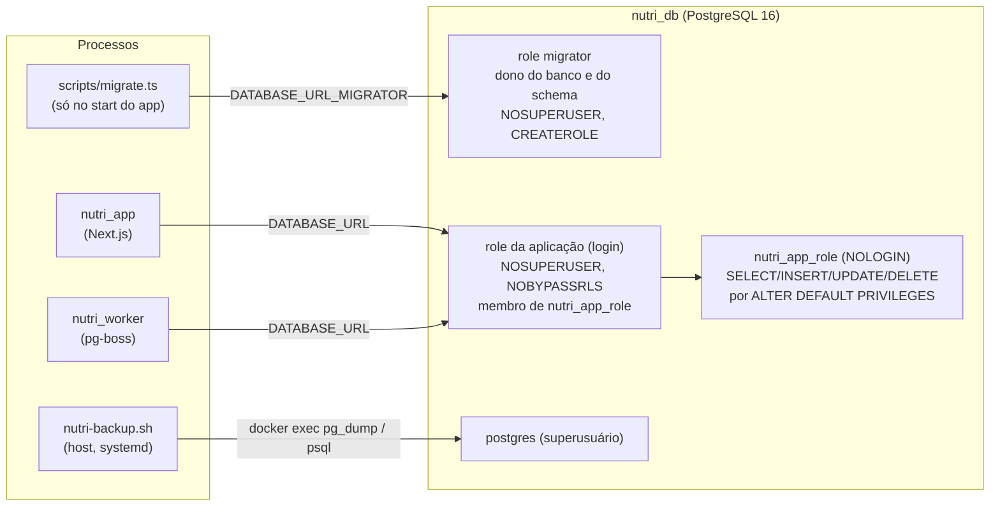
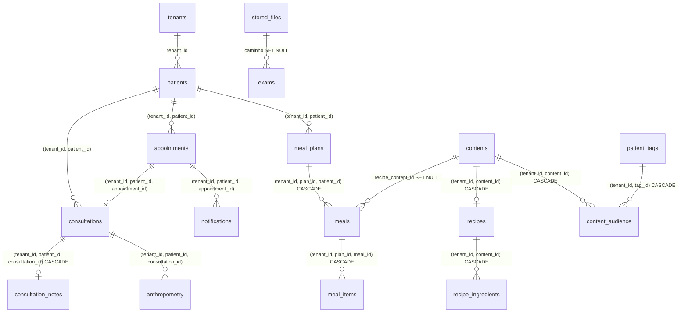
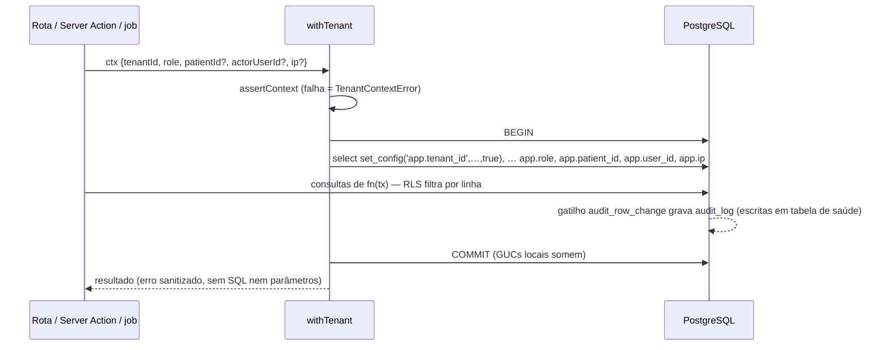
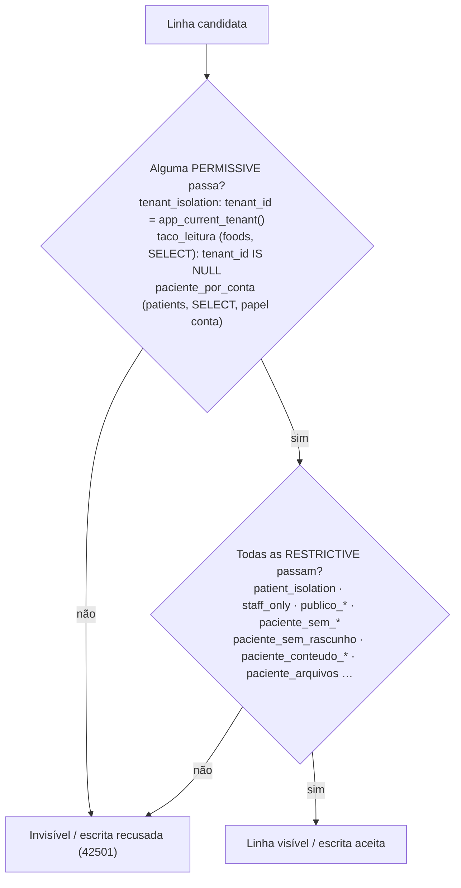
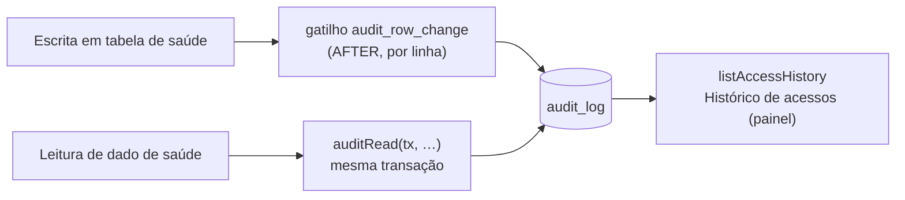
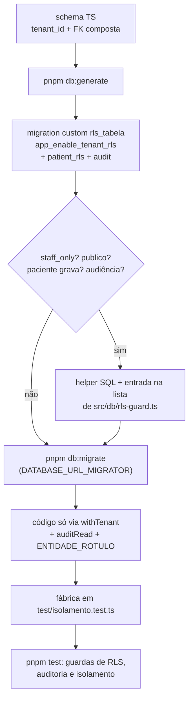

# 2. Banco de dados

Este capítulo descreve o banco do NutriDebby como ele está no código (migrations `0000`–`0125`, `drizzle/meta/_journal.json` com 126 entradas, conferidas no branch do Plano 14A em 09/10/2026, a `0110` (migration de dados do prazo de guarda, JUR-01) no mesmo dia as `0111`–`0112` (Plano 14B-1, modelos sugeridos pela IA) no branch `plano-14b-ia-nutri` em 10/10/2026 as `0113`–`0114` (Plano 14B-2, resumo e rascunho pela IA) no branch `plano-14b-2-resumo-rascunho` em 14/10/2026 as `0115`–`0117` (Plano 15, IA Nutri do paciente) no branch `plano-15-ia-nutri-paciente` em 15/10/2026 as `0118`–`0121` (Plano 17, lembretes de rotina, §2.5.11) no branch `plano-17-lembretes-rotina` em 17/11/2026, as `0122`–`0123` (Plano 20, Financeiro do consultório, §2.5.12) na `main` `6c3ee8f` (PR #53) e no branch `plano-20-financeiro` em `7a0e919`, em 17/11/2026, e as `0124`–`0125` (Plano 18, PR 2, `patient_cadastro`, §2.5.4) no branch local `plano-18-pr2` em 17/11/2026, na `main` desde o PR #56 (`07756c4`); as tabelas e funções dos documentos assinados, `0089`–`0093` e `0104`–`0105`, têm o detalhe no [cap. 9](09-documentos-assinados.md#93-banco), as da IA, `0098`–`0100`, `0107`–`0109` (Plano 14A) e `0111`–`0112` (Plano 14B-1, [§10.12.3](10-ia.md#10123-banco-d18-migrations-0111-e-0112)) `0113`–`0114` (Plano 14B-2, [§10.13.10](10-ia.md#101310-banco-migrations-0113-e-0114)) e `0115`–`0117` (Plano 15, [§10.14.9](10-ia.md#10149-banco-migrations-0115-0116-e-0117)), no [cap. 10](10-ia.md#104-banco), e as dos exames enviados, `0101`–`0102`, no [cap. 11](11-exames-enviados.md#113-banco); `0094`–`0097` são do Plano 09: `app_versao_do_schema()` e `admin_actions`; a `0103`, da sessão da equipe; a `0106`, do Plano 16). Ele explica os roles, as migrations, o catálogo de tabelas, o isolamento por RLS, a auditoria, as guardas de CI e o passo a passo para criar uma tabela nova sem abrir brecha.

Convenção de citação: `arquivo:linha` aponta para o código; "Plano NN, Dx" aponta para a tabela de decisões do plano em `docs/superpowers/plans/`; "spec §n" aponta para `docs/superpowers/specs/2026-09-27-nutridebby-mvp-design.md`.

---

## 2.1 Visão geral

| Item | Valor | Fonte |
|---|---|---|
| SGBD | PostgreSQL 16 (`postgres:16-alpine` em dev e nos testes) | `docker-compose.dev.yml`, `test/postgres-teste.ts:11` |
| Extensões | `citext`, `pg_trgm`, `unaccent`, `btree_gist` | `drizzle/0000_base_roles_e_rls.sql:1-7` |
| ORM | Drizzle (`drizzle-orm` 0.45.3) com `node-postgres` | `package.json`, `src/db/client.ts:1-2` |
| Schema TS | `src/db/schema/*.ts` (reexportado por `index.ts`) | `drizzle.config.ts:5`, `src/db/schema/index.ts` |
| Migrations | SQL em `drizzle/`, aplicadas pelo migrador do Drizzle | `src/db/migrate.ts:8-18` |
| Fila | pg-boss no schema `pgboss`, dono = role da aplicação | `src/db/migrate.ts:80-81` |
| Chave primária | `uuid` v4 (`gen_random_uuid()`) | Plano 01, "Desvios conscientes da spec" |
| Datas | sempre `timestamptz` (teste quebra com `timestamp` sem fuso) | `src/db/migrate.test.ts:36` |
| Isolamento | RLS **habilitada e forçada** em toda tabela com `tenant_id` | RNF-07; `drizzle/0000_base_roles_e_rls.sql:30-39` |



---

## 2.2 Roles e credenciais

### 2.2.1 Os roles

| Role | Atributos | Quem cria | Para quê | Fonte |
|---|---|---|---|---|
| Migrator (em produção `nutri_owner`) | `LOGIN NOSUPERUSER CREATEROLE NOCREATEDB NOBYPASSRLS`, dono do banco `nutri` | O dono do servidor, uma vez, como `postgres` | Rodar as migrations; dono de todas as tabelas e funções | Plano 01, Tarefa 13, Step 1b (Ruling R49) |
| `nutri_app_role` | `NOLOGIN NOSUPERUSER NOBYPASSRLS NOCREATEDB NOCREATEROLE` | Migration `0000` | Grupo que recebe os privilégios de tabela | `drizzle/0000_base_roles_e_rls.sql:9-19` |
| Role da aplicação (o usuário de `DATABASE_URL`; `nutri_app` em dev e nos testes) | `LOGIN NOSUPERUSER NOBYPASSRLS NOCREATEDB NOCREATEROLE` | `ensureAppLogin` em toda execução de migrations | Conexão do app e do worker | `src/db/migrate.ts:21-85` |
| `postgres` | Superusuário local do container | Imagem do Postgres | Só o script de backup no host (`pg_dump` dentro do container) e a criação do migrator | spec RNF-05; CLAUDE.md regra 10 |

Por que o migrator não é superusuário: o dono das tabelas também obedece à RLS forçada (`FORCE ROW LEVEL SECURITY`). Funções `SECURITY DEFINER` de um dono superusuário passariam por cima da RLS. O teste mensal de restauração recusa o backup se existir função `SECURITY DEFINER` de superusuário (`scripts/backup/nutri-restauracao-teste.sh:67`, `:86`).

Por que `CREATEROLE` basta: no PG 16 quem tem `CREATEROLE` só gerencia os roles que criou. O plano avisa que o passo não é seguro em PG < 16 (Plano 01, Tarefa 13, Step 1b, nota "Atenção"). As extensões da `0000` são *trusted* e o dono do banco pode criá-las (mesma nota).

### 2.2.2 Variáveis de ambiente

| Variável | Quem lê | Regra | Fonte |
|---|---|---|---|
| `DATABASE_URL` | app, worker, `admin:criar`, seed do E2E, migrations (para criar o login do app) | Obrigatória; `postgres://` | `src/env.ts:28-30`, `:281-285` |
| `DATABASE_URL_MIGRATOR` | **só** `scripts/migrate.ts` | Obrigatória para migrar; o usuário tem de ser **diferente** do de `DATABASE_URL` | `src/env.ts:281-298`, `:334-337` |

Isolamento da credencial do migrator (Plano 01, Ruling R37):

- `getEnv()` e `getServerEnv()` não expõem `DATABASE_URL_MIGRATOR` (`src/env.test.ts:40-41`).
- O `docker-entrypoint.sh` roda as migrations e sobe o Next com `env -u DATABASE_URL_MIGRATOR`; o worker e o `admin:criar` sobem sempre sem ela (`docker-entrypoint.sh:5-17`).
- O serviço `nutri_worker` nem tem a variável cadastrada no Easypanel (Plano 01, Tarefa 13, Step 1).

Nunca copie valores dessas variáveis para documentação, log ou chat. O `.env.example` traz só valores de desenvolvimento local.

### 2.2.3 Privilégios de tabela

A `0000` concede ao `nutri_app_role` `SELECT, INSERT, UPDATE, DELETE` em toda tabela futura do schema `public` por `ALTER DEFAULT PRIVILEGES` (`drizzle/0000_base_roles_e_rls.sql:17-19`). Esse comando vale só para objetos criados **pelo role que o executou**. Por isso toda migration roda com `DATABASE_URL_MIGRATOR` (CLAUDE.md regra 7): uma tabela criada por outro role nasce sem permissão para a aplicação.

Exceções (revogações explícitas):

| Tabela | Revogado do `nutri_app_role` | Motivo | Fonte |
|---|---|---|---|
| `audit_log` | `UPDATE`, `DELETE` | Append-only | `drizzle/0002_rls_plataforma.sql:3` |
| `consents` | `UPDATE`, `DELETE` | Prova de aceite append-only; única escrita posterior é `app_anonimizar_aceites` | `drizzle/0009_consents.sql:13` |
| `backup_runs` | `INSERT`, `UPDATE`, `DELETE` | Só o script do host grava; o app só lê | `drizzle/0014_backup_runs_somente_leitura.sql:2` |
| Banco (`TEMPORARY`) | revogado de `PUBLIC` | Tabela temporária fica fora da RLS e já foi vetor de desvio de `search_path` (T4-R2a, M5) | `src/db/migrate.ts:59-75` |

### 2.2.4 O que `ensureAppLogin` faz em cada deploy

`runMigrations` aplica o SQL e depois chama `ensureAppLogin` (`src/db/migrate.ts:8-18`):

1. Valida o nome do role de `DATABASE_URL` (`^[a-z_][a-z0-9_]{2,62}$`) e exige senha (`:25-26`).
2. Cria o role com `NOSUPERUSER NOBYPASSRLS NOCREATEDB NOCREATEROLE`, ou só sincroniza login e senha quando o migrator não é superusuário (`:33-47`).
3. Para com erro se o role tiver `SUPERUSER`, `BYPASSRLS`, `CREATEDB` ou `CREATEROLE` (`:48-55`).
4. `GRANT nutri_app_role` e `GRANT CONNECT` no banco (`:56-58`).
5. `REVOKE TEMPORARY ... FROM PUBLIC` e confere o efeito; se o migrator não for dono do banco, para com mensagem clara (G6, `:59-75`).
6. `GRANT <app> TO CURRENT_USER WITH SET TRUE, INHERIT FALSE` (necessário no PG 16 para o próximo passo, `:76-79`).
7. `CREATE SCHEMA IF NOT EXISTS pgboss AUTHORIZATION <app>` (`:80-81`).

Consequência operacional: a senha do role da aplicação volta sozinha a cada start do app (ela vem de `DATABASE_URL`). A do migrator não; numa restauração de desastre o dono a redefine com `\password` (`docs/operacao/restauracao.md`, passos 3-4).

---

## 2.3 Rodar as migrations

| Ambiente | Comando | Quem é o migrator | Fonte |
|---|---|---|---|
| Dev | `docker compose -f docker-compose.dev.yml up -d` e `pnpm db:migrate` | `nutri_owner` do compose (superusuário do container de dev) | `package.json` (`db:migrate`), `docker-compose.dev.yml` |
| Testes (Vitest) | automático no `globalSetup` | superusuário do Testcontainers | `test/global-setup.ts:9-22` |
| Teste do migrator sem superusuário | `src/db/migrate-owner.test.ts` (cluster próprio montado como o runbook) | role com `CREATEROLE`, dono do banco | `src/db/migrate-owner.test.ts:41-127` |
| CI (E2E) | `pnpm db:migrate` antes do `e2e:seed` | — | `.github/workflows/ci.yml:168` |
| Produção | automático: `docker-entrypoint.sh` roda `scripts/migrate.ts` antes do `next start` | `nutri_owner` | `docker-entrypoint.sh:8-10` |

`pnpm db:migrate` = `tsx --env-file-if-exists=.env.local scripts/migrate.ts`. O script lê `getMigratorEnv()` e chama `runMigrations({ migratorUrl, appUrl })` com um pool de 1 conexão (`scripts/migrate.ts:1-5`, `src/db/migrate.ts:8-18`). Rodar de novo é seguro (`src/db/migrate.test.ts:67`).

Regras de operação:

- Deploy = merge na `main` (CLAUDE.md regra 6). O start do `nutri_app` aplica as migrations pendentes. Uma migration com erro derruba o start do app.
- Nunca aponte ferramentas de banco (inclusive o MCP `postgres-dev`) para produção (CLAUDE.md regra 5).
- Mudança em banco de produção, inclusive manual, só com confirmação do dono (CLAUDE.md regra 6).

---

## 2.4 Criar migrations

### 2.4.1 Migration gerada pelo schema

1. Altere o schema em `src/db/schema/<módulo>.ts`.
2. `pnpm db:generate` (`drizzle-kit generate`, `package.json`). O `drizzle-kit` compara o schema TS com o último snapshot em `drizzle/meta/` e escreve o SQL.
3. Revise o SQL gerado. Acrescente um comentário no topo quando houver decisão (ver `drizzle/0066_link_online_e_fk_pedido.sql:1-7`).

### 2.4.2 Migration custom (RLS, funções, dados)

`pnpm drizzle-kit generate --custom --name <nome>` cria um arquivo vazio na sequência (CLAUDE.md regra 2; `seeds/fontes/LEIA-ME.md`). Use para:

- Instalar RLS e auditoria (`rls_<tabela>`): ver §2.11.
- Políticas fora dos helpers, funções SQL, gatilhos.
- Restrições que o Drizzle não sabe gerar. Hoje ficam **só no SQL** (o schema TS não as declara):

| Restrição | Por que fora do schema TS | Fonte |
|---|---|---|
| `appointments_sem_sobreposicao` (`EXCLUDE USING gist`) | Drizzle não tem `tstzrange` | `drizzle/0051_rls_consultas.sql:80-84` |
| `consultations_consulta_fk` | Import circular entre arquivos de schema | `drizzle/0064_fk_atendimento_consulta.sql:1-6` |
| `stored_files_paciente_fk` | `platform.ts` não importa `patients` (ciclo) | `drizzle/0072_rls_stored_files_paciente.sql:1-4` |
| `meals_receita_fk` (`ON DELETE SET NULL (recipe_content_id)`) | Drizzle não gera a lista de colunas do `SET NULL` | `drizzle/0082_rls_conteudos.sql:30-33` |
| `foods_busca_idx` (GIN sobre `app_unaccent(lower(nome))`) | Índice sobre função própria | `drizzle/0040_rls_alimentos.sql:5` |

### 2.4.3 Migration de dados

- Em tabela com RLS forçada, o próprio dono só enxerga linhas com contexto. Entre num tenant por vez com `set_config('app.tenant_id', …, true)` e `set_config('app.role', 'worker', true)`, e zere no fim. Exemplo: `drizzle/0072_rls_stored_files_paciente.sql:6-22`.
- Em tabela auditada: o mesmo `set_config` por tenant, ou `DISABLE TRIGGER audit_row_change` só dentro da própria migration (CLAUDE.md regra 8). Exemplo com o gatilho ligado (cada linha alterada vira um "alterar" de ator nulo no `audit_log`): `drizzle/0110_prazo_guarda_bloqueio.sql` (JUR-01), que só aumenta `anonimizar_apos` (`GREATEST`) e é testada com o migrator sem superusuário em `src/db/migrate-owner.test.ts`.
- Linhas sem tenant (TACO em `foods`): o gerador das medidas desliga o `FORCE` só durante os `UPDATE` e religa no fim (`src/modules/alimentos/medidas.ts:33-55`, `drizzle/0042_seed_medidas_ibge.sql`).
- Dados em `tenants` (sem RLS nem auditoria) podem ser alterados direto (ex.: `UPDATE "tenants" SET "agendamento_publico_ativo" = false`, `drizzle/0067_exclusao_e_pagina_publica_desligada.sql:8`).
- Uma migration que pode falhar com dado inesperado deve falhar e deixar o dono decidir, não apagar nada (`drizzle/0072_rls_stored_files_paciente.sql:24-26`).

---

## 2.5 Catálogo de tabelas

São 69 tabelas em `public`: 53 com `tenant_id` sob RLS, 4 com `tenant_id` fora da RLS (`RLS_EXCEPTIONS`) e 12 sem `tenant_id` (Plano 10A: mais 4 sob RLS e `document_verifications` fora dela; Plano 09: `admin_actions`; Plano 11: `ia_tarefas` e `ia_uso` sob RLS e `ia_gasto_plataforma` sem `tenant_id`; Plano 12: `exam_submissions` e `exam_submission_files` sob RLS, com a proteção no [§11.3](11-exames-enviados.md#113-banco); Plano 14A: `ia_autorizacoes` sob RLS; Plano 14B-1: `ia_geracoes_modelos` sob RLS; Plano 15: `ia_nutri_participacoes`, `ia_nutri_mensagens` e `ia_nutri_consentimentos` sob RLS e `ia_nutri_pausa` sem `tenant_id`; Plano 17: `lembretes_rotina` e `lembretes_rotina_envios` sob RLS; Plano 18 (PR 2): `patient_cadastro` sob RLS, §2.5.4; Plano 20: `fin_configuracoes`, `fin_categorias` e `fin_lancamentos` sob RLS, as três `staff_only`). Contagem conferida nos `pgTable(` de `src/db/schema/*.ts` (17/11/2026, depois do PR 2 do Plano 18 e do Plano 20).

Legenda da coluna "Proteção":
**T** `tenant_isolation` · **P** `patient_isolation` · **S** `staff_only` · **Pub** comandos liberados ao contexto `publico` · **PE** comandos que a sessão de paciente grava · **A** gatilho de auditoria (entidade) · **X** política própria (ver §2.6.5).

### 2.5.1 Matriz de proteção (tabelas com `tenant_id` sob RLS)

| Tabela | Proteção | Migration da RLS |
|---|---|---|
| `audit_log` | T, P, Pub `insert`, PE `insert`, X `paciente_sem_leitura` | 0002, 0007, 0051, 0070, 0085 |
| `stored_files` | T, PE `insert`, X `paciente_arquivos`, `paciente_arquivo_insert` | 0011, 0072, 0080, 0085, 0090 (`paciente_arquivos` sem `documento_base` e `documento_digitalizado`) |
| `patients` | T, P (coluna `id`), Pub `select`/`insert`, PE `update`, A `patients`, X `paciente_por_conta`, gatilhos `paciente_colunas` (desde a 0119, também a pausa dos lembretes em `livres`), `patients_ia_quem` (desde a 0109, a ciência e a recusa de IA do Plano 11 congeladas para qualquer sessão do app, RN-128) e `patients_lembretes_do_paciente` (Plano 17: `lembretes_pausados_em` só pela sessão de paciente, pelo worker ou na ida a `bloqueado`) | 0017, 0051, 0070, 0073, 0085, 0099, 0100, 0109, 0119 |
| `patient_tags` | T, S | 0020 |
| `patient_tag_links` | T, P, S, A `etiquetas` | 0020 |
| `consultations` | T, P, A `atendimentos` | 0028 |
| `consultation_notes` | T, P, S, A `notas_privadas` | 0028 |
| `anthropometry` | T, P, A `antropometria` | 0022 |
| `energy_calcs` | T, P, A `gasto_energetico` | 0024 |
| `anamnesis_templates` | T, gatilho `anamnesis_templates_ia_origem` (`app_modelo_ia_origem`, Plano 14B-1: origem IA só pelo `worker`, aprovação uma vez e pela usuária da sessão) | 0026, 0112 |
| `anamneses` | T, P, A `anamnese` | 0026 |
| `exams` | T, P, A `exames`; UNIQUE (`tenant_id`, `patient_id`, `id`), alvo da FK de `ia_tarefas` | 0030, 0098 |
| `privacy_requests` | T, P, PE `insert`, A `pedidos_titular` | 0033, 0079 |
| `data_exports` | T, P, PE `insert`/`update`, A `exportacoes`, X `paciente_exportacao_titular`, gatilho `paciente_colunas` | 0035, 0079, 0080, 0085 |
| `foods` | T, X `taco_leitura` | 0040 |
| `food_measures` | T | 0043 |
| `meal_plans` | T, P, A `plano_alimentar`, X `paciente_sem_rascunho`, gatilho `meal_plans_ia_origem` (`app_modelo_ia_origem`, Plano 14B-1); Plano 14B-2: o "Usar como rascunho" grava pelo gatilho de sempre, com `ia_origem_em` | 0045, 0112 |
| `meals` | T, P, A `plano_alimentar`, X `paciente_sem_rascunho` | 0045 |
| `meal_items` | T, P, A `plano_alimentar`, X `paciente_sem_rascunho` | 0045 |
| `availability_rules` | T, S, Pub `select` | 0049, 0051 |
| `availability_blocks` | T, S, Pub `select` | 0049, 0051 |
| `appointments` | T, P, Pub `select`/`insert`, PE `insert`/`update`, A `agenda` | 0051, 0070 |
| `notifications` | T, P, Pub `select`/`insert`, PE `insert`/`update` (sem auditoria) | 0053, 0070 |
| `public_booking_requests` | T, S, Pub `select`/`insert`/`update` | 0056 |
| `whatsapp_conexoes` | T, S | 0058 |
| `push_subscriptions` | T, P, PE `insert`/`delete` (sem auditoria) | 0061, 0075 |
| `access_events` | T, P, PE `insert` (sem auditoria) | 0075 |
| `diary_entries` | T, P, PE `insert`, A `diario`, X `paciente_diario_insert` | 0077, 0080 (a `0106` e a `0121` só acrescentam colunas) |
| `contents` | T, X `paciente_conteudo_visivel` | 0082, 0083 |
| `recipes` | T, X `paciente_conteudo_visivel` | 0082, 0083 |
| `recipe_ingredients` | T, X `paciente_conteudo_visivel` | 0082, 0083 |
| `content_audience` | T, P, A `conteudos` | 0082 |
| `content_views` | T, P, PE `insert` (sem auditoria), X `paciente_conteudo_visto` | 0082, 0083 |
| `content_favorites` | T, P, PE `insert`/`delete` (sem auditoria), X `paciente_conteudo_favorito` | 0082, 0083 |
| `signed_documents` | T, P, A `documentos`, X `paciente_so_emitidos`, gatilhos `documento_imutavel` e `documento_versao` | 0090, 0091, 0093, 0105 |
| `signed_document_notes` | T, P, S, A `documentos`, gatilho `notas_imutaveis` | 0090, 0091, 0105 |
| `signed_document_receipts` | T, P, PE `insert`, A `documentos`, X `paciente_recibo_proprio`, `recibo_fora_do_paciente`; `REVOKE UPDATE, DELETE` | 0090, 0092 |
| `document_access_codes` | T, P, PE `insert`/`update` (sem auditoria), X `paciente_codigo_de_assinado`, gatilho `codigo_acesso_regras` | 0090, 0091, 0092 |
| `ia_tarefas` | T, P, S, A `ia`, gatilhos `ia_tarefas_sem_apagar` (DELETE só do `worker` com o paciente anonimizado) e `ia_tarefas_imutavel` (colunas fixas; Plano 14B-2: `carimbo_dados` fixo, salvo a troca do `worker` no portão) | 0099, 0100, 0114 |
| `ia_uso` | T, S (sem `patient_id`, fora da auditoria); `REVOKE DELETE, TRUNCATE` | 0099 |
| `ia_geracoes_modelos` (Plano 14B-1) | T, S (sem `patient_id`, fora da auditoria); `REVOKE DELETE, TRUNCATE`; gatilho `ia_geracoes_modelos_imutavel` (colunas fixas); índice único parcial de um pacote em andamento por tenant | 0112 |
| `ia_autorizacoes` (Plano 14A) | T, P, PE `insert` (sem auditoria, `AUDIT_EXCEPTIONS`), X `paciente_autorizacao_propria` (RESTRICTIVE, só a própria autorização ou retirada, no app com a própria conta ou no link sem conta); `REVOKE UPDATE, DELETE, TRUNCATE`; gatilho `ia_autorizacoes_regras` | 0108 |
| `ia_nutri_participacoes` (Plano 15) | T, P, A `ia_nutri_liberacao` | 0116 |
| `ia_nutri_mensagens` (Plano 15) | T, P, PE `update` (`avaliacao` e `encaminhada_em`; INSERT só pelas funções da 0117), A `ia_nutri`; gatilhos `ia_nutri_mensagens_regras` (colunas por papel; a `nutri` só abre e resolve, e `responde_a` → nulo só pela ação referencial da FK) e `ia_nutri_mensagens_sem_apagar` (DELETE do `worker` só com a mensagem vencida, o titular bloqueado ou anonimizado ou o marcador da revogação; da `nutri` só a pergunta com risco de quem revogou, depois de aberta); FK composta `responde_a` `ON DELETE SET NULL (responde_a)`; índice único parcial de uma pergunta em andamento por paciente | 0115, 0116 |
| `ia_nutri_consentimentos` (Plano 15) | T, P, PE `insert` (sem auditoria, `AUDIT_EXCEPTIONS`), X `paciente_consentimento_proprio` (RESTRICTIVE, só o próprio aceite, canal `app`, com a própria conta); `REVOKE UPDATE, DELETE, TRUNCATE`; gatilho `ia_nutri_consentimentos_regras` (relógio do banco; revogação só com o marcador de `app_ia_nutri_revogar`) | 0116 |
| `lembretes_rotina` (Plano 17) | T, P, PE `update` (só `desligado_pelo_paciente_em`), A `lembretes`; gatilhos `lembretes_rotina_regras` (colunas fixas; o paciente com conta só a própria marca, com o relógio do banco, e o `updated_at` vai ao `now()`; o paciente sem conta nada; a `nutri` nunca a marca e só cria com `criado_por` = a usuária da sessão) e `lembretes_rotina_sem_apagar` (a equipe não apaga o que o paciente desligou, salvo com o titular `bloqueado`) | 0119, 0120, 0129 |
| `lembretes_rotina_envios` (Plano 17) | T, P, S (sem auditoria, `AUDIT_EXCEPTIONS`); gatilhos `lembretes_rotina_envios_do_worker` (INSERT e UPDATE que muda algo só pelo `worker` e pelo contexto vazio; tenant, paciente e lembrete fixos) e `lembretes_rotina_envios_sem_apagar` (DELETE só pelo `worker`, pelo contexto vazio e pela cascata do lembrete, `pg_trigger_depth() > 1`); FK para o lembrete `ON DELETE CASCADE` | 0119, 0129 |
| `patient_cadastro` (Plano 18) | T, P, A `patients` (como `patients`: o "Alterou" do Histórico, `entidade_id` = id da linha), X `patient_cadastro_paciente_com_conta` (RESTRICTIVE, `FOR ALL`: a sessão de paciente sem login — `semConta` — não lê nem grava nem a própria linha); sem `S`, `Pub` e `PE` (o titular com login só **lê** a própria linha); `REVOKE TRUNCATE`; gatilhos `patient_cadastro_colunas_fixas` (`id`, `tenant_id`, `patient_id` fixos, 42501), `patient_cadastro_sem_apagar` (DELETE só do `worker` com o titular já anonimizado) e `patient_cadastro_titular_ativo` (INSERT/UPDATE recusado com o titular anonimizado, para qualquer papel) | 0125 (tabela na 0124) |
| `fin_configuracoes` (Plano 20) | T, S (sem `patient_id`, sem gatilho; o módulo grava `recordAudit` de `financeiro_configuracoes`); `REVOKE DELETE, TRUNCATE` | 0123 |
| `fin_categorias` (Plano 20) | T, S; gatilho `fin_categorias_fixas` (`tipo` e `chave` fixos; "Consultas" nunca apagada) | 0123 |
| `fin_lancamentos` (Plano 20) | T, P, S, A `financeiro`; `REVOKE DELETE, TRUNCATE`; gatilho `fin_lancamentos_regras` (contexto vazio e `worker` recusados — o `worker` só no ramo da anonimização —, os outros papéis caem na RLS sem ler `patients`; na sessão `nutri`, autoria e cancelamento pelo banco, colunas fixas, paciente `FOR KEY SHARE`, bloqueado só receber/desfazer/reduzir/cancelar, cancelado e anonimizado imutáveis); índice único parcial de uma cobrança ativa por consulta | 0123 |

Toda tabela da matriz tem também `publico_negado` (ou `publico_sem_<cmd>` nos comandos não liberados) e `paciente_sem_<cmd>` nos comandos de escrita não liberados (§2.6.4).

### 2.5.2 Convenção das chaves: FK composta pelo tenant

Toda tabela filha liga-se à mãe por FK **composta** que inclui `tenant_id` (Plano 03, decisão "Vínculo das tabelas filhas"). A mãe expõe um `UNIQUE (tenant_id, id)` (ex.: `patients_tenant_id_unique`, `drizzle/0016_pacientes.sql:21`). Efeito: o banco recusa uma linha do tenant A apontando para paciente do tenant B, e a FK vale mesmo sem passar pela RLS. Quando a filha também guarda `patient_id`, a FK para a mãe intermediária usa a tripla `(tenant_id, patient_id, id)`, para que uma nota nunca aponte para o atendimento de outro paciente (`consultation_notes_atendimento_fk`, `drizzle/0027_atendimentos.sql:27`).

Paciente nunca é apagado (arquiva, bloqueia, anonimiza): as FKs para `patients` são `NO ACTION` (Plano 03, mesma decisão).



### 2.5.3 Plataforma e autenticação (`platform.ts`, `auth.ts`, `access.ts`)

| Tabela | Colunas principais | Chaves e restrições | Fonte |
|---|---|---|---|
| `tenants` | `slug`, `nome_exibicao`, `status` (`ativa`/`suspensa`), `fuso` (padrão `America/Sao_Paulo`), `crn`, `logo_path`, `cor_primaria`, `wa_cota_mensal` (500), `antecedencia_min_h` (12), `cancelamento_min_h` (24), `endereco_consultorio`, `link_online_padrao`, `agendamento_publico_ativo` (padrão `false` desde a 0067), `mostrar_perc_gordura_paciente`, `armazenamento_bytes`, `dpa_aceito_em`, `dpa_versao`, `taxa_faltas_base`, `go_live_em`; Plano 10A: `nome_profissional`, `contato_email`, `contato_telefone_e164`, `fitoterapia_registro`, `fitoterapia_declarada_em`, `fitoterapia_termo_versao`, `documentos_liberados` (padrão `false`); Plano 11: `ia_liberada` (padrão `false`), `ia_ativada_em`, `ia_aditivo_versao`, `ia_cota_mensal_usd` (`numeric(7,2)`, padrão 15), `ia_aviso_mes` | `slug` UNIQUE e regex `^[a-z0-9-]{3,40}$`; CHECKs de faixa (0–72 h, cota ≥ 0, bytes ≥ 0, cor `#rrggbb`, taxa 0–100); Plano 10A: nome profissional 5–120, registro da Fitoterapia 1–60, registro/data/termo juntos ou nulos; Plano 11: `tenants_ia_cota_valida` (0–1000) e o gatilho `tenants_interruptores_da_admin` — `ia_liberada`, `ia_cota_mensal_usd` e `documentos_liberados` só mudam **fora** de `withTenant` (com `app.role` definido, 42501); `tenants` não tem RLS, então sem o gatilho qualquer contexto poderia ligá-los | 0001, 0008, 0067, 0086, 0089, 0098, 0100 |
| `audit_log` | `tenant_id`, `actor_user_id`, `acao`, `entidade`, `entidade_id`, `patient_id`, `ip`, `criado_em` | CHECK `acao` em (`ler`,`criar`,`alterar`,`excluir`,`exportar`,`bloquear`,`anonimizar`); índices (`tenant_id`,`entidade`,`entidade_id`,`criado_em`) e (`tenant_id`,`patient_id`,`criado_em`) | 0001, 0006 |
| `system_heartbeat` | `name` (PK), `beat_at` | Batimento do worker lido pelo `/api/health` | 0001; `src/worker/heartbeat.ts` |
| `stored_files` | `tenant_id`, `patient_id` (nulo = arquivo do consultório), `tipo`, `caminho`, `bytes`, `mime`, `criado_por` | `caminho` UNIQUE; `bytes > 0`; `tipo` em (`logo`,`capa`,`exame`,`plano_pdf`,`diario_foto`,`diario_foto_original`,`orientacao_pdf`,`exportacao`,`documento_base`,`documento_assinado`,`documento_digitalizado`; os três últimos desde a 0089; `exame_original` e `exame_pagina` do Plano 12; `ia_autorizacao_termo` desde a 0107, o termo em papel da autorização de IA); CHECK `stored_files_dono` (`logo`/`capa`/`orientacao_pdf` ⇔ `patient_id` nulo); FK (`tenant_id`,`patient_id`) → `patients` | 0010, 0071, 0072 |
| `backup_runs` | `tipo` (`banco`/`arquivos`), `ok`, `bytes`, `detalhe`, `iniciado_em`, `concluido_em` | índice (`tipo`,`concluido_em`) | 0013 |
| `admin_actions` (Plano 09) | `admin_user_id` (nulo na CLI), `acao` (`reiniciar_2fa`, `codigo_2fa_recusado`; Plano 11: `liberar_ia`, `bloquear_ia`, `ajustar_cota_ia`), `alvo_user_id`, `alvo_papel`, `alvo_tenant_id` (Plano 11), `origem` (`admin`/`cli`), `criado_em` | Só inclusão para a aplicação (`REVOKE UPDATE, DELETE, TRUNCATE`, 0096); CHECK `admin_actions_alvo_coerente` (0098): o 2FA exige usuário-alvo, as ações de IA exigem `alvo_tenant_id` e usuário e papel nulos, `codigo_2fa_recusado` fica sem alvo. Escrita por `plataforma/reiniciar-2fa.ts`, `contas.ts` (`definirIaLiberada`) e `metricas.ts` (`ajustarCotaIa`); o valor da cota vai só para o log | 0095–0098 |
| `user` | `name`, `email` (citext), `email_verified`, `two_factor_enabled`, `app_role` (`admin`/`nutri`/`paciente`), `tenant_id` (nutri), `tema` (`sistema`/`claro`/`escuro`), `guia` (jsonb) | `email` UNIQUE; FK `tenant_id` → `tenants` | 0003, 0004, 0088 |
| `session`, `account`, `verification`, `two_factor`, `rate_limit` | Tabelas do Better Auth | FKs `user_id` → `user` `ON DELETE CASCADE` | 0003, 0004 |
| `invites` | `user_id` (nutri), `tenant_id` e `patient_id` (paciente), `tipo` (`nutri`/`paciente`), `token_hash`, `expira_em`, `usado_em` | `token_hash` UNIQUE; CHECK `invites_alvo`; um pendente por usuário e por paciente (índices únicos parciais); FK (`tenant_id`,`patient_id`) → `patients` `CASCADE` | 0008, 0018 |
| `consents` | `user_id` (nulo no aceite da página pública), `tenant_id`, `patient_id`, `termo_versao` (desde o Plano 11 também `ia-aditivo-<versão>`, o aditivo de IA da nutricionista, com o `tenant_id` do consultório), `aceito_em`, `ip` | CHECK `consents_titular` (conta ou paciente); `UNIQUE NULLS NOT DISTINCT (user_id, termo_versao, tenant_id, patient_id)`; FK (`tenant_id`,`patient_id`) → `patients` | 0009, 0018, 0055 |

Decisões: tabelas do Better Auth no lugar de `users` (Plano 01, "Desvios conscientes"); `tema`/`guia` como colunas de `user` (Plano 08, D17); aceite por vínculo em `consents` (Plano 03, "Prova do aceite por vínculo"; Plano 05, D13).

### 2.5.4 Prontuário (`pacientes.ts`)

| Tabela | Colunas principais | Chaves e restrições | Fonte |
|---|---|---|---|
| `patients` | `user_id` (nulo até aceitar o convite), `nome`, `data_nascimento`, `sexo` (`F`/`M`), `telefone_e164`, `email` (citext), `origem` (`nutri`/`agendamento_publico`), `whatsapp_optin_em`, `whatsapp_optin_origem`, `whatsapp_optout_em`, `status` (`ativo`/`arquivado`/`bloqueado`), `bloqueado_em`, `anonimizar_apos`, `anonimizado_em`; Plano 11: `ia_recusada_em`, `ia_aviso_versao`, `ia_aviso_em`, `ia_aviso_canal` (`email`/`em_maos`/`portal`), `ia_aviso_enviado_em` (CHECKs `patients_ia_aviso_junto`, `_canal_valido`, `_versao_tamanho`, 0098; congeladas desde a 0109, Plano 14A: nenhuma sessão do app as grava); Plano 16: `peso_oculto_no_app_em`; Plano 17: `lembretes_pausados_em` ("Pausar todos os lembretes", §2.5.11) | UNIQUE (`tenant_id`,`email`) e (`tenant_id`,`id`); índice único parcial (`tenant_id`,`user_id`); CHECK telefone E.164; nascimento e sexo obrigatórios salvo página pública ou anonimizado; FK `user_id` → `user` `SET NULL` | 0016, 0071, 0106, 0118 |
| `patient_tags` | `nome` (citext, 1–40) | UNIQUE (`tenant_id`,`nome`) e (`tenant_id`,`id`) | 0019 |
| `patient_tag_links` | `patient_id`, `tag_id` | UNIQUE (`patient_id`,`tag_id`); FK etiqueta `CASCADE` | 0019 |
| `consultations` | `patient_id`, `data`, `orientacoes_paciente` (≤ 5000), `appointment_id` | UNIQUE (`tenant_id`,`patient_id`,`id`); índice único parcial por `appointment_id` (um atendimento por consulta) | 0027, 0063, 0064 |
| `consultation_notes` | `consultation_id` (UNIQUE), `texto` (1–20000) | FK tripla → `consultations` `CASCADE` | 0027 |
| `anthropometry` | `data`, `peso_kg`, `altura_cm`, `imc` (GENERATED STORED), `circunferencias`, `dobras_mm`, `protocolo` (`jp3`/`jp7`/`nenhum`), `densidade`, `perc_gordura`, `consultation_id` | peso 1–400, altura 30–250 | 0021, 0027 |
| `energy_calcs` | `formula` (`harris_benedict`/`mifflin`/`fao_oms`), `peso_kg`, `altura_cm`, `idade` (≥ 18), `sexo`, `fator_atividade` (1,00–2,50), `tmb`, `get` | — | 0023 |
| `anamnesis_templates` | `nome` (1–80), `schema` (jsonb), `padrao`, `arquivado_em`; Plano 14B-1: `ia_geracao_id` (origem IA), `aprovado_em`, `aprovado_por` | UNIQUE (`tenant_id`,`id`); um `padrao` por tenant; FK (`tenant_id`,`ia_geracao_id`) → `ia_geracoes_modelos` (na `0112`); CHECKs `anamnesis_templates_aprovacao_coerente` e `_padrao_aprovado` (o padrão nunca é sugestão sem aprovação) | 0025, 0111 |
| `anamneses` | `template_id`, `template_snapshot`, `respostas`, `data` | FK (`tenant_id`,`template_id`) → modelos | 0025 |
| `exams` | `data`, `titulo` (1–120), `arquivo_path`, `valores` (jsonb; desde o Plano 11 cada linha pode ter `iaTarefaId`, a origem da sugestão da IA) | `arquivo_path` do próprio tenant; FK → `stored_files.caminho` `SET NULL`; UNIQUE `exams_tenant_paciente_id_unique` (0098) | 0029, 0031, 0098 |
| `privacy_requests` | `tipo` (`exportacao`/`exclusao`), `status` (`aberto`/`concluido`), `prazo`, `concluido_em` | um `aberto` por (`tenant_id`,`patient_id`,`tipo`) | 0032, 0078 |
| `data_exports` | `status` (`pendente`/`pronta`/`falhou`/`expirada`), `arquivo_path`, `expira_em`, `solicitado_por` (sem FK desde a 0037), `escopo` (`equipe`/`titular`) | caminho em `<tenant>/exportacao/`; FK → `stored_files.caminho` `SET NULL` | 0034, 0036, 0037, 0071 |
| `patient_cadastro` (Plano 18, D1) | `patient_id`, `cpf` (só os 11 dígitos), `nome_social`, `identidade_genero`, `estado_civil`, `escolaridade`, `ocupacao`, `nacionalidade`, `naturalidade`, `telefone_fixo_e164`, `cep` (8 dígitos), `logradouro`, `numero`, `complemento`, `bairro`, `cidade`, `uf`, `observacao`, `created_at`, `updated_at` | UNIQUE `patient_cadastro_paciente_unique` (`tenant_id`,`patient_id`: uma linha por paciente, alvo do *upsert*); índice único parcial `patient_cadastro_cpf_unico` (`tenant_id`,`cpf`) `WHERE cpf IS NOT NULL` (a última defesa: a repetição é conferida antes, sob trava, [§4.2.11](04-modulos-clinicos.md#4211-cadastro-complementar-lista-e-no-app-do-paciente-plano-18-pr-2)); um CHECK por coluna (regex do CPF, do CEP e do E.164, tamanhos, listas fechadas de identidade, estado civil, escolaridade e UF) — `validarCadastro` confere as mesmas regras antes de gravar, porque o 23514 levaria a linha inteira ao log do Postgres; FK (`tenant_id`,`patient_id`) → `patients` `NO ACTION` | 0124, 0125 |

Notas privadas e etiquetas são tabelas próprias com `staff_only`, porque uma coluna em `consultations` não teria como ser escondida da sessão de paciente (Plano 03, decisão "Notas privadas e etiquetas").

`patient_cadastro` (Plano 18, D1) é a tabela filha do cadastro complementar (Res. CFN 594/2017): nome, nascimento, sexo,
e-mail e celular continuam em `patients`. Ficou fora de `patients` porque `patients` tem `select` liberado ao contexto
`publico` e é lida pela sessão de paciente sem login (convite, link da consulta, WhatsApp, contexto da IA Nutri); a RLS
não esconde coluna (§2.6.3), então CPF, endereço e observação só ficam longe desses caminhos numa tabela própria, com a
política `patient_cadastro_paciente_com_conta`. A linha nasce no primeiro "Salvar" com algum campo preenchido, na mesma
transação de `patients`; esvaziar tudo grava nulo (o DELETE é só da anonimização). Sem `staff_only`: é dado do titular
(D3), que o paciente com login lê.

### 2.5.5 Alimentos e plano alimentar (`alimentos.ts`, `plano-alimentar.ts`)

| Tabela | Colunas principais | Chaves e restrições | Fonte |
|---|---|---|---|
| `foods` | `tenant_id` (**nulo = TACO**), `taco_id`, `nome` (2–120), `grupo`, `kcal`, `proteina_g`, `carboidrato_g`, `lipidio_g`, `fibra_g`, `micros`, `medidas_caseiras`, `origem_food_id` (sem FK) | `taco_id` UNIQUE; CHECK `foods_origem_valida` (`tenant_id` nulo ⇔ `taco_id` presente); alimento próprio completo; faixas | 0038, 0040 |
| `food_measures` | `food_id`, `nome`, `plural`, `gramas` (0,1–5000) | UNIQUE (`tenant_id`,`food_id`,`nome`); FK `food_id` `CASCADE` | 0041 |
| `meal_plans` | `patient_id` (nulo = modelo), `is_template`, `titulo`, `meta_kcal`, `energy_calc_id` (sem FK), `status` (`rascunho`/`publicado`/`arquivado`), `versao`, `revisao`, `ultimo_envio`, `publicado_em`, `origem_plan_id`, `mostrar_calorias`, `orientacoes`, `pdf_path`, `pdf_status`, `pdf_pedido_em`; Plano 14B-1: `ia_geracao_id` (origem IA, só em modelo), `aprovado_em`, `aprovado_por`; Plano 14B-2: `ia_origem_em` (o plano do paciente nasceu do rascunho da IA: marca no editor e selo no PDF e no app; "Editar" copia) | UNIQUE (`tenant_id`,`id`) e (`tenant_id`,`id`,`patient_id`); um publicado e um rascunho por paciente (índices parciais); modelo ⇔ sem paciente e sempre rascunho; FK `meal_plans_ia_geracao_fk` (`tenant_id`,`ia_geracao_id`); CHECKs `meal_plans_ia_geracao_so_modelo` e `_aprovacao_coerente`; Plano 14B-2: CHECK `meal_plans_ia_origem_so_paciente` (`ia_origem_em` nunca em modelo) | 0044, 0046, 0047, 0111, 0113 |
| `meals` | `plan_id`, `patient_id`, `nome`, `horario`, `ordem`, `observacao`, `recipe_content_id` | UNIQUE (`tenant_id`,`plan_id`,`id`); FKs para o plano `CASCADE`; `meals_receita_fk` `SET NULL (recipe_content_id)` | 0044, 0081, 0082 |
| `meal_items` | `plan_id`, `meal_id`, `patient_id`, `food_id` (FK `RESTRICT`), `quantidade_g` (0,1–5000), `medida`, `medida_caseira_txt`, `substitui_item_id`, `ordem`, `nutrientes` | FK para a refeição e para o item principal da mesma refeição `CASCADE` | 0044 |

`meals` e `meal_items` repetem `tenant_id`, `patient_id` e `plan_id` para a RLS por paciente e para a política `paciente_sem_rascunho` olhar o plano sem `JOIN` em duas camadas (spec §7, linhas de `meals` e `meal_items`). `energy_calc_id` não tem FK porque `ON DELETE SET NULL` numa FK composta zeraria também `tenant_id` (spec §7, `meal_plans`).

### 2.5.6 Agenda e notificações (`agenda.ts`)

| Tabela | Colunas principais | Chaves e restrições | Fonte |
|---|---|---|---|
| `availability_rules` | `dia_semana` (0–6), `inicio`, `fim`, `duracao_min` (15–240), `modalidade` (`presencial`/`online`/`ambas`) | `fim > inicio` | 0048 |
| `availability_blocks` | `inicio`, `fim`, `motivo` (≤ 120) | `fim > inicio` | 0048 |
| `appointments` | `patient_id`, `inicio`, `fim`, `modalidade`, `link_online`, `status` (`agendada`/`confirmada`/`cancelada`/`realizada`/`faltou`), `origem`, `confirmada_via`, `cancelado_por` (`nutri`/`paciente`/`sistema`), `cancelada_em`, `motivo_cancelamento`, `pedido_remarcacao_em`, `remarcada_de`, `presenca_em` | UNIQUE (`tenant_id`,`id`) e (`tenant_id`,`patient_id`,`id`); duração ≤ 8 h; `link_online` só em online e `https://`; `EXCLUDE` contra sobreposição | 0050, 0051, 0066, 0067 |
| `notifications` | `patient_id`, `appointment_id`, `canal` (`email`/`whatsapp`/`push`), `tipo`, `status`, `motivo_ignorada`, `erro` (≤ 60), `provider_msg_id`, `provider_jid`, `conteudo_selado`, `tentativas`, `inicio_consulta`, `agendada_para`, `enviada_em` | `provider_msg_id` UNIQUE; índice único parcial só para lembretes; `conteudo_selado` só em `pendente`/`enviando` | 0052, 0054, 0062, 0068, 0069, 0074, 0084 |
| `public_booking_requests` | `token_hash` (UNIQUE), `codigo_hash`, `email`, `nome`, `telefone_e164`, `whatsapp_optin`, `inicio`, `modalidade`, `termo_versao`, `ip`, `tentativas`, `expira_em`, `verificado_em`, `concluido_em`, `appointment_id` | FK (`tenant_id`,`appointment_id`) → `appointments` | 0055, 0066 |
| `public_rate_limits` | `chave` (PK), `janela_inicio`, `contagem` | Sem `tenant_id` | 0055 |
| `whatsapp_conexoes` | `instancia` (`nd-<tenant_id>`), `estado`, `numero_e164`, `conectada_em`, `desconectada_em`, `aviso_desconexao_em`, `aviso_cota_mes` | `tenant_id` UNIQUE (uma por tenant) | 0057 |
| `push_subscriptions` | `patient_id`, `endpoint` (https, ≤ 1000), `p256dh`, `auth`, `user_agent` | UNIQUE (`tenant_id`,`patient_id`,`endpoint`); índice em `endpoint` | 0060, 0074 |

Anti-sobreposição (Plano 05, D9): `EXCLUDE USING gist (tenant_id WITH =, tstzrange(inicio, fim, '[)') WITH &&) WHERE (status <> 'cancelada')`. A restrição vale acima da RLS: a corrida entre dois pacientes que não se veem é decidida no banco (`drizzle/0051_rls_consultas.sql:80-84`). O `=` de `uuid` no GiST vem do `btree_gist`.

### 2.5.7 Portal do paciente (`portal.ts`)

| Tabela | Colunas principais | Chaves e restrições | Fonte |
|---|---|---|---|
| `access_events` | `patient_id`, `dia` (no fuso do tenant) | UNIQUE (`tenant_id`,`patient_id`,`dia`) | 0074 |
| `diary_entries` | `data_hora`, `refeicao` (lista fechada), `texto` (1–2000), `foto_path`, `foto_original_path`, `foto_status`, `comentario_nutri` (1–1000), `comentado_em`, `visto_pela_nutri_em` | texto ou foto obrigatório; caminhos do próprio tenant; FKs das fotos → `stored_files.caminho` `SET NULL`; colunas depois: `resposta` e `refeicao_do_plano` (0106) e `refeicao_slot` (0121, anulável, sem CHECK; [§5.5.12](05-agenda-portal-conteudo.md#5512-respostas-no-diário-plano-16-us-192-rn-197-rn-198)) | 0076, 0106, 0121 |

### 2.5.8 Conteúdo (`conteudo.ts`)

| Tabela | Colunas principais | Chaves e restrições | Fonte |
|---|---|---|---|
| `contents` | `tipo` (`video`/`receita`/`orientacao`), `titulo`, `resumo`, `corpo_md`, `video_provider`, `video_id`, `capa_path`, `pdf_path`, `etiquetas text[]`, `visibilidade` (`todos`/`etiquetas`/`pacientes`), `status` (`rascunho`/`publicado`), `publicado_em` | UNIQUE (`tenant_id`,`id`); `publicado_em` ⇔ publicado; até 10 etiquetas de 1–30 caracteres (`app_etiquetas_validas`); formato do vídeo; PDF só em orientação; GIN em `etiquetas` e full-text `portuguese` | 0081, 0082 |
| `recipes` | `content_id` (PK), `rendimento_total_g`, `porcao_g`, `tempo_preparo_min`, `modo_preparo_md` | porção ≤ rendimento | 0081 |
| `recipe_ingredients` | `content_id`, `food_id` (FK `RESTRICT`), `quantidade_g`, `medida_caseira_txt`, `ordem` | FK → `recipes` `CASCADE` | 0081 |
| `content_audience` | `content_id`, `patient_id` ou `tag_id` | CHECK exatamente um alvo; UNIQUE (`content_id`,`patient_id`) e (`content_id`,`tag_id`) | 0081 |
| `content_views` | `content_id`, `patient_id`, `visto_em` | UNIQUE (`content_id`,`patient_id`) | 0081 |
| `content_favorites` | `content_id`, `patient_id` | UNIQUE (`content_id`,`patient_id`) | 0081 |

`content_audience.tag_id` é etiqueta **de paciente** (`patient_tags`); `contents.etiquetas` são rótulos do conteúdo, visíveis ao paciente (Plano 07, D1).

### 2.5.9 Documentos assinados (`documentos.ts`, Plano 10A)

| Tabela | Papel | Detalhe |
|---|---|---|
| `signed_documents` | O documento (receita ou, desde o Plano 13, parecer nutricional; versões pela retificação): estados, conteúdo congelado, código, PDF preparado e final (FKs `NO ACTION` para `stored_files.caminho`, as primeiras do projeto), assinatura, entrega, cancelamento, anonimização, envio digitalizado | [§9.3.1](09-documentos-assinados.md#931-tabelas) |
| `signed_document_notes` | Justificativa de uso, motivo de cancelamento e, desde o Plano 13, motivo da retificação (`staff_only`) | idem |
| `signed_document_receipts` | Recebimento (`aberto`/`recebido`), só INSERT | idem |
| `document_access_codes` | Código do link de uso único (só HMAC) e a sessão curta | idem |
| `document_verifications` | Linha pública da verificação, **fora da RLS** (§2.9) | idem |

### 2.5.10 IA (`ia.ts`, Plano 11)

| Tabela | Papel | Detalhe |
|---|---|---|
| `ia_tarefas` | Um pedido à IA: situação (8 estados), exame (FK composta `ON DELETE SET NULL (exam_id)`, na `0099`), quem pediu, a sugestão (`resultado`, só enquanto `pronta`), motivo de falha, modelo e versão das instruções, reserva e custo, `enviado_em`/`saiu_em`, prazo, quem encerrou. Plano 14B-2: os tipos `resumo_historico` e `rascunho_plano` (CHECK `ia_tarefas_tipo_valido`), `carimbo_dados` (só no resumo, 64 hex, CHECK `ia_tarefas_carimbo_so_resumo`) e o índice único parcial `ia_tarefas_em_andamento_sem_exame_idx` (um resumo e um rascunho em andamento por paciente) | [§10.4](10-ia.md#104-banco), [§10.13.10](10-ia.md#101310-banco-migrations-0113-e-0114) |
| `ia_uso` | Registro técnico de custo, uma linha por tarefa, sem `patient_id` nem conteúdo; `REVOKE DELETE, TRUNCATE` | idem |
| `ia_gasto_plataforma` | Contador do mês de Brasília do teto global, **sem `tenant_id`** (§2.9) | idem |
| `ia_autorizacoes` (Plano 14A) | Um evento por linha da autorização de IA do paciente (`autorizou`, `retirou`, `pedido_email`): versão, usos, destino, canal, quem registrou, `em`/`registrado_em` do relógio do banco, IP e user-agent (app e link), HMAC do e-mail (link), termo em papel (FK `NO ACTION` para `stored_files.caminho`); só de inclusão | [§10.10.1](10-ia.md#10101-banco-ia_autorizacoes) |
| `ia_geracoes_modelos` (Plano 14B-1) | Um pedido de pacote de modelos sugeridos por área (sem paciente): área (CHECK com as 7), situação (`na_fila`, `processando`, `pronta`, `falhou`, `cancelada`), quem pediu, modelo e versão das instruções, reserva e custo, itens descartados, voltas, `enviado_em`; os modelos gravados apontam para ela (`ia_geracao_id`) | [§10.12.3](10-ia.md#10123-banco-d18-migrations-0111-e-0112) |
| `ia_nutri_participacoes` (Plano 15) | A liberação da IA Nutri por paciente (D6): liberada em/por (CHECK de coerência) e bloqueada em; uma por paciente | [§10.14.9](10-ia.md#10149-banco-migrations-0115-0116-e-0117) |
| `ia_nutri_mensagens` (Plano 15) | A conversa: a pergunta do paciente (texto, situação, risco, encaminhamento, abertura e resolução pela nutricionista, saída ao provedor, `contou_no_limite`), a resposta `ia` (texto montado ou código do texto fixo, categoria, tipo, fontes, avaliação) e a mensagem `sistema` do filtro de risco; `revogada_em` e `expira_em` (180 dias; 30 dias para o risco de quem revogou; fim do mês para o esqueleto) | idem |
| `ia_nutri_consentimentos` (Plano 15) | Um evento por linha do consentimento da IA Nutri (`aceite`, `revogacao`): versão e destino só no aceite, canal `app` ou `nutricionista` (só na revogação, DP-17), quem registrou, `registrado_em` do relógio do banco, IP e user-agent; só de inclusão | idem |
| `ia_nutri_pausa` (Plano 15) | Linha única da pausa de emergência da IA Nutri na plataforma (`pausada_em`, `pausada_por`), **sem `tenant_id`** (§2.9); nasce não pausada | [§10.14.5](10-ia.md#10145-a-pausa-de-emergência-e-as-duas-barreiras-rn-185-dp-1-do-1-do-5) |

Colunas novas em `tenants` e `patients` (§2.5.3, §2.5.4) e a UNIQUE de `exams` vêm da `0098`; RLS, auditoria, gatilhos e
`admin_metricas_ia()`, da `0099`; os gatilhos de defesa da revisão final, da `0100`. Plano 14A: `ia_autorizacoes`, a
coluna `ia_tarefas.destino` (o destino gravado no portão do envio; CHECK `ia_tarefas_destino_valido`, imutável depois de
gravado) e o tipo de arquivo `ia_autorizacao_termo`, da `0107`; RLS, política, `REVOKE`, gatilho, funções e
`app_ia_tarefas_imutavel` refeita, da `0108`; `app_patients_ia_quem` refeita (colunas de ciência congeladas), da `0109`.
Plano 14B-1: `ia_geracoes_modelos` e as colunas de origem e aprovação de `meal_plans` e `anamnesis_templates`, da `0111`;
RLS, `staff_only`, `REVOKE`, a FK de `anamnesis_templates` e os gatilhos `app_ia_geracoes_imutavel` e `app_modelo_ia_origem`,
da `0112` (nenhuma migração de dados, nenhum `DISABLE TRIGGER`). Plano 14B-2: os tipos novos de `ia_tarefas`, `carimbo_dados`, o
índice sem exame e `meal_plans.ia_origem_em`, da `0113` (gerada); `app_ia_tarefas_imutavel` refeita com o carimbo, da `0114`
(custom; nenhuma tabela nova, nenhuma migração de dados, nenhum `DISABLE TRIGGER`). Plano 15: as quatro tabelas da IA Nutri, as colunas
`ia_nutri_*` de `tenants`, as ações novas de `admin_actions` e o tipo `duvida_vista` de `notifications`, da `0115` (gerada);
RLS, auditoria, políticas, `REVOKE`, os gatilhos e a linha não pausada, da `0116`; as funções fechadas, da `0117`
([§10.14.9](10-ia.md#10149-banco-migrations-0115-0116-e-0117); nenhuma migração de dados, nenhum `DISABLE TRIGGER`).

### 2.5.11 Lembretes de rotina (`lembretes.ts`, Plano 17)

| Tabela | Colunas principais | Chaves e restrições | Fonte |
|---|---|---|---|
| `lembretes_rotina` | `patient_id`, `tipo` (`agua`/`refeicoes`/`suplemento`/`livre`), `config` (jsonb, validado por tipo no módulo, `src/modules/lembretes/config.ts`), `texto` (nome do suplemento ou texto livre), `ligado` (da equipe, padrão `true`), `desligado_pelo_paciente_em` (do paciente), `criado_por` (sem FK, como `audit_log.actor_user_id`), `created_at`, `updated_at` | UNIQUE (`tenant_id`,`patient_id`,`id`), alvo da FK das marcas; FK (`tenant_id`,`patient_id`) → `patients` (`NO ACTION`); CHECK `lembretes_rotina_tipo_valido`; CHECK `lembretes_rotina_texto_por_tipo` (água e refeições sem texto; suplemento 1–60 e livre 1–120 caracteres, por `char_length(btrim(texto))`); índice único parcial `lembretes_rotina_um_por_tipo` (`tenant_id`,`patient_id`,`tipo`) só para `agua` e `refeicoes` (o limite de 5 suplementos e 5 livres é do módulo) | 0118 |
| `lembretes_rotina_envios` | `lembrete_id` (PK), `patient_id`, `ultimo_slot_em` (a marca do último slot enviado), `updated_at` | FK (`tenant_id`,`patient_id`,`lembrete_id`) → `lembretes_rotina` `ON DELETE CASCADE`; uma linha por lembrete, atualizada no lugar pelo upsert condicional do worker (`marcar`, `src/modules/lembretes/envio.ts:205`) | 0118 |

A coluna `patients.lembretes_pausados_em` ("Pausar todos os lembretes") também é da `0118`. RLS (`app_enable_tenant_rls` e
`app_enable_patient_rls` nas duas), auditoria de `lembretes_rotina` (entidade `lembretes`), `app_allow_paciente_escrita('lembretes_rotina',
'update')`, `app_enable_staff_only('lembretes_rotina_envios')`, os gatilhos `app_lembretes_rotina_regras`,
`app_lembretes_rotina_envios_do_worker` e `app_patients_lembretes_do_paciente` e a `app_paciente_colunas_patients` refeita
(0085 + `lembretes_pausados_em` em `livres`, linha a linha), da `0119`; o gatilho `app_lembretes_rotina_sem_apagar` (BEFORE
DELETE), da `0120` (revisão da Tarefa 1); a `app_lembretes_rotina_regras` refeita (paciente sem conta recusado, `updated_at`
do paciente pelo `now()`, `criado_por` da `nutri` conferido) e o gatilho `app_lembretes_rotina_envios_sem_apagar` (BEFORE
DELETE da marca), da `0129` (limpeza dos Minor, TRI-17-20). Nenhuma migração de dados, nenhum `DISABLE TRIGGER`. Regras de cada gatilho e o
motor de envio em [§5.3.9](05-agenda-portal-conteudo.md#539-lembretes-de-rotina-por-push-plano-17); testes do banco em
`src/modules/lembretes/banco.test.ts`.

### 2.5.12 Financeiro (`financeiro.ts`, Plano 20)

| Tabela | Colunas principais | Chaves e restrições | Fonte |
|---|---|---|---|
| `fin_configuracoes` | `tenant_id` (PK), `saldo_inicial_centavos`, `saldo_inicial_em` (`date`), `valor_consulta_centavos` (opcional), `created_at`, `updated_at` | Uma linha por consultório; CHECK `fin_configuracoes_saldo_faixa` (−1.000.000.000 a 1.000.000.000 centavos), `fin_configuracoes_saldo_data` (≥ 2000-01-01; o "até hoje" no fuso é do módulo), `fin_configuracoes_valor_consulta_faixa` (nulo ou 1 a 100.000.000) | 0122 |
| `fin_categorias` | `tipo` (`entrada`/`saida`), `nome`, `chave` (só `consultas`), `arquivada_em` | UNIQUE (`tenant_id`,`id`,`tipo`), alvo da FK composta dos lançamentos; índices únicos `fin_categorias_chave_unique` (`tenant_id`,`chave`) onde há chave e `fin_categorias_nome_unique` (`tenant_id`,`tipo`,`lower(nome)`); CHECK de tipo, de nome (1 a 60), `fin_categorias_chave_valida` (chave só `consultas` e só em entrada) e `fin_categorias_chave_nunca_arquivada` | 0122 |
| `fin_lancamentos` | `tipo`, `categoria_id`, `valor_centavos`, `vencimento` e `pago_em` (`date`), `forma_pagamento` (as sete de `FORMAS_DE_PAGAMENTO`, `src/db/schema/financeiro-formas.ts`), `descricao`, `patient_id` e `appointment_id` (opcionais), `criado_por` (sem FK, como `enviado_por`: a semente do E2E recria as contas), `cancelado_em`, `cancelado_por`, `motivo_cancelamento`, `anonimizado_em`, `created_at`, `updated_at` | FK (`tenant_id`,`categoria_id`,`tipo`) → `fin_categorias` (`NO ACTION`: categoria do mesmo tipo garantida pelo banco); FK (`tenant_id`,`patient_id`) → `patients` e (`tenant_id`,`patient_id`,`appointment_id`) → `appointments` (`NO ACTION`); CHECK de faixa (valor 1 a 100.000.000; datas de 2000 a 2100), `fin_lancamentos_pago_tem_forma`, tamanho de descrição e motivo (1 a 200), `fin_lancamentos_saida_sem_paciente`, `fin_lancamentos_consulta_com_paciente` (fecha o furo do `MATCH SIMPLE`), `fin_lancamentos_cancelamento_coerente` e `fin_lancamentos_anonimizado_sem_texto` | 0122 |

Índices de `fin_lancamentos` (`0122_financeiro.sql:70-75`): `fin_lancamentos_consulta_ativa_unique` (**único parcial**
`(tenant_id, appointment_id)` onde há consulta e `cancelado_em` é nulo: uma cobrança ativa por consulta; predicado em
literais para o `ON CONFLICT … WHERE` da cobrança achar o índice), `fin_lancamentos_pago_idx` (`(tenant_id, pago_em)`, pagos
não cancelados: saldo, fluxo, mês recebido), `fin_lancamentos_aberto_idx` (`(tenant_id, vencimento)`, em aberto: previstos e
pendências), `fin_lancamentos_paciente_idx` (`(tenant_id, patient_id, vencimento)`), `fin_lancamentos_criado_idx`
(`(tenant_id, created_at, id)`: "Últimos lançamentos" do Resumo; correção da T4) e `fin_lancamentos_categoria_idx`
(`(tenant_id, categoria_id, tipo)`: a FK composta conferida em cada DELETE de categoria; `/code-review high` do PR 1).

A `0123_rls_financeiro` traz a RLS (`app_enable_tenant_rls` e `app_enable_staff_only` nas três;
`app_enable_patient_rls` e `app_enable_audit('fin_lancamentos', 'financeiro')`), o `REVOKE DELETE, TRUNCATE` de
`fin_lancamentos` e `fin_configuracoes`, os gatilhos `fin_categorias_fixas` (BEFORE UPDATE OR DELETE) e
`fin_lancamentos_regras` (BEFORE INSERT OR UPDATE) e a função `app_anonimizar_financeiro(uuid)` (`SECURITY INVOKER`, só
`worker`, paciente bloqueado com o prazo vencido, marcador local `app.fin_anonimizando` ligado e desligado). Nenhuma
migração de dados, nenhum `DISABLE TRIGGER`. Regras de cada gatilho, da função e das travas em
[§12.3](12-financeiro.md#123-banco); testes do banco em `src/modules/financeiro/banco.test.ts`. As duas migrations foram
**regeneradas** em cima da `0121` antes do merge do PR 1 (`docs/operacao/sessoes-paralelas.md`, §5), e a guarda nova do
journal em `src/db/migrate.test.ts` quebra o CI se uma migration entrar com `when` menor que o da anterior ou com `idx`
fora de ordem (o migrador do Drizzle a pularia em silêncio em produção).

---

## 2.6 RLS em detalhe

### 2.6.1 Os GUCs do contexto

A RLS lê variáveis de sessão (`current_setting(..., true)`) pelas funções de `0000` e `0007`. Todas usam `nullif(…, '')`: fora de contexto o valor é nulo e as políticas não casam (0 linhas), em vez de dar erro de conversão.

| GUC | Função SQL | Quem define | Fonte |
|---|---|---|---|
| `app.tenant_id` | `app_current_tenant()` → `uuid` | `withTenant`; `withConta` grava `''` | `drizzle/0000_base_roles_e_rls.sql:21-22` |
| `app.role` | `app_current_role()` → `text` | `withTenant` (`nutri`/`paciente`/`worker`/`publico`); `withConta` (`conta`) | `drizzle/0000_base_roles_e_rls.sql:27-28` |
| `app.patient_id` | `app_current_patient()` → `uuid` | `withTenant`, só para `paciente` | `drizzle/0000_base_roles_e_rls.sql:24-25` |
| `app.user_id` | `app_current_user()` → `uuid` | `withTenant` (`actorUserId`), `withConta` (a conta) | `drizzle/0007_auditoria_funcoes.sql:1-2` |
| `app.ip` | `app_current_ip()` → `text` | `withTenant` (`ip`) | `drizzle/0007_auditoria_funcoes.sql:4-5` |
| `app.receitas_do_plano` | lido direto nas políticas de conteúdo | `liberarReceitasDoPlano(tx)` | `src/modules/conteudo/audiencia.ts:45` |

Tudo é gravado com `set_config(..., true)`, local à transação. Depois do commit, a mesma conexão do pool volta a ver nada (Plano 01, Review Focus 1; teste em `src/db/tenant.test.ts:64`).

### 2.6.2 `withTenant` e `withConta`

`withTenant(ctx, fn, db?)` (`src/db/tenant.ts:86-106`):

1. `assertContext(ctx)` valida antes de tocar no banco (`src/db/tenant.ts:53-74`): `tenantId` uuid; papel na lista `ROLES` (o `admin` não existe ali, de propósito); `patientId` obrigatório e exclusivo do `paciente`; `actorUserId` obrigatório para `nutri` e para `paciente` com login; `semConta: true` só para `paciente` sem ator; IP válido.
2. Abre uma transação e executa um único `select set_config(...)` com os cinco GUCs.
3. Roda `fn(tx)`.
4. Qualquer erro passa por `sanitizarErroDeBanco`: o erro do Drizzle leva SQL e parâmetros na mensagem, que não podem chegar a log nem Sentry (RNF-11; `src/db/tenant.ts:102-105`). A mesma sanitização vale para toda consulta, pelo *patch* em `PgPreparedQuery.queryWithCache` (`src/db/client.ts:8-27`).

`semConta` (N7, Plano 08) marca o paciente agindo sem sessão de login (link assinado da consulta, resposta pelo WhatsApp, convite). Só sete arquivos podem usar (desde o Plano 15, também `src/modules/ia/nutri-paciente/contexto.ts`: o contexto da IA Nutri lido pelo worker na sessão do paciente, sem login; desde o Plano 18, `src/modules/ficha/no-app.ts`): `SEM_CONTA_PERMITIDOS` (`src/db/tenant.ts:39-47`; `src/modules/documentos/link-documento.ts` é o link do documento do Plano 10A e `src/modules/ia/autorizacao-link.ts`, o link da autorização de IA do Plano 14A), conferido por `src/db/sem-conta-guarda.test.ts`. Plano 18 (D16, RN-281): o
`no-app.ts` abre o contexto do paciente sem login **pela
nutricionista**, só para contar o que o app mostra ("No app do paciente", [§4.2.11](04-modulos-clinicos.md#4211-cadastro-complementar-lista-e-no-app-do-paciente-plano-18-pr-2));
a guarda procura a palavra em qualquer `.ts`/`.tsx` fora de teste, inclusive em comentário. Nenhum desses contextos lê
`patient_cadastro` (política `patient_cadastro_paciente_com_conta`, §2.5.1).

`withConta(userId, fn, db?)` (`src/db/tenant.ts:114-129`; Plano 06, D2): grava `app.role = 'conta'`, `app.user_id = userId` e `app.tenant_id = ''`. Serve para a conta de paciente (sem tenant) achar os próprios vínculos. Só `src/modules/portal/vinculos.ts` usa (CLAUDE.md regra 1).



### 2.6.3 Contextos

| Contexto | Como entra | O que vê e grava | Fonte |
|---|---|---|---|
| `nutri` (equipe) | `requireNutri` / `requireApiNutri` | Tudo do próprio tenant. As políticas RESTRICTIVE só restringem `paciente` e `publico` | `src/lib/tenant-session.ts:22-28`, `:47` |
| `worker` | Jobs do worker, com `tenant_id` no payload; sem ator | Igual à equipe no tenant do job; varreduras entre tenants partem de `tenants` | spec §4.1 "Worker"; ex. `src/modules/notificacoes/agendar.ts:212` |
| `paciente` | `requirePaciente` / `requireApiPaciente`; tenant e paciente vêm dos vínculos da conta | Só linhas próprias (`patient_isolation`), nada de `staff_only`, nada de rascunho, conteúdo só pela audiência, escrita só em `PACIENTE_ESCREVE` e com colunas conferidas | `src/lib/paciente-session.ts` (`requirePaciente`, que monta o `ctx` no fim, e `requireApiPaciente`); Plano 06, D1 |
| `paciente` + `semConta` | Seis fluxos sem login (`SEM_CONTA_PERMITIDOS`; o link do documento desde o Plano 10A, o da autorização de IA desde o Plano 14A e o contexto da IA Nutri no worker desde o Plano 15) e, desde o Plano 18, a contagem do "No app do paciente" pela nutricionista (`no-app.ts`, D16: só contagens e ids) | Mesma RLS do paciente; `audit_log` sem ator; `patient_cadastro` negada (0 linhas) | `src/db/tenant.ts:21-47` |
| `publico` | Página pública `/n/<slug>`, link da consulta, horários livres; sem ator | Só `PUBLICO_LIBERADO`, só nos comandos listados; o resto nega | Plano 05, D11; `src/db/tenant.ts:8-13`; ex. `src/modules/agenda/agendamento-publico.ts:74` |
| `conta` | `withConta` | Só `patients` da própria conta (`paciente_por_conta`, `SELECT`) e a TACO; nada é gravado | Plano 06, D2; `drizzle/0073_conta_vinculos.sql` |
| admin | Não tem contexto: `withTenant` recusa | Lê tabelas fora da RLS (`tenants`, `user`…) e as contagens das funções `SECURITY DEFINER` de métricas | `src/db/tenant.ts:56`; `src/modules/plataforma/metricas.ts:25`, `:46`; spec §3 |

A RLS não restringe **colunas**. Por isso o `publico` só roda dentro de funções fechadas de `src/modules/agenda` que devolvem o mínimo (`src/db/tenant.ts:8-13`), e a sessão de paciente tem gatilhos que conferem colunas (§2.6.6).

### 2.6.4 Como as políticas se combinam

O Postgres libera uma linha quando **ao menos uma** política PERMISSIVE passa **e todas** as RESTRICTIVE passam. No projeto só três políticas são PERMISSIVE: `tenant_isolation`, `taco_leitura` e `paciente_por_conta`. Todas as outras são RESTRICTIVE e começam por `app_current_role() IS DISTINCT FROM '<papel>' OR …`, isto é, só pesam para o papel que miram.



### 2.6.5 Funções que instalam políticas

| Função | Migration (versão atual) | O que cria | Observações |
|---|---|---|---|
| `app_enable_tenant_rls(tbl)` | 0000 → 0051 → **0070** | `ENABLE` e `FORCE ROW LEVEL SECURITY`; `tenant_isolation` (PERMISSIVE, ALL); chama `app_deny_publico` e `app_deny_paciente_escrita` | Tabela nova nasce fechada para `publico` e para a escrita do paciente (`drizzle/0070_paciente_sem_escrita.sql:39-50`) |
| `app_enable_patient_rls(tbl, col = 'patient_id')` | 0000 | `patient_isolation` (RESTRICTIVE, ALL): para `paciente`, `col = app_current_patient()` | Em `patients` a coluna é `id` (`drizzle/0017_rls_pacientes.sql:4`) |
| `app_enable_staff_only(tbl)` | 0020 | `staff_only` (RESTRICTIVE, ALL): nega o papel `paciente`, inclusive as próprias linhas | US-016, US-019 |
| `app_deny_publico(tbl)` | 0051 | `publico_negado` (RESTRICTIVE, ALL) | Remove `publico_sem_*` antes |
| `app_allow_publico(tbl, VARIADIC comandos)` | 0051 | Troca `publico_negado` por uma `publico_sem_<cmd>` por comando **não** liberado | Comando fora de `select/insert/update/delete` dá erro. `SELECT … FOR UPDATE/SHARE` exige `update`; `INSERT … RETURNING/ON CONFLICT` exige `select` (`drizzle/0051_rls_consultas.sql:17-18`) |
| `app_deny_paciente_escrita(tbl)` | 0070 | `paciente_sem_insert` (WITH CHECK), `paciente_sem_update` e `paciente_sem_delete` (USING) | Sem a política de `UPDATE`, `SELECT … FOR UPDATE/SHARE` do paciente não enxerga a linha (`drizzle/0070_paciente_sem_escrita.sql:15-16`) |
| `app_allow_paciente_escrita(tbl, VARIADIC comandos)` | 0070 | Recria as três negações e remove só as dos comandos liberados | Idempotente; aceita só `insert/update/delete` |
| `app_enable_audit(tbl, entidade, col = 'patient_id')` | 0007 | Gatilho `audit_row_change` `AFTER INSERT OR UPDATE OR DELETE` | Recusa coluna do titular inexistente (T4-R2b) |

As migrations `0051` e `0070` aplicaram as negações também às tabelas que já existiam, percorrendo `pg_policies` onde há `tenant_isolation` (`drizzle/0051_rls_consultas.sql:53-60`, `drizzle/0070_paciente_sem_escrita.sql:52-59`).

Políticas criadas à mão (fora dos helpers):

| Política | Tabela | Tipo / comando | Regra | Decisão / Fonte |
|---|---|---|---|---|
| `taco_leitura` | `foods` | PERMISSIVE, SELECT | `tenant_id IS NULL` | Plano 04, D1; `drizzle/0040_rls_alimentos.sql:11` |
| `paciente_sem_rascunho` | `meal_plans`, `meals`, `meal_items` | RESTRICTIVE, ALL | Paciente só vê/grava plano com `status <> 'rascunho'` | Plano 04, D12; `drizzle/0045_rls_planos_alimentares.sql:19-34` |
| `paciente_arquivos` | `stored_files` | RESTRICTIVE, ALL | Paciente: próprios arquivos, `logo` e `capa` de conteúdo visível a ele | Plano 06, D4; refeita na 0085 (N38); `drizzle/0085_paciente_colunas.sql:59-68` |
| `paciente_por_conta` | `patients` | PERMISSIVE, SELECT | Papel `conta` e `user_id = app_current_user()` | Plano 06, D2; `drizzle/0073_conta_vinculos.sql:6-7` |
| `paciente_diario_insert` | `diary_entries` | RESTRICTIVE, INSERT | Sem foto convertida, comentário nem "visto"; foto original tem de ser `stored_files` `diario_foto_original` do próprio paciente | `drizzle/0080_paciente_restricoes.sql:9-20` |
| `paciente_exportacao_titular` | `data_exports` | RESTRICTIVE, ALL | Paciente só vê/grava `escopo = 'titular'` | `drizzle/0080_paciente_restricoes.sql:24-26` |
| `paciente_arquivo_insert` | `stored_files` | RESTRICTIVE, INSERT | Paciente só grava `diario_foto_original` | `drizzle/0080_paciente_restricoes.sql:30-31` |
| `paciente_conteudo_visivel` | `contents`, `recipes`, `recipe_ingredients` | RESTRICTIVE, SELECT | Publicado e da audiência; filhas herdam por `EXISTS` em `contents` | Plano 07, D2; `drizzle/0083_audiencia_conteudos.sql:42-67` |
| `paciente_conteudo_visto` / `paciente_conteudo_favorito` | `content_views` / `content_favorites` | RESTRICTIVE, INSERT | Só conteúdo visível **pela audiência**, nunca com `app.receitas_do_plano` ligado | `drizzle/0083_audiencia_conteudos.sql:69-79` |
| `paciente_sem_leitura` | `audit_log` | RESTRICTIVE, SELECT | Paciente não lê o `audit_log` (B-6) | Plano 08, D9; `drizzle/0085_paciente_colunas.sql:52-54` |
| `paciente_arquivos` (refeita) | `stored_files` | RESTRICTIVE, ALL | Como na 0085, menos `documento_base` e `documento_digitalizado` | Plano 10A; `drizzle/0090_rls_documentos.sql` |
| `paciente_so_emitidos` | `signed_documents` | RESTRICTIVE, ALL | Paciente só vê assinado/substituído/cancelado e nunca grava | Plano 10A; `drizzle/0090_rls_documentos.sql` |
| `paciente_recibo_proprio` | `signed_document_receipts` | RESTRICTIVE, INSERT | Paciente só grava recibo de documento `assinado` dele, nunca `pessoalmente` | Plano 10A, D11; 0090 |
| `recibo_fora_do_paciente` | `signed_document_receipts` | RESTRICTIVE, INSERT | Fora da sessão de paciente, só `pessoalmente` com `registrado_por = app_current_user()` | Plano 10A; `drizzle/0092_documentos_defesa.sql` |
| `paciente_codigo_de_assinado` | `document_access_codes` | RESTRICTIVE, INSERT | Sessão de paciente só cria código de documento `assinado` | Plano 10A; 0092 |

### 2.6.6 Conferência de colunas na sessão de paciente

A RLS decide **onde** o paciente grava. Os gatilhos `BEFORE UPDATE` `paciente_colunas` decidem **o quê** (Plano 08, D9, B-4; `drizzle/0085_paciente_colunas.sql`). Eles só agem com `app.role = 'paciente'` e recusam com `42501`, o mesmo código da RLS.

| Tabela | Função | O paciente pode |
|---|---|---|
| `patients` | `app_paciente_colunas_patients()` | Mudar só `user_id` (de nulo para a própria conta), opt-in do WhatsApp com origem `paciente` ou opt-out a partir de agora, e `updated_at` (`:4-36`); desde a `0119` (Plano 17, refeita linha a linha), também `lembretes_pausados_em`, cujas regras (pausar com o relógio do banco, retomar) ficam no gatilho `patients_lembretes_do_paciente` (`drizzle/0119_rls_lembretes_rotina.sql:84-147`) |
| `data_exports` | `app_paciente_colunas_exports()` | Só passar `status` de `pendente` para `falhou` (e `updated_at`) (`:39-50`) |

Os documentos do Plano 10A têm gatilhos de colunas que valem para **todo** papel, não só o do paciente:
`app_documento_imutavel` (`signed_documents`, 0091/0093/0105) e `app_documento_versao` (o INSERT da versão nova, 0105),
`app_notas_imutaveis` (`signed_document_notes`, 0091/0105),
`app_codigo_acesso_regras` (`document_access_codes`) e `app_verificacao_situacao` (`document_verifications`, 0092).
Detalhe em [§9.3.3](09-documentos-assinados.md#933-gatilhos-e-funções).

Os lembretes do Plano 17 também (`0119`, `0120`, `0129`): `app_lembretes_rotina_regras` (a sessão de paciente com conta só
muda `desligado_pelo_paciente_em`, a sem conta nada; a `nutri` nunca a muda e só cria em nome próprio),
`app_lembretes_rotina_envios_do_worker`, `app_lembretes_rotina_envios_sem_apagar` e `app_lembretes_rotina_sem_apagar` ([§5.3.9](05-agenda-portal-conteudo.md#539-lembretes-de-rotina-por-push-plano-17)).

### 2.6.7 Conteúdo pela audiência e a exceção do plano

A sessão de paciente só vê conteúdo `publicado` **e** da audiência: `todos`; `pacientes` com linha própria em `content_audience`; `etiquetas` pela função `app_conteudo_por_etiqueta` (Plano 07, D2; RN-12). A receita sugerida numa refeição do plano **publicado** do próprio paciente aparece só com `app.receitas_do_plano = 'on'` na transação. Esse GUC é ligado por `liberarReceitasDoPlano(tx)` (`src/modules/conteudo/audiencia.ts:45`) apenas por `planoDoPaciente` (`src/modules/portal/plano.ts:60`) e por `conteudoDoPaciente(…, { doPlano: true })`. O teste `src/modules/portal/conteudos.test.ts:160-172` quebra se outro arquivo ligar a exceção (CLAUDE.md regra 2). O portal nunca filtra a audiência à mão.

### 2.6.8 Funções `SECURITY DEFINER`

Todas seguem o mesmo molde:

- `SET search_path = public, pg_temp` e nomes qualificados (`public.tabela`) contra desvio por tabela temporária (T4-R2a; `drizzle/0012_metricas_admin.sql:4-6`).
- `REVOKE ALL … FROM PUBLIC` e `GRANT EXECUTE … TO nutri_app_role`.
- O dono é o migrator, não superusuário: a RLS forçada vale dentro da função. Por isso ela entra no tenant com `set_config(…, true)` e **devolve o contexto do chamador** antes de retornar.
- Cobertas por `src/db/migrate-owner.test.ts:128-384`, com migrator sem superusuário.

| Função | Migration | Chamada por | Guarda de entrada | Faz |
|---|---|---|---|---|
| `admin_tenant_metrics()` | 0012 → 0015 → 0017 → **0059** | `src/modules/plataforma/metricas.ts:25` | Recusa com `55000` se houver `app.tenant_id` (dentro de `withTenant` apagaria o contexto, M13) | Por tenant: arquivos, bytes, pacientes ativos, consultas e WhatsApps do mês no fuso do tenant |
| `admin_metricas_sucesso()` | 0087 | `src/modules/plataforma/metricas.ts:46` | Mesma | CS-02 e CS-03 por tenant (Plano 08, D15) |
| `admin_metricas_ia()` | 0099 | `metricasDeIaPorTenant` (`src/modules/plataforma/metricas.ts`) | Mesma | Tarefas e custo do mês (fuso do tenant) por tenant, só contagens e somas de `ia_uso` (Plano 11, US-100) |
| `app_anonimizar_aceites(uuid)` | 0065 | `src/modules/pacientes/lgpd.ts:561` | Só `worker` de um tenant; paciente `bloqueado` ainda não anonimizado (senão `42501`) | Tira IP e conta dos aceites do termo; mantém versão e data |
| `app_soltar_endpoint_push(text)` | 0075 | `src/modules/portal/push-inscricao.ts:89` | Só `paciente` com conta; endpoint `https://` ≤ 1000 | Apaga o endpoint de toda **outra** conta em todos os tenants; diz se havia linha da própria conta (Plano 06, D26) |
| `app_conta_sem_outro_vinculo(uuid)` | 0079 | `src/modules/pacientes/conta-titular.ts:11` | Só `worker` de um tenant | Trava a conta (`FOR UPDATE`), lê vínculos no papel `conta`, devolve se não há outro vínculo não anonimizado (Plano 06, D18) |
| `app_conteudo_por_etiqueta(uuid)` | 0083 | A política `paciente_conteudo_visivel` | Fora da sessão de paciente responde `false` | Lê `patient_tag_links` (staff_only) como `worker` do mesmo tenant e responde só sim/não |
| `app_ia_autorizacao_soltar_termo(uuid)` | 0108 | `apagarTermosDeAutorizacao` (`src/modules/pacientes/lgpd.ts`), no `naMesmaTransacao` do `apagarArquivo` | Só `worker` de um tenant (senão `42501`) | Anula o `arquivo_path` do termo em papel só com o titular `bloqueado` ou anonimizado; devolve se anulou (Plano 14A, US-113; o UPDATE foi revogado) |
| `app_anonimizar_autorizacoes_ia(uuid)` | 0108 | `anonimizarVencidos` (`src/modules/pacientes/lgpd.ts`), logo depois de `app_anonimizar_aceites` | Só `worker` de um tenant; paciente `bloqueado` ainda não anonimizado, travado `FOR UPDATE` (senão `42501`) | Tira IP, user-agent e HMAC do e-mail de `ia_autorizacoes` e, só no canal `app`, a conta de quem registrou; mantém evento, versão, usos, destino, canal e datas (Plano 14A) |
| `app_ia_nutri_perguntar(text, text, text, text, text)` | 0117 | `perguntar` (`src/modules/ia/nutri-paciente/conversa.ts`) | Só sessão de paciente **com conta** (tenant, paciente e conta do contexto, nunca de parâmetro); texto de 1 a 500; risco e texto fixo coerentes (senão `22023`) | Troca o papel para `worker` só dentro da função (molde 0083) e volta antes do `RETURN`; trava o paciente; confere liberação, o último evento do consentimento (versão mínima e destino vindos do servidor), plano publicado, uma por vez e 10/dia e 100/mês no fuso do consultório; grava a pergunta (ou a com risco e a mensagem `sistema` do texto fixo — fora da fila, acima de 10 no dia, o de transtorno vira o de emergência); devolve o código e o id. **Não enfileira** (o módulo TS enfileira na mesma transação) (Plano 15, RN-179) |
| `app_ia_nutri_enviar_a_nutri(text, text, text)` | 0117 | `enviarANutri` (`conversa.ts`) | Mesma | A mesma parte do paciente; até 3 dúvidas abertas sem risco; grava a pergunta já encaminhada, sem resposta, sem job e sem contar no limite (DP-16) |
| `app_ia_nutri_revogar(text, text, uuid)` | 0117 | `desativarNoApp` e `desativarPelaNutri` (`consentimento.ts`) | Sessão de paciente com conta e `p_patient` nulo (canal `app`) **ou** sessão `nutri` com `p_patient` do tenant (canal `nutricionista`, DP-17); senão `42501` | Com o último evento `aceite`: grava a revogação com o marcador local `app.ia_nutri_revogando`, cancela a fila, guarda a pergunta com risco não aberta até 30 dias (D22) e esvazia o resto até o fim do mês (esqueleto, D32); devolve o id da revogação e o número de canceladas |
| `app_anonimizar_consentimentos_ia_nutri(uuid)` | 0117 | `anonimizarVencidos` (`src/modules/pacientes/lgpd.ts`) | Só `worker` de um tenant; paciente `bloqueado` ainda não anonimizado, travado (senão `42501`) | Tira IP, user-agent e conta; mantém evento, versão, destino, canal e data (Plano 15) |
| `admin_metricas_ia_nutri()` | 0117 | `metricasDeIaPorEscopo` (`src/modules/plataforma/metricas.ts`) | Recusa com `55000` dentro de `withTenant` | Por tenant: perguntas do mês e os dois escopos de `ia_uso` (`conversa_paciente` × o resto) no mesmo `SELECT` (DP-11) |

`app_anonimizar_documentos(uuid)` (0091, Plano 10A) segue o molde (`search_path` fixo, `REVOKE`/`GRANT`) mas é
**`SECURITY INVOKER`**: o gatilho `app_documento_imutavel` já exige o contexto `worker`, e rodar com o papel de quem chama
não dá privilégio a mais (desvio consciente da spec v0.3; [§9.3.3](09-documentos-assinados.md#933-gatilhos-e-funções)).

Gatilhos de defesa do Plano 11 (sem `SECURITY DEFINER`, recusam com 42501): `app_ia_tarefas_sem_apagar` (0099),
`app_patients_ia_quem` (0099, refeita na 0100: a sessão `nutri` não grava o canal `email` em INSERT nem muda versão, data
ou canal mantendo `email`; trocar para `em_maos` — nova entrega em mãos, `registrarEntregaEmMaos` — continua permitido), `app_ia_tarefas_imutavel` (0100) e `app_tenants_interruptores_da_admin` (0100). Testes em
`src/db/ia-schema.test.ts`, com os ramos que liberam (worker apagando tarefa de paciente anonimizado). Plano 14A:
`app_patients_ia_quem` refeita na `0109` (com qualquer `app.role`, recusa INSERT que preencha e UPDATE que mude qualquer
das cinco colunas de ciência e recusa; só o contexto vazio passa — RN-128), `app_ia_tarefas_imutavel` refeita na `0108`
(o `destino` gravado não muda nem volta a nulo) e o gatilho novo `app_ia_autorizacoes_regras` (BEFORE INSERT em
`ia_autorizacoes`, [§10.10.1](10-ia.md#10101-banco-ia_autorizacoes)); testes em `src/db/ia-autorizacoes.test.ts`. Plano 14B-1:
`app_ia_geracoes_imutavel` (BEFORE UPDATE em `ia_geracoes_modelos`: id, tenant, área, quem pediu, modelo, versão das
instruções e data do pedido fixos) e `app_modelo_ia_origem` (BEFORE INSERT OR UPDATE em `meal_plans` e
`anamnesis_templates`: `ia_geracao_id` só pelo `worker`, nunca já aprovado e imutável; a aprovação vai de nula a
preenchida uma vez, com `aprovado_por = app_current_user()`), na `0112`; testes em `src/db/ia-modelos.test.ts`. Plano 14B-2:
`app_ia_tarefas_imutavel` refeita na `0114` a partir da `0108`, linha a linha, com `carimbo_dados` fixo salvo a troca do
`worker` no portão (`OLD.status = 'processando'`, `OLD.enviado_em` nulo e `NEW.enviado_em` preenchido no mesmo `UPDATE`);
testes em `src/db/ia-resumo-rascunho.test.ts`. Plano 15 (0116): `app_ia_nutri_consentimentos_regras` (BEFORE INSERT),
`app_ia_nutri_mensagens_regras` (BEFORE UPDATE), `app_ia_nutri_mensagens_sem_apagar` (BEFORE DELETE),
`app_ia_nutri_pausa_da_admin` (BEFORE UPDATE em `ia_nutri_pausa`: recusa com `app.role` preenchido),
`app_tenants_interruptores_da_admin` refeita a partir da 0100 com `ia_nutri_cota_mensal_usd` e o gatilho novo
`app_tenants_ia_nutri_da_equipe` (as sessões de paciente, público e conta não mudam `ia_nutri_ativada_em`,
`ia_nutri_aviso_mes` nem `ia_nutri_risco_aviso_em`); as regras de cada um estão na regra 2 do `CLAUDE.md` e na
[§10.14.9](10-ia.md#10149-banco-migrations-0115-0116-e-0117); testes em `src/db/ia-nutri-schema.test.ts`. Plano 17 (0119, 0120):
`app_lembretes_rotina_regras` (BEFORE INSERT OR UPDATE; colunas fixas; a sessão de paciente só a própria marca, com
`clock_timestamp()`; a `nutri` nunca a marca, nem ao criar; público e conta, `42501`), `app_lembretes_rotina_envios_do_worker`
(BEFORE INSERT OR UPDATE; só `worker` e contexto vazio gravam a marca; o UPDATE sem mudança passa, para o teste de
isolamento), `app_patients_lembretes_do_paciente` (BEFORE INSERT OR UPDATE em `patients`, no molde do
`app_patients_ia_quem`) e `app_lembretes_rotina_sem_apagar` (BEFORE DELETE); na 0129 (TRI-17-20), `app_lembretes_rotina_regras` refeita
(paciente sem conta recusado, `updated_at` do paciente pelo `now()`, `criado_por` da `nutri` conferido) e
`app_lembretes_rotina_envios_sem_apagar` (BEFORE DELETE da marca: `worker`, contexto vazio e a cascata do lembrete); testes em `src/modules/lembretes/banco.test.ts`. Plano 20 (0123):
`app_fin_categorias_fixas` (BEFORE UPDATE OR DELETE) e `app_fin_lancamentos_regras` (BEFORE INSERT OR UPDATE), ambas com
`SET search_path = public, pg_temp` e nomes com `public.`, e a `app_anonimizar_financeiro(uuid)`, que segue o molde da
`app_anonimizar_documentos`: `SECURITY INVOKER`, só `worker`, chamada por `anonimizarVencidos` só quando o paciente tem
lançamento ([§12.3](12-financeiro.md#123-banco)); testes em `src/modules/financeiro/banco.test.ts` e
`src/db/migrate-owner.test.ts`. SUS-102 (0126): `app_tenants_por_sessao` (BEFORE INSERT OR UPDATE OR DELETE em `tenants`, gatilho `tenants_por_sessao`, roda depois dos dois de antes): só o `worker` e o contexto vazio (admin, seed) criam e apagam consultório; paciente, público e conta só tocam a linha do próprio consultório (a conta, nenhuma), mesmo num UPDATE sem mudança, e não mudam coluna nenhuma (o paciente só sobe `armazenamento_bytes` do próprio consultório até `COTA_BYTES`, teto replicado na migration, na reserva de cota de `salvarArquivo`/`salvarArquivos`); a `nutri` só toca a própria linha, sem trocar o `id` nem mudar as colunas da admin (`status`, `wa_cota_mensal`, `taxa_faltas_base`, `go_live_em`, `dpa_*`), com `armazenamento_bytes` livre (o `apagarArquivo` dela devolve o espaço); `worker`, admin e contexto vazio livres no UPDATE; testes em `src/db/tenants-gatilho.test.ts`.

Funções sem `SECURITY DEFINER` de apoio: `app_unaccent` (wrapper `IMMUTABLE` para índice, Plano 04, D6; `0040`), `app_versao_atende(text, text)` (o `versaoAtende` de `textos-legais.ts` em SQL, usado pelas funções da IA Nutri; Plano 15, `0117`), `app_etiquetas_validas` (CHECK de etiquetas; `0082`), `app_audit_row_change` (gatilho; §2.8) e as `app_paciente_colunas_*` (§2.6.6).

---

## 2.7 Guardas no CI

As listas de `src/db/rls-guard.ts` e `src/db/audit-guard.ts` são a fonte da verdade do código. Os testes comparam cada lista com o catálogo do banco (`pg_policies`, `pg_trigger`) nos dois sentidos possíveis e também com nomes que não existem mais (`findStaleExceptions`, `src/db/rls-guard.ts:85`). Rodam no `pnpm test` do CI (`.github/workflows/ci.yml:118`, job `test`, no runner próprio). O porquê de conferir a expressão (e não só o nome) e de "negar por padrão" está em [§7.4.1](07-testes-qualidade-e-processo.md#741-guardas-de-banco-catálogo-do-postgres).

| Lista | Conteúdo hoje | Guarda | Teste |
|---|---|---|---|
| `RLS_EXCEPTIONS` (`rls-guard.ts:9`) | `user`, `consents`, `invites`, `document_verifications` (Plano 10A) | `findRlsViolations` (`:57`): toda tabela com `tenant_id` fora da lista tem RLS habilitada, forçada e `tenant_isolation`; com `patient_id` (ou `patients`), também `patient_isolation` | `src/db/rls-guard.test.ts:52-83` |
| `PATIENT_POLICY_EXCEPTIONS` (`:20`) | `stored_files` (política própria `paciente_arquivos`) | idem | idem |
| `STAFF_ONLY` (`:105`) | `patient_tags`, `patient_tag_links`, `consultation_notes`, `availability_rules`, `availability_blocks`, `public_booking_requests`, `whatsapp_conexoes`, `signed_document_notes` (Plano 10A), `ia_tarefas`, `ia_uso` (Plano 11), `ia_geracoes_modelos` (Plano 14B-1), `lembretes_rotina_envios` (Plano 17), `fin_configuracoes`, `fin_categorias` e `fin_lancamentos` (Plano 20, F-D1: o titular recebe o que é dele pela exportação, por inclusão explícita) | `findStaffOnlyViolations` (`:123`): cada tabela da lista tem `staff_only` RESTRICTIVE | `rls-guard.test.ts:85-101` |
| `PUBLICO_LIBERADO` (`:141`) | `availability_rules` e `availability_blocks` (`select`); `appointments`, `patients`, `notifications` (`select`, `insert`); `audit_log` (`insert`); `public_booking_requests` (`select`, `insert`, `update`) | `findPublicoViolations` (`:152`): fora da lista, exatamente `publico_negado`; na lista, exatamente as `publico_sem_<cmd>` dos comandos negados, com comando e RESTRICTIVE certos | `rls-guard.test.ts:103-143` |
| `PACIENTE_ESCREVE` (`:188`) | `patients` (`update`); `appointments`, `notifications`, `data_exports` (`insert`, `update`); `audit_log`, `stored_files`, `access_events`, `diary_entries`, `privacy_requests`, `content_views`, `signed_document_receipts` (`insert`); `push_subscriptions`, `content_favorites` (`insert`, `delete`); `document_access_codes` (`insert`, `update`; Plano 10A); `exam_submissions` (`insert`, `update`) e `exam_submission_files` (`insert`) (Plano 12); `ia_autorizacoes` (`insert`; Plano 14A, `:205`); `ia_nutri_mensagens` (`update`) e `ia_nutri_consentimentos` (`insert`) (Plano 15, `:206-207`); `lembretes_rotina` (`update`; Plano 17, `:208`); o motivo de `patients` cita a pausa dos lembretes desde o Plano 17 | `findPacienteEscritaViolations` (`:216`): cada comando não liberado tem `paciente_sem_<cmd>` com nome, comando, RESTRICTIVE **e a expressão** certa (B-5); comando liberado não pode ter a negação | `rls-guard.test.ts:145-214` |
| `CONTEUDO_POR_AUDIENCIA` (`:245`) | `contents`, `recipes`, `recipe_ingredients` | `findConteudoAudienciaViolations` (`:273`): `paciente_conteudo_visivel` RESTRICTIVE `FOR SELECT` com trechos obrigatórios da expressão (R11) | `rls-guard.test.ts:216+` |
| `ESCRITA_POR_AUDIENCIA` (`:267`) | `content_views` → `paciente_conteudo_visto`; `content_favorites` → `paciente_conteudo_favorito` | idem, `FOR INSERT` | idem |
| `AUDIT_EXCEPTIONS` (`audit-guard.ts:4`) | `audit_log`, `invites`, `consents`, `notifications`, `push_subscriptions`, `access_events`, `stored_files`, `content_views`, `content_favorites`, `document_access_codes` (Plano 10A), `ia_autorizacoes` (Plano 14A: consentimento, não dado de saúde; a linha é a prova, como `consents`), `ia_nutri_consentimentos` (Plano 15, pelo mesmo motivo), `lembretes_rotina_envios` (Plano 17: registro técnico do último horário enviado, sem dado clínico; a configuração, em `lembretes_rotina`, é auditada) | `findAuditViolations` (`:23`): toda tabela com `patient_id` (ou `patients`) tem o gatilho `audit_row_change` | `src/db/audit-guard.test.ts:10-50` |

A guarda de `STAFF_ONLY` confere só o sentido lista → banco. Uma `staff_only` criada sem entrada na lista não quebra o CI; a regra 2 do CLAUDE.md manda fazer as duas coisas. Pior: **nenhuma guarda detecta a tabela que deveria ser `staff_only` quando se esquecem o SQL e a lista**. `findStaffOnlyViolations` (`rls-guard.ts:123`) e a matriz de `test/isolamento.test.ts` só percorrem as tabelas já listadas em `STAFF_ONLY`; a tabela esquecida fica só com `patient_isolation`, e o paciente continua lendo as próprias linhas. Quem decide que a tabela é interna da equipe é a revisão, não o CI.

Outros testes de isolamento:

- `test/isolamento.test.ts` (RNF-07, US-006; detalhe em [§7.4.2](07-testes-qualidade-e-processo.md#742-a-matriz-de-isolamento-testisolamentotestts)): exige uma fábrica em `FABRICAS` (`:24`) para **toda** tabela com `tenant_id` fora de `RLS_EXCEPTIONS` (`:398-400`). Com dois tenants e dois pacientes por tenant, tenta ler, alterar, excluir e gravar linha alheia em cada contexto (`nutri` de outro tenant, `paciente`, `publico`, `conta`). Tabela-mãe com FK `NO ACTION` entra em `ULTIMAS` (`:255`), apagada por último (desde o Plano 17, também `lembretes_rotina`, mãe com cascata de `lembretes_rotina_envios`; `fin_categorias`, do Plano 20, fica fora: a única filha, `fin_lancamentos`, está em `SEM_DELETE`, e `SO_APAGA.fin_categorias` deixa de fora as categorias com lançamento). Fábrica que a equipe não pode semear roda com outro papel por `PAPEL_DA_FABRICA` (`:185`; Plano 17: `lembretes_rotina_envios` como `worker`).
- `src/db/tenant.test.ts`: contexto inválido, reaproveitamento do pool, `audit_log` sem `UPDATE`/`DELETE`, `withConta`.
- `src/db/migrate.test.ts:15-29`: o role da aplicação não é superusuário nem `BYPASSRLS` e é membro de `nutri_app_role` (Plano 01, Review Focus 2: o superusuário do Testcontainers mascararia a RLS). Desde o Plano 20, também a guarda do journal (`drizzle/meta/_journal.json` com `idx` sem buraco e `when` estritamente crescente; §2.5.12).
- Fixtures de teste `rls_fixture_patient_items` e `audit_fixture_registros`, criadas só no `globalSetup` (`test/global-setup.ts:24-48`).

---

## 2.8 Auditoria

### 2.8.1 Modelo

Decisão do Plano 02 ("API de auditoria"): **escrita** auditada por gatilho, sem código de aplicação; **leitura** auditada explicitamente com `auditRead`. RNF-08 e US-007.

`audit_log` (`drizzle/0001_plataforma.sql:1-11`, `0006`):

| Coluna | Conteúdo |
|---|---|
| `tenant_id` | do registro alterado (gatilho) ou `app_current_tenant()` (`recordAudit`) |
| `actor_user_id` | `app_current_user()`; nulo = "Sistema" (worker, `publico`, paciente sem login) |
| `acao` | `ler`, `criar`, `alterar`, `excluir`, `exportar`, `bloquear`, `anonimizar` |
| `entidade` | chave da entidade (ex.: `antropometria`) |
| `entidade_id` | `id` do registro |
| `patient_id` | titular (coluna indicada em `app_enable_audit`) |
| `ip` | `app_current_ip()` |
| `criado_em` | `clock_timestamp()` (ações na mesma transação ficam em ordem) |

Proteções: `REVOKE UPDATE, DELETE` (append-only, `0002`); `patient_isolation` (`0007:52`); `paciente_sem_leitura` (`0085`). O `INSERT` é liberado a `publico` e `paciente` porque o gatilho e o `auditRead` rodam com o papel de quem age (`PUBLICO_LIBERADO` e `PACIENTE_ESCREVE`, motivos em `src/db/rls-guard.ts:141`, `:188`). Os IPs do `audit_log` ficam mesmo após a anonimização, como registro de responsabilização (spec RNF-08, "Plano 05").

### 2.8.2 Gatilho `audit_row_change`

`app_audit_row_change()` (`drizzle/0007_auditoria_funcoes.sql:14-32`):

- Converte `NEW` (ou `OLD` no `DELETE`) em `jsonb` e grava **só** `tenant_id`, `id` e o titular. Nenhum conteúdo da linha vai para o log.
- `acao` = `criar`/`alterar`/`excluir` conforme `TG_OP`.
- `SET search_path = public, pg_temp` e `INSERT INTO public.audit_log`: uma tabela temporária `audit_log` não desvia a auditoria (T4-R2a).
- Não é `SECURITY DEFINER`: roda com o papel de quem escreve e passa pela RLS do `audit_log`.

Entidades instaladas e o rótulo do "Histórico de acessos" (`ENTIDADE_ROTULO`, `src/modules/plataforma/audit.ts:49-82`):

| Tabela | Entidade | Rótulo |
|---|---|---|
| `patients` (titular = `id`) | `patients` | Cadastro do paciente |
| `patient_tag_links` | `etiquetas` | Etiquetas |
| `anthropometry` | `antropometria` | Antropometria |
| `energy_calcs` | `gasto_energetico` | Gasto energético |
| `anamneses` | `anamnese` | Anamnese |
| `consultations` | `atendimentos` | Atendimento |
| `consultation_notes` | `notas_privadas` | Notas privadas |
| `exams` | `exames` | Exames |
| `privacy_requests` | `pedidos_titular` | Pedido do titular (LGPD) |
| `data_exports` | `exportacoes` | Exportação de dados |
| `meal_plans`, `meals`, `meal_items` | `plano_alimentar` | Plano alimentar |
| `appointments` | `agenda` | Agenda |
| `diary_entries` | `diario` | Diário alimentar |
| `content_audience` | `conteudos` | Público de conteúdo |
| `signed_documents`, `signed_document_notes`, `signed_document_receipts` | `documentos` | Documentos assinados |
| `ia_tarefas` | `ia` | Inteligência artificial (Plano 11). O `criar` aparece como **"Pediu leitura à IA"** (Plano 14B-2: **"Pediu resumo à IA"**, **"Pediu rascunho à IA"** ou, com a tarefa já apagada, "Pediu uso da IA", pelo `tipo` lido em `ia_tarefas`; o `exportar` do portão, "Laudo enviado à IA" ou **"Dados enviados à IA"**, D22); o `alterar` com ator nulo (mudanças de situação do worker) fica no `audit_log` mas **fora** da tela, na contagem e na página de `listAccessHistory` |
| — (`ia_autorizacoes` fica sem gatilho) | `ia_autorizacao` | Autorização de IA (Plano 14A): só o `ler` de "Ver termo assinado" (`auditRead` em `caminhoDoTermo`, `src/modules/ia/autorizacao.ts`) |
| `ia_nutri_mensagens` | `ia_nutri` | IA Nutri (conversa com o paciente), Plano 15. O `criar` do gatilho (pergunta, resposta do worker, mensagem do filtro) e os `alterar` de ator nulo ficam **fora** da tela; o "Perguntou à IA" é o `criar` de `ia_nutri_pergunta`, o "Enviou dúvida à nutricionista", o de `ia_nutri_duvida`, e o "Desativou a IA Nutri", o de `ia_nutri_revogacao` (P15-02a; os `alterar` da própria revogação, em nome de quem revogou, ficam **fora** da tela), gravados pelo módulo; o `exportar` "Pergunta enviada à IA" (ator nulo) é gravado uma vez por pergunta, só quando o pedido pode ter saído (`registrarSaida`, `saida.ts`; nunca com `nao_enviado`) |
| `ia_nutri_participacoes` | `ia_nutri_liberacao` | IA Nutri — liberação (Plano 15): liberar e bloquear o paciente |
| — (`ia_nutri_consentimentos` fica sem gatilho) | — | Consentimento da IA Nutri (Plano 15): a linha é a prova, em `AUDIT_EXCEPTIONS` |
| `lembretes_rotina` | `lembretes` | Lembretes no app (Plano 17): escritas da equipe e do paciente (desligar, religar); o `ler` de `lembretesDoPaciente` (painel) e de `meusLembretes` (portal), só quando há lembrete |
| — (`lembretes_rotina_envios` fica sem gatilho) | — | Marca técnica do worker (Plano 17), em `AUDIT_EXCEPTIONS`: auditada, cada push viraria uma linha de `audit_log` |
| `fin_lancamentos` | `financeiro` | Financeiro (Plano 20, RN-319): "Criou" e "Alterou" (inclusive o cancelamento e, com ator nulo, a anonimização); o `ler` das telas de um paciente identificado (RN-318) e o `exportar` do CSV (RN-321), gravados pelo módulo ([§12.8](12-financeiro.md#128-auditoria-e-privacidade)) |
| — (`fin_configuracoes` fica sem gatilho, sem `patient_id`) | `financeiro_configuracoes` | Sem rótulo: o `alterar` de cada gravação do saldo e do valor da consulta (`recordAudit`, RN-320) fica fora do Histórico do paciente, para o registro das operações |

Entidades gravadas só por `recordAudit` (sem tabela de gatilho), do Plano 10A: `perfil_profissional` ("Perfil
profissional", sem paciente: dados para documentos e habilitação em Fitoterapia) e `tentativa_assinatura` ("Tentativa de
assinatura com código recusado", no histórico do paciente do documento). Do Plano 11: `exportar` da entidade `ia`, gravado
pelo worker no portão do envio ("Laudo enviado à IA", ator nulo = "Sistema"), e o `ler` da abertura da sugestão
(`auditRead`, "Visualizou").

### 2.8.3 Leitura auditada

`recordAudit(tx, entries)` insere uma ou várias linhas com `app_current_tenant()`, ator e IP do contexto; fora de `withTenant` falha de propósito (tenant nulo) (`src/modules/plataforma/audit.ts:10-25`). `auditRead(tx, …)` é o atalho com `acao = 'ler'` (`:27-34`). Chame-o **na mesma transação** que devolveu o dado de saúde (CLAUDE.md regra 8).

Não chamam `auditRead`, por decisão:

| Leitura | Motivo | Decisão |
|---|---|---|
| Agenda (nome, hora, situação) e lista de pacientes | Não é prontuário | Plano 05, D10 |
| Conteúdo lido pelo paciente; lista "Quem viu" | Registro de uso | Plano 07, D6 |
| Contagem do diário no Início | Auditada no máximo uma vez por paciente por dia, por ator | spec RNF-08, "Plano 08" |
| Listas de documentos no painel e no portal (tipo, data, situação, assinatura, recibos) | Como a agenda; o conteúdo e o PDF são auditados | Plano 10A, D17 |
| Fila "Dúvidas dos pacientes", o contador do menu e a situação das perguntas no portal (`GET /api/p/ia-nutri/situacao`: só id e status) | Só listam ou dão estado; abrir a dúvida, a aba da ficha e a conversa do paciente são auditados | Plano 15, RN-183 |
| `temLembretes` e `temLembretesNaTela` (cartão de Hoje e seção de Eu) e a leitura dos lembretes pelo worker | Só sim/não, ou conferência de estado que não volta a nenhuma usuária; a lista do painel e a do portal são auditadas | Plano 17 |
| Financeiro: Resumo, lista de lançamentos sem filtro de paciente, lista de "Pagamentos pendentes" (nome, total e data), relatórios, o chip "Paciente: {nome}" e o aviso do bloqueado | Como a agenda; o financeiro de **um** paciente identificado (lista filtrada, edição, detalhe das pendências, seção "Cobrança" e a mensagem do atendimento) grava **um** `ler` por abertura, só com linha | Plano 20, RN-318 |
| Seções do Início da ficha (`secoesDoInicio`: contador e os 3 últimos com rótulo genérico, data e situação) e o cartão Resumo (`cartaoResumo`: aniversário, "Paciente desde" e a data do plano publicado) | Sem conteúdo clínico (nunca o nome do modelo da anamnese nem o do exame), como a agenda e as listas de documentos; o paciente já foi lido e auditado por `carregarProntuario`, e a última antropometria do cabeçalho grava **um** `ler` (`antropometria`) por execução do layout. Seção que devolve dado auditado declara `leitura: { entidade }` e `inicio.ts` grava um `auditRead` dela, só com itens ([§4.2.10](04-modulos-clinicos.md#4210-ficha-do-paciente-início-perfil-cabeçalho-e-registro-de-seções-plano-18-pr-1)) | Plano 18, D13, D14, RN-276, RN-277 |
| Plano 18, PR 2: a nota "Cadastro incompleto" (`presencaDoCadastro`: só expressões `campo is not null`), o nome social na lista e no cabeçalho (projeção `nome_social` em `listarPacientes`/`buscarPaciente`) e o "No app do paciente" (`noAppDoPaciente`: contagens, datas, ids e marcas sim/não, inclusive o diário dos últimos 30 dias) | Presença, nome exibido e números, nunca o valor do cadastro nem conteúdo clínico; `buscarPaciente` já audita a abertura (`patients`). Os **valores** do cadastro só saem na aba Perfil, por `cadastroDoPaciente`, com `auditRead` (entidade `patients`, `entidade_id` = id da linha de `patient_cadastro`, "Cadastro do paciente") | Plano 18, D16, D20, RN-268, RN-269, RN-281 |

Tabelas com `patient_id` sem gatilho estão em `AUDIT_EXCEPTIONS`, cada uma com o motivo (`src/db/audit-guard.ts:4-19`).



---

## 2.9 Tabelas fora da RLS e quem as acessa

Estas tabelas não têm RLS. A proteção é o código: acesso só pelos arquivos listados, sempre filtrando por dono (CLAUDE.md regra 1).

| Tabela | Por que fora | Quem acessa | Fonte |
|---|---|---|---|
| `tenants` | Sem `tenant_id`; o admin precisa listar | Services do M1, admin, varreduras do worker, funções de métricas | spec §4.1 |
| `user` (tem `tenant_id`) | Identidade global; o login acontece antes do contexto | `src/lib/auth.ts`, `admin-bootstrap.ts`, `audit.ts`, `contas.ts`, `convites.ts`, `dpa.ts`, `suspensao.ts`, `monitoramento.ts`, `preferencias.ts` (plataforma); `convite-paciente.ts`, `exportacao-job.ts`, `conta-titular.ts` (pacientes); `aviso-nutri.ts` (agenda); `src/modules/ia/nutri-paciente/contexto.ts` (só `user.name` das contas `nutri` do tenant, para a máscara; Plano 15); `scripts/e2e-seed.ts`; `test/sessao.ts`, `test/pacientes.ts`, `test/portal.ts`, `test/carga/seed.ts` | `RLS_EXCEPTIONS.user`; CLAUDE.md regra 1 |
| `session`, `account`, `verification`, `two_factor`, `rate_limit` | Internas do Better Auth | `src/lib/auth.ts` | spec §7 |
| `consents` (tem `tenant_id`) | Aceite gravado antes da sessão; append-only | `dpa.ts`, `convite-paciente.ts`, `agendamento-publico.ts`, `exportacao-job.ts`, `portal/termo.ts`, `test/portal.ts`, `scripts/e2e-seed.ts`, `test/carga/seed.ts`; anonimização só por `app_anonimizar_aceites` | `src/db/rls-guard.ts:11-12` |
| `document_verifications` (tem `tenant_id`) | Lida pelo código antes de existir contexto de tenant (verificação pública); sem dado de saúde nem do paciente | Só `src/modules/documentos/verificacao.ts` (guarda em `verificacao.test.ts`); `UPDATE` só de `situacao`/`situacao_em`, `DELETE` revogado; a situação só avança (gatilho) | `src/db/rls-guard.ts:15`; 0090, 0092 |
| `invites` (tem `tenant_id`) | Lido pelo token antes de existir conta | `plataforma/convites.ts`, `pacientes/convite-paciente.ts`, `plataforma/contas.ts`, sempre por tipo ou `user_id` (e tenant no de paciente) | `src/db/rls-guard.ts:13-14` |
| `ia_nutri_pausa` (Plano 15) | Sem `tenant_id`: a linha única da pausa de emergência da IA Nutri, sem dado de tenant nem de saúde; nasce não pausada | Escrita só por `src/modules/plataforma/ia-nutri-pausa.ts` (admin, fora do contexto de tenant; gatilho `ia_nutri_pausa_da_admin`, `REVOKE INSERT, DELETE, TRUNCATE`); lida por qualquer contexto (`lerPausa`) | `drizzle/0116_rls_ia_nutri.sql` |
| `ia_gasto_plataforma` (Plano 11) | Sem `tenant_id`: contador do teto global de IA, sem dado de tenant nem de saúde | Só `src/modules/ia/cota.ts`; `REVOKE DELETE, TRUNCATE` | `drizzle/0099_rls_ia.sql:23` |
| `admin_actions` (Plano 09) | Sem `tenant_id`; trilha da admin, só inclusão | `plataforma/reiniciar-2fa.ts`, `contas.ts`, `metricas.ts` e, desde o Plano 15, `ia-nutri-pausa.ts` (`pausar_ia_nutri`, `retomar_ia_nutri`; `ajustar_cota_ia_nutri` em `metricas.ts`) | `drizzle/0095_admin_actions.sql`, `0096` |
| `backup_runs` | Escrita do script do host; app só lê | Script de backup; `monitoramento.ts` | `drizzle/0014_backup_runs_somente_leitura.sql`; CLAUDE.md regra 10 |
| `public_rate_limits` | Contadores com HMAC do IP/e-mail e marca anti-repetição do webhook; desde o Plano 10A também a verificação pública, o link do documento e o código do 2FA ao assinar | Só `src/modules/agenda/limite-ip.ts` (o webhook do WhatsApp usa `consumirLimite` dele) | `src/modules/agenda/limite-ip.ts:28`; `src/modules/notificacoes/whatsapp/webhook.ts:133-139` |
| `system_heartbeat` | Batimento do worker; marcas dos alertas | `src/worker/heartbeat.ts`, `src/app/api/health/route.ts`, `monitoramento.ts`, `src/modules/ia/alertas.ts` (`avisarComMarca`: marcas `alerta_ia_credencial` e `alerta_ia_teto`, Plano 11; roda no worker e também no app, pelo teto em `pedirLeituraExame`, `tarefas.ts:199`, e, desde o Plano 14B-2, em `falhaDoPedidoDoAssistente`, `tarefas.ts:123`) | `drizzle/0001_plataforma.sql:13-16` |
| Schema `pgboss` | Fila; dono = role da aplicação | pg-boss | `src/db/migrate.ts:80-81` |

Limite conhecido (P06-12): a negação de escrita da sessão de paciente não alcança estas tabelas (spec §4.1, "Escrita do paciente negada por padrão").

---

## 2.10 Seeds

| Seed | Origem | Migration | Como regenerar | Garantia |
|---|---|---|---|---|
| TACO 4ª ed. (597 alimentos) | `seeds/fontes/Taco_4a_edicao_2011.xls` (sha256 conferido) → `seeds/taco-4ed.csv` | `drizzle/0039_seed_taco.sql` (antes da RLS de `foods`, que entra na `0040`) | `pnpm seed:taco` (`scripts/seeds/gerar-taco.ts`) | `taco-fonte.test.ts` refaz CSV e SQL e compara; ids determinísticos `00000000-0000-4000-8000-<taco_id 12 dígitos>` (Plano 04, D2, D3) |
| Medidas caseiras IBGE (28 alimentos, 44 medidas) | `seeds/medidas-ibge.csv` (curadoria manual citando a linha do IBGE; `seeds/fontes/ibge-tabelamedidas_bd.zip`) | `drizzle/0042_seed_medidas_ibge.sql` (`UPDATE foods SET medidas_caseiras` com `NO FORCE`/`FORCE` em volta) | Acrescentar linhas no CSV, `pnpm drizzle-kit generate --custom --name medidas_ibge_<n>`, `pnpm seed:medidas <arquivo>` | `medidas-fonte.test.ts` confere cada linha contra a planilha (Plano 04, D5) |

Fontes: `seeds/fontes/LEIA-ME.md`, `src/modules/alimentos/taco.ts:4-9`, `src/modules/alimentos/medidas.ts:15-19`, spec INT-04.

A TACO é imutável para a aplicação: `foods_origem_valida` liga `tenant_id` nulo a `taco_id`, e `tenant_isolation` impede gravar linha com `tenant_id` nulo (Plano 04, D1).

Não há seed de dados de negócio nas migrations. Dados de teste vêm de `scripts/e2e-seed.ts` (E2E) e `test/carga/seed.ts` (pilha de carga separada, nunca contra produção; spec RNF-02).

---

## 2.11 Passo a passo: tabela nova com `tenant_id`

Segue as regras 1, 2, 7, 8 e 9 do CLAUDE.md. Exemplo: tabela `minha_tabela` com dado de saúde do paciente.

1. **Schema TS** em `src/db/schema/<módulo>.ts`, no molde de `accessEvents` (`src/db/schema/portal.ts:7-21`):
   - `tenantId: uuid('tenant_id').notNull().references(() => tenants.id)`.
   - `patientId` com FK **composta** para `patients`: `foreignKey({ columns: [t.tenantId, t.patientId], foreignColumns: [patients.tenantId, patients.id], name: 'minha_tabela_paciente_fk' })`.
   - Se outra tabela vai apontar para esta, `unique().on(t.tenantId, t.id)` (e `t.patientId`, se a filha também tiver titular).
   - Datas sempre `timestamp(…, { withTimezone: true })` (`src/db/migrate.test.ts:36`).
   - Caminho de arquivo? FK para `stored_files.caminho` e CHECK `like tenant_id::text || '/<tipo>/%'` (ex.: `diary_entries_foto_do_tenant`, `drizzle/0076_diario.sql:21`).
2. **Gerar o SQL**: `pnpm db:generate`. Revise.
3. **Migration custom de RLS**: `pnpm drizzle-kit generate --custom --name rls_minha_tabela`, com:

   ```sql
   SELECT app_enable_tenant_rls('minha_tabela');            -- RLS forçada, tenant_isolation, publico_negado, paciente_sem_*
   --> statement-breakpoint
   SELECT app_enable_patient_rls('minha_tabela');           -- se tiver patient_id
   --> statement-breakpoint
   SELECT app_enable_audit('minha_tabela', 'minha_entidade'); -- se for dado de saúde (regra 8)
   ```

   Conforme o caso, acrescente:

   | Precisa de | SQL | E também |
   |---|---|---|
   | Paciente nunca vê, nem as próprias linhas | `SELECT app_enable_staff_only('minha_tabela');` | Entrada em `STAFF_ONLY`. Atenção: se esquecer **as duas** coisas, nenhuma guarda avisa (§2.7) |
   | Fluxo público lê/grava | `SELECT app_allow_publico('minha_tabela', 'select', …);` | Entrada em `PUBLICO_LIBERADO` (comandos idênticos) |
   | Portal do paciente grava | `SELECT app_allow_paciente_escrita('minha_tabela', 'insert', …);` | Entrada em `PACIENTE_ESCREVE`; avaliar política RESTRICTIVE e/ou gatilho `paciente_colunas` para conferir **o que** é gravado (0080, 0085) |
   | Conteúdo sem `patient_id` lido pela audiência | Política RESTRICTIVE `paciente_conteudo_visivel` `FOR SELECT` herdando de `contents` por `EXISTS` (ligando `c.id` e `c.tenant_id`) | Entrada em `CONTEUDO_POR_AUDIENCIA` |
   | `patient_id` mas não é dado de saúde | Sem `app_enable_audit` | Entrada justificada em `AUDIT_EXCEPTIONS` |
   | Escrita do paciente só em conteúdo que ele vê pela audiência | Política RESTRICTIVE de `INSERT` (como `paciente_conteudo_visto`, `paciente_conteudo_favorito`) | Entrada em `PACIENTE_ESCREVE` **e** em `ESCRITA_POR_AUDIENCIA` (`rls-guard.ts:267`) |
   | `patient_id` sem a política `patient_isolation` padrão (política própria) | Política própria no lugar de `app_enable_patient_rls` (caso de `stored_files`: `paciente_arquivos`) | Entrada justificada em `PATIENT_POLICY_EXCEPTIONS` (`rls-guard.ts:20`) |
   | Titular na coluna `id` (como `patients`) | `app_enable_patient_rls('t', 'id')` e `app_enable_audit('t', 'e', 'id')` | — |

4. **Rodar com o migrator**: `pnpm db:migrate` (usa `DATABASE_URL_MIGRATOR`). Outro role deixaria a tabela sem permissão para `nutri_app_role` (regra 7).
5. **Acesso no código**: toda consulta por `withTenant(ctx, fn)` (regra 1). Ao **devolver** dado de saúde, `auditRead(tx, …)` na mesma transação. Acrescente a entidade em `ENTIDADE_ROTULO` (`src/modules/plataforma/audit.ts:49`).
6. **Arquivos**: gravar e apagar só por `salvarArquivo`/`apagarArquivo`; o registro que aponta para o arquivo nasce no `registrar` e morre no `naMesmaTransacao`; servir só por `signFileUrl` (regra 9; [§4.1.3](04-modulos-clinicos.md#413-armazenamento-com-cota-e-url-assinada-rn-18-regra-9-do-claudemd)).
7. **Teste de isolamento**: fábrica em `FABRICAS` de `test/isolamento.test.ts:24`. Se precisar de linha-mãe, crie a mãe no mesmo comando (CTE). Se for mãe com FK `NO ACTION`, ponha em `ULTIMAS` (`:263`), salvo se a filha estiver em `SEM_DELETE` e `SO_APAGA` deixar de fora a mãe com filha (caso de `fin_categorias`, Plano 20).
8. **LGPD**: decida se a tabela entra na exportação, no bloqueio e na anonimização do titular (spec RNF-08; `src/modules/pacientes/lgpd.ts`, `exportacao-job.ts`). Coluna nova em `patients` ou em `patient_cadastro` (Plano 18) também entra no mapa de `src/modules/pacientes/colunas-decididas.test.ts` (exportação, anonimização e IA): o teste lê `information_schema.columns` e quebra com coluna sem decisão.
9. **Rodar `pnpm test`**: as guardas de §2.7 quebram se faltar política, entrada de lista ou gatilho.



---

## Divergências encontradas

| # | Spec diz | Código faz | Onde |
|---|---|---|---|
| 1 | §7: a política 🔒 é `tenant_id = current_setting('app.tenant_id')::uuid` | `tenant_id = app_current_tenant()`, com `nullif(current_setting('app.tenant_id', true), '')::uuid`: fora de contexto dá 0 linhas, não erro de conversão | `drizzle/0000_base_roles_e_rls.sql:21-22`, `:36-38` |
| 2 | §7, linha de `consultations`: campo `notas_privadas` | Não existe a coluna; as notas ficam na tabela `consultation_notes` com `staff_only` | `drizzle/0027_atendimentos.sql:1-11`, `drizzle/0028_rls_atendimentos.sql:7-13` |
| 3 | §7, linha de `invites`: `tipo` (`nutri`), sem tenant | `tipo` em (`nutri`,`paciente`), colunas `tenant_id` e `patient_id`, CHECK `invites_alvo`, índice de pendente por paciente | `drizzle/0018_convite_paciente.sql` |
| 4 | §4.1, item "Tabelas sem `tenant_id`": lista `users`, `consents` e `invites` | As três têm `tenant_id` e estão em `RLS_EXCEPTIONS` (o item "Escrita do paciente negada por padrão" da mesma seção já diz isso) | `drizzle/0003_auth.sql:57`, `drizzle/0018_convite_paciente.sql:4-5`; `src/db/rls-guard.ts:9-15` |
| 5 | §7 não lista `system_heartbeat`; §4.1 não a cita entre as tabelas fora da RLS | A tabela existe (`name`, `beat_at`) e é usada pelo worker e pelo `/api/health` | `drizzle/0001_plataforma.sql:13-16`; `src/worker/heartbeat.ts` |
| 6 | §4.1: `withTenant` faz `SET LOCAL` de `app.tenant_id`, `app.role` e `app.patient_id` | `set_config(…, true)` de cinco GUCs: também `app.user_id` e `app.ip` (usados pela auditoria e por `paciente_por_conta`) | `src/db/tenant.ts:94-99` |
| 7 | CLAUDE.md regra 2: tabela `staff_only` exige a entrada em `STAFF_ONLY`, e "a guarda quebra o CI se esquecer" (para as outras listas) | A guarda de `STAFF_ONLY` só confere lista → banco; `staff_only` instalada sem entrada na lista não quebra o CI | `src/db/rls-guard.ts:123-132` |
| 8 | `CLAUDE.md`, regra 1: lista das tabelas fora da RLS (`tenants`, `backup_runs`, `public_rate_limits`, `ia_gasto_plataforma`) | `admin_actions` (Plano 09, sem `tenant_id`, só inclusão) também fica fora da RLS e não aparece nessa lista; a regra a cita só no trecho de `reiniciar-2fa.ts`. As escritas de IA nela (`contas.ts`, `metricas.ts`) seguem a mesma proteção (fora de `withTenant`, só a admin) | `drizzle/0095_admin_actions.sql`; `src/modules/plataforma/contas.ts` (`definirIaLiberada`), `metricas.ts` (`ajustarCotaIa`) |
| 9 | `CLAUDE.md`, regras 2 e 8: cada plano com tabela nova anota ali as listas, os gatilhos e a auditoria (Planos 11 a 15) | **Resolvida (revisão final do Plano 17, 17/11/2026):** a anotação entrou no fim das regras 2 e 8 (`lembretes_rotina` (`PACIENTE_ESCREVE` `update`, entidade `lembretes`, gatilhos `lembretes_rotina_regras` e `lembretes_rotina_sem_apagar`), `lembretes_rotina_envios` (`STAFF_ONLY`, `AUDIT_EXCEPTIONS`, gatilho do worker, `PAPEL_DA_FABRICA`/`COM_MAE`/`IMUTAVEIS` no isolamento) e a exceção da sessão `nutri` em `patients_lembretes_do_paciente` (a limpeza na ida a `bloqueado`); detalhe na §2.5.11) | `drizzle/0119_rls_lembretes_rotina.sql`, `0120`; `src/db/rls-guard.ts:208`; `src/db/audit-guard.ts:19` |
| 10 | Spec dos lembretes (`docs/superpowers/specs/2026-11-13-nutridebby-lembretes-de-rotina-design.md`) §5.5: a configuração "é parte da conduta" e por isso é auditada | O comentário da `0119` repete isso (`:6`), mas `atenderPedidoExclusao` classifica a configuração como "ajuste do app, não prontuário" para fins de guarda (NORMAS-03) e a apaga na hora. Leitura coerente: auditada como escrita sobre o titular (regra 8), fora do prazo de guarda do prontuário ([§5.3.9](05-agenda-portal-conteudo.md#539-lembretes-de-rotina-por-push-plano-17)) | `drizzle/0119_rls_lembretes_rotina.sql:6`; `src/modules/pacientes/lgpd.ts:196-205` |
| 11 | Spec do Plano 18 (`docs/superpowers/specs/2026-11-16-nutridebby-18-ficha-cadastro-design.md`) §9.1: dois gatilhos em `patient_cadastro` (`_colunas_fixas` com `tenant_id` e `patient_id`; `_sem_apagar`) | Três: `patient_cadastro_colunas_fixas` também fixa o `id` (o `entidade_id` da trilha), e `patient_cadastro_titular_ativo` (BEFORE INSERT OR UPDATE) recusa gravar o cadastro de titular já anonimizado, para qualquer papel — uma imagem antiga no deploy ou a tela aberta durante a anonimização traria CPF e endereço de volta (revisão da T5) | `drizzle/0125_rls_patient_cadastro.sql:18-30`, `:49-63` |
| 12 | Spec do Financeiro (`docs/superpowers/specs/2026-11-16-nutridebby-20-financeiro-design.md`) RN-316 e plano, Tarefa 9: `anonimizarVencidos` chama `app_anonimizar_financeiro` para o paciente vencido | Só quando ele tem lançamento: a função confere o prazo pelo relógio do banco, e o `now` do job pode ser outro (decisão da execução; [§12.13](12-financeiro.md#1213-divergências-conhecidas), #1) | `src/modules/pacientes/lgpd.ts:565` (a conferência em `temLancamentos`, `src/modules/financeiro/titular.ts`) |
