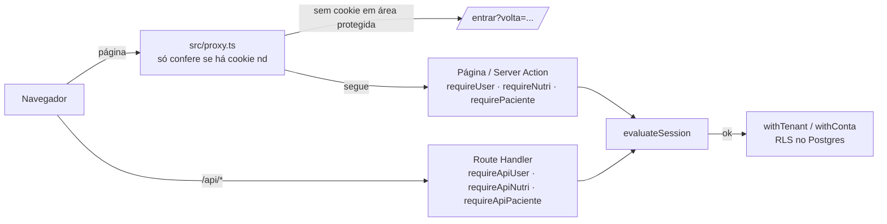
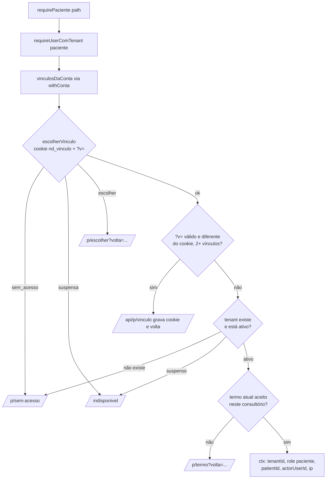
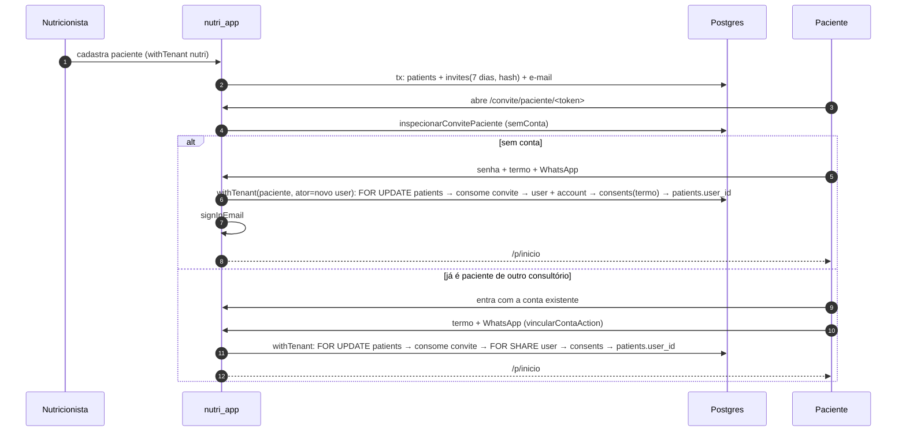

# 3. Autenticação, sessões e autorização

Este capítulo descreve como alguém entra no NutriDebby, quanto tempo a sessão vale, o que cada papel pode abrir e como os convites, os aceites (DPA e termo) e a suspensão de conta mexem nisso.

Fonte de verdade: o código. Cada afirmação cita o arquivo e a linha ou a função. Decisões vêm dos planos em `docs/superpowers/plans/` (o número do plano e da decisão aparece entre parênteses). As divergências entre spec e código estão no fim.

---

## 3.1 Visão geral

| Peça | Onde | Papel |
|---|---|---|
| Better Auth 1.7.6 | `package.json` (`"better-auth": "1.7.6"`), `src/lib/auth.ts` (`createAuth`) | Login por e-mail e senha, 2FA TOTP, sessões no Postgres, limite de tentativas, redefinição de senha |
| Rota HTTP do Better Auth | `src/app/api/auth/[...all]/route.ts` | Expõe `GET`/`POST` de `/api/auth/*` via `toNextJsHandler(getAuth())` |
| Proxy (Next 16) | `src/proxy.ts` | Filtro barato: sem cookie de sessão em área protegida → `/entrar` |
| Regras puras de sessão | `src/lib/session-rules.ts` (`evaluateSession`) | Decide `ok`/`login`/`expired`/`setup-2fa`/`forbidden`/`suspended` |
| Guardas de página e Server Action | `src/lib/session.ts` (`requireUser`), `src/lib/tenant-session.ts` (`requireNutri`), `src/lib/paciente-session.ts` (`requirePaciente`) | Redirecionam |
| Guardas de Route Handler | `src/lib/api-auth.ts` (`requireApiUser`), `requireApiNutri`, `requireApiPaciente` | Respondem 401/403 em JSON |
| Contexto do banco | `src/db/tenant.ts` (`withTenant`, `withConta`) | Aplica a RLS com tenant, papel, paciente, ator e IP |

Princípio: o proxy só olha se **existe** um cookie. Quem decide o acesso é a guarda chamada **em cada página, Server Action e Route Handler**. O layout não é barreira: `src/app/admin/layout.tsx` (comentário das linhas 3–6) e `src/app/painel/layout.tsx` (comentário da linha 11) dizem isso de forma explícita.



---

## 3.2 Papéis

O papel fica em `user.app_role`, com três valores aceitos pela restrição `user_app_role_valido` (`src/db/schema/auth.ts`, tabela `user`): `admin`, `nutri`, `paciente`. O tipo TypeScript é `AppRole` (`src/lib/session-rules.ts:1`).

| Papel | `user.tenant_id` | Página inicial (`homeFor`, `session-rules.ts:15-17`) | 2FA | Sessão |
|---|---|---|---|---|
| `admin` | nulo | `/admin` | **obrigatório** | 12 h de inatividade |
| `nutri` | o tenant dela | `/painel` | opcional | 12 h de inatividade |
| `paciente` | **nulo** (o vínculo é o prontuário) | `/p/inicio` | não oferecido | 30 dias |

Pontos que importam:

- **Um login, um papel.** O e-mail é global e único (`user.email` é `citext` com `unique()`, `src/db/schema/auth.ts`). A spec (§3, "Modelo de identidade") manda usar outro e-mail para ser nutricionista e paciente ao mesmo tempo. O convite de paciente recusa e-mail de conta da equipe (`MSG_CONVITE_PACIENTE.contaDeEquipe`, `src/modules/pacientes/convite-paciente.ts:26`, checado em `prepararAceite`, linha 176).
- **A conta de paciente não tem tenant.** `aceitarConvitePaciente` grava o `user` sem `tenantId` (`convite-paciente.ts:236`). O vínculo com cada consultório é a linha `patients.user_id`. Por isso o paciente pode ser atendido por várias nutricionistas com o mesmo login (spec §3).
- **O admin nunca consulta tabela com `tenant_id`.** `withTenant` aceita só `nutri`, `paciente`, `worker` e `publico` e lança erro para qualquer outro papel (`src/db/tenant.ts`, `ROLES` e `assertContext`). Plano 01, Global Constraints (§4.1 da spec).
- `appRole`, `tenantId` e `tema` são `additionalFields` com `input: false` (`auth.ts:142-149`): nenhum endpoint do Better Auth deixa o cliente gravá-los.

---

## 3.3 Configuração do Better Auth (`src/lib/auth.ts`)

`createAuth(db, opts)` (linha 32) monta a instância. `getAuth()` (linhas 194-197) guarda uma instância única por processo.

| Opção | Valor no código | Linha | Por quê |
|---|---|---|---|
| `baseURL`, `trustedOrigins` | `APP_URL` | 42, 53-55 | Só a própria origem chama os endpoints |
| `secret` | variável `AUTH_SECRET` (mín. 32 caracteres, `src/env.ts:112`) | 54 | Assina cookies e cifra o segredo do TOTP |
| `logger` | só nível e mensagem vão ao pino | 59 | O erro do Drizzle carrega SQL e parâmetros (token, senha). RNF-11, regra 3 do CLAUDE.md |
| `database` | `drizzleAdapter(db, { provider: 'pg', schema: authSchema })` | 60 | Tabelas `user`, `session`, `account`, `verification`, `two_factor`, `rate_limit` (`src/db/schema/auth.ts`) |
| `verification.storeIdentifier` | `'hashed'` | 64 | Tokens de redefinição e de 2FA ficam só como SHA-256. Plano 02, "Itens adiados do Plano 01", Tarefa 3 |
| `emailAndPassword.disableSignUp` | `true` | 67 | Não existe cadastro público. Contas nascem por convite ou pelo CLI |
| `minPasswordLength` / `maxPasswordLength` | 10 / 128 | 68-69 | US-002 |
| `password.hash` / `verify` | argon2id próprio | 70-73 | Ver 3.4 |
| `resetPasswordTokenExpiresIn` | `RESET_TOKEN_TTL_S` = 3600 s | 30, 74 | US-002: link de 1 h |
| `revokeSessionsOnPasswordReset` | `true` | 75 | Trocar a senha derruba as outras sessões |
| `sendResetPassword` | `deliverPasswordLink` | 77-80 | Ver 3.11 |
| `session.expiresIn` | 30 dias (`PATIENT_SESSION_MS`) | 85 | Padrão; a equipe é cortada para 12 h no hook |
| `session.disableSessionRefresh` | `true` | 90 | O Better Auth nunca desliza a sessão; só `slideSession` desliza |
| `databaseHooks.session.create.before` | bloqueia tenant suspenso e aplica `capSessionExpiry` | 95-107 | RN-15 e RNF-06 |
| `databaseHooks.session.create.after` | rechecagem com `FOR SHARE` | 114-118 | Corrida login × suspensão (M8) |
| `rateLimit` | `storage: 'database'`, 100/60 s geral, 5/15 min nas rotas sensíveis | 122-141 | RNF-06 |
| `advanced.cookiePrefix` | `'nd'` | 151 | Cookies `nd.session_token` etc. (com `__Secure-` em https) |
| `advanced.database.generateId` | `'uuid'` | 152 | PK uuid v4 (Plano 01, desvios) |
| `advanced.ipAddress.trustedProxies` | `TRUSTED_PROXIES` | 153 | IP real atrás do Traefik |
| `hooks.before` | Turnstile e política de senha | 155-171 | INT-06 e US-002 |
| `plugins` | `twoFactor({ issuer: 'NutriDebby' })`, `nextCookies()` | 172 | 2FA e cookies em Server Actions |

`TRUSTED_PROXIES` é obrigatória quando `NODE_ENV=production`; sem ela o processo não sobe (`src/env.ts:162-167`), porque o limite de tentativas viraria um balde só para todo mundo.

`src/lib/auth.cli.ts` é uma instância só para o CLI do Better Auth gerar o schema (Plano 01, estrutura de arquivos, linha 85). Ela aponta para um banco inexistente e usa um segredo fixo de mentira. O app nunca a importa.

### Limite de tentativas

`auth.ts:122-141`. Contagem no banco (tabela `rate_limit`), por IP + rota. O IPv6 é agrupado pelo /64 (padrão do Better Auth; comentário em `src/lib/ip.ts:8-10`).

| Rota | Janela | Máximo |
|---|---|---|
| Qualquer `/api/auth/*` | 60 s | 100 |
| `/sign-in/email` | 15 min | 5 |
| `/two-factor/verify-totp`, `/two-factor/verify-backup-code` | 15 min | 5 |
| `/request-password-reset` | 15 min | 5 |
| `/two-factor/enable`, `/two-factor/disable`, `/change-password`, `/verify-password`, `/two-factor/get-totp-uri`, `/two-factor/generate-backup-codes`, `/delete-user` | 15 min | 5 |

As rotas da última linha conferem a senha com a sessão aberta. O limite impede que um cookie roubado vire força bruta da senha (comentário da linha 132). O 429 aparece na tela de login como "Muitas tentativas. Tente novamente em 15 minutos." (`src/app/entrar/page.tsx:31`). E2E: `e2e/auth.spec.ts`, teste "senha errada 5 vezes bloqueia com a mensagem da spec".

---

## 3.4 Senha

**Hash.** Argon2id por `@node-rs/argon2` 2.2.1: `memoryCost: 19456` (19 MiB), `timeCost: 2`, `parallelism: 1` (`src/lib/password.server.ts:6-9`). O Better Auth recebe essas funções em `emailAndPassword.password` (`auth.ts:70-73`). Os convites usam o mesmo `hashPassword` (`src/modules/plataforma/convites.ts:85`, `convite-paciente.ts:226`).

**Política.** `validatePasswordPolicy` (`src/lib/password-policy.ts:1`):

| Regra | Mensagem |
|---|---|
| ≥ 10 caracteres | "A senha precisa ter pelo menos 10 caracteres." |
| ≤ 128 caracteres | "A senha pode ter no máximo 128 caracteres." |
| ao menos 1 letra (`\p{L}`) e 1 número (`\p{Nd}`) | "A senha precisa ter pelo menos 1 letra e 1 número." |
| fora da lista de senhas comuns (`src/lib/common-passwords.txt`, comparação sem caixa) | "Essa senha é muito comum. Escolha outra." |

Onde a política roda:

- `hooks.before` do Better Auth, só em `/reset-password` e `/change-password` (`auth.ts:166-169`).
- `aceitarConvite` (nutricionista, `convites.ts:66`; política na linha 73) e `aceitarConvitePaciente` (`convite-paciente.ts:220`), que não passam pelo Better Auth.
- No navegador, como ajuda, sem a lista comum (`src/app/definir-senha/page.tsx:17`).

**Custo do argon2 e convite inválido.** Antes do hash, os dois aceites de convite conferem o token sem trava. Um POST anônimo com token ruim nunca gasta os ~19 MB do argon2 (T6-R2a, `convites.ts:78-85`; `convite-paciente.ts:223-226`).

---

## 3.5 Verificação em duas etapas (2FA)

**Quem é obrigado:** só o admin. `evaluateSession` devolve `setup-2fa` quando `role === 'admin' && !user.twoFactorEnabled` e a página não é `/conta/seguranca` (`session-rules.ts:57`). `requireUser` redireciona para `SECURITY_PATH` (`session.ts`, `case 'setup-2fa'`). `requireApiUser` responde 403 "Acesso negado". Para a nutricionista, o 2FA é opcional e fica em "Configurações > Segurança" (`/conta/seguranca`). O paciente não tem a tela: `src/app/conta/seguranca/page.tsx` chama `requireUser(['admin', 'nutri'], …)`. Decisão da spec §3 ("2FA: obrigatório para o admin; opcional (recomendado) para a nutricionista") e US-003.

**Ativação** (`src/app/conta/seguranca/enable-2fa.tsx`):

1. A usuária confirma a senha → `authClient.twoFactor.enable({ password })` devolve a `totpURI` e os códigos de recuperação.
2. O QR é gerado **no navegador** (`QRCode.toDataURL`); a chave aparece também em texto.
3. O código de 6 dígitos confirma por `twoFactor.verifyTotp`.
4. Os códigos de recuperação aparecem uma vez. O Better Auth gera 10 códigos por padrão (`node_modules/better-auth/dist/plugins/two-factor/backup-codes/index.mjs`, `amount ?? 10`) e guarda-os cifrados (`storeBackupCodes: "encrypted"`).

**Segredo do TOTP.** Fica na tabela `two_factor`, cifrado pelo Better Auth com `symmetricEncrypt` (XChaCha20-Poly1305, `node_modules/better-auth/dist/crypto/index.mjs`) e chave derivada de `AUTH_SECRET`. Desvio consciente do Plano 01 (tabela "Desvios conscientes"): a spec pedia AES-256-GCM com `ENCRYPTION_KEY`. TOTP padrão: 6 dígitos, 30 s.

**Login com 2FA.** O endpoint `/sign-in/email` cria a sessão normalmente. O hook `after` do plugin apaga essa sessão e o cookie, grava um desafio de 10 min em `verification` e um cookie assinado `two_factor` (`node_modules/better-auth/dist/plugins/two-factor/index.mjs`, hook de `/sign-in/email`). O cliente vai para `/entrar/2fa` (`src/lib/auth-client.ts:11-16`). Depois do código certo, o Better Auth cria a sessão definitiva. Consequência: os `databaseHooks` de sessão (bloqueio de tenant suspenso, corte de 12 h) rodam **nas duas** criações.

A tela de 2FA sempre manda `trustDevice: false` (`src/app/entrar/2fa/page.tsx:19`). Nenhum aparelho fica "confiável"; o código é pedido em todo login.

**2FA para assinar documentos (Plano 10A, RN-145, D13).** Para a nutricionista, o 2FA continua opcional para entrar, mas
passa a ser **condição para assinar** documentos: sem `twoFactorEnabled`, o envio digitalizado é recusado e a tela
mostra "Ative a verificação em duas etapas em Segurança para assinar documentos." com o link "Ativar agora". O código é
pedido em todo envio, por `confirmarCodigo2fa` (`src/lib/confirmar-2fa.ts`: `auth.api.verifyTOTP` com a sessão da
própria usuária, 5 erros em 15 min por usuária, anti-repetição de 90 s, `liberarCodigo2fa` quando o envio falha depois
do código aceito). Para não virar um oráculo do código fora desse limite, o hook `before` de `src/lib/auth.ts` recusa o
`/two-factor/verify-totp` chamado pela web com sessão aberta e 2FA já ativo (`TWO_FACTOR_JA_ATIVO`); o login (sem
sessão) e a ativação (2FA ainda desligado) seguem, e a chamada interna (`auth.api`, sem `request`) também. A tela
`/conta/seguranca` ganhou o bloco "Como funciona" com o guia `seguranca`. Detalhe em
[§9.6](09-documentos-assinados.md#96-código-do-2fa-no-momento-de-assinar-rn-145-d13).

---

## 3.6 Sessão, inatividade e renovação

### Regras (`src/lib/session-rules.ts`)

| Constante | Valor | Linha |
|---|---|---|
| `STAFF_IDLE_MS` | 12 h | 5 |
| `PATIENT_SESSION_MS` | 30 dias | 6 |
| `SESSION_REFRESH_MS` | 15 min | 8 |
| `SECURITY_PATH` | `/conta/seguranca` | 9 |
| `SUSPENDED_PATH` | `/indisponivel` | 11 |
| `MSG_SESSAO_EXPIRADA` | "Sessão expirada. Entre de novo." | 13 |

- `capSessionExpiry` (linhas 28-32): no nascimento da sessão, tudo que não é `paciente` recebe no máximo agora + 12 h. Papel desconhecido conta como equipe ("na dúvida, vale o limite menor").
- `sessionExpiresAt` (20-22): agora + 30 dias (paciente) ou + 12 h (equipe).
- `isRefreshDue` (35-37): renova só se `updatedAt` tem 15 min ou mais. Evita uma escrita por requisição (RNF-06, nota do Plano 01 na spec).

### `evaluateSession` (linhas 39-59)

Ordem das checagens. A primeira que casar decide.

| # | Condição | Decisão |
|---|---|---|
| 1 | sem sessão ou sem usuário | `expired` se veio cookie, senão `login` |
| 2 | papel fora de `allowed` | `forbidden` |
| 3 | equipe e `now - session.updatedAt > 12 h` | `expired` |
| 4 | `tenantStatus === 'suspensa'` | `suspended` |
| 5 | admin sem 2FA e fora de `/conta/seguranca` | `setup-2fa` |
| 6 | — | `ok` |

A checagem 3 é uma defesa a mais. O `expiresAt` já vale no máximo última atividade + 12 h, e o Better Auth recusa a sessão vencida em qualquer rota. Ela exige que a sessão seja lida com `disableRefresh: true` (comentário da linha 54).

### Como a sessão desliza

`slideSession` (`auth.ts:205-216`) grava `updatedAt = agora` e o novo `expiresAt` direto no banco, com `WHERE expires_at > agora`. Sessão vencida nunca volta. Quem chama:

- `requireUserComTenant` → `deslizarUmaVez` (`session.ts:33-42`), memoizado por `cache` do React (uma escrita por render, mesmo com layout e página).
- `requireApiUser` (`api-auth.ts`, `case 'ok'`): atividade de API também conta (T7-R2b; uploads).

Falha ao renovar só gera `logger.warn` com o nome do erro. A requisição segue, porque já foi autenticada.

**Cookie do paciente.** O banco desliza, mas o cookie tinha `Max-Age` fixo desde o login. `POST /api/p/acesso` (`src/app/api/p/acesso/route.ts:13-23`), chamado uma vez quando o portal abre, reemite o mesmo valor do cookie com `Max-Age` de 30 dias (`cookieDeSessaoRenovado`, `src/lib/sessao-cookies.ts:42`). Plano 06, D9 (fecha o P06-11).

### `requireUser` e `requireUserComTenant` (`src/lib/session.ts`)

`lerSessaoDaRequisicao` (linha 17) lê a sessão com `disableRefresh: true` e, se o usuário tem tenant, a linha de `tenants` por PK. As duas leituras são memoizadas por requisição (T14, S-7). Depois de `evaluateSession`:

| Decisão | Ação |
|---|---|
| `ok` | desliza e devolve `{ data, tenant }` |
| `login` | `redirect('/entrar?volta=…')` |
| `expired` | `auth.api.signOut` e `redirect('/entrar?expirada=1&volta=…')` |
| `setup-2fa` | `redirect('/conta/seguranca')` |
| `suspended` | `redirect('/indisponivel')` |
| `forbidden` | `redirect(homeFor(papel))`, a página inicial do próprio papel |

O `volta` vem do cabeçalho `x-nd-caminho` (`CURRENT_PATH_HEADER`, `src/lib/safe-return.ts:32`), gravado pelo proxy com caminho + query. O proxy sempre sobrescreve o valor do cliente. Tudo passa por `safeReturnPath` (3.13).

### `requireApiUser` (`src/lib/api-auth.ts:19`)

Mesma regra para Route Handlers, sem redirecionar:

| Decisão | Resposta |
|---|---|
| `login`, `expired` | 401 `{ erro: "Sessão expirada. Entre de novo." }` |
| `suspended` | 403 "Conta temporariamente indisponível" |
| `setup-2fa`, `forbidden` | 403 "Acesso negado" |

Toda recusa sai com `cache-control: no-store` (`recusaApi`, linha 13). É assim que o admin recebe 403 em `/api/painel/*` e `/api/p/*` (US-004, cenário "Admin não vê prontuário").

---

## 3.7 Guardas por papel

### `requireNutri` / `requireApiNutri` (`src/lib/tenant-session.ts:22`, `:37`)

Toda página e Server Action da nutricionista começa por `requireNutri(path)`:

1. `requireUserComTenant(['nutri'], path)`.
2. Sem `tenantId` ou sem linha do tenant → erro (estado impossível).
3. `tenant.dpaVersao !== DPA_VERSAO` → `redirect('/painel/dpa')`, salvo com `permitirDpaPendente` (só o layout e a própria tela do DPA usam).
4. Devolve `ctx = { tenantId, role: 'nutri', actorUserId, ip }`, pronto para `withTenant`.

`requireApiNutri` faz o mesmo para Route Handlers: 403 "Acesso negado" sem tenant e 403 "Aceite o contrato de tratamento de dados para continuar." com o DPA pendente. O IP vem de `clientIp(req.headers, TRUSTED_PROXIES)`.

### Admin

Não há `requireAdmin`. Cada página e Server Action do admin chama `requireUser(['admin'], …)` (ex.: `src/app/admin/actions.ts`, `criarContaAction`, `suspenderAction`, `reativarAction`). O admin nunca recebe `TenantContext`.

### `requirePaciente` / `requireApiPaciente` (`src/lib/paciente-session.ts:111`, `:165`)

Ver 3.8.

### Resumo

| Guarda | Usado em | Papéis | Além da sessão | Falha |
|---|---|---|---|---|
| `requireUser` | páginas e Server Actions | lista passada | — | redirect |
| `requireApiUser` | Route Handlers | lista passada | — | 401/403 |
| `requireNutri` | painel | `nutri` | DPA atual; `ctx` | redirect |
| `requireApiNutri` | `/api/painel/*` | `nutri` | DPA atual; `ctx` | 403 |
| `requirePaciente` | portal `/p/*` | `paciente` | vínculo, consultório ativo, termo atual; `ctx` | redirect |
| `requireApiPaciente` | `/api/p/*` | `paciente` | idem | 403 |

---

## 3.8 Sessão do paciente: vínculos, `nd_vinculo` e contexto `conta`

### O problema

A conta de paciente não tem tenant. Para abrir o portal é preciso saber **qual** prontuário (consultório) ela está usando. E é preciso achar os prontuários da conta sem saber o tenant, com a RLS forçada.

### Contexto `conta` (Plano 06, D2)

`withConta(userId, fn)` (`src/db/tenant.ts:99`) abre a transação com `app.role = 'conta'`, `app.user_id = userId` e `app.tenant_id` vazio. No banco, a política `paciente_por_conta` (`drizzle/0073_conta_vinculos.sql`, linha 6) libera **só `SELECT`** em `patients` onde `user_id` é a própria conta. Toda outra tabela devolve 0 linhas, porque nenhuma `tenant_isolation` casa sem tenant. Nada é gravado.

Uso restrito (CLAUDE.md, regra 1): `src/modules/portal/vinculos.ts` e a função `app_conta_sem_outro_vinculo` (`drizzle/0079_paciente_titular.sql`), usada na anonimização.

Alternativa descartada no D2: uma função `SECURITY DEFINER` que varresse todos os tenants (N consultas por requisição).

### `vinculosDaConta` e `escolherVinculo` (`src/modules/portal/vinculos.ts`)

`vinculosDaConta(userId)` (linha 16) junta `patients` (contexto `conta`) e `tenants` (sem RLS) e devolve `{ tenantId, patientId, nomeNutri, tenantStatus }`. Sem `todos: true`, ficam de fora prontuários arquivados, bloqueados e anonimizados (RN-08).

`escolherVinculo(vinculos, cookie, pedido)` (linha 56):

| Situação | Resultado |
|---|---|
| nenhum vínculo | `sem_acesso` |
| nenhum consultório ativo | `suspensa` |
| exatamente 1 vínculo | `ok` com ele |
| 2+ vínculos | o `pedido` (`?v=` do link), se for ativo da conta; senão o do cookie, se for ativo; senão `escolher` |

### O cookie `nd_vinculo` (Plano 06, D3)

Definido em `src/lib/paciente-session.ts:21-50`:

| Atributo | Valor |
|---|---|
| Nome | `nd_vinculo` |
| Conteúdo | só o `tenantId` |
| `Path` | `/` |
| `Max-Age` | 30 dias |
| `HttpOnly`, `SameSite=Lax` | sim |
| `Secure` | só quando `APP_URL` começa com `https://` (`cookieVinculoSeguro`) |

O cookie é só uma **preferência**. A cada requisição ele é reconferido contra `vinculosDaConta`. Cookie velho ou forjado com um tenant que não é vínculo ativo da conta não dá acesso a nada. Quem grava:

| Onde | Quando |
|---|---|
| `escolherAction` (`src/app/p/escolher/actions.ts`) | escolha em `/p/escolher`; confere vínculo ativo e consultório não suspenso |
| `GET /api/p/vinculo` (`src/app/api/p/vinculo/route.ts:15`) | link com `?v=` (e-mail, push) de outro consultório; confere de novo |
| `POST /api/p/acesso` | abertura do portal com 2+ vínculos (o cookie desliza junto) |
| `POST /sair` | apaga (`cookieDoVinculoApagado`) |

O `GET` que grava cookie em `/api/p/vinculo` é aceito de propósito (spec RNF-06, v1.11, S-12): links de e-mail chegam como navegação de outro site, e o efeito é só trocar entre vínculos ativos da própria conta.

### `requirePaciente` (linha 111)



A lógica comum fica em `acessoDaConta` (linha 92), usada pela página e pela API, na ordem: vínculo (D3, RN-08) → consultório não suspenso (RN-15) → termo aceito (US-011, D25). A própria tela do termo passa `permitirTermoPendente`.

`requireApiPaciente` (linha 165) aplica a mesma regra sem regravar o cookie e responde 403. Com vínculo a escolher, o JSON leva `motivo: 'escolher'`, para a tela oferecer o link da escolha (S-4). Os textos: "Acesso negado", "Conta temporariamente indisponível", "Para continuar, aceite o Termo de Uso e Privacidade." (`RECUSA_API`, linha 153).

`ctx.patientId` liga a RLS por paciente. `withTenant` exige `patientId` e `actorUserId` para `role: 'paciente'` (`src/db/tenant.ts`, `assertContext`), salvo os fluxos sem login listados em `SEM_CONTA_PERMITIDOS`.

---

## 3.9 Bootstrap do admin (`pnpm admin:criar`)

Script: `scripts/admin-criar.ts`, ligado em `package.json` (`"admin:criar": "tsx --env-file-if-exists=.env.local scripts/admin-criar.ts"`). Lógica: `createAdmin` em `src/modules/plataforma/admin-bootstrap.ts:15`.

1. Normaliza o e-mail (`normalizeEmail`) e valida com zod. Plano 01, Review Focus 4: `" Admin@Exemplo.com "` vira `admin@exemplo.com`.
2. Recusa e-mail já usado. A corrida é decidida pela constraint `user_email_unique`.
3. Insere `user` com `appRole: 'admin'`, `emailVerified: true`, **sem senha**.
4. Troca o destino dos links por um que só captura a URL (`setPasswordLinkSink`, `src/lib/password-links.ts:44`) e chama `auth.api.requestPasswordReset` com `redirectTo: '/definir-senha'`. Chamada interna sem `ctx.request` não passa pelo Turnstile (`auth.ts:158-160`).
5. Sem link ou com erro, apaga o usuário criado.
6. O script imprime o link no terminal (válido por `RESET_TOKEN_TTL_S`, 1 h, uso único) e avisa que o 2FA será obrigatório no primeiro acesso.

Não existe tela pública para criar admin (`disableSignUp: true`). Rodar o comando no container do app em produção é operação do dono: o link é uma credencial e não deve ir para log nem para chat.

---

## 3.10 Convites

Tabela `invites` (`src/db/schema/access.ts`). Guarda só o SHA-256 do token (`token_hash`, único). O token é `randomToken()`: 32 bytes em base64url, 43 caracteres (`src/lib/crypto.ts:9-11`), e todo token recebido é validado contra `/^[A-Za-z0-9_-]{43}$/` antes de consultar o banco. A restrição `invites_alvo` separa os dois tipos. Índices únicos parciais deixam no máximo um convite pendente por usuário (`invites_user_pendente_idx`) e por paciente (`invites_paciente_pendente_idx`). A tabela fica fora da RLS (`RLS_EXCEPTIONS`, `src/db/rls-guard.ts`), porque é lida antes de existir sessão. Só três módulos a acessam (CLAUDE.md, regra 1).

| | Nutricionista | Paciente |
|---|---|---|
| História | US-001 / US-002 | US-010 / US-011 |
| Validade | 72 h (`CONVITE_NUTRI_VALIDADE_MS`, `convites.ts:11`) | 7 dias (`CONVITE_PACIENTE_VALIDADE_MS`, `convite-paciente.ts:18`) |
| Aponta para | `user_id` (a conta já existe, sem senha) | `tenant_id` + `patient_id` (a conta nasce no aceite) |
| Quem cria | admin: `criarContaNutri` / `reenviarConvite` (`src/modules/plataforma/contas.ts:59`, `:89`) | nutricionista: `enviarConvitePaciente` / `reenviarConvitePaciente` (`convite-paciente.ts:52`, `:102`) |
| Link | `/convite/<token>` (montado por `urlDoApp(appUrl, …)`, `src/lib/url-do-app.ts`, `convites.ts:32`) | `/convite/paciente/<token>` |
| Canal | e-mail pela fila, na mesma transação | e-mail na mesma transação. O WhatsApp é só um aviso **sem link** (decisão do dono, US-010, nota do Plano 05) |
| Aceite grava | senha (`account`), `emailVerified`, DPA | `user` de paciente, senha, termo, `patients.user_id`, escolha do WhatsApp |
| Mensagens | "Convite expirado. Peça um novo ao suporte." / "Convite inválido ou já usado. Se você já definiu sua senha, entre com seu e-mail e senha." | `MSG_CONVITE_PACIENTE` (`convite-paciente.ts:20-28`) |

### Convite da nutricionista

`criarContaNutri` cria, numa transação, o tenant, a usuária `nutri` sem senha, o convite e o e-mail (`contas.ts:59-87`). `reenviarConvite` trava a usuária (`FOR UPDATE`, T5-R3), recusa tenant suspenso ("Conta suspensa: reative antes de reenviar o convite.", PF-N6, RN-15) e recusa quem já tem senha. `criarConvite` apaga os pendentes antes de inserir (`convites.ts:23-29`).

`aceitarConvite` (`convites.ts:66`):

1. Valida DPA marcado, política de senha, confirmação e formato do token.
2. `inspecionarConvite` sem trava; só então o argon2 (T6-R2a).
3. Na transação: trava a usuária (`FOR UPDATE`) **antes** do convite, a mesma ordem de `reenviarConvite`. A ordem invertida causava deadlock 40P01 (T6-R1).
4. Recusa se já existe `account` `credential`.
5. Consome o convite com `UPDATE … WHERE usado_em IS NULL AND expira_em > agora`. O segundo envio simultâneo vê 0 linhas.
6. Grava a senha, `emailVerified = true` e o aceite do DPA (`registrarAceiteDpa`).

A Server Action (`src/app/convite/[token]/actions.ts`) faz login automático com `signInEmail`. Se o tenant foi suspenso entre o aceite e o login, vai para `/indisponivel` (T7-R2a). Outra falha cai em `/entrar?volta=/painel`.

### Convite do paciente

`inspecionarConvitePaciente` (`convite-paciente.ts:141`) lê o convite pelo token e o prontuário no contexto do próprio paciente, com `semConta: true` (paciente sem sessão; lista fechada em `SEM_CONTA_PERMITIDOS`, `src/db/tenant.ts`). Classifica a conta com aquele e-mail: `nenhuma`, `paciente` ou `equipe`.

A página `src/app/convite/paciente/[token]/page.tsx` decide:

| Caso | Tela |
|---|---|
| expirado / inválido | aviso |
| consultório suspenso | `redirect('/indisponivel')` |
| e-mail de conta da equipe | "Este e-mail já é usado por outra conta. Peça à sua nutricionista para cadastrar outro e-mail." |
| conta de paciente, sem sessão | "Entre com sua conta existente para ver os dados da nutricionista {nome}." + `/entrar?volta=…` |
| conta de paciente, sessão de outro e-mail | "Este convite foi enviado para outro e-mail. Saia desta conta e abra o link de novo." |
| conta de paciente, sessão certa | só termo + WhatsApp → `vincularContaExistente` |
| sem conta | senha + termo + WhatsApp → `aceitarConvitePaciente` |

`aceitarConvitePaciente` (linha 213) roda num `withTenant` com o ator igual ao novo `userId` (a escrita em `patients` sai auditada com ele). Ordem de trava: paciente → convite (T6-R1). Cria `user` (`appRole: 'paciente'`, sem tenant), `account`, o aceite do termo e `patients.user_id`. Um `user_email_unique` em corrida vira "convite inválido".

`vincularContaExistente` (linha 260) exige que o e-mail da conta logada seja o do convite: outro login não "adota" o prontuário. Dentro da transação relê a conta com `FOR SHARE`, para não ligar o prontuário a uma conta que outro consultório acabou de anonimizar (B-2, D18 do Plano 06).

Arquivar ou bloquear o paciente apaga o convite pendente (`apagarConvitesPendentes`, linha 77; RN-08, US-018).

```mermaid
sequenceDiagram
  autonumber
  participant A as Admin
  participant App as nutri_app
  participant DB as Postgres
  participant W as nutri_worker
  participant N as Nutricionista
  A->>App: criarContaAction (requireUser admin)
  App->>DB: tx: tenants + user nutri sem senha + invites(72 h, hash) + job e-mail
  W->>N: e-mail com /convite/<token>
  N->>App: abre o link (inspecionarConvite)
  N->>App: senha + aceite do DPA (aceitarConviteAction)
  App->>App: checa token sem trava, depois argon2id
  App->>DB: tx: FOR UPDATE user → confere se já há account credential (convites.ts:93-97; se houver, convite inválido) → UPDATE invites usado_em (:99-103) → grava account → emailVerified → consents(dpa) → tenants.dpa_versao
  App->>App: signInEmail (hooks: tenant ativo? expira em 12 h)
  App-->>N: redirect /painel
```



---

## 3.11 Redefinição de senha

| Etapa | Onde |
|---|---|
| Formulário "Esqueci minha senha" com Turnstile | `src/app/esqueci-senha/form.tsx` → `authClient.requestPasswordReset` com o cabeçalho `x-turnstile-token` |
| Turnstile no servidor | `hooks.before` de `/request-password-reset` (`auth.ts:159-165`): 503 `TURNSTILE_INDISPONIVEL` ou 403 `TURNSTILE_INVALIDO`, **antes** de qualquer escrita (INT-06) |
| Mesma resposta para qualquer e-mail | o formulário mostra sempre "Se o e-mail estiver cadastrado, você receberá um link" (`form.tsx:49`) |
| Entrega fora do caminho da resposta | `emailPasswordLinkSink` dispara `enfileirarLinkDeSenha` sem `await` (`password-links.ts:37-39`). Nem a latência nem uma falha da fila revelam se o e-mail existe (F3) |
| Tenant suspenso não recebe | `enfileirarLinkDeSenha` (linha 20) descarta se o tenant não está ativo (RN-15, F2) |
| Link cifrado na fila | o job leva a mensagem selada (Plano 02, "Fila de e-mail") |
| Token guardado com hash | `verification.storeIdentifier: 'hashed'` |
| Validade | 1 h, uso único (`RESET_TOKEN_TTL_S`) |
| Definir a nova senha | `/definir-senha?token=…` → `authClient.resetPassword` (`src/app/definir-senha/page.tsx:20`); política no `hooks.before` |
| Efeito colateral | `revokeSessionsOnPasswordReset: true` |

A mesma tela `/definir-senha` serve ao primeiro acesso do admin (3.9). O admin não tem tenant: o link sempre sai.

---

## 3.12 Aceites: DPA e termo do paciente (`consents`)

Tabela `consents` (`src/db/schema/access.ts`). É prova de aceite: sem `ON DELETE CASCADE`, só `INSERT`. Unicidade `consents_titular_termo_unique` em `(user_id, termo_versao, tenant_id, patient_id)` com `NULLS NOT DISTINCT`: repetir o aceite não duplica. Fora da RLS (`RLS_EXCEPTIONS`), com lista fechada de módulos (CLAUDE.md, regra 1). A anonimização só mexe nela por `app_anonimizar_aceites` (migration 0065).

| | DPA (nutricionista) | Termo do paciente |
|---|---|---|
| Constante de versão | `DPA_VERSAO = '0.1-provisorio'` (`src/modules/plataforma/dpa.ts:6`) | `TERMO_PACIENTE_VERSAO = '0.1-provisorio'` (`src/modules/pacientes/termo-paciente.ts:5`) |
| Valor gravado em `termo_versao` | `dpa-0.1-provisorio` (`DPA_TERMO`) | `termo-paciente-0.1-provisorio` (`TERMO_PACIENTE`) |
| `tenant_id` em `consents` | nulo | o consultório do vínculo |
| Marca extra | `tenants.dpa_aceito_em` e `tenants.dpa_versao` | — |
| Onde é exigido | `requireNutri` compara `tenant.dpaVersao` com `DPA_VERSAO` | `requirePaciente` chama `termoAceito(userId, tenantId)` (`src/modules/portal/termo.ts:10`) |
| Tela | `/painel/dpa` (`aceitarDpaAction`, `src/app/painel/actions.ts:12`) | `/p/termo` (`aceitarTermoAction`, `src/app/p/termo/actions.ts`) |
| Primeiro aceite | no convite (`aceitarConvite`) | no convite (`registrarAceiteTermo`, `convite-paciente.ts:204`) |
| IP | gravado (`clientIp`) | gravado |

`registrarAceiteDpa` (`dpa.ts:28`) só atualiza `tenants` quando a linha de `consents` foi de fato inserida. Assim a marca no tenant nunca diverge da prova (T6-R2b).

O termo do paciente é aceito **por consultório**: cada nutricionista é controladora dos dados (RNF-08). Plano 06, D25.

**Aditivo de IA (Plano 11, A-D20).** Terceiro tipo de aceite em `consents`: `ia-aditivo-<versão>` (`IA_ADITIVO_TERMO`,
`src/modules/ia/textos-legais.ts`), da nutricionista, **com** o `tenant_id` do consultório (o DPA usa `tenant_id` nulo),
gravado por `registrarAceiteAditivoIa` (`dpa.ts:50`) quando ela marca "Li e aceito o aditivo de inteligência artificial
(versão {versão})" e clica em "Ativar a IA no consultório" (Configurações). Marca extra: `tenants.ia_ativada_em` e
`tenants.ia_aditivo_versao`. `ia_ativada_em` é a data da ativação **em vigor**: o `coalesce` de `registrarAceiteAditivoIa`
só a preserva enquanto a IA continua ativa (aceite de versão nova do aditivo, clique repetido; `dpa.ts:57-60`);
`desativarIa` a zera (`src/modules/ia/ativacao.ts:48`) e a reativação grava a data nova. A data do primeiro aceite de cada
versão fica em `consents.aceito_em` (`onConflictDoNothing`). Diferente do DPA, versão nova do aditivo **não**
redireciona o painel: a seção de IA em Configurações mostra "Para continuar usando a IA, aceite a versão atual do aditivo
de inteligência artificial." com o aditivo e o botão "Aceitar a versão atual" (`ia-secao.tsx:33-38`), e cada exame com
laudo mostra o mesmo aviso no lugar de "Ler valores com IA" (`iaNoExame`, `exames/ia-exame.tsx:22`)
(`IA_ADITIVO_VERSAO_MIN`). Detalhe no [cap. 10](10-ia.md).

**Como publicar uma versão nova** (texto do advogado, P08-06): trocar `DPA_VERSAO` ou `TERMO_PACIENTE_VERSAO` e os parágrafos. Na próxima requisição, toda nutricionista vai para `/painel/dpa` e todo paciente para `/p/termo`. Não precisa de migration.

---

## 3.13 Proxy e redirecionamento seguro

`src/proxy.ts`:

- `PROTECTED = ['/admin', '/painel', '/p', '/conta', '/inicio']` (linha 7). Casa o prefixo exato ou `prefixo/…` (linha 22).
- Sem cookie de sessão (`getSessionCookie(req, { cookiePrefix: 'nd' })`, linha 23) → `/entrar?volta=<caminho atual>`. Só olha a **presença** do cookie, não a validade. Cookie vencido passa e cai no `requireUser` (`expired`).
- Também gera o `x-request-id`, o nonce e a CSP de cada página, e grava `x-nd-caminho`. Esses cabeçalhos estão em [§6.3.2 CSP com nonce](06-worker-seguranca-operacao.md#632-csp-com-nonce-d7-do-plano-08) e [§6.4.2 `request_id`](06-worker-seguranca-operacao.md#642-request_id-d2-do-plano-08).
- `matcher` (linha 55): tudo menos `api/`, `serwist/`, `_next/static`, `_next/image`, `favicon.ico` e `manifest.webmanifest`. O `api/` fica fora porque o Next copiaria para a memória o corpo de toda requisição que passa pelo proxy, com corte silencioso em 10 MB, e o exame tem até 20 MB (comentário das linhas 51-53). **Consequência: toda rota `/api/*` precisa da própria guarda.**

`safeReturnPath` (`src/lib/safe-return.ts:13`) aceita só caminho local e confere de novo **depois** da normalização WHATWG, que pode transformar `/.//evil.com` em `//evil.com`. Plano 01, Review Focus 3; E2E em `e2e/auth.spec.ts` ("?volta externo não redireciona para fora" e "?volta que a normalização vira //host…"). Sem `volta` válido, o login vai para `/inicio`, que redireciona pelo papel (`src/app/inicio/page.tsx`).

No portal, `voltaDoPortal` (`paciente-session.ts:61`) restringe ainda mais: só `/p/…`, nunca a própria escolha e sem o `?v=`.

---

## 3.14 Suspensão de conta (RN-15, US-004)

Decisão do Plano 02 ("Decisões de desenho", linha "Suspensão"): status no tenant, sessões revogadas na mesma transação, bloqueio no login e checagem em cada requisição.

`suspenderConta(tenantId, adminId)` (`src/modules/plataforma/suspensao.ts:19`), numa transação:

1. `tenants.status = 'suspensa'`. Tenant inexistente → `ContaNaoEncontradaError` ("Conta não encontrada.").
2. Enfileira `agenda-tenant` com `evento: 'suspenso'` na mesma transação (`avisarAgenda`). O worker marca os lembretes pendentes como "ignorada" (o admin nunca toca tabela 🔒).
3. Apaga todas as linhas de `session` das usuárias com `user.tenant_id` = tenant.
4. Log com `tenantId`, `adminId` e a contagem. Nada é apagado do prontuário.

`reativarConta` (linha 33) volta o status para `ativa` e enfileira `evento: 'reativado'` (lembretes reagendados pela RN-05; o que o worker faz com os lembretes está em [§5.3.8](05-agenda-portal-conteudo.md#538-suspensão-e-reativação-do-tenant-us-004-rn-15)).

Onde a suspensão barra:

| Camada | Mecanismo |
|---|---|
| Login, 2FA, primeiro acesso | `session.create.before` lança `CONTA_SUSPENSA` (`auth.ts:103-105`). A tela de login leva para `/indisponivel` (`src/app/entrar/page.tsx:30`) |
| Corrida login × suspensão | `session.create.after` relê o status com `FOR SHARE` em `tenants` (`statusDoTenantDaUsuaria`, `auth.ts:182-190`). Suspensa → apaga a sessão recém-criada e recusa (M8, G7) |
| Sessão já aberta (equipe) | `evaluateSession` → `suspended` → `/indisponivel` ou 403 |
| Paciente | por vínculo, em `acessoDaConta`. O consultório suspenso barra só aquele vínculo. Sem nenhum ativo → `/indisponivel`; com outro ativo → `/p/escolher` (o suspenso aparece desabilitado) |
| Convites | `reenviarConvite` recusa; o convite de paciente manda para `/indisponivel` |
| E-mails e jobs | `tenantIsActive` (`tenant-status.ts:49`) e `enfileirarLinkDeSenha` |

As sessões de paciente **não** são apagadas pela suspensão: a conta de paciente não tem `tenant_id` e pode ter vínculos em outros consultórios.

---

## 3.15 Sair

`POST /sair` (`src/app/sair/route.ts:44`). É Route Handler, não Server Action: com o cookie já apagado por outra aba, o proxy responderia 307 e a tela mostraria "Application error" (spec v1.7).

1. CSRF: aceita só `Origin` igual à origem do `APP_URL` ou, sem `Origin`, `Sec-Fetch-Site: same-origin`. Senão 403 sem efeito.
2. Lê a sessão e apaga a linha de `session` **sem engolir o erro**. O `signOut` do Better Auth engole falha de banco e ainda apagaria o cookie, deixando a sessão viva no servidor.
3. Responde 303 para `/entrar` com os `Set-Cookie` que apagam os cookies do Better Auth (`cookiesDeSessaoApagados`, `src/lib/sessao-cookies.ts:27`), com o mesmo nome e atributos do login (`__Secure-` em produção), mais o `nd_vinculo` apagado e `Clear-Site-Data: "cache", "storage"` (Plano 06, D6).
4. Falhou ao apagar → mantém o cookie e manda para `/sair/erro`, logando só o motivo sanitizado.

Outros pontos que encerram sessões: redefinição de senha (todas as sessões), suspensão (sessões da equipe do tenant) e anonimização do titular sem outro vínculo (`src/modules/pacientes/conta-titular.ts`, apaga `session` e `account`; Plano 06, D18).

---

## 3.16 Fluxo de login completo

```mermaid
sequenceDiagram
  autonumber
  participant U as Usuário
  participant E as /entrar (cliente)
  participant BA as /api/auth (Better Auth)
  participant DB as Postgres
  participant G as requireUser
  U->>E: e-mail + senha
  E->>BA: POST /sign-in/email
  BA->>BA: rate limit (5 / 15 min por IP + rota)
  BA->>DB: confere hash argon2id
  BA->>DB: cria session (hook before: tenant suspenso? → CONTA_SUSPENSA; expiresAt ≤ agora + 12 h para equipe)
  BA->>DB: hook after: FOR SHARE em tenants (corrida com suspensão)
  alt 2FA ativo
    BA->>DB: apaga a sessão; grava desafio de 10 min
    BA-->>E: twoFactorRedirect + cookie two_factor
    E->>U: /entrar/2fa?volta=...
    U->>BA: POST /two-factor/verify-totp (ou código de recuperação)
    BA->>DB: cria a sessão definitiva (mesmos hooks)
  end
  BA-->>E: Set-Cookie nd.session_token
  E->>G: navega para ?volta (safeReturnPath) ou /inicio
  G->>DB: getSession(disableRefresh) + tenants por PK
  G->>G: evaluateSession
  alt admin sem 2FA
    G-->>U: /conta/seguranca
  else ok
    G->>DB: slideSession (se passaram 15 min)
    G-->>U: página (ou homeFor do papel)
  end
```

---

## 3.17 Como estender com segurança

- **Página nova do painel:** primeira linha `await requireNutri('/painel/…')`; numa aba do prontuário, `carregarProntuario(id)` (`src/app/painel/pacientes/[id]/prontuario.ts:12`). Use o `ctx` devolvido em `withTenant`. Nunca monte o `TenantContext` à mão. Server Action só em `actions.ts`. Checklist completo: [§7.4.5](07-testes-qualidade-e-processo.md#745-checklist-tela-nova).
- **Página nova do portal:** `await requirePaciente('/p/…')`. Nenhuma guarda do CI confere isso no portal (§7.4.5).
- **Rota nova em `/api/painel/*`:** `requireApiNutri(req)`; em `/api/p/*`, `requireApiPaciente(req)`. Lembre: o proxy não protege `/api/*`.
- **Página nova do admin:** `requireUser(['admin'], path)`. O admin não lê tabelas 🔒. Precisa de número agregado? Use função `SECURITY DEFINER` como `admin_tenant_metrics()`.
- **Área nova com outro prefixo de URL:** acrescente o prefixo em `PROTECTED` (`src/proxy.ts:7`) **e** chame a guarda na página.
- **Novo endpoint do Better Auth que confere senha:** acrescente uma regra de 5 / 15 min em `rateLimit.customRules`.
- **Novo fluxo que grava senha fora do Better Auth:** `validatePasswordPolicy(senha, commonPasswords())` antes do `hashPassword`, e checagem barata do token antes do argon2.
- **Tabela nova lida pelo contexto `conta`:** não faça. O D2 do Plano 06 limita o contexto a `patients` (SELECT).
- **Nunca** registre em log o link do convite, o link de redefinição, o token da sessão ou o cookie (CLAUDE.md, regra 3). Use `nomeDoErro(err)` ou `sanitizarErroDeBanco(err)`.

### Testes de referência

| Assunto | Teste |
|---|---|
| Regras de sessão | `src/lib/session-rules.test.ts`, `src/lib/session.test.ts`, `src/lib/api-auth.test.ts` |
| Better Auth (hooks, limite, suspensão) | `src/lib/auth.test.ts`, `src/lib/two-factor.test.ts` |
| Senha e links | `src/lib/password-policy.test.ts`, `src/lib/password-links.test.ts` |
| Portal | `src/lib/paciente-session.test.ts`, `src/modules/portal/vinculos.test.ts`, `src/modules/portal/termo.test.ts` |
| Convites, DPA, suspensão, admin | `src/modules/plataforma/primeiro-acesso.test.ts`, `dpa.test.ts`, `suspensao.test.ts`, `admin-bootstrap.test.ts`, `src/modules/pacientes/convite-paciente.test.ts` |
| Redirecionamento | `src/lib/safe-return.test.ts` |
| E2E | `e2e/auth.spec.ts`, `e2e/recuperacao.spec.ts`, `e2e/sair.spec.ts`, `e2e/sessao-portal.spec.ts` |

---

## 3.18 Variáveis de ambiente deste capítulo

Só os nomes. Os valores ficam no Easypanel.

| Variável | Uso |
|---|---|
| `APP_URL` | `baseURL`, `trustedOrigins`, CSRF do `/sair`, `Secure` do `nd_vinculo`, links de convite |
| `AUTH_SECRET` | assinatura dos cookies e cifra do TOTP (mín. 32 caracteres) |
| `TRUSTED_PROXIES` | IP real atrás do Traefik (obrigatória em produção) |
| `TURNSTILE_SITE_KEY`, `TURNSTILE_SECRET_KEY` | anti-robô do "Esqueci minha senha" |
| `ENCRYPTION_KEY` | cifra do job de e-mail que leva o link (não cifra o TOTP) |

---

## Divergências encontradas

| # | Spec | Código | Observação |
|---|---|---|---|
| 1 | US-001, cenário "Primeiro admin": o admin "recebe o e-mail para definir a senha" | `createAdmin` captura o link com `setPasswordLinkSink` e o script **imprime** no terminal (`scripts/admin-criar.ts`). Nenhum e-mail sai | A §9.7 da design spec (linha 406, "Deploy e migrations") já diz "o link … sai só no terminal". A US-001 ficou com o texto antigo |
| 2 | US-003, cenário "Segredo protegido": `users.totp_secret_enc` cifrado com AES-256-GCM | Tabela `two_factor` do Better Auth, cifra XChaCha20-Poly1305 com chave de `AUTH_SECRET` | Desvio consciente do Plano 01, aplicado à RNF-06 na v1.3; o cenário da US-003 não foi atualizado |
| 3 | US-002, cenário "Bloqueio por tentativas": 5 erros "com o mesmo e-mail e IP" | Limite por IP + rota (`rateLimit.customRules`, `auth.ts:128`). Não considera o e-mail | Desvio consciente (Plano 01; RNF-06 v1.11, D11). Pacientes atrás do mesmo IP de operadora dividem o balde |
| 4 | RNF-06 (design spec): "2FA TOTP para a nutricionista" | 2FA obrigatório só para o admin (`session-rules.ts:57`); opcional para a nutricionista | Coincide com a §3 e com a US-003 ("opcional para a nutricionista"). A frase da RNF-06 é ambígua |
| 5 | US-011, cenário "Aceite do convite": `consents` registra `termo_versao "1.0"` e o rótulo "(versão 1.0)" | Grava `termo-paciente-0.1-provisorio`; o rótulo mostra "versão 0.1-provisorio" (`termo-paciente.ts:5-8`) | O texto definitivo depende do P08-06. O valor gravado leva prefixo (`termo-paciente-`/`dpa-`), não só o número |
| 6 | US-002, cenário "Login redireciona por perfil": o paciente vai para `/p` | `homeFor('paciente')` = `/p/inicio`; `/p` também redireciona para `/p/inicio` (`src/app/p/page.tsx`) | Efeito igual; o destino exato difere |
| 7 | US-003, cenário "Ativar 2FA": "10 códigos de recuperação" | O código não fixa a quantidade: usa o padrão do Better Auth 1.7.6 (`amount ?? 10`) | Hoje bate. Uma atualização do Better Auth que mude o padrão muda o comportamento sem mudar o código |
