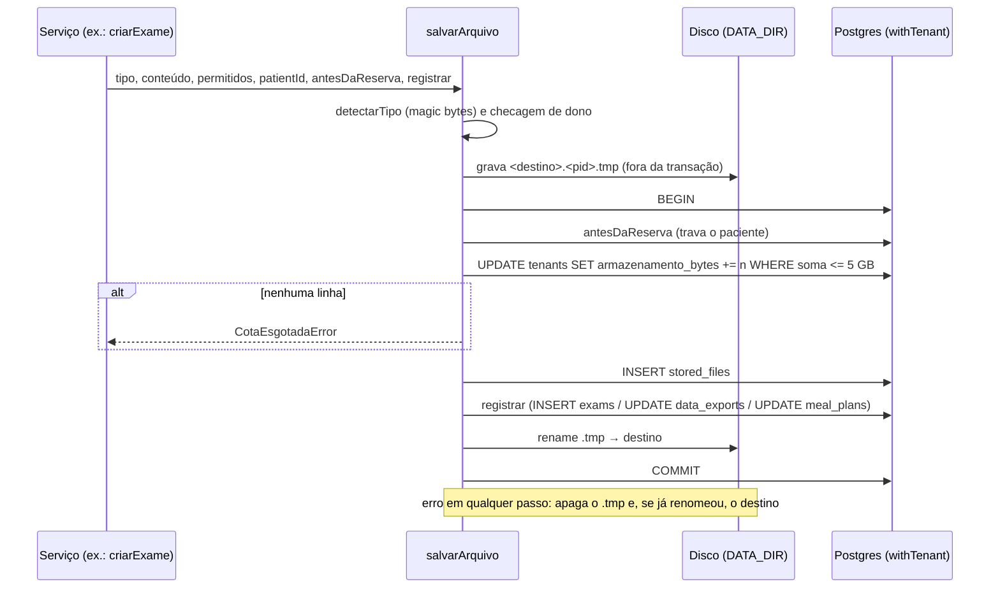
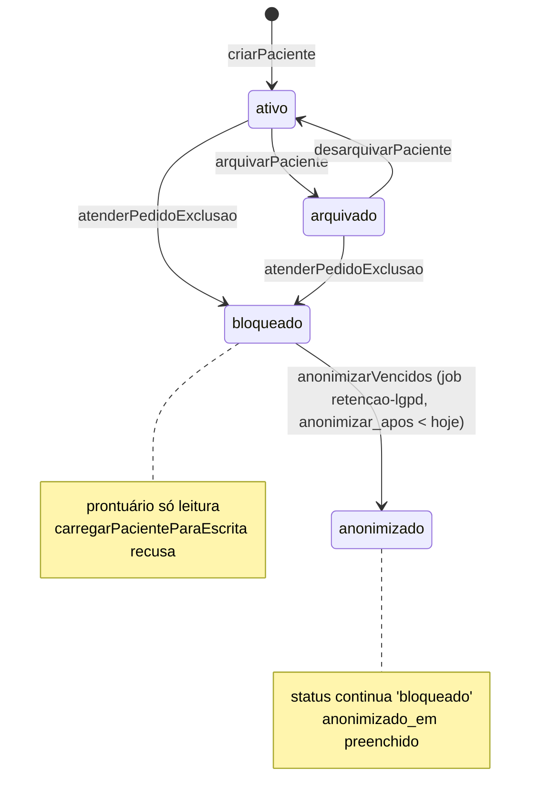
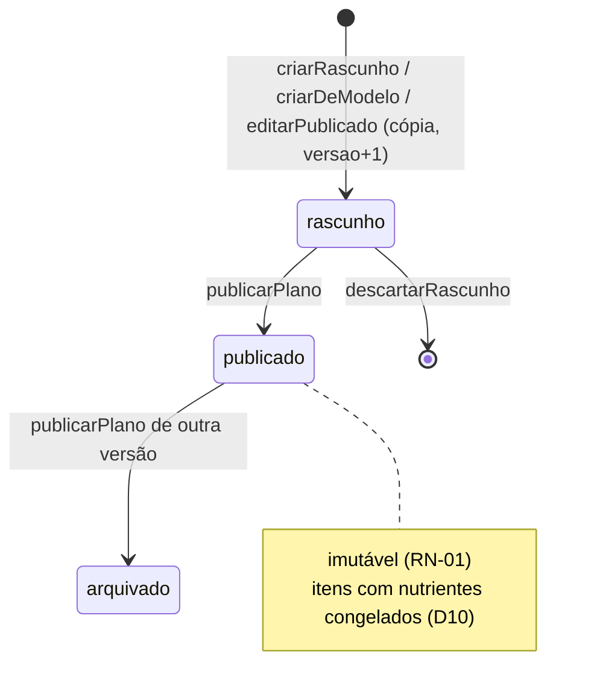

# 4. Módulos clínicos e de plataforma

Este capítulo descreve os três blocos de domínio que sustentam o consultório:

- **Plataforma** (`src/modules/plataforma/`): contas, convites, perfil e marca, armazenamento, monitoramento, métricas e preferências.
- **Pacientes e prontuário** (`src/modules/pacientes/`): cadastro, etiquetas, anamnese, antropometria, gasto energético, exames, atendimentos, evolução e LGPD.
- **Alimentos e plano alimentar** (`src/modules/alimentos/`, `src/modules/plano-alimentar/`).

Fonte de verdade: o código. Cada afirmação cita arquivo e linha (ou função). Decisões citadas como "Plano NN, Dx" vêm de `docs/superpowers/plans/`. Regras "RN-xx", "RNF-xx", "US-xxx" e "CS-xx" vêm da spec (`docs/superpowers/specs/2026-09-27-nutridebby-mvp-design.md` e `…-historias.md`). "Regra n do CLAUDE.md" é a regra obrigatória n de `CLAUDE.md` do projeto.

## 4.0 Convenções que todos os módulos seguem

| Convenção | Como aparece no código | Onde |
|---|---|---|
| Tabela com `tenant_id` só dentro de `withTenant(ctx, fn)` | Todo serviço recebe `ctx: TenantContext` e abre a transação com `withTenant` | `src/db/tenant.ts`; regra 1 do CLAUDE.md |
| Id da URL validado antes do banco | `idValido(id)` (`z.guid()`); id inválido vira "não encontrado", nunca erro 500 | `src/modules/pacientes/base.ts:24` |
| Escrita no prontuário trava o paciente | `carregarPacienteParaEscrita(tx, id)`: `SELECT … FOR UPDATE`; bloqueado ou anonimizado lança `PacienteBloqueadoError`; arquivado continua editável | `src/modules/pacientes/base.ts:31` |
| Leitura de dado de saúde é auditada | `auditRead(tx, {entidade, entidadeId, patientId})` na mesma transação; escritas viram `audit_log` pelo gatilho `audit_row_change` | `src/modules/plataforma/audit.ts:28`; regra 8 do CLAUDE.md |
| Erros por campo | Cada módulo tem uma classe `XxxError` com `erros: Record<campo, mensagem>` e textos em pt-BR da spec | ex.: `PacienteError` (`pacientes.ts:34`), `PlanoError` (`plano-alimentar/erros.ts:28`) |
| Datas "do dia" no fuso do tenant | `hojeNoFuso(fuso, agora)`, `idadeEm(nascimento, data)` | `src/modules/pacientes/datas.ts:16,23`; RN-06 |
| Arredondamento | `arredondar(v, casas)` por notação exponencial (meio para cima, sem erro de ponto flutuante); `formatarDecimal` com vírgula e sem separador de milhar | `src/lib/numero.ts:15,21`; RNF-12 |
| Ordem de travas | paciente → tenant (cota) → registro do arquivo/plano. Toda função que mexe em arquivo de paciente ou em plano respeita essa ordem para evitar deadlock | comentários em `armazenamento.ts:61`, `rascunho.ts:150`, `plano-pdf-job.ts:30` |

Entidades de auditoria das tabelas deste capítulo (gatilho instalado por `app_enable_audit` nas migrations):

| Tabela | Entidade no `audit_log` | Migration |
|---|---|---|
| `patients` | `patients` (coluna de id `id`) | `drizzle/0017_rls_pacientes.sql` |
| `patient_tag_links` | `etiquetas` | `drizzle/0020_rls_etiquetas.sql` |
| `anthropometry` | `antropometria` | `drizzle/0022_rls_antropometria.sql` |
| `energy_calcs` | `gasto_energetico` | `drizzle/0024_rls_gasto_energetico.sql` |
| `anamneses` | `anamnese` | `drizzle/0026_rls_anamnese.sql` |
| `consultations` / `consultation_notes` | `atendimentos` / `notas_privadas` | `drizzle/0028_rls_atendimentos.sql` |
| `exams` | `exames` | `drizzle/0030_rls_exames.sql` |
| `privacy_requests` | `pedidos_titular` | `drizzle/0033_rls_privacidade.sql` |
| `data_exports` | `exportacoes` | `drizzle/0035_rls_exportacoes.sql` |
| `meal_plans`, `meals`, `meal_items` | `plano_alimentar` | `drizzle/0045_rls_planos_alimentares.sql` |

Tabelas sem `patient_id` (`anamnesis_templates`, `patient_tags`, `foods`, `food_measures`) não têm gatilho.

---

## 4.1 Plataforma

### 4.1.1 Contas de nutricionista e convites (US-001, US-002, US-004)

**Arquivos:** `src/modules/plataforma/contas.ts`, `convites.ts`, `dpa.ts`, `suspensao.ts`, `tenant-status.ts`, `admin-bootstrap.ts`.

**Tabelas:** `tenants` (sem RLS, sem `tenant_id`), `user`/`account`/`session` (Better Auth, exceção de RLS), `invites` e `consents` (com `tenant_id`, mas em `RLS_EXCEPTIONS`).

| Função | O que faz | Onde |
|---|---|---|
| `criarContaNutri(input)` | Valida (`novaContaSchema`), cria `tenants` + `user` (`appRole = 'nutri'`, sem senha) + convite de 72 h + e-mail, **na mesma transação**. Pré-checa slug e e-mail para mensagem amigável; em corrida, decide a `UNIQUE` (`tenants_slug_unique`, `user_email_unique`) | `contas.ts:59` |
| `reenviarConvite(tenantId)` | Trava a nutricionista (`FOR UPDATE`), recusa se a conta está suspensa (`conta_suspensa`) ou se ela já tem senha (`ja_tem_senha`), gera convite novo | `contas.ts:89` |
| `listarContas(db?, now?, { busca, depois, antes, limite })` | Lista do admin: só `tenants`, `user`, `account`, `invites`. Calcula o estado do convite (`aceito`/`pendente`/`expirado`/`sem_convite`). **P09-07 (Plano 13, T11):** devolve `PaginaDeContas` (`contas`, `anterior`, `proxima`, `busca`), 50 por página (`CONTAS_POR_PAGINA`); cursor = id de um consultório (`?depois=`/`?antes=`, validado como uuid; inválido ou sem linhas = primeira página, mantendo a busca), comparação `(created_at, id)` com a linha do cursor **no banco** (sem perder os microssegundos), ordem `created_at desc, id desc`; busca (`trim`, até 100, `BUSCA_CONTAS_MAX`) por `position(lower(busca) in lower(nome · slug))` ou `exists` de **qualquer** nutricionista do consultório com o e-mail — `%` e `_` literais, parâmetro ligado; **uma linha por consultório** (`left join lateral … limit 1`: o e-mail mostrado é o da primeira nutricionista). As quatro métricas `admin_metricas_*` continuam calculadas para todos os consultórios (D-P5); a página `/admin` só desenha as linhas da página, com o formulário GET `role="search"` ("Buscar por nome, endereço ou e-mail", "Buscar", "Limpar busca", em `GET_PERMITIDOS`), "Nenhuma conta encontrada." e a navegação "Anterior"/"Próxima". Depois de uma ação, o redirecionamento volta à primeira página sem a busca (desvio 8 do Plano 13) | `contas.ts:162` |
| `criarConvite(q, userId)` | Apaga convites pendentes do usuário e grava um novo; guarda só o SHA-256 do token; devolve o token em claro só para o e-mail | `convites.ts:23` |
| `inspecionarConvite(q, token)` | Estado do token (`valido`/`expirado`/`invalido`); token fora do formato (`/^[A-Za-z0-9_-]{43}$/`) nem chega ao banco | `convites.ts:35` |
| `aceitarConvite(input)` | Primeiro acesso: aceite do DPA obrigatório, política de senha, checagem barata do token **antes** do argon2 (T6-R2a), depois transação: trava o usuário, consome o convite com `UPDATE … WHERE usado_em IS NULL`, grava a senha, marca e-mail verificado, registra o DPA | `convites.ts:66` |
| `registrarAceiteDpa(q, …)` | `INSERT … ON CONFLICT DO NOTHING` em `consents`; só atualiza `tenants.dpa_aceito_em` se a linha foi inserida (prova e marca nunca divergem) | `dpa.ts:28` |
| `definirIaLiberada(db, tenantId, liberar, adminId, { producao? })` (Plano 11) | Interruptor "IA" da admin (`tenants.ia_liberada`) com `liberar_ia`/`bloquear_ia` em `admin_actions`; em produção (`o.producao ?? emProducao(getEnv())`) recusa liberar (`IaProvisoriaError`) enquanto o aviso ou o aditivo forem `-provisorio` (D22). Só fora de `withTenant` (gatilho `tenants_interruptores_da_admin`) | `contas.ts:186` |
| `registrarAceiteAditivoIa(…)` (Plano 11) | Aceite do aditivo de IA em `consents` (`ia-aditivo-<versão>`, com o `tenant_id`) e `tenants.ia_ativada_em` (a data da ativação em vigor: o `coalesce` só a mantém com a IA ativa — aceite de versão nova, clique repetido, `dpa.ts:57-60`; `desativarIa` a zera, `ativacao.ts:48`, e a reativação grava data nova; o primeiro aceite de cada versão fica em `consents.aceito_em`) e `ia_aditivo_versao`; devolve se a linha é nova. Chamada por `ativarIa` ([§10.2](10-ia.md#102-peças)) | `dpa.ts:50` |
| `suspenderConta` / `reativarConta` | `tenants.status`, revoga as sessões das usuárias do tenant e envia `agenda-tenant` ao worker na mesma transação (o admin nunca toca tabela 🔒) | `suspensao.ts:19,33` |
| `getTenantStatus`, `tenantIsActive`, `buscarTenant`, `buscarTenantPorSlug`, `listarTenantsParaVarredura` | Leituras de `tenants`. `aguardarSuspensao` usa `FOR SHARE` para esperar uma suspensão em curso | `tenant-status.ts:26,49,33,42,54` |

Regras e constantes:

- Convite da nutricionista vale 72 h (`CONVITE_NUTRI_VALIDADE_MS`, `convites.ts:11`). Um convite pendente por usuário (índice único parcial em `invites`; spec §7).
- CRN: `/^CRN-?\d{1,2}\s?\d{3,6}$/i`, gravado em maiúsculas (`contas.ts:14,29`).
- Slug: `^[a-z0-9-]{3,40}$` (`contas.ts:35`).
- Ordem de travas usuário → convite em `aceitarConvite` e `reenviarConvite` (T6-R1) para evitar deadlock 40P01 (`convites.ts:62-65`).
- DPA: `DPA_VERSAO = '0.1-provisorio'` (`dpa.ts:6`). Mudar a versão obriga novo aceite (`requireNutri`).
- RN-15 (tenant suspenso): sessões revogadas na hora; o worker consulta `tenantIsActive` antes de gerar exportação e PDF (`exportacao-job.ts`, `plano-pdf-job.ts:38`).

Decisão (Plano 02, "Suspensão"): status + revogação das sessões + bloqueio no login + checagem por requisição, em vez de só um status lido no login.

### 4.1.2 Perfil e marca (US-005)

**Arquivos:** `marca.ts`, `marca-constantes.ts`, `logo.ts`, `src/lib/tema/contraste.ts`, `src/lib/tema/marca-tema.ts`.

| Função | O que faz | Onde |
|---|---|---|
| `atualizarPerfil(tenantId, input)` | Valida `perfilSchema` e grava em `tenants`. O `tenantId` vem sempre da sessão (`requireNutri`), nunca do formulário (`tenants` não tem RLS) | `marca.ts:64` |
| `getTenantBrand(tenant)` | `{nome, cor, corNoEscuro, logoUrl}`; logo servido por `signFileUrl`. `server-only` | `marca.ts:73` |
| `processarLogo(conteudo)` | Tipo pelo conteúdo; PNG/JPEG redimensionados com `sharp` para ≤ 512 px, sem EXIF; SVG rasterizado num **processo filho** (`scripts/svg-raster.mjs`) morto por `SIGKILL` em 5 s ou com saída > 2 MB | `logo.ts:230`, `rasterizarSvg` |
| `contemFiltroSvg(buf)` | Recusa SVG com `filter`/primitivas `<fe…>`, inclusive escondidos por referência numérica, escape CSS, comentário ou CDATA; recusa DOCTYPE fora da forma comum | `logo.ts:127` |
| `trocarLogo(ctx, conteudo)` | `processarLogo` → `salvarArquivo(tipo 'logo', ['png'])` → `apontarLogo` (troca atômica de `tenants.logo_path` com `FOR UPDATE`) → apaga o logo antigo. Se o ponteiro falha, apaga o arquivo novo | `logo.ts:274`, `apontarLogo` `logo.ts:266` |

Validações de `perfilSchema` (`marca.ts:31`):

| Campo | Regra |
|---|---|
| `corPrimaria` | `#RRGGBB` e contraste ≥ 4,5:1 com branco (`contrasteComBranco`) |
| `antecedenciaMinH`, `cancelamentoMinH` | inteiro 0–72 |
| `linkOnlinePadrao` | vazio ou `https://…`, até 500 caracteres |
| `enderecoConsultorio` | até 200 caracteres |
| `fuso` | só os 15 fusos de `FUSOS_BRASIL` (`marca-constantes.ts:15`) |

Constantes: `COR_PADRAO = '#1d6b5a'` (Plano 08, D23; `marca-constantes.ts:8`), `LOGO_MAX_BYTES = 2 MB`, `LOGO_LADO_MAX = 512` (`marca-constantes.ts:10-11`).

Proteções do processamento de SVG (risco residual aceito na US-005): um logo por vez no processo (`processando`, `logo.ts:214`), resfriamento de 10 min por tenant depois de um SVG pesado (`RESFRIAMENTO_MS`, `logo.ts:148`), `<!ENTITY>` recusado já em `detectarTipo` (`src/lib/file-type.ts:64`). SVG nunca é guardado (RNF-06).

Decisão (Plano 08, D19): a cor do tenant vai para destaque, botões e foco; no modo escuro, a variante clara `corNoEscuro` é calculada no servidor.

Plano 10A: a mesma página (`/painel/configuracoes/perfil`) ganhou a seção "Dados para documentos" (`#documentos`: nome
completo, e-mail e telefone do carimbo das receitas, e a autodeclaração da habilitação em Fitoterapia), gravada por
`src/modules/documentos/perfil-profissional.ts` com auditoria explícita (`recordAudit`, entidade `perfil_profissional`,
sem paciente; `tenants` não tem gatilho). O CRN e o endereço continuam no formulário de marca. Detalhe no
[cap. 9](09-documentos-assinados.md#92-arquivos-do-módulo).

### 4.1.3 Armazenamento com cota e URL assinada (RN-18, regra 9 do CLAUDE.md)

**Arquivos:** `src/modules/plataforma/armazenamento.ts`, `src/lib/signed-url.ts`, `src/lib/file-type.ts`, `src/app/api/arquivos/route.ts`.

**Tabelas:** `stored_files` 🔒 (registro de cada arquivo) e `tenants.armazenamento_bytes` (contador da cota).

Layout no disco: `DATA_DIR/<tenantId>/<tipo>/<uuid>.<ext>` (`armazenamento.ts:96`). O nome nunca vem do usuário. `resolverCaminho` recusa qualquer caminho que escape de `DATA_DIR` (`armazenamento.ts:49`).

| Função | O que faz | Onde |
|---|---|---|
| `salvarArquivo(ctx, input)` | Única porta de gravação. Ver fluxo abaixo | `armazenamento.ts:64` |
| `apagarArquivo(ctx, filtro, deps)` | Única porta de remoção: apaga `stored_files`, devolve os bytes à cota e remove do disco depois do commit (ou antes, com `removerAntesDoCommit`) | `armazenamento.ts:160` |
| `nivelDeUso(bytes)` | `ok` / `aviso` (≥ 80%) / `esgotado` (≥ 100%) | `armazenamento.ts:38` |
| `limparTmpOrfaos(dataDir, agora)` | Apaga `*.<pid>.tmp` com mais de 24 h; fila diária `limpar-tmp` às 04h | `armazenamento.ts:210`; `src/worker/index.ts:198` |
| `signFileUrl(caminho)` | URL `/api/arquivos?c=…&e=…&s=…`, HMAC-SHA256 com `FILE_URL_SECRET`, validade 300 s | `src/lib/signed-url.ts:16` |
| `verifyFileUrl(params)` | Confere formato do caminho, assinatura (comparação em tempo constante) e validade | `src/lib/signed-url.ts:27` |

Parâmetros de `salvarArquivo`:

| Parâmetro | Uso |
|---|---|
| `tipo` | `logo`, `capa`, `exame`, `plano_pdf`, `diario_foto`, `diario_foto_original`, `orientacao_pdf`, `exportacao` (`armazenamento.ts:16`) |
| `permitidos` | Extensões aceitas para aquele uso; o tipo real vem dos *magic bytes* (`detectarTipo`); SVG nunca passa (`armazenamento.ts:92-94`) |
| `patientId` | Obrigatório para `TIPOS_DO_PACIENTE` (`exame`, `plano_pdf`, `diario_foto`, `diario_foto_original`, `exportacao`) e proibido para os demais (Plano 06, D4; `armazenamento.ts:20,89`). O banco repete a regra no CHECK `stored_files_dono` |
| `antesDaReserva(tx)` | Roda antes da reserva da cota: é onde se trava o dono do arquivo (paciente) |
| `registrar(tx, arquivo)` | Grava o registro que aponta para o arquivo (exame, exportação, PDF) na mesma transação |
| `naoBarrarPelaCota` | Só a exportação LGPD: conta na cota, mas não é recusada por ela |
| `substitui` | Caminho do arquivo que este substitui (foto do diário): a cota é conferida pela diferença |



Regras:

- Cota de 5 GB por tenant (`COTA_BYTES`, `armazenamento.ts:12`), aviso em 80% (`COTA_AVISO`). Mensagem: "Espaço de armazenamento esgotado. Fale com o suporte." (RN-18).
- A reserva é um `UPDATE` condicional na linha de `tenants`: uploads simultâneos serializam nessa linha e nunca passam do limite (`armazenamento.ts:115-127`).
- O arquivo vai para o disco **antes** da transação; dentro dela só acontece o `rename`. Assim a linha do tenant fica travada pelo tempo do `rename`, não da escrita (`armazenamento.ts:102-105`).
- Falha no `rm` depois do commit só gera aviso de arquivo órfão; o log leva o código do erro (`motivoDoErro`), nunca o caminho (RNF-11; `armazenamento.ts:193-203`).

Servir arquivos (`src/app/api/arquivos/route.ts:21`):

- Não há sessão na rota: a URL assinada é a credencial. Quem emite a assinatura é quem já checou o acesso (página do painel ou do portal).
- Respostas: 403 (assinatura ou caminho), 410 (expirada), 404 (arquivo ausente).
- Cabeçalhos do 200: `content-security-policy: default-src 'none'; sandbox`, `x-content-type-options: nosniff`, `referrer-policy: no-referrer`, `cache-control: private, max-age=<segundos até expirar>` (T8-R2a) (`route.ts:36-47`; a CSP está em `:42`).
- As respostas de erro (403, 410, 404; `erro()`, `route.ts:18`) não levam essa CSP: só `cache-control: no-store` mais os cabeçalhos globais de `next.config.ts` (§6.3.1).
- PDF e ZIP saem como `attachment`; imagens como `inline` (o visualizador de PDF do Chrome não abre sob CSP `sandbox` — desvio registrado no Plano 03).
- O caminho aceito é só `<uuid>/<tipo>/<uuid>.(png|jpg|webp|heic|pdf|zip)` (`CAMINHO_ARQUIVO`, `signed-url.ts:8`).

Como estender com segurança:

1. Tipo novo de arquivo: acrescentar em `TipoDeArquivo`, no CHECK `stored_files_tipo_valido` (migration), em `TIPOS_DO_PACIENTE` se tiver dono, e no `MIME`/`CAMINHO_ARQUIVO` se a extensão for nova. Se o tipo tiver dono (paciente), confira também: o CHECK `stored_files_dono` (`drizzle/0071_stored_files_paciente.sql:7`, validado em `0072`), que exige `patient_id` exatamente para os tipos de paciente; a política `paciente_arquivos` (`0072`, refeita em `0085`), que decide o que o paciente enxerga; `anexosDoPaciente` (`src/modules/pacientes/lgpd.ts:289`), que apaga os arquivos na exclusão e na anonimização (LGPD), e a exportação (`exportacao-job.ts`), se o arquivo faz parte dos dados do titular. Se o arquivo for temporário (como `exportacao`), acrescente o `--exclude` do `rclone sync` de `data/` em `scripts/backup/nutri-backup.sh:118` (hoje só `/*/exportacao/**`), para não ir ao R2.
2. Registro que aponta para o arquivo: gravar no `registrar` de `salvarArquivo` e apagar no `naMesmaTransacao` de `apagarArquivo`. Nunca em transação separada (regra 9 do CLAUDE.md; Plano 03, decisão "Arquivo e registro juntos").
3. Respeitar a ordem de travas: dono em `antesDaReserva`/`naMesmaTransacao`, depois cota. Os documentos (Plano 10A) travam o documento antes da cota em todo `salvarArquivo` que grava nele (`travarDocumentoAntesDaCota`, `src/modules/documentos/arquivos-do-preparo.ts`).

Tipos do Plano 10A: `documento_base` (PDF preparado), `documento_assinado` (PDF final) e `documento_digitalizado` (fotos da
digitalizada), os três com dono. São os primeiros apontados por FK **`NO ACTION`** (`signed_documents.base_pdf_path` e
`pdf_path`), não `SET NULL`: um `apagarArquivo` avulso de um PDF de documento é recusado. A política `paciente_arquivos`
(refeita na 0090) esconde do paciente o base e as fotos; `anexosDoPaciente` nunca lista esses caminhos (a anonimização
passa por `anonimizarDocumentosDoPaciente`, [§9.4.4](09-documentos-assinados.md#944-lgpd-us-150-base-plano-10a-d1)).

### 4.1.4 Monitoramento de backup e disco (RNF-05, RNF-13)

**Arquivo:** `src/modules/plataforma/monitoramento.ts`. Jobs em `src/worker/index.ts:118-136`.

O backup roda no host (systemd às 03h, `scripts/backup/nutri-backup.sh`), não no worker (Plano 02, decisão "Onde roda o backup"; regra 10 do CLAUDE.md). O script grava `backup_runs`; o app só lê.

| Função | O que faz | Onde |
|---|---|---|
| `ultimosBackups(db, now)` | Última execução de cada tipo (`banco`, `arquivos`) por `DISTINCT ON` | `monitoramento.ts:47` |
| `backupsFaltando(db, now)` | Tipos sem execução nas últimas 26 h ou cuja última execução falhou | `monitoramento.ts:59` |
| `verificarBackups` | Avisa os admins; o e-mail cita só os tipos, nunca `backup_runs.detalhe` | `monitoramento.ts:96` |
| `percentualDisco(statfs)` | Mesma conta do `df` (blocos reservados ao root não contam como livres), arredondada para cima | `monitoramento.ts:18` |
| `statfsDoDiretorio(dir)` | Mede o ancestral existente mais próximo se `DATA_DIR` ainda não existe | `monitoramento.ts:28` |
| `verificarDisco` | Alerta com ≥ 70%, no máximo 1 e-mail a cada 24 h (marca `alerta_disco` em `system_heartbeat`) | `monitoramento.ts:103` |
| `avisarAdmins(db, montar, …)` | Um e-mail por admin, todos na mesma transação; a marca do alerta só confirma junto dos e-mails e só se houve destinatário (F5, F6, G4) | `monitoramento.ts:79` |

| Job | Agenda (America/Sao_Paulo) | Constante |
|---|---|---|
| `monitor-backup` | `0 7 * * *` | `BACKUP_JANELA_MS = 26 h` (`monitoramento.ts:10`) |
| `monitor-disco` | `0 * * * *` | `DISCO_LIMITE = 70` (`monitoramento.ts:11`) |

### 4.1.5 Métricas do admin e critérios de sucesso CS-01..03

**Arquivos:** `src/modules/plataforma/metricas.ts` (admin), `metricas-sucesso.ts` (nutricionista). Migrations `0086_metricas_sucesso.sql` (colunas) e `0087_metricas_sucesso_admin.sql` (função).

O admin nunca consulta tabela 🔒 (regra 1). Ele lê só contagens por funções `SECURITY DEFINER` que entram tenant a tenant e recusam rodar dentro de `withTenant` (`drizzle/0087_metricas_sucesso_admin.sql:14-16`).

| Função | O que devolve | Onde |
|---|---|---|
| `metricasPorTenant()` | `admin_tenant_metrics()`: arquivos, bytes, pacientes ativos, consultas e mensagens de WhatsApp do mês | `metricas.ts:21` |
| `metricasDeSucessoPorTenant()` | `admin_metricas_sucesso()`: pacientes com conta, que abriram o app em 7 dias, faltas e consultas iniciadas no mês | `metricas.ts:44` |
| `ajustarCotaWhatsapp(tenantId, valor)` | `tenants.wa_cota_mensal`, inteiro 0–100000 (RN-09) | `metricas.ts:61` |
| `metricasDeIaPorTenant()` (Plano 11) | `admin_metricas_ia()`: tarefas de IA e custo do mês (micro-dólares) por tenant, para a coluna "IA" | `metricas.ts:133` |
| `ajustarCotaIa(tenantId, valor, adminId)` (Plano 11) | `tenants.ia_cota_mensal_usd`, 0–1000 ("Informe um valor entre 0 e 1000"); grava `ajustar_cota_ia` em `admin_actions` e o valor só no log (`limite de IA ajustado`) | `metricas.ts:119` |
| `salvarMetricasBase(tenantId, {taxaBase, goLiveEm})` | `tenants.taxa_faltas_base` (0–100, até 2 casas, vírgula ou ponto) e `tenants.go_live_em` (dd/mm/aaaa) | `metricas.ts:92` |
| `metricasDeSucesso(ctx, tenant, agora)` | CS-01, CS-02 e CS-03 do tenant, numa transação, sem `auditRead` (só contagens) | `metricas-sucesso.ts:23,32` |

Definições (Plano 08, D15; spec §1.1):

| Critério | Cálculo no código |
|---|---|
| CS-01 | Consultas `realizada` com atendimento (`LEFT JOIN consultations` por `appointment_id`) ÷ consultas `realizada` desde `go_live_em` até agora; "dias desde o início" = dias entre `go_live_em` e hoje + 1 (`DIAS_CS01 = 30`) |
| CS-02 | Pacientes `ativo`, com `user_id` e não anonimizados que têm `access_events` nos últimos 7 dias ÷ a mesma população; barras por dia (`META_CS02 = 0.6`) |
| CS-03 | Taxa de faltas do mês (Início) contra `taxa_faltas_base` informada pelo admin |

Decisão (Plano 08, D15): denominador do CS-02 = ativos **com conta**, não todos os ativos; base do CS-03 gravada pelo admin, não pela nutricionista.

### 4.1.6 Preferências de tema e manual guiado (Plano 08, D17, D26, D27)

**Arquivos:** `src/modules/plataforma/preferencias.ts`, `preferencias-tipos.ts`. Migration `0088_preferencias_usuaria.sql`.

| Função | O que faz | Onde |
|---|---|---|
| `gravarTema(userId, tema)` | `user.tema` ∈ `sistema`/`claro`/`escuro` | `preferencias.ts:16` |
| `lerGuia(userId)` | `user.guia` (`{id: {v, estado}}`) | `preferencias.ts:22` |
| `marcarGuia(userId, id, versao, estado)` | Um `UPDATE` com `jsonb_set` atômico: duas abas não se apagam; versão menor nunca sobrescreve; "visto" não rebaixa um tour concluído ou dispensado da mesma versão | `preferencias.ts:32` |
| `proximoTema(atual, aparelhoEscuro)` | O botão alterna o que a usuária vê | `preferencias-tipos.ts:7` |

Decisão D17: colunas na `user` (não cookie, não `localStorage`, não tabela nova). O tema chega à sessão pelo `additionalFields` do Better Auth; o servidor desenha o tema sem piscar. O `userId` vem sempre de `requireNutri`.

---

## 4.2 Pacientes e prontuário

### 4.2.1 Cadastro de paciente (US-010, RN-17)

**Arquivos:** `src/modules/pacientes/pacientes.ts`, `base.ts`, `datas.ts`, `telefone.ts`, `convite-paciente.ts`.

**Tabela:** `patients` 🔒. Restrições relevantes (`src/db/schema/pacientes.ts`): `UNIQUE (tenant_id, email)` em `citext`; status `ativo`/`arquivado`/`bloqueado`; telefone E.164; CHECK `patients_nascimento_e_sexo` (nascimento e sexo obrigatórios, salvo origem `agendamento_publico` ou anonimizado).

| Função | O que faz | Onde |
|---|---|---|
| `pacienteSchema(hoje)` | Nome 2–120; nascimento válido, idade 18–120 no dia do tenant (RN-17); sexo `F`/`M`; e-mail; telefone normalizado para E.164; WhatsApp autorizado exige telefone; convite por WhatsApp exige autorização | `pacientes.ts:42` |
| `criarPaciente(ctx, tenant, input)` | Insere com `origem = 'nutri'`, autorização de WhatsApp de origem `nutri`, convite por e-mail de 7 dias na mesma transação e, se pedido, o aviso por WhatsApp (sem link). E-mail repetido decidido pela `UNIQUE` | `pacientes.ts:115` |
| `atualizarPaciente(...)` | Trava o paciente; e-mail bloqueado depois que ele ativou o acesso; e-mail corrigido antes do aceite reenvia o convite | `pacientes.ts:151` |
| `buscarPaciente(ctx, id)` | Abre o prontuário e audita a leitura (`patients`) | `pacientes.ts:196` |
| `listarPacientes(ctx, filtro)` | Busca sem acento por nome ou e-mail (`unaccent … ilike`, curingas escapados), filtro por status e etiqueta, até 500 linhas. Filtrar por etiqueta audita uma leitura de "etiquetas" por paciente devolvido | `pacientes.ts:218` |

Autorização de WhatsApp (`autorizacaoWhatsapp`, `pacientes.ts:101`): o formulário da nutricionista nunca desfaz uma escolha do paciente. Marcar só grava se não há opt-in nem opt-out; desmarcar só apaga opt-in de origem `nutri`.

A lista não audita (nome e contato), como a agenda (Plano 05, D10). Abrir o prontuário audita.

### 4.2.2 Etiquetas (US-019)

**Arquivo:** `src/modules/pacientes/etiquetas.ts`. **Tabelas:** `patient_tags` e `patient_tag_links`, ambas `staff_only` (`drizzle/0020_rls_etiquetas.sql`; `STAFF_ONLY` em `src/db/rls-guard.ts:105`).

| Função | O que faz | Onde |
|---|---|---|
| `listarEtiquetas(ctx)` | Etiquetas com a contagem de pacientes **ativos** (o número do seletor bate com a lista padrão) | `etiquetas.ts:17` |
| `etiquetasDoPaciente(ctx, id)` | Leitura auditada (etiqueta é dado de saúde: "diabetes", "gestante") | `etiquetas.ts:34` |
| `salvarEtiquetasDoPaciente(ctx, id, {etiquetas, nova})` | Deixa o paciente com exatamente o conjunto pedido; cria a `nova` (até 40 caracteres) se não existir; id de outro tenant é ignorado (só vale o que a RLS mostra) | `etiquetas.ts:56` |

Decisão (Plano 03, "Notas privadas e etiquetas"): tabelas próprias com a política RESTRICTIVE `staff_only` (`app.role <> 'paciente'`). Uma coluna em tabela visível ao paciente não poderia ser escondida: o role do banco é o mesmo e GRANT por coluna não distingue `app.role`. A guarda `findStaffOnlyViolations` quebra o CI se faltar a política.

### 4.2.3 Anamnese com modelo e snapshot (US-012)

**Arquivos:** `anamnese.ts`, `anamnese-tipos.ts` (puro, usado também no navegador), `anamnese-padrao.ts`.

**Tabelas:** `anamnesis_templates` 🔒 (`nome`, `schema jsonb`, `padrao`, `arquivado_em`; índice único parcial de um padrão por tenant) e `anamneses` 🔒 (`template_snapshot`, `respostas`, `data`).

| Função | O que faz | Onde |
|---|---|---|
| `garantirModeloPadrao(tx, tenantId)` | Cria "Anamnese geral" se o tenant nunca teve padrão; corrida decidida pelo índice único (`ON CONFLICT DO NOTHING`) | `anamnese.ts:22` |
| `listarModelos(ctx)` | Garante o padrão e lista os não arquivados | `anamnese.ts:27` |
| `salvarModelo(ctx, id, input)` | Cria ou altera; valida com `validarModelo` (até 100 perguntas; escolha precisa de ≥ 2 opções; até 30 opções de até 100 caracteres) | `anamnese.ts:50`; `anamnese-tipos.ts:43` |
| `arquivarModelo(ctx, id)` | "Excluir" = arquivar | `anamnese.ts:74` |
| `preencherAnamnese(ctx, tenant, patientId, templateId, respostas)` | Valida contra o modelo atual e grava **cópia do modelo** em `template_snapshot` | `anamnese.ts:80` |
| `atualizarAnamnese(...)` | Valida contra o **snapshot**, nunca contra o modelo atual | `anamnese.ts:119` |
| `listarAnamneses`, `buscarAnamnese` | Leituras auditadas (`anamnese`) | `anamnese.ts:134,161` |
| `perguntasDaAnamnese(...)` | Só as perguntas do snapshot, sem auditar (não devolve resposta) | `anamnese.ts:151` |

Tipos de pergunta (`TIPOS_PERGUNTA`, `anamnese-tipos.ts:6`): `texto_curto` (≤ 200), `texto_longo` (≤ 5000), `numero` (com unidade), `sim_nao`, `escolha_unica`, `multipla_escolha`, `data`. Obrigatória vazia: "Responda: {rótulo}"; valor inválido: "Resposta inválida: {rótulo}". Qualquer erro = nada salvo (`validarRespostas`, `anamnese-tipos.ts:81`).

Modelo padrão (`modeloPadrao`, `anamnese-padrao.ts:6`): dez perguntas não obrigatórias com os nomes exatos da US-012.

Decisão (Plano 03, "Modelo padrão de anamnese"): criado na primeira listagem, não na criação da conta, porque a conta é criada pelo admin, que nunca toca tabela 🔒.

### 4.2.4 Antropometria (US-013) e gasto energético (US-014)

**Arquivos:** `formulas.ts` (puro, usado no servidor e na prévia do navegador), `antropometria.ts`, `antropometria-constantes.ts`, `gasto-energetico.ts`.

**Tabelas:** `anthropometry` 🔒 (`imc` gerado pelo banco; `densidade numeric(6,5)`; `perc_gordura numeric(5,2)`) e `energy_calcs` 🔒 (entradas e resultado com 6 casas; CHECK idade ≥ 18 e fator 1,00–2,50).

#### Fórmulas implementadas (Apêndice A)

Unidades: peso P em kg, altura A em cm, idade I em anos completos, soma de dobras S em mm.

| Fórmula | Implementação | Onde |
|---|---|---|
| IMC = P / (A/100)² | `imc()` no navegador; no banco, coluna gerada `round(peso_kg / ((altura_cm/100)^2), 2)` | `formulas.ts:28`; `src/db/schema/pacientes.ts` (`anthropometry.imc`) |
| Harris-Benedict, homem: 66,47 + 13,75·P + 5,003·A − 6,755·I | `tmb('harris_benedict')` | `formulas.ts:89-90` |
| Harris-Benedict, mulher: 655,1 + 9,563·P + 1,85·A − 4,676·I | idem | `formulas.ts:90` |
| Mifflin-St Jeor: 10·P + 6,25·A − 5·I + 5 (H) / − 161 (M) | `tmb('mifflin')` | `formulas.ts:91-92` |
| FAO/OMS 18–29: 15,3·P + 679 (H) / 14,7·P + 496 (M) | `tmb('fao_oms')`; menor de 18 lança erro (RN-17) | `formulas.ts:93-95` |
| FAO/OMS 30–59: 11,6·P + 879 (H) / 8,7·P + 829 (M) | idem | `formulas.ts:96` |
| FAO/OMS ≥ 60: 13,5·P + 487 (H) / 10,5·P + 596 (M) | idem | `formulas.ts:97` |
| GET = TMB × fator (1,00–2,50) | `gastoTotal()`: TMB sem arredondar, resultado limpo em 6 casas (1302,5 × 1,40 daria 1823,4999… em JS) | `formulas.ts:101-108` |
| Jackson & Pollock: D = a − b·S + c·S² − d·I | `densidadeJP()` com `COEF_JP` | `formulas.ts:34-42` |
| JP3 homem (peitoral, abdominal, coxa): 1,10938 / 0,0008267 / 0,0000016 / 0,0002574 | `COEF_JP.jp3.M`, `JP3.M` | `formulas.ts:21,35` |
| JP3 mulher (tríceps, supra-ilíaca, coxa): 1,0994921 / 0,0009929 / 0,0000023 / 0,0001392 | `COEF_JP.jp3.F`, `JP3.F` | `formulas.ts:21,35` |
| JP7 homem (7 dobras): 1,112 / 0,00043499 / 0,00000055 / 0,00028826 | `COEF_JP.jp7.M` | `formulas.ts:36` |
| JP7 mulher: 1,097 / 0,00046971 / 0,00000056 / 0,00012828 | `COEF_JP.jp7.F` | `formulas.ts:36` |
| Siri: %G = 495 / D − 450 | `siri()` | `formulas.ts:45` |

Detalhes que mudam o resultado:

- `calcularGordura` grava a densidade com 5 casas e o %G com 2, mas calcula o %G a partir da densidade **sem arredondar** (arredondar antes muda a 2ª casa) (`formulas.ts:66-74`).
- Dobras fora de [1, 100] mm ficam ausentes; as presentes são arredondadas a 1 casa antes da conta (`dobrasNormalizadas`, `formulas.ts:51`).
- Exibição de TMB e GET: `kcal(v)` = inteiro, meio para cima, depois de limpar o resíduo de ponto flutuante (RN-14; `formulas.ts:111`).
- `compararTmb` devolve as três fórmulas lado a lado (`formulas.ts:113`).

#### Serviços

| Função | O que faz | Onde |
|---|---|---|
| `registrarAntropometria(ctx, tenant, patientId, input)` | Valida tudo antes (data não futura nem anterior ao nascimento; peso 1–400; altura 30–250; circunferências 5–300; dobras 1–100). Com protocolo `jp3`/`jp7` e dobras completas, grava densidade e %G com a idade **na data da avaliação**. Faltando dobra ou cadastro, salva as medidas e devolve aviso ("Preencha as N dobras…") | `antropometria.ts:64` |
| `listarAntropometrias`, `excluirAntropometria` | Leitura auditada; exclusão trava o paciente | `antropometria.ts:142,159` |
| `salvarCalculo(ctx, tenant, patientId, input)` | Idade no dia do cálculo no fuso do tenant; sexo e nascimento do cadastro; recusa menor de 18; grava TMB e GET com 6 casas e devolve os inteiros do mesmo valor gravado (sem arredondamento duplo) | `gasto-energetico.ts:33` |
| `listarCalculos`, `medidasRecentes` | Leituras auditadas; `medidasRecentes` alimenta o cálculo e o g/kg do plano | `gasto-energetico.ts:78,92` |

### 4.2.5 Exames (US-015)

**Arquivos:** `exames.ts`, `exames-constantes.ts`. **Tabela:** `exams` 🔒 (`valores jsonb`; `arquivo_path` com FK para `stored_files.caminho ON DELETE SET NULL` e CHECK do prefixo do tenant).

| Função | O que faz | Onde |
|---|---|---|
| `lerValores(bruto)` | Até 50 linhas; nome ≤ 80, unidade ≤ 20, referência ≤ 80; valor numérico finito < 10¹⁵. Passou do limite → recusa (não corta dado de saúde em silêncio) | `exames.ts:30` |
| `criarExame(ctx, tenant, patientId, input)` | Valida; confere o paciente (barato) antes de tocar arquivo; com laudo, chama `salvarArquivo(tipo 'exame', ['pdf','jpg','png'])` com `antesDaReserva` = trava do paciente e `registrar` = `INSERT exams` | `exames.ts:56` |
| `excluirExame(ctx, patientId, id)` | Exame e laudo saem na mesma transação (`apagarArquivo` com `naMesmaTransacao`). Desde o Plano 11 (D20), antes do `DELETE` chama `cancelarTarefas(tx, { tenantId, patientId, examId })`: leitura da IA na fila é cancelada com estorno e a sugestão pronta é esvaziada; a tarefa fica, com `exam_id` nulo (`ON DELETE SET NULL`) | `exames.ts:109` |
| `listarExames` | Leitura auditada (`exames`) | `exames.ts:127` |
| `agruparMarcadores(lista)` | Uma série por nome + unidade (sem diferenciar maiúsculas e espaços), pontos em ordem cronológica: mg/dL e mmol/L são séries diferentes | `exames.ts:146` |

Limite: 20 MB por laudo (`EXAME_MAX_BYTES`, `exames-constantes.ts:2`), mensagem "Envie PDF, JPEG ou PNG de até 20 MB".

Plano 11: o exame com laudo ganha "Ler valores com IA" (quando a IA está ativa e o paciente foi informado); as linhas
salvas de uma sugestão levam `iaTarefaId` e aparecem com "IA · conferido em {data}". `lerValores` continua montando
objetos novos, então a digitação manual nunca grava `iaTarefaId`. Detalhe no [cap. 10](10-ia.md).

### 4.2.6 Atendimentos e notas privadas (US-016)

**Arquivo:** `atendimentos.ts`. **Tabelas:** `consultations` 🔒 (`data`, `orientacoes_paciente` ≤ 5000, `appointment_id` único quando não nulo) e `consultation_notes` 🔒 `staff_only` (`texto` 1–20000; FK tripla `(tenant_id, patient_id, consultation_id)`).

| Função | O que faz | Onde |
|---|---|---|
| `registrarAtendimento(ctx, tenant, patientId, input)` | Data não futura; textos normalizados (CRLF → LF). Com `appointmentId` (Plano 05, "Iniciar atendimento"): trava a consulta, aplica `motivoParaNaoIniciarAtendimento` e marca a consulta `realizada`. Grava a nota em `consultation_notes` (vazia = sem linha) | `atendimentos.ts:66` |
| `atualizarAtendimento(...)` | Altera data e orientações; regrava ou apaga a nota | `atendimentos.ts:100` |
| `listarAtendimentos` | Data e orientações, **sem** a nota; audita `atendimentos` | `atendimentos.ts:164` |
| `buscarAtendimento` | Abre um atendimento com a nota (`LEFT JOIN`); audita `atendimentos` e, se houver nota, `notas_privadas` | `atendimentos.ts:169` |
| `orientacoesDoPaciente(ctx)` | Para o portal: só orientações, só em sessão de paciente (recusa o contexto da nutricionista) | `atendimentos.ts:179` |

Garantias de privacidade da nota: a política `staff_only` (`drizzle/0028_rls_atendimentos.sql`) esconde a tabela de qualquer sessão de paciente, mesmo por SQL direto; a exportação nunca inclui notas (ver 4.2.9).

Corrida "duas abas iniciando o mesmo atendimento": decidida pelo índice `consultations_consulta_idx`; o erro vira "Esta consulta já tem um atendimento registrado." (`atendimentos.ts:95`).

### 4.2.7 Evolução em SVG no servidor (US-017)

**Arquivos:** `evolucao.ts`, `ui/grafico-linha.tsx`. Páginas: `src/app/painel/pacientes/[id]/evolucao/page.tsx` e `src/app/p/(portal)/evolucao/page.tsx`.

| Função | O que faz | Onde |
|---|---|---|
| `seriesDasAvaliacoes(avaliacoes)` | Uma série por medida (peso, IMC, %G, seis circunferências), só com as datas em que foi medida; série vazia some | `evolucao.ts:15` |
| `diferencas(series)` | Primeiro × último de cada série com ≥ 2 pontos | `evolucao.ts:49` |
| `formatarDiferenca(v, casas, unidade)` | "−3,2 kg" com sinal de menos tipográfico; arredonda o módulo e aplica o sinal depois | `evolucao.ts:41` |
| `casasDoMarcador(pontos)` | Casas de exibição do marcador de exame (máximo digitado, teto 3) | `evolucao.ts:36` |
| `evolucaoDoPaciente(ctx, patientId)` | Junta antropometria e marcadores; as leituras são auditadas pelos serviços de origem | `evolucao.ts:60` |
| `GraficoLinha` | Componente de servidor: SVG 640×220, eixo com mínimo/meio/máximo, `<title>` por ponto, tabela de dados para leitor de tela e impressão; zero JS | `ui/grafico-linha.tsx:17` |

Texto com poucos dados: "Registre mais uma avaliação para ver a evolução" (`MSG_POUCOS_DADOS`, `evolucao.ts:8`).

Decisão (Plano 03, "Gráficos"): SVG próprio em vez do Recharts previsto na §9.1 — nenhum JS de gráfico no navegador e acessível por tabela.

### 4.2.8 LGPD: arquivar, pedido de exclusão e anonimização (US-018, RNF-08)

**Arquivos:** `lgpd.ts`, `conta-titular.ts`. **Tabelas:** `patients`, `privacy_requests` 🔒 (um pedido aberto por paciente e tipo, índice `privacy_requests_aberto_unique`), mais as tabelas que cada etapa limpa.



| Função | O que faz | Onde |
|---|---|---|
| `arquivarPaciente(ctx, id)` | `ativo` → `arquivado`; apaga convites pendentes. Prontuário mantido (RN-08) | `lgpd.ts:34` |
| `desarquivarPaciente(ctx, id)` | `arquivado` → `ativo`; bloqueado lança erro | `lgpd.ts:54` |
| `atenderPedidoExclusao(ctx, tenant, id, nomeDigitado)` | Confere o nome digitado; calcula `anonimizar_apos`; conclui (ou cria concluído) o `privacy_requests`; bloqueia; ver lista abaixo; enfileira `exclusao-atendida` na mesma transação | `lgpd.ts:86` |
| `apagarFotosDoDiario(ctx, id)` | Remove fotos do diário (original e JPEG) com `removerAntesDoCommit`; o registro fica com `foto_status = 'removida'` | `lgpd.ts:190` |
| `concluirExclusaoAtendida(data, deps)` | Job: apaga as fotos e **só depois** envia o e-mail "pedido atendido" (F-13). Na última tentativa o e-mail sai mesmo com erro de disco | `lgpd.ts:230` |
| `pedidosDoTitularAbertos(ctx)` | Quadro "Pedidos do titular" do Início, prazo mais curto primeiro | `lgpd.ts:269` |
| `anexosDoPaciente(tx, id)` | Laudos, exportações, PDFs de plano e fotos do diário do paciente | `lgpd.ts:289` |
| `anonimizarVencidos(db, now)` | Job diário: por tenant (inclusive suspensos), rede de segurança das fotos, depois anonimiza cada bloqueado vencido | `lgpd.ts:338` |
| `contaSemOutroVinculo(tx, userId)` / `anonimizarContaSemVinculo(tx, userId, now)` | P06-08: a conta de login sem outro vínculo é anonimizada; sessões, senha, 2FA e `verification` ligados a ela saem; só conta `paciente` | `conta-titular.ts:10,29` |

O que `atenderPedidoExclusao` faz na transação (`lgpd.ts:98-169`):

1. `status = 'bloqueado'`, `bloqueado_em`, `anonimizar_apos`.
2. Opt-in de WhatsApp apagado e opt-out gravado.
3. Convites pendentes apagados.
4. Consultas futuras canceladas pelo "sistema", sem aviso ao paciente (`cancelarFuturasPelaExclusao`; decisão do dono no fechamento do Plano 05).
5. Notificações pendentes viram `ignorada` sem conteúdo selado.
6. `push_subscriptions` do vínculo apagadas (Plano 05, D14).
7. Uso de conteúdo apagado (`apagarUsoDeConteudo`; Plano 07, D15).
8. `access_events` apagados (`apagarAcessosDoTitular`; Plano 08, D13).
9. `recordAudit('bloquear')` e job `exclusao-atendida`.

Prazo de guarda: `PRAZO_GUARDA_ANOS = 20` (`lgpd.ts:21`), contado do último `consultations.data` (atendimento registrado) ou de hoje, se não houver (`lgpd.ts:102-106`). P-01 pendente com CRN/advogado.

A anonimização de cada paciente (`lgpd.ts:372-428`):

1. Apaga cada anexo com `removerAntesDoCommit` (se o `rm` falhar, o registro fica e o dia seguinte tenta de novo).
2. Trava o paciente; `app_anonimizar_aceites(id)` tira IP e conta dos aceites (migration 0065).
3. `nome = 'Paciente anonimizado'`, e-mail `anonimo-<id>@anonimizado.invalid`, telefone, nascimento e `user_id` nulos.
4. Se surgiu anexo novo nesse meio tempo, desfaz tudo (fica para o dia seguinte).
5. Apaga push, uso de conteúdo e acessos gravados depois do bloqueio; limpa textos livres e destinos da agenda (`anonimizarAgenda`, `lgpd.ts:314`; Plano 05, D10).
6. Anonimiza a conta de login sem outro vínculo (Plano 06, D18).
7. `recordAudit('anonimizar')`.

Um tenant com erro não para os outros; o log leva só o tenant e o código do erro (RNF-11).

Jobs: `retencao-lgpd` às 04h (`src/worker/index.ts:140`), que também chama `expirarExportacoesVencidas`; `exclusao-atendida` com 5 novas tentativas (`src/jobs/queues.ts:20`).

Plano 10A: na anonimização, os documentos assinados saem **antes** do laço de anexos, por
`anonimizarDocumentosDoPaciente` (`src/modules/documentos/lgpd-documentos.ts`; função `app_anonimizar_documentos` no
`naMesmaTransacao` do apagar do PDF), e a conferência final recusa se sobrar PDF de documento
(`pdfsDeDocumentosRestantes`). No bloqueio, os documentos ficam guardados e só leitura; o portal e o link deixam de
mostrá-los; a verificação pública continua. Detalhe em [§9.4.4](09-documentos-assinados.md#944-lgpd-us-150-base-plano-10a-d1).

Plano 11: o pedido de exclusão atendido chama `cancelarTarefas` (fila cancelada com estorno, sugestões prontas
esvaziadas; `lgpd.ts`, ordem paciente → tenant → tarefas); a anonimização, no contexto `worker` e depois de gravar
`anonimizado_em`, apaga as linhas de `ia_tarefas` do paciente — a única exclusão que o gatilho `ia_tarefas_sem_apagar`
aceita — e o registro técnico fica em `ia_uso`, sem titular ([§10.7](10-ia.md#107-privacidade)).

### 4.2.9 Exportação ZIP (US-018, US-046)

**Arquivos:** `exportacao.ts` (rotas e painel), `exportacao-job.ts` e `prontuario-pdf.tsx` (só no worker). **Tabela:** `data_exports` 🔒 (`status` `pendente`/`pronta`/`falhou`/`expirada`, `escopo` `equipe`/`titular`, `expira_em`).

Regra 9 do CLAUDE.md: PDF e ZIP (`@react-pdf/renderer`, `fflate`) só no worker. `exportacao.ts` importa de `exportacao-job.ts` só o tipo (`exportacao.ts:11-12`); a guarda está em `exportacao.test.ts`.

```mermaid
sequenceDiagram
    participant N as Painel / Portal
    participant E as solicitarExportacao
    participant W as Worker (exportacao-paciente)
    participant F as salvarArquivo
    N->>E: Exportar dados (escopo)
    E->>E: trava paciente; recusa anonimizado
    E->>E: reaproveita pendente < 30 min do mesmo escopo
    E->>E: INSERT data_exports + recordAudit('exportar') + job (mesma transação)
    W->>W: tenant ativo? pedido pendente? titular ainda ativo?
    W->>W: montarDados (sem staff_only) + lerAnexos (teto 100 MB)
    W->>W: renderizarProntuario (PDF) + zipSync
    W->>F: tipo 'exportacao', naoBarrarPelaCota
    F->>F: antesDaReserva: trava paciente, desiste se anonimizado
    F->>F: registrar: status 'pronta', e-mail com link, job expirar-exportacao (+24 h)
    W->>W: expirarAnteriores (mesmo paciente e escopo)
```

| Função | O que faz | Onde |
|---|---|---|
| `solicitarExportacao(ctx, patientId, {escopo})` | Ver diagrama. Pendente há mais de 30 min (`PENDENTE_MAX_MS`) vira `falhou` e nasce outro | `exportacao.ts:57` |
| `estadoDaExportacao(...)` | Estado para a página do link; entregar o link pronto audita `exportacoes` | `exportacao.ts:129` |
| `exportacoesRecentes(...)` | Últimos 5 pedidos, auditados | `exportacao.ts:171` |
| `linkDaExportacao(appUrl, pedido)` | Titular: `/p/meus-dados/exportacoes/<id>` (com o consultório); equipe: `/painel/pacientes/<id>/exportacoes/<id>` | `exportacao.ts:37` |
| `montarDados(tx, patientId, now, fuso, escopo)` | `dados.json` com paciente, anamneses, antropometria, gasto energético, exames, atendimentos (só orientações), planos (rascunho só no escopo `equipe`), pedidos LGPD, consultas, lembretes, aceites, dispositivos push (sem endpoint), diário e conteúdos | `exportacao-job.ts:218` |
| `gerarExportacao(data, deps)` | Job idempotente: só age sobre `pendente`; cota esgotada, anonimização no meio ou última tentativa → `falhou` | `exportacao-job.ts:464` |
| `expirarExportacao` / `expirarExportacoesVencidas` | Apaga o ZIP e marca `expirada` na transação do arquivo; a varredura diária pega o que o job de +24 h não conseguiu | `exportacao-job.ts:705,616` |

Conteúdo do ZIP: `dados.json`, `prontuario.pdf`, `laudos/<data>-<nn>.<ext>` e `diario/<data>-<n>.jpg` (nomes sem texto do usuário; `exportacao-job.ts:289,297,521`). Laudos e fotos guardados sem recompressão. Acima de `LIMITE_LAUDOS_BYTES = 100 MB` (`exportacao-job.ts:152`) o que não cabe fica fora com `laudosForaDoZip = true`.

Nunca exportados: `consultation_notes`, `patient_tags`/`patient_tag_links` (Plano 03, "Conteúdo da exportação"), motivo de cancelamento escrito pela nutricionista, texto e destino das mensagens.

Plano 10A: o ZIP traz os PDFs assinados das receitas em `documentos/` e a chave `documentos` no `dados.json`
(`documentosParaExportacao`): equipe = todos, com a justificativa de uso; titular = só os emitidos, com a justificativa
e o recebimento; nunca o PDF preparado nem o motivo de cancelamento.

Plano 11: o `dados.json` ganha a seção `ia` (id, tipo, situação, `criadoEm`, `encerradoEm`, `enviadoEm` = `saiu_em` e o
provedor quando o laudo saiu; nunca a sugestão — `ia_tarefas` é `staff_only` e entra só por inclusão explícita) e, em
`paciente`, `avisoIa` (versão, data, canal), `avisoIaEnviadoEm` e `recusouIaEm`, nos dois escopos
(`exportacao-job.ts`).

Validade do link: 24 h (`EXPORTACAO_VALIDADE_MS`, `exportacao.ts:14`). O ZIP não vai para o backup de `/data` (Plano 03, decisão do dono).

---

## 4.3 Alimentos

### 4.3.1 TACO 4ª ed. e seed (INT-04, US-020)

**Arquivos:** `src/modules/alimentos/taco.ts`, `grupos.ts`, `seeds/taco-4ed.csv`, `drizzle/0039_seed_taco.sql`.

**Tabela:** `foods` (`tenant_id` nulo = TACO; preenchido = "Meu alimento"). Valores por 100 g em `numeric(7,2)`; `micros jsonb`; `medidas_caseiras jsonb`; `taco_id smallint UNIQUE`.

| Item | Detalhe | Onde |
|---|---|---|
| Fonte | Planilha original `seeds/fontes/Taco_4a_edicao_2011.xls`, aba "CMVCol taco3", sha256 fixado; o teste `taco-fonte.test.ts` refaz CSV e migration e compara | `TACO_FONTE`, `taco.ts:4` |
| Quantidade | 597 alimentos (`seeds/taco-4ed.csv`: 598 linhas com cabeçalho) | `seeds/taco-4ed.csv` |
| Ids | Determinísticos: `00000000-0000-4000-8000-<taco_id com 12 dígitos>` | `idTaco`, `taco.ts:44`; Plano 04, D2 |
| Valores especiais | `Tr` → 0; `NA`, `*` e vazio → `NULL`; erro de digitação do alimento 373 corrigido | `valor`, `taco.ts:49`; `CORRECOES`, `taco.ts:27`; Plano 04, D4 |
| Grupos | Os 15 grupos da TACO, também CHECK `foods_grupo_valido` | `GRUPOS_TACO`, `grupos.ts:2` |
| Citação | "TACO 4ª ed. — NEPA/UNICAMP" na tela e no rodapé do PDF | `FONTE_TACO_TEXTO`, `taco.ts:13` |
| Imutabilidade | RLS `tenant_isolation` (escrita só das próprias linhas) + `taco_leitura` (`FOR SELECT USING (tenant_id IS NULL)`) | `drizzle/0040_rls_alimentos.sql`; Plano 04, D1 |

### 4.3.2 Medidas caseiras (US-020, Plano 04, D5)

**Arquivos:** `medidas.ts`, `medidas-constantes.ts`, `seeds/medidas-ibge.csv`, `drizzle/0042_seed_medidas_ibge.sql`. **Tabela:** `food_measures` 🔒 (`UNIQUE (tenant_id, food_id, nome)`, gramas 0,1–5000).

- Seed IBGE (POF 2008–2009): 44 medidas de 28 alimentos em `foods.medidas_caseiras` (`MEDIDAS_FONTE`, `medidas.ts:15`). A migration desliga `FORCE ROW LEVEL SECURITY` só durante o `UPDATE` (`sqlSeedMedidas`, `medidas.ts:37`).
- `medidasDeVarios(tx, ids)`: IBGE primeiro, depois as do tenant (`medidas.ts:63`).
- `cadastrarMedida(ctx, foodId, input)`: nome e plural 2–60; recusa nome igual ao de uma medida IBGE do mesmo alimento (o seletor mostraria dois rótulos iguais) (`medidas.ts:85`).
- `excluirMedida` (`medidas.ts:121`).
- Texto do item: `textoMedida(qtd, m)` — singular abaixo de 2 ("1,5 colher de sopa cheia"), plural a partir de 2 (`medidas-constantes.ts:16`). Gramas: `gramasDaMedida(qtd, gramas)` com 2 casas (`medidas-constantes.ts:22`). Até 100 medidas por item (`QTD_MEDIDA_MAX`).

### 4.3.3 Busca (US-020, Plano 04, D6)

`buscarAlimentos(ctx, termo)` (`busca.ts:31`):

- Até 6 palavras de até 60 caracteres (`palavrasDaBusca`, `busca.ts:13`); menos de 2 caracteres úteis → lista vazia.
- Cada palavra vira `app_unaccent(lower(nome)) LIKE '%palavra%'`, com `%`, `_` e `\` escapados.
- Ordem: começa com a 1ª palavra → `similarity` (pg_trgm) → nome mais curto → nome.
- Até 20 resultados (`BUSCA_LIMITE`), com selo `TACO`/`Meu alimento`, valores por 100 g e medidas.
- Índice: GIN `gin_trgm_ops` em `app_unaccent(lower(nome))`; `app_unaccent` é um wrapper `IMMUTABLE` porque `unaccent` é `STABLE` e não entra em índice (`drizzle/0040_rls_alimentos.sql:1-5`).

Meta da spec: "feijao carioca" entre os 5 primeiros em ≤ 300 ms.

### 4.3.4 Alimentos próprios (US-021)

**Arquivo:** `alimentos.ts`.

| Função | O que faz | Onde |
|---|---|---|
| `carregarAlimento` | Detalhe com aviso de valores incompletos | `alimentos.ts:55` |
| `criarAlimento` / `editarAlimento` | Nome 2–120, grupo da TACO, os 5 valores obrigatórios (energia 0–900, demais 0–100 g). TACO não é editável: "Alimentos da TACO não podem ser alterados. Use "Duplicar como meu alimento"." | `alimentos.ts:69,82` |
| `excluirAlimento` | Só do próprio tenant; FK `RESTRICT` de `meal_items` e de `recipe_ingredients` vira "Este alimento está em um plano ou receita e não pode ser excluído." | `alimentos.ts:96`; `MSG_ALIMENTO.emUso` |
| `duplicarComoMeu` | Copia nome, grupo, valores (sem valor → 0), micros e medidas IBGE; grava `origem_food_id`; devolve `incompleto` | `alimentos.ts:114` |

CHECKs no banco (`src/db/schema/alimentos.ts`): `foods_origem_valida` (TACO ⇔ `taco_id`), `foods_proprio_completo` (alimento próprio sem nulo), `foods_valores_faixa`, `foods_nome_tamanho`.

---

## 4.4 Plano alimentar

**Arquivos:** `src/modules/plano-alimentar/` (`calculo.ts`, `meta.ts`, `rascunho.ts`, `publicacao.ts`, `modelos.ts`, `carregar.ts`, `plano-pdf-job.ts`, `plano-pdf.tsx`, `constantes.ts`, `erros.ts`, `tipos.ts`). API: `src/app/api/painel/planos/[id]/route.ts` (GET/PUT), `…/[id]/pdf/route.ts`, `…/[id]/revisao/route.ts`. Editor: `src/app/painel/planos/editor/`.

**Tabelas:**

| Tabela | Pontos-chave |
|---|---|
| `meal_plans` 🔒 | `patient_id` nulo = modelo (`is_template`); `status` `rascunho`/`publicado`/`arquivado`; `versao`; `revisao` e `ultimo_envio` (D7); `meta_kcal` 500–10000; `energy_calc_id` sem FK; `pdf_path`, `pdf_status`, `pdf_pedido_em`; índices únicos parciais "1 publicado" e "1 rascunho" por paciente (RN-01, D11) |
| `meals` 🔒 | `tenant_id`, `patient_id`, `plan_id`; nome 1–60; `horario time`; `ordem`; `recipe_content_id` (US-054) |
| `meal_items` 🔒 | `food_id` FK `RESTRICT`; `quantidade_g numeric(7,2)` 0,1–5000; `medida jsonb` (cópia); `medida_caseira_txt`; `substitui_item_id` (FK para o principal da mesma refeição, cascade); `nutrientes jsonb` (cópia congelada na publicação) |

Política `paciente_sem_rascunho` (RESTRICTIVE) nas três tabelas: sessão de paciente nunca vê nem grava rascunho (`drizzle/0045_rls_planos_alimentares.sql`; Plano 04, D12).

### 4.4.1 Cálculo RN-02 compartilhado

`calculo.ts` não importa banco nem React: o editor (navegador), o servidor e o PDF usam a mesma conta (`calculo.ts:6`).

| Função | Regra | Onde |
|---|---|---|
| `lerQuantidade(v)` | Gramas em [0,1; 5000]; senão `null` | `calculo.ts:14` |
| `nutrientesDoItem(porCem, g)` | `valor_por_100g × g / 100`, 6 casas; valor nulo na TACO conta 0 e entra em `semValor` (sem `NaN`) | `calculo.ts:21` |
| `totalDosItens(itens)` | Soma só itens principais (`substituiItemId` nulo) com quantidade válida | `calculo.ts:41` |
| `totalDoDia(refeicoes)` | Soma das refeições | `calculo.ts:52` |
| `indicadorMeta(kcal, meta)` | \|desvio\| ≤ 5% verde "Dentro da meta"; ≤ 10% amarelo "Atenção"; > 10% vermelho "Fora da meta"; texto com sinal e até 1 casa ("+7,5%") | `calculo.ts:60` |
| `distribuicaoMacros(total, pesoKg)` | g, g/kg (peso da última antropometria; sem peso, `null`) e % do VET com 4/4/9 kcal/g | `calculo.ts:72` |
| `kcalTexto`, `gTexto` | kcal inteiro; gramas com 1 casa | `calculo.ts:82-83` |
| `diferencaKcalDoItem(sub, principal)` | Diferença da substituição só se os **dois** lados têm kcal na TACO | `calculo.ts:97` |
| `quantidadeDoItem(i)` | "4 colheres de sopa cheias (100 g)" ou só "12,5 g" | `calculo.ts:101` |

`contextoDoPaciente(ctx, patientId, fuso)` (`meta.ts:12`) junta o peso para g/kg (Plano 04, D15) e os cálculos de GET para "Usar como meta do plano". As duas leituras já são auditadas.

Limites (`constantes.ts`): até 15 refeições e 200 itens por plano; textos até 2000; até 20 envios incertos.

### 4.4.2 Rascunho, salvamento por diferença e trava de revisão (Plano 04, D7, D8, D11)

```mermaid
sequenceDiagram
    participant Ed as Editor (use-salvamento.ts)
    participant API as PUT /api/painel/planos/[id]
    participant S as salvarRascunho
    Ed->>Ed: edição → espera 800 ms
    Ed->>API: rascunho inteiro + revisao + envio (uuid) + enviosIncertos
    API->>API: corpo ≤ 512 KB (413 acima)
    API->>S: validar (tudo antes do banco)
    S->>S: trava paciente → plano FOR UPDATE
    alt status ≠ rascunho
        S-->>API: PlanoNaoEditavelError (409 nao_editavel)
    else revisão diferente e não é repetição
        S-->>API: ConflitoRevisaoError (409 conflito)
    end
    S->>S: confere cálculo de GET, alimentos visíveis, receitas novas publicadas (FOR SHARE)
    S->>S: 1. remove itens e refeições que saíram
    S->>S: 2. insere/atualiza refeições que mudaram
    S->>S: 3. insere principais, depois substituições; UPDATE só do que mudou
    S->>S: revisao + 1, ultimo_envio = envio
    S-->>Ed: {revisao}
```

| Função | O que faz | Onde |
|---|---|---|
| `criarRascunho(ctx, patientId)` | Um rascunho por paciente: devolve o existente ou cria com `proximaVersao` | `rascunho.ts:24` |
| `proximaVersao(tx, patientId)` | `max(versao) + 1` contando publicadas, arquivadas e rascunho | `rascunho.ts:18` |
| `validar(entrada)` (privada) | Ids gerados no cliente, únicos no corpo (D8); medida `{nome, plural, gramas, qtd}`; quantidade arredondada a 2 casas; substituição só para principal da mesma refeição; meta 500–10000; horário `HH:MM`. Erros por chave `item:<id>:campo` e `refeicao:<id>:campo`; nada é gravado com erro | `rascunho.ts:59` |
| `salvarRascunho(ctx, planId, entrada)` | Ver diagrama | `rascunho.ts:155` |
| `copiarConteudo(tx, origem, destino)` | Copia refeições e itens com ids novos; origem travada `FOR SHARE`; `nutrientes = null` (a cópia volta aos valores atuais) | `rascunho.ts:286` |
| `descartarRascunho(ctx, patientId, planId)` | Só o rascunho do paciente da URL; paciente bloqueado não descarta | `rascunho.ts:319` |

Por que a gravação é por diferença: o gatilho de auditoria grava uma linha por linha alterada. Regravar tudo a cada salvamento poria dezenas de linhas no "Histórico de acessos" a cada 2 s (D7). `canonico`/`iguais` comparam ignorando a ordem das chaves do `jsonb` (`rascunho.ts:144-146`).

Repetição segura (`rascunho.ts:170-174`): um envio cuja resposta se perdeu chega com revisão antiga. Ele é aceito se `ultimo_envio` estiver em `enviosIncertos` da mesma tela. Como o corpo é o rascunho inteiro e a gravação é por diferença, reaplicar não desfaz nada.

Erros mapeados pela rota (`src/app/api/painel/planos/[id]/route.ts`): 422 `PlanoError`; 409 `conflito`/`bloqueado`/`nao_editavel`; 404 não encontrado. Deadlock vira `PlanoError` "Recarregue a página" (`rascunho.ts:275`).

### 4.4.3 Publicação com versão (RN-01, US-025, Plano 04, D10)



`publicarPlano(ctx, patientId, planId)` (`publicacao.ts:37`), numa transação, travas paciente → plano:

1. Exige ao menos uma refeição com alimento, horário em todas e item principal em cada refeição (`exigirPublicavel`, `publicacao.ts:19`).
2. Arquiva o publicado anterior.
3. Congela `nutrientes` de cada item com um `UPDATE … FROM foods` (nome, origem e os 5 valores por 100 g). Se o número de linhas congeladas difere do número de itens, aborta (`publicacao.ts:58-67`).
4. `status = 'publicado'`, `publicado_em`, `pdf_status = 'pendente'`, `pdf_pedido_em`.
5. Enfileira `plano-pdf` e grava o aviso ao paciente (`avisarPlanoNovo`, Plano 06) na mesma transação.

| Função | O que faz | Onde |
|---|---|---|
| `editarPublicado(ctx, patientId, planId)` | Só a versão **publicada** gera rascunho (`versao + 1`, `origem_plan_id`); se já há rascunho, devolve o existente; versão arquivada → "Esta versão não está mais publicada. Recarregue a página." | `publicacao.ts:86` |
| `pedirNovoPdf(...)` | Só de `falhou` volta a `pendente` com job; `pendente` → `PdfEmPreparoError`; `pronto` → nada; paciente bloqueado não ganha PDF novo | `publicacao.ts:127` |
| `lerPlanoNaTransacao(tx, planId, opts)` | Rascunho/modelo: valores atuais dos alimentos (e medidas, se for o editor). Publicado/arquivado: a cópia congelada. Audita `plano_alimentar` quando há paciente | `carregar.ts:17` |
| `paraCliente(p)` | Remove o caminho interno do PDF antes de mandar ao navegador | `carregar.ts:89` |
| `statusDoPdf`, `revisaoDoPlano`, `listarPlanosDoPaciente` | Estado do PDF (para o painel atualizar sem recarregar e auditar de novo), revisão atual, versões | `carregar.ts:106,117,125` |

Consequência de D10: corrigir um "Meu alimento" não muda plano publicado; "Editar" cria o rascunho com os valores atuais.

### 4.4.4 Modelos (US-024)

`modelos.ts`. Modelo = `meal_plans` com `is_template = true`, sem paciente, sempre `rascunho` (CHECKs `meal_plans_modelo_sem_paciente`, `meal_plans_modelo_rascunho`).

| Função | O que faz | Onde |
|---|---|---|
| `criarModelo(ctx, titulo)` | Modelo vazio | `modelos.ts:20` |
| `listarModelos(ctx)` | Com contagem de refeições | `modelos.ts:26` |
| `salvarComoModelo(ctx, planId, titulo)` | Copia refeições e itens; audita a leitura do plano do paciente; paciente bloqueado não gera modelo | `modelos.ts:48` |
| `criarDeModelo(ctx, modeloId, patientId)` | Rascunho novo do paciente; recusa se já houver rascunho ("Já existe um rascunho para este paciente.") | `modelos.ts:73` |
| `excluirModelo(ctx, id)` | Apaga o modelo | `modelos.ts:94` |

Modelo não se publica: `publicarPlano` filtra por `patient_id` e devolve "não encontrado" (`publicacao.ts:44-45`). Modelos não mostram g/kg (D15).

### 4.4.5 PDF do plano no worker (US-026, Plano 04, D13, D14)

`gerarPdfDoPlano(data, deps)` (`plano-pdf-job.ts:32`):

1. Tenant suspenso → `falhou` (RN-15).
2. Só age com `pdf_status = 'pendente'` em plano publicado ou arquivado (idempotente).
3. Lê o plano congelado sem auditar (o worker não é usuário).
4. Renderiza com `renderizarPlano` (`plano-pdf.tsx:95`): Helvetica/WinAnsi, cor `tenant.corPrimaria ?? COR_PADRAO` e logo lido do disco (D14: `getTenantBrand` é `server-only`), CRN, data de publicação no fuso, kcal só com `mostrar_calorias`, citação da TACO.
5. Grava com `salvarArquivo(tipo 'plano_pdf', ['pdf'])`: `antesDaReserva` trava o paciente e desiste se ele foi bloqueado ou anonimizado; `registrar` grava `pdf_path` e `pronto`.
6. Cota esgotada ou última tentativa → `falhou`; outros erros → nova tentativa do pg-boss.

Rede de segurança: `expirarPdfsPendentes` a cada 15 min marca `falhou` o pendente há mais de 1 h, medido por `pdf_pedido_em` (`plano-pdf-job.ts:114,125`; `src/worker/index.ts:194`). Fila `plano-pdf`: 2 novas tentativas, 30 s com backoff, 120 s cada (`src/jobs/queues.ts:25`).

Download: o painel chama `signFileUrl(pdf_path)` (`src/app/painel/pacientes/[id]/plano-alimentar/[planId]/pdf-do-plano.tsx`); o portal, `src/app/api/p/plano/pdf/route.ts`.

---

## 4.5 Jobs do worker deste capítulo

Filas usadas pelos módulos deste capítulo: `monitor-backup`, `monitor-disco`, `retencao-lgpd`, `exclusao-atendida`,
`exportacao-paciente`, `expirar-exportacao`, `plano-pdf`, `expirar-plano-pdf` e `limpar-tmp`
(`src/jobs/queues.ts`, `src/worker/index.ts`). Gatilho, função, novas tentativas, expiração e payload de cada uma
estão na tabela única de [§6.2.3 Filas](06-worker-seguranca-operacao.md#623-filas). Todas as agendas em `America/Sao_Paulo`.

---

## 4.6 Como estender com segurança

| Tarefa | Passos obrigatórios |
|---|---|
| Nova tabela clínica com `patient_id` | `pnpm db:generate`; migration custom com `app_enable_tenant_rls`, `app_enable_patient_rls` e `app_enable_audit('<tabela>', '<entidade>')`; FK composta `(tenant_id, patient_id) → patients`; entrada em `FABRICAS` de `test/isolamento.test.ts`; `auditRead` em toda leitura que devolve o dado; incluir em `montarDados` (exportação) e, se tiver arquivo, em `anexosDoPaciente` (anonimização). Regras 2, 8 e 9 do CLAUDE.md |
| Tabela que o paciente nunca vê | Também `app_enable_staff_only` e `STAFF_ONLY` em `src/db/rls-guard.ts`; nunca incluir na exportação |
| Escrita no prontuário | Começar por `carregarPacienteParaEscrita` (bloqueado vira só leitura) |
| Nova fórmula | Função pura em `formulas.ts`, sem arredondar; arredondar só na exibição com `kcal`; acrescentar o caso de teste do Apêndice A em `formulas.test.ts` |
| Mudar o cálculo do plano | Só em `calculo.ts` (editor, servidor e PDF compartilham); o plano publicado lê `nutrientes` congelados |
| Novo campo do plano | Validar em `validar` de `rascunho.ts`, comparar em `iguais`, copiar em `copiarConteudo`/`editarPublicado` e exportar em `planosParaExportacao` |
| Ampliar medidas IBGE (E-08) | Editar `seeds/medidas-ibge.csv` e gerar migration nova com `pnpm seed:medidas` |

---

## Divergências encontradas

Spec × código (o código foi descrito acima; a spec deve ser corrigida ou a decisão confirmada):

1. **Harris-Benedict, exemplo do Apêndice A e da US-014.** A spec diz mulher 60 kg/165 cm/35 anos = "1370,5 kcal (exibido como 1371)" e "Harris-Benedict 1371". A fórmula implementada (`formulas.ts:90`) dá 1370,47 → **1370** (RN-14, meio para cima). Desvio já registrado no Plano 03 ("Desvios conscientes", P-08 com a nutricionista), mas o Apêndice A e a US-014 (v1.11) não foram atualizados.
2. **§7 `consultations.notas_privadas`.** A spec ainda lista a coluna. O código usa a tabela `consultation_notes` com `staff_only` (`src/db/schema/pacientes.ts`, `consultationNotes`; Plano 03, "Notas privadas e etiquetas"). A spec não cita `consultation_notes` em lugar nenhum.
3. **§9.1 "UI … Recharts".** Não há Recharts no `package.json`; os gráficos são SVG de servidor (`ui/grafico-linha.tsx`; Plano 03, "Gráficos").
4. **§7 `anamnesis_templates`.** A spec lista só `nome` e `schema`; o código tem também `padrao` (índice único parcial) e `arquivado_em`. A US-012 diz que o modelo padrão existe "ao criar a conta"; o código o cria na primeira listagem (`garantirModeloPadrao`, `anamnese.ts:22`) — efeito igual para a usuária, momento diferente.
5. **§7 `exams.arquivo_path`.** A spec trata como campo livre; o código tem FK para `stored_files.caminho` com `ON DELETE SET NULL` e CHECK `exams_arquivo_do_tenant` (desvio do Plano 03 não refletido na §7).
6. **US-021, cenário "Alimento em uso".** O cenário diz "Este alimento está em um plano e não pode ser excluído."; o código diz "Este alimento está em um plano ou receita e não pode ser excluído." (`alimentos-constantes.ts`, `MSG_ALIMENTO.emUso`; Plano 07, D12). A nota do Plano 07 (`…-historias.md:1367`) já traz o texto novo; o cenário original não foi corrigido.
7. **US-018, cenário "Exportar": "dados.json (todas as tabelas de P)".** O código exclui as tabelas `staff_only` (notas privadas, etiquetas) e o motivo de cancelamento escrito pela nutricionista (`exportacao-job.ts:106,128,214`). É decisão do Plano 03 ("Conteúdo da exportação") e está na US-046, mas o texto da US-018 não diz.
8. **US-018 "anonimizar_apos = última consulta + prazo".** O código conta da última **data de atendimento registrado** (`max(consultations.data)`), não da última consulta da agenda (`appointments`) (`lgpd.ts:102-106`). Coerente com o Plano 03 ("Prazo de guarda"); uma consulta agendada sem atendimento registrado não estende o prazo.

Plano × código:

9. **Teto de laudos na exportação.** Decisão do dono no Plano 03: 200 MB. Código: `LIMITE_LAUDOS_BYTES = 100 MB` (`exportacao-job.ts:152`), valor do Plano 06, D16 (que passou a incluir as fotos do diário no mesmo teto). A tabela de decisões do Plano 03 ficou desatualizada.
10. **DPA e termo do paciente.** Plano 08, D14 previa `DPA_VERSAO` e `TERMO_PACIENTE_VERSAO = '1.0'` com o texto do advogado. O código continua com `'0.1-provisorio'` (`dpa.ts:6`, `termo-paciente.ts:5`). A spec v1.11 (Apêndice C) registra que a Tarefa 8 ficou fora, bloqueada no E-09: pendência conhecida, não erro.
