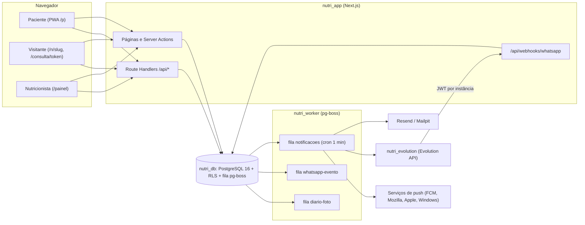
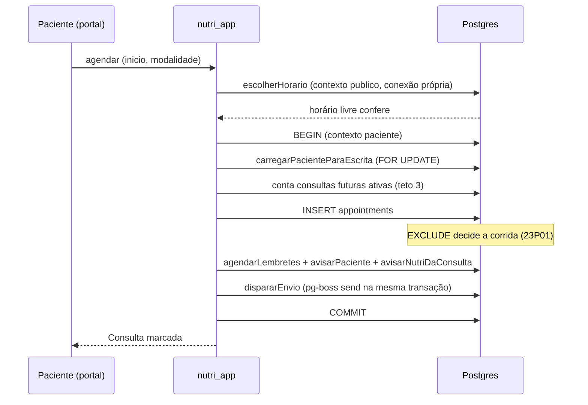
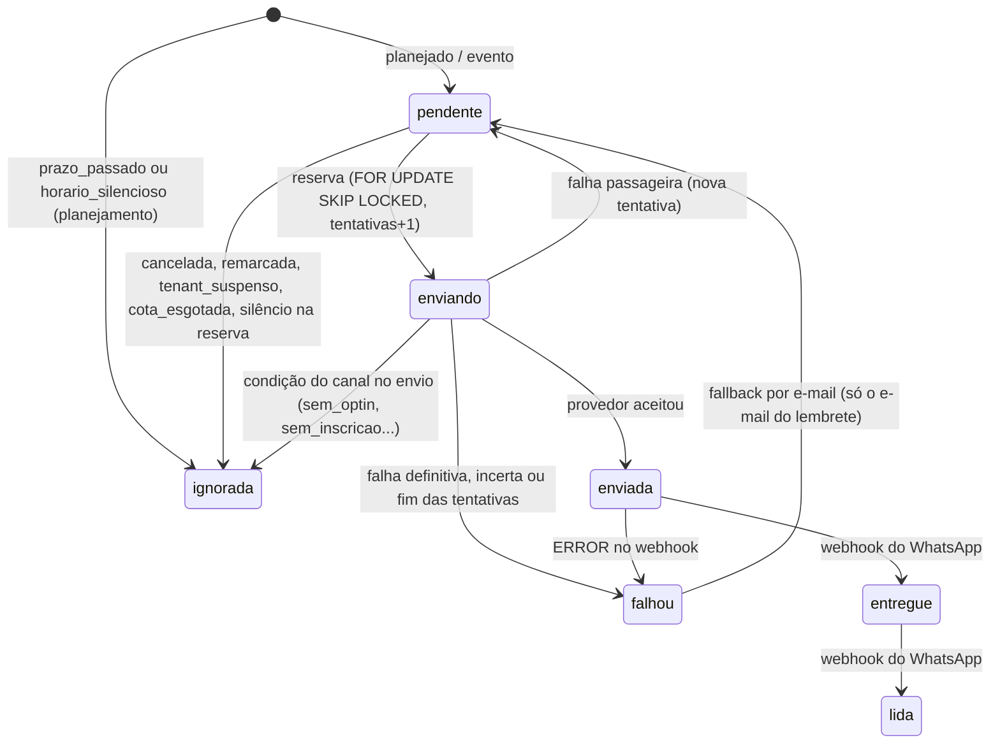
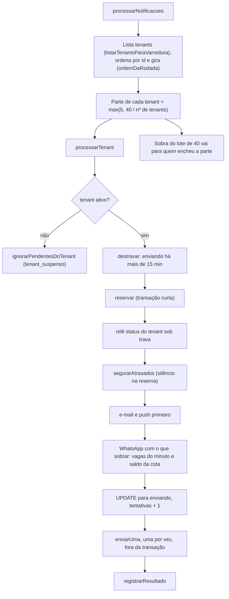
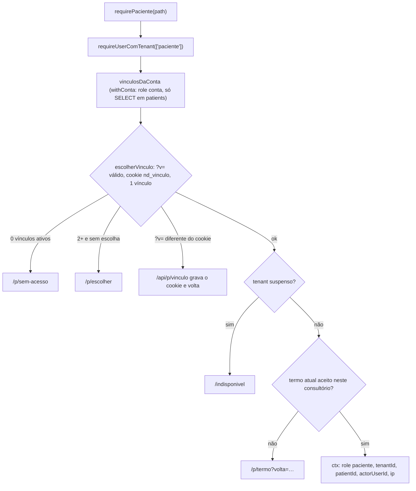

# 5. Agenda, notificações, portal do paciente, conteúdos e interface

Este capítulo cobre o que o paciente vê e o que chega até ele: a agenda, a página pública de agendamento, o motor de
notificações e os três canais, o portal do paciente (PWA), a biblioteca de conteúdos, a interface do painel e o manual
guiado. A base (RLS, `withTenant`, auditoria, arquivos) está nos capítulos anteriores ([cap. 2](02-banco-de-dados.md),
[§4.1.3](04-modulos-clinicos.md#413-armazenamento-com-cota-e-url-assinada-rn-18-regra-9-do-claudemd)). Aqui ela é citada só onde muda o
comportamento.

Convenções do capítulo:

- **Px Dy** = decisão `Dy` do Plano `x` (`docs/superpowers/plans/`). Exemplo: P05 D9 é a D9 do Plano 05.
- **RN-xx, RNF-xx, INT-xx, US-xxx** = itens da spec (`docs/superpowers/specs/2026-09-27-nutridebby-mvp-design.md` e
  `…-mvp-historias.md`).
- Caminhos são relativos à raiz do repositório. Quando a afirmação vem de uma função, ela é citada pelo nome.
- Variáveis de ambiente aparecem só pelo nome. Nenhum valor de segredo está neste documento.

---

## 5.0 Mapa dos módulos

| Módulo | Pasta | Responsabilidade | Plano |
|---|---|---|---|
| Agenda | `src/modules/agenda/` | Fuso, regras e bloqueios, horários livres, consultas, cancelamento, link assinado, página pública, limites por IP, presença, Início do painel | P05 (e P08 para o Início) |
| Notificações | `src/modules/notificacoes/` | Planejamento e envio (e-mail, WhatsApp, push), textos, cota, webhook do WhatsApp | P05 (P06 e P07 acrescentam tipos) |
| Portal | `src/modules/portal/` + `src/lib/paciente-session.ts` | Vínculos da conta, acesso diário, plano, diário, evolução, lista de compras, pedidos do titular, inscrição de push, conteúdos do paciente | P06 (P07 para conteúdos) |
| Conteúdo | `src/modules/conteudo/` | Vídeo, oEmbed, capa, markdown, receitas, audiência, aviso, métricas, LGPD do titular | P07 |
| Ajuda | `src/modules/ajuda/conteudo.ts` | Texto dos tours e do manual (`GUIAS`) | P08 |
| Tema | `src/lib/tema/`, `src/app/globals.css`, `src/components/ui/` | Tokens de cor, contraste, cor da marca no escuro, componentes base | P08 |

A spec registra a divisão em dois módulos (`agenda` e `notificacoes`) porque o motor de envio também serve o convite do
paciente (US-010) — desvio do §4.1 listado no Plano 05 ("Desvios conscientes da spec").



---

## 5.1 Agenda

### 5.1.1 Fuso horário (RN-06, P05 D8)

Tudo é gravado em UTC (`timestamptz`). Calendário, horário silencioso, virada do mês da cota e textos usam
`tenants.fuso` (padrão `America/Sao_Paulo`). As funções ficam em `src/modules/agenda/fuso.ts`, só com `Intl`, sem
biblioteca (P05, "Global Constraints").

| Função | O que faz |
|---|---|
| `partesNoFuso(instante, fuso)` | Data, hora, dia da semana e minutos desde 00:00 no fuso |
| `paraInstante(data, hora, fuso)` | Data + hora locais → instante. Hora inexistente (início do horário de verão) → `null`; hora repetida → a primeira ocorrência (D8) |
| `inicioDoDia`, `inicioDoMes`, `inicioDoMesSeguinte` | Limites de dia e de mês civil no fuso (usados na cota, RN-09, e na taxa de faltas) |
| `formatarQuando`, `quandoComFuso`, `rotuloDoFuso` | "sex., 16/10/2026 às 14:00 (horário de Brasília)". Mensagens ao paciente sempre levam a sigla |
| `dataDaAgendaValida(data, hoje)` | Data existe e fica entre 1900 e hoje + 5 anos (`ANOS_FUTUROS_AGENDA`). Sem o teto, `9999-12-31` virava 500 |

Regra para quem estende: nunca use `new Date().getHours()` ou `getDate()` no servidor (UTC). Use `partesNoFuso`.

### 5.1.2 Horários de atendimento e bloqueios (US-030)

Tabelas `availability_rules` e `availability_blocks` (migrations `drizzle/0048_agenda_disponibilidade.sql` e
`0049_rls_agenda_disponibilidade.sql`). Ambas são `staff_only`: a sessão de paciente não lê nem as próprias linhas
(`STAFF_ONLY` em `src/db/rls-guard.ts`; o motivo do bloqueio pode ser pessoal). O contexto `publico` lê as duas
(`PUBLICO_LIBERADO`, comando `select`).

Regras de validação (`src/modules/agenda/disponibilidade.ts`, `validarRegra`, `criarRegra`, `criarBloqueio`;
constantes em `src/modules/agenda/constantes.ts`):

| Item | Limite | Mensagem |
|---|---|---|
| Duração da regra | 15 a 240 min (`DURACAO_MIN`, `DURACAO_MAX`) | "A duração deve ser de 15 a 240 minutos" |
| Regras por tenant | 30 (`MAX_REGRAS`) | "Limite de 30 horários de atendimento." |
| Sobreposição no mesmo dia | proibida, conferida sob `pg_advisory_xact_lock('agenda-regras', tenant)` | "Este horário se sobrepõe a outro do mesmo dia." |
| Bloqueio | até 366 dias; motivo até 120 caracteres | "O bloqueio pode ter no máximo 366 dias" |
| Bloqueio sem hora | dias inteiros no fuso (00:00 do primeiro até 00:00 do dia seguinte ao último) | — |

### 5.1.3 Horários livres (RN-03, P05 D11)

RN-03: horários livres = regras − bloqueios − consultas não canceladas.

- `gerarHorarios` (`src/modules/agenda/horarios.ts`) é pura. Para cada dia da janela e cada regra do dia da semana,
  gera horários de `duracaoMin` a partir do início, enquanto couberem até o fim. Pula a hora local inexistente. Usa
  intervalos semiabertos `[início, fim)` (`sobrepoe`), como o `EXCLUDE` do banco.
- Regra `online` ou `ambas` só oferece "online" se o tenant tiver `link_online_padrao` (`modalidadesDa`).
- `horariosLivres` (`src/modules/agenda/consultas.ts`) roda no contexto **`publico`** do `withTenant`: lê regras,
  bloqueios e só `id`/`inicio`/`fim` das consultas não canceladas. Devolve só intervalos. Usa uma margem de 8 h depois
  do fim da janela para pegar bloqueio ou consulta que cruza o último horário.
- `horariosParaPaciente` (`src/modules/agenda/agendamento-paciente.ts`) aplica a janela do paciente: de agora +
  `tenants.antecedencia_min_h` (padrão 12 h) até agora + 60 dias (`JANELA_PACIENTE_DIAS`).
- `escolherHorario` confere que o horário pedido é **exatamente** um horário livre oferecido agora (início e
  modalidade). Qualquer outra coisa vira "Esse horário não está mais disponível. Escolha outro.".

**Por que o contexto `publico`.** O paciente não pode ler regras, bloqueios nem consultas de outros. Os horários livres
precisam de tudo isso. A solução foi um papel sem ator, com leitura negada por padrão no banco e liberada tabela a
tabela (P05 D11; detalhes em 5.2.1). Assim, mesmo um erro no código não devolve dado de outro paciente.

**Regra de conexão (P05, "Global Constraints").** `horariosLivres` e `escolherHorario` abrem a própria transação.
Chame-as **antes** de abrir a transação da gravação, nunca dentro. O pool tem `max: 10`; dez pedidos com duas conexões
cada travam o app. Dentro da transação, quem revalida o horário é o `EXCLUDE`.

### 5.1.4 Tabela `appointments` e o `EXCLUDE` (P05 D9)

Migrations `drizzle/0050_consultas.sql` (tabela) e `0051_rls_consultas.sql` (RLS e restrição).

| Coluna | Observação |
|---|---|
| `inicio`, `fim` | `timestamptz`. A spec previa `periodo tstzrange`; o Drizzle não tem o tipo, então a faixa é expressão da restrição (desvio registrado no P05) |
| `modalidade` | `presencial`/`online`. CHECK `appointments_link_online`: online exige `https://…` até 500 caracteres; presencial sem link |
| `status` | `agendada`, `confirmada`, `cancelada`, `realizada`, `faltou` |
| `origem` | `nutri`/`paciente` (a página pública grava `paciente`) |
| `confirmada_via` | `whatsapp`/`link` (o portal também grava `link`, P06 D19) |
| `cancelado_por` | `nutri`/`paciente`/`sistema` (`sistema` desde a migration `0067`: pedido de exclusão atendido) |
| `motivo_cancelamento` | até 300 caracteres; só a nutricionista lê o que ela escreveu (`motivoDoCancelamentoDaNutri`) |
| `pedido_remarcacao_em`, `remarcada_de`, `cancelada_em`, `presenca_em` | estado do fluxo |

CHECKs relevantes de `0050`: `appointments_periodo_valido` (`fim > inicio` e no máximo 8 horas),
`appointments_cancelamento_completo` (cancelada ⇔ `cancelado_por` e `cancelada_em` preenchidos).

A restrição que impede sobreposição:

```sql
ALTER TABLE appointments ADD CONSTRAINT appointments_sem_sobreposicao
  EXCLUDE USING gist (tenant_id WITH =, tstzrange(inicio, fim, '[)') WITH &&) WHERE (status <> 'cancelada');
```

- `'[)'`: terminar às 10:00 e começar às 10:00 não é sobreposição.
- `realizada` e `faltou` continuam ocupando o horário.
- O `=` do uuid no GiST vem da extensão `btree_gist` (migration `0000`).
- A restrição vale **acima da RLS**. Dois pacientes que não se veem disputam o mesmo horário; o banco decide.

Tratamento de erro (`src/modules/agenda/consultas.ts`):

| Situação | Tratamento |
|---|---|
| 23P01 (violação do `EXCLUDE`) | `ehSobreposicao(e)`. Paciente: "Esse horário acabou de ser ocupado. Escolha outro.". Nutricionista: `comoConflito` relê numa transação nova e devolve "Conflito com a consulta de {nome} às HH:MM" |
| 40P01 (deadlock) | `repetirSeDeadlock` repete a operação inteira **uma vez**. O Postgres insere no índice GiST antes de procurar conflitos; duas gravações simultâneas podem esperar uma pela outra. Um segundo 40P01 sobe como erro |

RLS: `app_enable_tenant_rls`, `app_enable_patient_rls` (paciente vê só as próprias) e `app_enable_audit('appointments',
'agenda')` (escritas no "Histórico de acessos"). Leitura da agenda **não** chama `auditRead` (P05 D10: nome, hora e
situação, como a lista de pacientes).

### 5.1.5 Marcar uma consulta

Três caminhos gravam consulta. Todos, na mesma transação: lembretes (`agendarLembretes`), aviso "Consulta marcada" ao
paciente (`avisarPaciente`) e o pedido de envio imediato (`dispararEnvio`).

| Caminho | Função | Regras |
|---|---|---|
| Nutricionista (US-031) | `agendarPelaNutri` (`consultas.ts`) | Qualquer data (até o passado, para encaixe) e qualquer horário. Fora das regras ou em bloqueio, grava e devolve avisos (`fora_do_horario`, `dentro_de_bloqueio`). Paciente arquivado: "Paciente arquivado: desarquive para agendar." (P05 D22) |
| Paciente no portal (US-032) | `agendarComoPaciente` (`agendamento-paciente.ts`) | Tenant ativo (RN-15), paciente ativo (RN-08), horário livre (`escolherHorario`), no máximo 3 consultas futuras ativas (`MAX_CONSULTAS_FUTURAS_PUBLICO`, contadas sob a trava do paciente). Avisa a nutricionista (`avisarNutriDaConsulta`) |
| Página pública (US-032) | `confirmarCodigo` → `gravarPedido` (`agendamento-publico.ts`) | Ver 5.2 |

O teto de 3 consultas também no portal veio da revisão da Tarefa 12 do Plano 06 (comentário de
`agendarComoPaciente`; RN-16 v1.9): sem ele, "Entrar (já sou paciente)" levava de um caminho com teto para um sem teto.

Consulta marcada no passado não gera aviso nem lembrete: `avisarPaciente` sai cedo se a consulta já começou, e
`planejarLembretes` marca `prazo_passado` (P05 D22).



### 5.1.6 Cancelar, remarcar e confirmar (RN-04, P05 D17)

Arquivo `src/modules/agenda/cancelamento.ts`.

| Ação | Quem | Regra |
|---|---|---|
| `cancelarConsulta` | Nutricionista a qualquer momento; paciente até `cancelamento_min_h` antes (padrão 24 h; `podeAlterarPeloPaciente`, no limite exato ainda pode) | Paciente fora do prazo: "Para alterar, fale com sua nutricionista." Lembretes pendentes viram `ignorada`/`consulta_cancelada` (`cancelarLembretes`). Aviso "Consulta cancelada" ao paciente; se foi ele, e-mail à nutricionista |
| `remarcarComoPaciente` | Paciente, dentro do prazo | Cancela a antiga (`cancelado_por = 'paciente'`) e cria a nova com `remarcada_de`, numa transação |
| `moverConsulta` ("Alterar data e hora") | Nutricionista | A mesma consulta. Se o início muda: volta a `agendada`, perde confirmação e pedido de remarcação, lembretes do horário antigo pendentes viram `consulta_remarcada`, horário novo ganha linhas novas. Mudar só duração, modalidade ou link mantém tudo |
| `confirmarPresenca` | Paciente (link, portal, "1" no WhatsApp) | Idempotente; só antes do início e com paciente ativo. Desfaz um pedido de remarcação em aberto |
| `pedirRemarcacao` | Paciente fora do prazo ("Avisar que preciso remarcar") | Marca o pedido e avisa a nutricionista uma vez por pedido |
| `cancelarFuturasPelaExclusao` | Sistema, ao atender pedido de exclusão (US-018) | Cancela consultas futuras com `cancelado_por = 'sistema'`, **sem** aviso ao paciente; a nutricionista recebe um e-mail só com o primeiro nome e a quantidade |

**Ordem das travas: paciente → consulta → notificações.** Está em todos os caminhos (`moverConsulta`,
`cancelarConsulta`, `remarcarComoPaciente`, `travarPacienteDaConsulta`). A ordem inversa causou deadlock na revisão da
Tarefa 7: o `INSERT` em `notifications` pede `FOR KEY SHARE` no paciente pela FK. Quem acrescentar uma escrita na agenda
deve respeitar essa ordem.

### 5.1.7 Link assinado da consulta (P05 D20)

O paciente age sem login pela página `/consulta/<token>` (`src/app/consulta/[token]/`). O link vai em todo e-mail de
lembrete e de "Consulta marcada". **Nunca** vai por WhatsApp (decisão do dono de 02/10/2026, INT-01).

Formato do token (`src/modules/agenda/link-consulta.ts`, `assinarLinkConsulta`):

| Bytes | Conteúdo |
|---|---|
| 0 | Versão (`1`) |
| 1–16 | `tenant_id` (uuid) |
| 17–32 | `appointment_id` (uuid) |
| 33–36 | Início da consulta em segundos (também a validade) |
| 37–52 | HMAC-SHA256 truncado em 128 bits |

São 53 bytes em base64url, 71 caracteres. A chave é derivada por HKDF de `ENCRYPTION_KEY` com o rótulo
`nutridebby:link-consulta:v1` (`chaveDosLinks`); nenhuma variável nova. O MAC cobre o corpo **e o SHA-256 do e-mail
atual do paciente** (normalizado): corrigido o e-mail, todo link antigo deixa de conferir, sem estado novo no banco
(decisão do dono no fechamento do Plano 05; ver "Divergências").

Como o link é lido (`src/modules/agenda/acoes-link.ts`, `resolver`):

1. Formato canônico (`/^[A-Za-z0-9_-]{71}$/` e reescrita igual). Um token, uma grafia.
2. Lê o tenant e a consulta no contexto `publico` (só `patient_id`, e-mail, início e situação do paciente).
3. Confere o MAC em tempo constante. Até aqui, toda falha é "Link inválido." (não revela se tenant ou consulta existem).
4. Consulta já começou, ou mudou de início depois do link (`noInicioDoLink`) → "Este link expirou.".
5. Tenant suspenso, paciente arquivado, bloqueado ou anonimizado → "Conta temporariamente indisponível".

Regras de segurança:

- `abrirLinkConsulta` (o `GET` da página) **nunca muda estado**: a pré-visualização de link do WhatsApp abre a URL.
- As ações (`confirmarPeloLink`, `cancelarPeloLink`, `remarcarPeloLink`, `avisarRemarcacaoPeloLink`) rodam com o
  contexto `paciente` do dono da consulta, `semConta: true` e o IP de quem clicou (`comoPaciente`). A RLS por paciente
  continua valendo. O `audit_log` fica sem ator ("Sistema").
- O início do token e o e-mail conferido são reconferidos **sob as travas** (`conferirInicioDoLink`,
  `conferirEmailDoLink` em `cancelamento.ts`): a nutricionista pode mudar algo entre abrir o link e clicar.
- `next.config.ts` manda `Referrer-Policy: no-referrer` em `/consulta/:token*`.
- `acoes-link.ts` está na lista fechada `SEM_CONTA_PERMITIDOS` (`src/db/tenant.ts`), conferida por
  `sem-conta-guarda.test.ts`.

### 5.1.8 Presença, pendências e taxa de faltas (US-037, P05 D21, CS-03)

Arquivo `src/modules/agenda/presenca.ts`.

- `registrarPresenca`: depois do início, `realizada` ou `faltou` (pode corrigir). Cancelada não. "Faltou" com
  atendimento ligado não. Vale também para paciente bloqueado ou anonimizado (é histórico da agenda).
- Pendência ("sem registro de presença"): não cancelada, terminou há mais de 24 h e continua `agendada`/`confirmada`
  (`semRegistro`). A tela `/painel/agenda/pendencias` lista as 100 mais antigas.
- `indicadoresDaAgendaNaTransacao`: mês civil no fuso do tenant. Taxa = faltas ÷ consultas do mês já iniciadas e não
  canceladas. Consulta futura não entra no denominador. Texto: "12,5% (2 de 16)" (`textoTaxa`).
- "Iniciar atendimento" (`motivoParaNaoIniciarAtendimento`, `consultaParaIniciarAtendimento`) liga um atendimento do
  prontuário à consulta (`consultations.appointment_id`, migrations `0063`/`0064`).

A agenda do painel tem visões dia, semana (padrão, começa na segunda) e lista de 30 dias
(`src/app/painel/agenda/periodo.ts`, `periodoDaVisao`). A situação aparece em texto, nunca só em cor (`selosDaConsulta`).

### 5.1.9 Início do painel (P08 D21, D22)

`lerInicio` (`src/modules/agenda/inicio.ts`) lê tudo numa **transação só**. Leituras em paralelo abriam uma transação
cada e ocupavam o pool (achado 3 do `/code-review` do PR #12).

O cartão "Próxima consulta" não mostra peso (P08 D22): exigiria `auditRead` a cada abertura. Mostra contagens:
"Diário: N registros em 7 dias" e "Portal: N de 7 dias". A contagem do diário é dado de saúde de um paciente nomeado,
então é auditada (entidade `diario`) **no máximo uma vez por paciente por dia, por ator**, no fuso do tenant
(`auditarDiarioUmaVezNoDia`, trava `pg_advisory_xact_lock('inicio-diario', paciente)`; decisão do dono de 04/10/2026).

---

## 5.2 Página pública `/n/<slug>` (RN-16, P05 D11–D13)

A página nasce **desligada** (`tenants.agendamento_publico_ativo` padrão `false`, migration `0067`). A nutricionista
liga em Configurações.

### 5.2.1 Contexto `publico` negado por padrão

A migration `drizzle/0051_rls_consultas.sql` criou duas funções e mudou `app_enable_tenant_rls`:

- `app_deny_publico(tabela)` cria a política `RESTRICTIVE` `publico_negado`
  (`USING app_current_role() IS DISTINCT FROM 'publico'`).
- `app_enable_tenant_rls` chama `app_deny_publico` no fim. Toda tabela nova com `tenant_id` nasce fechada ao
  `publico`. A migration aplicou a negação também em todas as tabelas existentes.
- `app_allow_publico(tabela, comandos…)` troca a negação por uma `RESTRICTIVE` por comando que continua negado.

A lista explícita é `PUBLICO_LIBERADO` (`src/db/rls-guard.ts`). A guarda `findPublicoViolations` (CI) confere nome,
comando e `RESTRICTIVE` contra `pg_policies`.

| Tabela | Comandos | Motivo (do código) |
|---|---|---|
| `availability_rules`, `availability_blocks` | `select` | horários livres |
| `appointments` | `select`, `insert` | início/fim nos horários livres, dono do link, consulta da página pública |
| `patients` | `select`, `insert` | situação do dono do link; paciente da página pública |
| `audit_log` | `insert` | o gatilho de auditoria roda com o papel de quem grava |
| `notifications` | `select`, `insert` | lembretes da consulta pública (`INSERT … ON CONFLICT` lê a linha nova) |
| `public_booking_requests` | `select`, `insert`, `update` | pedido: cria, confere o código (`FOR UPDATE`) e conclui |

Consequência prática: sem a política de `UPDATE`, o `publico` não altera paciente e não consegue travar linha de
`patients` com `SELECT … FOR SHARE` (a linha some do resultado). Por isso `gravarPedido` usa uma trava por e-mail e a
reconferência descrita abaixo.

### 5.2.2 Fluxo em dois passos

```mermaid
sequenceDiagram
  participant Vis as Visitante
  participant App as nutri_app
  participant CF as Cloudflare Turnstile
  participant DB as Postgres
  participant W as Worker (fila email)
  Vis->>App: POST /api/n/slug/codigo (nome, e-mail, horário, termo, 18+, token Turnstile)
  App->>DB: consumirLimite(ip, 10/h)
  App->>CF: siteverify (antes de qualquer escrita de negócio)
  App->>DB: escolherHorario (publico)
  App->>DB: BEGIN; trava do e-mail; 1 código/60 s; 5 códigos/h
  App->>DB: INSERT public_booking_requests (hash do token, HMAC do código)
  App->>DB: enfileira e-mail codigo_agendamento; COMMIT
  App-->>Vis: { pedido }
  W-->>Vis: e-mail com o código de 6 dígitos (10 min)
  Vis->>App: POST /api/n/slug/confirmar (pedido, código)
  App->>DB: confere código (5 erros invalidam)
  App->>DB: gravarPedido: paciente (novo ou ativo), teto 3, consulta, aceite do termo, pedido concluído
  App-->>Vis: "Consulta marcada para …"
```

Pontos de projeto (`src/modules/agenda/agendamento-publico.ts`):

- **Resposta igual para e-mail cadastrado ou não** até o código ser confirmado (P05 D12). `solicitarCodigo` não olha
  `patients`. O teto de 3 consultas é conferido **depois** do código, em `gravarPedido`.
- **Turnstile** (`src/lib/turnstile.ts`, `verifyTurnstile`): valida no servidor com `TURNSTILE_SECRET_KEY`, prazo de
  5 s, confere o `hostname` do app. Fora do ar = `'indisponivel'` → 503 "Tente novamente em alguns minutos"; nunca segue
  sem verificação (INT-06). `src/env.ts` recusa chaves de teste em produção.
- **Código**: 6 dígitos de `randomInt`. O banco guarda só `hashDoCodigo` = HMAC (chave HKDF de `ENCRYPTION_KEY`,
  rótulo `nutridebby:codigo-agendamento:v1`) de `"<id do pedido>:<código>"`. O código de um pedido não confere em outro.
  Validade 10 min (`CODIGO_VALIDADE_MS`); 5 erros (`MAX_ERROS_CODIGO`) → 410 "Muitas tentativas com código errado.".
  Depois do código certo, o pedido pode escolher outro horário por 30 min sem novo código (`VERIFICADO_VALIDADE_MS`).
- **Paciente**: e-mail de paciente ativo → a consulta vai para ele (ele provou o e-mail). Arquivado, bloqueado ou
  anonimizado → 409 "Não foi possível agendar por aqui. Fale com sua nutricionista.". Paciente novo nasce com
  `origem = 'agendamento_publico'` e opt-in de WhatsApp com origem `paciente` se marcou e deu telefone. Opt-in marcado
  por paciente que já existe é descartado (o `publico` não altera pacientes).
- **Corrida com o pedido de exclusão**: o `INSERT` da consulta segura o paciente pela FK (`FOR KEY SHARE`), e
  `reconferirPaciente` relê o status logo depois (comentário de `gravarPedido`).
- **Aceite do termo**: grava em `consents` com `patient_id` e `tenant_id` (P05 D13: `user_id` nulo; `UNIQUE NULLS NOT
  DISTINCT`).
- **Limpeza**: pedidos com mais de 24 h somem (`limparPedidosPublicos`, job `agenda-limpeza`, 04:30 de Brasília).

As rotas (`src/app/api/n/[slug]/codigo`, `confirmar`, `horario`) usam `responder` (`src/app/api/n/[slug]/resposta.ts`):
JSON de até 8 KB, `cache-control: no-store`, `PublicoError` → status e `{ erro }` ou `{ erros }`.

### 5.2.3 Limites com HMAC (`src/modules/agenda/limite-ip.ts`)

A tabela `public_rate_limits` não tem `tenant_id` nem RLS. **Só este arquivo** a acessa (regra 1 do `CLAUDE.md`).

- `chaveDoLimite(tipo, valor)` grava `tipo:HMAC(valor)`, com chave HKDF de `ENCRYPTION_KEY` (rótulo
  `nutridebby:limite-publico:v1`). O banco nunca tem o IP nem o e-mail.
- `consumirLimite` é um `INSERT … ON CONFLICT DO UPDATE` atômico que zera a contagem quando a janela vira. Aceita uma
  transação (o webhook do WhatsApp grava a marca junto com o evento).
- `limparLimites` apaga contadores de mais de 1 dia (job `agenda-limpeza`).

| Limite | Chave | Valor |
|---|---|---|
| Tentativas por IP | `ip:` + IP do balde | 10 por hora, em qualquer das três ações, até para slug inexistente |
| Códigos por e-mail | `email-hora:` + `tenant:email` | 5 por hora, contado só quando o código sai |
| Intervalo entre códigos | `max(created_at)` do e-mail em `public_booking_requests` | 60 s ("Aguarde 1 minuto para pedir outro código.") |
| Marca anti-repetição do webhook | `webhook:` + JWT + SHA-256 do corpo | 1 durante a validade do JWT (5.4.2) |

O IP vem de `clientIp` (auditoria, Turnstile) e `clientIpDoLimite` (balde) em `src/lib/ip.ts`, com `TRUSTED_PROXIES`
(os saltos do Traefik não contam; `X-Forwarded-For` forjado à esquerda não vence). No IPv6, o balde é o /64.

---

## 5.3 Motor de notificações (RN-05, P05 D6, D7)

### 5.3.1 Ideia central: estado no banco, varrido pelo worker

O motor **não** agenda um job por lembrete. O pg-boss apaga job criado depois de 14 dias, e uma consulta pode ser
marcada com 60 dias de antecedência (P05, "Global Constraints"). O estado fica em `notifications` (`status`,
`agendada_para`), e o worker varre a tabela:

- Cron `notificacoes` a cada minuto (`src/worker/index.ts`, `boss.schedule('notificacoes', '* * * * *', …,
  { tz: 'America/Sao_Paulo' })`).
- Ações que precisam de envio já chamam `dispararEnvio(tx, tenantId)` (`src/modules/notificacoes/agendar.ts`): enfileira
  a mesma varredura só daquele tenant, **na mesma transação** (`send` com `fromDrizzle(tx, sql)`).
- A fila tem `retryLimit: 0` (`src/jobs/queues.ts`): o que falha volta como `pendente` com nova data.
- Um job de `notificacoes` por vez no worker (`localConcurrency` padrão 1; comentário em `src/worker/index.ts`).

### 5.3.2 Uma linha por consulta × tipo × canal

Tabela `notifications` (migrations `0052`, `0053`, `0054`, `0062`, `0068`, `0069`, `0084`). Tipos em
`src/modules/notificacoes/tipos.ts`:

| Tipo | Canais | Origem | Conta na cota do WhatsApp |
|---|---|---|---|
| `lembrete_24h`, `lembrete_2h` | e-mail, WhatsApp, push | `agendarLembretes` | sim |
| `consulta_marcada`, `consulta_cancelada` | e-mail, push | `avisarPaciente` | — |
| `convite_paciente` | WhatsApp | `agendarConviteWhatsapp` (US-010) | sim |
| `resposta_confirmacao`, `resposta_remarcar` | WhatsApp (e e-mail no "2") | webhook (5.4.2) | não |
| `push_teste` | push | `inscreverAparelho` (P06 D7) | — |
| `comentario_diario` | push | `avisarComentario` (P06 D13) | — |
| `plano_novo` | push (+ e-mail pela fila `email`) | `avisarPlanoNovo` (P06 D24) | — |
| `conteudo_novo` | push | `avisarConteudoNovo` (P07 D5) | — |

Chave única: índice parcial `notifications_versao_unique` em (`appointment_id`, `canal`, `tipo`, `inicio_consulta`)
**só para `lembrete_24h` e `lembrete_2h`** (`TIPOS_UM_POR_HORARIO`, `src/db/schema/agenda.ts`; migration `0068`, que
tirou as respostas da chave). Consequências (P05 D6):

- Marcar de novo no mesmo horário reescreve só a linha que **não saiu** (`pendente`, `ignorada`, `falhou`;
  `gravar` com `ON CONFLICT … DO UPDATE … WHERE`).
- Mudar o horário cria linhas novas. A pendente do horário antigo vira `ignorada`/`consulta_remarcada`
  (`descartarHorarioAntigo`).
- **Linha enviada é imutável.** Ela conta na cota e nas métricas.
- Avisos de evento (`avisarPaciente`) ficam fora da chave: cada evento ganha linhas próprias, com idempotência por
  (tipo, início) entre as pendentes ou saindo.

`conteudo_selado` (texto cifrado até o envio) só pode existir em `pendente`/`enviando`
(CHECK `notifications_conteudo_so_antes_do_envio`, migration `0062`). Hoje nenhum fluxo grava (comentário em
`src/modules/notificacoes/mensagens.ts`), mas toda saída final o limpa.

### 5.3.3 Estados



### 5.3.4 Planejamento dos lembretes

`planejarLembretes(inicio, fuso, agora)` (`agendar.ts`): 24 h e 2 h antes (`ANTECEDENCIA_MS`).

- Horário já passou → `ignorada`/`prazo_passado`.
- Horário em `[21:00, 08:00)` no fuso do tenant (`emHorarioSilencioso`; 08:00 em ponto vale) →
  `ignorada`/`horario_silencioso`. No planejamento, **não** adia.
- Senão, `pendente`. As linhas nascem para os **três canais**. As condições de cada canal são conferidas só no envio.

### 5.3.5 A varredura (`src/modules/notificacoes/enviar.ts`)



| Constante | Valor | Onde |
|---|---|---|
| `LOTE_POR_EXECUCAO` | 40 por execução | `enviar.ts` |
| `LOTE_MIN_POR_TENANT` | 5 | `enviar.ts` |
| `TRAVADA_MS` | 15 min em `enviando` = worker caiu | `enviar.ts` |
| `ESPERAS_S` | e-mail 60/120/240 s; WhatsApp e push 60/300/1500 s | `enviar.ts` |
| `WHATSAPP_POR_MINUTO` | 8 por tenant | `enviar.ts` |

**No máximo uma vez para WhatsApp e push.** `destravar` devolve o e-mail preso em `enviando` para `pendente` (o Resend
tem chave de idempotência), mas marca WhatsApp e push presos como `falhou`/`interrompido`. Timeout ou exceção do
provedor depois de o pedido sair também é definitivo (`sem_resposta`): na dúvida, não reenvia (INT-01, P05 D6).

**Condições comuns** (`motivoParaIgnorar`), na hora do envio: paciente ativo e não anonimizado (RN-08); convite já
aceito; para lembretes, "Consulta marcada" e respostas: consulta não cancelada, não encerrada, ainda no início para o
qual a linha foi planejada e ainda não começada.

**Condições por canal:**

| Canal | Motivos de `ignorada` |
|---|---|
| E-mail | — (falha de transporte = `repetir`) |
| WhatsApp | `whatsapp_desligado` (sem provedor), `whatsapp_desconectado`, `sem_optin` (opt-in vazio ou opt-out preenchido), `sem_telefone`, `cota_esgotada` |
| Push | `push_desligado` (sem VAPID), `sem_inscricao` (nenhuma inscrição ou todas mortas) |

### 5.3.6 Horário silencioso na reserva (P05 D7)

O planejamento já ignora o que cairia no silêncio. Mas um lembrete pode vencer durante o silêncio por atraso (worker
parado, conta reativada à noite). `segurarAtrasados`, na 1ª tentativa:

- No silêncio: adia para as próximas 08:00 (`fimDoSilencio`) se ainda fizer sentido (`lembreteFazSentido`); senão
  `ignorada`/`horario_silencioso`.
- Fora do silêncio: o de 24 h atrasado que perdeu o sentido (a consulta começa em até 2 h) vira `prazo_passado`.
- "Faz sentido": o de 24 h só até o horário do de 2 h (ou até 30 min antes do início, se o de 2 h caiu no silêncio); o
  de 2 h até 30 min antes do início.
- O de 24 h que sai no dia da consulta diz "hoje" (`ehHoje` em `mensagens.ts`).
- Vale para os três canais. Só lembretes: avisos de evento, convite e respostas saem na hora. Novas tentativas não
  esperam o fim do silêncio.

### 5.3.7 Cota de WhatsApp (RN-09, P05 D15) e ritmo (P05 D16)

Arquivo `src/modules/notificacoes/whatsapp/cota.ts`.

- É **limite de uso** (protege o número contra bloqueio), não de custo. Padrão `tenants.wa_cota_mensal = 500`.
- Conta `CONTA_COTA` = `lembrete_24h`, `lembrete_2h`, `convite_paciente` aceitos pela Evolution (`enviada_em`) no mês
  civil do fuso do tenant (`usoDoMes`). As respostas "1"/"2" (`FORA_DA_COTA`) seguem o ritmo, mas não a cota.
- Na reserva (`escolherWhatsapp`), o uso conta também as `enviando`. Com saldo, a volta reserva no máximo o saldo; o
  resto fica `pendente` e é recontado na volta seguinte. Só vira `cota_esgotada` quando o uso já chegou a 100%.
- 80% → `avisarSeChegou80`: um e-mail "Você usou 80% dos WhatsApps do mês" por mês (`whatsapp_conexoes.aviso_cota_mes`),
  num savepoint (a falha do aviso não desfaz o registro do envio).
- O admin pode ampliar a cota; vale na hora (o tenant é relido a cada volta).
- Ritmo: `vagasDoMinuto` conta as `enviando` e as enviadas no último minuto, sob
  `pg_advisory_xact_lock('whatsapp-envio', tenant)`. A Evolution recebe `delay: 1200` ("digitando…") e
  `linkPreview: false` (`src/modules/notificacoes/whatsapp/evolution.ts`).

### 5.3.8 Suspensão e reativação do tenant (US-004, RN-15)

O admin nunca toca tabela com `tenant_id`. Ele só enfileira o job `agenda-tenant` (a suspensão em si — sessões, login, convites — está em [§3.14](03-autenticacao-e-acesso.md#314-suspensão-de-conta-rn-15-us-004)). O worker faz a troca
(`src/worker/index.ts`):

- `ignorarPendentesDoTenant`: pendentes → `ignorada`/`tenant_suspenso`, com o status relido sob `FOR SHARE` em
  `tenants`.
- `reagendarTenantReativado`: replaneja os lembretes ignorados por suspensão das consultas futuras ativas. O que já
  passou fica `prazo_passado` (decisão do dono de 02/10/2026). O convite por WhatsApp não volta.

---

## 5.4 Canais

### 5.4.1 E-mail (INT-02)

- Transporte em `src/email/transport.ts`: `resendTransport` (API do Resend) ou `mailpitTransport` (dev e CI).
  `transportFromEnv` escolhe por `EMAIL_TRANSPORT` (padrão `resend` em produção, `mailpit` fora; `src/env.ts`).
  `RESEND_API_KEY` é obrigatória com `resend`; `MAILPIT_URL` com `mailpit`.
- Modelos: componentes React em `src/email/templates.tsx`, renderizados por `renderEmail`.
- Lembretes e avisos do motor: chave de idempotência `notificacao:<id>:<início da consulta>` (`enviarEmail`). A
  repetição não duplica no Resend.
- E-mails fora do motor (código da página pública, avisos à nutricionista, plano novo, exportação) vão pela fila `email`
  (3 novas tentativas a partir de 60 s, `src/jobs/queues.ts`). Plano 10A: `documento_novo`, `documento_link` (paciente
  sem conta, link de uso único), `codigo_documento` (código de 6 dígitos do link) e `documento_atualizado` (cancelamento),
  todos neutros, sem o tipo do documento nem itens ([cap. 9](09-documentos-assinados.md#943-entrega-recebimento-e-cancelamento)).
- E-mail da nutricionista vem de `user` (`src/modules/agenda/aviso-nutri.ts`, na lista de exceções da regra 1). O nome do
  paciente vai só no corpo, nunca no assunto (INT-02).

### 5.4.2 WhatsApp pela Evolution API (INT-01, P05 D1–D5)

**Provedor.** Interface `ProvedorWhatsapp` (`src/modules/notificacoes/whatsapp/provedor.ts`): `enviarTexto`, `conectar`,
`estado`, `desconectar`. Três implementações:

| Modo | Arquivo | Quando |
|---|---|---|
| `evolution` | `whatsapp/evolution.ts` | `EVOLUTION_API_URL` e `EVOLUTION_API_KEY` presentes |
| `sandbox` | `whatsapp/sandbox.ts` | `WHATSAPP_SANDBOX=1` (dev, CI, E2E): a mensagem vira e-mail no Mailpit para `<número>@whatsapp.sandbox`. Recusado em produção por `src/env.ts` |
| `fake` | testes | Vitest |

`modoWhatsapp`/`provedorDoAmbiente` (`whatsapp/ambiente.ts`) decidem. Sem provedor, as linhas viram
`whatsapp_desligado` e os lembretes seguem por e-mail e push.

**Instância por tenant (P05 D2).** `nd-<tenantId>` (`instanciaDoTenant`, `whatsapp/conexao.ts`). A nutricionista
conecta pelo QR em `/painel/whatsapp`. Um bloqueio do número atinge só aquele consultório. Estado em
`whatsapp_conexoes` (migrations `0057`/`0058`, `staff_only`, uma linha por tenant).

**Envio.** `POST /message/sendText/{instância}` com texto simples, timeout de 10 s. Nenhuma mensagem leva link; o texto
cita o e-mail mascarado (`emailMascarado`: `a***@dominio`). Lembretes terminam com "Responda 1 para confirmar ou 2 se
precisar remarcar." (`textoWhatsapp`).

**Webhook autenticado por JWT da instância (P05 D4).**

```mermaid
sequenceDiagram
  participant EVO as Evolution
  participant R as /api/webhooks/whatsapp
  participant DB as Postgres
  participant W as Worker
  Note over EVO: jwt_key da instância = HKDF(EVOLUTION_WEBHOOK_SECRET, "nd-tenant")
  EVO->>R: POST Authorization: Bearer JWT HS256 + corpo
  R->>R: corpo até 256 KB; instance → tenant
  R->>R: verificarJwtWebhook(chave da instância do corpo)
  alt inválido
    R-->>EVO: 401 (a Evolution não repete)
  end
  R->>R: classificarEvento (reduz ao mínimo)
  R->>DB: BEGIN; consumirLimite(marca do pedido, 1)
  R->>DB: send whatsapp-evento (evento cifrado); COMMIT
  R-->>EVO: 200
  W->>DB: processarEventoWhatsapp
```

- `chaveDoWebhook(segredo, instância)` (`whatsapp/jwt.ts`) deriva a chave por HKDF com o rótulo
  `nutridebby:webhook-jwt:<instância>`. O segredo-mestre nunca sai do app. Um JWT de um consultório não vale para outro.
  `conectar` reconfigura o webhook a cada conexão, com o cabeçalho `jwt_key` (`evolution.ts`). Trocar o segredo exige
  "Conectar WhatsApp" de novo em cada consultório.
- `verificarJwtWebhook`: só `alg = HS256`, HMAC em tempo constante, grafia canônica da assinatura, `exp` com folga de
  60 s, `iat` aceito até 60 s no futuro (`FOLGA_S`; `src/modules/notificacoes/whatsapp/jwt.ts:51`), validade máxima de 900 s, `app = 'evolution'`, `action = 'webhook'`.
- **Anti-repetição**: o JWT da Evolution não tem `jti`. A marca é `HMAC(JWT + SHA-256 do corpo)` (`marcaDoPedido`),
  gravada em `public_rate_limits` na **mesma transação** do evento na fila, pelo tempo em que o JWT pode ser aceito
  (`aceitoPorS`). Pedido repetido → **200 sem efeito**. Se enfileirar falhar, não fica marca e a repetição da Evolution
  passa.
- **Endereço interno**: em produção, `src/env.ts` exige `EVOLUTION_WEBHOOK_URL` com host interno (nome de serviço ou IP
  privado). URL pública só com `EVOLUTION_WEBHOOK_URL_PUBLICA=1`.
- Sem `EVOLUTION_WEBHOOK_SECRET`, a rota responde 404 (WhatsApp desligado).
- Nada do corpo vai para log (traz número, texto e `apikey`).

**Eventos tratados** (`classificarEvento`, `processarEventoWhatsapp` em `whatsapp/webhook.ts`):

| Evento | Tratamento |
|---|---|
| `messages.upsert` | Texto reduzido na rota a `confirmar`/`remarcar` (`interpretarResposta`, `whatsapp/respostas.ts`: "1", "sim", "confirmo"… / "2", "remarcar", "não posso"…, sem acento, até 60 caracteres). O texto nunca é gravado, enfileirado nem logado. Grupos, mídia, `@lid` e outros textos → 200 e descartados |
| `messages.update` | Status só avança (`enviada` → `entregue` → `lida`). ERROR de enviada → `falhou` e `fallbackPorEmail` |
| `connection.update` | Estado e número da própria instância. Queda → no máximo um e-mail "Seu WhatsApp foi desconectado do NutriDebby" a cada 6 h (`INTERVALO_AVISO_DESCONEXAO_MS`, `atualizarEstadoConexao`) |

**Resposta "1"/"2" (US-035).** Vale para o lembrete de WhatsApp enviado àquele número (o `provider_jid` gravado no
envio) nas últimas 26 h (`JANELA_RESPOSTA_MS`), de consulta futura e ativa. A ação roda como o próprio paciente
(`semConta: true`) e reconfere o início sob trava. As mensagens de volta têm teto (`respostasDevidas`): no máximo uma
resposta de WhatsApp de cada tipo por horário da consulta; no "2", um e-mail "Remarcar sua consulta" com o link atual,
de novo só se o "2" abrir um pedido novo e o último e-mail tiver 60 min ou mais (`INTERVALO_EMAIL_REMARCAR_MS`).

**Fallback por e-mail.** WhatsApp de lembrete que falhou de vez (no envio, preso em `enviando` ou ERROR no webhook) faz
o e-mail do mesmo lembrete voltar a `pendente`, se ele tinha falhado (`fallbackPorEmail` em `agendar.ts`, que mora lá
para a rota do webhook não importar o motor).

### 5.4.3 Push web com VAPID (INT-03, P05 D19, P06 D7, D26)

**Envio só no worker.** `src/modules/notificacoes/push.ts` importa `web-push`; nenhuma rota importa esse arquivo (guarda
em `push.test.ts`). `pushDoAmbiente` exige `VAPID_PUBLIC_KEY`, `VAPID_PRIVATE_KEY` e `VAPID_SUBJECT` juntas;
`src/env.ts` confere formato e se as duas chaves são do mesmo par. O app lê só `VAPID_PUBLIC_KEY`, para entregar ao
navegador; tem de ser a mesma do worker.

**Endpoint aceito** (`endpointDePush`, `src/modules/notificacoes/push-endpoint.ts`): só `https`, porta padrão, sem
usuário/senha, forma canônica, host só com rótulos LDH e o mesmo host para o `new URL` e o `url.parse` legado (o que o
`web-push` usa). Só os serviços de `SERVICOS_DE_PUSH`: `fcm.googleapis.com`, `updates.push.services.mozilla.com`,
`*.push.apple.com`, `*.notify.windows.com`. Isso impede o worker de fazer POST para a rede interna.

**Resultado por dispositivo** (`webPushProvedor`): 404/410 → inscrição apagada; outro 4xx → definitivo; 429 e 5xx →
nova tentativa; sem resposta HTTP → repete só se o pedido nem saiu (`pedidoNaoSaiu`), senão incerto. `enviarPush` envia
a todos os dispositivos do vínculo: algum recebeu → `enviada`; algum incerto → `falhou` sem repetir. TTL até o início
da consulta, no máximo 24 h e no mínimo 60 s.

**Texto neutro.** Nada de nome da nutricionista, do paciente, modalidade ou local (decisão do dono de 02/10/2026: a
tela de bloqueio revelaria com quem a pessoa se consulta). Textos em `pushDaNotificacao` (`mensagens.ts`): lembretes
"Você tem uma consulta amanhã às HH:MM." / "hoje"; avisos do portal com título "NutriDebby" e corpo fixo por tipo
(`AVISOS_DO_PORTAL`), abrindo `/p/inicio`, `/p/diario`, `/p/plano` ou `/p/conteudos` com `?v=<tenantId>`.

**Recepção no aparelho** (`src/app/sw.ts`): o evento `push` mostra `{ titulo, corpo }`; `notificationclick` abre só
endereço da própria origem (`urlDaNotificacao`; senão `/p/inicio`).

**Inscrição pelo portal** (`src/modules/portal/push-inscricao.ts`, rota `POST`/`DELETE /api/p/push`):

- `inscreverAparelho` grava uma linha por vínculo ativo da conta (`push_subscriptions` tem `tenant_id` e `patient_id`,
  P05 D14, migrations `0060`/`0061`).
- Antes, `app_soltar_endpoint_push` (migration `0075`, `SECURITY DEFINER`, só na sessão de paciente) apaga o endpoint de
  toda **outra** conta em qualquer tenant (P06 D26: aparelho compartilhado).
- Na abertura do portal (`sincronizar`), se o endpoint não era desta conta, nada é gravado (409) e o navegador descarta
  a inscrição.
- `push_teste`: um pendente por vez por paciente e 1 min entre pedidos (`testeRecente`, trava
  `pg_advisory_xact_lock('push-teste', paciente)`).
- A rota limita 20 pedidos a cada 10 min por conta, em memória (`criarLimite` em `src/app/api/p/push/route.ts`; P08 D10,
  uma réplica).
- O "Sair" do portal cancela a inscrição no servidor e chama `unsubscribe()` no navegador (`src/app/p/sair-portal.tsx`;
  o Safari < 17 ignora o `Clear-Site-Data`).

---

## 5.5 Portal do paciente (`/p`, Plano 06)

### 5.5.1 Sessão, vínculos e termo

A conta de paciente não tem tenant. Ela pode ser paciente de vários consultórios.



- `src/lib/paciente-session.ts`: `requirePaciente` (páginas e Server Actions) e `requireApiPaciente` (rotas
  `/api/p/…`, com 403 e motivo). A regra é a mesma (`acessoDaConta`).
- Contexto `conta` (P06 D2): `withConta(userId, fn)` sem `app.tenant_id`; a única política que libera linhas é
  `paciente_por_conta` em `patients` (só `SELECT`). Só `src/modules/portal/vinculos.ts` usa.
- Cookie `nd_vinculo` (P06 D3): só o `tenantId`, `httpOnly`, `SameSite=Lax`, 30 dias, reconferido a cada requisição.
  O `?v=` dos links de e-mail e push é só uma preferência.
- Termo (P06 D25): `termoAceito` em `consents` (`src/modules/portal/termo.ts`); versão atual em `TERMO_PACIENTE`.
- Escrita da sessão de paciente negada por padrão no banco (P06 D1; detalhes no capítulo de RLS).

### 5.5.2 Rotas e abas

Abas em `ITENS_DO_PORTAL` (`src/app/p/navegacao.ts`): Início, Plano, Diário, Conteúdos, Evolução, Agenda, Perfil.
"Conteúdos" entrou no lugar de "Compras" (P07 D3); `/p/compras` marca a aba "Plano". Sete colunas iguais com hífen
automático; nunca rola na horizontal (E2E a 360 e 320 px; ratificado pelo dono em 04/10/2026).

| Rota | Função de domínio | Auditoria |
|---|---|---|
| `/p/inicio` | resumo, "Ativar notificações", instalação | — |
| `/p/plano` | `planoDoPaciente` (`portal/plano.ts`) | `auditRead` (P06 D22) |
| `/p/compras` | `listaDoPlano` (`portal/lista-compras.ts`) | `auditRead` |
| `/p/diario` | `diarioDoPaciente`, `registrarNoDiario` (`portal/diario.ts`) | `auditRead`; escrita pelo gatilho |
| `/p/evolucao` | `evolucaoParaPaciente` (`portal/evolucao.ts`) | `auditRead` |
| `/p/agenda`, `/p/agenda/nova`, `/p/agenda/<id>` | `consultasDoPaciente`, `agendarComoPaciente`, ações de 5.1.6 | sem `auditRead` (P05 D10) |
| `/p/conteudos`, `/p/conteudos/<id>` | `feedDeConteudos`, `conteudoDoPaciente` (`portal/conteudos.ts`) | sem `auditRead` (P07 D6) |
| `/p/perfil` | `preferenciaWhatsapp`, push, privacidade, trocar de nutricionista | — |
| `/p/meus-dados/exportacoes/<id>` | destino do e-mail da exportação | — |
| `/p/documentos` (Plano 10A; marca a aba "Perfil", com o cartão "Documentos" no Início e "Meus documentos" em Perfil) | `documentosDoPaciente`, `confirmarRecebimentoNoPortal` (`documentos/portal.ts`) | lista sem `auditRead` (Plano 10A, D17); o PDF com `auditRead` |
| `/p/escolher`, `/p/sem-acesso`, `/p/termo` | fora do layout do portal | — |

APIs: `POST /api/p/acesso`, `POST /api/p/diario` (multipart), `POST`/`DELETE /api/p/push`, `GET /api/p/plano/pdf`,
`GET /api/p/conteudos/<id>/pdf`, `GET /api/p/documentos/<id>/pdf` (Plano 10A: `auditRead` + recibo "aberto"),
`GET /api/p/vinculo`, `GET /api/p/ping` (204, sem sessão). Os documentos não ficam na cópia offline (o service worker
só guarda `/p/plano`; teste em `src/app/sw-regras.test.ts`).

A leitura de dado de saúde pelo **próprio paciente** gera "Visualizou" com o ator = a conta do paciente (P06 D22).

### 5.5.3 PWA com Serwist

- Manifest (`src/app/manifest.ts`): `scope: '/p/'`, `start_url: '/p/inicio'`, `display: standalone`, sem
  `orientation` (WCAG 1.3.4), ícones gerados por `scripts/gerar-icones.ts` (P06 D21).
- Integração: `@serwist/turbopack` (`next.config.ts` com `withSerwist`; rota `src/app/serwist/[path]/route.ts`
  compila `src/app/sw.ts`). O registro é feito por `SerwistProvider` em `src/app/p/sw-provider.tsx`, com
  `swUrl="/serwist/sw.js"` e `scope: '/p/'`.
- O service worker usa `skipWaiting`, `clientsClaim` e o precache dos estáticos do build.

### 5.5.4 "Meu plano" offline (US-040, P06 D6)

Só "Meu plano" fica no aparelho. Regras em `src/app/sw-regras.ts`, usadas pelo service worker e pelo cliente.

| Item | Valor |
|---|---|
| Cache | `nd-plano-v1` (`CACHE_PLANO`), uma entrada: `/p/plano` |
| Quem grava | `guardarPlano`, a pedido da própria página (mensagem `{ tipo: 'plano', dono, versao }` de `GuardarPlano` em `src/app/p/plano-guardado.tsx`). A navegação pelo menu é `fetch` do roteador, não `navigate` |
| O que grava | Só resposta 200, `basic`, não redirecionada, `text/html`, de `/p/plano` (`podeGuardarPlano`) |
| Cabeçalhos da cópia | `x-nd-dono` (conta + vínculo), `x-nd-versao`, `x-nd-guardado-em`, `x-nd-build` |
| Validade | 30 dias (`VALIDADE_PLANO_MS`); renova se tiver mais de 1 dia (`RENOVAR_PLANO_MS`) |
| Rota "Meu plano" | `NetworkFirst`, 4 s de espera, não grava (`cacheWillUpdate: null`) |
| Outras navegações em `/p/` sem rede | `NetworkOnly` com `handlerDidError` → a cópia guardada |
| Selo | "Offline — exibindo última versão" quando `navigator.onLine` é falso ou o `GET /api/p/ping` falha em 5 s (`src/app/p/selo-offline.tsx`) |

A cópia **sai**:

- no "Sair" (`/sair` responde `Clear-Site-Data: "cache", "storage"`, `src/app/sair/route.ts`) e pela chamada
  `esquecerPlanoGuardado`;
- na tela de login;
- quando o portal abre com outro dono (mensagem `{ tipo: 'dono' }` → `conferirDono`);
- quando a busca termina em `/entrar`, `/p/sem-acesso` ou `/indisponivel`, ou é redirecionada para fora do plano
  (`saiuDoPlano`, `PAGINAS_SEM_PLANO`);
- em `/p/escolher`, se o dono não for um vínculo que a conta ainda pode escolher (`esquecerPlanoGuardadoForaDe`);
- depois de 30 dias.

**Deploy novo.** O Serwist apaga do precache os estáticos do build anterior. Na ativação do service worker novo,
`renovarCopia` busca a cópia de novo (prazo de 10 s). Sem isso, o HTML guardado abriria offline sem estilo.

Nada de `/api`, foto ou PDF fica no aparelho. Nada da biblioteca de conteúdos fica offline (P07 D16).

### 5.5.5 Acesso diário (CS-02, P06 D9, P08 D13)

`POST /api/p/acesso`, chamado uma vez quando o portal abre, faz duas coisas:

- `registrarAcesso` (`src/modules/portal/acesso.ts`): uma linha por paciente por **dia no fuso do tenant** em
  `access_events` (`ON CONFLICT DO NOTHING`).
- Reescreve o cookie de sessão com `Max-Age` de 30 dias (desliza junto com o banco; fecha o P06-11) e o `nd_vinculo`.

Retenção de 400 dias (`RETENCAO_ACESSOS_DIAS`), apagada tenant a tenant pelo job `agenda-limpeza`
(`limparAcessosAntigos`). Pedido de exclusão atendido e anonimização apagam na hora (`apagarAcessosDoTitular`).

### 5.5.6 Diário com foto (US-042, RN-07, P06 D10–D12)

```mermaid
sequenceDiagram
  participant Pac as Paciente
  participant API as POST /api/p/diario
  participant DB as Postgres
  participant FS as /data
  participant W as Worker (diario-foto)
  Pac->>API: refeição, texto, foto (até 10 MB)
  API->>DB: salvarArquivo(diario_foto_original): antesDaReserva = conferirLimite (trava do paciente, 10/dia)
  API->>FS: grava o original (tipo pelo conteúdo: jpg, png, heic)
  API->>DB: registrar: INSERT diary_entries (foto_status processando) + send diario-foto
  W->>FS: lê o original
  W->>W: HEIC: heic-decode (WASM), recusa acima de 40 MP pelo cabeçalho
  W->>W: sharp: rotate, JPEG até 1600 px, qualidade 80, sem EXIF/GPS
  W->>DB: salvarArquivo(JPEG) e aponta foto_path; apagarArquivo(original)
```

- Validação em `registrarNoDiario` (`src/modules/portal/diario.ts`): refeição da lista `REFEICOES_DO_DIARIO`; texto até
  2000 caracteres (`TEXTO_DIARIO_MAX`; as constantes `REFEICOES_DO_DIARIO`, `FOTO_DIARIO_MAX_BYTES` de 10 MB, `LIMITE_DIARIO_POR_DIA`, `TEXTO_DIARIO_MAX`, `COMENTARIO_MAX` e `MSG_DIARIO` ficam em `src/modules/portal/diario-constantes.ts:2-9`, sem banco, porque o formulário do cliente também as usa) contados em code points; texto ou foto obrigatório; sem `\0`.
- Limite de 10 registros por dia no fuso do tenant (`LIMITE_DIARIO_POR_DIA`), decidido com a linha do paciente travada
  (`conferirLimite`, P06 D12).
- Cota esgotada com texto → salva sem a foto ("Registro salvo sem a foto."); só a foto → erro da cota.
- Conversão em `src/modules/portal/diario-foto-job.ts` (`converterFotoDoDiario`), só no worker. O `sharp`
  pré-compilado lê HEIF só com AV1, então o HEIC do iPhone passa por `heic-decode` (P06 D10). `MAX_PIXELS` =
  40 milhões: o modo HEIF Max de 48 MP do iPhone vira "falhou", de propósito (memória do worker; comentário no arquivo).
  O pipeline JPEG é `paraJpegSemMetadados` (`src/lib/jpeg.ts`).
- Paciente bloqueado ou anonimizado durante a conversão → foto "removida", sem JPEG.
- Rede de segurança: `expirar-diario-foto` a cada 15 min (`expirarFotosPendentes`). Registro em "processando" há mais
  de 30 min sem job vivo vira "falhou" e o original (com EXIF/GPS) sai do disco e da cota. Não reconverte (uma foto que
  derrubou o worker o derrubaria de novo).
- O paciente só cria; não edita nem apaga (P06 D11). O banco também confere o que ele grava
  (`paciente_diario_insert`, migration `0080`).
- O original (`foto_original_path`) nunca é assinado para o portal (`paraRegistro`).

### 5.5.7 Comentários da nutricionista (US-043, P06 D13)

`src/modules/portal/diario-nutri.ts`:

- `feedDeDiarios`: registros recentes de todos os pacientes, não vistos primeiro; leitura auditada por paciente.
- `abrirRegistro`: preenche `visto_pela_nutri_em` só na primeira vez.
- `comentarRegistro`: um comentário por registro, até 1000 caracteres, corrigível. O push "Sua nutricionista comentou
  seu diário" sai **só no primeiro** (`avisarComentario`). Paciente bloqueado ou anonimizado recusa.

### 5.5.8 Evolução, lista de compras, plano

- Evolução (P06 D14): peso, IMC e circunferências; "% de gordura" só com `tenants.mostrar_perc_gordura_paciente`;
  dobras, densidade e exames nunca (`evolucaoParaPaciente`).
- Lista de compras (RN-13, P06 D15): itens principais do plano publicado × dias (1 a 14, padrão 7), agrupados pelo
  grupo do alimento (`listaDeCompras`). Arredonda a 1 casa antes de escolher g ou kg (`quantidadeTexto`: 999,99 g →
  "1,0 kg"). A marcação "comprado" fica no `localStorage` com a chave `nd-compras:<id do plano>`
  (`src/app/p/(portal)/compras/marcacao.ts`) e é apagada no "Sair", no login e na troca de dono.
- "Meu plano" (`planoDoPaciente`): a RLS só entrega plano não rascunho (`paciente_sem_rascunho`); liga
  `liberarReceitasDoPlano` para o cartão "Sugestão de receita" (5.6.4). `versaoDaCopiaOffline` define a versão da cópia
  offline.

### 5.5.9 Pedidos do titular (US-046, P06 D16, D17)

`src/modules/portal/meus-dados.ts`:

- `pedirMeusDados`: o mesmo job de exportação da US-018 com `data_exports.escopo = 'titular'` (sem notas privadas,
  etiquetas nem planos em rascunho; com o diário e as fotos). No máximo 1 a cada 24 h; até 3 tentativas em 24 h
  contando as falhas (`TENTATIVAS_TITULAR_24H`).
- `pedirExclusao`: `privacy_requests` `exclusao`/`aberto`, prazo de 15 dias no fuso do tenant, um aberto por vez
  (índice único parcial, migration `0078`). E-mail "Seu pedido foi registrado"; aparece no quadro "Pedidos do titular"
  do painel.

### 5.5.10 Agenda e perfil no portal

- Agenda (P06 D19): as mesmas funções do Plano 05; "Minhas consultas" mostra as próximas e as 10 últimas. A sigla do fuso
  aparece quando o fuso do aparelho difere do do tenant (`src/app/p/quando-local.tsx`, RN-06).
- Perfil (P06 D20): "Receber lembretes por WhatsApp" (`preferenciaWhatsapp`, `src/modules/portal/perfil.ts`). Desmarcar
  grava `whatsapp_optout_em`; marcar exige telefone e grava opt-in com origem `paciente`. O gatilho
  `paciente_colunas` (migration `0085`) só deixa a sessão de paciente mudar essas colunas, `user_id` (aceite do convite)
  e `updated_at`.

---

## 5.6 Conteúdos (Plano 07)

### 5.6.1 Modelo de dados

Migrations `0081_conteudos.sql`, `0082_rls_conteudos.sql`, `0083_audiencia_conteudos.sql`, `0084_conteudo_novo.sql`.

| Tabela | Papel | RLS e auditoria |
|---|---|---|
| `contents` | `tipo` (`video`/`receita`/`orientacao`), título (1–120), resumo (≤ 300), `corpo_md` (≤ 20000), vídeo, `capa_path`, `pdf_path`, `etiquetas text[]` (rótulos do feed, até 10 de 1–30), `visibilidade`, `status`, `publicado_em` | tenant + `paciente_conteudo_visivel` |
| `recipes` | 1:1 com o conteúdo: rendimento (> 0, ≤ 20000 g), porção, modo de preparo (≤ 10000), tempo (1–1440 min) | herda por `EXISTS` |
| `recipe_ingredients` | `food_id` (FK `RESTRICT`), quantidade 0,1–5000 g, medida caseira em texto (≤ 60), até 50 | herda por `EXISTS` |
| `content_audience` | alvo: `patient_id` **ou** `tag_id` (etiqueta de paciente) | por paciente; gatilho de auditoria (entidade `conteudos`, P07 D6) |
| `content_views` | uma por paciente (`UNIQUE`) | por paciente; fora da auditoria |
| `content_favorites` | favorito | por paciente; fora da auditoria |

Dois tipos de "etiqueta" (P07 D1, aprovada pelo dono em 04/10/2026): a audiência por etiqueta usa as **etiquetas de
paciente** (`patient_tags`, que o paciente nunca vê); o filtro do feed usa os **rótulos do conteúdo**
(`contents.etiquetas`, visíveis). Juntar os dois mostraria ao paciente nomes como "gestante".

### 5.6.2 Vídeo (RN-10, INT-05, P07 D9, D10, P08 D12)

- `lerLinkDeVideo` (`src/modules/conteudo/video.ts`): YouTube (`youtube.com`, `www.`, `m.`, com `/watch?v=`,
  `/shorts/`, `/embed/`, `/live/`; e `youtu.be`) e Vimeo (`vimeo.com`, `/channels/…`, não listado com hash,
  `player.vimeo.com/video/`). Sem usuário, senha ou porta; até 500 caracteres. O id passa por regex no código **e** por
  CHECK no banco.
- `urlDoPlayer`: `https://www.youtube-nocookie.com/embed/<id>` ou `https://player.vimeo.com/video/<id>?dnt=1` (com
  `h=` no não listado). O `src` sai só do id validado.
- oEmbed (`src/modules/conteudo/oembed.ts`, `miniaturaDoVideo`): depois da transação, prazo **total** de 5 s, sem seguir
  redirecionamento, JSON ≤ 64 KB, miniatura só de `i.ytimg.com`/`i.vimeocdn.com` em `https` e ≤ 2 MB. O link digitado
  nunca é buscado (sem SSRF). Qualquer falha → capa padrão; o cadastro segue.
- A capa do oEmbed só vale se o conteúdo ainda aponta para o mesmo vídeo, conferido com a linha travada
  (`VideoTrocadoError`, `src/modules/conteudo/arquivos.ts`).
- Player sob demanda (P08 D12): `PlayerSobDemanda` (`src/components/player-sob-demanda.tsx`) mostra "Carregar o vídeo" e
  "O vídeo é exibido pelo YouTube." (ou Vimeo). O `iframe` só entra depois do clique, com `title="Vídeo: {título}"`,
  `referrerPolicy="strict-origin-when-cross-origin"` (o YouTube recusa embed sem referrer) e
  `allow="encrypted-media; picture-in-picture; fullscreen"`, e recebe o foco. Abrir um conteúdo não manda o IP do
  paciente ao provedor.
- O `nutri_app` precisa sair para esses quatro hosts em HTTPS; sem isso, todo vídeo fica com a capa padrão (INT-05).

### 5.6.3 Receitas (RN-11, P07 D11, D12)

`nutrientesPorPorcao` (`src/modules/conteudo/receita-calculo.ts`): Σ(nutriente de cada ingrediente) × porção ÷
rendimento. Cada ingrediente pela RN-02. Alimento sem valor na TACO conta 0 e entra em `semValor` ("Sem valor na TACO").

Decisão importante (P07 D11): os valores são **calculados na hora** a partir dos alimentos atuais, sem cópia congelada.
Corrigir um "Meu alimento" muda a receita publicada. É o oposto do plano alimentar, que congela na publicação (RN-01).

`validarReceita` (`receitas.ts`) arredonda rendimento e porção a 1 casa **antes** de conferir: "0,04" vira erro do campo,
não 500 do CHECK.

### 5.6.4 Orientações: markdown seguro e PDF (US-052, P07 D7, D8, D20)

`src/modules/conteudo/markdown.tsx`: subconjunto próprio, sem dependência, renderizado como elementos React. **Nunca**
`dangerouslySetInnerHTML`; HTML digitado aparece como texto.

| Recurso | Suporte |
|---|---|
| Parágrafos e quebras | linha em branco separa; quebra simples vira `<br>` |
| Ênfase | `**negrito**`, `*itálico*`, aninhamento até 3 níveis |
| Títulos | `#` a `######`; `#`/`##` viram `h2`, o resto `h3` (o `h1` é o título do conteúdo) |
| Listas | `-`, `*`, `1.` ou `1)` |
| Links | `[texto](url)`; `hrefSeguro` aceita só `http`/`https` absoluto sem usuário/senha; abrem em nova aba com `rel="noopener noreferrer nofollow"` |
| Proteção | quantificadores limitados (sem retrocesso catastrófico) |

Capa (P07 D8): `processarCapa` (`src/modules/conteudo/capa.ts`) aceita JPEG/PNG do upload (WebP só do oEmbed), tipo
pelo conteúdo, até 40 MP, converte para JPEG ≤ 1280 px, qualidade 80, sem EXIF, transparência sobre branco. Capa até
5 MB, PDF até 10 MB (`CAPA_MAX_BYTES`, `PDF_MAX_BYTES` em `constantes.ts`).

Arquivos só por `trocarCapa`, `trocarPdf`, `removerCapa`, `removerPdf` (`arquivos.ts`) e `excluirConteudo`, que gravam e
limpam o ponteiro em `contents` na transação do arquivo (regra 9 do `CLAUDE.md`). O PDF de uma orientação publicada sem
texto não sai (ela ficaria publicada vazia, P07 D17).

O portal baixa o PDF por `GET /api/p/conteudos/<id>/pdf`: lê o `pdf_path` de `contents` (já filtrado pela audiência) e
responde 303 para a URL assinada de 5 min gerada no clique. Fora da audiência, 404. O portal nunca lê `stored_files`
(P07 D20).

### 5.6.5 Audiência no banco (RN-12, P07 D2)

A sessão de paciente só vê conteúdo **publicado e da audiência dela**. Quem decide é a política `RESTRICTIVE`
`paciente_conteudo_visivel` de `drizzle/0083_audiencia_conteudos.sql`:

```sql
CREATE POLICY paciente_conteudo_visivel ON contents AS RESTRICTIVE FOR SELECT
  USING (
    app_current_role() IS DISTINCT FROM 'paciente'
    OR (status = 'publicado' AND (
      visibilidade = 'todos'
      OR (visibilidade = 'pacientes' AND EXISTS (SELECT 1 FROM content_audience a
           WHERE a.tenant_id = contents.tenant_id AND a.content_id = contents.id
             AND a.patient_id = app_current_patient()))
      OR (visibilidade = 'etiquetas' AND app_conteudo_por_etiqueta(contents.id))
      OR (tipo = 'receita' AND current_setting('app.receitas_do_plano', true) = 'on' AND EXISTS (
           SELECT 1 FROM meals m JOIN meal_plans pl ON pl.tenant_id = m.tenant_id AND pl.id = m.plan_id
            WHERE m.tenant_id = contents.tenant_id AND m.recipe_content_id = contents.id
              AND pl.status = 'publicado'))
    ))
  );
```

- `app_conteudo_por_etiqueta` é `SECURITY DEFINER` e responde só sim/não (paciente ativo e não anonimizado com uma das
  etiquetas). `patient_tag_links` continua `staff_only`.
- A subconsulta em `meals`/`meal_plans` roda com a RLS do paciente: só enxerga as refeições dele, de plano não rascunho.
- **Exceção da RN-12** (receita sugerida no plano publicado do próprio paciente, US-054): só com
  `app.receitas_do_plano = 'on'`, ligado por `liberarReceitasDoPlano(tx)` (`src/modules/conteudo/audiencia.ts`,
  `set_config` local à transação). Só `planoDoPaciente` e `conteudoDoPaciente(…, { doPlano: true })` chamam. Nunca o
  feed, a busca, os favoritos ou o registro de visualização (guarda em `src/modules/portal/conteudos.test.ts`).
- Escrita: `paciente_conteudo_visto` (`content_views`) e `paciente_conteudo_favorito` (`content_favorites`) só aceitam
  conteúdo visível pela audiência e **com a liberação do plano desligada**.
- As listas `CONTEUDO_POR_AUDIENCIA` e `ESCRITA_POR_AUDIENCIA` (`src/db/rls-guard.ts`) têm de bater com o banco
  (guarda `findConteudoAudienciaViolations` no CI).
- Fora da sessão de paciente (aviso, métricas), a audiência é a condição SQL `naAudiencia`/`naAudienciaDaLinha`
  (`audiencia.ts`) sobre `patients` ativos e não anonimizados.

Por que no banco e não no código: um filtro esquecido no portal exporia conteúdo dirigido por etiqueta (por exemplo, a
uma condição de saúde) a quem não deveria ver. Com a política, a linha nem existe para o paciente: a URL dá 404, também
no PDF.

`gravarAudiencia` grava só a diferença (o gatilho registra o que mudou) e só tira paciente que o formulário **mostrou**
(campo `exibidos`, até 500 pacientes, `PACIENTES_NA_LISTA`) e a nutricionista desmarcou (P07 D15).

### 5.6.6 Ciclo de vida (P07 D17)

`src/modules/conteudo/conteudos.ts`:

| Ação | Função | Efeito |
|---|---|---|
| Criar, salvar | `criarConteudo`, `salvarConteudo` | `validarConteudo` antes do banco; oEmbed depois do commit (`capaDoVideo`) |
| Publicar | `publicarConteudo` | `rascunho` → `publicado`; publicar de novo renova `publicado_em` (volta ao topo; "Novo" para quem não abriu). Exige receita com ingrediente, orientação com texto ou PDF e, em `etiquetas`/`pacientes`, um alvo válido. Com "Avisar pacientes", chama `avisarConteudoNovo` na mesma transação |
| Despublicar | `despublicarConteudo` | Volta a `rascunho`; some do feed e do cartão do plano na hora |
| Excluir | `excluirConteudo` | Apaga capa, PDF e o conteúdo; o `DELETE` vai no `naMesmaTransacao` do último arquivo, com ponteiros conferidos. A sugestão na refeição vira nula (`ON DELETE SET NULL`) |

Receita na refeição (P07 D13): só no rascunho do plano, só receita publicada; não entra no total nem no PDF do plano.

### 5.6.7 Portal: feed, busca, visualização e favorito (US-055, P07 D18, D19)

`src/modules/portal/conteudos.ts`:

- `feedDeConteudos`: a RLS já filtra; o código só aplica tipo, busca, rótulo e favoritos. No máximo 100 itens
  (`FEED_LIMITE`), do mais recente. Busca full-text `portuguese` sobre `app_unaccent(titulo || ' ' || resumo)` com
  `websearch_to_tsquery`, a partir de 2 caracteres. Palavra inteira: "ave" não acha "aveia" (P07 D19).
- "Novo" = sem visualização do próprio paciente.
- `registrarVisualizacao`: chamada pelo navegador ao abrir o detalhe (Server Action), não no render do servidor; a
  pré-busca do `next/link` não conta (P07 D18). Uma por paciente (`ON CONFLICT DO NOTHING`).
- `marcarFavorito`: formulário "Favoritar"/"Remover dos favoritos".

### 5.6.8 Métricas (US-056, P07 D14)

`metricasDosConteudos` (`src/modules/conteudo/metricas.ts`): uma consulta agrupada para a lista inteira. Denominador =
pacientes ativos na audiência **atual** (com ou sem conta no portal). Numerador = quantos deles abriram. Quem abriu só
pelo cartão do plano, fora da audiência, não conta. Texto "18 de 40 pacientes (45%)" (`textoDaMetrica`). "Quem viu"
(`quemViu`) lista nome e data, sem `auditRead` (P07 D6).

### 5.6.9 Aviso de conteúdo novo (US-053, P07 D4, D5)

`avisarConteudoNovo` (`src/modules/conteudo/aviso.ts`), na transação da publicação:

- Um único `INSERT … SELECT` em `notifications`, serializado por `pg_advisory_xact_lock('conteudo_novo', tenant)`: duas
  publicações simultâneas não avisam a mesma pessoa duas vezes.
- Alvo: paciente com conta no portal (`user_id` não nulo), com alguma inscrição em `push_subscriptions` no consultório
  (decisão do dono de 04/10/2026), na audiência **agora** (`naAudiencia`), sem outro `conteudo_novo` criado nas 24 h
  anteriores (`JANELA_AVISO_MS`; índice parcial da migration `0084`).
- Texto neutro "Sua nutricionista publicou um novo conteúdo" (P07 D4): um título como "Cardápio para gestantes" diria
  uma condição de saúde na tela de bloqueio.
- No horário silencioso, `agendada_para` = próximas 08:00; fora dele, `dispararEnvio` já. Sem e-mail.
- Devolve quantos serão avisados ("Aviso enviado para {n} pacientes.").

### 5.6.10 LGPD do titular (P07 D15)

`apagarUsoDeConteudo` (`src/modules/conteudo/titular.ts`) apaga `content_audience`, `content_views` e
`content_favorites` do titular no pedido de exclusão atendido e na anonimização. Arquivar não apaga. A exportação leva
vistos e favoritos (`conteudosDoTitular`), com o título só de conteúdo publicado; o despublicado vai como "Conteúdo
indisponível".

---

## 5.7 Interface do painel (Plano 08)

### 5.7.1 Tokens de cor e `data-tema` (P08 D24)

- Fonte única dos valores: `TOKENS` em `src/lib/tema/tokens.ts`, cada token com `[claro, escuro]`. Exemplos: `fundo`,
  `cartao`, `texto`, `suave`, `borda`, `campo`, `link`, `erro`, `aviso`, `ok` e os fundos correspondentes.
- `PARES` lista os pares usados na interface com o contraste mínimo: texto 4,5:1; borda de campo 3:1. O teste
  `src/lib/tema/tema.test.ts` confere o contraste e que o `globals.css` repete os valores.
- `src/app/globals.css`: variáveis `--nd-*`; claros em `:root` e `[data-tema='claro']`; escuros em
  `[data-tema='escuro']` e em `@media (prefers-color-scheme: dark)` para `[data-tema='sistema']`; `@theme inline`
  expõe ao Tailwind (`bg-fundo`, `bg-cartao`, `text-suave`, `border-campo`…). A variante `dark:` segue o `data-tema`
  (`@custom-variant dark`). `@media print` volta aos claros. `:focus-visible` global.
- **Sem `light-dark()`**: o Safari só o tem a partir da 17.5 e a RNF-09 exige iOS 16.4+.
- O `data-tema` fica no contêiner do layout, não no `<html>`.
- Fontes Figtree (texto) e Bricolage Grotesque (títulos) por `next/font/google`, servidas pelo próprio app
  (`src/app/layout.tsx`).

### 5.7.2 Cor do consultório (P08 D19, D23)

- O cabeçalho é neutro. A cor do tenant vai para o item ativo do menu, o cartão de destaque, os botões primários e o
  foco (`--nd-marca-base`, `--nd-marca-clara` em `src/app/painel/layout.tsx`).
- No escuro, `corNoEscuro` (`src/lib/tema/marca-tema.ts`) clareia a cor com branco em passos de 2% até passar 4,5:1 sobre
  o cartão e o fundo escuros. Calculado no servidor.
- `COR_PADRAO = '#1d6b5a'` (`src/modules/plataforma/marca-constantes.ts`), só para quem nunca gravou `cor_primaria`.
- Item ativo do menu: pílula na cor **e** sublinhado em negrito (`classeDoItem`, `src/app/painel/navegacao.ts`). A
  forma do texto é o sinal que não depende de cor (WCAG 1.4.1).

### 5.7.3 Componentes base (`src/components/ui/`)

| Componente | Uso |
|---|---|
| `Cartao` | Cartão do bento (raio 24). `destaque` usa a cor do consultório com texto branco e `data-sobre-marca` (foco branco) |
| `Botao`, `BotaoLink` | Alvo de 44 px (`min-h-11`). Variantes `primario` (cor da marca), `secundario`, `escuro` |
| `Aviso` | `erro` com `role="alert"`; `aviso`/`ok` com `role="status"` |
| `Selo` | Etiqueta curta de situação |

Guardas: `src/app/painel/cores.test.ts` (sem cor fixa, sem `dark:` espalhado, borda com token, ativo que não é só cor);
`src/app/painel/rotas-axe.test.ts` (a lista de rotas do axe bate com os `page.tsx`; RNF-10, P08 D25).

### 5.7.4 Layout e menu (P08 D20, D21)

- `src/app/painel/layout.tsx` monta o cabeçalho de todas as telas. **Não é barreira de segurança**: cada página chama
  `requireNutri` (guarda em `cabecalho.test.ts`). Com o DPA pendente, o cabeçalho mostra só marca, tema e "Sair".
- Menu de 6 itens (`ITENS_DO_MENU`): Início, Pacientes, Agenda, Diários, Conteúdos, Configurações. "Configurações" é um
  hub de cartões e fica marcado também em WhatsApp, Alimentos e modelos (`DO_HUB`).
- Menu da conta no avatar (`<details>`, `src/app/painel/menu-conta.tsx`): "Perfil e marca", "Segurança", "Manual",
  "Rever o tour de boas-vindas", "Sair".
- Sem sino de avisos na v1 (P08 D21): os alertas ficam no Início, como `Aviso`.

### 5.7.5 Tema da conta (P08 D17)

- Colunas `user.tema` (`sistema`/`claro`/`escuro`, padrão `sistema`) e `user.guia` (`jsonb`), migration
  `drizzle/0088_preferencias_usuaria.sql`.
- Só `src/modules/plataforma/preferencias.ts` lê e grava, sempre com o `userId` da sessão (`gravarTema`, `lerGuia`,
  `marcarGuia`; exceção da regra 1). O `tema` chega à sessão pelo `additionalFields` do Better Auth com `input: false`.
- O servidor desenha o tema certo: sem piscada e sem script inline. A escolha vale em qualquer aparelho e sobrevive ao
  "Sair" (`Clear-Site-Data` não a apaga). Alternativas descartadas: cookie (deixaria o layout raiz dinâmico) e
  `localStorage` (apagado a cada saída).
- Botão `AlternarTema` (`src/app/painel/alternar-tema.tsx`): rótulo fixo "Modo escuro" com `aria-pressed`; em
  "sistema" vira o oposto do modo atual do aparelho (`proximoTema`). Funciona sem JavaScript (o formulário posta).

### 5.7.6 Portal com os mesmos tokens (P08 D18)

O portal usa os mesmos tokens e fontes e segue o modo do aparelho, **sem botão**: `data-tema="sistema"` fixo
(`src/app/p/layout.tsx`, `src/app/p/(portal)/layout.tsx`) e `themeColor` claro `#1d6b5a` e escuro `#0f1613`. A
disposição (360 px, barra de abas) não virou bento.

---

## 5.8 Manual guiado (P08-10, P08 D26, D27)

### 5.8.1 Conteúdo

`src/modules/ajuda/conteudo.ts` exporta `GUIAS`: 14 guias tipados (`boas-vindas`, `pacientes`, `plano-alimentar`,
`documentos`, `prontuario`, `agenda`, `horarios`, `diarios`, `conteudos`, `alimentos`, `modelos`, `configuracoes`, `whatsapp`
e `seguranca`). Plano 10A (D18): `documentos` (v1) antes do `prontuario`; `configuracoes` na v2 (seção "Dados para
documentos"); `seguranca` (v1) para `/conta/seguranca`, mostrado na própria tela num bloco "Como funciona"
(`ajuda-seguranca.tsx`), porque a tela fica fora do layout do painel; o teste do manual passou a cobrir `src/app/conta`. Plano 11:
`configuracoes` na v3 (seção de ajuda "Inteligência artificial (IA)", quatro itens; os passos do tour não mudaram — a
seção da tela tem `data-guia="ia-secao"`, mas nenhum passo aponta para ela, porque ela só aparece com a IA configurada); no `prontuario`, a pergunta comum
sobre "Ler valores com IA" entrou **sem** subir a versão (o recurso depende da liberação pela admin e os passos do tour não
mudaram; comentário no arquivo). Nenhuma tela nova do painel: a IA mora em telas que já tinham guia.

| Campo | Papel |
|---|---|
| `id` | Chave do progresso (regex `ID_GUIA`) |
| `versao` | Sobe quando o texto muda de verdade: o aviso "Primeira vez aqui?" volta (D27) |
| `padrao` | `RegExp` da rota; `guiaDaRota` pega o primeiro que casar |
| `ajuda` | Resumo e seções da gaveta e da página do manual |
| `passos` | `{ alvo?, titulo, texto }`; `alvo` casa com `data-guia` na tela |

O texto é **rascunho** até o dono e a Debby aprovarem (P08-08), sem dado de saúde nos exemplos (comentário no arquivo).

### 5.8.2 Componentes

| Peça | Arquivo | Comportamento |
|---|---|---|
| Tour | `src/app/painel/guia/tour.tsx` | `<dialog>` modal nativo (`showModal`: foco preso, `Esc`, fundo inerte). "{i} de {n}", "Voltar", "Próximo", "Concluir", "Pular o tour". Passo sem alvo aparece centralizado. Respeita `prefers-reduced-motion`. Não executa ações |
| Orquestração | `src/app/painel/guia/guia-do-painel.tsx` | Só o tour de boas-vindas abre sozinho, uma vez, no `/painel`, com o DPA aceito. Tours por tela não abrem sozinhos: aviso "Primeira vez aqui?" com "Ver como funciona" e "Dispensar". `?tour=boas-vindas` reabre |
| Gaveta | `src/app/painel/guia/gaveta-ajuda.tsx` | "Ajuda: {tela}" num `<dialog>` à direita, com o resumo, "Ver o tour desta tela" e "Abrir o manual completo" |
| Central | `src/app/painel/ajuda/page.tsx` | "Manual do NutriDebby" com índice "Nesta página". Funciona sem JavaScript e imprime. Chama `requireNutri` |

### 5.8.3 Progresso

- `user.guia` guarda só `{ id: { v, estado } }`, com `estado` em `concluido`, `dispensado`, `visto` (`ESTADOS_GUIA`).
  Sem data por passo, sem cliques, sem envio a terceiros (D27).
- `marcarGuia` grava com `jsonb_set` numa instrução (duas abas não se apagam). Recusa calada fora das regras: id fora do
  formato, versão fora de 1 a 1000, estado fora da lista.
- `precisaDoGuia(progresso, guia, estados)`: verdadeiro se não há registro, se a versão gravada é menor ou se o estado
  não está na lista pedida.
- O seed do E2E marca todos os guias como concluídos nas contas do E2E; a conta do `manual.spec` começa zerada
  (spec §4.3).

---

## 5.9 Como estender com segurança

### Novo tipo de notificação

1. Acrescente o tipo em `TipoNotificacao` e os rótulos em `src/modules/notificacoes/tipos.ts`.
2. Migration que amplia o CHECK de `notifications.tipo` (exemplo: `0084_conteudo_novo.sql`). Rode com
   `DATABASE_URL_MIGRATOR`.
3. Texto em `mensagens.ts` (`emailDaNotificacao`, `textoWhatsapp` ou `AVISOS_DO_PORTAL`). Push com texto neutro.
4. Se tiver consulta e precisar de "uma por horário", avalie `TIPOS_UM_POR_HORARIO` e o índice parcial.
5. Se for WhatsApp, decida se entra em `CONTA_COTA` ou `FORA_DA_COTA`.
6. Grave a linha na transação da ação e chame `dispararEnvio(tx, tenantId)` se precisar sair já. Respeite o horário
   silencioso se não for resposta a uma ação de agora.

### Nova escrita na agenda

- Trave paciente → consulta → notificações, nessa ordem.
- Calcule horários livres **antes** da transação; deixe o `EXCLUDE` decidir a corrida; envolva em `repetirSeDeadlock`.
- Escritas em `appointments` já são auditadas pelo gatilho; não chame `recordAudit`.

### Nova tabela que o fluxo público ou o portal precisa

- O `publico` e a escrita do paciente nascem negados. Libere por comando (`app_allow_publico`,
  `app_allow_paciente_escrita`) e acrescente a entrada com o motivo em `PUBLICO_LIBERADO` ou `PACIENTE_ESCREVE`. A
  guarda do CI quebra se esquecer (regra 2 do `CLAUDE.md`).

### Nova tela do portal

O checklist de tela nova (painel e portal) está no [§7.4.5](07-testes-qualidade-e-processo.md#745-checklist-tela-nova).

- Comece com `requirePaciente(path)`; use o `ctx` devolvido em `withTenant`. Rota em `/api/p/*`: `requireApiPaciente`
  e, em POST, `mesmaOrigem` antes da sessão. A origem tem guarda (`src/app/api/mesma-origem-rotas.test.ts`, P09-01);
  a sessão, **nenhuma no portal**: uma página ou rota sem `requirePaciente`/`requireApiPaciente` passa no CI.
- Dado de saúde devolvido → `auditRead` na mesma transação (P06 D22).
- Nada novo no cache offline: só "Meu plano" (P06 D6). Se precisar mudar isso, revise `sw-regras.ts` e as regras de
  limpeza.
- Barra de abas: 7 colunas; acrescentar uma exige decisão (P07 D3 e comentário de `ITENS_DO_PORTAL`).

### Novo conteúdo visível ao paciente

- Tabela sem `patient_id` que o paciente lê pela audiência → política `paciente_conteudo_visivel` e entrada em
  `CONTEUDO_POR_AUDIENCIA` (regra 2 do `CLAUDE.md`). Nunca filtre a audiência à mão no portal.

### Novo guia do manual

- Acrescente em `GUIAS` com `id`, `versao: 1`, `padrao` e `passos`; marque os alvos com `data-guia`. Subir `versao` faz o
  aviso voltar para todos.

---

## 5.10 Operação

### Variáveis de ambiente (só nomes)

| Variável | App | Worker | Efeito |
|---|---|---|---|
| `ENCRYPTION_KEY` | sim | sim | Base das chaves HKDF do link da consulta, do código da página pública e dos limites |
| `TURNSTILE_SITE_KEY`, `TURNSTILE_SECRET_KEY` | sim | — | Página pública; chaves de teste recusadas em produção |
| `TRUSTED_PROXIES` | sim | — | IP real para limites, auditoria e Turnstile |
| `EMAIL_TRANSPORT`, `EMAIL_FROM`, `RESEND_API_KEY`, `MAILPIT_URL` | sim | sim | Transporte de e-mail |
| `EVOLUTION_API_URL`, `EVOLUTION_API_KEY` | sim | sim | Liga o WhatsApp (juntas ou nenhuma) |
| `EVOLUTION_WEBHOOK_SECRET` | sim | — | Segredo-mestre do JWT do webhook (≥ 32 caracteres; o de exemplo é recusado em produção) |
| `EVOLUTION_WEBHOOK_URL`, `EVOLUTION_WEBHOOK_URL_PUBLICA` | sim | — | Endereço que a Evolution chama; interno em produção |
| `WHATSAPP_SANDBOX` | sim | sim | Só fora de produção |
| `VAPID_PUBLIC_KEY` | sim | sim | No app, só para o navegador; tem de ser a do worker |
| `VAPID_PRIVATE_KEY`, `VAPID_SUBJECT` | — | sim | Envio de push |

Configuração de serviço muda pelo Easypanel, nunca por `docker service update` (regra 6 do `CLAUDE.md` do projeto).
A tabela completa de variáveis (todos os processos, validação e onde cada uma é lida) está em [§1.9](01-visao-geral-e-arquitetura.md#19-variáveis-de-ambiente).

### Jobs do worker (`src/worker/index.ts`, `src/jobs/queues.ts`)

Filas deste capítulo: `notificacoes` (a cada minuto + envio imediato), `whatsapp-evento`, `agenda-tenant`,
`agenda-limpeza` (04:30), `diario-foto`, `expirar-diario-foto` (a cada 15 min) e `email`. Gatilho, função, novas
tentativas e payload de cada uma: [§6.2.3 Filas](06-worker-seguranca-operacao.md#623-filas).

### Sinais úteis

- Na partida, o worker loga o modo do WhatsApp (`evolution`, `sandbox` ou `desligado`) e se o push está ligado, sem URL
  nem chaves.
- Cada notificação processada loga `tenantId`, id, canal, tipo, resultado, motivo e código de erro. Nunca texto,
  e-mail, número, endpoint ou link (RNF-11).
- Na tela da consulta do painel, `listarNotificacoesDaConsulta` mostra cada lembrete com a situação em texto
  (`situacaoDaNotificacao`: "Agendado para…", "Não enviado: {motivo}").

---

## Divergências encontradas

Spec × código (o código é a referência):

1. **Títulos no markdown das orientações.** O P07 D7 (e a nota da spec RNF-06 v1.10) fala em títulos `##`/`###`.
   O código aceita `#` a `######` e mapeia `#`/`##` para `h2` e o resto para `h3`
   (`src/modules/conteudo/markdown.tsx`, linha 85). Também aceita listas com `*` e `1)`. Extensão inofensiva, não
   documentada.
2. **Validade do JWT do webhook.** INT-01 descreve "`exp` (10 min, folga de 60 s)". O código aceita qualquer JWT com
   `exp − iat` de até 900 s (15 min), mais 60 s de folga (`VALIDADE_MAX_S`, `src/modules/notificacoes/whatsapp/jwt.ts`).
   A Evolution emite 10 min; o código é mais tolerante que o texto da spec.
3. **Tamanho do comentário da nutricionista.** A spec (§7, `diary_entries`) fixa `comentario_nutri` em 1–1000
   caracteres (CHECK por `char_length`). `comentarRegistro` (`src/modules/portal/diario-nutri.ts`) confere
   `comentario.length` (unidades UTF-16): um texto com emojis é recusado pelo app antes de 1000 caracteres reais. O
   texto do diário do paciente conta code points (`[...texto].length` em `diario.ts`), como o banco.
4. **Restrição de duração da consulta não descrita.** `appointments_periodo_valido` (migration `0050`) limita a consulta
   a 8 horas. O §7 da spec não cita esse CHECK (a aplicação limita a 240 min).

Plano × código:

5. **Repetição do webhook.** O P05 D4 (b) diz "o mesmo pedido de novo → 401". O código responde **200 sem efeito**
   (`receberWebhook`, `src/modules/notificacoes/whatsapp/webhook.ts`), como a spec INT-01 v1.8 e o comentário da rota
   (`src/app/api/webhooks/whatsapp/route.ts`). O plano ficou desatualizado.
6. **Token do link da consulta.** O P05 D20 descreve versão + tenant + consulta + validade + HMAC. O código também
   amarra o MAC ao SHA-256 do e-mail atual do paciente (`mac` em `src/modules/agenda/link-consulta.ts`; decisão do dono no
   fechamento do Plano 05). A spec de design não descreve o formato do token; só as histórias citam o link "caído com a
   correção do e-mail" (US-035).
