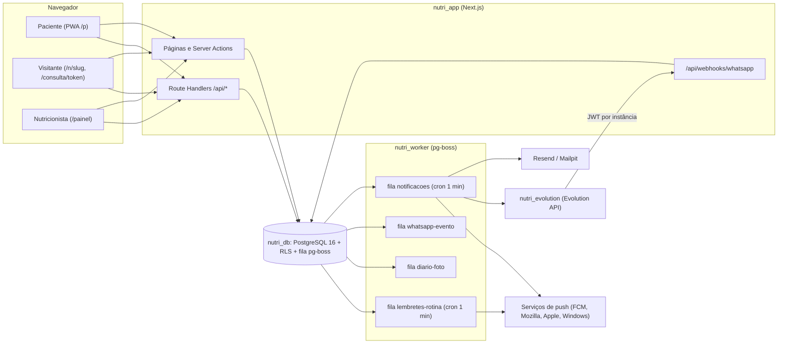
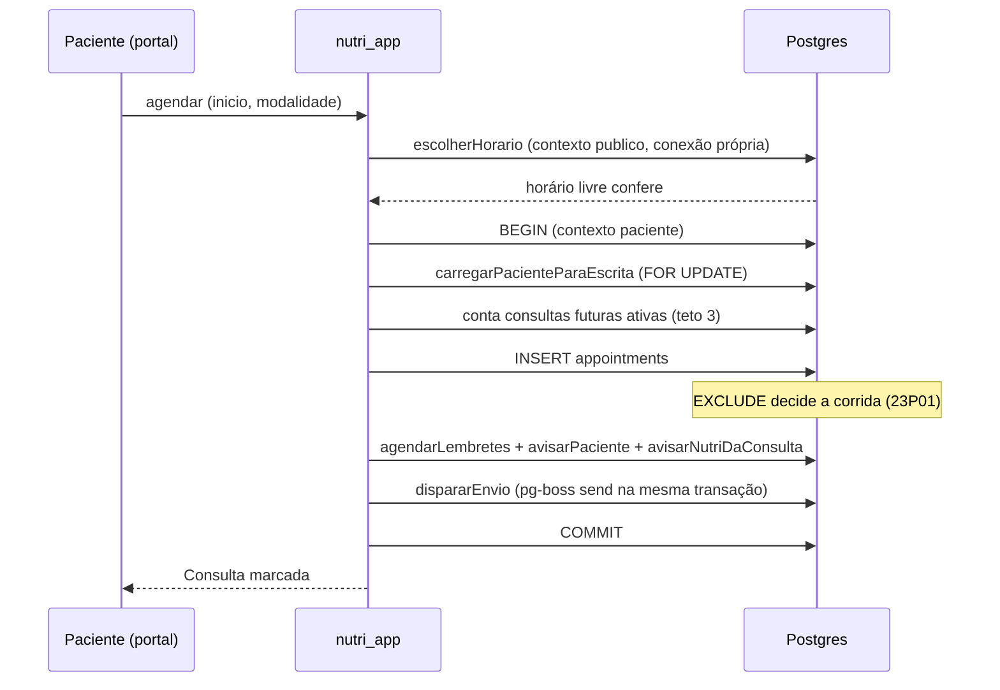
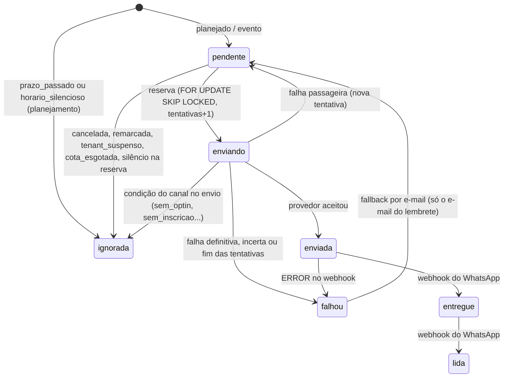
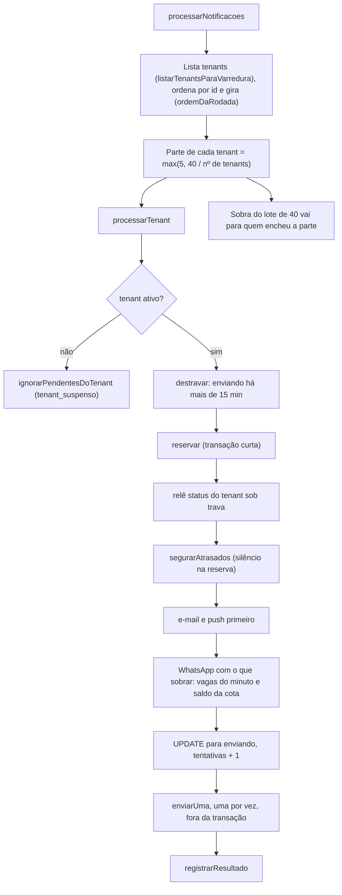
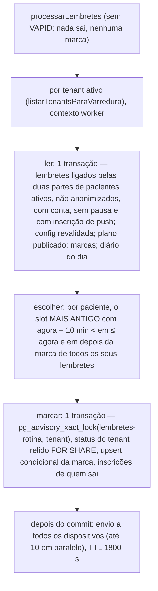
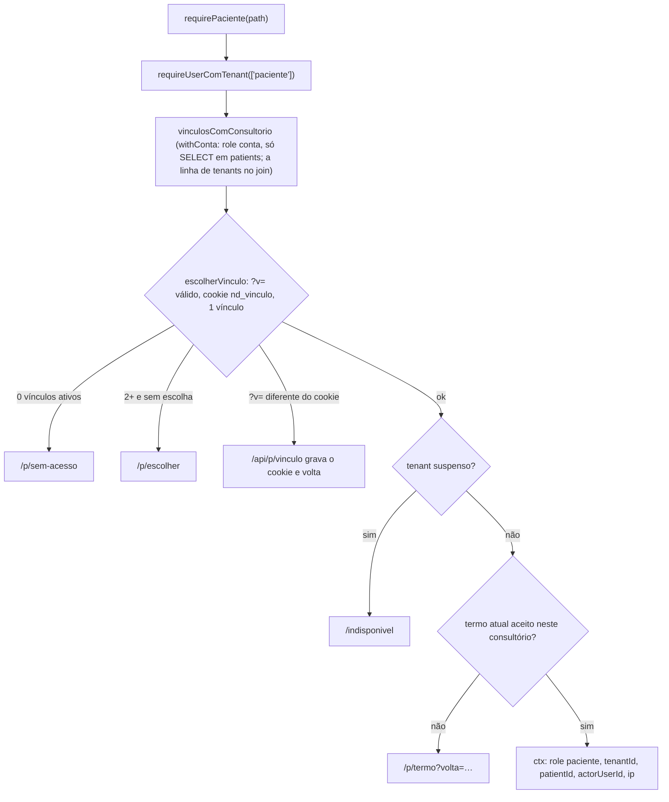
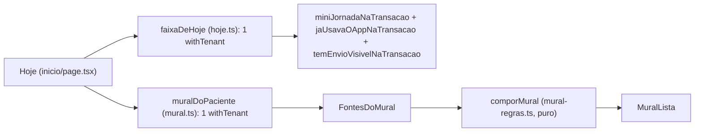

# 5. Agenda, notificações, portal do paciente, conteúdos e interface

Este capítulo cobre o que o paciente vê e o que chega até ele: a agenda, a página pública de agendamento, o motor de
notificações e os três canais, o portal do paciente (PWA), a biblioteca de conteúdos, a interface do painel e o manual
guiado. A base (RLS, `withTenant`, auditoria, arquivos) está nos capítulos anteriores ([cap. 2](02-banco-de-dados.md),
[§4.1.3](04-modulos-clinicos.md#413-armazenamento-com-cota-e-url-assinada-rn-18-regra-9-do-claudemd)). Aqui ela é citada só onde muda o
comportamento.

Convenções do capítulo:

- **Px Dy** = decisão `Dy` do Plano `x` (`docs/superpowers/plans/`). Exemplo: P05 D9 é a D9 do Plano 05.
- **RN-xx, RNF-xx, INT-xx, US-xxx** = itens da spec (`docs/superpowers/specs/2026-09-27-nutridebby-mvp-design.md` e
  `…-mvp-historias.md`).
- Caminhos são relativos à raiz do repositório. Quando a afirmação vem de uma função, ela é citada pelo nome.
- Variáveis de ambiente aparecem só pelo nome. Nenhum valor de segredo está neste documento.

---

## 5.0 Mapa dos módulos

| Módulo | Pasta | Responsabilidade | Plano |
|---|---|---|---|
| Agenda | `src/modules/agenda/` | Fuso, regras e bloqueios, horários livres, consultas, cancelamento, link assinado, página pública, limites por IP, presença, Início do painel | P05 (e P08 para o Início) |
| Notificações | `src/modules/notificacoes/` | Planejamento e envio (e-mail, WhatsApp, push), textos, cota, webhook do WhatsApp | P05 (P06 e P07 acrescentam tipos) |
| Portal | `src/modules/portal/` + `src/lib/paciente-session.ts` | Vínculos da conta, acesso diário, plano, diário (e as respostas à refeição do plano), evolução, lista de compras, pedidos do titular, inscrição de push, conteúdos do paciente, mural e faixa de Hoje (`hoje.ts`, `faixaDeHoje`), Jornada | P06 (P07 para conteúdos; P16 para o mural, as respostas e a Jornada; P08-13 para a faixa de Hoje) |
| Lembretes de rotina | `src/modules/lembretes/` + `src/modules/notificacoes/push-dispositivos.ts` | Configuração por paciente (equipe e paciente), plano do dia (slots, fusão, teto), envio por push no job `lembretes-rotina` (§5.3.9) | P17 |
| Conteúdo | `src/modules/conteudo/` | Vídeo, oEmbed, capa, markdown, receitas, audiência, aviso, métricas, LGPD do titular | P07 |
| Ajuda | `src/modules/ajuda/conteudo.ts`, `src/modules/ajuda/portal.ts`, `src/modules/ajuda/precisa-do-guia.ts` (P08-13) | Texto dos tours e do manual do painel (`GUIAS`) e o guia do portal (`GUIA_PORTAL`, `AVISO_PORTAL`) | P08 (P16 para o portal) |
| Tema | `src/lib/tema/`, `src/app/globals.css`, `src/components/ui/` | Tokens de cor, contraste, cor da marca no escuro, cor da faixa do portal, componentes base | P08 (P16 para o portal) |

A spec registra a divisão em dois módulos (`agenda` e `notificacoes`) porque o motor de envio também serve o convite do
paciente (US-010) — desvio do §4.1 listado no Plano 05 ("Desvios conscientes da spec").



---

## 5.1 Agenda

### 5.1.1 Fuso horário (RN-06, P05 D8)

Tudo é gravado em UTC (`timestamptz`). Calendário, horário silencioso, virada do mês da cota e textos usam
`tenants.fuso` (padrão `America/Sao_Paulo`). As funções ficam em `src/modules/agenda/fuso.ts`, só com `Intl`, sem
biblioteca (P05, "Global Constraints").

| Função | O que faz |
|---|---|
| `partesNoFuso(instante, fuso)` | Data, hora, dia da semana e minutos desde 00:00 no fuso |
| `paraInstante(data, hora, fuso)` | Data + hora locais → instante. Hora inexistente (início do horário de verão) → `null`; hora repetida → a primeira ocorrência (D8) |
| `inicioDoDia`, `inicioDoMes`, `inicioDoMesSeguinte` | Limites de dia e de mês civil no fuso (usados na cota, RN-09, e na taxa de faltas) |
| `formatarQuando`, `quandoComFuso`, `rotuloDoFuso` | "sex., 16/10/2026 às 14:00 (horário de Brasília)". Mensagens ao paciente sempre levam a sigla |
| `dataDaAgendaValida(data, hoje)` | Data existe e fica entre 1900 e hoje + 5 anos (`ANOS_FUTUROS_AGENDA`). Sem o teto, `9999-12-31` virava 500 |

Regra para quem estende: nunca use `new Date().getHours()` ou `getDate()` no servidor (UTC). Use `partesNoFuso`.

### 5.1.2 Horários de atendimento e bloqueios (US-030)

Tabelas `availability_rules` e `availability_blocks` (migrations `drizzle/0048_agenda_disponibilidade.sql` e
`0049_rls_agenda_disponibilidade.sql`). Ambas são `staff_only`: a sessão de paciente não lê nem as próprias linhas
(`STAFF_ONLY` em `src/db/rls-guard.ts`; o motivo do bloqueio pode ser pessoal). O contexto `publico` lê as duas
(`PUBLICO_LIBERADO`, comando `select`).

Regras de validação (`src/modules/agenda/disponibilidade.ts`, `validarRegra`, `criarRegra`, `criarBloqueio`;
constantes em `src/modules/agenda/constantes.ts`):

| Item | Limite | Mensagem |
|---|---|---|
| Duração da regra | 15 a 240 min (`DURACAO_MIN`, `DURACAO_MAX`) | "A duração deve ser de 15 a 240 minutos" |
| Regras por tenant | 30 (`MAX_REGRAS`) | "Limite de 30 horários de atendimento." |
| Sobreposição no mesmo dia | proibida, conferida sob `pg_advisory_xact_lock('agenda-regras', tenant)` | "Este horário se sobrepõe a outro do mesmo dia." |
| Bloqueio | até 366 dias; motivo até 120 caracteres | "O bloqueio pode ter no máximo 366 dias" |
| Bloqueio sem hora | dias inteiros no fuso (00:00 do primeiro até 00:00 do dia seguinte ao último) | — |

### 5.1.3 Horários livres (RN-03, P05 D11)

RN-03: horários livres = regras − bloqueios − consultas não canceladas.

- `gerarHorarios` (`src/modules/agenda/horarios.ts`) é pura. Para cada dia da janela e cada regra do dia da semana,
  gera horários de `duracaoMin` a partir do início, enquanto couberem até o fim. Pula a hora local inexistente. Usa
  intervalos semiabertos `[início, fim)` (`sobrepoe`), como o `EXCLUDE` do banco.
- Regra `online` ou `ambas` só oferece "online" se o tenant tiver `link_online_padrao` (`modalidadesDa`).
- `horariosLivres` (`src/modules/agenda/consultas.ts`) roda no contexto **`publico`** do `withTenant`: lê regras,
  bloqueios e só `id`/`inicio`/`fim` das consultas não canceladas. Devolve só intervalos. Usa uma margem de 8 h depois
  do fim da janela para pegar bloqueio ou consulta que cruza o último horário.
- `horariosParaPaciente` (`src/modules/agenda/agendamento-paciente.ts`) aplica a janela do paciente: de agora +
  `tenants.antecedencia_min_h` (padrão 12 h) até agora + 60 dias (`JANELA_PACIENTE_DIAS`).
- `escolherHorario` confere que o horário pedido é **exatamente** um horário livre oferecido agora (início e
  modalidade). Qualquer outra coisa vira "Esse horário não está mais disponível. Escolha outro.".

**Por que o contexto `publico`.** O paciente não pode ler regras, bloqueios nem consultas de outros. Os horários livres
precisam de tudo isso. A solução foi um papel sem ator, com leitura negada por padrão no banco e liberada tabela a
tabela (P05 D11; detalhes em 5.2.1). Assim, mesmo um erro no código não devolve dado de outro paciente.

**Regra de conexão (P05, "Global Constraints").** `horariosLivres` e `escolherHorario` abrem a própria transação.
Chame-as **antes** de abrir a transação da gravação, nunca dentro. O pool tem `max: 10`; dez pedidos com duas conexões
cada travam o app. Dentro da transação, quem revalida o horário é o `EXCLUDE`.

### 5.1.4 Tabela `appointments` e o `EXCLUDE` (P05 D9)

Migrations `drizzle/0050_consultas.sql` (tabela) e `0051_rls_consultas.sql` (RLS e restrição).

| Coluna | Observação |
|---|---|
| `inicio`, `fim` | `timestamptz`. A spec previa `periodo tstzrange`; o Drizzle não tem o tipo, então a faixa é expressão da restrição (desvio registrado no P05) |
| `modalidade` | `presencial`/`online`. CHECK `appointments_link_online`: online exige `https://…` até 500 caracteres; presencial sem link |
| `status` | `agendada`, `confirmada`, `cancelada`, `realizada`, `faltou` |
| `origem` | `nutri`/`paciente` (a página pública grava `paciente`) |
| `confirmada_via` | `whatsapp`/`link` (o portal também grava `link`, P06 D19) |
| `cancelado_por` | `nutri`/`paciente`/`sistema` (`sistema` desde a migration `0067`: pedido de exclusão atendido) |
| `motivo_cancelamento` | até 300 caracteres; só a nutricionista lê o que ela escreveu (`motivoDoCancelamentoDaNutri`) |
| `pedido_remarcacao_em`, `remarcada_de`, `cancelada_em`, `presenca_em` | estado do fluxo |

CHECKs relevantes de `0050`: `appointments_periodo_valido` (`fim > inicio` e no máximo 8 horas),
`appointments_cancelamento_completo` (cancelada ⇔ `cancelado_por` e `cancelada_em` preenchidos).

A restrição que impede sobreposição:

```sql
ALTER TABLE appointments ADD CONSTRAINT appointments_sem_sobreposicao
  EXCLUDE USING gist (tenant_id WITH =, tstzrange(inicio, fim, '[)') WITH &&) WHERE (status <> 'cancelada');
```

- `'[)'`: terminar às 10:00 e começar às 10:00 não é sobreposição.
- `realizada` e `faltou` continuam ocupando o horário.
- O `=` do uuid no GiST vem da extensão `btree_gist` (migration `0000`).
- A restrição vale **acima da RLS**. Dois pacientes que não se veem disputam o mesmo horário; o banco decide.

Tratamento de erro (`src/modules/agenda/consultas.ts`):

| Situação | Tratamento |
|---|---|
| 23P01 (violação do `EXCLUDE`) | `ehSobreposicao(e)`. Paciente: "Esse horário acabou de ser ocupado. Escolha outro.". Nutricionista: `comoConflito` relê numa transação nova e devolve "Conflito com a consulta de {nome} às HH:MM" |
| 40P01 (deadlock) | `repetirSeDeadlock` repete a operação inteira **uma vez**. O Postgres insere no índice GiST antes de procurar conflitos; duas gravações simultâneas podem esperar uma pela outra. Um segundo 40P01 sobe como erro |

RLS: `app_enable_tenant_rls`, `app_enable_patient_rls` (paciente vê só as próprias) e `app_enable_audit('appointments',
'agenda')` (escritas no "Histórico de acessos"). Leitura da agenda **não** chama `auditRead` (P05 D10: nome, hora e
situação, como a lista de pacientes).

### 5.1.5 Marcar uma consulta

Três caminhos gravam consulta. Todos, na mesma transação: lembretes (`agendarLembretes`), aviso "Consulta marcada" ao
paciente (`avisarPaciente`) e o pedido de envio imediato (`dispararEnvio`).

| Caminho | Função | Regras |
|---|---|---|
| Nutricionista (US-031) | `agendarPelaNutri` (`consultas.ts`) | Qualquer data (até o passado, para encaixe) e qualquer horário. Fora das regras ou em bloqueio, grava e devolve avisos (`fora_do_horario`, `dentro_de_bloqueio`). Paciente arquivado: "Paciente arquivado: desarquive para agendar." (P05 D22) |
| Paciente no portal (US-032) | `agendarComoPaciente` (`agendamento-paciente.ts`) | Tenant ativo (RN-15), paciente ativo (RN-08), horário livre (`escolherHorario`), no máximo 3 consultas futuras ativas (`MAX_CONSULTAS_FUTURAS_PUBLICO`, contadas sob a trava do paciente). Avisa a nutricionista (`avisarNutriDaConsulta`) |
| Página pública (US-032) | `confirmarCodigo` → `gravarPedido` (`agendamento-publico.ts`) | Ver 5.2 |

O teto de 3 consultas também no portal veio da revisão da Tarefa 12 do Plano 06 (comentário de
`agendarComoPaciente`; RN-16 v1.9): sem ele, "Entrar (já sou paciente)" levava de um caminho com teto para um sem teto.

Consulta marcada no passado não gera aviso nem lembrete: `avisarPaciente` sai cedo se a consulta já começou, e
`planejarLembretes` marca `prazo_passado` (P05 D22).



### 5.1.6 Cancelar, remarcar e confirmar (RN-04, P05 D17)

Arquivo `src/modules/agenda/cancelamento.ts`.

| Ação | Quem | Regra |
|---|---|---|
| `cancelarConsulta` | Nutricionista a qualquer momento; paciente até `cancelamento_min_h` antes (padrão 24 h; `podeAlterarPeloPaciente`, no limite exato ainda pode) | Paciente fora do prazo: "Para alterar, fale com sua nutricionista." Lembretes pendentes viram `ignorada`/`consulta_cancelada` (`cancelarLembretes`). Aviso "Consulta cancelada" ao paciente; se foi ele, e-mail à nutricionista |
| `remarcarComoPaciente` | Paciente, dentro do prazo | Cancela a antiga (`cancelado_por = 'paciente'`) e cria a nova com `remarcada_de`, numa transação |
| `moverConsulta` ("Alterar data e hora") | Nutricionista | A mesma consulta. Se o início muda: volta a `agendada`, perde confirmação e pedido de remarcação, lembretes do horário antigo pendentes viram `consulta_remarcada`, horário novo ganha linhas novas. Mudar só duração, modalidade ou link mantém tudo |
| `confirmarPresenca` | Paciente (link, portal, "1" no WhatsApp) | Idempotente; só antes do início e com paciente ativo. Desfaz um pedido de remarcação em aberto |
| `pedirRemarcacao` | Paciente fora do prazo ("Avisar que preciso remarcar") | Marca o pedido e avisa a nutricionista uma vez por pedido |
| `cancelarFuturasPelaExclusao` | Sistema, ao atender pedido de exclusão (US-018) | Cancela consultas futuras com `cancelado_por = 'sistema'`, **sem** aviso ao paciente; a nutricionista recebe um e-mail só com o primeiro nome e a quantidade |

**Ordem das travas: paciente → consulta → notificações.** Está em todos os caminhos (`moverConsulta`,
`cancelarConsulta`, `remarcarComoPaciente`, `travarPacienteDaConsulta`). A ordem inversa causou deadlock na revisão da
Tarefa 7: o `INSERT` em `notifications` pede `FOR KEY SHARE` no paciente pela FK. Quem acrescentar uma escrita na agenda
deve respeitar essa ordem.

### 5.1.7 Link assinado da consulta (P05 D20)

O paciente age sem login pela página `/consulta/<token>` (`src/app/consulta/[token]/`). O link vai em todo e-mail de
lembrete e de "Consulta marcada". **Nunca** vai por WhatsApp (decisão do dono de 02/10/2026, INT-01).

Formato do token (`src/modules/agenda/link-consulta.ts`, `assinarLinkConsulta`):

| Bytes | Conteúdo |
|---|---|
| 0 | Versão (`1`) |
| 1–16 | `tenant_id` (uuid) |
| 17–32 | `appointment_id` (uuid) |
| 33–36 | Início da consulta em segundos (também a validade) |
| 37–52 | HMAC-SHA256 truncado em 128 bits |

São 53 bytes em base64url, 71 caracteres. A chave é derivada por HKDF de `ENCRYPTION_KEY` com o rótulo
`nutridebby:link-consulta:v1` (`chaveDosLinks`); nenhuma variável nova. O MAC cobre o corpo **e o SHA-256 do e-mail
atual do paciente** (normalizado): corrigido o e-mail, todo link antigo deixa de conferir, sem estado novo no banco
(decisão do dono no fechamento do Plano 05; ver "Divergências").

Como o link é lido (`src/modules/agenda/acoes-link.ts`, `resolver`):

1. Formato canônico (`/^[A-Za-z0-9_-]{71}$/` e reescrita igual). Um token, uma grafia.
2. Lê o tenant e a consulta no contexto `publico` (só `patient_id`, e-mail, início e situação do paciente).
3. Confere o MAC em tempo constante. Até aqui, toda falha é "Link inválido." (não revela se tenant ou consulta existem).
4. Consulta já começou, ou mudou de início depois do link (`noInicioDoLink`) → "Este link expirou.".
5. Tenant suspenso, paciente arquivado, bloqueado ou anonimizado → "Conta temporariamente indisponível".

Regras de segurança:

- `abrirLinkConsulta` (o `GET` da página) **nunca muda estado**: a pré-visualização de link do WhatsApp abre a URL.
- As ações (`confirmarPeloLink`, `cancelarPeloLink`, `remarcarPeloLink`, `avisarRemarcacaoPeloLink`) rodam com o
  contexto `paciente` do dono da consulta, `semConta: true` e o IP de quem clicou (`comoPaciente`). A RLS por paciente
  continua valendo. O `audit_log` fica sem ator ("Sistema").
- O início do token e o e-mail conferido são reconferidos **sob as travas** (`conferirInicioDoLink`,
  `conferirEmailDoLink` em `cancelamento.ts`): a nutricionista pode mudar algo entre abrir o link e clicar.
- `next.config.ts` manda `Referrer-Policy: no-referrer` em `/consulta/:token*`.
- `acoes-link.ts` está na lista fechada `SEM_CONTA_PERMITIDOS` (`src/db/tenant.ts`), conferida por
  `sem-conta-guarda.test.ts`.

### 5.1.8 Presença, pendências e taxa de faltas (US-037, P05 D21, CS-03)

Arquivo `src/modules/agenda/presenca.ts`.

- `registrarPresenca`: depois do início, `realizada` ou `faltou` (pode corrigir). Cancelada não. "Faltou" com
  atendimento ligado não. Vale também para paciente bloqueado ou anonimizado (é histórico da agenda).
- Plano 20 (RN-310, RN-312): a passagem a `realizada` lê `tenants.fuso` e chama `cobrarConsultaRealizada` na mesma
  transação (a cobrança no Financeiro, com o valor da consulta configurado); a correção de `realizada` para `faltou` só lê a
  cobrança (`aoCorrigirParaFaltou`: não cancela nem altera, F-P5 = v0.2). `registrarPresenca` devolve `{ cobranca }` (nulo
  quando a situação não mudou); `presencaAction` leva só o tipo à URL (`?ok=presenca&cobranca=…`, nunca o valor), e a tela da
  consulta mostra a mensagem e a seção "Cobrança" abaixo de "Registrar presença"
  ([§12.5](12-financeiro.md#125-cobrança-da-consulta-us-303-rn-310-a-rn-314)). A pendência de presença
  (`/painel/agenda/pendencias`) não muda e não se confunde com "Pagamentos pendentes" do Financeiro.
- Pendência ("sem registro de presença"): não cancelada, terminou há mais de 24 h e continua `agendada`/`confirmada`
  (`semRegistro`). A tela `/painel/agenda/pendencias` lista as 100 mais antigas.
- `indicadoresDaAgendaNaTransacao`: mês civil no fuso do tenant. Taxa = faltas ÷ consultas do mês já iniciadas e não
  canceladas. Consulta futura não entra no denominador. Texto: "12,5% (2 de 16)" (`textoTaxa`).
- "Iniciar atendimento" (`motivoParaNaoIniciarAtendimento`, `consultaParaIniciarAtendimento`) liga um atendimento do
  prontuário à consulta (`consultations.appointment_id`, migrations `0063`/`0064`).

A agenda do painel tem visões dia, semana (padrão, começa na segunda) e lista de 30 dias
(`src/app/painel/agenda/periodo.ts`, `periodoDaVisao`). A situação aparece em texto, nunca só em cor (`selosDaConsulta`).

### 5.1.9 Início do painel (P08 D21, D22)

`lerInicio` (`src/modules/agenda/inicio.ts`) lê tudo numa **transação só**. Leituras em paralelo abriam uma transação
cada e ocupavam o pool (achado 3 do `/code-review` do PR #12).

O cartão "Próxima consulta" não mostra peso (P08 D22): exigiria `auditRead` a cada abertura. Mostra contagens:
"Diário: N registros em 7 dias" e "Portal: N de 7 dias". A contagem do diário é dado de saúde de um paciente nomeado,
então é auditada (entidade `diario`) **no máximo uma vez por paciente por dia, por ator**, no fuso do tenant
(`auditarDiarioUmaVezNoDia`, trava `pg_advisory_xact_lock('inicio-diario', paciente)`; decisão do dono de 04/10/2026).

---

## 5.2 Página pública `/n/<slug>` (RN-16, P05 D11–D13)

A página nasce **desligada** (`tenants.agendamento_publico_ativo` padrão `false`, migration `0067`). A nutricionista
liga em Configurações.

### 5.2.1 Contexto `publico` negado por padrão

A migration `drizzle/0051_rls_consultas.sql` criou duas funções e mudou `app_enable_tenant_rls`:

- `app_deny_publico(tabela)` cria a política `RESTRICTIVE` `publico_negado`
  (`USING app_current_role() IS DISTINCT FROM 'publico'`).
- `app_enable_tenant_rls` chama `app_deny_publico` no fim. Toda tabela nova com `tenant_id` nasce fechada ao
  `publico`. A migration aplicou a negação também em todas as tabelas existentes.
- `app_allow_publico(tabela, comandos…)` troca a negação por uma `RESTRICTIVE` por comando que continua negado.

A lista explícita é `PUBLICO_LIBERADO` (`src/db/rls-guard.ts`). A guarda `findPublicoViolations` (CI) confere nome,
comando e `RESTRICTIVE` contra `pg_policies`.

| Tabela | Comandos | Motivo (do código) |
|---|---|---|
| `availability_rules`, `availability_blocks` | `select` | horários livres |
| `appointments` | `select`, `insert` | início/fim nos horários livres, dono do link, consulta da página pública |
| `patients` | `select`, `insert` | situação do dono do link; paciente da página pública |
| `audit_log` | `insert` | o gatilho de auditoria roda com o papel de quem grava |
| `notifications` | `select`, `insert` | lembretes da consulta pública (`INSERT … ON CONFLICT` lê a linha nova) |
| `public_booking_requests` | `select`, `insert`, `update` | pedido: cria, confere o código (`FOR UPDATE`) e conclui |

Consequência prática: sem a política de `UPDATE`, o `publico` não altera paciente e não consegue travar linha de
`patients` com `SELECT … FOR SHARE` (a linha some do resultado). Por isso `gravarPedido` usa uma trava por e-mail e a
reconferência descrita abaixo.

### 5.2.2 Fluxo em dois passos

```mermaid
sequenceDiagram
  participant Vis as Visitante
  participant App as nutri_app
  participant CF as Cloudflare Turnstile
  participant DB as Postgres
  participant W as Worker (fila email)
  Vis->>App: POST /api/n/slug/codigo (nome, e-mail, horário, termo, 18+, token Turnstile)
  App->>DB: consumirLimite(ip, 10/h)
  App->>CF: siteverify (antes de qualquer escrita de negócio)
  App->>DB: escolherHorario (publico)
  App->>DB: BEGIN; trava do e-mail; 1 código/60 s; 5 códigos/h
  App->>DB: INSERT public_booking_requests (hash do token, HMAC do código)
  App->>DB: enfileira e-mail codigo_agendamento; COMMIT
  App-->>Vis: { pedido }
  W-->>Vis: e-mail com o código de 6 dígitos (10 min)
  Vis->>App: POST /api/n/slug/confirmar (pedido, código)
  App->>DB: confere código (5 erros invalidam)
  App->>DB: gravarPedido: paciente (novo ou ativo), teto 3, consulta, aceite do termo, pedido concluído
  App-->>Vis: "Consulta marcada para …"
```

Pontos de projeto (`src/modules/agenda/agendamento-publico.ts`):

- **Resposta igual para e-mail cadastrado ou não** até o código ser confirmado (P05 D12). `solicitarCodigo` não olha
  `patients`. O teto de 3 consultas é conferido **depois** do código, em `gravarPedido`.
- **Turnstile** (`src/lib/turnstile.ts`, `verifyTurnstile`): valida no servidor com `TURNSTILE_SECRET_KEY`, prazo de
  5 s, confere o `hostname` do app. Fora do ar = `'indisponivel'` → 503 "Tente novamente em alguns minutos"; nunca segue
  sem verificação (INT-06). `src/env.ts` recusa chaves de teste em produção.
- **Código**: 6 dígitos de `randomInt`. O banco guarda só `hashDoCodigo` = HMAC (chave HKDF de `ENCRYPTION_KEY`,
  rótulo `nutridebby:codigo-agendamento:v1`) de `"<id do pedido>:<código>"`. O código de um pedido não confere em outro.
  Validade 10 min (`CODIGO_VALIDADE_MS`); 5 erros (`MAX_ERROS_CODIGO`) → 410 "Muitas tentativas com código errado.".
  Depois do código certo, o pedido pode escolher outro horário por 30 min sem novo código (`VERIFICADO_VALIDADE_MS`).
- **Paciente**: e-mail de paciente ativo → a consulta vai para ele (ele provou o e-mail). Arquivado, bloqueado ou
  anonimizado → 409 "Não foi possível agendar por aqui. Fale com sua nutricionista.". Paciente novo nasce com
  `origem = 'agendamento_publico'` e opt-in de WhatsApp com origem `paciente` se marcou e deu telefone. Opt-in marcado
  por paciente que já existe é descartado (o `publico` não altera pacientes).
- **Corrida com o pedido de exclusão**: o `INSERT` da consulta segura o paciente pela FK (`FOR KEY SHARE`), e
  `reconferirPaciente` relê o status logo depois (comentário de `gravarPedido`).
- **Aceite do termo**: grava em `consents` com `patient_id` e `tenant_id` (P05 D13: `user_id` nulo; `UNIQUE NULLS NOT
  DISTINCT`).
- **Limpeza**: pedidos com mais de 24 h somem (`limparPedidosPublicos`, job `agenda-limpeza`, 04:30 de Brasília).

As rotas (`src/app/api/n/[slug]/codigo`, `confirmar`, `horario`) usam `responder` (`src/app/api/n/[slug]/resposta.ts`):
JSON de até 8 KB, `cache-control: no-store`, `PublicoError` → status e `{ erro }` ou `{ erros }`.

### 5.2.3 Limites com HMAC (`src/modules/agenda/limite-ip.ts`)

A tabela `public_rate_limits` não tem `tenant_id` nem RLS. **Só este arquivo** a acessa (regra 1 do `CLAUDE.md`).

- `chaveDoLimite(tipo, valor)` grava `tipo:HMAC(valor)`, com chave HKDF de `ENCRYPTION_KEY` (rótulo
  `nutridebby:limite-publico:v1`). O banco nunca tem o IP nem o e-mail.
- `consumirLimite` é um `INSERT … ON CONFLICT DO UPDATE` atômico que zera a contagem quando a janela vira. Aceita uma
  transação (o webhook do WhatsApp grava a marca junto com o evento).
- `limparLimites` apaga contadores de mais de 1 dia (job `agenda-limpeza`).

| Limite | Chave | Valor |
|---|---|---|
| Tentativas por IP | `ip:` + IP do balde | 10 por hora, em qualquer das três ações, até para slug inexistente |
| Códigos por e-mail | `email-hora:` + `tenant:email` | 5 por hora, contado só quando o código sai |
| Intervalo entre códigos | `max(created_at)` do e-mail em `public_booking_requests` | 60 s ("Aguarde 1 minuto para pedir outro código.") |
| Marca anti-repetição do webhook | `webhook:` + JWT + SHA-256 do corpo | 1 durante a validade do JWT (5.4.2) |

O IP vem de `clientIp` (auditoria, Turnstile) e `clientIpDoLimite` (balde) em `src/lib/ip.ts`, com `TRUSTED_PROXIES`
(os saltos do Traefik não contam; `X-Forwarded-For` forjado à esquerda não vence). No IPv6, o balde é o /64.

---

## 5.3 Motor de notificações (RN-05, P05 D6, D7)

### 5.3.1 Ideia central: estado no banco, varrido pelo worker

O motor **não** agenda um job por lembrete. O pg-boss apaga job criado depois de 14 dias, e uma consulta pode ser
marcada com 60 dias de antecedência (P05, "Global Constraints"). O estado fica em `notifications` (`status`,
`agendada_para`), e o worker varre a tabela:

- Cron `notificacoes` a cada minuto (`src/worker/index.ts`, `boss.schedule('notificacoes', '* * * * *', …,
  { tz: 'America/Sao_Paulo' })`).
- Ações que precisam de envio já chamam `dispararEnvio(tx, tenantId)` (`src/modules/notificacoes/agendar.ts`): enfileira
  a mesma varredura só daquele tenant, **na mesma transação** (`send` com `fromDrizzle(tx, sql)`).
- A fila tem `retryLimit: 0` (`src/jobs/queues.ts`): o que falha volta como `pendente` com nova data.
- Um job de `notificacoes` por vez no worker (`localConcurrency` padrão 1; comentário em `src/worker/index.ts`).

### 5.3.2 Uma linha por consulta × tipo × canal

Tabela `notifications` (migrations `0052`, `0053`, `0054`, `0062`, `0068`, `0069`, `0084`). Tipos em
`src/modules/notificacoes/tipos.ts`:

| Tipo | Canais | Origem | Conta na cota do WhatsApp |
|---|---|---|---|
| `lembrete_24h`, `lembrete_2h` | e-mail, WhatsApp, push | `agendarLembretes` | sim |
| `consulta_marcada`, `consulta_cancelada` | e-mail, push | `avisarPaciente` | — |
| `convite_paciente` | WhatsApp | `agendarConviteWhatsapp` (US-010) | sim |
| `resposta_confirmacao`, `resposta_remarcar` | WhatsApp (e e-mail no "2") | webhook (5.4.2) | não |
| `push_teste` | push | `inscreverAparelho` (P06 D7) | — |
| `comentario_diario` | push | `avisarComentario` (P06 D13) | — |
| `plano_novo` | push (+ e-mail pela fila `email`) | `avisarPlanoNovo` (P06 D24) | — |
| `conteudo_novo` | push | `avisarConteudoNovo` (P07 D5) | — |

Chave única: índice parcial `notifications_versao_unique` em (`appointment_id`, `canal`, `tipo`, `inicio_consulta`)
**só para `lembrete_24h` e `lembrete_2h`** (`TIPOS_UM_POR_HORARIO`, `src/db/schema/agenda.ts`; migration `0068`, que
tirou as respostas da chave). Consequências (P05 D6):

- Marcar de novo no mesmo horário reescreve só a linha que **não saiu** (`pendente`, `ignorada`, `falhou`;
  `gravar` com `ON CONFLICT … DO UPDATE … WHERE`).
- Mudar o horário cria linhas novas. A pendente do horário antigo vira `ignorada`/`consulta_remarcada`
  (`descartarHorarioAntigo`).
- **Linha enviada é imutável.** Ela conta na cota e nas métricas.
- Avisos de evento (`avisarPaciente`) ficam fora da chave: cada evento ganha linhas próprias, com idempotência por
  (tipo, início) entre as pendentes ou saindo.

`conteudo_selado` (texto cifrado até o envio) só pode existir em `pendente`/`enviando`
(CHECK `notifications_conteudo_so_antes_do_envio`, migration `0062`). Hoje nenhum fluxo grava (comentário em
`src/modules/notificacoes/mensagens.ts`), mas toda saída final o limpa.

### 5.3.3 Estados



### 5.3.4 Planejamento dos lembretes

`planejarLembretes(inicio, fuso, agora)` (`agendar.ts`): 24 h e 2 h antes (`ANTECEDENCIA_MS`).

- Horário já passou → `ignorada`/`prazo_passado`.
- Horário em `[21:00, 08:00)` no fuso do tenant (`emHorarioSilencioso`; 08:00 em ponto vale) →
  `ignorada`/`horario_silencioso`. No planejamento, **não** adia.
- Senão, `pendente`. As linhas nascem para os **três canais**. As condições de cada canal são conferidas só no envio.

### 5.3.5 A varredura (`src/modules/notificacoes/enviar.ts`)



| Constante | Valor | Onde |
|---|---|---|
| `LOTE_POR_EXECUCAO` | 40 por execução | `enviar.ts` |
| `LOTE_MIN_POR_TENANT` | 5 | `enviar.ts` |
| `TRAVADA_MS` | 15 min em `enviando` = worker caiu | `enviar.ts` |
| `ESPERAS_S` | e-mail 60/120/240 s; WhatsApp e push 60/300/1500 s | `enviar.ts` |
| `WHATSAPP_POR_MINUTO` | 8 por tenant | `enviar.ts` |

**No máximo uma vez para WhatsApp e push.** `destravar` devolve o e-mail preso em `enviando` para `pendente` (o Resend
tem chave de idempotência), mas marca WhatsApp e push presos como `falhou`/`interrompido`. Timeout ou exceção do
provedor depois de o pedido sair também é definitivo (`sem_resposta`): na dúvida, não reenvia (INT-01, P05 D6).

**Condições comuns** (`motivoParaIgnorar`), na hora do envio: paciente ativo e não anonimizado (RN-08); convite já
aceito; para lembretes, "Consulta marcada" e respostas: consulta não cancelada, não encerrada, ainda no início para o
qual a linha foi planejada e ainda não começada.

**Condições por canal:**

| Canal | Motivos de `ignorada` |
|---|---|
| E-mail | — (falha de transporte = `repetir`) |
| WhatsApp | `whatsapp_desligado` (sem provedor), `whatsapp_desconectado`, `sem_optin` (opt-in vazio ou opt-out preenchido), `sem_telefone`, `cota_esgotada` |
| Push | `push_desligado` (sem VAPID), `sem_inscricao` (nenhuma inscrição ou todas mortas) |

### 5.3.6 Horário silencioso na reserva (P05 D7)

O planejamento já ignora o que cairia no silêncio. Mas um lembrete pode vencer durante o silêncio por atraso (worker
parado, conta reativada à noite). `segurarAtrasados`, na 1ª tentativa:

- No silêncio: adia para as próximas 08:00 (`fimDoSilencio`) se ainda fizer sentido (`lembreteFazSentido`); senão
  `ignorada`/`horario_silencioso`.
- Fora do silêncio: o de 24 h atrasado que perdeu o sentido (a consulta começa em até 2 h) vira `prazo_passado`.
- "Faz sentido": o de 24 h só até o horário do de 2 h (ou até 30 min antes do início, se o de 2 h caiu no silêncio); o
  de 2 h até 30 min antes do início.
- O de 24 h que sai no dia da consulta diz "hoje" (`ehHoje` em `mensagens.ts`).
- Vale para os três canais. Só lembretes: avisos de evento, convite e respostas saem na hora. Novas tentativas não
  esperam o fim do silêncio.

### 5.3.7 Cota de WhatsApp (RN-09, P05 D15) e ritmo (P05 D16)

Arquivo `src/modules/notificacoes/whatsapp/cota.ts`.

- É **limite de uso** (protege o número contra bloqueio), não de custo. Padrão `tenants.wa_cota_mensal = 500`.
- Conta `CONTA_COTA` = `lembrete_24h`, `lembrete_2h`, `convite_paciente` aceitos pela Evolution (`enviada_em`) no mês
  civil do fuso do tenant (`usoDoMes`). As respostas "1"/"2" (`FORA_DA_COTA`) seguem o ritmo, mas não a cota.
- Na reserva (`escolherWhatsapp`), o uso conta também as `enviando`. Com saldo, a volta reserva no máximo o saldo; o
  resto fica `pendente` e é recontado na volta seguinte. Só vira `cota_esgotada` quando o uso já chegou a 100%.
- 80% → `avisarSeChegou80`: um e-mail "Você usou 80% dos WhatsApps do mês" por mês (`whatsapp_conexoes.aviso_cota_mes`),
  num savepoint (a falha do aviso não desfaz o registro do envio).
- O admin pode ampliar a cota; vale na hora (o tenant é relido a cada volta).
- Ritmo: `vagasDoMinuto` conta as `enviando` e as enviadas no último minuto, sob
  `pg_advisory_xact_lock('whatsapp-envio', tenant)`. A Evolution recebe `delay: 1200` ("digitando…") e
  `linkPreview: false` (`src/modules/notificacoes/whatsapp/evolution.ts`).

### 5.3.8 Suspensão e reativação do tenant (US-004, RN-15)

O admin nunca toca tabela com `tenant_id`. Ele só enfileira o job `agenda-tenant` (a suspensão em si — sessões, login, convites — está em [§3.14](03-autenticacao-e-acesso.md#314-suspensão-de-conta-rn-15-us-004)). O worker faz a troca
(`src/worker/index.ts`):

- `ignorarPendentesDoTenant`: pendentes → `ignorada`/`tenant_suspenso`, com o status relido sob `FOR SHARE` em
  `tenants`.
- `reagendarTenantReativado`: replaneja os lembretes ignorados por suspensão das consultas futuras ativas. O que já
  passou fica `prazo_passado` (decisão do dono de 02/10/2026). O convite por WhatsApp não volta.

### 5.3.9 Lembretes de rotina por push (Plano 17)

Spec `docs/superpowers/specs/2026-11-13-nutridebby-lembretes-de-rotina-design.md`; plano
`docs/superpowers/plans/2026-11-13-nutridebby-17-lembretes-rotina.md` (decisões da revisão de 16/11/2026: NORMAS-DECISAO-1,
NORMAS-DECISAO-2 e NORMAS-03). A nutricionista configura, por paciente, avisos de água, das refeições do plano (com o
pedido opcional de registro no diário), de suplemento e um lembrete livre; o worker os envia **só por push**. É um motor
à parte do de 5.3.1–5.3.8: nada vai para `notifications`, nada sai por WhatsApp ou e-mail, e o lote de 40 das consultas
não é disputado (spec §4, abordagem 2).

**Peças.**

| Peça | Arquivo | Papel |
|---|---|---|
| Limites, prioridades e textos | `src/modules/lembretes/constantes.ts` | Janela `06:00`–`22:00` (`JANELA_INICIO`/`JANELA_FIM`, `:10-13`), `TETO_POR_DIA = 24` (`:15`), `PRIORIDADE` (`:26`), `TEXTOS_PUSH` e `TITULO_PUSH` (`:32-42`), mensagens de validação e formatadores dos resumos. Sem banco: o painel e o portal (cliente) também importam |
| Configuração | `src/modules/lembretes/config.ts` | Tipos por `tipo`, `validarLembrete` (`:117`, formulário da equipe), `validarConfig` (`:128`, o worker revalida o `config` de cada linha **sem** o texto) e `sugestaoInicial` (`:134`) |
| Plano do dia | `src/modules/lembretes/slots.ts` | `planoDoDia` (`:118`) e `maiorDiaDaSemana` (`:129`), puros, sobre `calcular` (`:33`) |
| Equipe | `src/modules/lembretes/equipe.ts` | `lembretesDoPaciente` (`:89`), `salvarLembrete` (`:141`), `ligarLembrete` (`:210`), `apagarLembrete` (`:226`) |
| Paciente | `src/modules/lembretes/paciente.ts` | `meusLembretes` (`:57`), `desligarMeuLembrete` (`:89`), `pausarMeusLembretes` (`:110`), `temLembretes` (`:127`), `temLembretesNaTela` (`:147`) |
| Envio | `src/modules/lembretes/envio.ts` | `processarLembretes` (`:278`), só no worker |
| Dispositivos | `src/modules/notificacoes/push-dispositivos.ts` | `inscricoesDosPacientes` (`:23`) e `enviarAosDispositivos` (`:44`): o laço por dispositivo e a limpeza das inscrições mortas, extraídos de `enviarPush` (`enviar.ts`), que passou a usá-los. Só no worker (guarda de grafo em `push.test.ts`) |

**Tipos e texto da tela de bloqueio** (título `NutriDebby`, `TEXTOS_PUSH`; o toque abre a tela com `?v=<tenantId>`,
`telaDoPortal`, para o vínculo certo com 2+ consultórios):

| Tipo | Configuração | Push | Toque abre |
|---|---|---|---|
| `agua` (um por paciente) | início e fim (na janela, fim > início), intervalo de 60, 90, 120, 180 ou 240 min, dias da semana | "Hora de beber água 💧" | `/p/inicio` |
| `refeicoes` (um por paciente) | antecedência 0, 15 ou 30 min; diário 30 ou 60 min depois, ou não pedir | "Está chegando a hora: {rótulo}" (antecedência > 0) / "Hora de: {rótulo}" (na hora); fora da lista fechada, "Está chegando a hora da sua refeição" / "Hora da sua refeição"; diário: "Registre sua refeição no diário" | `/p/plano`; diário: `/p/diario` |
| `suplemento` (até 5) | nome (1–60, aparado), 1 a 4 horários, dias | "Hora do seu suplemento" | `/p/perfil/lembretes` |
| `livre` (até 5) | texto (1–120, aparado), 1 a 4 horários, dias | "Você tem um lembrete do seu plano" | `/p/perfil/lembretes` |

- **Nome da refeição no push (NORMAS-DECISAO-1).** O `{rótulo}` é `refeicaoDoDiario(nome)` — um item da lista fechada do
  diário (`src/modules/portal/diario-constantes.ts`) —, nunca o nome que a nutricionista digitou nem `rotuloDaRefeicao` (que
  leva o horário). A comparação ignora acento, maiúscula e espaços nas pontas (`semAcento`); quando o nome não casa com a
  lista (`'Outro'`), sai o texto genérico (`payloadDoSlot`, `envio.ts:42`).
- **Suplemento e texto livre nunca vão ao push nem ao log** (regra 3). O worker nem lê `lembretes_rotina.texto`: a leitura
  em lote (`ler`, `envio.ts:136`) seleciona `id`, `patient_id`, `tipo`, `config` e `updated_at` (minimização, LGPD art. 6º,
  III). Os dois textos aparecem só dentro do app, como "Sua nutricionista: {texto}" em Eu › Lembretes (voz da
  nutricionista, C-197). O suplemento tem nome livre, sem vínculo com a receita (NORMAS-DECISAO-2); o formulário mostra a
  ajuda fixa "O lembrete não substitui a prescrição: composição, via e posologia vão na receita e no prontuário." e o
  lembrete livre, "O lembrete não substitui a prescrição nem as orientações registradas no prontuário." (TRI-17-20 #62,
  texto provisório), as duas no `aria-describedby` do campo de texto (`form-lembrete.tsx`).
- **Refeições não copiam horário**: no envio, valem as refeições do plano **publicado** de maior versão
  (`refeicoesDosPlanos`, `envio.ts:84`); republicar muda os avisos sozinho. Refeição sem horário não gera aviso; sem plano
  publicado, nada sai.

**O plano do dia** (`calcular`, `slots.ts:33`; tudo na hora local de `tenants.fuso`):

1. Cada lembrete ativo gera os seus avisos do dia (`dias` conferidos pelo dia da semana local). O pedido do diário de uma
   refeição **já registrada hoje** sai aqui, antes da janela, da fusão e do teto (`slots.ts:69`): não derruba a água do
   mesmo minuto. "Já registrada" = um registro do dia local com a refeição do plano escolhida (`refeicao_slot`, 0121, gravada com ou sem
   resposta), com a cópia da resposta (`refeicao_do_plano`) ou, só no registro sem nenhuma das duas e quando o nome está na lista fechada, com a mesma refeição (`registradasNoDiario`, `envio.ts:113`; conferência de estado do
   worker, sem `auditRead`). A comparação é pelo rótulo `nome · HH:MM` (`rotuloDaRefeicao`), não pelo nome: duas refeições de mesmo nome
   ("Lanche" às 10:00 e às 16:00) não se confundem (TRI-17-20 #14).
2. Fora da janela 06:00–22:00 (as 22:00 valem) não há aviso; hora que não existe no fuso (horário de verão) também não.
   Slot anterior ao `updated_at` do lembrete não sai (`validoDesde`, `slots.ts:78`): lembrete salvo às 10:03 não envia a
   água das 10:00; ligar, religar e editar renovam o `updated_at`.
3. **Fusão por minuto** (`slots.ts:84`): avisos do mesmo minuto viram **um** slot, com o tipo (e o texto) do mais
   prioritário — `refeicao` (5) > `suplemento` (4) > `livre` (3) > `diario` (2) > `agua` (1); entre duas refeições, a que
   vem antes no plano. O slot guarda os ids de todos os lembretes fundidos.
4. **Teto de 24 por dia** (`slots.ts:96`): acima disso saem os slots de menor prioridade e, no mesmo tipo, os mais tarde
   do dia (corte determinístico). O teto vale para o plano do dia em vigor em cada execução: mudar a configuração ou o plano
   no meio do dia pode somar avisos já enviados (limite aceito no plano, sem contador diário).

**Teto ao salvar.** `salvarLembrete` recusa ("Com este lembrete, o paciente receberia mais de 24 avisos em um dia.
Diminua os horários ou aumente o intervalo da água.") quando `maiorDiaDaSemana` passa de 24: o maior total antes do
corte numa semana de referência sem horário de verão (seg 08/06/2026 a dom 14/06/2026), contando **todos** os lembretes
do paciente como ativos (também os desligados pela equipe ou pelo paciente, com o editado no lugar do antigo) e as
refeições do plano publicado. Por isso ligar e religar não conferem o teto. A publicação do plano **não** é barrada: se o
plano novo passar do teto, o worker corta, e a seção do painel avisa.

**O job `lembretes-rotina`** (cron `* * * * *` em `src/worker/index.ts:115`; fila em `src/jobs/queues.ts:41`:
`retryLimit: 0`, expira em 120 s; um job por vez):



- **Quem recebe** (`ler`): lembrete `ligado` e sem `desligado_pelo_paciente_em`; paciente `ativo`, não anonimizado (RN-08),
  com `user_id` (convite aceito), sem `lembretes_pausados_em` e com alguma inscrição de push **no vínculo** (cada consultório
  só vê as suas inscrições pela RLS). Linha com `config` inválida é pulada e contada (`pulados`), com o aviso de log
  "lembretes de rotina com configuração inválida" (só tenant e contagem).
- **Tolerância de 10 min** (`TOLERANCIA_MS`, `envio.ts:33`): slot com mais de 10 min de atraso é pulado, nunca enviado
  atrasado (worker parado e de volta não manda "hora do almoço" à tarde). **O slot devido mais antigo** é o escolhido (um
  atraso de 1 min não perde a refeição); um push por paciente por execução, o seguinte no minuto seguinte se ainda estiver
  na janela de 10 min.
- **No máximo uma vez por slot** (como o D6 do Plano 05): `marcar` (`envio.ts:205`) trava o tenant
  (`pg_advisory_xact_lock(hashtext('lembretes-rotina'), hashtext(tenant))`, `:206`), relê o status sob trava
  (`getTenantStatus(…, { aguardarSuspensao: true })`, `:207`, RN-15) e grava a marca de cada lembrete do slot com
  `INSERT … ON CONFLICT (lembrete_id) DO UPDATE … WHERE lembretes_rotina_envios.ultimo_slot_em < excluded.ultimo_slot_em
  RETURNING lembrete_id` (`:215-220`). Só sai o slot cujos ids voltaram **todos** no `RETURNING` (`:222`): a escrita
  condicional é o que garante o "uma vez" (duas execuções juntas, ou o job expirado relançado pelo pg-boss 12 com o antigo
  ainda rodando); a trava só serializa. A marca é gravada **antes** do envio: falha ou resultado incerto não repete.
- **TTL 1800 s** (`TTL_PUSH_S`, `envio.ts:35`): depois de 30 min o serviço de push descarta o aviso não entregue.
- **Resumo no log** ("lembretes de rotina processados"): `tenantId`, `enviados` (algum aparelho recebeu), `pulados`
  (configuração inválida ou nenhum aparelho válido na hora do envio) e `falhas` (nenhum aparelho recebeu, sem nova
  tentativa). Nada de endpoint, payload, texto ou nome de refeição (RNF-11).

**Quem pode o quê.**

| Quem | Pode | Onde |
|---|---|---|
| Equipe (sessão `nutri`) | Criar, editar (sem trocar o tipo), ligar/desligar (`ligado`) e apagar; ver a marca do paciente e a pausa geral (com a data), os aparelhos com notificação e o previsto para hoje | `equipe.ts`; sempre trava o paciente (`carregarPacienteParaEscrita`: recusa bloqueado e anonimizado) |
| Paciente (sessão de paciente **com conta**; sem conta — link, WhatsApp — nada) | Desligar e religar cada lembrete (`desligado_pelo_paciente_em`) e "Pausar todos os lembretes" / "Retomar os lembretes" (`patients.lembretes_pausados_em`); não cria, não edita, não apaga | `paciente.ts`; só `new Date()` ou nulo, só quando o estado muda (UPDATE condicional) |
| Worker | Gravar e apagar a marca de envio (a equipe não apaga a marca: ela só sai junto com o lembrete, pela cascata); apagar e limpar na anonimização | `envio.ts`, `lgpd.ts` |

**"A nutricionista não religa" vale no banco** (autonomia do titular; decisão da revisão do plano), não só na tela:

- Gatilho `lembretes_rotina_regras` (`app_lembretes_rotina_regras`, criada na `0119` e refeita inteira na
  `drizzle/0129_lembretes_rotina_regras_2.sql`, TRI-17-20 #6/#7): `id`, tenant, paciente, `tipo`, `criado_por` e
  `created_at` fixos para todos; a sessão de paciente sem conta (`app_current_user()` nulo: link de documento, WhatsApp)
  não grava nada, nem o UPDATE sem mudança (`42501`); a sessão de paciente com conta só muda `desligado_pelo_paciente_em`,
  com o relógio do banco (`clock_timestamp()`) ao desligar, e o `updated_at` dela é sempre o `now()` da transação (o valor
  enviado é ignorado); a sessão `nutri` muda a configuração mas **nunca** essa marca (nem para religar, nem para desligar
  em nome do paciente, nem ao criar) e só cria lembrete com `criado_por = app_current_user()` (outro valor, `42501`);
  público e conta não escrevem; worker e contexto vazio mudam a marca.
- Gatilho `lembretes_rotina_envios_sem_apagar` (BEFORE DELETE em `lembretes_rotina_envios`, `0129`, TRI-17-20 #5): só o
  worker, o contexto vazio e a cascata do apagamento do lembrete (`pg_trigger_depth() > 1`) apagam a marca de envio; a
  equipe que a apagasse reabriria o slot e o push sairia de novo. Testes em `src/modules/lembretes/banco.test.ts`.
- Gatilho `lembretes_rotina_sem_apagar` (`drizzle/0120_lembretes_rotina_sem_apagar.sql`): a equipe não apaga o lembrete
  que o paciente desligou (senão apagaria e criaria outro igual, ligado); passam o worker, o contexto vazio e o paciente já
  `bloqueado` (a exclusão atendida). `apagarLembrete` recusa antes, com "O paciente desligou este lembrete. Você pode
  desligá-lo do seu lado, mas não apagá-lo.", e o painel esconde o "Apagar".
- Gatilho `patients_lembretes_do_paciente` (`0119:84-114`): a pausa geral só pela sessão de paciente (relógio do banco ao
  pausar) ou pelo worker/contexto vazio; a única exceção da sessão `nutri` é a limpeza no mesmo UPDATE que leva o paciente
  a `bloqueado` (`atenderPedidoExclusao`). O `paciente_colunas` de `patients` ganhou `lembretes_pausados_em` em `livres`
  (`0119:117-147`).
- Regra de precisão (comentários em `src/db/schema/lembretes.ts` e `pacientes.ts`): a equipe nunca põe essas colunas num
  `set()`; reenviar o valor lido perde os microssegundos do `clock_timestamp()` e o gatilho recusa com `42501`.

**Painel** — seção "Lembretes no app" (`data-guia="lembretes-app"`) no fim da aba Plano alimentar
(`src/app/painel/pacientes/[id]/plano-alimentar/lembretes/`: `secao.tsx`, `lista.tsx`, `form-lembrete.tsx`, `actions.ts`);
não há aba nova (com 12 abas, uma 13ª não caberia a 1280 px; desde o Plano 18 a ficha tem 13 — Início e Perfil no lugar do
Resumo, "Histórico" encurtado — e uma 14ª não cabe, R-266; [§4.2.10](04-modulos-clinicos.md#4210-ficha-do-paciente-início-perfil-cabeçalho-e-registro-de-seções-plano-18-pr-1)).

- Primeira visão (nenhum lembrete): "Sugestão — confira e salve", com água 08:00–20:00 a cada 2 h, todos os dias, e
  refeições na hora, sem diário; só vale depois de "Salvar". A sugestão fica guardada no cliente (`ListaDeLembretes`):
  cada cartão sai quando é salvo e o outro fica na tela com o que foi editado nele (o servidor manda `sugestao: null`
  assim que existe um lembrete); a sugestão some quando os dois estão salvos. Depois: "Adicionar água", "Adicionar
  refeições" (abrem com o item da sugestão; cada um só aparece sem o lembrete salvo e sem o cartão do mesmo tipo na
  sugestão), "Adicionar suplemento" e "Adicionar lembrete livre" (no limite, "Limite de 5 suplementos." / "Limite de 5
  lembretes livres.").
- Cada linha: nome do tipo, resumo, interruptor da equipe (`role="switch"`, "Ligado"/"Desligado"; ligar o que o paciente
  desligou responde "Lembrete ligado pela equipe. O paciente desligou este lembrete no app; ele só volta a receber quando
  religar em Eu › Lembretes.", com `ligarLembrete` devolvendo a marca lida na própria transação — TRI-17-20 #38, texto
  provisório; a action que lança, por rede ou erro 500, vira o alerta "Não foi possível salvar. Verifique a conexão e tente
  de novo." (`MSG_LEMBRETES.falhou`, por `chamarAcao`, também no "Apagar"; o redirect e o `notFound()` da action seguem o caminho do Next por `unstable_rethrow`, como no interruptor do portal), e o interruptor volta ao estado salvo —
  TRI-17-20 #60), "Editar" e "Apagar"
  (confirmação "Apagar este lembrete? O paciente deixa de recebê-lo."); "Desligado pelo paciente em {data}" e, no de
  refeições, os avisos "{refeição} sem horário — não gera lembrete", "{refeição} fora do horário dos lembretes (6h às 22h)" e
  "O paciente ainda não tem plano publicado: os avisos das refeições começam quando você publicar."
- Rodapé: "Previsto para hoje: {n} lembretes" (ou "1 lembrete", "Nenhum lembrete previsto para hoje."), contando só o que
  sairia (ligado pelas duas partes, sem pausa geral; não sabe dos aparelhos); "Este paciente ainda não ativou as
  notificações no app. Os lembretes começam quando ele ativar." sem aparelho; o corte de hoje: "Acima do limite de 24 por
  dia: alguns lembretes de água não serão enviados." (só água cortada) ou "…alguns lembretes não serão enviados.".
  Cabeçalho: "Notificações: ativas em {n} aparelho(s)". Avisos de topo: "O paciente pausou todos os lembretes em {data}." e,
  arquivado, "Paciente arquivado: os lembretes não são enviados." (continua editável). Bloqueado: só leitura.

**Portal** — Eu › Lembretes (`/p/perfil/lembretes`, tela de detalhe de Eu com `CabecalhoDetalhe`, destino do push de
suplemento e livre; §5.5.2):

- Lista só os lembretes **ligados pela equipe** (o desligado por ela não aparece; o desligado pelo paciente aparece
  "Desligado"), com o resumo ("Água: das 08:00 às 20:00, a cada 2 h · todos os dias", "Refeições: aviso na hora, nas
  refeições do seu plano" — com o pedido do diário ligado, "Refeições: aviso 15 min antes e pedido de registro no diário
  30 min depois, nas refeições do seu plano" (`rotuloDoDiarioNoPortal`) —, "Suplemento: 08:00 e 20:00 · seg a sex",
  "Lembrete: 08:00 · todos os dias"), "Sua
  nutricionista: {texto}" no suplemento e no livre, o interruptor e "Pausar todos os lembretes"/"Retomar os lembretes"
  (o mesmo botão, o foco fica). Com a pausa: "Lembretes pausados. Você não vai receber avisos até retomar." no topo, e os
  interruptores continuam usáveis. Sem nenhum: "Sua nutricionista ainda não configurou lembretes para você." (sem
  redirecionar: o push antigo abre uma frase com sentido).
- Pedido de notificações (`ativar-aviso.tsx`): "Ative as notificações para receber os lembretes da sua nutricionista."
  quando dá para ativar; no iPhone fora da tela inicial, "Para receber os lembretes no iPhone, instale o app na tela
  inicial." com os passos do `Instalar`. Com as notificações já bloqueadas no aparelho ao abrir a tela
  (`Notification.permission === 'denied'`, detectado só por `estadoDoAparelho`, `src/app/p/notificacoes.tsx`), o aviso
  "As notificações estão bloqueadas neste aparelho, por isso os lembretes não chegam. Para receber, libere as
  notificações deste app nas configurações do navegador ou do celular." (prop `negado` de `AtivarNotificacoes`, sem região
  viva; TRI-17-20 #47, texto provisório).
- Eu mostra a seção "Lembretes" com "Ver meus lembretes" enquanto houver lembrete ligado pela equipe
  (`temLembretesNaTela`), mesmo que o paciente tenha desligado todos ou pausado — é o único caminho para religar. O
  cartão de notificações de Hoje usa `temLembretes` (ligado pelas duas partes; a pausa não conta) e troca o texto para o
  dos lembretes (`textoDoCartao`, `cartoes-do-aparelho.tsx`; a chave de dispensa continua `notificacoes`).

**Auditoria.**

- Escritas em `lembretes_rotina` (equipe e paciente) pelo gatilho `audit_row_change`, entidade `lembretes`, rótulo
  "Lembretes no app" (`ENTIDADE_ROTULO`, `src/modules/plataforma/audit.ts:78`).
- `lembretesDoPaciente` (painel, `equipe.ts:99`) e `meusLembretes` (portal, `paciente.ts:77`) chamam `auditRead` (entidade
  `lembretes`, sem `entidadeId`) só quando devolvem algum lembrete. `temLembretes`, `temLembretesNaTela` e a leitura do
  worker não chamam (só sim/não, ou conferência de estado sem devolver nada a uma usuária).
- `lembretes_rotina_envios` fica **sem** gatilho, em `AUDIT_EXCEPTIONS`: com a marca na tabela auditada, cada push viraria
  uma linha de `audit_log` (spec §5.5).

**Classificação para a guarda (LGPD, Tarefa 7, NORMAS-03).** Como diz o comentário em `atenderPedidoExclusao`
(`src/modules/pacientes/lgpd.ts:196-204`): "a configuração dos lembretes é ajuste do app, não prontuário. A conduta
(plano alimentar, receita do suplemento) fica nos registros próprios (Res. CFN 594/2017; Res. CFN 656/2020, art. 3º, XI e
XII). Por isso a equipe apaga de fato, e a exclusão atendida apaga na hora, como as notificações no aparelho e as
conversas da IA Nutri […]; o `audit_log` guarda quem criou, alterou e excluiu, sem o conteúdo." O comentário da `0119`
(`:6`) e o de `lembretesDoPaciente` dizem que a configuração "é parte da conduta" para justificar a **auditoria**. As duas
leituras se somam: o nome do suplemento e o texto livre são escritos pela nutricionista sobre o paciente, então as escritas
e as leituras são auditadas como qualquer escrita sobre o titular (regra 8); mas, para fins de **guarda**, a configuração
não é prontuário — o registro clínico da conduta é o plano e a receita —, então não segue o prazo de guarda do
prontuário e sai na hora.

- **Exclusão atendida** (`atenderPedidoExclusao`): `lembretes_pausados_em` vai a nulo no mesmo UPDATE que leva o paciente a
  `bloqueado` (`lgpd.ts:175`) e os lembretes são apagados (`:205`; as marcas em cascata) **depois** desse UPDATE (o
  `lembretes_rotina_sem_apagar` só deixa a sessão `nutri` apagar o desligado pelo paciente com o titular `bloqueado`) e
  **depois** da trava do tenant de `cancelarTarefas` (ordem paciente → tenant → linhas, porque o `marcar` do worker segura o
  tenant `FOR SHARE` antes de gravar a marca; apagar antes faria um ciclo).
- **Anonimização** (`anonimizarVencidos`, contexto `worker`): limpa a pausa (`lgpd.ts:578`) e apaga os lembretes gravados
  depois do bloqueio (`:583`).
- **Exportação** (`montarDados`, `src/modules/pacientes/exportacao-job.ts`): `paciente.lembretesPausadosEm` (`:113`) e a
  chave nova `lembretesDeRotina` (`:181`: `tipo`, `config`, `texto`, `ligado`, `desligadoPeloPacienteEm`, `criadoEm`), nos
  dois escopos (equipe e titular), sem a marca de envio nem quem criou. A chave `lembretes` continua sendo a das mensagens
  das consultas (Plano 05).

---

## 5.4 Canais

### 5.4.1 E-mail (INT-02)

- Transporte em `src/email/transport.ts`: `resendTransport` (API do Resend) ou `mailpitTransport` (dev e CI).
  `transportFromEnv` escolhe por `EMAIL_TRANSPORT` (padrão `resend` em produção, `mailpit` fora; `src/env.ts`).
  `RESEND_API_KEY` é obrigatória com `resend`; `MAILPIT_URL` com `mailpit`.
- Modelos: componentes React em `src/email/templates.tsx`, renderizados por `renderEmail`.
- Lembretes e avisos do motor: chave de idempotência `notificacao:<id>:<início da consulta>` (`enviarEmail`). A
  repetição não duplica no Resend.
- E-mails fora do motor (código da página pública, avisos à nutricionista, plano novo, exportação) vão pela fila `email`
  (3 novas tentativas a partir de 60 s, `src/jobs/queues.ts`). Plano 10A: `documento_novo`, `documento_link` (paciente
  sem conta, link de uso único), `codigo_documento` (código de 6 dígitos do link) e `documento_atualizado` (cancelamento),
  todos neutros, sem o tipo do documento nem itens ([cap. 9](09-documentos-assinados.md#943-entrega-recebimento-e-cancelamento)).
- E-mail da nutricionista vem de `user` (`src/modules/agenda/aviso-nutri.ts`, na lista de exceções da regra 1). O nome do
  paciente vai só no corpo, nunca no assunto (INT-02).

### 5.4.2 WhatsApp pela Evolution API (INT-01, P05 D1–D5)

**Provedor.** Interface `ProvedorWhatsapp` (`src/modules/notificacoes/whatsapp/provedor.ts`): `enviarTexto`, `conectar`,
`estado`, `desconectar`. Três implementações:

| Modo | Arquivo | Quando |
|---|---|---|
| `evolution` | `whatsapp/evolution.ts` | `EVOLUTION_API_URL` e `EVOLUTION_API_KEY` presentes |
| `sandbox` | `whatsapp/sandbox.ts` | `WHATSAPP_SANDBOX=1` (dev, CI, E2E): a mensagem vira e-mail no Mailpit para `<número>@whatsapp.sandbox`. Recusado em produção por `src/env.ts` |
| `fake` | testes | Vitest |

`modoWhatsapp`/`provedorDoAmbiente` (`whatsapp/ambiente.ts`) decidem. Sem provedor, as linhas viram
`whatsapp_desligado` e os lembretes seguem por e-mail e push.

**Instância por tenant (P05 D2).** `nd-<tenantId>` (`instanciaDoTenant`, `whatsapp/conexao.ts`). A nutricionista
conecta pelo QR em `/painel/whatsapp`. Um bloqueio do número atinge só aquele consultório. Estado em
`whatsapp_conexoes` (migrations `0057`/`0058`, `staff_only`, uma linha por tenant).

**Envio.** `POST /message/sendText/{instância}` com texto simples, timeout de 10 s. Nenhuma mensagem leva link; o texto
cita o e-mail mascarado (`emailMascarado`: `a***@dominio`). Lembretes terminam com "Responda 1 para confirmar ou 2 se
precisar remarcar." (`textoWhatsapp`).

**Webhook autenticado por JWT da instância (P05 D4).**

```mermaid
sequenceDiagram
  participant EVO as Evolution
  participant R as /api/webhooks/whatsapp
  participant DB as Postgres
  participant W as Worker
  Note over EVO: jwt_key da instância = HKDF(EVOLUTION_WEBHOOK_SECRET, "nd-tenant")
  EVO->>R: POST Authorization: Bearer JWT HS256 + corpo
  R->>R: corpo até 256 KB; instance → tenant
  R->>R: verificarJwtWebhook(chave da instância do corpo)
  alt inválido
    R-->>EVO: 401 (a Evolution não repete)
  end
  R->>R: classificarEvento (reduz ao mínimo)
  R->>DB: BEGIN; consumirLimite(marca do pedido, 1)
  R->>DB: send whatsapp-evento (evento cifrado); COMMIT
  R-->>EVO: 200
  W->>DB: processarEventoWhatsapp
```

- `chaveDoWebhook(segredo, instância)` (`whatsapp/jwt.ts`) deriva a chave por HKDF com o rótulo
  `nutridebby:webhook-jwt:<instância>`. O segredo-mestre nunca sai do app. Um JWT de um consultório não vale para outro.
  `conectar` reconfigura o webhook a cada conexão, com o cabeçalho `jwt_key` (`evolution.ts`). Trocar o segredo exige
  "Conectar WhatsApp" de novo em cada consultório.
- `verificarJwtWebhook`: só `alg = HS256`, HMAC em tempo constante, grafia canônica da assinatura, `exp` com folga de
  60 s, `iat` aceito até 60 s no futuro (`FOLGA_S`; `src/modules/notificacoes/whatsapp/jwt.ts:51`), validade máxima de 900 s, `app = 'evolution'`, `action = 'webhook'`.
- **Anti-repetição**: o JWT da Evolution não tem `jti`. A marca é `HMAC(JWT + SHA-256 do corpo)` (`marcaDoPedido`),
  gravada em `public_rate_limits` na **mesma transação** do evento na fila, pelo tempo em que o JWT pode ser aceito
  (`aceitoPorS`). Pedido repetido → **200 sem efeito**. Se enfileirar falhar, não fica marca e a repetição da Evolution
  passa.
- **Endereço interno**: em produção, `src/env.ts` exige `EVOLUTION_WEBHOOK_URL` com host interno (nome de serviço ou IP
  privado). URL pública só com `EVOLUTION_WEBHOOK_URL_PUBLICA=1`.
- Sem `EVOLUTION_WEBHOOK_SECRET`, a rota responde 404 (WhatsApp desligado).
- Nada do corpo vai para log (traz número, texto e `apikey`).

**Eventos tratados** (`classificarEvento`, `processarEventoWhatsapp` em `whatsapp/webhook.ts`):

| Evento | Tratamento |
|---|---|
| `messages.upsert` | Texto reduzido na rota a `confirmar`/`remarcar` (`interpretarResposta`, `whatsapp/respostas.ts`: "1", "sim", "confirmo"… / "2", "remarcar", "não posso"…, sem acento, até 60 caracteres). O texto nunca é gravado, enfileirado nem logado. Grupos, mídia, `@lid` e outros textos → 200 e descartados |
| `messages.update` | Status só avança (`enviada` → `entregue` → `lida`). ERROR de enviada → `falhou` e `fallbackPorEmail` |
| `connection.update` | Estado e número da própria instância. Queda → no máximo um e-mail "Seu WhatsApp foi desconectado do NutriDebby" a cada 6 h (`INTERVALO_AVISO_DESCONEXAO_MS`, `atualizarEstadoConexao`) |

**Resposta "1"/"2" (US-035).** Vale para o lembrete de WhatsApp enviado àquele número (o `provider_jid` gravado no
envio) nas últimas 26 h (`JANELA_RESPOSTA_MS`), de consulta futura e ativa. A ação roda como o próprio paciente
(`semConta: true`) e reconfere o início sob trava. As mensagens de volta têm teto (`respostasDevidas`): no máximo uma
resposta de WhatsApp de cada tipo por horário da consulta; no "2", um e-mail "Remarcar sua consulta" com o link atual,
de novo só se o "2" abrir um pedido novo e o último e-mail tiver 60 min ou mais (`INTERVALO_EMAIL_REMARCAR_MS`).

**Fallback por e-mail.** WhatsApp de lembrete que falhou de vez (no envio, preso em `enviando` ou ERROR no webhook) faz
o e-mail do mesmo lembrete voltar a `pendente`, se ele tinha falhado (`fallbackPorEmail` em `agendar.ts`, que mora lá
para a rota do webhook não importar o motor).

### 5.4.3 Push web com VAPID (INT-03, P05 D19, P06 D7, D26)

**Envio só no worker.** `src/modules/notificacoes/push.ts` importa `web-push`; nenhuma rota importa esse arquivo (guarda
em `push.test.ts`). `pushDoAmbiente` exige `VAPID_PUBLIC_KEY`, `VAPID_PRIVATE_KEY` e `VAPID_SUBJECT` juntas;
`src/env.ts` confere formato e se as duas chaves são do mesmo par. O app lê só `VAPID_PUBLIC_KEY`, para entregar ao
navegador; tem de ser a mesma do worker.

**Endpoint aceito** (`endpointDePush`, `src/modules/notificacoes/push-endpoint.ts`): só `https`, porta padrão, sem
usuário/senha, forma canônica, host só com rótulos LDH e o mesmo host para o `new URL` e o `url.parse` legado (o que o
`web-push` usa). Só os serviços de `SERVICOS_DE_PUSH`: `fcm.googleapis.com`, `updates.push.services.mozilla.com`,
`*.push.apple.com`, `*.notify.windows.com`. Isso impede o worker de fazer POST para a rede interna.

**Resultado por dispositivo** (`webPushProvedor`): 404/410 → inscrição apagada; outro 4xx → definitivo; 429 e 5xx →
nova tentativa; sem resposta HTTP → repete só se o pedido nem saiu (`pedidoNaoSaiu`), senão incerto. `enviarPush` envia
a todos os dispositivos do vínculo: algum recebeu → `enviada`; algum incerto → `falhou` sem repetir. TTL até o início
da consulta, no máximo 24 h e no mínimo 60 s. Desde o Plano 17, o laço por dispositivo e a limpeza das inscrições
mortas ficam em `enviarAosDispositivos` (`src/modules/notificacoes/push-dispositivos.ts:44`), que `enviarPush` e os lembretes
de rotina (§5.3.9, TTL fixo de 1800 s) usam; o resultado `passageira` vira `repetir` só no motor das notificações.

**Texto neutro.** Nada de nome da nutricionista, do paciente, modalidade ou local (decisão do dono de 02/10/2026: a
tela de bloqueio revelaria com quem a pessoa se consulta). Textos em `pushDaNotificacao` (`mensagens.ts`): lembretes
"Você tem uma consulta amanhã às HH:MM." / "hoje"; avisos do portal com título "NutriDebby" e corpo fixo por tipo
(`AVISOS_DO_PORTAL`), abrindo `/p/inicio`, `/p/diario`, `/p/plano` ou `/p/conteudos` com `?v=<tenantId>`.

**Recepção no aparelho** (`src/app/sw.ts`): o evento `push` mostra `{ titulo, corpo }`; `notificationclick` abre só
endereço da própria origem (`urlDaNotificacao`; senão `/p/inicio`).

**Inscrição pelo portal** (`src/modules/portal/push-inscricao.ts`, rota `POST`/`DELETE /api/p/push`):

- `inscreverAparelho` grava uma linha por vínculo ativo da conta (`push_subscriptions` tem `tenant_id` e `patient_id`,
  P05 D14, migrations `0060`/`0061`).
- Antes, `app_soltar_endpoint_push` (migration `0075`, `SECURITY DEFINER`, só na sessão de paciente) apaga o endpoint de
  toda **outra** conta em qualquer tenant (P06 D26: aparelho compartilhado).
- Na abertura do portal (`sincronizar`), se o endpoint não era desta conta, nada é gravado (409) e o navegador descarta
  a inscrição.
- `push_teste`: um pendente por vez por paciente e 1 min entre pedidos (`testeRecente`, trava
  `pg_advisory_xact_lock('push-teste', paciente)`).
- A rota limita 20 pedidos a cada 10 min por conta, em memória (`criarLimite` em `src/app/api/p/push/route.ts`; P08 D10,
  uma réplica).
- O "Sair" do portal cancela a inscrição no servidor e chama `unsubscribe()` no navegador (`src/app/p/sair-portal.tsx`;
  o Safari < 17 ignora o `Clear-Site-Data`).

---

## 5.5 Portal do paciente (`/p`, Plano 06; layout G no Plano 16)

### 5.5.1 Sessão, vínculos e termo

A conta de paciente não tem tenant. Ela pode ser paciente de vários consultórios.



- `src/lib/paciente-session.ts`: `requirePaciente` (páginas e Server Actions) e `requireApiPaciente` (rotas
  `/api/p/…`, com 403 e motivo). A regra é a mesma (`acessoDaConta`). Desde o P08-13 (S-7) o consultório vem no join
  dos vínculos (`vinculosComConsultorio`, sem reler `tenants`) e, nas páginas, a regra roda **uma vez por requisição**:
  `acessoDaRequisicao`, um `cache()` do React com a chave conta + `exigirTermo`, divide a leitura entre o layout e a
  página; o redirect fica com cada chamador; numa Server Action cada chamada relê; a API não usa o cache (§3.8 do
  capítulo 03; teste em `src/lib/paciente-session.cache.test.ts`).
- Contexto `conta` (P06 D2): `withConta(userId, fn)` sem `app.tenant_id`; a única política que libera linhas é
  `paciente_por_conta` em `patients` (só `SELECT`). Só `src/modules/portal/vinculos.ts` usa.
- Cookie `nd_vinculo` (P06 D3): só o `tenantId`, `httpOnly`, `SameSite=Lax`, 30 dias, reconferido a cada requisição.
  O `?v=` dos links de e-mail e push é só uma preferência.
- Termo (P06 D25): `termoAceito` em `consents` (`src/modules/portal/termo.ts`); versão atual em `TERMO_PACIENTE`.
- Escrita da sessão de paciente negada por padrão no banco (P06 D1; detalhes no capítulo de RLS).

### 5.5.2 Rotas e seções

Plano 16 (layout G, spec `docs/superpowers/specs/2026-10-08-nutridebby-app-paciente-g-design.md` §4.1): sai a barra de
7 abas no rodapé (P06 D23) e entram **cinco seções** na faixa do topo, nesta ordem: Hoje, Jornada, Plano, Exames, Eu.
Nenhuma URL mudou (C-195): as telas que não são seção marcam a seção pelo `tambem`.

| Seção | Rota | Também marca (`tambem`) | Título (h1) |
|---|---|---|---|
| Hoje | `/p/inicio` | `/p/diario` | "Olá, {primeiro nome}" (`MSG_G.titulos.hoje`) |
| Jornada | `/p/jornada` (nova) | `/p/evolucao`, `/p/agenda` | "Sua jornada" (ou "Sua jornada desde {mês}") |
| Plano | `/p/plano` | `/p/compras`, `/p/conteudos` (G-D8 = a) | "Plano de hoje" |
| Exames | `/p/exames` | — | "Meus exames" |
| Eu | `/p/perfil` | `/p/documentos`, `/p/meus-dados`, `/p/ajuda` (as subpáginas de `/p/perfil`, como `/p/perfil/ia` e `/p/perfil/lembretes` do Plano 17, marcam Eu pelo prefixo, `secaoDe`) | "Eu" |

- Fonte única: `SECOES_DO_PORTAL` (`src/app/p/navegacao.ts`). `secoesDoPortal({ exames })` tira "Exames" quando o
  consultório não recebe exames pelo app **e** o paciente não tem envio não cancelado (RN-192, G-D9 = a;
  `temEnvioVisivel`, só a existência, sem `auditRead`); a rota continua abrindo pelo endereço. `secaoDe(pathname)` e
  `itemAtual(pathname)` dizem a seção de uma rota (também nas subpáginas e nas telas do `tambem`).
- **Regra: toda página de `src/app/p/(portal)` marca exatamente uma seção.** O teste `src/app/p/navegacao.test.ts`
  ("RN-191: toda página de /p/(portal) marca exatamente uma seção") lista os `page.tsx` e quebra quando uma rota nova
  fica sem seção.
- Moldura de **servidor** (D10): cada página de seção renderiza a `Faixa` (`src/components/portal/faixa.tsx`: `<header
  data-sobre-marca data-guia="faixa">` com o nome do consultório, o título, os `children` e a `NavSecoes`) com o próprio
  título; as telas de detalhe renderizam o `CabecalhoDetalhe` (`src/components/portal/cabecalho-detalhe.tsx`: `Voltar` +
  h1 `#titulo-da-tela`, que recebe o foco no carregamento). A `NavSecoes` recebe `atual` da página (sem `usePathname`: a
  navegação funciona sem JavaScript), marca a seção com `aria-current="page"` e pílula branca, em 5 (ou 4) colunas iguais.
  `molduraDaSecao` (`src/app/p/moldura.ts`) devolve a marca e as seções (Jornada, Plano, Exames e Eu); com o
  recebimento desligado, decide o "Exames" numa transação própria (`temEnvioVisivel`). Hoje usa `molduraComExames(tenant, exames)` (mesmo arquivo) com o
  `exames` que `faixaDeHoje` (`src/modules/portal/hoje.ts`) já decidiu na transação da faixa (P08-13; §5.5.13). A regra
  RN-192 (`Boolean(tenant.examesPacienteAtivadoEm) || envio não cancelado`) fica escrita nos dois lugares,
  `molduraDaSecao` e `faixaDeHoje`: mudou uma, mude a outra (o teste `src/app/p/(portal)/inicio/page.test.ts`, "P08-13:
  a seção "Exames" da moldura é a que a faixa decidiu", confere o repasse). A cor da faixa é `--nd-faixa`, posta pelo
  `src/app/p/(portal)/layout.tsx` com `corDaFaixa` (§5.7.6).
- **"Voltar" é um link fixo** para o destino (Desvio 13), com o nome "Voltar para {destino}" (`MSG_G.voltarPara`): a seção
  ("Hoje", "Jornada", "Plano", "Eu") ou a lista de que o detalhe faz parte ("Minhas consultas", "Conteúdos"). Nas telas de
  detalhe nenhuma seção fica marcada na tela; a seção é dita pelo "Voltar para {seção}" (Desvio 14, G-D13 = a).
- Barra **"Ações"** (`BarraDeAcoes`, `src/components/portal/barra-de-acoes.tsx`, `<nav aria-label="Ações"
  data-guia="acoes">`), só em Hoje, fixa embaixo: "Foto da refeição" (`/p/diario?foto=1#registrar`; o campo já vem com
  `capture="environment"`, mas a câmera só abre com o toque, Desvio 6), "Enviar exame" (`/p/exames#enviar`, só com o
  recebimento ligado, RN-215) e "Agendar" (`/p/agenda/nova`, ou `/p/agenda` no teto de consultas futuras).
- "Sair" (RN-211, D12) fica no fim de Eu; continua no topo de `/p/escolher`, `/p/sem-acesso` e `/p/termo`
  (`CabecalhoSair`).
- "Nada some" (CS-190, §4.10 da spec): toda função do portal de antes do layout G é alcançável a partir de Hoje em até 2
  toques (3 em três linhas, Desvio 16, G-D14 = a). O dado do teste é a tabela `CAMINHOS` de `e2e/nada-some.spec.ts`.

| Rota | Função de domínio | Auditoria |
|---|---|---|
| `/p/inicio` (Hoje) | `muralDoPaciente` (`portal/mural.ts`) + `faixaDeHoje` (`portal/hoje.ts`: a mini-jornada, o `jaUsava` e o "Exames" numa transação, P08-13) | `auditRead` por entidade (§5.5.11); agenda, conteúdos e documentos sem |
| `/p/jornada` (nova) | `jornadaDoPaciente` (`portal/jornada.ts`) | `auditRead` de `atendimentos` e `antropometria` (§5.5.13) |
| `/p/plano` | `planoDoPaciente` (`portal/plano.ts`) | `auditRead` (P06 D22) |
| `/p/plano/refeicao/<id>` (nova) | `planoDoPaciente` + `respostasDeHoje` (`portal/diario.ts`); 404 fora do plano publicado | `auditRead` (o plano e, com resposta, o diário) |
| `/p/compras` | `listaDoPlano` (`portal/lista-compras.ts`) | `auditRead` |
| `/p/diario` | `diarioDoPaciente`, `registrarNoDiario` (`portal/diario.ts`); aceita `?refeicao=<uuid>&resposta=outra_coisa&foto=1` | `auditRead`; escrita pelo gatilho |
| `/p/evolucao` ("Todas as medidas") | `evolucaoParaPaciente` (`portal/evolucao.ts`) | `auditRead` |
| `/p/agenda`, `/p/agenda/nova`, `/p/agenda/<id>` | `consultasDoPaciente`, `agendarComoPaciente`, ações de 5.1.6 | sem `auditRead` (P05 D10) |
| `/p/conteudos`, `/p/conteudos/<id>` | `feedDeConteudos`, `conteudoDoPaciente` (`portal/conteudos.ts`) | sem `auditRead` (P07 D6) |
| `/p/exames` | envio e lista dos exames enviados ([cap. 11](11-exames-enviados.md)) | `auditRead` (cap. 11) |
| `/p/perfil` (Eu) | conta ("Conectado como"), consultório, documentos, lembretes (Plano 17, só com lembrete ligado pela equipe, `temLembretesNaTela`), notificações, instalar, privacidade, "Como usar o app", trocar de nutricionista, "Sair" | — |
| `/p/perfil/lembretes` (Plano 17; detalhe de Eu, destino do push de suplemento e de lembrete livre) | `meusLembretes`, `desligarMeuLembrete`, `pausarMeusLembretes` (`src/modules/lembretes/paciente.ts`; §5.3.9) | `auditRead` (entidade `lembretes`) só quando há lembrete; escritas pelo gatilho |
| `/p/ajuda` (nova) | `GUIA_PORTAL` (`src/modules/ajuda/portal.ts`), "Ver o tour de novo" | — |
| `/p/meus-dados/exportacoes/<id>` | destino do e-mail da exportação | — |
| `/p/documentos` (Plano 10A; marca "Eu", com o item "Você tem {n} documentos novos" no mural e "Ver meus documentos" em Eu) | `documentosDoPaciente`, `confirmarRecebimentoNoPortal` (`documentos/portal.ts`) | lista sem `auditRead` (Plano 10A, D17); o PDF com `auditRead` |
| `/p/escolher`, `/p/sem-acesso`, `/p/termo` | fora do layout do portal | — |

APIs: `POST /api/p/acesso`, `POST /api/p/diario` (multipart; desde o Plano 16, também `refeicaoId` e `resposta`,
§5.5.12), `POST`/`DELETE /api/p/push`, `GET /api/p/plano/pdf`, `GET /api/p/conteudos/<id>/pdf`,
`GET /api/p/documentos/<id>/pdf` (Plano 10A: `auditRead` + recibo "aberto"), `GET /api/p/vinculo`, `GET /api/p/ping`
(204, sem sessão). O Plano 16 não criou rota de API, nem o Plano 17 (as escritas de Eu › Lembretes são Server Actions,
`src/app/p/(portal)/perfil/lembretes/actions.ts`). Os documentos não ficam na cópia offline (o service worker só guarda
`/p/plano`; teste em `src/app/sw-regras.test.ts`, sem mudança no Plano 16).

A leitura de dado de saúde pelo **próprio paciente** gera "Visualizou" com o ator = a conta do paciente (P06 D22).

### 5.5.3 PWA com Serwist

- Manifest (`src/app/manifest.ts`): `scope: '/p/'`, `start_url: '/p/inicio'`, `display: standalone`, sem
  `orientation` (WCAG 1.3.4), ícones gerados por `scripts/gerar-icones.ts` (P06 D21).
- Integração: `@serwist/turbopack` (`next.config.ts` com `withSerwist`; rota `src/app/serwist/[path]/route.ts`
  compila `src/app/sw.ts`). O registro é feito por `SerwistProvider` em `src/app/p/sw-provider.tsx`, com
  `swUrl="/serwist/sw.js"` e `scope: '/p/'`.
- O service worker usa `skipWaiting`, `clientsClaim` e o precache dos estáticos do build.

### 5.5.4 "Meu plano" offline (US-040, P06 D6)

Só "Meu plano" fica no aparelho. Regras em `src/app/sw-regras.ts`, usadas pelo service worker e pelo cliente.

| Item | Valor |
|---|---|
| Cache | `nd-plano-v1` (`CACHE_PLANO`), uma entrada: `/p/plano` |
| Quem grava | `guardarPlano`, a pedido da própria página (mensagem `{ tipo: 'plano', dono, versao }` de `GuardarPlano` em `src/app/p/plano-guardado.tsx`). A navegação pelo menu é `fetch` do roteador, não `navigate` |
| O que grava | Só resposta 200, `basic`, não redirecionada, `text/html`, de `/p/plano` (`podeGuardarPlano`) |
| Cabeçalhos da cópia | `x-nd-dono` (conta + vínculo), `x-nd-versao`, `x-nd-guardado-em`, `x-nd-build` |
| Validade | 30 dias (`VALIDADE_PLANO_MS`); renova se tiver mais de 1 dia (`RENOVAR_PLANO_MS`) |
| Rota "Meu plano" | `NetworkFirst`, 4 s de espera, não grava (`cacheWillUpdate: null`) |
| Outras navegações em `/p/` sem rede | `NetworkOnly` com `handlerDidError` → a cópia guardada |
| Selo | "Offline — exibindo última versão" quando `navigator.onLine` é falso ou o `GET /api/p/ping` falha em 5 s (`src/app/p/selo-offline.tsx`) |
| Marca da cópia (SUS-112) | A busca de `guardarPlano` leva `x-nd-copia: 1` (`CABECALHO_PEDIDO_DA_COPIA`); só então `/p/plano` desenha `<span hidden data-nd-copia-offline>` (`MARCA_DA_COPIA`). A navegação do paciente nunca leva o cabeçalho |
| Quando a rede volta (SUS-112) | `reloadOnOnline={false}` no `SerwistProvider`; `RecarregarAoVoltar` (`src/app/p/sw-provider.tsx`) recarrega **só** o documento com a marca (`ehCopiaOffline`), com `navigator.onLine` e a página ficando (`deveRecarregarAoVoltar`, `vigiarSaida`: `beforeunload` marca a saída por 5 s, `pagehide` de vez, `pageshow` do bfcache desmarca). Lista de permissão: página viva (diário, envio de exame, Hoje…) nunca recarrega, e o que o paciente digita fica |

A cópia **sai**:

- no "Sair" (`/sair` responde `Clear-Site-Data: "cache", "storage"`, `src/app/sair/route.ts`) e pela chamada
  `esquecerPlanoGuardado`;
- na tela de login;
- quando o portal abre com outro dono (mensagem `{ tipo: 'dono' }` → `conferirDono`);
- quando a busca termina em `/entrar`, `/p/sem-acesso` ou `/indisponivel`, ou é redirecionada para fora do plano
  (`saiuDoPlano`, `PAGINAS_SEM_PLANO`);
- em `/p/escolher`, se o dono não for um vínculo que a conta ainda pode escolher (`esquecerPlanoGuardadoForaDe`);
- depois de 30 dias.

**Deploy novo.** O Serwist apaga do precache os estáticos do build anterior. Na ativação do service worker novo,
`renovarCopia` busca a cópia de novo (prazo de 10 s). Sem isso, o HTML guardado abriria offline sem estilo.

Nada de `/api`, foto ou PDF fica no aparelho. Nada da biblioteca de conteúdos fica offline (P07 D16).

**Refeição aberta offline (Plano 16, US-193, RN-208).** O service worker não mudou: sem rede, toda navegação em `/p/`
cai na cópia de `/p/plano`. Cada refeição da sanfona de `/p/plano` é um `<details id="ref-<id>">` (aberto quando é a
próxima). Aberta pelo endereço de uma refeição (`/p/plano/refeicao/<id>`, o "Ver a refeição" do mural), a cópia monta o
`AbrirRefeicaoDaUrl` (`src/app/p/(portal)/plano/abrir-refeicao-da-url.tsx`), que lê o caminho, abre essa refeição e rola
até ela. Os botões que gravam ("Comi assim" e os `LinkDeResposta` de "Comi outra coisa" e "Mandar foto do prato") ficam
desabilitados sem rede (`useOnline`, `src/components/portal/online.ts`) com o aviso "Sem conexão. Registre quando
voltar.". `/p/plano` **não** chama `respostasDeHoje`: a cópia guardada não leva o diário (a marca "No diário" fica no
mural e na refeição aberta). E2E: `e2e/app-paciente.spec.ts` ("offline…").

### 5.5.5 Acesso diário (CS-02, P06 D9, P08 D13)

`POST /api/p/acesso`, chamado uma vez quando o portal abre, faz duas coisas:

- `registrarAcesso` (`src/modules/portal/acesso.ts`): uma linha por paciente por **dia no fuso do tenant** em
  `access_events` (`ON CONFLICT DO NOTHING`).
- Reescreve o cookie de sessão com `Max-Age` de 30 dias (desliza junto com o banco; fecha o P06-11) e o `nd_vinculo`.

Retenção de 400 dias (`RETENCAO_ACESSOS_DIAS`), apagada tenant a tenant pelo job `agenda-limpeza`
(`limparAcessosAntigos`). Pedido de exclusão atendido e anonimização apagam na hora (`apagarAcessosDoTitular`).

### 5.5.6 Diário com foto (US-042, RN-07, P06 D10–D12)

```mermaid
sequenceDiagram
  participant Pac as Paciente
  participant API as POST /api/p/diario
  participant DB as Postgres
  participant FS as /data
  participant W as Worker (diario-foto)
  Pac->>API: refeição, texto, foto (até 10 MB)
  API->>DB: salvarArquivo(diario_foto_original): antesDaReserva = conferirLimite (trava do paciente, 10/dia)
  API->>FS: grava o original (tipo pelo conteúdo: jpg, png, heic)
  API->>DB: registrar: INSERT diary_entries (foto_status processando) + send diario-foto
  W->>FS: lê o original
  W->>W: HEIC: heic-decode (WASM), recusa acima de 40 MP pelo cabeçalho
  W->>W: sharp: rotate, JPEG até 1600 px, qualidade 80, sem EXIF/GPS
  W->>DB: salvarArquivo(JPEG) e aponta foto_path; apagarArquivo(original)
```

- Validação em `registrarNoDiario` (`src/modules/portal/diario.ts`): refeição da lista `REFEICOES_DO_DIARIO`; texto até
  2000 caracteres (`TEXTO_DIARIO_MAX`; as constantes `REFEICOES_DO_DIARIO`, `FOTO_DIARIO_MAX_BYTES` de 10 MB, `LIMITE_DIARIO_POR_DIA`, `TEXTO_DIARIO_MAX`, `COMENTARIO_MAX` e `MSG_DIARIO` ficam em `src/modules/portal/diario-constantes.ts:2-9`, sem banco, porque o formulário do cliente também as usa) contados em code points; texto ou foto obrigatório; sem `\0`.
- Limite de 10 registros por dia no fuso do tenant (`LIMITE_DIARIO_POR_DIA`), decidido com a linha do paciente travada
  (`conferirLimite`, P06 D12).
- Cota esgotada com texto → salva sem a foto ("Registro salvo sem a foto."); só a foto → erro da cota.
- Conversão em `src/modules/portal/diario-foto-job.ts` (`converterFotoDoDiario`), só no worker. O `sharp`
  pré-compilado lê HEIF só com AV1, então o HEIC do iPhone passa por `heic-decode` (P06 D10). `MAX_PIXELS` =
  40 milhões: o modo HEIF Max de 48 MP do iPhone vira "falhou", de propósito (memória do worker; comentário no arquivo).
  O pipeline JPEG é `paraJpegSemMetadados` (`src/lib/jpeg.ts`).
- Paciente bloqueado ou anonimizado durante a conversão → foto "removida", sem JPEG.
- Rede de segurança: `expirar-diario-foto` a cada 15 min (`expirarFotosPendentes`). Registro em "processando" há mais
  de 30 min sem job vivo vira "falhou" e o original (com EXIF/GPS) sai do disco e da cota. Não reconverte (uma foto que
  derrubou o worker o derrubaria de novo).
- O paciente só cria; não edita nem apaga (P06 D11). O banco também confere o que ele grava
  (`paciente_diario_insert`, migration `0080`).
- O original (`foto_original_path`) nunca é assinado para o portal (`paraRegistro`).

### 5.5.7 Comentários da nutricionista (US-043, P06 D13)

`src/modules/portal/diario-nutri.ts`:

- `feedDeDiarios`: registros recentes de todos os pacientes, não vistos primeiro; leitura auditada por paciente.
- `abrirRegistro`: preenche `visto_pela_nutri_em` só na primeira vez.
- `comentarRegistro`: um comentário por registro, até 1000 caracteres, corrigível. O push "Sua nutricionista comentou
  seu diário" sai **só no primeiro** (`avisarComentario`). Paciente bloqueado ou anonimizado recusa.

### 5.5.8 Evolução, lista de compras, plano

- "Todas as medidas" (`/p/evolucao`, P06 D14; título e tabela do Plano 16): peso, IMC e circunferências; "% de
  gordura" só com `tenants.mostrar_perc_gordura_paciente`; dobras, densidade e exames nunca (`evolucaoParaPaciente`). Uma
  tabela "Medidas por avaliação" (`TabelaMedidas`) e os gráficos com título visível. As "Orientações recebidas" saíram
  daqui (Desvio 12): moram na Jornada (§5.5.13), que as lê e audita. Com "Não mostrar peso no app", peso e IMC saem no
  módulo (§5.5.14). Sem nenhuma série que o paciente possa ver (ex.: peso oculto e avaliações só de peso e altura), a
  tela mostra o texto neutro "Nenhuma medida para mostrar." (`MSG_JORNADA.semMedidas`), não o "Registre mais uma
  avaliação para ver a evolução" — que diria que houve medição (RN-214; revisão final do Plano 16). Com série mas nada a
  comparar, continua o `MSG_POUCOS_DADOS`.
- Lista de compras (RN-13, P06 D15): itens principais do plano publicado × dias (1 a 14, padrão 7), agrupados pelo
  grupo do alimento (`listaDeCompras`). Arredonda a 1 casa antes de escolher g ou kg (`quantidadeTexto`: 999,99 g →
  "1,0 kg"). A marcação "comprado" fica no `localStorage` com a chave `nd-compras:<id do plano>`
  (`src/app/p/(portal)/compras/marcacao.ts`) e é apagada no "Sair", no login e na troca de dono.
- "Meu plano" (`planoDoPaciente`): a RLS só entrega plano não rascunho (`paciente_sem_rascunho`); liga
  `liberarReceitasDoPlano` para o cartão "Sugestão de receita" (5.6.4). `versaoDaCopiaOffline` define a versão da cópia
  offline. Plano 16 (US-193): a página vira uma sanfona de refeições (`RefeicaoDetalhe`; o `summary` sem `flex`, para não
  perder o marcador), com "Cerca de {n} kcal" só com `mostrarCalorias`; refeições sem horário no fim (`proximaRefeicao`
  ignora refeição sem horário). A sugestão de receita fica dentro da refeição: 2 toques para a próxima (que já vem aberta)
  e pelo "Ver a refeição" do mural, 3 para as outras (Desvio 16, G-D14 = a).

### 5.5.9 Pedidos do titular (US-046, P06 D16, D17)

`src/modules/portal/meus-dados.ts`:

- `pedirMeusDados`: o mesmo job de exportação da US-018 com `data_exports.escopo = 'titular'` (sem notas privadas,
  etiquetas nem planos em rascunho; com o diário e as fotos). No máximo 1 a cada 24 h; até 3 tentativas em 24 h
  contando as falhas (`TENTATIVAS_TITULAR_24H`).
- `pedirExclusao`: `privacy_requests` `exclusao`/`aberto`, prazo de 15 dias no fuso do tenant, um aberto por vez
  (índice único parcial, migration `0078`). E-mail "Seu pedido foi registrado"; aparece no quadro "Pedidos do titular"
  do painel.

### 5.5.10 Agenda e perfil no portal

- Agenda (P06 D19): as mesmas funções do Plano 05; "Minhas consultas" mostra as próximas e as 10 últimas. A sigla do fuso
  aparece quando o fuso do aparelho difere do do tenant (`src/app/p/quando-local.tsx`, RN-06).
- Eu (antes "Perfil"; seções por assunto no Plano 16: Conta com "Conectado como {e-mail}", Consultório com o logo
  sobre fundo branco, Documentos, Notificações, Instalar o app, Privacidade, "Como usar o app" e "Sair"; "Trocar de
  nutricionista" com 2+ vínculos; desde o Plano 17, "Lembretes" com "Ver meus lembretes" entre Documentos e Notificações,
  só com lembrete ligado pela equipe, §5.3.9). Privacidade abre com o texto da RN-214 ("Algumas informações do acompanhamento podem não
  aparecer no app, a critério da sua nutricionista. Suas medidas, registros e documentos estão na cópia dos seus dados
  (Baixar meus dados)."), o mesmo para todo paciente. Desde o Plano 15, o bloco "IA Nutri" fica ao lado do de "Uso de inteligência
  artificial (IA)" da 14A, com a situação ("Você autorizou em …", "Você desativou em …"), "Desativar a IA Nutri e apagar
  as conversas" (só com o aceite vigente) e "Ler as conversas"; aparece com qualquer evento de consentimento ou conversa
  guardada, também com o paciente bloqueado, o consultório desligado, a pausa ou sem `IA_PROVEDOR` (`blocoIaNutriDoApp`,
  [§10.14.6](10-ia.md#10146-consentimento-revogação-e-o-esqueleto-rn-171-rn-182-d22-d26-d32-dp-17)). Notificações (P06 D20): "Receber lembretes por WhatsApp"
  (`preferenciaWhatsapp`, `src/modules/portal/perfil.ts`). Desmarcar grava `whatsapp_optout_em`; marcar exige telefone
  e grava opt-in com origem `paciente`. O gatilho `paciente_colunas` (migration `0085`) só deixa a sessão de paciente
  mudar essas colunas, `user_id` (aceite do convite) e `updated_at`.

### 5.5.11 Hoje: o mural (Plano 16, US-191, §4.3)

Hoje é **leitura**: nenhuma tabela nova, nada gravado para o mural existir (spec §4.3, C-191). O mural não é chat
(RN-193): não tem campo de texto (o E2E confere que o `main` de Hoje não tem `textarea` nem `input` de texto) e o rodapé
fixo (`MSG_MURAL.rodape`) diz que os registros do diário ficam visíveis para a nutricionista, que o mural não é uma
conversa com a nutricionista nem tem prazo de resposta, que a IA Nutri, quando liberada, é um programa e responde só
sobre o plano (Plano 15, D34: a frase antiga "Este app não é um canal de conversa" deixou de ser verdade; emenda à spec
G, C-191/RN-193), e manda ligar 192 em emergência. A IA Nutri é tela própria dentro de Plano (`/p/plano/ia`), nunca
conversa no mural ([§10.14.10](10-ia.md#101410-telas-textos-fixos-e-manual-guiado)); o único item dela em Hoje é o
convite único "A IA Nutri está disponível para você." ("Aviso do app", com "Agora não" por 30 dias).



- **Duas camadas.** `muralDoPaciente(ctx, tenant, agora)` (`src/modules/portal/mural.ts`) só busca as fontes, numa
  transação com o contexto do paciente (a RLS entrega só as linhas dele): o plano publicado por `lerPlanoNaTransacao`
  (`comMedidas: false`, sem liberar receitas), o diário da janela (com `paraRegistro`), os envios de exame não cancelados
  (com `situacaoParaPaciente`), a próxima consulta dos próximos 7 dias (`listarConsultasNaTransacao`), os conteúdos novos
  (`conteudosNovosNaTransacao`, `portal/conteudos.ts`) e a contagem de documentos novos (`novosNoPortalNaTransacao`,
  `documentos/portal.ts`, que é também o corpo de `novosNoPortal`). `comporMural(fontes, agora, fuso)`
  (`src/modules/portal/mural-regras.ts`, puro) decide os itens, a ordem, os textos e a autoria.
- **Janela e limites** (RN-195, RN-196, RN-199): 7 dias (`JANELA_MURAL_DIAS`), até 40 itens (`MAX_ITENS_MURAL`, os mais
  recentes), refeição do plano a partir de 90 min antes do horário (`ANTECEDENCIA_REFEICAO_MIN`; só refeições com
  horário; a primeira do dia leva a saudação "Bom dia/Boa tarde/Boa noite, {nome}."), até 3 conteúdos
  (`MAX_CONTEUDOS_NO_MURAL`), leitura do diário com teto de 100 linhas (`LIMITE_DIARIO_NO_MURAL`). Hoje em ordem
  crescente; os dias anteriores num `<details>` "Dias anteriores", um `h3` por dia. A consulta e os documentos novos
  entram em Hoje na hora da leitura, sem hora própria (D13); plano novo e conteúdo novo, na data da publicação. O resumo
  da refeição usa os nomes do plano, até 4, com a primeira letra minúscula (Desvio 8, risco R6).
- **Autoria visível** (RN-194, C-197, §11.1): todo item diz o autor **no texto**, não só pelo lado ou pela cor do balão —
  "Você" (registro do paciente), "Aviso do app" (tudo o que o sistema compõe, em 3ª pessoa ou impessoal, sem elogio,
  conselho ou ordem) ou "Sua nutricionista comentou seu registro ({refeição}, {dia} às {hora})" (o comentário dela,
  verbatim, com borda de destaque). Nenhum texto do sistema fala pela nutricionista.
- **Vazio:** sem plano publicado, "Nada por aqui ainda. Quando sua nutricionista publicar seu plano, suas refeições
  aparecem aqui." (`MSG_MURAL.vazio`); com plano e nada para hoje, "Nada para agora. Suas refeições aparecem aqui perto do
  horário de cada uma." (`MSG_MURAL.nadaAgora`). A decisão é pelo dia, não pelo mural todo.
- **Auditoria** (RN-200, regra 8): `auditRead` **uma vez por entidade** lida com dado de saúde — `plano_alimentar`
  (dentro de `lerPlanoNaTransacao`, com o id do plano), `diario` e `exames_enviados` (só quando há linhas). Agenda,
  conteúdos e a contagem de documentos não (P05 D10, P07 D6, 10A D17). A mini-jornada audita `antropometria` na transação
  da faixa (`faixaDeHoje`, P08-13), só quando lê o peso (Desvio 4). Uma abertura de Hoje gera até quatro "Visualizou" (risco R5; medido na
  carga e no runbook, PM-G11).
- **Por que não há tabela de mensagens.** A spec escolheu um mural composto na hora (spec C, D24 = b): nada a moderar,
  reter, exportar ou anonimizar além do que já existe, e nenhuma promessa de resposta. Item novo no mural = uma fonte nova
  em `FontesDoMural` + um `case` em `comporMural` e em `MuralLista`, com o `auditRead` da entidade se for dado de saúde.
- **Componentes:** `MuralLista` (`src/app/p/(portal)/inicio/mural-lista.tsx`, `<ol aria-label="Hoje">`; o primeiro item
  de refeição leva `data-guia="respostas"`), `ConfirmarNoMural` (confirmar presença na consulta; `role="status"` sempre
  montado), `CartoesDoAparelho` (ativar notificações e instalar, dispensáveis por 30 dias com a chave
  `nd-cartao:<conta>:<cartão>`, apagadas no "Sair" e no `/entrar`, Desvio 9; desde o Plano 17, com lembrete ligado pelas
  duas partes — `temLembretes` —, o cartão de notificações diz "Ative as notificações para receber os lembretes da sua
  nutricionista.", com a mesma chave de dispensa), `AtualizarAoVoltar` (`router.refresh()`
  quando a aba volta a ficar visível), `GuiaDoPortal` (§5.8.4) e a faixa com a `MiniJornada`.
- **Nada em log** (regra 3, RNF-196): nem texto do diário, nem nome de refeição, nem medida; nenhum push novo (RN-209). O
  Plano 17 reabriu de propósito o push por horário de refeição (spec dos lembretes §1), num motor à parte, fora do mural
  (§5.3.9).

### 5.5.12 Respostas no diário (Plano 16, US-192, RN-197, RN-198)

A resposta "Comi assim" / "Comi outra coisa" é um **registro do diário** com duas colunas novas em `diary_entries`
(migration `drizzle/0106_app_paciente_g.sql`, só aditiva, sem dado nem `DISABLE TRIGGER`):

| Coluna / CHECK | Regra |
|---|---|
| `resposta text` | `null` (registro comum) ou `'como_no_plano'`/`'outra_coisa'` (`diary_entries_resposta_valida`) |
| `refeicao_do_plano text` | presente se e só se `resposta` presente, 1 a 80 caracteres (`diary_entries_refeicao_do_plano`) |
| `refeicao_slot text` (Plano 17, `drizzle/0121_diario_refeicao_slot.sql`, só `ADD COLUMN`) | anulável, sem CHECK: o mesmo rótulo `"{nome} · {HH:MM}"`, gravado por `registrarNoDiario` sempre que o registro vem de uma refeição do plano (`refeicaoId`), com ou sem resposta; só o worker dos lembretes a lê (`registradasNoDiario`, `src/modules/lembretes/envio.ts:114`); nunca exibida nem exportada (marcador técnico, fora do `dados.json`) |
| `diary_entries_outra_coisa_tem_conteudo` | "Comi outra coisa" exige texto ou foto |
| `diary_entries_tem_conteudo` (recriado) | texto, foto ou `resposta is not distinct from 'como_no_plano'` |

O `diary_entries_tem_conteudo` usa `is not distinct from`, não `=` (desvio da T1 em relação à §9 da spec, que escrevia
`=`; a spec foi acertada no fechamento): com `resposta` nula, `resposta = 'como_no_plano'` dá `null`, um CHECK com `null`
**passa**, e o banco aceitaria um registro sem texto, sem foto e sem resposta.

- **Cópia, não referência.** `refeicao_do_plano` guarda o rótulo `"{nome} · {HH:MM}"` (`rotuloDaRefeicao`,
  `src/modules/portal/diario-constantes.ts`), não o id da refeição: o registro não muda quando o plano é republicado
  (§11). A coluna `refeicao` recebe o nome mapeado para a lista do diário (`refeicaoDoDiario`, senão "Outro").
- **Gravação.** `POST /api/p/diario` com `refeicaoId` + `resposta` → `registrarNoDiario` (`src/modules/portal/diario.ts`).
  Com o paciente travado (`travarPaciente`, a mesma trava do limite de 10 por dia), a refeição é lida do **plano publicado
  do próprio paciente** pela RLS (`refeicaoDoPlanoPublicado`): id inválido ou fora dele → 404 "Refeição não encontrada no
  seu plano.". A hora do registro é a do servidor. A escrita passa pela política `paciente_diario_insert` (0080, sem
  mudança) e vira `audit_log` pelo gatilho (entidade `diario`).
- **Idempotência (D3, Desvio 1).** Com o paciente travado: se já há resposta para o mesmo rótulo no dia (fuso do tenant),
  "Comi assim" sem texto nem foto **devolve o registro existente** (`jaRegistrado: true`, mesmo no limite de 10) — toque
  duplo, outra aba. Com texto ou foto depois de uma resposta, o registro entra como **registro comum** (`resposta` e
  `refeicao_do_plano` nulos): o que o paciente escreveu nunca se perde e continua valendo "uma resposta por refeição do
  plano por dia". `respostasDeHoje(ctx, fuso)` devolve os rótulos já respondidos (auditado, `diario`, quando há linhas);
  o mural esconde o "Comi assim" de quem já respondeu.
- **"Desfazer" só no aparelho (D4, G-D5 = c).** `ComiAssim` (`src/components/portal/comi-assim.tsx`) mostra "Registrado
  no diário." com "Desfazer" por 10 s (`PRAZO_DESFAZER_MS`, `comi-assim-estado.ts`). O prazo pausa com foco ou ponteiro
  no aviso (WCAG 2.2.1); pelo teclado o foco vai ao "Desfazer" e, ao desfazer, volta ao botão (no toque o foco não muda).
  Ao fim do prazo, ao sair da tela (`pagehide`, ou `visibilitychange` para `hidden`) ou ao desmontar, envia por
  `fetch(…, { keepalive: true })` (RN-198: o paciente já disse que comeu). "Desfazer" cancela **antes** de enviar: não há
  DELETE no banco (P06 D11; o paciente não edita nem apaga). Trocar para "envia no toque" é `PRAZO_DESFAZER_MS = 0`. A
  guarda `src/lib/consulta-automatica.test.ts` tem o arquivo em `USO_DA_PESSOA` (o envio vem do toque da pessoa).
- **"Comi outra coisa" e "Mandar foto do prato"** levam ao formulário do diário com a refeição do plano
  (`/p/diario?refeicao=<uuid>&resposta=outra_coisa`, `&foto=1`).
- **Painel** (§4.9): o feed `/painel/diarios` e o registro aberto mostram "Comeu como no plano" / "Comeu outra coisa"
  (`ROTULO_RESPOSTA_NUTRI`) e "Refeição do plano: {rótulo}".
- **Exportação** (T15): `diario[]` ganha `resposta`, `respostaRotulo` ("Comi assim"/"Comi outra coisa") e
  `refeicaoDoPlano`, nos dois escopos.
- Risco aceito (R9): fechar o app pelo gerenciador de tarefas dentro dos 10 s pode perder o envio (o `pagehide` nem sempre
  dispara no iOS); o paciente vê o registro faltando no mural e toca de novo.

### 5.5.13 Jornada (Plano 16, US-194, §4.5)

- **Módulo:** `jornadaDoPaciente(ctx, tenant, agora)` (`src/modules/portal/jornada.ts`) lê numa transação, com o contexto
  do paciente, os atendimentos (data e `orientacoes_paciente` — nunca a nota privada, `staff_only`), as avaliações (sem
  dobras nem densidade, P06 D14) e as consultas futuras (`futuras`, filtrada também por `patient_id` desde o P08-13: a
  RLS já restringe ao paciente, e o filtro deixa a consulta usar o índice do paciente, `appointments_paciente_idx`, em vez
  do do tenant; vale para a Jornada e a mini-jornada); `auditRead` de `atendimentos` e de `antropometria` (só quando há
  linhas); a agenda sem. `montarJornada` (`src/modules/portal/jornada-regras.ts`, puro mas **só servidor** — importa
  `pacientes/evolucao`; os componentes de cliente recebem as strings prontas) monta o título ("Sua jornada desde {mês}",
  com o ano quando a primeira consulta é de outro ano, Desvio 7), os marcos (a próxima consulta primeiro, depois os
  passados por data decrescente) e o gráfico.
- **Marcos:** cada atendimento mostra as medidas da avaliação **mais recente** ligada a ele e o quadro "Orientação da sua
  nutricionista"; avaliação sem atendimento (ou não a mais recente do atendimento) vira o marco "Medidas de {data}" —
  nenhuma avaliação some (revisão da T9) — **só se tiver medida para mostrar**: com o peso oculto, uma avaliação só de
  peso e altura daria um marco vazio, e o paciente perceberia o valor sumido (RN-214; revisão final do Plano 16). O
  marco do atendimento fica mesmo sem medida (data e orientação próprias). A linha do tempo é `<ol aria-label="Linha do tempo">`
  (`src/app/p/(portal)/jornada/linha-do-tempo.tsx`); a próxima consulta tem "Ver a consulta".
- **Gráfico:** "Peso nas consultas" com 2+ pesos; com o peso visível e menos de 2 pesos, "Cintura nas consultas" com 2+
  cinturas; senão nenhum. **Com o peso oculto, nenhum gráfico de medida corporal em destaque** (G-D16 = a: a condição
  `!e.pesoOculto && cinturas.length >= 2`). O `GraficoLinha` não tem o tracejado até a próxima consulta (Desvio 11).
- **Mini-jornada** (RN-202): `miniJornadaNaTransacao` + `miniJornada` (`jornada.ts`). Desde o P08-13, Hoje a lê dentro de
  `faixaDeHoje` (`src/modules/portal/hoje.ts`), a segunda transação curta de Hoje (D2, ao lado da do mural): na mesma
  transação, com o contexto do paciente, a mini-jornada (com o `auditRead` de `antropometria`, só quando lê o peso), o
  `jaUsava` do aviso (`jaUsavaOAppNaTransacao`, §5.8.4) e, com o recebimento de exames desligado, se há envio visível
  (`temEnvioVisivelNaTransacao`: a seção "Exames", RN-192, §5.5.2). Antes eram três transações além da do mural (a da
  moldura, a da mini-jornada e a do `jaUsavaOApp`). `miniJornadaDoPaciente` (transação própria) continua no módulo, agora só usada pelos testes. Teste:
  `src/modules/portal/hoje.test.ts` (o mesmo resultado das três leituras separadas, a antropometria auditada uma vez, peso
  oculto sem leitura nem auditoria, só em sessão de paciente). Com 2+ pesos:
  "{diferença} desde {mês}" (ou "Sem mudança de peso desde {mês}") e, só para o leitor de tela, "{peso} kg na última
  consulta" dentro do texto do link (sem `aria-label`, WCAG 2.5.3); senão "{n} consultas desde {mês}" ou "Sua jornada
  começa na primeira consulta."; a segunda linha é o próximo marco. RN-206: número com sinal, sem cor, elogio ou meta. O
  componente (`src/components/portal/mini-jornada.tsx`, cliente) usa `MSG_G.titulos.jornada`, não `MSG_JORNADA` (que
  arrastaria o `pg` para o navegador).
- Links: "Todas as medidas" (`/p/evolucao`), "Minhas consultas" (`/p/agenda`) e "Agendar consulta" (só com `podeAgendar`,
  o mesmo teto de consultas futuras da agenda pública).

### 5.5.14 "Não mostrar peso no app" (Plano 16, US-195, RN-203 a RN-206)

- **Coluna:** `patients.peso_oculto_no_app_em timestamptz` (0106). Só a equipe liga, na aba Evolução do prontuário
  (`PesoOcultoNoApp`, `src/app/painel/pacientes/[id]/evolucao/peso-oculto.tsx`; ação `pesoOcultoAction`; funciona sem
  JavaScript; "Peso oculto no app desde dd/mm/aaaa"). A sessão de paciente leva 42501: o gatilho `paciente_colunas`
  (0085) **não mudou** e a coluna fica fora das `livres`.
- **Escrita:** `definirPesoOculto` (`src/modules/pacientes/peso-oculto.ts`), só `role: 'nutri'`; paciente bloqueado ou
  anonimizado recusa (`carregarPacienteParaEscrita`). Ligar de novo mantém a data da primeira vez. Trilha (Desvio 5): o
  gatilho de `patients` grava "alterar" sem dizer a coluna, por isso a decisão ganha linha própria por `recordAudit`
  (entidade `peso_no_app`, `criar` = "Ligou", `excluir` = "Desligou" no "Histórico de acessos", com o rótulo "Peso oculto
  no app").
- **Filtro no módulo, nunca no componente** (CS-194): `evolucaoParaPaciente` lê pela leitura auditada de sempre e tira
  peso e IMC com `semPeso` (`SERIES_DO_PESO = ['peso', 'imc']`, G-D6 = a) antes de devolver; `jornadaDoPaciente` e
  `miniJornadaNaTransacao` (a de Hoje, e a de `miniJornadaDoPaciente`) nem leem `peso_kg`/`imc` (`pesoOcultoNaTransacao`). Nenhum componente do portal lê a coluna. O
  `% de gordura` e as circunferências continuam. O app não diz ao paciente que o peso está oculto. Testes:
  `src/modules/portal/peso-oculto-portal.test.ts` (nenhuma resposta do portal traz peso ou IMC; tela nova que mostre
  medida corporal entra no objeto `respostas` desse teste) e `e2e/app-paciente.spec.ts` (nenhum documento nem RSC de `/p/`
  traz o número; desligar devolve).
- **O que não muda** (RN-204, spec §10): é apresentação, não restrição de acesso — o prontuário, os documentos assinados,
  os textos livres da nutricionista (orientações e comentários aparecem como estão) e as exportações.
- **Exportação (D6, T15):** `pesoOcultoNoAppEm` vai no `dados.json` **dos dois escopos** (equipe e titular), descrito como
  "preferência de exibição no app definida pela nutricionista"; as avaliações com o peso continuam nas duas. Tirar da cópia
  do titular só com o parecer do advogado (E-09) e a decisão do dono.
- **Voltar atrás:** a imagem anterior ao Plano 16 não lê a coluna e volta a mostrar peso e IMC a quem tem a opção ligada
  ([§6.8.1](06-worker-seguranca-operacao.md#681-roteiro-de-volta-atrás); runbook `docs/operacao/app-paciente.md`, passo 7).

---

## 5.6 Conteúdos (Plano 07)

### 5.6.1 Modelo de dados

Migrations `0081_conteudos.sql`, `0082_rls_conteudos.sql`, `0083_audiencia_conteudos.sql`, `0084_conteudo_novo.sql`.

| Tabela | Papel | RLS e auditoria |
|---|---|---|
| `contents` | `tipo` (`video`/`receita`/`orientacao`), título (1–120), resumo (≤ 300), `corpo_md` (≤ 20000), vídeo, `capa_path`, `pdf_path`, `etiquetas text[]` (rótulos do feed, até 10 de 1–30), `visibilidade`, `status`, `publicado_em` | tenant + `paciente_conteudo_visivel` |
| `recipes` | 1:1 com o conteúdo: rendimento (> 0, ≤ 20000 g), porção, modo de preparo (≤ 10000), tempo (1–1440 min) | herda por `EXISTS` |
| `recipe_ingredients` | `food_id` (FK `RESTRICT`), quantidade 0,1–5000 g, medida caseira em texto (≤ 60), até 50 | herda por `EXISTS` |
| `content_audience` | alvo: `patient_id` **ou** `tag_id` (etiqueta de paciente) | por paciente; gatilho de auditoria (entidade `conteudos`, P07 D6) |
| `content_views` | uma por paciente (`UNIQUE`) | por paciente; fora da auditoria |
| `content_favorites` | favorito | por paciente; fora da auditoria |

Dois tipos de "etiqueta" (P07 D1, aprovada pelo dono em 04/10/2026): a audiência por etiqueta usa as **etiquetas de
paciente** (`patient_tags`, que o paciente nunca vê); o filtro do feed usa os **rótulos do conteúdo**
(`contents.etiquetas`, visíveis). Juntar os dois mostraria ao paciente nomes como "gestante".

### 5.6.2 Vídeo (RN-10, INT-05, P07 D9, D10, P08 D12)

- `lerLinkDeVideo` (`src/modules/conteudo/video.ts`): YouTube (`youtube.com`, `www.`, `m.`, com `/watch?v=`,
  `/shorts/`, `/embed/`, `/live/`; e `youtu.be`) e Vimeo (`vimeo.com`, `/channels/…`, não listado com hash,
  `player.vimeo.com/video/`). Sem usuário, senha ou porta; até 500 caracteres. O id passa por regex no código **e** por
  CHECK no banco.
- `urlDoPlayer`: `https://www.youtube-nocookie.com/embed/<id>` ou `https://player.vimeo.com/video/<id>?dnt=1` (com
  `h=` no não listado). O `src` sai só do id validado.
- oEmbed (`src/modules/conteudo/oembed.ts`, `miniaturaDoVideo`): depois da transação, prazo **total** de 5 s, sem seguir
  redirecionamento, JSON ≤ 64 KB, miniatura só de `i.ytimg.com`/`i.vimeocdn.com` em `https` e ≤ 2 MB. O link digitado
  nunca é buscado (sem SSRF). Qualquer falha → capa padrão; o cadastro segue.
- A capa do oEmbed só vale se o conteúdo ainda aponta para o mesmo vídeo, conferido com a linha travada
  (`VideoTrocadoError`, `src/modules/conteudo/arquivos.ts`).
- Player sob demanda (P08 D12): `PlayerSobDemanda` (`src/components/player-sob-demanda.tsx`) mostra "Carregar o vídeo" e
  "O vídeo é exibido pelo YouTube." (ou Vimeo). O `iframe` só entra depois do clique, com `title="Vídeo: {título}"`,
  `referrerPolicy="strict-origin-when-cross-origin"` (o YouTube recusa embed sem referrer) e
  `allow="encrypted-media; picture-in-picture; fullscreen"`, e recebe o foco. Abrir um conteúdo não manda o IP do
  paciente ao provedor.
- O `nutri_app` precisa sair para esses quatro hosts em HTTPS; sem isso, todo vídeo fica com a capa padrão (INT-05).

### 5.6.3 Receitas (RN-11, P07 D11, D12)

`nutrientesPorPorcao` (`src/modules/conteudo/receita-calculo.ts`): Σ(nutriente de cada ingrediente) × porção ÷
rendimento. Cada ingrediente pela RN-02. Alimento sem valor na TACO conta 0 e entra em `semValor` ("Sem valor na TACO").

Decisão importante (P07 D11): os valores são **calculados na hora** a partir dos alimentos atuais, sem cópia congelada.
Corrigir um "Meu alimento" muda a receita publicada. É o oposto do plano alimentar, que congela na publicação (RN-01).

`validarReceita` (`receitas.ts`) arredonda rendimento e porção a 1 casa **antes** de conferir: "0,04" vira erro do campo,
não 500 do CHECK.

### 5.6.4 Orientações: markdown seguro e PDF (US-052, P07 D7, D8, D20)

`src/modules/conteudo/markdown.tsx`: subconjunto próprio, sem dependência, renderizado como elementos React. **Nunca**
`dangerouslySetInnerHTML`; HTML digitado aparece como texto.

| Recurso | Suporte |
|---|---|
| Parágrafos e quebras | linha em branco separa; quebra simples vira `<br>` |
| Ênfase | `**negrito**`, `*itálico*`, aninhamento até 3 níveis |
| Títulos | `#` a `######`; `#`/`##` viram `h2`, o resto `h3` (o `h1` é o título do conteúdo) |
| Listas | `-`, `*`, `1.` ou `1)` |
| Links | `[texto](url)`; `hrefSeguro` aceita só `http`/`https` absoluto sem usuário/senha; abrem em nova aba com `rel="noopener noreferrer nofollow"` |
| Proteção | quantificadores limitados (sem retrocesso catastrófico) |

Capa (P07 D8): `processarCapa` (`src/modules/conteudo/capa.ts`) aceita JPEG/PNG do upload (WebP só do oEmbed), tipo
pelo conteúdo, até 40 MP, converte para JPEG ≤ 1280 px, qualidade 80, sem EXIF, transparência sobre branco. Capa até
5 MB, PDF até 10 MB (`CAPA_MAX_BYTES`, `PDF_MAX_BYTES` em `constantes.ts`).

Arquivos só por `trocarCapa`, `trocarPdf`, `removerCapa`, `removerPdf` (`arquivos.ts`) e `excluirConteudo`, que gravam e
limpam o ponteiro em `contents` na transação do arquivo (regra 9 do `CLAUDE.md`). O PDF de uma orientação publicada sem
texto não sai (ela ficaria publicada vazia, P07 D17).

O portal baixa o PDF por `GET /api/p/conteudos/<id>/pdf`: lê o `pdf_path` de `contents` (já filtrado pela audiência) e
responde 303 para a URL assinada de 5 min gerada no clique. Fora da audiência, 404. O portal nunca lê `stored_files`
(P07 D20).

### 5.6.5 Audiência no banco (RN-12, P07 D2)

A sessão de paciente só vê conteúdo **publicado e da audiência dela**. Quem decide é a política `RESTRICTIVE`
`paciente_conteudo_visivel` de `drizzle/0083_audiencia_conteudos.sql`:

```sql
CREATE POLICY paciente_conteudo_visivel ON contents AS RESTRICTIVE FOR SELECT
  USING (
    app_current_role() IS DISTINCT FROM 'paciente'
    OR (status = 'publicado' AND (
      visibilidade = 'todos'
      OR (visibilidade = 'pacientes' AND EXISTS (SELECT 1 FROM content_audience a
           WHERE a.tenant_id = contents.tenant_id AND a.content_id = contents.id
             AND a.patient_id = app_current_patient()))
      OR (visibilidade = 'etiquetas' AND app_conteudo_por_etiqueta(contents.id))
      OR (tipo = 'receita' AND current_setting('app.receitas_do_plano', true) = 'on' AND EXISTS (
           SELECT 1 FROM meals m JOIN meal_plans pl ON pl.tenant_id = m.tenant_id AND pl.id = m.plan_id
            WHERE m.tenant_id = contents.tenant_id AND m.recipe_content_id = contents.id
              AND pl.status = 'publicado'))
    ))
  );
```

- `app_conteudo_por_etiqueta` é `SECURITY DEFINER` e responde só sim/não (paciente ativo e não anonimizado com uma das
  etiquetas). `patient_tag_links` continua `staff_only`.
- A subconsulta em `meals`/`meal_plans` roda com a RLS do paciente: só enxerga as refeições dele, de plano não rascunho.
- **Exceção da RN-12** (receita sugerida no plano publicado do próprio paciente, US-054): só com
  `app.receitas_do_plano = 'on'`, ligado por `liberarReceitasDoPlano(tx)` (`src/modules/conteudo/audiencia.ts`,
  `set_config` local à transação). Só `planoDoPaciente` e `conteudoDoPaciente(…, { doPlano: true })` chamam. Nunca o
  feed, a busca, os favoritos ou o registro de visualização (guarda em `src/modules/portal/conteudos.test.ts`).
- Escrita: `paciente_conteudo_visto` (`content_views`) e `paciente_conteudo_favorito` (`content_favorites`) só aceitam
  conteúdo visível pela audiência e **com a liberação do plano desligada**.
- As listas `CONTEUDO_POR_AUDIENCIA` e `ESCRITA_POR_AUDIENCIA` (`src/db/rls-guard.ts`) têm de bater com o banco
  (guarda `findConteudoAudienciaViolations` no CI).
- Fora da sessão de paciente (aviso, métricas), a audiência é a condição SQL `naAudiencia`/`naAudienciaDaLinha`
  (`audiencia.ts`) sobre `patients` ativos e não anonimizados.

Por que no banco e não no código: um filtro esquecido no portal exporia conteúdo dirigido por etiqueta (por exemplo, a
uma condição de saúde) a quem não deveria ver. Com a política, a linha nem existe para o paciente: a URL dá 404, também
no PDF.

`gravarAudiencia` grava só a diferença (o gatilho registra o que mudou) e só tira paciente que o formulário **mostrou**
(campo `exibidos`, até 500 pacientes, `PACIENTES_NA_LISTA`) e a nutricionista desmarcou (P07 D15).

### 5.6.6 Ciclo de vida (P07 D17)

`src/modules/conteudo/conteudos.ts`:

| Ação | Função | Efeito |
|---|---|---|
| Criar, salvar | `criarConteudo`, `salvarConteudo` | `validarConteudo` antes do banco; oEmbed depois do commit (`capaDoVideo`) |
| Publicar | `publicarConteudo` | `rascunho` → `publicado`; publicar de novo renova `publicado_em` (volta ao topo; "Novo" para quem não abriu). Exige receita com ingrediente, orientação com texto ou PDF e, em `etiquetas`/`pacientes`, um alvo válido. Com "Avisar pacientes", chama `avisarConteudoNovo` na mesma transação |
| Despublicar | `despublicarConteudo` | Volta a `rascunho`; some do feed e do cartão do plano na hora |
| Excluir | `excluirConteudo` | Apaga capa, PDF e o conteúdo; o `DELETE` vai no `naMesmaTransacao` do último arquivo, com ponteiros conferidos. A sugestão na refeição vira nula (`ON DELETE SET NULL`) |

Receita na refeição (P07 D13): só no rascunho do plano, só receita publicada; não entra no total nem no PDF do plano.

### 5.6.7 Portal: feed, busca, visualização e favorito (US-055, P07 D18, D19)

`src/modules/portal/conteudos.ts`:

- `feedDeConteudos`: a RLS já filtra; o código só aplica tipo, busca, rótulo e favoritos. No máximo 100 itens
  (`FEED_LIMITE`), do mais recente. Busca full-text `portuguese` sobre `app_unaccent(titulo || ' ' || resumo)` com
  `websearch_to_tsquery`, a partir de 2 caracteres. Palavra inteira: "ave" não acha "aveia" (P07 D19).
- "Novo" = sem visualização do próprio paciente.
- `registrarVisualizacao`: chamada pelo navegador ao abrir o detalhe (Server Action), não no render do servidor; a
  pré-busca do `next/link` não conta (P07 D18). Uma por paciente (`ON CONFLICT DO NOTHING`).
- `marcarFavorito`: formulário "Favoritar"/"Remover dos favoritos".

### 5.6.8 Métricas (US-056, P07 D14)

`metricasDosConteudos` (`src/modules/conteudo/metricas.ts`): uma consulta agrupada para a lista inteira. Denominador =
pacientes ativos na audiência **atual** (com ou sem conta no portal). Numerador = quantos deles abriram. Quem abriu só
pelo cartão do plano, fora da audiência, não conta. Texto "18 de 40 pacientes (45%)" (`textoDaMetrica`). "Quem viu"
(`quemViu`) lista nome e data, sem `auditRead` (P07 D6).

### 5.6.9 Aviso de conteúdo novo (US-053, P07 D4, D5)

`avisarConteudoNovo` (`src/modules/conteudo/aviso.ts`), na transação da publicação:

- Um único `INSERT … SELECT` em `notifications`, serializado por `pg_advisory_xact_lock('conteudo_novo', tenant)`: duas
  publicações simultâneas não avisam a mesma pessoa duas vezes.
- Alvo: paciente com conta no portal (`user_id` não nulo), com alguma inscrição em `push_subscriptions` no consultório
  (decisão do dono de 04/10/2026), na audiência **agora** (`naAudiencia`), sem outro `conteudo_novo` criado nas 24 h
  anteriores (`JANELA_AVISO_MS`; índice parcial da migration `0084`).
- Texto neutro "Sua nutricionista publicou um novo conteúdo" (P07 D4): um título como "Cardápio para gestantes" diria
  uma condição de saúde na tela de bloqueio.
- No horário silencioso, `agendada_para` = próximas 08:00; fora dele, `dispararEnvio` já. Sem e-mail.
- Devolve quantos serão avisados ("Aviso enviado para {n} pacientes.").

### 5.6.10 LGPD do titular (P07 D15)

`apagarUsoDeConteudo` (`src/modules/conteudo/titular.ts`) apaga `content_audience`, `content_views` e
`content_favorites` do titular no pedido de exclusão atendido e na anonimização. Arquivar não apaga. A exportação leva
vistos e favoritos (`conteudosDoTitular`), com o título só de conteúdo publicado; o despublicado vai como "Conteúdo
indisponível".

---

## 5.7 Interface do painel (Plano 08)

### 5.7.1 Tokens de cor e `data-tema` (P08 D24)

- Fonte única dos valores: `TOKENS` em `src/lib/tema/tokens.ts`, cada token com `[claro, escuro]`. Exemplos: `fundo`,
  `cartao`, `texto`, `suave`, `borda`, `campo`, `link`, `erro`, `aviso`, `ok` e os fundos correspondentes.
- `PARES` lista os pares usados na interface com o contraste mínimo: texto 4,5:1; borda de campo 3:1. O teste
  `src/lib/tema/tema.test.ts` confere o contraste e que o `globals.css` repete os valores.
- `src/app/globals.css`: variáveis `--nd-*`; claros em `:root` e `[data-tema='claro']`; escuros em
  `[data-tema='escuro']` e em `@media (prefers-color-scheme: dark)` para `[data-tema='sistema']`; `@theme inline`
  expõe ao Tailwind (`bg-fundo`, `bg-cartao`, `text-suave`, `border-campo`…). A variante `dark:` segue o `data-tema`
  (`@custom-variant dark`). `@media print` volta aos claros. `:focus-visible` global.
- **Sem `light-dark()`**: o Safari só o tem a partir da 17.5 e a RNF-09 exige iOS 16.4+.
- O `data-tema` fica no contêiner do layout, não no `<html>`.
- Fontes Figtree (texto) e Bricolage Grotesque (títulos) por `next/font/local` desde o SUS-106 (antes `next/font/google`,
  que buscava as fontes no build e derrubava o CI): os `woff2` do subconjunto latin ficam versionados em `src/fontes/`
  (`LEIAME.md`: origem, licença OFL 1.1, subconjunto), servidas pelo próprio app (`src/app/layout.tsx`, o layout raiz), com `preload: false` desde o P08-13: no layout raiz o preload vale para **todas**
  as rotas, e o portal do paciente (`/p`, que tem fontes próprias, §5.7.6) baixava ~60 KB destas duas no celular antes do
  primeiro quadro sem usá-las. Fora do `/p` elas baixam quando a página as usa (`display: 'swap'`, com a fonte de reserva
  ajustada pelo `next/font`).

### 5.7.2 Cor do consultório (P08 D19, D23)

- O cabeçalho é neutro. A cor do tenant vai para o item ativo do menu, o cartão de destaque, os botões primários e o
  foco (`--nd-marca-base`, `--nd-marca-clara` em `src/app/painel/layout.tsx`).
- No escuro, `corNoEscuro` (`src/lib/tema/marca-tema.ts`) clareia a cor com branco em passos de 2% até passar 4,5:1 sobre
  o cartão e o fundo escuros. Calculado no servidor.
- `COR_PADRAO = '#1d6b5a'` (`src/modules/plataforma/marca-constantes.ts`), só para quem nunca gravou `cor_primaria`.
- Item ativo do menu: pílula na cor **e** sublinhado em negrito (`classeDoItem`, `src/app/painel/navegacao.ts`). A
  forma do texto é o sinal que não depende de cor (WCAG 1.4.1).

### 5.7.3 Componentes base (`src/components/ui/`)

| Componente | Uso |
|---|---|
| `Cartao` | Cartão do bento (raio 24). `destaque` usa a cor do consultório com texto branco e `data-sobre-marca` (foco branco) |
| `Botao`, `BotaoLink` | Alvo de 44 px (`min-h-11`). Variantes `primario` (cor da marca), `secundario`, `escuro` |
| `Aviso` | `erro` com `role="alert"`; `aviso`/`ok` com `role="status"` |
| `Selo` | Etiqueta curta de situação |

Guardas: `src/app/painel/cores.test.ts` (sem cor fixa, sem `dark:` espalhado, borda com token, ativo que não é só cor);
`src/app/painel/rotas-axe.test.ts` (a lista de rotas do axe bate com os `page.tsx`; RNF-10, P08 D25).

### 5.7.4 Layout e menu (P08 D20, D21)

- `src/app/painel/layout.tsx` monta o cabeçalho de todas as telas. **Não é barreira de segurança**: cada página chama
  `requireNutri` (guarda em `cabecalho.test.ts`). Com o DPA pendente, o cabeçalho mostra só marca, tema e "Sair".
- Menu de 7 itens fixos (`ITENS_DO_MENU`): Início, Pacientes, Agenda, Diários, Conteúdos, Financeiro (Plano 20, RN-327:
  para toda nutricionista, sem contador) e Configurações; "Exames recebidos" (Plano 12) e "Dúvidas dos pacientes" (Plano 15)
  entram quando ligados, e o menu chega a 9 itens (o cabeçalho quebra a linha, R-310 do Plano 20). "Configurações" é um
  hub de cartões e fica marcado também em WhatsApp, Alimentos e modelos (`DO_HUB`).
- Menu da conta no avatar (`<details>`, `src/app/painel/menu-conta.tsx`): "Perfil e marca", "Segurança", "Manual",
  "Rever o tour de boas-vindas", "Sair".
- Sem sino de avisos na v1 (P08 D21): os alertas ficam no Início, como `Aviso`.

### 5.7.5 Tema da conta (P08 D17)

- Colunas `user.tema` (`sistema`/`claro`/`escuro`, padrão `sistema`) e `user.guia` (`jsonb`), migration
  `drizzle/0088_preferencias_usuaria.sql`.
- Só `src/modules/plataforma/preferencias.ts` lê e grava, sempre com o `userId` da sessão (`gravarTema`, `lerGuia`,
  `marcarGuia`; exceção da regra 1). O `tema` chega à sessão pelo `additionalFields` do Better Auth com `input: false`.
- O servidor desenha o tema certo: sem piscada e sem script inline. A escolha vale em qualquer aparelho e sobrevive ao
  "Sair" (`Clear-Site-Data` não a apaga). Alternativas descartadas: cookie (deixaria o layout raiz dinâmico) e
  `localStorage` (apagado a cada saída).
- Botão `AlternarTema` (`src/app/painel/alternar-tema.tsx`): rótulo fixo "Modo escuro" com `aria-pressed`; em
  "sistema" vira o oposto do modo atual do aparelho (`proximoTema`). Funciona sem JavaScript (o formulário posta).

### 5.7.6 Portal: tokens, faixa e fontes (P08 D18; layout G no Plano 16)

O portal segue o modo do aparelho, **sem botão**: `data-tema="sistema"` fixo (`src/app/p/layout.tsx`,
`src/app/p/(portal)/layout.tsx`) e `themeColor` claro `#1d6b5a` e escuro `#0f1613`. O painel não mudou com o Plano 16
(G-D3, C-193): tudo o que é do portal fica escopado em `[data-app='paciente']`.

- **Tokens (D8, Desvio 2).** Fundo, texto, suave, cartão e borda do portal são os de `TOKENS` (os valores claros da spec
  §4.7 são os mesmos; os escuros ficam os atuais, aprovados pelo `contraste()`). Só os que faltavam são novos:
  `TOKENS_PORTAL` (`src/lib/tema/tokens.ts`) — `p-clara` (`#e2efe9` / `#1f3a31`, balão do paciente e quadro da
  orientação), `p-marco` (`#f0b867` nos dois modos, chip e marco âmbar) e `p-marco-texto` (`#14211d` nos dois modos: no
  escuro o `texto` é claro e reprovaria sobre o âmbar) —, com os pares de contraste em `PARES_PORTAL` (conferidos por
  `src/lib/tema/tema.test.ts`). Classes: `bg-p-clara`, `bg-p-marco`, `text-p-marco-texto`, `bg-faixa`, `text-faixa`,
  `bg-faixa-cartao`, `font-portal`, `font-portal-titulo`. A guarda `src/app/painel/cores.test.ts` varre `src/app/p` e
  `src/components`: nada de cor da paleta do Tailwind (exceção com motivo em `EXCECOES`, como o `bg-white` do logo em Eu).
- **Cor da faixa (RN-207, G-D7 = a).** `corDaFaixa(cor)` (`src/lib/tema/marca-tema.ts`) mistura a cor do consultório com
  preto em passos de 2% (`misturar(cor, '#000000', i / 50)`, `i` de 0 a 50) até o branco dar **≥ 4,5:1 sobre a faixa e
  sobre o cartão translúcido** da mini-jornada (a faixa misturada a 16% com o verde claro `#e2efe9`,
  `OPACIDADE_CARTAO_FAIXA`, `VERDE_CLARO_PORTAL`); a cor padrão `#1d6b5a` já passa e não muda. Por quê: a cor aceita pelo
  `perfilSchema` tem ≥ 4,5:1 com o branco, mas o cartão translúcido clareia o fundo (com `#767676`, 3,52:1). Calculada no
  servidor e posta em `--nd-faixa` pelo `src/app/p/(portal)/layout.tsx`; vale só na faixa e nos cabeçalhos do portal —
  botões e links continuam com `--nd-marca`. Sobre a faixa (`[data-sobre-marca]`) o foco é branco (`--nd-foco: #ffffff`),
  conferido no E2E (contorno ≥ 3:1 contra a cor da faixa, claro e escuro). O anel duplo de 2 px da RN-207 não foi feito
  (Desvio 15, backlog).
- **Fontes (D9, RNF-193).** `src/app/p/fontes.ts`: Red Hat Display (títulos e números, pesos 700/800/900,
  `--font-redhat`) e Atkinson Hyperlegible Next (texto, 400/700, `--font-atkinson`) por `next/font/local` (SUS-106: woff2
  versionados em `src/fontes/`), subconjunto `latin`, `display: 'swap'`, aplicadas só em `src/app/p/layout.tsx`. São servidas pelo próprio app
  (CSP `font-src 'self'`; o navegador não fala com o Google — LGPD). Os dois arquivos são variáveis (um `woff2` por família
  para todos os pesos, os mesmos que o Google entregava): a Red Hat é declarada na faixa `700 900` (abaixo de 700 cai no
  700, como as faces 700/800/900 de antes) e a Atkinson em **duas faces fixas, 400 e 700**, do mesmo arquivo (baixado uma
  vez), para o `font-medium` cair no 400 e o `font-semibold` no 700 como no `next/font/google` — uma faixa `400 700` daria
  500 e 600 de verdade e mudaria o peso de botões e rótulos (revisão do SUS-106). Só o subconjunto latin, que tem os acentos
  do português: um caractere de latin-ext ou vietnamese (ex.: "ł", "ş" num nome) sai na fonte de reserva, só ele
  (`src/fontes/LEIAME.md`). Orçamento: **160 KB** de `woff2` no primeiro carregamento de
  `/p`. Medido na T2: 126 112 bytes (≈ 123,2 KB) no primeiro carregamento; as fontes novas somam ≈ 95,6 KB em
  `.next/static/media` (menos de 0,1 MB na imagem comprimida). O `e2e/fontes-portal.spec.ts` (IP `10.9.19.6`, conta MULTI
  em `/p/escolher`; o plano dizia `10.9.26.1`, a dispatch da T2 deu este) mede de novo a cada execução e imprime o total
  (no fechamento, 08/10/2026: 123,2 KB em 4 arquivos — as duas do portal e as duas do painel, pré-carregadas pelo layout
  raiz). Desde o P08-13 (`preload: false` em Figtree e Bricolage, §5.7.1) o primeiro carregamento do `/p` baixa **só as
  duas fontes do portal**: ≈ 63 KB em 2 arquivos (os dois `woff2` marcados para preload no build, 34 024 + 30 668 bytes
  em `.next/static/media`). O E2E agora também limita a **2 arquivos** (`expect(fontes.length, 'só as fontes do
  portal').toBeLessThanOrEqual(2)`), além dos 160 KB. Para o portal não puxar a Bricolage pelo tour, o `Tour` recebe a
  fonte do título por prop (`classeTitulo`, §5.8.4).
- **Disposição (§4.2).** Faixa no topo com as seções, `main` e, em Hoje, a barra "Ações" fixa embaixo; marcos de região
  `header`, `nav "Seções"`, `main`, `nav "Ações"`. Alvos de toque ≥ 44 px (`min-h-11`); WCAG 2.1 AA a 360 e 320 px,
  claro e escuro, sem rolagem horizontal com o texto em 200% (E2E `acessibilidade.spec.ts`); `prefers-reduced-motion`
  sem animação; linguagem neutra sobre o corpo (RN-206).

---

## 5.8 Manual guiado (P08-10, P08 D26, D27)

### 5.8.1 Conteúdo

`src/modules/ajuda/conteudo.ts` exporta `GUIAS`: 20 guias tipados (`boas-vindas`, `pacientes`, `plano-alimentar`,
`documentos`, `ia-nutri`, `inicio-paciente`, `perfil-paciente`, `prontuario`, `agenda`, `horarios`, `exames-recebidos`, `duvidas`, `diarios`, `conteudos`, `alimentos`,
`modelos`, `configuracoes`, `whatsapp`, `seguranca` e `financeiro`; `exames-recebidos` do Plano 12, `ia-nutri` e `duvidas` do Plano 15, `inicio-paciente` e `perfil-paciente` do Plano 18, `financeiro` do Plano 20). Plano 10A (D18): `documentos` (v1) antes do `prontuario`; `configuracoes` na v2 (seção "Dados para
documentos"); `seguranca` (v1) para `/conta/seguranca`, mostrado na própria tela num bloco "Como funciona"
(`ajuda-seguranca.tsx`), porque a tela fica fora do layout do painel; o teste do manual passou a cobrir `src/app/conta`. Plano 11:
`configuracoes` na v3 (seção de ajuda "Inteligência artificial (IA)", quatro itens; os passos do tour não mudaram — a
seção da tela tem `data-guia="ia-secao"`, mas nenhum passo aponta para ela, porque ela só aparece com a IA configurada); no `prontuario`, a pergunta comum
sobre "Ler valores com IA" entrou **sem** subir a versão (o recurso depende da liberação pela admin e os passos do tour não
mudaram; comentário no arquivo). Nenhuma tela nova do painel: a IA mora em telas que já tinham guia. Plano 15 (★ DO-6):
os guias novos `ia-nutri` (aba "IA Nutri" da ficha, antes do `prontuario`, cujo padrão casa qualquer aba) e `duvidas`
(fila "Dúvidas dos pacientes"), na versão 1; `boas-vindas` na **v3** (o passo do menu cita "Dúvidas dos pacientes") e
`configuracoes` na **v8** (o aditivo 1.2 e o passo `ia-nutri-secao`) — [§10.14.10](10-ia.md#101410-telas-textos-fixos-e-manual-guiado).
Plano 17: guia `plano-alimentar` na **v2** (comentário `// Plano 17: a seção Lembretes no app`): o passo novo "Lembretes no
app" (alvo `lembretes-app`, o `data-guia` do cartão da seção, depois de "Publicar") e a pergunta comum do limite ("Lembretes no
app: cada paciente recebe no máximo 24 lembretes por dia, sempre entre 6h e 22h no fuso do consultório. …"); o item da IA do
Plano 14B-2 continua sem ter subido a versão. Guia do portal `portal-novidades` na **v3** (Lembretes em Eu, §5.8.4). A seção
mora numa aba que já tinha guia: nenhuma tela nova do painel, nada em `SEM_AJUDA` (`src/modules/ajuda/conteudo.test.ts`, caso
"Plano 17: a seção \"Lembretes no app\" no guia do plano alimentar…").

Plano 18, PR 1 (abas Início e Perfil, [§4.2.10](04-modulos-clinicos.md#4210-ficha-do-paciente-início-perfil-cabeçalho-e-registro-de-seções-plano-18-pr-1)):

- **Guia novo `inicio-paciente`**, na versão 1 (`conteudo.ts:152`), com título "Início do paciente". O título "Início" é
  do guia de boas-vindas, e o teste "nenhum título de guia repetido" impede o mesmo h2 duas vezes no manual completo.
  - `padrao` `^/painel/pacientes/ID$`: só a aba Início da ficha.
  - Fica **antes** do `prontuario`, porque `guiaDaRota` pega o primeiro que casa, e o `prontuario` casa todas as abas.
  - Os quatro passos têm os alvos `cabecalho-paciente` (`layout.tsx:32`), `abas-prontuario` (`abas.tsx:37`),
    `adicionar-prontuario` (o botão Adicionar, `inicio/adicionar.tsx:28`) e `secoes-inicio` (`page.tsx:97`).
  - Os dois primeiros repetem os textos do `prontuario`. "Adicionar" diz "Um botão só para registrar anamnese, medidas,
    exames, atendimentos e prescrições."; "Seções", "Cada seção mostra quantos registros há e os três mais recentes."
  - A frase do selo "No app" da spec §8.3 fica para a Tarefa 9, com a v2. O teste garante que a v1 não fala do selo.
- **`prontuario` na v3** (`conteudo.ts:214`, comentário "3 = Plano 18: abas Início e Perfil"):
  - Passo `cabecalho-paciente`: "Nome, idade, situação e as medidas da última avaliação, com a data. O selo mostra se o
    paciente está arquivado ou bloqueado.".
  - Passo `abas-prontuario`: "Início reúne o que já foi feito; Perfil guarda o cadastro. Cada parte do acompanhamento
    tem a sua aba.".
  - O resumo e o primeiro item do "Passo a passo" passam a citar o Início e o Perfil.
  - Quem já viu a v2 recebe de novo o aviso "Primeira vez aqui?".
- **`pacientes` continuou na v1 no PR 1.** Só o item da gaveta mudou ("Reenviar convite" em "Acesso ao app", na aba
  Perfil); o tour não mudou. No PR 2 foi à v2 (abaixo).
- **Tela nova `/painel/pacientes/[id]/perfil`.** No PR 1 o `prontuario` cobria a tela (o padrão casa qualquer aba); no
  PR 2 ela ganhou o guia próprio `perfil-paciente` (abaixo). Nada em `SEM_AJUDA`.
- **Teste do manual.** O teste dos nomes citados entre aspas passou a ler também `src/modules/ficha` (`TSX_FORA`), onde
  ficam os textos do Início (`MSG_FICHA`).

Plano 18, PR 2 (cadastro em seções, lista e "No app", [§4.2.11](04-modulos-clinicos.md#4211-cadastro-complementar-lista-e-no-app-do-paciente-plano-18-pr-2)):

- **`pacientes` na v2** (`conteudo.ts:43`, comentário "Plano 18: abas da lista, Ações e o cadastro em seções"; spec
  §8.1 e §8.4). Passos `novo-paciente` (sem mudança), `busca-pacientes` ("Ache um paciente pelo nome ou pelo e-mail. As
  abas separam ativos e arquivados; os bloqueados ficam em Ver bloqueados."), o novo `acoes-paciente` ("Em Ações você
  abre a ficha, edita o cadastro, arquiva ou reativa o paciente sem sair da lista."; alvo no cabeçalho da coluna
  "Ações", `src/app/painel/pacientes/page.tsx:107`) e o novo `cadastro-paciente` ("O cadastro fica em seções. Só nome,
  nascimento, sexo e e-mail são obrigatórios; o resto completa o registro da primeira consulta."; alvo no `<form>` de
  `paciente-form.tsx:107`, que só existe em "Novo paciente": na lista o passo aparece centralizado). A gaveta trocou "no
  filtro de situação" por "os arquivados ficam na aba Inativos" e "prontuário" por "ficha".
- **`inicio-paciente` na v2** (`conteudo.ts:153`): o passo `secoes-inicio` ganhou a frase da spec §8.3 ("… O selo No
  app marca o que o paciente vê no app.") e entrou o passo `no-app-cartao` ("O que o paciente enxerga no app, contado
  com as mesmas regras do app."; alvo no cartão, `inicio/cartao-no-app.tsx:48`). A gaveta explica o cartão e a página
  "No app do paciente" (a página `/app` cai no guia `prontuario`, que casa qualquer aba).
- **Guia novo `perfil-paciente`** (v1, `conteudo.ts:182`, título "Perfil do paciente"; padrão `^/painel/pacientes/ID/perfil$`,
  antes do `prontuario`): o mesmo passo `cadastro-paciente` do guia `pacientes` e a gaveta com o nome social "só a
  pedido do paciente", o CPF fora da lista e do app (e o link "Abrir o cadastro existente (abre em nova aba)"), a
  observação na cópia dos dados do titular e o paciente bloqueado só para consulta.
- **`prontuario` continua na v3** (a do PR 1).
- Teste: `conteudo.test.ts`, casos "Plano 18 (§8.1)…", "Plano 18 (§8.3)…" e "Plano 18 (§8.4)…".

Plano 20 (Financeiro, [§12.6](12-financeiro.md#126-telas-navegação-e-manual-guiado)):

- **Guia novo `financeiro`**, versão 1, o **último** de `GUIAS` (`conteudo.ts:442`; o Plano 18 insere guias antes do
  `prontuario`), título "Financeiro", `padrao` `^/painel/financeiro(/.*)?$`: cobre as oito telas novas (nada em
  `SEM_AJUDA`). Ajuda com "Para começar" e "Perguntas comuns"; 12 passos com os alvos `financeiro-secoes`,
  `financeiro-cartoes`, `financeiro-saldo`, `financeiro-valor-consulta`, `financeiro-categorias`, `financeiro-filtros`,
  `financeiro-novo`, `financeiro-receber`, `financeiro-cancelar`, `financeiro-pendentes`, `financeiro-relatorios` e
  `financeiro-csv` (os passos de uma tela abrem no centro quando o alvo não está nela). Texto em rascunho até a aprovação
  do dono e da Debby (F-P4).
- **`boas-vindas` na v4** (comentário "4 = Plano 20"): o passo do menu passa a "Pacientes, Agenda, Diários, Conteúdos,
  Financeiro e Configurações ficam no topo. …", mantendo as frases de "Exames recebidos" e "Dúvidas dos pacientes" (limite
  de 300 caracteres do teste). Quem já viu a v3 vê o tour de novo.
- **`agenda` na v2** (comentário "Plano 20: Realizada gera a cobrança"): item novo no "Passo a passo" — "Ao marcar
  "Realizada" (ou registrar o atendimento da consulta), a cobrança é criada no Financeiro com o valor da consulta; a seção
  "Cobrança" da consulta mostra o valor e o recebimento."; os passos do tour não mudaram.
- **Teste do manual.** `src/modules/financeiro` entrou em `TSX_FORA` (os rótulos citados entre aspas moram em
  `MSG_FINANCEIRO`); o caso do Plano 15 passou a `versao ≥ 3` e casos novos fixam `boas-vindas` 4, `agenda` 2 e o guia
  `financeiro` (versão, posição, rotas e alvos).

| Campo | Papel |
|---|---|
| `id` | Chave do progresso (regex `ID_GUIA`) |
| `versao` | Sobe quando o texto muda de verdade: o aviso "Primeira vez aqui?" volta (D27) |
| `padrao` | `RegExp` da rota; `guiaDaRota` pega o primeiro que casar |
| `ajuda` | Resumo e seções da gaveta e da página do manual |
| `passos` | `{ alvo?, titulo, texto }`; `alvo` casa com `data-guia` na tela |

O texto é **rascunho** até o dono e a Debby aprovarem (P08-08), sem dado de saúde nos exemplos (comentário no arquivo).

Plano 22, PR 2 (exames do consultório, [§4.2.12](04-modulos-clinicos.md#4212-exames-do-consultório-catálogo-edição-com-versão-nota-e-comparativo-plano-22-pr-2)):

- **Guia novo `exames-do-consultorio`** (o 20º de `GUIAS`, no fim da lista), na versão 1 (`conteudo.ts:431`), título "Exames do consultório", `padrao`
  `^/painel/exames(/.*)?$`: as seis telas do hub (catálogo, exame do catálogo, modelos de solicitação). O
  `/painel/exames-recebidos` continua no guia `exames-recebidos` (o padrão exige `/` ou o fim depois de `exames`). Cinco
  passos, com os alvos `secoes-exames` (`src/app/painel/exames/secoes.tsx`), `nomes-para-comecar`
  (`catalogo/nomes-para-comecar.tsx`), `novo-exame-catalogo` (`catalogo/page.tsx`), `faixas-consultorio` e `modelos-nota`
  (`catalogo/exame-catalogo-form.tsx`; os dois últimos só no formulário do exame). Resumo: "O catálogo com os exames que
  você pede e lê, com as suas faixas e os modelos de nota, e os modelos de solicitação. Nada daqui aparece para o
  paciente." Rascunho para o `revisor-interface` e a Debby (PM-E12).
- **`configuracoes` na v9** (`conteudo.ts:349`, +1 sobre a `main`, EP-D52): o resumo cita "exames do consultório", e o
  passo `cartoes-configuracoes` termina com "Em "Exames" ficam o catálogo de exames, as suas faixas e os modelos de
  solicitação.".
- **`prontuario` na v4** (`conteudo.ts:215`): o quarto item do "Passo a passo", "Na aba Exames, "Adicionar do catálogo"
  monta as linhas com os exames do seu catálogo; copie a faixa impressa no laudo para ver a classificação. "Editar"
  corrige um exame já lançado e guarda a versão anterior, com a justificativa. Para ver a evolução entre datas, marque
  "Comparar" em 2 a 6 exames." A Tarefa 5b acrescentou o "Comparar" no mesmo item sem subir de novo (um +1 por PR que
  muda a tela). As telas novas da ficha (detalhe, editar, versões e comparativo) ficam no `prontuario`, cujo padrão casa
  qualquer aba; nada em `SEM_AJUDA`.
- **Teste do manual** (`conteudo.test.ts`): `TSX_FORA` passou a ler `src/modules/exames` (os textos de `MSG_EXAMES`); os
  pins antigos de `prontuario` e `configuracoes` viraram `toBeGreaterThanOrEqual`, e os casos novos do Plano 22 fixam
  `exames-do-consultorio` na v1, `configuracoes` na v9 e `prontuario` na v4.

### 5.8.2 Componentes

| Peça | Arquivo | Comportamento |
|---|---|---|
| Tour | `src/components/guia/tour.tsx` (desde o Plano 16, T14; antes em `src/app/painel/guia/`) | `<dialog>` modal nativo (`showModal`: foco preso, `Esc`, fundo inerte). "{i} de {n}", "Voltar", "Próximo", "Concluir", "Pular o tour". Passo sem alvo aparece centralizado. Respeita `prefers-reduced-motion`. Não executa ações |
| Orquestração | `src/app/painel/guia/guia-do-painel.tsx` | Só o tour de boas-vindas abre sozinho, uma vez, no `/painel`, com o DPA aceito. Tours por tela não abrem sozinhos: aviso "Primeira vez aqui?" com "Ver como funciona" e "Dispensar". `?tour=boas-vindas` reabre |
| Gaveta | `src/app/painel/guia/gaveta-ajuda.tsx` | "Ajuda: {tela}" num `<dialog>` à direita, com o resumo, "Ver o tour desta tela" e "Abrir o manual completo" |
| Central | `src/app/painel/ajuda/page.tsx` | "Manual do NutriDebby" com índice "Nesta página". Funciona sem JavaScript e imprime. Chama `requireNutri` |

### 5.8.3 Progresso

- `user.guia` guarda só `{ id: { v, estado } }`, com `estado` em `concluido`, `dispensado`, `visto` (`ESTADOS_GUIA`).
  Sem data por passo, sem cliques, sem envio a terceiros (D27).
- `marcarGuia` grava com `jsonb_set` numa instrução (duas abas não se apagam). Recusa calada fora das regras: id fora do
  formato, versão fora de 1 a 1000, estado fora da lista.
- `precisaDoGuia(progresso, guia, estados)`: verdadeiro se não há registro, se a versão gravada é menor ou se o estado
  não está na lista pedida. Fica em `src/modules/ajuda/precisa-do-guia.ts` desde o P08-13 (reexportada por `conteudo.ts`,
  então os imports do painel não mudam; o tipo do guia é só `{ id, versao }`): o portal (`GuiaDoPortal`) importa dali,
  para não levar ao navegador os textos dos guias do painel (`GUIAS`).
- O seed do E2E marca todos os guias como concluídos nas contas do E2E; a conta do `manual.spec` começa zerada
  (spec §4.3).

### 5.8.4 Manual guiado do portal (Plano 16, T14, US-199, RN-212, PM-G10)

- **Conteúdo:** `GUIA_PORTAL` (`src/modules/ajuda/portal.ts`), fora de `GUIAS` (que é do painel e casa por rota do
  painel): id `portal-novidades`, versão **2** desde o Plano 15 (★ DO-6: a IA Nutri vai ao ar ligada pela nutricionista e as
  frases do mural, de Plano — "…e, quando liberada, a IA Nutri" — e dos dois pedidos de IA, um para os exames em Eu ›
  Privacidade e outro para a IA Nutri em Plano, mudaram para todos; a regra de privacidade é a mesma redação do rodapé do
  mural, `MSG_MURAL.rodape`) e **3** desde o Plano 17 (Tarefa 6: em "Perguntas comuns", "Se a sua nutricionista configurou
  lembretes, eles ficam em Eu › Lembretes, e você pode desligar qualquer um." — com a ressalva, porque o guia é o mesmo para
  todos os pacientes; o tour não mudou, os 5 alvos são os mesmos). **A subida para a v3 mostra "O manual do app foi
  atualizado. Quer ver o que há de novo?" uma vez a todo paciente que já viu a v2** (`avisoDoGuia`, teste em
  `src/modules/ajuda/portal.test.ts`), em qualquer consultório, tenha ou não lembretes (alternativa registrada no plano e não
  escolhida: acrescentar o item sem subir a versão). Título "Como usar o app", a ajuda da página `/p/ajuda` e 5 passos com os alvos
  `faixa`, `mural`, `respostas`, `acoes` e `secao-eu` (`data-guia` na `Faixa`, no `main` de Hoje, no primeiro item de
  refeição do mural, na `BarraDeAcoes` e no link de Eu da `NavSecoes`). O passo "Responder à refeição" tem texto que
  independe do item (fora da janela de 90 min não há alvo). Ajuda, passos e aviso não falam de peso nem de IMC (teste em
  `src/modules/ajuda/portal.test.ts`). Textos em rascunho até a Debby (G-D10).
- **Aviso** (`AVISO_PORTAL`): só ele abre sozinho, uma vez por conta, em Hoje (`GuiaDoPortal`,
  `src/app/p/(portal)/inicio/guia-do-portal.tsx`), e grava "visto" ao aparecer — "O app mudou. Quer ver onde ficou cada
  coisa?" para quem já usava o app e "Boas-vindas ao app do seu acompanhamento. Quer ver como funciona?" para quem entra
  pela primeira vez (G-D17 = a: `jaUsavaOAppNaTransacao(tx, patientId, hoje)`, `src/modules/portal/acesso.ts`, chamada
  por `faixaDeHoje` na transação da faixa desde o P08-13, §5.5.13; `jaUsavaOApp(ctx, hoje)`, com transação própria,
  continua no módulo. Olha se há `access_events` do paciente antes de hoje, pela RLS do paciente e sem `auditRead`). "Ver como funciona" abre o tour; "Agora não" grava
  "dispensado". Desde o Plano 15, quem já viu uma versão **anterior** do guia (`ProgressoGuia.v` < `GUIA_PORTAL.versao`)
  recebe "O manual do app foi atualizado. Quer ver o que há de novo?" (`AVISO_PORTAL.atualizado`, `avisoDoGuia`), nunca
  "O app mudou" de novo (spec C §7.8); o aviso vale para todo paciente que viu a versão 1, em qualquer consultório.
- **Tour:** o mesmo `Tour` do painel, agora em `src/components/guia/tour.tsx`, com as props `focoAoFechar`
  (padrão o botão "Ajuda" do painel; no portal, o link de Eu), `folhaEvitaAlvo` (padrão `false`; no portal, a folha sobe
  para o topo quando o alvo encosta no rodapé, para não cobrir a barra de ações — conferido no E2E) e, desde o P08-13,
  `classeTitulo` (a classe do título do passo; padrão `font-titulo text-xl font-semibold`, a Bricolage do painel; o
  portal passa `font-portal-titulo text-xl font-bold`, a Red Hat Display, e não baixa a Bricolage, §5.7.6). Reabre por
  `/p/inicio?tour=portal-novidades` ("Ver o tour de novo" em `/p/ajuda`, que Eu liga por "Como usar o app").
- **Progresso e regra 1:** o mesmo `user.guia` da conta (vale em todos os aparelhos e consultórios, RN-210), gravado por
  `marcarGuiaPortalAction` (`src/app/p/(portal)/ajuda/actions.ts`, `requirePaciente` na primeira linha) e lido por
  `lerGuia`. `src/modules/plataforma/preferencias.ts` passou a ser chamado também pela **sessão de paciente**, sempre com
  o `userId` de `requirePaciente`, nunca do formulário — a exceção da tabela `user` na regra 1 do `CLAUDE.md` diz isso.

---

## 5.9 Como estender com segurança

### Novo tipo de notificação

1. Acrescente o tipo em `TipoNotificacao` e os rótulos em `src/modules/notificacoes/tipos.ts`.
2. Migration que amplia o CHECK de `notifications.tipo` (exemplo: `0084_conteudo_novo.sql`). Rode com
   `DATABASE_URL_MIGRATOR`.
3. Texto em `mensagens.ts` (`emailDaNotificacao`, `textoWhatsapp` ou `AVISOS_DO_PORTAL`). Push com texto neutro.
4. Se tiver consulta e precisar de "uma por horário", avalie `TIPOS_UM_POR_HORARIO` e o índice parcial.
5. Se for WhatsApp, decida se entra em `CONTA_COTA` ou `FORA_DA_COTA`.
6. Grave a linha na transação da ação e chame `dispararEnvio(tx, tenantId)` se precisar sair já. Respeite o horário
   silencioso se não for resposta a uma ação de agora.

### Nova escrita na agenda

- Trave paciente → consulta → notificações, nessa ordem.
- Calcule horários livres **antes** da transação; deixe o `EXCLUDE` decidir a corrida; envolva em `repetirSeDeadlock`.
- Escritas em `appointments` já são auditadas pelo gatilho; não chame `recordAudit`.

### Nova tabela que o fluxo público ou o portal precisa

- O `publico` e a escrita do paciente nascem negados. Libere por comando (`app_allow_publico`,
  `app_allow_paciente_escrita`) e acrescente a entrada com o motivo em `PUBLICO_LIBERADO` ou `PACIENTE_ESCREVE`. A
  guarda do CI quebra se esquecer (regra 2 do `CLAUDE.md`).

### Nova tela do portal

O checklist de tela nova (painel e portal) está no [§7.4.5](07-testes-qualidade-e-processo.md#745-checklist-tela-nova).

- Comece com `requirePaciente(path)`; use o `ctx` devolvido em `withTenant`. Rota em `/api/p/*`: `requireApiPaciente`
  e, em POST, `mesmaOrigem` antes da sessão. A origem tem guarda (`src/app/api/mesma-origem-rotas.test.ts`, P09-01);
  a sessão, **nenhuma no portal**: uma página ou rota sem `requirePaciente`/`requireApiPaciente` passa no CI.
- Dado de saúde devolvido → `auditRead` na mesma transação (P06 D22).
- Nada novo no cache offline: só "Meu plano" (P06 D6). Se precisar mudar isso, revise `sw-regras.ts` e as regras de
  limpeza.
- Seções (Plano 16): toda página nova de `src/app/p/(portal)` marca uma seção — ponha a rota no `tambem` da seção certa em
  `SECOES_DO_PORTAL` (o teste `src/app/p/navegacao.test.ts` quebra se esquecer). Seção nova (sexta coluna) exige decisão
  do dono. Tela de seção usa a `Faixa`; tela de detalhe, o `CabecalhoDetalhe` com "Voltar para {destino}". Medida
  corporal nova no portal entra no objeto `respostas` de `src/modules/portal/peso-oculto-portal.test.ts` (§5.5.14).

### Novo conteúdo visível ao paciente

- Tabela sem `patient_id` que o paciente lê pela audiência → política `paciente_conteudo_visivel` e entrada em
  `CONTEUDO_POR_AUDIENCIA` (regra 2 do `CLAUDE.md`). Nunca filtre a audiência à mão no portal.

### Novo guia do manual

- Acrescente em `GUIAS` com `id`, `versao: 1`, `padrao` e `passos`; marque os alvos com `data-guia`. Subir `versao` faz o
  aviso voltar para todos.

---

## 5.10 Operação

### Variáveis de ambiente (só nomes)

| Variável | App | Worker | Efeito |
|---|---|---|---|
| `ENCRYPTION_KEY` | sim | sim | Base das chaves HKDF do link da consulta, do código da página pública e dos limites |
| `TURNSTILE_SITE_KEY`, `TURNSTILE_SECRET_KEY` | sim | — | Página pública; chaves de teste recusadas em produção |
| `TRUSTED_PROXIES` | sim | — | IP real para limites, auditoria e Turnstile |
| `EMAIL_TRANSPORT`, `EMAIL_FROM`, `RESEND_API_KEY`, `MAILPIT_URL` | sim | sim | Transporte de e-mail |
| `EVOLUTION_API_URL`, `EVOLUTION_API_KEY` | sim | sim | Liga o WhatsApp (juntas ou nenhuma) |
| `EVOLUTION_WEBHOOK_SECRET` | sim | — | Segredo-mestre do JWT do webhook (≥ 32 caracteres; o de exemplo é recusado em produção) |
| `EVOLUTION_WEBHOOK_URL`, `EVOLUTION_WEBHOOK_URL_PUBLICA` | sim | — | Endereço que a Evolution chama; interno em produção |
| `WHATSAPP_SANDBOX` | sim | sim | Só fora de produção |
| `VAPID_PUBLIC_KEY` | sim | sim | No app, só para o navegador; tem de ser a do worker |
| `VAPID_PRIVATE_KEY`, `VAPID_SUBJECT` | — | sim | Envio de push |

Configuração de serviço muda pelo Easypanel, nunca por `docker service update` (regra 6 do `CLAUDE.md` do projeto).
A tabela completa de variáveis (todos os processos, validação e onde cada uma é lida) está em [§1.9](01-visao-geral-e-arquitetura.md#19-variáveis-de-ambiente).

### Jobs do worker (`src/worker/index.ts`, `src/jobs/queues.ts`)

Filas deste capítulo: `notificacoes` (a cada minuto + envio imediato), `lembretes-rotina` (a cada minuto, Plano 17), `whatsapp-evento`, `agenda-tenant`,
`agenda-limpeza` (04:30), `diario-foto`, `expirar-diario-foto` (a cada 15 min) e `email`. Gatilho, função, novas
tentativas e payload de cada uma: [§6.2.3 Filas](06-worker-seguranca-operacao.md#623-filas).

### Sinais úteis

- Na partida, o worker loga o modo do WhatsApp (`evolution`, `sandbox` ou `desligado`) e se o push está ligado, sem URL
  nem chaves.
- Cada notificação processada loga `tenantId`, id, canal, tipo, resultado, motivo e código de erro. Nunca texto,
  e-mail, número, endpoint ou link (RNF-11).
- Lembretes de rotina (Plano 17): um log por tenant e execução, "lembretes de rotina processados", com `enviados`, `pulados` e
  `falhas`; "lembretes de rotina com configuração inválida" com a contagem. Nunca o nome do suplemento, o texto livre ou o
  nome da refeição.
- Na tela da consulta do painel, `listarNotificacoesDaConsulta` mostra cada lembrete com a situação em texto
  (`situacaoDaNotificacao`: "Agendado para…", "Não enviado: {motivo}").

---

## Divergências encontradas

Spec × código (o código é a referência):

1. **Títulos no markdown das orientações.** O P07 D7 (e a nota da spec RNF-06 v1.10) fala em títulos `##`/`###`.
   O código aceita `#` a `######` e mapeia `#`/`##` para `h2` e o resto para `h3`
   (`src/modules/conteudo/markdown.tsx`, linha 85). Também aceita listas com `*` e `1)`. Extensão inofensiva, não
   documentada.
2. **Validade do JWT do webhook.** INT-01 descreve "`exp` (10 min, folga de 60 s)". O código aceita qualquer JWT com
   `exp − iat` de até 900 s (15 min), mais 60 s de folga (`VALIDADE_MAX_S`, `src/modules/notificacoes/whatsapp/jwt.ts`).
   A Evolution emite 10 min; o código é mais tolerante que o texto da spec.
3. **Tamanho do comentário da nutricionista.** A spec (§7, `diary_entries`) fixa `comentario_nutri` em 1–1000
   caracteres (CHECK por `char_length`). `comentarRegistro` (`src/modules/portal/diario-nutri.ts`) confere
   `comentario.length` (unidades UTF-16): um texto com emojis é recusado pelo app antes de 1000 caracteres reais. O
   texto do diário do paciente conta code points (`[...texto].length` em `diario.ts`), como o banco.
4. **Restrição de duração da consulta não descrita.** `appointments_periodo_valido` (migration `0050`) limita a consulta
   a 8 horas. O §7 da spec não cita esse CHECK (a aplicação limita a 240 min).

Plano × código:

5. **Repetição do webhook.** O P05 D4 (b) diz "o mesmo pedido de novo → 401". O código responde **200 sem efeito**
   (`receberWebhook`, `src/modules/notificacoes/whatsapp/webhook.ts`), como a spec INT-01 v1.8 e o comentário da rota
   (`src/app/api/webhooks/whatsapp/route.ts`). O plano ficou desatualizado.
6. **Token do link da consulta.** O P05 D20 descreve versão + tenant + consulta + validade + HMAC. O código também
   amarra o MAC ao SHA-256 do e-mail atual do paciente (`mac` em `src/modules/agenda/link-consulta.ts`; decisão do dono no
   fechamento do Plano 05). A spec de design não descreve o formato do token; só as histórias citam o link "caído com a
   correção do e-mail" (US-035).

Plano 16 (app do paciente no layout G; spec G v0.1, `docs/superpowers/specs/2026-10-08-nutridebby-app-paciente-g-design.md`)
× código — os "Desvios conscientes" do plano (`docs/superpowers/plans/2026-10-08-nutridebby-16-app-paciente.md`). A spec
G foi acertada nos Desvios 5, 13, 14 e 16 e no CHECK de `diary_entries_tem_conteudo` (§9); os outros ficam registrados aqui:

7. **Resposta com conteúdo depois de outra resposta** (RN-197 diz "devolve esse registro"): só o "Comi assim" sem texto
   nem foto é idempotente; com texto ou foto, o registro entra como registro comum (Desvio 1, D3; §5.5.12).
8. **Tokens do portal** reaproveitam `TOKENS` em vez de redefinir `--nd-p-fundo`… com os mesmos valores claros; os escuros
   ficam os atuais; acrescentado `p-marco-texto` (Desvio 2, D8; §5.7.6).
9. **Horários das refeições sem a sigla do fuso**: "Próxima refeição às 12:30" é a hora do plano, não um instante; a sigla
   (RN-06) vale para a hora dos itens, a consulta e a mini-jornada (Desvio 3).
10. **Mini-jornada fora do mural**: a RN-200 põe o `auditRead` do mural em três entidades; a mini-jornada audita
    `antropometria` na própria transação, e nem lê o peso quando ele está oculto (Desvio 4, D2).
11. **"Foto da refeição" não abre a câmera sozinha**: o navegador exige o gesto; a barra leva ao campo com
    `capture="environment"` (Desvio 6).
12. **"Desde março" ganha o ano** quando a primeira consulta é de outro ano (Desvio 7).
13. **Resumo da refeição com os nomes do plano** (nomes da TACO com vírgulas), só a primeira letra minúscula (Desvio 8,
    risco R6; a Debby confere, G-D10).
14. **Cartões dispensados apagados no "Sair" e no `/entrar`** (a RN-201 cita também a "troca de dono"; a chave já leva a
    conta) (Desvio 9).
15. **Textos novos fora da spec** (Desvio 10): todos em constantes (`MSG_MURAL`, `MSG_JORNADA`, `MSG_G`, `MSG_PESO_OCULTO`,
    `MSG_COMI_ASSIM`, `AVISO_PORTAL`, guia `portal-novidades`), em rascunho até a Debby revisar (G-D10), e na tabela
    "Textos de interface" do E5 da spec do MVP.
16. **Gráfico da Jornada sem o tracejado até a próxima consulta** (Desvio 11): o `GraficoLinha` não tem esse traço.
17. **"Orientações recebidas" saiu de `/p/evolucao`** (Desvio 12): mora na Jornada, que as lê e audita.
18. **Foco sem o anel branco de 2 px da RN-207** (Desvio 15): o portal usa o `:focus-visible` global e, sobre a faixa, o
    foco branco; o anel duplo ficou no backlog.
19. **Sugestão de receita dentro da refeição** (Desvio 16, como a spec G diz; o texto do plano dizia "no `summary`"): 2
    toques para a próxima refeição (aberta) e pelo "Ver a refeição" do mural, 3 para as outras (G-D14 = a).

Plano 17 (lembretes de rotina; spec `docs/superpowers/specs/2026-11-13-nutridebby-lembretes-de-rotina-design.md`, plano
`docs/superpowers/plans/2026-11-13-nutridebby-17-lembretes-rotina.md`) × código, conferido em 17/11/2026 no branch
`plano-17-lembretes-rotina` (§5.3.9):

20. **Nome da refeição no push.** A spec (§5.1, §7) põe "{nome da refeição}" no push. O código usa só o rótulo da lista
    fechada do diário (`refeicaoDoDiario`) e, fora dela, o texto genérico; na hora (antecedência 0) o texto é "Hora de:
    {rótulo}" (NORMAS-DECISAO-1 da revisão do plano; `payloadDoSlot`, `src/modules/lembretes/envio.ts:42`). Spec emendada (§9,
    17/11/2026).
21. **Prioridade da fusão.** A spec (§5.2) lista "refeição > suplemento > livre > água" na fusão do mesmo minuto; o código
    (e o plano) põe o pedido do diário entre o livre e a água (`PRIORIDADE`, `src/modules/lembretes/constantes.ts:26`).
22. **Apagamento.** A spec (§5.5) diz que as duas tabelas "saem na anonimização". O código também as apaga na exclusão
    atendida, e a equipe apaga de fato (NORMAS-03: ajuste do app, não prontuário; `src/modules/pacientes/lgpd.ts:196-205`),
    salvo o lembrete que o paciente desligou (`0120`).
23. **"A nutricionista não religa" no banco.** A spec (§5.3) e o plano (Tarefa 1) previam a regra no módulo e no gatilho de
    colunas; a revisão da Tarefa 1 acrescentou a migration `0120` (`lembretes_rotina_sem_apagar`: a equipe não apaga o
    lembrete desligado pelo paciente), que o plano não lista em "Estrutura de arquivos".
24. **Seção "Lembretes" de Eu.** O plano (Tarefa 6) mostra a seção "só quando `temLembretes`". O código usa
    `temLembretesNaTela` (lembrete ligado pela equipe, mesmo que o paciente tenha desligado todos ou pausado), para não
    sumir o único caminho de religar (revisão T6-01, `src/modules/lembretes/paciente.ts:147`). O cartão de Hoje continua com
    `temLembretes`.
25. **Cor do interruptor.** O plano (Tarefa 6) cita `bg-destaque`; o código usa `bg-marca`/`border-marca` no ligado e
    `campo` no desligado, nos dois interruptores (painel e portal), pelo contraste ≥ 3:1 no modo escuro (revisões das
    Tarefas 5 e 6).
26. **Aviso do corte.** A spec (§5.2) tem só "Acima do limite de 24 por dia: alguns lembretes de água não serão enviados.";
    o código mostra essa frase quando só a água foi cortada e "Acima do limite de 24 por dia: alguns lembretes não serão
    enviados." quando outro tipo também foi (`secao.tsx`).
27. **Exportação.** A spec (§5.5) fala em "configuração" no `dados.json`; o código usa a chave nova `lembretesDeRotina` (a
    `lembretes` já era das mensagens das consultas, Plano 05) e põe `lembretesPausadosEm` dentro de `paciente`.
