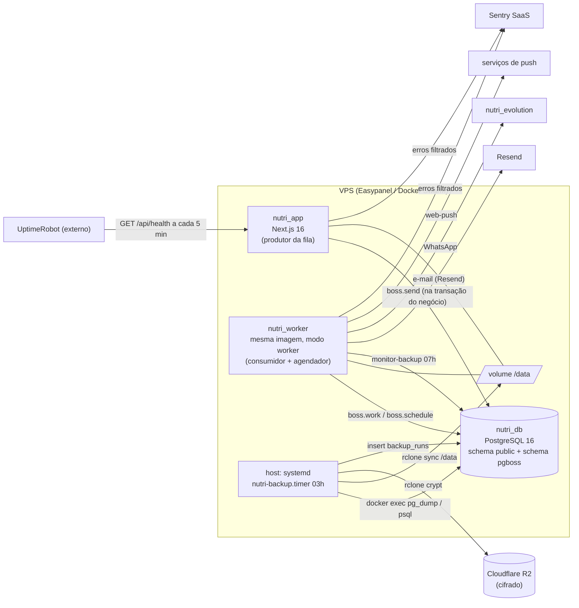
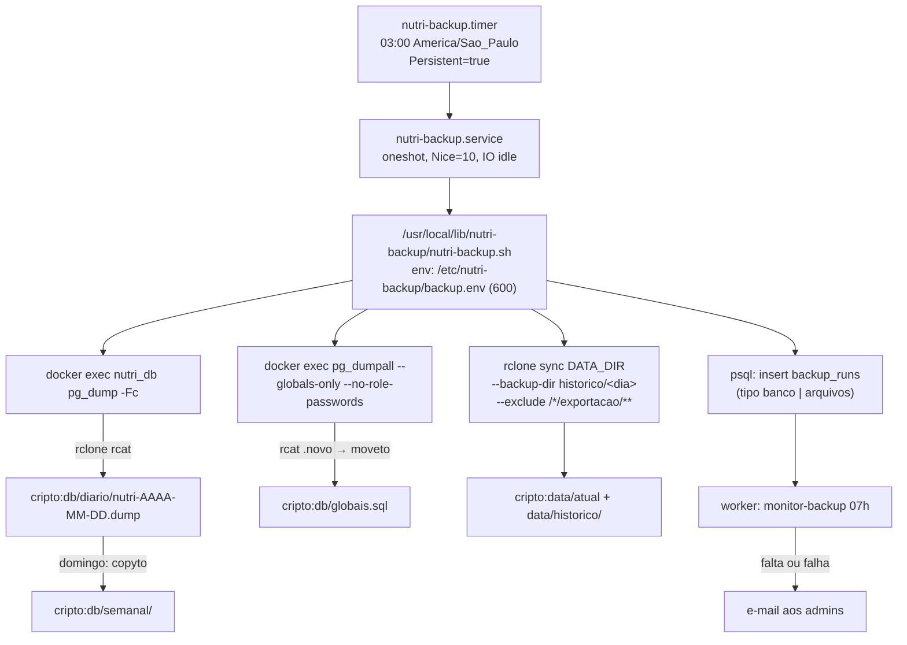
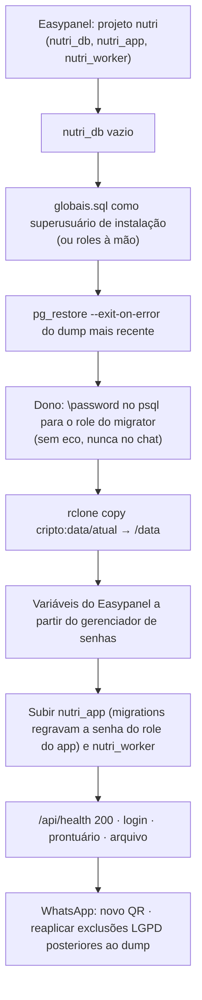
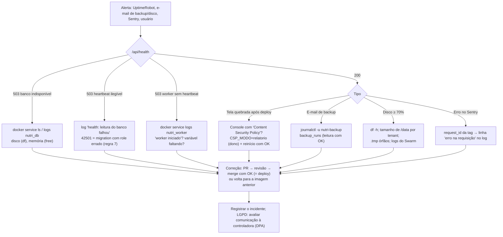

# 6. Worker, segurança e operação

Este capítulo descreve o processo de fundo (worker pg-boss), as defesas de segurança da camada HTTP, a
observabilidade, o backup e a restauração, o teste de carga, o checklist do go-live e a rotina de operação.

Convenções:

- Caminhos são relativos à raiz do repositório. `arquivo:N` aponta a linha; quando a linha muda com facilidade,
  cito o nome da função.
- Horários do código estão em `America/Sao_Paulo` (BRT). A VPS e os logs estão em UTC, 3 h à frente
  (`docs/operacao/carga.md:3-4`). Ex.: o `retencao-lgpd` das 04h BRT aparece às 07h UTC no log
  (`docs/operacao/go-live.md`, último item de "Produto e acessibilidade").
- "Dono" é o dono do servidor e do produto. Tudo que muda produção passa por ele (seção 6.10).
- Segredos aparecem só pelo **nome** da variável. Nenhum valor está neste documento.

---

## 6.1 Visão geral



Fontes: `src/worker/index.ts`, `src/jobs/boss.ts`, `scripts/backup/*`, spec §4
(`docs/superpowers/specs/2026-09-27-nutridebby-mvp-design.md:80-110`), D1 e D3 do Plano 08
(`docs/superpowers/plans/2026-10-04-nutridebby-08-go-live.md:35,37`).

Princípios que atravessam o capítulo:

1. **O app só enfileira; o worker executa.** Trabalho lento ou que fala com terceiros (e-mail, WhatsApp, push, PDF,
   conversão de imagem, ZIP) roda no worker (Plano 02, "Architecture",
   `docs/superpowers/plans/2026-09-28-nutridebby-02-plataforma.md:5`).
2. **A fila mora no Postgres** (schema `pgboss`), sem Redis (spec §4, linha 95).
3. **Nada sensível sai do processo** — nem no log, nem no Sentry, nem no `output` do job (CLAUDE.md, regra 3).
4. **Backup fora do worker**, no host (CLAUDE.md, regra 10; decisão "Onde roda o backup" do Plano 02).

---

## 6.2 Worker pg-boss

### 6.2.1 Processo e ciclo de vida

| Item | Como é | Onde |
|---|---|---|
| Imagem | A mesma do app. O `ENTRYPOINT` escolhe o modo pelo 1º argumento ou por `APP_ROLE` | `Dockerfile:43`, `docker-entrypoint.sh:3` |
| Comando | `node --import tsx src/worker/index.ts`, **sem** `DATABASE_URL_MIGRATOR` no ambiente (`env -u`) | `docker-entrypoint.sh:12-13` |
| Dev | `pnpm worker` (`tsx --env-file-if-exists=.env.local src/worker/index.ts`) | `package.json:21` |
| Variáveis | Validadas por `getWorkerEnv()` (Zod, `workerSchema`); falha rápido se faltar algo | `src/env.ts:217` e seguintes, `src/worker/index.ts:218` |
| Role do banco | O mesmo da aplicação (`DATABASE_URL`, sem `BYPASSRLS`) | spec §4.1, linha 127 |
| Schema da fila | `pgboss`, criado pelas migrations com dono = role da aplicação; o worker usa `createSchema: false` | `src/db/migrate.ts:80-81`, `src/worker/index.ts:44-49` |
| Filas | Criadas **e atualizadas** a cada subida por `ensureQueues` (`createQueue` + `updateQueue`): o código é a fonte da verdade | `src/jobs/queues.ts:50-55` |
| Parada | `SIGTERM`/`SIGINT` ouvidos antes de iniciar (`rodarComSinais`): no ar → `boss.stop({ graceful: true, timeout: 30_000 })`, fecha o Sentry e o pool; ainda esperando o schema → corta a espera e fecha Sentry e pool; idempotente | `src/worker/sinais.ts`, `src/worker/index.ts` |
| Erro não tratado | O worker **não** usa a integração `OnUnhandledRejection` do Sentry: a rejeição derruba o processo e o Swarm o reinicia | `src/lib/sentry.ts:87-91,110` |

Variáveis do worker (nomes; `src/env.ts`, `serverSchema` e `workerSchema`): `DATABASE_URL`, `LOG_LEVEL`,
`SENTRY_DSN`, `SENTRY_ENVIRONMENT`, `APP_URL`, `ENCRYPTION_KEY`, `DATA_DIR`, `EMAIL_FROM`, `EMAIL_TRANSPORT`,
`RESEND_API_KEY`, `MAILPIT_URL`, `EVOLUTION_API_URL`, `EVOLUTION_API_KEY`, `WHATSAPP_SANDBOX`, `VAPID_PUBLIC_KEY`,
`VAPID_PRIVATE_KEY`, `VAPID_SUBJECT`. Regras cruzadas no `superRefine` (`src/env.ts`, fim do `workerSchema`):
Resend exige `RESEND_API_KEY`; Evolution exige as duas variáveis juntas; `WHATSAPP_SANDBOX=1` é recusado em produção;
as três do VAPID vêm juntas e do mesmo par. Tabela completa: [§1.9 Variáveis de ambiente](01-visao-geral-e-arquitetura.md#19-variáveis-de-ambiente).

**Espera do schema (P09-02).** Antes de subir o pg-boss, `esperarVersaoDoSchema` (`src/worker/versao-schema.ts`) confere
pela função `app_versao_do_schema()` (0094) que a última migration do `drizzle/meta/_journal.json` da imagem já foi
aplicada pelo app; confere de novo a cada 3 s por até 5 min (`INTERVALO_SCHEMA_MS`, `PRAZO_SCHEMA_MS`). Passou do prazo:
log `schema do banco atrás do worker` (com a migration esperada, o `when` da última aplicada lida, o nome do erro e o
SQLSTATE), o processo sai com erro e o Swarm o reinicia. Um `SIGTERM` durante a espera a corta na hora (code review do
PR #22: com node como PID 1, sem o ouvinte o Swarm esperaria o grace period). Em dev, `pnpm worker` num banco sem
as migrations do branch espera e sai com a mesma mensagem: rode `pnpm db:migrate`.

### 6.2.2 Produtor e consumidor

Há **duas** instâncias do pg-boss, com papéis diferentes.

| | Produtor (app, scripts, testes) | Consumidor (worker) |
|---|---|---|
| Criação | `getBoss()` | `new PgBoss(...)` em `startWorker` |
| Arquivo | `src/jobs/boss.ts:18-39` | `src/worker/index.ts:45-52` |
| Pool | Próprio, `max: 2` | Próprio do pg-boss |
| Supervisão / agendamento | `supervise: false`, `schedule: false` | Ligados (padrão) |
| Dentro do worker | — | `useBoss(boss)` registra a instância do worker para os envios feitos nos jobs (`src/jobs/boss.ts:42-44`) |

**Por que o produtor tem pool próprio** (revisão 2 da T12 do Plano 05, comentário em `src/jobs/boss.ts:10-17`):
quem enfileira dentro de uma transação segura uma conexão do app enquanto espera o `getBoss`. Com o produtor no pool
do app, dez envios assim logo após um deploy ocupavam as 10 conexões e o `start` do pg-boss esperava para sempre.

**Envio transacional.** Todo produtor que grava junto passa `{ db: fromDrizzle(tx, sql) }`: o job só existe se a
transação do negócio confirmar (`src/email/queue.ts:10-20`). Exemplos: conta criada ⇔ convite enfileirado; pedido de
exportação ⇔ job `exportacao-paciente` (`src/modules/pacientes/exportacao.ts:113-117`).

### 6.2.3 Filas

São **20 filas** (17 até o Plano 08 e 3 do Plano 10A), todas em `QUEUES` (`src/jobs/queues.ts:9-53`) e todas registradas em `src/worker/index.ts` pelo
`work` embrulhado (seção 6.2.7). A guarda `src/worker/sem-detalhe.test.ts` exige pelo menos 17 registros (não subiu com
o Plano 10A).

Legenda das colunas de tentativa (opções do pg-boss 12, `package.json:39`): **retry** = `retryLimit` (número de
**novas** tentativas, leitura da INT-02 no Plano 02, linha "Fila de e-mail"); **atraso** = `retryDelay` em segundos,
com `↗` quando `retryBackoff: true` (exponencial com sorteio); **expira** = `expireInSeconds` (tempo máximo de uma
execução); **apaga** = `deleteAfterSeconds`.

| Fila | Gatilho | O que faz | retry / atraso / expira / apaga | Payload |
|---|---|---|---|---|
| `heartbeat` | cron `* * * * *` (`index.ts:58`) | Grava `system_heartbeat(name='worker')` (`recordHeartbeat`) | 0 / — / 60 / — | `{}` |
| `email` | Produtor `enqueueEmail` (`src/email/queue.ts:14`) | Abre o selo, renderiza e envia (Resend ou Mailpit); ignora tenant suspenso (RN-15); `idempotencyKey` = id do job (`src/email/job.ts:8-23`) | 3 / 60↗ / 60 / 86 400 | `{ tenantId, selado }` |
| `notificacoes` | cron `* * * * *` (`index.ts:85`) e produtor `dispararEnvio` (`src/modules/notificacoes/agendar.ts:199`) | Motor de lembretes RN-05: varre os tenants (ou um só) e envia e-mail, WhatsApp e push; até `LOTE_POR_EXECUCAO = 40` por execução (`enviar.ts:36`), WhatsApp a no máximo `WHATSAPP_POR_MINUTO = 8` por tenant (`enviar.ts:178`) | 0 / — / 300 / 3 600 | `{ tenantId? }` |
| `agenda-tenant` | Produtor na suspensão/reativação (`src/modules/plataforma/suspensao.ts:11`) | Suspenso: pendentes viram `ignorada`/`tenant_suspenso`; reativado: lembretes de consultas futuras voltam (`ignorarPendentesDoTenant`, `reagendarTenantReativado`) | 3 / 60↗ / 300 / 86 400 | `{ tenantId, evento }` |
| `whatsapp-evento` | Produtor na rota do webhook (`src/modules/notificacoes/whatsapp/webhook.ts:91`) | Conexão, status de entrega e resposta "1"/"2"; idempotente (`processarEventoWhatsapp`) | 3 / 30↗ / 60 / 86 400 | `{ selado }` |
| `agenda-limpeza` | cron `30 4 * * *` (`index.ts:106`) | Apaga pedidos da página pública com mais de 24 h, contadores de limite com mais de 1 dia, `access_events` com mais de 400 dias (D13 do Plano 08) e, desde o Plano 10A, os códigos do link do documento vencidos há mais de 1 dia (`limparCodigosDeDocumentoVencidos`; campo `codigos` no log "limpeza da agenda pública", `index.ts:111-112`) | 2 / 600 / 300 / — | `{}` |
| `monitor-backup` | cron `0 7 * * *` (`index.ts:118`) | Confere `backup_runs` e avisa os admins por e-mail (seção 6.5.6) | 2 / 300 / 120 / — | `{}` |
| `monitor-disco` | cron `0 * * * *` (`index.ts:128`) | Mede o disco de `DATA_DIR`; ≥ 70% → e-mail aos admins, no máximo 1 a cada 24 h (RNF-13) | 0 / — / 60 / — | `{}` |
| `retencao-lgpd` | cron `0 4 * * *` (`index.ts:140`) | Anonimiza bloqueados com prazo de guarda vencido (`anonimizarVencidos`) e, mesmo se falhar, apaga exportações vencidas (`expirarExportacoesVencidas`) | 2 / 600 / 900 / — | `{}` |
| `exportacao-paciente` | Produtor no pedido (`src/modules/pacientes/exportacao.ts:113`) | Gera o ZIP (JSON + PDF), marca "pronta", enfileira o e-mail e o `expirar-exportacao`, tudo na transação do arquivo (`gerarExportacao`) | 2 / 60↗ / 300 / 86 400 | `{ tenantId, exportId }` |
| `expirar-exportacao` | Produtor com `startAfter` = 24 h (`exportacao-job.ts:574-575`) | Apaga o ZIP e marca "expirada" (`expirarExportacao`) | 3 / 300 / 120 / — | `{ tenantId, exportId }` |
| `exclusao-atendida` | Produtor no atendimento do pedido (`src/modules/pacientes/lgpd.ts:167`) | Apaga as fotos do diário e só depois manda "pedido de exclusão atendido"; na última tentativa o aviso sai assim mesmo (`concluirExclusaoAtendida`) | 5 / 60↗ / 300 / 86 400 | `{ tenantId, patientId }` |
| `plano-pdf` | Produtor na publicação (`src/modules/plano-alimentar/publicacao.ts:72,145`) | Gera o PDF do plano publicado (`gerarPdfDoPlano`) | 2 / 30↗ / 120 / 86 400 | `{ tenantId, planId }` |
| `diario-foto` | Produtor no envio do diário (`src/modules/portal/diario.ts:102`) | Converte para JPEG ≤ 1600 px sem EXIF/GPS e apaga o original (`converterFotoDoDiario`, RN-07) | 2 / 30↗ / 120 / 86 400 | `{ tenantId, entryId }` |
| `expirar-diario-foto` | cron `*/15 * * * *` (`index.ts:190`) | Foto "processando" há mais de 30 min sem job vivo → "falhou" e o original sai (`expirarFotosPendentes`) | 1 / 60 / 300 / — | `{}` |
| `expirar-plano-pdf` | cron `*/15 * * * *` (`index.ts:194`) | PDF "pendente" há mais de 1 h → "falhou" (`expirarPdfsPendentes`) | 1 / 60 / 120 / — | `{}` |
| `limpar-tmp` | cron `0 4 * * *` (`index.ts:215`) | Apaga `.tmp` órfãos de `salvarArquivo` com mais de 24 h (`limparTmpOrfaos`) | 1 / 600 / 300 / — | `{}` |
| `documento-pdf` | Produtor no preparo e no "Gerar o PDF de novo" (`src/modules/documentos/documentos.ts`, `prepararParaAssinatura`, `pedirNovoPdfDocumento`) | PDF preparado da receita com marca, carimbo, quadro "Assinatura digital", código e QR (`gerarPdfDoDocumento`; Plano 10A) | 2 / 30↗ / 120 / 86 400 | `{ tenantId, documentoId }` |
| `documento-digitalizado` | Produtor no envio das fotos (`receberDigitalizada`, `src/modules/documentos/digitalizada.ts`) | Normaliza as fotos, monta o PDF e assina como "digitalizada" (`montarPdfDigitalizado`); foto ilegível ou cota: falha sem nova tentativa | 2 / 30↗ / 180 / 86 400 | `{ tenantId, documentoId, userId }` |
| `expirar-documento-pdf` | cron `*/15 * * * *` (`index.ts:210`) | PDF `pendente` ou digitalização `recebendo`/`pendente` há mais de 1 h → `falhou` (`expirarPdfsDeDocumentoPendentes`); PDF base e fotos sem referência há mais de 1 h e ponteiros que sobraram num documento emitido → apagados (`limparArquivosOrfaosDeDocumentos`) | 1 / 60 / 300 / — | `{}` |

Ordem do dia (BRT): 03h backup no host → 04h `retencao-lgpd` e `limpar-tmp` → 04h30 `agenda-limpeza` → 07h
`monitor-backup`. A retenção roda **depois** do backup de propósito (comentário em `src/jobs/queues.ts:16`).

**`notificacoes` não tem retry** (`src/jobs/queues.ts:35-37`): o estado fica na tabela `notifications`; o que falhou
volta como "pendente" com a próxima tentativa na varredura seguinte. É uma fila **serial** — um job por vez no worker
(padrão `localConcurrency 1`; D16 do Plano 05, comentário em `src/worker/index.ts:84`).

### 6.2.4 Novas tentativas, "última tentativa" e redes de segurança

Padrão usado nas filas com efeito no disco ou no usuário (`index.ts:99,162,171,182,188`):

```ts
ultimaTentativa: job.retryCount >= job.retryLimit
```

O job recebe esse booleano e decide: nas tentativas intermediárias relança o erro (o pg-boss tenta de novo); na
última grava o estado final ("falhou") ou executa o fallback (o aviso da exclusão sai mesmo sem confirmar o disco).

Todos esses jobs são **idempotentes** — só agem sobre o estado esperado (`pendente`, `processando`). Exemplos:
`gerarExportacao` só age sobre pedido `pendente` (`exportacao-job.ts`, comentário antes de `gerarExportacao`);
`gerarPdfDoPlano` só com `pdf_status = 'pendente'`.

Quando o worker cai na última tentativa, o pg-boss expira o job e o registro ficaria parado. Por isso existem
**redes de segurança** periódicas:

| Estado esquecido | Quem resolve | Limite |
|---|---|---|
| Foto do diário "processando" | `expirar-diario-foto` | 30 min (`FOTO_PENDENTE_MAX_MS`, `diario-foto-job.ts`) |
| PDF do plano "pendente" | `expirar-plano-pdf` | 1 h (`PDF_PENDENTE_MAX_MS`, `plano-pdf-job.ts`) |
| Exportação pronta vencida ou pendente esquecida | `retencao-lgpd` → `expirarExportacoesVencidas` | 24 h / 1 dia |
| `.tmp` de gravação interrompida | `limpar-tmp` | 24 h |

A foto esquecida **não** é reconvertida: se a queda foi falta de memória com aquela foto, cada varredura derrubaria
o worker de novo (comentário de `expirarFotosPendentes`).

### 6.2.5 Payload cifrado (AES-256-GCM)

Um job que carrega dado pessoal ou link com token não fica em claro na tabela do pg-boss. A mensagem inteira vai
selada.

| Item | Valor | Onde |
|---|---|---|
| Algoritmo | AES-256-GCM, IV aleatório de 12 bytes, tag de 16 bytes | `src/lib/crypto.ts:34-40` |
| Chave | `ENCRYPTION_KEY`, 32 bytes em base64 na forma canônica (44 caracteres) — recusada no boot se colada errado | `src/env.ts`, `encryptionKeySchema`; `src/lib/crypto.ts:26-28` |
| AAD | A **finalidade**: um selo de uma fila não abre em outro uso | `src/lib/crypto.ts:30-37` |
| Formato | `v1.<iv>.<cifrado>.<tag>` em base64url | `src/lib/crypto.ts:39` |
| Abertura | Recusa IV ≠ 12 bytes e tag ≠ 16 bytes antes de decifrar (tag truncada facilitaria forjar); erro vira `SealError` genérico | `src/lib/crypto.ts:42-60` |

Finalidades em uso:

| Finalidade | Usada por | Onde |
|---|---|---|
| `email-job` | Fila `email` | `src/email/queue.ts:8,19`; aberta em `src/email/job.ts:17` |
| `whatsapp-evento` | Fila `whatsapp-evento` | `src/modules/notificacoes/whatsapp/webhook.ts:22,91`; aberta em `src/worker/index.ts:98` |
| `notificacao-conteudo` | Coluna `notifications.conteudo_selado` (hoje nenhum fluxo grava; o banco só aceita o texto antes do envio) | `src/modules/notificacoes/mensagens.ts:53-58` |

As demais filas carregam **só ids** (`tenantId`, `patientId`, `planId`…). O conteúdo é lido do banco na hora do
job (comentário de `DadosExclusaoAtendida` em `src/modules/pacientes/lgpd.ts`).

```mermaid
sequenceDiagram
  participant A as App (Server Action)
  participant DB as Postgres (public + pgboss)
  participant W as Worker
  participant R as Resend
  A->>DB: BEGIN; escrita do negócio
  A->>DB: boss.send('email', {tenantId, selado}) via fromDrizzle(tx)
  A->>DB: COMMIT (job e negócio juntos)
  W->>DB: busca job 'email'
  W->>DB: tenant ativo? (RN-15)
  W->>W: openSecret(selado, 'email-job')
  W->>R: send(..., idempotencyKey = id do job)
  W->>W: log: jobId, tipo, tenantId (sem destinatário nem link)
```

Fonte: `src/email/queue.ts`, `src/email/job.ts`. Decisão: "Fila de e-mail" do Plano 02
(`docs/superpowers/plans/2026-09-28-nutridebby-02-plataforma.md`, tabela "Decisões de desenho").

### 6.2.6 Heartbeat

- O job `heartbeat` roda a cada minuto e faz *upsert* em `system_heartbeat` (`src/worker/heartbeat.ts:7-12`). O worker
  também bate uma vez ao subir (`src/worker/index.ts:204`).
- `/api/health` lê essa linha. Mais de 10 min sem batida (`HEARTBEAT_MAX_AGE_MS`, `heartbeat.ts:5`) = 503
  (seção 6.4.3).
- A mesma tabela guarda a marca `alerta_disco` (último alerta de disco), usada para o limite de 1 alerta por 24 h
  (`src/modules/plataforma/monitoramento.ts:115-124`).

### 6.2.7 Erro de job sem detalhe (regra 3)

O erro que um job relança vai para o `output` do job no pg-boss, serializado com mensagem, pilha e propriedades
(`path` com `/data/<tenantId>/…`, e-mail do destinatário num erro de SMTP). Por isso todo handler passa por
`workSemDetalhe(boss)` (`src/worker/sem-detalhe.ts:38-44`, usado em `src/worker/index.ts:56`):

1. `semDetalhe` captura o erro original e manda ao Sentry por `capturarErroDoJob` (o filtro tira a mensagem; teto na
   seção 6.4.4).
2. Relança `erroSemDetalhe(fila, err)`: um `Error` novo com o texto `falha no job <fila> (<código>)`, onde o código é
   `ENOENT`, um SQLSTATE etc. (`motivoDoErro`, `src/modules/plataforma/armazenamento.ts`), ou o nome da classe.
3. O pg-boss continua vendo a falha (nova tentativa / `failed`).

Guarda: `src/worker/sem-detalhe.test.ts` falha se `src/worker/index.ts` chamar `boss.work(` direto e confere, com um
pg-boss real, que o `output` de um job falho não contém `/data/` nem o UUID.

### 6.2.8 Como adicionar uma fila

1. Entrada em `QUEUES` (`src/jobs/queues.ts`) com retry, atraso, expiração e, se o job carrega id de dado, `deleteAfterSeconds`.
   O `ensureQueues` cria ou atualiza no próximo boot.
2. Payload só com ids. Se precisar levar texto ou link, sele com `sealSecret(..., '<finalidade-nova>')`.
3. Produtor: `boss.send(nome, data, { db: fromDrizzle(tx, sql) })` dentro da transação do negócio; confira o retorno
   (`null` = recusado).
4. Consumidor: `await work(nome, ...)` em `startWorker` — **nunca** `boss.work` direto. Atualize o mínimo de registros
   na guarda de `sem-detalhe.test.ts`.
5. Tabela com `tenant_id`: dentro do job, `withTenant({ tenantId, role: 'worker' }, …)` (exemplo:
   `ignorarPendentesDoTenant`, `src/modules/notificacoes/agendar.ts:210-218`). Varredura entre tenants parte de `tenants`
   (spec §4.1, linha 127).
6. Job que manda algo ao paciente (e-mail, push, WhatsApp, PDF, exportação) confere o tenant suspenso (RN-15) com `getTenantStatus(tx, tenantId, { aguardarSuspensao: true })` ou `tenantIsActive`, relido sob trava na mesma transação (exemplos: `src/modules/notificacoes/enviar.ts:270-272`, `agendar.ts:214`). O papel `'worker'` só existe em código do worker; rota e Server Action usam o contexto de `requireNutri`/`requirePaciente`.
7. Log só com ids, contagens e `motivoDoErro(err)`. Nada de mensagem de erro, caminho ou e-mail.
8. Se o job pode morrer na última tentativa deixando estado intermediário, crie a rede de segurança (seção 6.2.4).
9. Cron: `boss.schedule(nome, '<cron>', {}, { tz: 'America/Sao_Paulo' })`.

---

## 6.3 Segurança

### 6.3.1 Cabeçalhos globais

Definidos em `CABECALHOS_SEGURANCA` (`src/lib/csp.ts:43-49`) e aplicados a **todas** as rotas, inclusive `/api`,
por `next.config.ts:12`. `poweredByHeader: false` tira o `x-powered-by` (`next.config.ts:8`).

| Cabeçalho | Valor | Decisão |
|---|---|---|
| `Strict-Transport-Security` | `max-age=63072000` (2 anos), **sem** `includeSubDomains` e **sem** `preload` | D8 do Plano 08 |
| `X-Content-Type-Options` | `nosniff` | RNF-06 |
| `Referrer-Policy` | `strict-origin-when-cross-origin`; `no-referrer` em `/convite/*`, `/consulta/*`, `/api/arquivos` e, desde o Plano 10A, em `/documento/*`, `/api/documento/*` (estas duas também com `Cache-Control: no-store`) e `/v/*` (`next.config.ts:15-25`) | M7 (Plano 02), D20 (Plano 05), RN-156 e RN-158 (Plano 10A) |
| `X-Frame-Options` | `DENY` | RNF-06 |
| `Permissions-Policy` | `camera=(self), microphone=(), geolocation=(), payment=(), usb=()` | RNF-06 |

**Por que a CSP não está aqui:** no Next 16, uma chave do `next.config.ts` **apaga** a mesma chave posta por um Route
Handler. Uma CSP global sumiria com o `default-src 'none'; sandbox` de `/api/arquivos` (comentário em
`src/lib/csp.ts:37-42`). Por isso a CSP de documento sai do `proxy.ts`.

**Por que HSTS sem subdomínios (D8):** outros subdomínios de `wsscloud.tech` (o CRM, o Easypanel) não ficam obrigados
a HTTPS por causa do NutriDebby; `preload` é difícil de desfazer.

### 6.3.2 CSP com nonce (D7 do Plano 08)

```mermaid
sequenceDiagram
  participant N as Navegador
  participant P as src/proxy.ts
  participant X as Next (página)
  N->>P: GET /painel (pode trazer CSP forjada no pedido)
  P->>P: requestId = randomUUID(); nonce = novoNonce()
  P->>P: apaga content-security-policy* do pedido
  P->>X: pedido com CSP (nonce), x-nonce, x-request-id
  X->>X: aplica o nonce aos próprios <script>
  X-->>P: resposta
  P-->>N: resposta + Content-Security-Policy + x-request-id
```

Fonte: `src/proxy.ts:17-49`; diretivas em `montarCsp` (`src/lib/csp.ts:9-35`).

| Diretiva | Valor | Por quê |
|---|---|---|
| `default-src` | `'self'` | — |
| `script-src` | `'self' 'nonce-<n>' 'strict-dynamic' https://challenges.cloudflare.com` (+ `'unsafe-eval'` só em dev) | Nonce por requisição; `strict-dynamic` cobre o `api.js` do Turnstile |
| `style-src` | `'self' 'unsafe-inline'` | Atributos `style` do React (cor da marca, gráficos) não aceitam nonce |
| `img-src` | `'self' data: blob:` | Capas locais, QR do 2FA (`data:`), prévia da foto do diário (`blob:`) |
| `font-src` | `'self'` | `next/font` serve as fontes |
| `connect-src` | `'self'` | O navegador não fala com o Sentry (D1) |
| `frame-src` | `https://www.youtube-nocookie.com https://player.vimeo.com https://challenges.cloudflare.com` | Players (D10 do Plano 07) e Turnstile |
| `worker-src`, `manifest-src` | `'self'` | PWA |
| `media-src` | `'self' blob:` | — |
| `object-src` / `base-uri` | `'none'` | — |
| `form-action` | `'self'` | Server Actions |
| `frame-ancestors` | `'none'` | Anti-clickjacking |
| `upgrade-insecure-requests` | Só se `APP_URL` começa com `https://` | — |

Pontos de atenção:

- **O `matcher` do proxy exclui `/api/`, `/serwist/`, `/_next/static`, `/_next/image`, `favicon.ico` e o manifest**
  (`src/proxy.ts:54-56`). Motivo (D2): o Next copia para a memória o corpo de toda requisição que passa pelo proxy,
  com corte silencioso em 10 MB; o exame de até 20 MB chegaria cortado. **Não aumente o `proxyClientMaxBodySize`.**
- Com o nonce, o layout raiz é dinâmico: **todas as páginas são dinâmicas** (D7). O LCP foi medido depois disso (D4).
- **Modo de emergência:** `CSP_MODO=relatorio` (variável do Easypanel, `src/env.ts:146`) troca para
  `Content-Security-Policy-Report-Only` com `report-uri /api/csp-relatorio`. A rota só registra a diretiva e a
  origem bloqueada; com a CSP valendo, ela não registra nada (`src/app/api/csp-relatorio/route.ts:12-35`).
- `/api/arquivos` tem CSP própria `default-src 'none'; sandbox`, só na resposta 200 (`src/app/api/arquivos/route.ts:42`); as respostas de erro (`route.ts:18`) têm apenas `cache-control: no-store` e os cabeçalhos globais.
- Cloudflare com proxy laranja: Rocket Loader, Email Obfuscation e Web Analytics automático injetam script sem nonce
  e quebram o app (`docs/operacao/go-live.md`, item da Cloudflare).

### 6.3.3 Rotas protegidas no proxy

O proxy só confere a **presença** do cookie de sessão (`nd`) em `/admin`, `/painel`, `/p`, `/conta` e `/inicio`; sem
cookie, redireciona para `/entrar?volta=<caminho>` (`src/proxy.ts:7,22-27`). A decisão de acesso real é de
`requireUser`/`requirePaciente` em cada página (`src/lib/session.ts:44`): ver
[§3.13 Proxy e redirecionamento seguro](03-autenticacao-e-acesso.md#313-proxy-e-redirecionamento-seguro) e
[§3.7 Guardas por papel](03-autenticacao-e-acesso.md#37-guardas-por-papel).

### 6.3.4 Limites de tentativa (rate limits)

| Onde | Limite | Chave | Armazenamento | Fonte |
|---|---|---|---|---|
| Better Auth, padrão | 100 / 60 s | IP + rota | Banco (`rate_limit`) | `src/lib/auth.ts:122-126` |
| Login, 2FA, recuperação de senha, troca de senha, `verify-password`, ativar/desativar 2FA, `/two-factor/get-totp-uri` (`auth.ts:137`), códigos de backup, `delete-user` | 5 / 15 min | IP + rota | Banco | `src/lib/auth.ts:127-140` |
| Página pública de agendamento: pedido | 10 / h | HMAC do IP (IPv6 pelo /64) | `public_rate_limits` | `src/modules/agenda/agendamento-publico.ts:60,122-123` |
| Página pública: código por e-mail | 5 / h | HMAC de tenant + e-mail | `public_rate_limits` | `agendamento-publico.ts:61,158` |
| Webhook do WhatsApp (anti-repetição) | 1 por janela de aceite | HMAC do JWT + corpo | `public_rate_limits`, na transação do evento | `src/modules/notificacoes/whatsapp/webhook.ts:138` |
| `POST /api/erro-cliente` | 20 / min | IP (/64 no IPv6) | Memória | `src/app/api/erro-cliente/route.ts:13,25` |
| `POST /api/csp-relatorio` (só no modo relatório) | 60 / min | IP (/64) | Memória | `src/app/api/csp-relatorio/route.ts:9,20` |
| `POST /api/p/push` | 20 / 10 min | Conta | Memória | `src/app/api/p/push/route.ts:16,51` |
| Verificação pública `/v/<código>` (Plano 10A) | 30 / h | HMAC do IP (`verificacao-ip`, /64) | `public_rate_limits` | `src/modules/documentos/verificacao.ts` (`consultarVerificacao`) |
| Link do documento: pedir código (Plano 10A) | 20 / h por IP; 5 / h e 1 / min por documento | `documento-ip`; `documento-envio` | `public_rate_limits` (+ data do último código) | `src/modules/documentos/link-documento.ts` (`pedirCodigoDocumento`) |
| Link do documento: confirmar código (Plano 10A) | 30 / h por IP; 5 erros por código | `documento-codigo-ip`; `tentativas` na linha | `public_rate_limits`; `document_access_codes` | `link-documento.ts` (`confirmarCodigoDocumento`) |
| Código do 2FA ao assinar (Plano 10A) | 5 erros / 15 min por usuária; mesmo código recusado por 90 s | `totp-erro`, `totp-usado` (HMAC do id) | `public_rate_limits` | `src/lib/confirmar-2fa.ts` |
| `POST /api/painel/documentos/[id]/digitalizada` (Plano 10A) | 2 envios processando por processo, 1 por usuária | Memória | Memória | `src/app/api/painel/documentos/[id]/digitalizada/route.ts` |

As rotas do Better Auth com limite de 5/15 min, uma a uma, estão em [§3.3 Limite de tentativas](03-autenticacao-e-acesso.md#limite-de-tentativas).

Detalhes:

- **IP real:** `TRUSTED_PROXIES` (CIDRs do Traefik/Swarm) tira os saltos do proxy da direita para a esquerda
  (`src/lib/ip.ts:3-22`, `src/lib/auth.ts:153`). Sem a variável em produção, o app não sobe (Plano 02, "Itens
  adiados do Plano 01"). `clientIp` devolve o IPv6 completo (auditoria, Turnstile); `clientIpDoLimite` usa o /64.
- **`public_rate_limits` guarda HMAC, nunca o IP ou o e-mail** (chave derivada por HKDF de `ENCRYPTION_KEY`,
  `src/modules/agenda/limite-ip.ts:12-18`). O contador é atômico (`INSERT … ON CONFLICT`, `consumirLimite`) e o
  `agenda-limpeza` apaga as linhas com mais de 1 dia (`limparLimites`).
- **Limites em memória valem para 1 réplica** (`src/lib/limite-memoria.ts:3-5`). Escalar o app muda o limite efetivo
  (anotado no backlog, "Notas do Plano 08").
- **Login por IP + rota, não por IP + e-mail** (D11 do Plano 08): um balde por e-mail permitiria travar a conta de
  alguém de propósito. Risco aceito: CGNAT. O checklist confere o 429 com o IP real.

### 6.3.5 Turnstile (INT-06)

`verifyTurnstile` (`src/lib/turnstile.ts:18-80`) valida o token no `siteverify` da Cloudflare **antes de qualquer
escrita**. Resultado em três estados:

| Resultado | Quando | O usuário vê |
|---|---|---|
| `ok` | `success: true` e `hostname` igual ao de `APP_URL` | — |
| `invalido` | Token ausente, > 2048 caracteres, vencido, repetido ou de outro domínio | "Confirme que você não é um robô." |
| `indisponivel` | Rede, timeout (5 s), 5xx, corpo não-JSON, segredo errado (`config`) | "Tente novamente em alguns minutos" — **nunca** segue sem verificar |

Usado em: "Esqueci minha senha" (`src/lib/auth.ts:157-161`, cabeçalho `x-turnstile-token`) e página pública de
agendamento (`src/app/api/n/[slug]/resposta.ts:41`). Falhas vão ao log só com motivo, status e até 5 códigos
(`src/lib/turnstile-log.ts:9-12`), nunca token, segredo ou IP.

### 6.3.6 Upload: tipo pelo conteúdo

- `detectarTipo` (`src/lib/file-type.ts:24`) decide pelos primeiros bytes: PNG, JPEG, PDF, WebP, HEIC (só com marca
  HEVC e sem marca AV1), ZIP e SVG. Nome e `Content-Type` do cliente são ignorados (RNF-06).
- SVG com `<!ENTITY` é recusado (XXE, "billion laughs"); a regex do SVG evita *backtracking* exponencial.
- `salvarArquivo` (`src/modules/plataforma/armazenamento.ts:64-153`) recusa tipo não permitido e **SVG sempre**
  (o logo SVG é convertido em PNG antes). O caminho é montado pelo servidor, nunca com texto do usuário, e
  `resolverCaminho` recusa caminho fora de `DATA_DIR` (CLAUDE.md, regra 9).
- Gravação em `.tmp` antes da transação, cota de 5 GB reservada na transação, `rename` no fim: fluxo e diagrama em
  [§4.1.3 Armazenamento com cota e URL assinada](04-modulos-clinicos.md#413-armazenamento-com-cota-e-url-assinada-rn-18-regra-9-do-claudemd).

### 6.3.7 URLs assinadas

`signFileUrl` (`src/lib/signed-url.ts:16`): HMAC-SHA256 com `FILE_URL_SECRET`, validade de 300 s; `GET /api/arquivos`
confere em tempo constante e responde 403/410/404 só com `cache-control: no-store` (mais os cabeçalhos globais); o 200 leva `default-src 'none'; sandbox`, `nosniff` e `no-referrer`. A
rota não reabre a sessão: a assinatura é emitida por quem já conferiu o acesso. Detalhe (formato do caminho,
cabeçalhos, `attachment` × `inline`) em [§4.1.3](04-modulos-clinicos.md#413-armazenamento-com-cota-e-url-assinada-rn-18-regra-9-do-claudemd).

### 6.3.8 Regra 3: nada sensível em log, Sentry ou mensagem

Camadas, de dentro para fora:

| Camada | O que faz | Onde |
|---|---|---|
| Código | Loga ids, contagens e `motivoDoErro(err)` (código `ENOENT`, SQLSTATE) ou `nomeDoErro(err)` (nome da classe), nunca a mensagem | `src/modules/plataforma/armazenamento.ts` (`motivoDoErro`), `src/lib/logger.ts:44-46` |
| pino `redact` | Censura `password`, `newPassword`, `currentPassword`, `token`, `accessToken`, `refreshToken`, `sessionToken`, `secret`, `url`, `cookie`, `authorization` até 2 níveis, e os cabeçalhos de cookie/autorização | `src/lib/logger.ts:4-22` |
| Better Auth | Logger próprio: só nível e mensagem fixa; os args (erro do Drizzle com SQL e parâmetros) ficam fora | `src/lib/auth.ts`, opção `logger` |
| Worker | `semDetalhe` limpa o erro do job (seção 6.2.7) | `src/worker/sem-detalhe.ts` |
| Health | Só o SQLSTATE/código e qual leitura falhou | `src/app/api/health/route.ts:21-27` |
| Sentry | Filtro de lista branca + SDK sem coleta (seção 6.4.4) | `src/lib/sentry-filtro.ts`, `src/lib/sentry.ts` |
| Backup | `stderr` do `pg_dump`, `rclone` e `pg_restore` descartado; só mensagens fixas | `scripts/backup/*.sh` |

---

## 6.4 Observabilidade

### 6.4.1 Logs (pino)

- JSON no stdout, `base: { app: 'nutridebby' }`, nível por `LOG_LEVEL` (padrão `info`) (`src/lib/logger.ts:24-36`).
- Lidos com `docker service logs nutri_app` / `nutri_worker` (Plano 02, Tarefa 14, passo 7). O log do Swarm **não tem
  rotação** (comentário em `src/app/api/csp-relatorio/route.ts:14-15`): não crie log por requisição.
- Linhas úteis do worker: `worker iniciado`, `canal de WhatsApp` (`ligado`/`desligado`, nunca URL), `canal de push`,
  `limpeza da agenda pública`, `retenção LGPD concluída`, `exportações vencidas apagadas`,
  `alerta de monitoramento sem destinatário` (`src/worker/index.ts`, `src/modules/plataforma/monitoramento.ts:91`).

### 6.4.2 `request_id` (D2 do Plano 08)

| Tipo de rota | Origem do id | Volta ao cliente? | Onde aparece |
|---|---|---|---|
| Páginas e Server Actions | `novoRequestId()` no `proxy.ts`; o do cliente é sobrescrito | Sim, `x-request-id` | Linha de log de erro e tag do Sentry |
| `/api/*` e `/serwist/*` | Novo no `onRequestError` (o cabeçalho do cliente seria forjável) | Não | Linha de log de erro e tag do Sentry |

Fontes: `src/proxy.ts:19,38,47`, `src/instrumentation.ts:13-21`, `src/lib/request-id.ts` (só UUID v4 é aceito).

O id **não** vai em toda linha de log: com o `AsyncContextFrame` do Node 24, um `enterWith` dentro do `requireUser`
não chega à página (D2). O `tenant_id` também não vai na linha de erro nem no Sentry (desvio registrado na spec).

### 6.4.3 `/api/health`

`GET /api/health` (`src/app/api/health/route.ts`) faz `select 1`, lê `system_heartbeat` e chama `evaluateHealth`
(`src/worker/heartbeat.ts:14-25`). Resposta sem cache (`cache-control: no-store`).

| Situação | HTTP | Corpo |
|---|---|---|
| Banco ok e batida há ≤ 10 min | 200 | `{"status":"ok"}` |
| `select 1` falhou | 503 | `reason: "banco indisponível"` |
| Banco respondeu, leitura do heartbeat falhou | 503 | `reason: "heartbeat ilegível"` |
| Nenhuma batida gravada | 503 | `reason: "worker sem heartbeat"` |
| Última batida há mais de 10 min | 503 | `reason: "worker sem heartbeat há mais de 10 min"` |

Dica do próprio código: um `42501` no log `health: leitura do banco falhou` com `leitura: heartbeat` costuma ser
migration rodada com o role errado (regra 7) (`route.ts:22-24`).

**Monitor externo (D3):** UptimeRobot gratuito, `GET /api/health` (espera 200 e a palavra `"ok"`) e `/entrar`, a cada
5 min, alerta por e-mail e celular do dono. Alternativa se o plano grátis não permitir uso comercial: HetrixTools
(1 min). Uptime Kuma na própria VPS foi descartado: cai junto com ela.

### 6.4.4 Sentry (D1 do Plano 08)

**Decisão:** Sentry SaaS no plano gratuito, SDK `@sentry/node` 11.4 (`package.json:31`) **só no servidor e no
worker**. Erros do navegador vão por uma rota própria. Alternativas descartadas: GlitchTip autohospedado (+3
serviços, ~1 GB de RAM) e `@sentry/nextjs` no navegador (bundle maior, mais superfície para vazar nome de paciente).

Inicialização:

- App: `register()` em `src/instrumentation.ts:4-10` (só runtime Node). Worker: `src/worker/index.ts:43`.
- Sem `SENTRY_DSN`, nada liga (`iniciarSentry`, `src/lib/sentry.ts:115-120`).
- Opções únicas em `opcoesDoSentry` (`src/lib/sentry.ts:93-112`); a guarda `src/lib/sentry-guarda.test.ts` exige
  `Sentry.init` só nesse arquivo e nenhum SDK de navegador, Replay ou tracing.

| Opção | Valor | Por quê |
|---|---|---|
| `dataCollection` | Tudo desligado (usuário, cookies, cabeçalhos, corpos, query string, dados de query, filas, variáveis, linhas de código) | No v11 o padrão é coletar tudo |
| `includeLocalVariables` | `false` | — |
| Tracing | Desligado: nenhuma taxa declarada, `traceLifecycle: 'static'`, `beforeSendTransaction: () => null` | Taxa zero não desliga o tracing no v8+ |
| `tracePropagationTargets` | `[]` | Nenhum cabeçalho do Sentry sai para Resend, Evolution, push |
| `beforeSend` / `beforeBreadcrumb` | `filtrarEvento` / `filtrarBreadcrumb` | Filtro único |
| `maxBreadcrumbs` | 30 | — |
| Tag inicial | `papel` = `app` ou `worker` | — |

**Filtro** (`src/lib/sentry-filtro.ts:96-135`). Regra: o que não está na lista do que pode sair, sai.

| Campo do evento | O que sobra |
|---|---|
| `extra`, `logentry` | Removidos |
| `message` | `[removido]`, salvo `MENSAGENS_FIXAS` (`'erro no navegador'`) |
| `exception.values[].value` | `[removido]`, salvo classes de texto fixo (`TenantContextError`, `CorpoGrandeError`, `CorpoLentoError`, até 200 caracteres) |
| `exception…frames` | Sem `vars`, `context_line`, `pre_context`, `post_context` |
| `request` | Só `method` e `url` reduzida por `caminhoSeguro` (sem query; UUID → `:id`; segmento longo → `:token`; convite, consulta e, desde o Plano 10A, `/documento/<token>` e `/api/documento/<token>` → `:token`; `/v/<código>` → `/v/:codigo`; `src/lib/sentry-filtro.ts:53-54`) |
| `user` | Só `id` |
| `breadcrumbs` | Só `http`/`fetch`, com método, status e **origem** da URL |
| `tags` | Só `TAGS_PERMITIDAS` (`request_id`, `tenant_id`, `papel`, `rota`, `tipo_rota`, `fila`, `motivo`, `digest`, `nome_erro`) com valor no formato seguro |
| `contexts` | Só `runtime`, `os`, `trace` |
| `transaction` | Método + caminho seguro |

**Limites de eventos** (protegem a cota mensal de 5 mil erros do plano gratuito; comentários em
`src/lib/sentry.ts:17-59`):

| Origem | Regra | Teto |
|---|---|---|
| Navegador (`/api/erro-cliente`) | Mesmo `nome`, `rota` e `digest` uma vez por 24 h | 30 por dia (~900/mês) |
| Jobs do worker (`capturarErroDoJob`) | Mesmo par `fila` + `motivo` uma vez por hora | 50 por dia (~1 500/mês) |
| Requisições (`onRequestError`) | Sem teto no código | Rate limit diário da chave no Sentry (checklist) |

Os tetos ficam em memória: um reinício zera o dia. Por isso o checklist pede também o *Rate Limit* por dia da chave
no painel do Sentry, abaixo de cota ÷ 30 (`docs/operacao/go-live.md`).

**Erros do navegador** (`src/app/api/erro-cliente/route.ts`): o cliente (`src/components/reportar-erro.ts`) manda só
`digest`, nome e rota. A rota exige mesma origem, limite por IP, corpo ≤ 1 KB e campos por regex; repassa com
`captureMessage('erro no navegador')` e *fingerprint* próprio (`src/lib/sentry.ts:148-160`).

**No painel do Sentry (dono):** *Data Scrubber*, *Default Scrubbers* e *Prevent Storing of IP Addresses* ligados;
**não** criar `SENTRY_TRACES_SAMPLE_RATE` (`docs/operacao/go-live.md`; runbook do Plano 08, passo 5).

---

## 6.5 Backup e restauração (RNF-05, regra 10)

### 6.5.1 Decisão: backup no host

Decisão do Plano 02 ("Onde roda o backup", tabela "Decisões de desenho"): **o backup roda no host por systemd**, não
no worker.

- `postgresql-client-16` + `rclone` na imagem somariam ≈ 40 MB comprimidos por versão e estourariam os 500 MB grátis
  do GHCR (2 versões mantidas).
- O worker não precisa de `BYPASSRLS`: o `pg_dump` roda **dentro** do container `nutri_db` como superusuário local.
- O worker só **confere** `backup_runs` e alerta.

Metas (RNF-05): 03h BRT; cifrado (rclone crypt) no R2; 7 diários + 4 semanais; `/data` com histórico de 30 dias;
dado excluído por LGPD some dos backups em até 35 dias; **RPO 24 h, RTO 4 h**; teste de restauração mensal.



### 6.5.2 Unidades systemd

| Arquivo | Conteúdo relevante |
|---|---|
| `scripts/backup/nutri-backup.timer` | `OnCalendar=*-*-* 03:00:00 America/Sao_Paulo`, `Persistent=true` (roda no boot se perdeu o horário) |
| `scripts/backup/nutri-backup.service` | `Type=oneshot`, `TimeoutStartSec=4h`, `EnvironmentFile=/etc/nutri-backup/backup.env`, `ExecStart=/usr/local/lib/nutri-backup/nutri-backup.sh`, `Nice=10`, `IOSchedulingClass=idle`, `PrivateTmp=true`, `NoNewPrivileges=true`; depois de `docker.service` |

### 6.5.3 Variáveis do backup (só nomes)

Arquivo `/etc/nutri-backup/backup.env`, `root:root`, modo 600, fora do Easypanel (desvio do §9.6 registrado no
Plano 02). Modelo: `scripts/backup/backup.env.example`.

| Variável | Papel |
|---|---|
| `NUTRI_DATA_DIR` | Pasta do volume `/data` no host (obrigatória) |
| `NUTRI_BACKUP_REMOTE` | Remoto de destino (padrão `cripto:`) |
| `NUTRI_DB_CONTAINER_FILTER`, `NUTRI_DB_USER`, `NUTRI_DB_NAME` | Opcionais (padrões `nutri_db`, `postgres`, `nutri`) |
| `RCLONE_CONFIG_R2_*` | Remoto S3 do R2 (tipo, provedor, chave de acesso, segredo, endpoint, `NO_CHECK_BUCKET`) |
| `RCLONE_CONFIG_CRIPTO_*` | Remoto `crypt` sobre o R2; `PASSWORD` e `PASSWORD2` são a saída de `rclone obscure` da `BACKUP_PASSPHRASE` e do salt |

A passphrase e o salt originais ficam **fora da VPS**, no gerenciador de senhas do dono. Sem eles o backup é
irrecuperável (`docs/operacao/restauracao.md:6-9`).

### 6.5.4 O que o script faz

`scripts/backup/nutri-backup.sh`:

1. Acha o container do banco (`docker ps -f name=nutri_db`). Sem ele, pula só o banco; `/data` segue (linhas 22-26).
2. **Banco** (`backup_banco`, linhas 73-111): `pg_dump -Fc` → `rclone rcat` em `db/diario/nutri-<dia>.dump`; no
   domingo copia para `db/semanal/`; grava os **roles** (D6) em `.novo` e só promove para `db/globais.sql` se o dump e o
   envio derem certo; poda 7 diários e 4 semanais. Falha no dump apaga o arquivo parcial.
3. **Arquivos** (`backup_arquivos`, linhas 113-137): `rclone sync` de `NUTRI_DATA_DIR` para `data/atual`, com
   `--backup-dir data/historico/<dia>`; poda o histórico com mais de 30 dias. O ZIP de exportação fica **fora**
   (`--exclude '/*/exportacao/**'`): vive 24 h e é refeito do banco (US-018).
4. Cada etapa grava uma linha em `backup_runs` (`tipo`, `ok`, `bytes`, `detalhe`, `iniciado_em`) via `psql` dentro do
   container (linhas 28-38). Detalhes possíveis: `pg_dump ou envio falhou`, `roles falhou`, `retenção falhou`,
   `rclone sync falhou`.
5. Sai com o número de etapas que falharam (linha 146).
6. Log: só mensagens fixas (`banco ok (N bytes)`, `arquivos ok`, `ERRO …`). `stderr` das ferramentas descartado (G2).

Layout no remoto cifrado:

| Caminho | Conteúdo | Retenção |
|---|---|---|
| `db/diario/nutri-AAAA-MM-DD.dump` | Dump custom do banco `nutri` | 7 |
| `db/semanal/nutri-AAAA-MM-DD.dump` | Cópia do dump de domingo | 4 |
| `db/globais.sql` | Roles, sem senha | Última cópia boa |
| `data/atual/` | Espelho de `/data` (sem exportações) | — |
| `data/historico/AAAA-MM-DD/` | Arquivos alterados/apagados naquele dia | 30 dias |

O banco `evolution` (WhatsApp) **não** está no backup (`docs/operacao/restauracao.md:46`).

### 6.5.5 `backup_runs`

- Sem `tenant_id`, sem RLS (CLAUDE.md, regra 1). Escrita **só pelo script**; o role da aplicação lê, mas não insere,
  altera nem apaga (teste em `test/backup.test.ts:259`).

### 6.5.6 Alerta do worker

`monitor-backup` às 07h BRT chama `verificarBackups` (`src/modules/plataforma/monitoramento.ts:96`): falta, falha
ou execução com mais de 26 h de cada tipo (`banco`, `arquivos`) gera um e-mail `alerta_backup` por admin, todos na
mesma transação, citando só os tipos — `backup_runs.detalhe` nunca sai do banco. Sem admin cadastrado, só o aviso
`alerta de monitoramento sem destinatário` no log. `monitor-disco` segue o mesmo caminho com 70%. Funções e
constantes em [§4.1.4 Monitoramento de backup e disco](04-modulos-clinicos.md#414-monitoramento-de-backup-e-disco-rnf-05-rnf-13).

### 6.5.7 Testes no CI

| Teste | O que cobre |
|---|---|
| `test/backup.test.ts` | Roda o script contra um remoto `crypt` sobre pasta local (sem R2, decisão "Alvo S3 nos testes" do Plano 02): domingo com semanal, histórico datado e poda, falhas do dump, do envio, da retenção, dos roles e da promoção do `globais.sql`, container ausente, sem `stderr` no log; e que **nenhum outro código cita o script** (linha 247) |
| `test/restauracao.test.ts` | Restaura num banco descartável e confere as guardas; `SECURITY DEFINER` com dono superusuário reprova; `globais.sql` vazio = ausente; dump sem as tabelas do app falha; dia sem dump falha |

O CI instala `rclone` e falha se ele faltar (`.github/workflows/ci.yml:40-41`; `test/backup.test.ts:19`).
**Nunca rode `nutri-backup.sh` fora desse teste** — há bancos de produção no host (regra 10).

### 6.5.8 Teste de restauração mensal

`scripts/backup/nutri-restauracao-teste.sh`, no host, com OK do dono a cada execução (lê o backup de produção).
Roteiro: `docs/operacao/restauracao.md:16-27`.

1. Sobe `postgres:16-alpine` com `--network none` e dados em `tmpfs`; senha descartável só no ambiente; container
   apagado no fim (`trap limpar EXIT`) — é dado de saúde (linhas 27-32).
2. Aplica `db/globais.sql` como o superusuário de instalação (D6: no PG 16 só ele recria as filiações `GRANTED BY`).
3. `pg_restore --exit-on-error` do dump do dia (`NUTRI_RESTAURAR_DIA`).
4. Imprime **só contagens** e só diz `restauracao ok` depois de todas as guardas (linhas 59-90):

| Guarda | Esperado |
|---|---|
| `tabelas_sem_rls` (tabelas com `tenant_id`, exceto `user`, `consents`, `invites`, sem RLS forçada) | 0 |
| `migrations` (`drizzle.__drizzle_migrations`) | > 0 |
| `tenants`, `pacientes` | Números legíveis |
| `funcoes_definer_superusuario` | 0 (`NUTRI_RESTAURAR_PERMITIR_DEFINER_SUPER` é só do CI; **nunca** no host) |
| `roles` | `ok` (`nutri_app_role` sem login, um membro com login, todo dono de tabela com login) |

5. Arquivos: `rclone cryptcheck` (só hashes) com o mesmo `--exclude`; restaurar **um** logo numa pasta 0700 e apagar.
6. Registrar em `docs/operacao/restauracao-AAAA-MM.md`. Duração > 1 h → avisar o dono.

### 6.5.9 Restauração de desastre (resumo)

Fonte completa: `docs/operacao/restauracao.md:29-48`.



Os roles voltam **sem senha** (`--no-role-passwords`). Sem a senha do migrator, o `docker-entrypoint.sh` roda
`scripts/migrate.ts` antes do `next start`, a autenticação falha e o app não sobe.

### 6.5.10 Estado atual

O backup ainda **não roda**: está **parcial**. Os scripts e as unidades estão no host desde 30/09/2026
(`/etc/systemd/system/nutri-backup.{service,timer}`, `/usr/local/lib/nutri-backup/`, `/etc/nutri-backup/`), mas o
timer está desabilitado (`systemctl list-unit-files 'nutri*'`: `nutri-backup.service static`, `nutri-backup.timer
disabled`). Falta o passo do dono: chaves no `backup.env` e habilitar o timer (P02-11 passo 6), sem refazer a
instalação do zero. P02-11 está 🔄 no backlog (`docs/superpowers/plans/2026-09-27-nutridebby-backlog.md:63`) e é o
primeiro item de "Antes do go-live (dono)" (linha 299). Sem ele, nada de paciente real (`docs/operacao/go-live.md`,
"Bloqueia"). A instalação copia os **dois** scripts para `/usr/local/lib/nutri-backup/`
(`docs/operacao/restauracao.md`, "Instalação no host"; Plano 02, Tarefa 14, passos 6 e 8); a cada mudança dos scripts
o dono reinstala (regra 10).

---

## 6.6 Teste de carga (k6)

Decisões D4 e D5 do Plano 08; roteiro em `docs/operacao/carga.md`.

| Item | Como é |
|---|---|
| Onde | Pilha **separada** na VPS (`docker-compose.carga.yml`): banco próprio, a imagem do GHCR do merge, portas só em `127.0.0.1`, segredos novos (`test/carga/gerar-env.sh`). **Nunca** contra produção nem com dado real |
| Quando | De madrugada (BRT), com snapshot no hPanel e OK do dono |
| Dados | `test/carga/seed.ts`: 50 consultórios × 300 pacientes (15 mil), sessões em `test/carga/.sessoes.json` (fora do git) |
| Ferramenta | `grafana/k6:2.3.0` por `docker run` (versão fixa: as consultas `jq` do relatório dependem dela); Lighthouse 12 por `pnpm dlx`; nada no `package.json` |
| Cenário | `test/carga/cenario.js`; rota nova entra na lista `ROTAS` |
| Duração | 13 min (2 de subida, 10 no alvo, 1 de descida) |
| Limites da rodada 1 | Variáveis `CARGA_*` (padrões em `docker-compose.carga.yml:14-42`) |

**Critério de aceite (D4):** APIs p95 ≤ 300 ms; páginas p95 ≤ 800 ms; falhas < 1% (sem os 429 esperados); job
`notificacoes` < 20 s com 15 mil pacientes; LCP ≤ 2,5 s em `/p/inicio` e `/p/plano`; ≥ 2 vCPU livres no host.

**Critério de parada** (`docs/operacao/carga.md:26-28`): interromper se a CPU ociosa ficar abaixo de 25% (2 vCPU) por
mais de 1 min, se o `cursoia_crm` piorar ou se a memória livre do host cair abaixo de 2 GB.

**Medir o worker:** duração do `notificacoes` em `pgboss.job` do banco **da carga**
(`max(completed_on - started_on)`), e antes da rodada conferir que `notifications` tem milhares de `pendente`
(`docs/operacao/carga.md:39-48`).

Fim: `docker compose … down -v` e apagar `.env.carga*`, `.sessoes.json`, `resumo.json`. Relatório em
`docs/operacao/carga-AAAA-MM-DD.md` num PR curto de docs. Estado: as rodadas ainda não rodaram (backlog, linha 303).

---

## 6.7 Checklist do go-live

`docs/operacao/go-live.md` (P08-09). Assina-se só com **todos** os itens de "Bloqueia" marcados. Nunca colar segredo
nele.

| Grupo | Itens (resumo) | Quem |
|---|---|---|
| Bloqueia | Backup instalado e com `banco ok`/`arquivos ok`; teste de restauração registrado; segredos no gerenciador de senhas; Plano 08 e textos legais mergeados; DPA v1.0 aceito; prazo de guarda confirmado; Sentry recebendo erro **sem** o texto sintético; scrubbers e "IP não guardado" no Sentry; rate limit diário da chave; monitor externo com alerta de teste; `curl -sI` com CSP, HSTS e sem `x-powered-by`; Cloudflare sem Rocket Loader etc.; relatório do k6 aprovado; 6ª tentativa de login dá 429 com o IP real | Dono / Dev |
| Ambiente | Limites do Easypanel revistos; WhatsApp ou go-live sem ele (D16); log da Evolution com retenção curta; `VAPID_PUBLIC_KEY` igual no app e no worker; Turnstile e Resend reais, DMARC `p=quarantine`; admin com 2FA; dados de teste; snapshot antes do merge final | Dono |
| Produto e acessibilidade | PWA no Android e no iPhone; vídeos; acessibilidade fora do axe; painel nos dois modos; validação da Debby; treinamento; `retencao-lgpd` rodou em produção | Dono / Debby / Dev |

---

## 6.8 Deploy e volta atrás

Merge na `main` = deploy (só com OK do dono, regra 6 do CLAUDE.md). O pipeline completo (CI, imagem no GHCR com
`:<sha>` e `:latest`, poda para 2 versões, webhooks do Easypanel, migrations no boot do `nutri_app`) está em
[§7.7 Pipeline do CI e deploy](07-testes-qualidade-e-processo.md#77-pipeline-do-ci-e-deploy). Antes do merge, o dono tira o snapshot no hPanel
(`docs/operacao/go-live.md:31`).

O worker que sobe antes das migrations cai e volta sozinho (`docs/operacao/carga.md:17`).

### 6.8.1 Roteiro de volta atrás

Por que não basta "redeploy": `nutri_app` e `nutri_worker` usam `ghcr.io/fabianojp06/nutridebby:latest` (§1.8). Um
redeploy puxa de novo o `:latest`, que é a imagem quebrada. É preciso fixar o SHA anterior. Toda troca de imagem é
feita pelo dono no Easypanel (regra 1 do servidor; regra 6 do `CLAUDE.md`) e reinicia serviço (regra 3 do servidor).

1. **Achar o SHA anterior.** O `deploy.yml` publica `:<sha do commit>` e `:latest` (`.github/workflows/deploy.yml:39-41`)
   e poda o pacote para as 2 versões mais recentes (`deploy.yml:52-57`). A anterior é o merge de antes na `main`
   (`git log --first-parent main`) e aparece na lista de versões do pacote no GHCR.
2. **Conferir as migrations.** O Drizzle só avança: não há migration de volta, e o banco fica no schema novo. Se o
   deploy quebrado aplicou uma migration de **contração** (removeu ou renomeou coluna, tabela ou função que a versão
   antiga usa), a imagem antiga quebra contra esse schema. Nesse caso, não volte a imagem: corrija para frente
   (passo 5). Migration só de expansão (spec §9.7; §1.8) é compatível com a imagem anterior.
3. **Fixar a imagem (dono).** No Easypanel, trocar a imagem de `nutri_app` **e** de `nutri_worker` para
   `ghcr.io/fabianojp06/nutridebby:<sha anterior>` e implantar. Os dois juntos: app e worker dividem o código de
   domínio e as filas.
4. **Conferir.** `GET /api/health` (`src/app/api/health/route.ts`) responde com o banco e o heartbeat do worker; logs
   dos dois serviços sem erro (`docker service logs`, leitura livre pela regra 2 do servidor).
5. **Corrigir para frente.** A correção segue o fluxo normal: PR → revisão → OK do dono. **Antes do merge**, o dono
   volta os dois serviços para `:latest` no Easypanel. Por quê: o webhook só manda o Easypanel reimplantar a imagem
   configurada (`deploy.yml:58-65`); com o SHA fixado, o merge da correção reimplanta a versão antiga. E a poda do
   GHCR remove esse SHA dois deploys depois.
6. **Snapshot do hPanel só como último recurso** (banco corrompido, servidor sem subir). O snapshot volta a VPS
   inteira: inclusive o `cursoia_crm` e os outros projetos do servidor, e perde tudo o que foi gravado depois dele
   (consultas, prontuário, aceites e pedidos LGPD). Exige OK do dono e registro do que se perdeu. Para perder menos, a
   Para voltar só o NutriDebby, sem tocar nos outros projetos, a alternativa é a restauração pelo backup das 03h
   ([§6.5.9](#659-restauração-de-desastre-resumo)); ela também perde o que foi gravado depois do dump, e o backup
   ainda não está instalado no host (§6.5.10).

---

## 6.9 Rotina de incidentes

Antes de qualquer ação que mude produção: snapshot no hPanel e confirmação do dono (CLAUDE.md do servidor, regras 3
e 5). Leitura (logs, `inspect`, `ps`, `stats`) é livre (regra 2 do servidor). **Subagentes nunca consultam o banco de
produção.**



Fontes de cada ramo: motivos do health (`src/worker/heartbeat.ts:14-25`, `src/app/api/health/route.ts:21-27`); CSP de
emergência (runbook do Plano 08, passo 6); journal do backup (Plano 02, Tarefa 14, passo 8); correlação pelo
`request_id` (D2); restauração perdida reaplica exclusões LGPD e registra no relatório de incidente
(`docs/operacao/restauracao.md:47-48`); o DPA provisório prevê comunicar incidentes à controladora "sem demora
injustificada" (Plano 02, texto do DPA, linha 3121). O plano formal de resposta a incidente (ANPD e titulares) foi
pedido ao advogado (runbook do Plano 08, passo 2, item k) e ainda não existe no repositório.

Comandos de leitura usados nos runbooks: `docker service ls --filter name=nutri_`,
`docker service logs --tail 50 nutri_worker`, `curl -s -o /dev/null -w "%{http_code}\n" https://<domínio>/api/health`
(Plano 02, Tarefa 14, passo 7); `journalctl -u nutri-backup --since '10 min ago'` (passo 8).

### 6.9.1 Segredo vazado

A reação a um segredo vazado é trocar a variável. Cada troca tem efeito colateral; alguns são graves. Leia a linha
antes de trocar. Só os nomes aparecem aqui; os valores ficam no Easypanel e no gerenciador de senhas do dono
(`docs/operacao/restauracao.md:6-9`).

| Variável | Efeito da troca (no código) | O que refazer |
|---|---|---|
| `AUTH_SECRET` | Assina os cookies de sessão (`src/lib/auth.ts:54`): **todas as sessões caem**. É também a chave do segredo TOTP e dos códigos de recuperação em `two_factor` (cifrados pelo Better Auth, `storeBackupCodes: "encrypted"` por padrão; §3.5): **toda conta com 2FA fica sem conseguir entrar**, inclusive o admin, para quem o 2FA é obrigatório (`src/lib/session-rules.ts:57`) | Plano para o 2FA abaixo. Depois, todos entram de novo |
| `ENCRYPTION_KEY` | (1) Jobs já na fila `email` e `whatsapp-evento` estão selados com a chave antiga e falham com `SealError` (`src/email/job.ts:17`, `src/worker/index.ts:101`, `src/lib/crypto.ts:58`), assim como o convite com conteúdo selado ainda pendente em `notifications` (`src/modules/notificacoes/mensagens.ts:86`). (2) Todo link de consulta já enviado por e-mail deixa de abrir (chave derivada, `src/modules/agenda/link-consulta.ts:14`). (3) Os códigos de agendamento público em andamento deixam de conferir (`src/modules/agenda/agendamento-publico.ts:69`). (4) Os contadores de limite e as marcas anti-repetição do webhook zeram (`src/modules/agenda/limite-ip.ts:13`), inclusive os do 2FA ao assinar e da verificação pública. (5) Plano 10A: todo link de documento já enviado deixa de abrir (`chaveDoLinkDocumento`, `src/modules/documentos/link-documento.ts:26`) e os códigos de 6 dígitos pendentes deixam de conferir | Reenviar os e-mails e convites que falharam; avisar que links de consulta antigos não abrem (o paciente usa o portal ou pede outro); para cada receita entregue por link a paciente sem app, usar "Reenviar link por e-mail" no documento. Trocar no app **e** no worker ao mesmo tempo |
| `EVOLUTION_WEBHOOK_SECRET` | A chave do JWT do webhook de cada consultório é derivada dele (`src/modules/notificacoes/whatsapp/jwt.ts:8`): os eventos das instâncias atuais passam a ser recusados | Cada consultório reconecta em "Conectar WhatsApp", que reconfigura o webhook (comentário em `jwt.ts:6`) |
| `VAPID_PUBLIC_KEY` / `VAPID_PRIVATE_KEY` | As inscrições de push foram criadas com a chave pública antiga (`src/app/p/notificacoes.tsx:78`); o serviço de push recusa os envios (4xx definitivo, `src/modules/notificacoes/push.ts:44`) | Pacientes reativam as notificações no portal. A pública tem de ser igual no app e no worker (§6.7) |
| `FILE_URL_SECRET` | Só as URLs de arquivo já emitidas deixam de valer; duram 5 min (`FILE_URL_TTL_S`, `src/lib/signed-url.ts:5`) | Nada |
| `DATABASE_URL` (senha do role do app) | O `ensureAppLogin` regrava a senha do role a partir da variável a cada start do app (`src/db/migrate.ts:21`) | Trocar no app e no worker; o app aplica no boot |
| `DATABASE_URL_MIGRATOR` | Não se regrava sozinha | O dono troca a senha do role com `\password` no `psql` (sem eco, nunca no chat) e atualiza a variável do app |
| `TURNSTILE_SECRET_KEY`, `RESEND_API_KEY`, `EVOLUTION_API_KEY`, `SENTRY_DSN`, chaves do R2 | Sem efeito em dado guardado | Gerar a nova no provedor, trocar a variável, revogar a antiga |

**Plano para o 2FA ao trocar `AUTH_SECRET`.**
- Se der tempo (troca planejada): antes da troca, cada conta com 2FA o desativa em `/conta/seguranca`; depois da troca,
  o admin é levado de novo à configuração (`setup-2fa`) e a nutricionista reativa se quiser.
- Se não der (vazamento ativo): troque primeiro. Depois da troca, um admin que ainda entra reinicia o 2FA das contas
  travadas em **/admin › Verificação em duas etapas** (P09-02: apaga a linha de `two_factor`, desliga o 2FA, revoga as
  sessões, registra em `admin_actions` e avisa a conta por e-mail). O painel pede o código atual do 2FA da própria
  admin (code review do PR #22: `confirmarCodigo2fa`, 5 tentativas em 15 min, o mesmo código não vale duas vezes em
  90 s; a recusa fica em `admin_actions` como `codigo_2fa_recusado`, sem conta-alvo) e recusa conta de paciente, que só
  o comando abaixo reinicia. Se nenhum admin consegue entrar, o dono roda, com
  OK explícito e snapshot no hPanel antes, `docker exec -it <container do nutri_app> /app/docker-entrypoint.sh
  admin:reiniciar-2fa <email do admin>` (o modo roda sem `DATABASE_URL_MIGRATOR`, `env -u`, como o `admin:criar`;
  nunca por subagente).

**Ordem.** (1) Snapshot no hPanel. (2) O dono troca a variável no Easypanel, no app e no worker (regra 1 do servidor).
(3) Reinício dos serviços com OK do dono. (4) `/api/health` 200 e logs sem `SealError` inesperado. (5) Refazer o que a
tabela pede. (6) Atualizar o gerenciador de senhas e registrar o incidente; LGPD: avaliar a comunicação à controladora
(DPA), como no fluxo acima.

---

## 6.10 O que só o dono faz

| Ação | Por quê / fonte |
|---|---|
| Mudar variáveis, domínio, imagem, volumes e limites dos serviços **no Easypanel** | O Easypanel sobrescreve `docker service update` (CLAUDE.md do servidor, regra 1; CLAUDE.md do projeto, regra 6) |
| Autorizar reinício de serviço, mexer no banco de produção, firewall, SSH, pacotes | Regra 3 do servidor. Nunca reiniciar o próprio Easypanel (regra 4) |
| Tirar snapshot no hPanel antes de mudança arriscada e antes de cada merge | Regra 5 do servidor; `docs/operacao/go-live.md` |
| Dar OK ao merge na `main` (= deploy) | CLAUDE.md do projeto, regra 6 |
| Guardar `BACKUP_PASSPHRASE`, salt, `AUTH_SECRET`, `ENCRYPTION_KEY`, `FILE_URL_SECRET`, `VAPID_*`, `EVOLUTION_*`, chaves do R2, Turnstile e Resend no gerenciador de senhas, fora da VPS | `docs/operacao/restauracao.md:6-9`. Sem `AUTH_SECRET` o TOTP não decifra; sem `ENCRYPTION_KEY`, jobs selados e links assinados de consulta não abrem. Troca após vazamento: §6.9.1 |
| Instalar e reinstalar o backup no host a cada mudança dos scripts; preencher `backup.env` | Regra 10 do projeto |
| Autorizar cada teste de restauração (lê produção) e devolver a senha do migrator por `\password` | `docs/operacao/restauracao.md` |
| Configurar Sentry (scrubbers, IP, rate limit) e o monitor externo | `docs/operacao/go-live.md` |
| Autorizar e acompanhar a rodada de carga | `docs/operacao/carga.md:3` |
| Assinar o checklist do go-live | `docs/operacao/go-live.md`, "Assinatura" |
| Fazer (ou pedir ao Claude, só os itens de leitura) a rotina de sustentação e registrá-la na issue mensal | [Cap. 8](08-sustentacao.md); checklist em `docs/operacao/sustentacao.md` |

A rotina periódica (diária a anual), o catálogo dos serviços externos com cotas e vencimentos, quem confere cada item
e onde fica o registro estão no [capítulo 8, Sustentação](08-sustentacao.md).

---

## 6.11 Decisões de projeto deste capítulo

| Decisão | Plano / nº | Escolha | Alternativa descartada |
|---|---|---|---|
| Onde roda o backup | Plano 02, "Decisões de desenho" | Host, systemd, `pg_dump` dentro do `nutri_db`, rclone crypt | Job do worker com cliente na imagem (estoura o GHCR, exige `BYPASSRLS`) |
| Fila de e-mail | Plano 02, "Decisões de desenho" | pg-boss, payload cifrado (AAD `email-job`), envio transacional, idempotência no Resend | — |
| Produtor com pool próprio | Plano 05, revisão 2 da T12 | Pool de 2 conexões só do pg-boss | Pool do app (travava o app após deploy) |
| Fila serial e ritmo do WhatsApp | Plano 05, D16 | 1 job por vez; 8 msgs/min por tenant | Disparo em massa |
| Sentry | Plano 08, D1 | SaaS grátis, `@sentry/node` só no servidor/worker, filtro por lista branca, tetos | GlitchTip; SDK no navegador |
| `request_id` | Plano 08, D2 | Proxy para páginas; `onRequestError` para APIs; não em toda linha | Proxy em `/api` (corta corpo > 10 MB) |
| Monitor | Plano 08, D3 | UptimeRobot a cada 5 min | HetrixTools; Worker da Cloudflare; Uptime Kuma local |
| Carga | Plano 08, D4/D5 | Pilha separada, metas bloqueantes | Só relatório |
| Roles no backup | Plano 08, D6 | `pg_dumpall --globals-only --no-role-passwords` | Roles à mão na crise |
| CSP | Plano 08, D7 | Nonce + `strict-dynamic`, valendo direto, modo relatório por variável | Report-Only por uma semana |
| HSTS | Plano 08, D8 | Sem subdomínios, sem `preload` | Com eles |
| Limite de login | Plano 08, D11 | IP + rota, 5/15 min | IP + e-mail |

---

## Divergências encontradas

Spec × código (e runbooks). As marcadas como **registradas** já constam como desvio consciente na spec v1.11; as
**novas** não foram registradas.

1. **Payload dos jobs com `tenant_id` — nova.** A spec §4.1 diz "todo job carrega `tenant_id` no payload e roda dentro
   de `withTenant`" (`docs/superpowers/specs/2026-09-27-nutridebby-mvp-design.md:127`). No código, as filas de cron
   (`heartbeat`, `monitor-*`, `retencao-lgpd`, `agenda-limpeza`, `limpar-tmp`, `expirar-*`) têm payload `{}` e
   varrem os tenants; `notificacoes` tem `tenantId` opcional; `whatsapp-evento` leva só `{ selado }`
   (o tenant está dentro do selo); `email` aceita `tenantId: null`. `monitor-backup`/`monitor-disco` leem `user` e
   `backup_runs` fora de `withTenant` (exceções da regra 1). A segunda frase da spec ("varreduras partem de
   `tenants`") é seguida.
2. **Heartbeat — nova (redação).** RNF-04: "se nenhum job for processado em 10 min, a resposta é 503". O código mede
   só a fila dedicada `heartbeat` (cron de 1 min, `src/worker/index.ts:58-61`). Uma fila travada (ex.:
   `notificacoes` em erro contínuo) não derruba o health se o `heartbeat` continuar rodando.
3. **Limites do worker — nova (documentos).** RNF-03 diz `nutri_worker` 512 MB; `docs/operacao/carga.md:91-92` chama
   de "limites atuais" `nutri_worker` 1 vCPU/1 GiB, e `docker-compose.carga.yml:41-42` usa esse padrão. Não é
   verificável no repositório qual vale no Easypanel; a spec diz que a RNF-03 será revista depois do k6.
4. **`request_id` e `tenant_id` nos logs — registrada.** RNF-11 pede ambos nos logs; o código põe o `request_id` só
   na linha de erro e no Sentry, e não põe `tenant_id` na linha de erro nem como tag (a tag existe em
   `TAGS_PERMITIDAS`, mas nada a preenche). Backlog.
5. **Monitor a cada 5 min — registrada** (RNF-04: 1 min / alerta ≤ 2 min; D3).
6. **CSP `connect-src` e `style-src` — registradas** (RNF-06 original: "próprio + Sentry"; código: `'self'` e
   `'unsafe-inline'` em estilos; D1, D7).
7. **HSTS sem subdomínios — registrada** (D8).
8. **Limite de login por IP + rota, não IP + e-mail — registrada** (Plano 01; D11).
9. **Backup no host, não no worker; sem `postgresql-client-16` no host — registradas** (Plano 02; D6).
10. **`@sentry/node` em vez de `@sentry/nextjs` — registrada** (D1).
