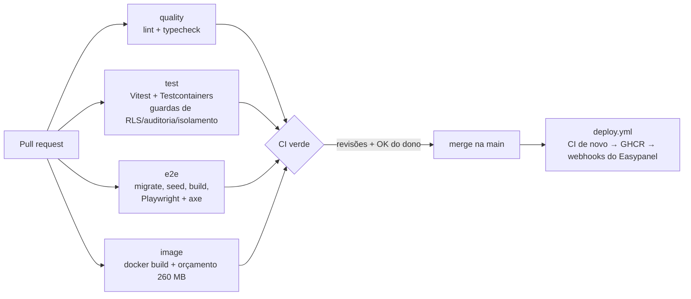
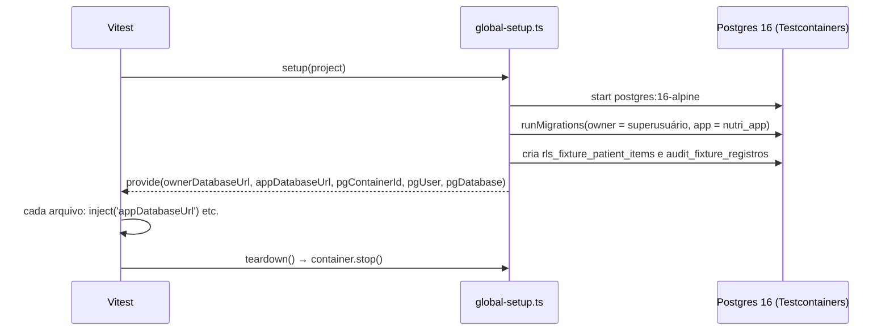
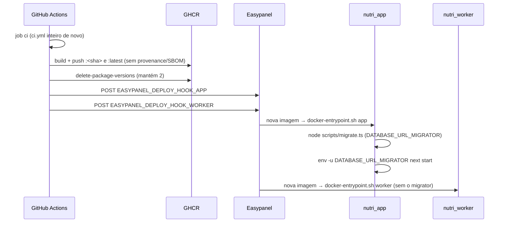
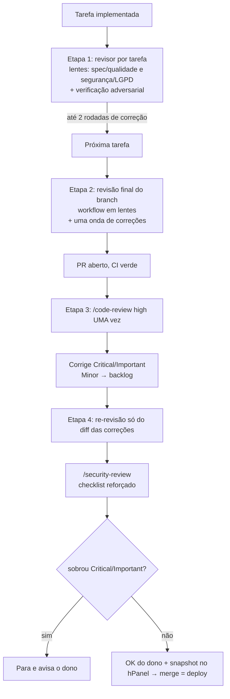
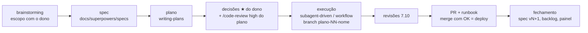

# 7. Testes, qualidade e processo de desenvolvimento

Este capítulo explica como o NutriDebby é testado, quais guardas quebram o CI de propósito, como o CI vira deploy,
como montar o ambiente de desenvolvimento e como uma entrega nova nasce, é revista e chega à produção.

Convenções:

- Caminhos são relativos à raiz do repositório. `arquivo:N` aponta a linha. Quando a linha muda com facilidade,
  cito o nome da função ou do teste.
- Decisões dos planos aparecem como "Plano NN, Dx" (decisão) ou "Plano NN, Tarefa N". Os planos estão em
  `docs/superpowers/plans/`.
- Segredos: este capítulo cita só o **nome** das variáveis. Nenhum valor de `.env`, nem os valores fictícios do CI,
  do Dockerfile ou do seed do E2E, é copiado aqui.
- As divergências entre spec, planos e código estão na seção 7.13.

---

## 7.1 Visão geral

A qualidade do NutriDebby se apoia em quatro camadas. Cada uma pega um tipo de erro diferente.

| Camada | Ferramenta | Onde | O que pega |
|---|---|---|---|
| Unitário e integração | Vitest 5 + Testcontainers (Postgres 16 real) | `src/**/*.test.ts`, `test/**/*.test.ts` (`vitest.config.ts:8`) | Regra de negócio, RLS, auditoria, filas, arquivos, rotas e Server Actions |
| Guardas de conformidade | Vitest (catálogo do Postgres e leitura do código-fonte) | `src/db/rls-guard.test.ts`, `src/db/audit-guard.test.ts`, `test/isolamento.test.ts` e outras (7.4) | Tabela nova sem RLS, sem auditoria, sem fábrica de isolamento; import proibido; rota sem axe |
| Ponta a ponta | Playwright 1.63 + `@axe-core/playwright` 4.13.0 | `e2e/*.spec.ts`, `playwright.config.ts` | Fluxos reais no navegador, e-mail no Mailpit, WhatsApp no sandbox, CSP, acessibilidade |
| Estática | ESLint 9 (`eslint-config-next`) e `tsc --noEmit` (TypeScript `strict`) | `eslint.config.mjs`, `tsconfig.json:7` | Erros de tipo, regras do React e do Next |



---

## 7.2 Números atuais

Medidos no commit `62615b9` (`origin/main`). Nenhum código mudou desde `d5662bb`, o último commit com CI
verde do Plano 08 (`git log d5662bb..HEAD` só tem docs). **Atualização do Plano 10A** (`3991c7d`, PR #19, 06/10/2026):
os valores marcados "10A" abaixo. **Atualização do Plano 11** (`2efa27b`, PR #23, 07/10/2026): os valores marcados "11".

| Item | Valor | Como conferir |
|---|---|---|
| Arquivos de teste do Vitest | **219** (215 em `src/`, ao lado do código; 4 em `test/`); 10A: **244**; 11: **282** | `find src test -name "*.test.ts" \| wc -l` |
| Casos do Vitest (execução) | **2024**; 10A: **2244**; 11: **2558** | "Resultado da entrega" do Plano 08 (`pnpm test` com 219 arquivos e 2024 testes); relatório das correções do `/code-review high` do PR #19 (244 arquivos, 2244 testes) e do PR #23 (282 arquivos, 2558 testes) |
| Chamadas `it(`/`test(` no código | 1502 | Contagem estática; a diferença para 2024 vem de laços e `it.each` (21 arquivos usam `it.each`) |
| Specs do Playwright | **17**; 10A: **18** (`documentos.spec.ts`); 11: **21** (`painel-pwa.spec.ts` do Plano 09, `ia-laudos.spec.ts` e `conferencia-ia.spec.ts`) | `ls e2e/*.spec.ts` |
| Testes E2E (execução no CI) | **130**, em 10,6 min | "Resultado da entrega" do Plano 08; 120 chamadas `test(` estáticas, o resto vem de laços (ex.: um teste por rota do portal em `e2e/acessibilidade.spec.ts:51`) |
| Migrations | **89** (`0000` a `0088`); 10A: **94** (`0000` a `0093`); 11: **101** (`0000` a `0100`) | `ls drizzle/*.sql`; 24 delas (10A: 25; 11: 26) se chamam `*rls_*` |
| Fábricas na matriz de isolamento | 36 (34 tabelas do app + 2 tabelas-fixture do `global-setup`); 10A: 40 (38 + 2); 11: 42 (40 + 2) | `FABRICAS`, `test/isolamento.test.ts:24` |
| Telas do painel no axe | 43 `page.tsx` em `src/app/painel` + `/conta/seguranca`; 10A: 45 + `/conta/seguranca` (o Plano 11 não criou tela: a IA mora nas abas Exames e Privacidade, em Configurações e no `/admin`) | `ROTAS_DO_PAINEL`, `e2e/painel-rotas.ts`; guarda `src/app/painel/rotas-axe.test.ts:8` |
| Telas do portal no axe | 10 rotas fixas + telas avulsas | `ROTAS`, `e2e/acessibilidade.spec.ts:50` |
| Imagem Docker | 256 MB comprimida na `main` 7ada357 (limite 260 MB); 11: **258 MB** (o Plano 11 soma ~7 MB com `pdf-lib` e `@anthropic-ai/sdk`, e o Dockerfile poda ~5 MB deles) — **2 MB de folga** | Job `image`, `.github/workflows/ci.yml:106`; runs 37483326880 e 37611756099 (PR #23) |
| Commits na `main` | 414, desde 27/09/2026; 10A: 470; 11: 533 | `git log --oneline \| wc -l` |

---

## 7.3 Vitest + Testcontainers

### Como roda

`pnpm test` executa `vitest run` (`package.json`, script `test`). A configuração está em `vitest.config.ts`:

| Opção | Valor | Por quê |
|---|---|---|
| `include` | `src/**/*.test.ts`, `test/**/*.test.ts` | Testes ficam ao lado do código; `test/` guarda os transversais |
| `globalSetup` | `test/global-setup.ts` | Sobe **um** Postgres para a suíte inteira |
| `setupFiles` | `test/setup.ts` | Variáveis de ambiente de teste em cada arquivo |
| `hookTimeout` | 120 s | Subir o container e rodar 89 migrations leva tempo |
| `testTimeout` | 30 s | Testes de integração com banco real |
| `resolve.tsconfigPaths` | `true` | O alias `@/` funciona nos testes |

Pré-requisito: Docker acessível. O Testcontainers usa o Docker da máquina (no CI, o do runner, `ci.yml:42`).

### O `global-setup` (`test/global-setup.ts`)



Pontos que importam:

1. **Dois papéis de conexão.** `ownerDatabaseUrl` é o superusuário do container, usado só para migrations,
   fixtures e consultas de conferência ao catálogo. `appDatabaseUrl` troca o usuário para `nutri_app`
   (`global-setup.ts:11-14`), o mesmo role sem privilégios da produção. `test/setup.ts` põe essa URL em
   `DATABASE_URL`. **Por quê:** o superusuário ignora a RLS. Um teste que conectasse com ele passaria mesmo com a
   RLS quebrada (Plano 01, Review Focus 2). `src/db/migrate.test.ts` prova que o role da aplicação não é
   superusuário nem tem `BYPASSRLS` (caso "o role da aplicação não é superusuário nem ignora RLS").
2. **As migrations de verdade.** O setup chama `runMigrations` (`src/db/migrate.ts`), a mesma função do deploy. Os
   testes rodam sobre o schema real, com as políticas e os gatilhos.
3. **Tabelas-fixture.** `rls_fixture_patient_items` e `audit_fixture_registros` (`global-setup.ts:20-44`) ganham
   `app_enable_tenant_rls`, `app_enable_patient_rls` e `app_enable_audit`. Elas testam as funções de RLS e de
   auditoria sem depender de uma tabela de negócio.
4. **Dados para o teste do backup.** O id do container, o usuário e o banco vão para `test/backup.test.ts` e
   `test/restauracao.test.ts`, que rodam `pg_dump`/`pg_restore` **dentro** do container, como no host.

`test/setup.ts` define `NODE_ENV=test`, `APP_URL`, `AUTH_SECRET`, `ENCRYPTION_KEY`, `EMAIL_FROM`, `MAILPIT_URL`,
`FILE_URL_SECRET`, as chaves de teste do Turnstile e um `DATA_DIR` temporário por arquivo (`mkdtempSync`),
apagado no `afterAll` (T8-R2b). Os valores são fictícios e só valem no teste.

### Isolamento entre testes

O banco é um só para todos os arquivos. Ninguém trunca tabela. Cada teste cria o **próprio tenant** com slug
aleatório (`novoTenant`, `test/pacientes.ts:18`) e os próprios pacientes e usuários com e-mail aleatório. Assim os
arquivos rodam em paralelo sem pisar um no outro, e a RLS ainda separa os dados.

### Helpers em `test/`

| Arquivo | Exporta | Uso |
|---|---|---|
| `test/db.ts` | `makeDb(url)`, `semPreChecagem(db)` | Pool + Drizzle para uma URL; `semPreChecagem` faz as pré-checagens devolverem `[]` para provar que só a constraint `UNIQUE` barra a duplicidade (T5-R1), sem depender de corrida real |
| `test/pacientes.ts` | `novoTenant`, `novoPaciente`, `emailsNaFila`, `ctxPaciente`, tipo `TenantDeTeste` | Tenant com usuária nutricionista e `ctx` com ator e IP; paciente gravado direto; e-mails da fila decifrados; contexto de paciente com ator (N7) |
| `test/sessao.ts` | `entrar`, `criarEEntrar`, `SENHA_TESTE` | Login pelo handler real do Better Auth; devolve o cookie `nd.session_token` |
| `test/nutri.ts` | `nutriComDpa` | Nutricionista com DPA aceito e cookie (testes de Route Handler) |
| `test/portal.ts` | `pacienteComConta` | Paciente com conta ligada e aceite do termo (como depois do convite, US-011) |
| `test/agenda.ts` | `SP`, `em`, `tenantAgenda`, `semanaToda`, `consultaDireta`, `perdeCorridaNoBanco`, `perdeDeadlockNoBanco` | Horários no fuso; disponibilidade; consulta direta; simulação determinística de corrida e de deadlock |
| `test/conteudos.ts` | `novoConteudo`, `novaEtiqueta`, `comoPaciente`, `idsVisiveis` | Conteúdo e etiqueta de teste; leitura como paciente para conferir a audiência |
| `test/notificacoes.ts` | `depsDeEnvio` | Dependências do motor de envio num lugar só: relógio parado, e-mail em memória, WhatsApp e push desligados (R12) |
| `test/email.ts` | `transporteFalso` | Transporte de e-mail em memória, com falhas programadas |
| `test/whatsapp.ts` | `whatsappFalso`, `conexaoDeTeste` | Provedor WhatsApp em memória e conexão do tenant |
| `test/pdf.ts` | `textoDoPdf`, `paginasDoPdf` | Lê o texto e conta as páginas dos PDFs do `@react-pdf` |
| `test/grafo-de-imports.ts` | `grafoDeImports`, `raizesDoNext`, `caminhoAte`, `fontesDe` | Grafo de imports pela árvore sintática do TypeScript (base das guardas de 7.4.3) |

Os quatro testes que vivem em `test/` são transversais: `isolamento.test.ts` (7.4.2), `grafo-de-imports.test.ts`
(testa o próprio grafo), `backup.test.ts` e `restauracao.test.ts`.

### Padrões que se repetem

- **Sem rede.** E-mail, WhatsApp e push entram por injeção de dependência (`depsDeEnvio`, `transporteFalso`,
  `whatsappFalso`). O `web-push` real é exercitado com o `https.request` trocado (`src/modules/notificacoes/push.test.ts`,
  casos "rodada 1" e "rodada 2").
- **Corridas determinísticas.** `perdeCorridaNoBanco` e `perdeDeadlockNoBanco` (`test/agenda.ts:53` e `:100`) forçam o
  caminho em que o banco decide, em vez de torcer para a corrida acontecer.
- **"A guarda funciona".** Toda guarda tem um teste negativo: cria uma tabela temporária ou remove uma política
  **dentro de uma transação**, confere que a guarda acusa e faz `rollback` (ex.: `audit-guard.test.ts`, caso
  "detecta tabela de saúde nova sem gatilho").

### Backup e restauração no Vitest (regra 10)

| Teste | O que roda | Proteção |
|---|---|---|
| `test/backup.test.ts` | `scripts/backup/nutri-backup.sh` de verdade, contra o container do Testcontainers e um remoto `crypt` numa pasta local | Ambiente montado à mão (`env` sem herdar o do host); senha do crypt gerada na hora; caso "nenhum outro arquivo de código cita o script (há bancos de produção no host)" (`:247`) |
| `test/restauracao.test.ts` | `scripts/backup/nutri-restauracao-teste.sh` num banco descartável sem rede | Monta o remoto com `pg_dump`/`pg_dumpall` direto, **sem** rodar o `nutri-backup.sh` (Plano 08, Tarefa 11) |

Os dois exigem `rclone`. No CI a falta dele é erro (`backup.test.ts:20`, `restauracao.test.ts:19`); o job `test`
instala o `rclone` antes (`ci.yml:40-41`). Fora do CI, sem `rclone`, eles são pulados (`describe.skipIf`).

### Outro cluster: `src/db/migrate-owner.test.ts`

Sobe um **segundo** container e monta o banco como o runbook de produção: o migrator é dono do banco e **não** é
superusuário (Plano 01, Tarefa 13, Ruling R49). Prova que as migrations rodam assim, que o role da aplicação não
cria tabela temporária (M5) e que a função `SECURITY DEFINER` das métricas do admin funciona sob `FORCE RLS`.

### Fora do Vitest

`test/carga/` (`seed.ts`, `cenario.js`, `gerar-env.sh`) é a pilha de carga do k6 (Plano 08, D5). Não casa com o
`include` do Vitest e nunca é importada pelo app. Roda só pelo roteiro `docs/operacao/carga.md`, na pilha
`docker-compose.carga.yml`, com OK do dono. Ver [§6.6 Teste de carga](06-worker-seguranca-operacao.md#66-teste-de-carga-k6).

---

## 7.4 Guardas do CI

Uma guarda é um teste que não testa uma função: ela confere uma **regra do projeto** e quebra o CI quando alguém a
esquece. O projeto prefere guarda a lembrete, porque o desenvolvimento é feito por agentes e revisores que não
carregam a memória das decisões antigas.

### 7.4.1 Guardas de banco (catálogo do Postgres)

Todas leem `pg_class`, `pg_policies`, `pg_trigger` e `information_schema` com a conexão do dono. A lista de tabelas
"com `tenant_id`" vem de `listTenantTables` (`src/db/rls-guard.ts:49`): tabelas comuns e particionadas do schema
`public` com a coluna `tenant_id`.

A tabela completa das guardas de banco — cada lista (`RLS_EXCEPTIONS`, `PATIENT_POLICY_EXCEPTIONS`, `STAFF_ONLY`,
`PUBLICO_LIBERADO`, `PACIENTE_ESCREVE`, `CONTEUDO_POR_AUDIENCIA`, `ESCRITA_POR_AUDIENCIA`, `AUDIT_EXCEPTIONS`), o
conteúdo de hoje, a função que confere (`findRlsViolations`, `findStaffOnlyViolations`, `findPublicoViolations`,
`findPacienteEscritaViolations`, `findConteudoAudienciaViolations`, `findStaleExceptions`, `findAuditViolations`) e
a linha do teste — está no capítulo do banco, [§2.7 Guardas no CI](02-banco-de-dados.md#27-guardas-no-ci). Aqui fica
o porquê.

**Por que a guarda confere a expressão e não só o nome.** Uma política `paciente_sem_delete USING (true)` tem o nome
e o comando certos e não nega nada. A guarda normaliza o texto que o Postgres guarda e compara com a negação
esperada (`normalizarExpressao` e `NEGA_PACIENTE`, `rls-guard.ts:201-202`; débito B-5 do Plano 06). O mesmo vale para a audiência: uma
`paciente_conteudo_visivel USING (true)` mostraria ao paciente todo conteúdo do tenant (`AUDIENCIA_EXIGE`,
`HERDA_DE_CONTENTS`, R11 do Plano 07). Os testes "B-5" e "R11" de `src/db/rls-guard.test.ts` (`:170` e `:204`)
provam que essas armadilhas quebram o CI.

**Por que "negar por padrão".** O `publico` (Plano 05, D11) e a escrita do paciente (Plano 06, D1) nascem negados
em toda tabela nova, porque `app_enable_tenant_rls` já cria `publico_negado` e `paciente_sem_*`
(`drizzle/0070_paciente_sem_escrita.sql:39`, versão atual da função). Liberar exige dois passos que precisam bater:
a chamada SQL (`app_allow_publico`, `drizzle/0051_rls_consultas.sql:19`; `app_allow_paciente_escrita`,
`drizzle/0070_paciente_sem_escrita.sql:25`) e a entrada na lista TypeScript com o motivo. Esquecer qualquer um dos
dois quebra o CI. A lista vira documentação viva de tudo o que o paciente e o visitante podem fazer.

Outros testes de banco que funcionam como guarda:

| Teste | Regra |
|---|---|
| `src/db/migrate.test.ts` | Role da aplicação sem superusuário/`BYPASSRLS`; extensões exigidas; **nenhuma coluna `timestamp` sem fuso** no schema `public`; migrations idempotentes; `CREATEDB`/`CREATEROLE` removidos ao reaplicar |
| `src/db/migrate-owner.test.ts` | Migrator sem superusuário (7.3) |
| `src/db/paciente-colunas.test.ts` | Gatilho `paciente_colunas` (migration 0085, B-4): a sessão de paciente só altera as colunas permitidas de `patients` e `data_exports` |
| `src/modules/alimentos/taco-fonte.test.ts` | A planilha da TACO tem o `sha256` esperado e `seeds/taco-4ed.csv` e a migration de seed são exatamente o que `pnpm seed:taco` gera |

### 7.4.2 A matriz de isolamento: `test/isolamento.test.ts`

É o teste do RNF-07: "tenta ler, alterar e excluir dados de outro tenant e de outro paciente do mesmo tenant em
todas as tabelas 🔒". Nasceu no Plano 02, Tarefa 8, e cada plano acrescentou as suas tabelas.

**Montagem (`beforeAll`, `:186`).** Cria dois tenants, A e B, cada um com dois pacientes (`PAC`). A tem os pacientes
P1 e P2. Para cada tabela com `tenant_id` fora de `RLS_EXCEPTIONS`, roda a fábrica uma vez por paciente de cada
tenant, como nutricionista (`withTenant`, papel `nutri`, conexão `nutri_app`). Semear os **dois** tenants faz o teste
falhar tanto se uma política negar tudo quanto se liberar tudo (PF-F3).

| Peça | Linha | O que é |
|---|---|---|
| `FABRICAS` | `:24` | Tabela → função `(tenantId, patientId) => SQL` que grava uma linha. Fábrica que precisa de linha-mãe cria a mãe **no mesmo comando** (CTE), ex.: `consultation_notes`, `meal_items`, `recipe_ingredients` |
| `SO_INSERE` | `:128` | Tabelas append-only (`audit_log` e, desde o Plano 10A, `signed_document_receipts`): UPDATE/DELETE já são negados por permissão |
| `SEM_DELETE`, `DELETE_REVOGADO` | `:133`, `:138` | Plano 11 (D9): em `ia_tarefas` e `ia_uso` o DELETE da equipe é negado (gatilho `ia_tarefas_sem_apagar`; `REVOKE` em `ia_uso`): o teste do tenant B pula o DELETE e confere que nada sumiu; em `ia_uso` a recusa vem da permissão, antes da RLS, para qualquer contexto (inclusive `publico`; R4 do pre-flight) |
| `IMUTAVEIS` | `:145` | Plano 10A (D19): `signed_documents`, `signed_document_notes`, `document_access_codes`; Plano 11 (revisão final): `ia_tarefas` — o gatilho recusa mudar `tenant_id`/`patient_id` com `42501` antes do `WITH CHECK` da RLS (mensagem própria, não "row-level security") |
| `SO_APAGA` | `:151` | Plano 10A: em `signed_documents` o DELETE de B só apaga rascunhos (os emitidos ficam, pelo gatilho); em `patients`, só os pacientes sem documento nem recibo (FK `NO ACTION`). Um paciente a mais por tenant, sem documento, faz o filtro casar |
| `ULTIMAS` | `:162` | Apagadas por último no teste de DELETE, porque as filhas têm FK `NO ACTION`/`RESTRICT` para elas (`foods`), ou cascata que zeraria linhas de B que o teste ainda conta (`contents`, `recipes`); desde o Plano 10A, `signed_documents` e `stored_files` (FKs `NO ACTION` dos PDFs); `patients` é sempre a última |
| `COLUNA_TITULAR` | `:225` | Em `patients` o titular é a coluna `id` |
| `SEM_DELETE_DO_PACIENTE` | `:227` | O paciente nunca é apagado (arquiva, bloqueia, anonimiza) |
| `UPDATE_DO_PACIENTE` | `:275` | O único UPDATE que a sessão de paciente consegue na própria linha de `data_exports` (`pendente → falhou`) |

**O que cada caso prova (`describe` em `:283`):**

| Caso | Prova |
|---|---|
| "toda tabela com tenant_id tem fábrica neste teste" (`:284`) | Tabela nova sem fábrica quebra o CI |
| WITH CHECK do tenant (`:289`) | B não grava linha com o `tenant_id` de A nem move a própria linha para A |
| WITH CHECK do paciente (`:302`) | P2 não grava linha de P1 nem move a própria para P1 |
| D1 (`:323`) | Fora de `PACIENTE_ESCREVE`, P2 não cria nem a própria linha |
| `staff_only` (`:332`) | A sessão de paciente não vê nem grava nada nessas tabelas |
| `publico` (`:345`) | O visitante só lê e grava o que `PUBLICO_LIBERADO` declara |
| `conta` (`:366`) | Sem tenant, a conta do paciente não vê nem grava nada (só `patients` da própria conta) |
| Leitura, alteração e exclusão de B (`:377`) | B só vê e só altera as próprias linhas; as de A ficam intactas (contagem feita com o dono) |
| Leitura, alteração e exclusão de P2 (`:427`) | P2 só vê e altera as próprias linhas; as de P1 ficam intactas |

O teste distingue a recusa da RLS (`violaRls`: código `42501` e mensagem de *row-level security*) de outro erro
qualquer. Uma FK quebrada não conta como isolamento. Desde o Plano 11 (revisão da T1), nos testes negativos de escrita a
recusa tem de vir da política **da própria tabela** (`violaRlsDe`: a mensagem cita `for table "<tabela>"`); só as
fábricas de `COM_MAE` (`:251`), que criam a mãe no mesmo comando, aceitam a recusa da mãe. Tabela nova não entra em
`COM_MAE`: a fábrica grava só a própria tabela, como a de `ia_tarefas` (`exam_id` nulo, status `falhou`).

### 7.4.3 Guardas de código (leitura do fonte)

| Guarda | Arquivo | Regra |
|---|---|---|
| Admin sem tabelas 🔒 | `src/app/admin/sem-tabelas-tenant.test.ts` | O admin nunca consulta tabela com `tenant_id` (§4.1), nem pelo que importa de `src/modules` |
| `semConta` em lista fechada | `src/db/sem-conta-guarda.test.ts` | `semConta: true` só nos arquivos de `SEM_CONTA_PERMITIDOS` (`src/db/tenant.ts:34`) |
| Ações e APIs do painel fora da sessão certa | `src/app/painel/acoes-de-paciente.test.ts`, `src/app/api/painel/acesso-negado.test.ts` | Toda função exportada de todo arquivo `actions.ts` de `src/app/painel` e `src/app/admin` (`acoesDe`, `acoes-de-paciente.test.ts:31-35`), chamada por paciente, volta ao portal; por nutricionista, as do admin voltam ao painel; toda rota de `/api/painel` responde 403 a paciente e a admin. Ação `'use server'` fora de um `actions.ts` (em `page.tsx` ou outro arquivo) **não** é conferida |
| Origem nas rotas de escrita com cookie (P09-01) | `src/app/api/mesma-origem-rotas.test.ts` | Toda rota de `src/app/api/{painel,p,documento}` (lista lida do disco) chamada em `POST`/`PUT`/`PATCH`/`DELETE` sem cookie e com `Origin: https://evil.example` responde 403: a origem é conferida antes da sessão (uma rota que lesse a sessão primeiro daria 401). Fora, de propósito: `/api/auth`, `/api/n`, `/api/webhooks`, `/api/csp-relatorio`, `/api/erro-cliente` |
| Liberação das receitas do plano | `src/modules/portal/conteudos.test.ts`, caso "guarda: só 'Meu plano' e o detalhe pelo cartão…" (`:151`) | `liberarReceitasDoPlano` só em `planoDoPaciente` e `conteudoDoPaciente(…, { doPlano: true })` |
| PDF e ZIP só no worker | `src/modules/pacientes/exportacao.test.ts:1017` | Nada do grafo do Next (`src/app`, `proxy`, `instrumentation`, `next.config`) alcança `exportacao-job`, os PDFs (inclusive `documento-pdf.tsx`, `documento-pdf-job.ts` e `digitalizada-job.tsx`, Plano 10A) ou o `@react-pdf` |
| Assinatura sem sessão (Plano 10A, D23) | `src/modules/documentos/registrar-assinatura.test.ts`, caso "D23…" | `registrar-assinatura.ts` (importado pelo worker) não puxa o Better Auth, `confirmar-2fa` nem `tenant-session`, nem pelos imports dos imports |
| Verificação pública por um arquivo só (Plano 10A) | `src/modules/documentos/verificacao.test.ts` | Nenhum arquivo de `src` além de `verificacao.ts` (e do schema) cita `document_verifications` (`RLS_EXCEPTIONS`) |
| Listas sem conteúdo (Plano 10A, D17) | `src/modules/documentos/documentos.test.ts`, `portal.test.ts` | As listas do painel e do portal só devolvem tipo, data, situação, assinatura e recibos, nunca itens, orientações ou justificativa (não chamam `auditRead`) |
| Restauração × `RLS_EXCEPTIONS` (Plano 10A) | `src/db/rls-guard.test.ts` | A lista de tabelas fora da conta no `nutri-restauracao-teste.sh` é a mesma de `RLS_EXCEPTIONS` |
| Documentos fora da cópia offline (Plano 10A) | `src/app/sw-regras.test.ts` | `/p/documentos` nunca é a página guardada pelo service worker nem entra no cache do plano |
| IA: SDK, `pdf-lib` e ZDR (Plano 11, RNF-103/RNF-105) | `src/modules/ia/guardas.test.ts` | `@anthropic-ai/sdk` só em `provedor-anthropic.ts` (em `src` e `scripts`); `pdf-lib` só em `preparar-pdf-thread.ts` e no gerador de laudos fictícios; o provedor não usa Batch, Files, execução de código, MCP, `fallbacks`, `speed`, `betas`, citações, `source: url`, `thinking`, ferramentas nem `count_tokens`, e fixa `maxRetries: 0` e `logLevel: 'off'`; nada do grafo do Next alcança o SDK, o `pdf-lib`, o provedor real, o preparo, o job da leitura nem a avaliação. `test/setup.ts` apaga `ANTHROPIC_API_KEY` do ambiente dos testes |
| IA: nada em log, fila ou Sentry (Plano 11, RNF-104) | `src/modules/ia/logs.test.ts` | Uma leitura com textos marcadores (ok, recusa e erro com nova tentativa): o marcador não aparece nos espiões do logger, nos dados dos jobs da fila `ia`, no erro limpo do job nem no evento do Sentry filtrado; a tag `motivo` só com formato de código; o pino tira `apiKey`, `x-api-key`, `parametros` e `resultado` |
| IA: travas sem ciclo (Plano 11, revisão final) | `src/modules/ia/travas.test.ts` | Transações reais em paralelo, conferidas por `pg_blocking_pids`: worker × "Não usar IA", `cancelarTarefas` × portão do envio, varredura × cancelamento — nenhuma termina em 40P01 |
| IA: gatilhos e CHECKs do banco (Plano 11) | `src/db/ia-schema.test.ts` | `ia_tarefas_sem_apagar`, `patients_ia_quem`, `ia_tarefas_imutavel`, `tenants_interruptores_da_admin`, os CHECKs de `ia_tarefas`, `admin_actions` e `patients`, com os ramos que liberam |
| `web-push` só no worker | `src/modules/notificacoes/push.test.ts:434` | Nada do grafo do Next alcança `push.ts`, `enviar.ts`, `web-push` nem `heic-decode` |
| Sentry | `src/lib/sentry-guarda.test.ts` | `Sentry.init` só em `src/lib/sentry.ts`; nenhum SDK de navegador, Replay ou tracing; `@sentry/node` fora de componente de cliente |
| Erro de job sem detalhe | `src/worker/sem-detalhe.test.ts` | Todo job registra por `workSemDetalhe`; nenhum `boss.work(` direto em `src/worker/index.ts` |
| Axe em toda tela | `src/app/painel/rotas-axe.test.ts:8` | `ROTAS_DO_PAINEL` tem exatamente um caminho por `page.tsx` de `src/app/painel` (Plano 08, D25) |
| Imagem Docker | `src/app/painel/rotas-axe.test.ts:19` | Todo arquivo de `e2e/` importado por `src/` volta ao contexto do build no `.dockerignore` |
| Visual V2 | `src/app/painel/cores.test.ts`, `cabecalho.test.ts`, `navegacao.test.ts` | Sem cor fixa nas telas da nutricionista (D24), foco visível, cabeçalho desenhado só pelo layout (D20); todo `page.tsx` do painel chama `requireNutri(` ou `carregarProntuario(` (`cabecalho.test.ts:49-51`, conferência de texto) |
| Manual guiado | `src/modules/ajuda/conteudo.test.ts:48` | Todo nome de botão citado no manual existe numa tela (desde o Plano 10A, também em `src/app/conta`); toda página de `src/app/painel` e `src/app/conta` tem guia ou está em `SEM_AJUDA`; o guia `prontuario` não cita a aba Documentos (D20) |
| Variáveis | `src/env.test.ts` | Validação de cada variável por processo (chaves de teste do Turnstile recusadas em produção fora de `localhost`, `AUTH_SECRET` ≥ 32, `DATABASE_URL_MIGRATOR` nunca exposta ao app…) |

O grafo de imports (`test/grafo-de-imports.ts`) usa o parser do TypeScript, segue `import`, `export … from`,
`import()` e `require`, ignora `import type` e resolve o alias `@/`. Por quê: um `grep` de texto não pega o import
indireto (rota → módulo A → módulo B → `@react-pdf`). Um import desses levaria o PDF para o bundle do servidor web e
para o processo que atende as páginas.

### 7.4.4 Checklist: tabela nova com `tenant_id`

O passo a passo completo (schema, migration custom de RLS, helpers SQL × listas de `src/db/rls-guard.ts`, migrator,
`withTenant`/`auditRead`, arquivos, fábrica em `FABRICAS`, LGPD) e o fluxograma estão em
[§2.11 Passo a passo: tabela nova com `tenant_id`](02-banco-de-dados.md#211-passo-a-passo-tabela-nova-com-tenant_id).
As guardas desta seção 7.4 quebram o CI se algum passo faltar.

### 7.4.5 Checklist: tela nova

As peças estão espalhadas em vários capítulos (§1, §3.17, §5.7.4, §5.9). Aqui ficam juntas. A coluna "Guarda" diz o
que o CI cobra; "nenhuma" quer dizer que só a revisão pega o esquecimento.

**Painel da nutricionista (`src/app/painel/…`)**

| # | Passo | Onde | Guarda |
|---|---|---|---|
| 1 | Primeira linha da página: `await requireNutri('/painel/…')` (`src/lib/tenant-session.ts:22`); use o `ctx` devolvido em `withTenant` | `page.tsx` | `cabecalho.test.ts:49-51` (só confere o texto) |
| 2 | Aba do prontuário (`/painel/pacientes/[id]/…`): use `carregarProntuario(id)` (`src/app/painel/pacientes/[id]/prontuario.ts:12`) em vez de `requireNutri` + `buscarPaciente`. Ela chama `requireNutri`, faz **uma** leitura auditada do paciente por requisição (o `cache` do React divide a leitura entre o layout e a página) e dá 404 a paciente de outro tenant ou id malformado | `page.tsx` da aba | `cabecalho.test.ts:49-51` |
| 3 | Server Action só num arquivo `actions.ts`, e toda função exportada começa pela guarda (`requireNutri`; no admin, `requireUser(['admin'])`). Não declare `'use server'` dentro de `page.tsx` nem em outro arquivo | `actions.ts` | `acoes-de-paciente.test.ts` (só lê arquivos `actions.ts`) |
| 4 | Rota em `/api/painel/*`: `requireApiNutri(req)` (`tenant-session.ts:37`); escrita: `mesmaOrigem(req)` antes da sessão (`src/lib/mesma-origem.ts:9`) | `route.ts` | `src/app/api/painel/acesso-negado.test.ts` (sessão), `src/app/api/mesma-origem-rotas.test.ts` (origem) |
| 5 | Entrada em `ROTAS_DO_PAINEL` (`e2e/painel-rotas.ts:10`) | `e2e/painel-rotas.ts` | `rotas-axe.test.ts:8` |
| 6 | Tela com `[id]`: campo novo em `IdsDoPainel` (`e2e/painel-rotas.ts:2`) e a criação do registro pela UI em `prepararTelasComId` (`e2e/painel.ts:43`) | `e2e/` | `pnpm typecheck` (o `tsconfig.json` inclui `e2e/`): campo usado em `ROTAS_DO_PAINEL` e não devolvido por `prepararTelasComId` não compila |
| 7 | Cores só por token (sem `bg-white`, `text-gray-…`); sem cabeçalho próprio (o layout desenha) | `.tsx` | `cores.test.ts`, `cabecalho.test.ts` |
| 8 | Se a tela é um destino: item em `ITENS_DO_MENU` (6 itens, `src/app/painel/navegacao.ts:2`) ou cartão no hub de Configurações (`DO_HUB`, `navegacao.ts:12`) | `navegacao.ts` | `navegacao.test.ts:10` fixa os 6 itens: item novo no menu exige decisão (P08 D20) |
| 9 | Guia do manual, se couber: entrada em `GUIAS` (`src/modules/ajuda/conteudo.ts:19`) | `conteudo.ts` | `conteudo.test.ts:48` (nomes de botão) |
| 10 | Dado de saúde devolvido: `auditRead(tx, …)` na mesma transação (`src/modules/plataforma/audit.ts:28`, regra 8) | módulo | nenhuma |

**Portal do paciente (`src/app/p/…`, `src/app/api/p/…`)**

| # | Passo | Onde | Guarda |
|---|---|---|---|
| 1 | Primeira linha da página: `await requirePaciente('/p/…')` (`src/lib/paciente-session.ts:111`) | `page.tsx` | **nenhuma** |
| 2 | Rota em `/api/p/*`: `requireApiPaciente(req)` (`paciente-session.ts:165`); escrita: `mesmaOrigem(req)` antes de tudo (ex.: `src/app/api/p/diario/route.ts:25`) | `route.ts` | `src/app/api/mesma-origem-rotas.test.ts` (só a origem; a sessão, **nenhuma**) |
| 3 | Dado de saúde devolvido: `auditRead` na mesma transação (P06 D22) | módulo | nenhuma |
| 4 | Nada novo no cache offline; aba nova na barra exige decisão (§5.9) | `src/app/sw-regras.ts`, `src/app/p/navegacao.ts:8` | — |

Atenção: nenhuma guarda do CI lê as páginas de `/p` nem as rotas de `/api/p`. Os testes de `requirePaciente` existem
por tela (ex.: `src/app/p/(portal)/plano/page.test.ts`), não como varredura. O proxy também não protege `/api/*`
(§1.4). Uma página ou rota do portal sem a guarda passa no CI; confira na revisão.

---

## 7.5 E2E com Playwright

### Configuração (`playwright.config.ts`)

| Item | Valor | Por quê |
|---|---|---|
| `baseURL` (`:4`) | `APP_URL`, senão `http://localhost:3000` no CI e `http://localhost:3100` local | A 3000 da VPS é o painel do Easypanel (PF-N16) |
| `fullyParallel` | `false` | Os specs dividem um banco e um consultório de teste; vários são `serial` |
| `retries` | 1 no CI, 0 local | Absorve uma oscilação de rede sem esconder falha repetida |
| `trace` | `retain-on-failure` | O CI sobe `playwright-report` quando falha (`ci.yml`, último passo do job `e2e`) |
| `webServer[0]` | `next start` na porta da `baseURL` | E2E roda o **build de produção**, não o `next dev` |
| `webServer[1]` | `pnpm worker`, espera `worker iniciado` no stdout (`src/worker/index.ts:205`) | E-mails e lembretes são enviados pelo worker |

**Projetos:**

| Projeto | Dispositivo | Specs |
|---|---|---|
| `chromium` | Desktop Chrome | Todos, menos os dois de acessibilidade |
| `celular` | Pixel 7 | `acessibilidade.spec.ts` (PWA no tamanho de Android; RNF-09, RNF-10) |
| `painel` | Desktop Chrome | `acessibilidade-painel.spec.ts` (Plano 08, D25) |

O Safari do iOS fica no teste manual do runbook (comentário em `playwright.config.ts:13`; checklist
`docs/operacao/go-live.md`, "Produto e acessibilidade").

### Dados do E2E: `scripts/e2e-seed.ts`

`pnpm e2e:seed` prepara o banco antes da suíte (`ci.yml:85`). Ele:

- cria ou atualiza o tenant `e2e-consultorio` com o DPA aceito e a página pública ligada;
- apaga a agenda desse tenant (filhas antes das mães) e arquiva os pacientes ativos de execuções anteriores;
- zera o limite por IP do visitante da página pública;
- recria as contas de teste (`E2E_ADMIN`, `E2E_NUTRI`, `E2E_RECUPERA`, `E2E_MULTI`, `E2E_MANUAL`,
  `E2E_ADMIN_PLATAFORMA` e, desde o Plano 10A, `E2E_DOCS` — a nutricionista dos documentos, com o 2FA já ativo e o
  consultório com os documentos liberados) com o progresso do manual marcado como visto, menos a conta do `manual.spec`.

As senhas dessas contas são fictícias e fixas no arquivo (o GitGuardian acusou; o backlog manda marcar como
credencial de teste). Nunca reaproveite essas contas fora do E2E.

**Cuidado:** o seed escreve no banco de `DATABASE_URL`. Ele apaga dados do tenant `e2e-consultorio`. Nunca rode
apontado para produção.

### Convenções dos specs

- **Um bloco de IP por spec.** O login tem limite de 5 tentativas a cada 15 min por IP. Cada spec declara a sua
  faixa no topo (ex.: `e2e/acessibilidade.spec.ts:9`, `10.9.10.21` a `.30`) e o `entrarComo` manda o IP no
  `x-forwarded-for` (`e2e/helpers.ts:7`). No CI, `TRUSTED_PROXIES` aponta para a TEST-NET-1, que satisfaz a
  validação de produção sem confiar em nenhum proxy real (comentário no job `e2e` do `ci.yml`).
- **E-mail pelo Mailpit.** `esperarEmail` (`e2e/mailpit.ts`) consulta a API do Mailpit em laço, com prazo. Falha do
  Mailpit falha na hora com o status (M4).
- **WhatsApp no sandbox.** `WHATSAPP_SANDBOX=1` manda a mensagem para o Mailpit (`<número>@whatsapp.sandbox`); o
  E2E assina os webhooks com `EVOLUTION_WEBHOOK_SECRET` (`e2e/whatsapp.ts`).
- **CSP vigiada.** `vigiarCsp` (`e2e/csp.ts`) junta toda mensagem de violação do console. O spec de acessibilidade
  do painel abre todas as telas e exige a lista vazia. É a prova de que a CSP pode valer direto (Plano 08, D7).
- **Admin com 2FA.** `entrarComoAdmin` ativa o 2FA no primeiro login e gera o código TOTP com `otpauth`.

### Acessibilidade (RNF-10)

| Spec | Projeto | Tags do axe | Cobertura |
|---|---|---|---|
| `e2e/acessibilidade.spec.ts` | `celular` | `wcag2a`, `wcag2aa`, `wcag21a`, `wcag21aa` | 10 rotas do portal, cada uma num teste; modo escuro do aparelho no portal e no painel; foco sobre a cor do consultório (contraste ≥ 3:1); 360 px e 320 px sem rolagem horizontal; alvo de toque ≥ 44 px; telas avulsas (consulta, exportação, sem acesso, escolher consultório, termo); paciente não alcança o painel |
| `e2e/acessibilidade-painel.spec.ts` | `painel` | as mesmas + `wcag22aa` (alvo de toque) | **Todas** as telas do painel (`ROTAS_DO_PAINEL` + `/conta/seguranca`) nos modos **claro**, **escuro** e **"igual ao aparelho" com o aparelho escuro**; menu da conta aberto e erros de formulário; 768 px sem rolagem horizontal |

Detalhes que evitam falso verde:

- `violacoes` exige `r.passes.length > 0`: o axe precisa ter rodado regras na página.
- No painel, os `incomplete` de `color-contrast` contam como falha (fundo com transparência cai em "incompleto"). A
  única tolerância é a linha "Conectado como …" do menu aberto, documentada no próprio teste.
- `prepararTelasComId` (`e2e/painel.ts`) cria pela interface real uma linha de cada tela com id (paciente, consulta,
  plano, conteúdo…) antes do laço.

### Specs

| Spec | Testes | Cobre |
|---|---|---|
| `auth.spec.ts` | 8 | Login, 2FA, sessão (Plano 01) |
| `recuperacao.spec.ts` | 2 | Esqueci minha senha |
| `sair.spec.ts` | 7 | Sair e `Clear-Site-Data` |
| `sessao-portal.spec.ts` | 2 | Sessão do portal (S-1, S-2, S-4) |
| `plataforma.spec.ts` | 6 | Admin cria nutricionista, convite, DPA, marca |
| `pacientes.spec.ts` | 9 | Cadastro, convite, prontuário |
| `plano-alimentar.spec.ts` | 18 | Criar, calcular e publicar plano |
| `agenda.spec.ts` | 12 | Horários, consultas, lembretes, link da consulta, página pública, WhatsApp sandbox, presença |
| `portal.spec.ts` | 20 | Portal do paciente |
| `conteudos.spec.ts` | 3 | Conteúdo visível só para a audiência certa (§9.7) |
| `inicio.spec.ts` | 2 | Início em bento |
| `menu-conta.spec.ts` | 1 | Menu da conta |
| `manual.spec.ts` | 10 | Manual guiado |
| `csp.spec.ts` | 3 | CSP e cabeçalhos |
| `health.spec.ts` | 1 | `/api/health` (o que o monitor externo confere) |
| `acessibilidade.spec.ts` | 11 (+ laço) | Portal |
| `acessibilidade-painel.spec.ts` | 5 (+ laço) | Painel |
| `documentos.spec.ts` (Plano 10A) | 1 | Receita de ponta a ponta pela digitalizada (rascunho → preparar → fotos + 2FA → portal: abrir e confirmar → situação no painel → verificação pública sem dado do paciente), com axe nos cartões "Aguardando assinatura" e "Documento assinado"; `acessibilidade.spec.ts` ganhou o axe de `/p/documentos`, `/v/<código>` e `/documento/<token>` (claro, escuro, 360 px) |

| `painel-pwa.spec.ts` (Plano 09) | 1 | Painel instalável: manifest próprio, nenhum service worker, HTML sem cache (P09-05) |
| `ia-laudos.spec.ts` (Plano 11) | 1 | Com `IA_PROVEDOR=sandbox`: aviso em mãos na Privacidade → laudo → "Ler valores com IA" → conferir → salvar só o marcado, com a marca "IA · conferido em {data}" |
| `conferencia-ia.spec.ts` (Plano 11) | 1 | A conferência guarda marcações e correções depois de um erro e no segundo envio (o React 19 limpava o formulário; revisão da T13) |

Os números são de chamadas `test(` no arquivo; laços geram mais casos na execução.

### Rodar localmente

```bash
pnpm e2e:seed            # banco de DEV (DATABASE_URL do .env.local)
pnpm build
pnpm test:e2e            # sobe next start na 3100 e o worker
pnpm test:e2e e2e/agenda.spec.ts --project=chromium   # um spec
```

`TRUSTED_PROXIES` é obrigatória no `next start` local (comentário em `.env.example`). O Playwright precisa do
Chromium instalado (`pnpm exec playwright install chromium`). O worker é sempre iniciado pelo Playwright
(`reuseExistingServer: false`); pare o seu `pnpm worker` antes, para não ter dois consumindo a fila.

---

## 7.6 Lint, typecheck e formatação

| Comando | O que faz |
|---|---|
| `pnpm lint` | `eslint .` com `eslint-config-next/core-web-vitals` e `eslint-config-next/typescript` (`eslint.config.mjs`) |
| `pnpm typecheck` | `next typegen` (script `pretypecheck`, gera os tipos de rota do Next 16) e `tsc --noEmit` com `strict` |
| `pnpm format` | `prettier --write .` com `.prettierrc` (aspas simples, `printWidth` 100) |

O CI roda `lint` e `typecheck` (job `quality`, `ci.yml:28-29`). **Não** roda o Prettier, e boa parte do código passa
de 100 colunas. Formatação não bloqueia; o backlog do Plano 08 tem um item de Prettier nos arquivos do heartbeat.

Comentários com `eslint-disable` existem e explicam o motivo na mesma linha (ex.: `useBoss` em
`src/worker/index.ts:53`, que não é hook do React).

---

## 7.7 Pipeline do CI e deploy

### `ci.yml` (todo pull request e chamado pelo deploy)

| Job | Tempo máx. | Passos | Observação |
|---|---|---|---|
| `quality` | 15 min | `pnpm install --frozen-lockfile`, `lint`, `typecheck` | Node 24, cache do pnpm |
| `test` | 15 min | instala `rclone`, `pnpm test` | Inclui todas as guardas; Testcontainers usa o Docker do runner |
| `e2e` | 20 min | serviços `postgres:16-alpine` e `axllent/mailpit:v1.27`; `playwright install chromium`, `db:migrate`, `e2e:seed`, `build`, `test:e2e` | `NODE_ENV=production`, `CI=true`, `WHATSAPP_SANDBOX=1`, `EMAIL_TRANSPORT=mailpit`; relatório do Playwright como artefato na falha |
| `image` | 20 min | `docker build` (cache do GHA), o orçamento e o teste de fumaça da IA | A imagem comprimida tem de caber em **260 MB** (`set -euo pipefail`, MB arredondado para cima); depois, `node --import tsx` na imagem, sem rede, prepara um PDF (thread do `pdf-lib`) e cria o cliente do SDK — confere a poda do Dockerfile |

Variáveis do job `e2e` (só nomes): `NODE_ENV`, `APP_URL`, `DATABASE_URL`, `DATABASE_URL_MIGRATOR`, `AUTH_SECRET`,
`ENCRYPTION_KEY`, `TRUSTED_PROXIES`, `EMAIL_FROM`, `EMAIL_TRANSPORT`, `MAILPIT_URL`, `FILE_URL_SECRET`, `DATA_DIR`,
`TURNSTILE_SITE_KEY`, `TURNSTILE_SECRET_KEY`, `WHATSAPP_SANDBOX`, `EVOLUTION_WEBHOOK_SECRET`, `IA_PROVEDOR` (`sandbox`; desde o
Plano 11), `CI`. Todos fictícios,
escritos no próprio workflow; nenhum vem de `secrets`.

**Concorrência (`ci.yml:11`).** Num PR, um commit novo cancela a execução anterior (economiza minutos do Actions).
Quando o `ci.yml` é chamado pelo deploy, o cancelamento fica desligado: o deploy nunca é interrompido no meio.

**Por que 260 MB.** O GHCR gratuito tem 500 MB e o deploy mantém duas versões (a nova e a que está rodando).
O `@sentry/node` v11 trazia ~6 MB de plugins de bundler sem uso; o `pnpm-workspace.yaml` poda o
`@sentry/bundler-plugins` por `overrides` (decisão do dono no Plano 08, Tarefa 2). No Plano 11, o estágio `build` do
Dockerfile apaga do `pdf-lib` e do `@anthropic-ai/sdk` o que não roda no worker (bundles de navegador e ES, fontes TS,
declarações de tipo e source maps, ~5 MB comprimidos); se a versão mudar o caminho, o build para.

### `deploy.yml` (push na `main`)



| Passo | Onde | Por quê |
|---|---|---|
| Build no Actions, nunca na VPS | `deploy.yml`, job `publish` | A VPS divide CPU e memória com o CRM `cursoia_crm` (RNF-03; Plano 01, Global Constraints) |
| `provenance: false`, `sbom: false` | `deploy.yml` | Cada push vira um manifesto só; a poda conta versões reais |
| Poda antes dos webhooks | `deploy.yml:53-57` | Se o deploy falhar, a poda já rodou; mantém a imagem nova e a anterior (a que roda) |
| Webhooks obrigatórios | `deploy.yml:58` | Sem `EASYPANEL_DEPLOY_HOOK_APP`/`_WORKER` o job falha com mensagem clara |
| `concurrency: deploy-main`, sem cancelamento | `deploy.yml` | Dois merges seguidos implantam em ordem |
| Migrations no app, antes do `start` | `docker-entrypoint.sh` (modo `app`) | O migrator do Drizzle aplica **todas** as pendentes numa única transação (`drizzle-orm/pg-core/dialect.js`, `migrate`, `session.transaction`, linhas 60-71), não uma transação por migration: se uma falhar, nenhuma da leva fica gravada e o container novo não sobe |
| `DATABASE_URL_MIGRATOR` fora dos processos longos | `docker-entrypoint.sh` (`env -u`) | O role dono do schema pode desligar a RLS; só o passo de migration o vê |

**Merge = deploy = reinício de serviço.** Por isso o merge exige o OK explícito do dono e um snapshot no hPanel antes
(regra 6 do `CLAUDE.md`; regras 3 e 5 do `CLAUDE.md` do servidor). Volta atrás: os serviços usam `:latest`, então
"redeploy" não basta; o dono fixa o `:<sha>` anterior no app e no worker e volta para `:latest` antes do próximo
merge. Migration não volta. Roteiro em [§6.8.1](06-worker-seguranca-operacao.md#681-roteiro-de-volta-atrás). As migrations seguem o padrão expand/contract: a versão antiga do código
convive alguns segundos com o schema novo (spec §9.7).

---

## 7.8 Ambiente de desenvolvimento

O desenvolvimento acontece na própria VPS (spec §9.4), ao lado da produção. Tudo de dev escuta só em `127.0.0.1`.

### Portas

| Porta | Serviço | Origem |
|---|---|---|
| 3000 | Painel do **Easypanel** (não usar) | `CLAUDE.md` do servidor |
| 3100 | `pnpm dev` (`next dev -p 3100`) e o E2E local | `package.json`, script `dev`; `playwright.config.ts:4` |
| 54329 | Postgres 16 de dev | `docker-compose.dev.yml` |
| 8025 | Mailpit: interface **e** API HTTP usada pelo transporte (`/api/v1/send`, `src/email/transport.ts:43`) | `docker-compose.dev.yml` |
| 1025 | Mailpit SMTP (exposta, mas o app não usa SMTP) | `docker-compose.dev.yml` |
| 3200 / 54339 | App e banco da pilha de carga (só com OK do dono) | `docker-compose.carga.yml` |

### Peças

- **`docker-compose.dev.yml`** (projeto `nutridebby-dev`): `postgres:16-alpine` com `mem_limit: 512m`, volume
  `nd-dev-db` e healthcheck; `axllent/mailpit:v1.27` com `mem_limit: 128m`.
- **`.env.local`** (fora do git, ignorado também no `.dockerignore`): copie `.env.example` e preencha. O
  `.env.example` traz só os nomes, com comentários dizendo qual processo usa cada variável e como gerar os
  segredos. Em dev: `EMAIL_TRANSPORT=mailpit`, `WHATSAPP_SANDBOX=1` e as chaves de teste da Cloudflare para o
  Turnstile (aceitas só em `localhost`, `src/env.ts:149`).
- **`pnpm db:migrate`**: `scripts/migrate.ts` lê `.env.local` (`--env-file-if-exists`), usa `DATABASE_URL_MIGRATOR`
  e cria ou sincroniza o role de `DATABASE_URL` (`ensureAppLogin`, `src/db/migrate.ts`).
- **`pnpm worker`**: o worker pg-boss com `tsx` (e-mails, lembretes, PDFs, fotos do diário, varreduras). Sem ele,
  nenhum e-mail chega ao Mailpit.
- **`pnpm admin:criar <email>`**: cria o admin e imprime no terminal o link de definição de senha (1 h, uso único).
- **TACO e medidas**: entram pelas migrations `0039_seed_taco.sql` e `0042_seed_medidas_ibge.sql`. `pnpm seed:taco` e
  `pnpm seed:medidas` só regeneram esses arquivos a partir de `seeds/`.
- **MCPs** (`.mcp.json`): `postgres-dev` (Postgres MCP em modo `restricted`, URL vinda de `NUTRI_DEV_DATABASE_URL`, só o
  banco de **dev**), `shadcn` e `next-devtools`. `.claude/settings.json` desliga os plugins Vercel e Supabase.
- **Next 16**: o `AGENTS.md` avisa que esta versão muda APIs e convenções. Leia o guia em `node_modules/next/dist/docs/`
  antes de escrever código de rota, proxy ou cache. O arquivo de interceptação é `src/proxy.ts`, não `middleware.ts`.

### Versões

| Ferramenta | Versão | Onde |
|---|---|---|
| Node | 24 | `.nvmrc`, `engines` do `package.json`, `Dockerfile` (`node:24-bookworm-slim`) |
| pnpm | 12.6.0 | `packageManager` do `package.json` (via `corepack`) |
| Postgres | 16 | `docker-compose.dev.yml`, `global-setup.ts`, CI |
| Mailpit | v1.27 | compose e CI |

---

## 7.9 As 10 regras do `CLAUDE.md`, com o porquê

O `CLAUDE.md` do projeto é lido por todo agente que trabalha no repositório. As regras são curtas porque a garantia
real está no código e nas guardas; a regra diz onde.

| # | Regra (resumo) | Por quê | Onde o código garante |
|---|---|---|---|
| 1 | Toda consulta a tabela com `tenant_id` passa por `withTenant(ctx, fn)`. O admin nunca consulta essas tabelas. `withConta` só em `vinculos.ts`. Exceções nominais para `user`, `consents`, `invites` e as tabelas sem tenant | A RLS só funciona se a transação tiver `app.tenant_id`, `app.role`, `app.patient_id`, `app.user_id` e `app.ip`. Fora de `withTenant` a conexão vê 0 linhas (Plano 01, Review Focus 1). A lista de exceções é nominal para que cada acesso fora da RLS seja auditável por leitura | `withTenant` (`src/db/tenant.ts:71`) com `set_config(..., true)`; `assertContext` recusa papel `admin` e exige `actorUserId` para nutricionista e paciente com login; guardas `sem-tabelas-tenant.test.ts` e `sem-conta-guarda.test.ts` |
| 2 | Tabela nova com `tenant_id`: migration custom com `app_enable_tenant_rls` (+ `patient`, `staff_only`, `publico`, escrita do paciente, audiência) e a entrada na lista certa | Isolamento no banco, não na aplicação: um bug de consulta não vaza dado de outro consultório. Negar por padrão faz a tabela nova nascer fechada | `rls-guard.ts` e `rls-guard.test.ts` ([§2.7](02-banco-de-dados.md#27-guardas-no-ci), 7.4.1) |
| 3 | Senhas, tokens, cookies e dados de saúde nunca vão para log, Sentry ou mensagens | LGPD e sigilo profissional: o log e o Sentry não são lugar de dado sensível, e o Sentry é um serviço de terceiro | `REDACT_KEYS` do pino (`src/lib/logger.ts:4`); `sanitizarErroDeBanco` no `withTenant`; filtro único `src/lib/sentry-filtro.ts`; `sem-detalhe.test.ts` |
| 4 | Textos de interface em pt-BR, com o texto exato da spec | As histórias têm critérios BDD com o texto exato; o E2E procura por esse texto (`getByRole(..., { name })`) | Specs E2E; tabelas "Textos de interface" nas histórias |
| 5 | MCP de banco só no dev; proibido em produção | Um agente com acesso de leitura à produção leria dado de saúde real | `.mcp.json`: `postgres-dev` com `--access-mode=restricted` e URL do dev |
| 6 | Configuração só pelo Easypanel; confirmar com o dono antes de reiniciar serviço, mexer no banco de produção ou dar merge | O Easypanel sobrescreve no próximo deploy o que for mudado por fora; o merge reinicia app e worker | `deploy.yml` (merge → webhooks) |
| 7 | Migrations sempre com `DATABASE_URL_MIGRATOR` | `ALTER DEFAULT PRIVILEGES` vale só para tabelas criadas pelo role que o emitiu. Migration rodada com outro role cria tabela sem permissão para `nutri_app` | `drizzle/0000_base_roles_e_rls.sql:17-19`; `scripts/migrate.ts` usa `getMigratorEnv()` |
| 8 | Dado de saúde ganha `app_enable_audit`; leitura de dado de saúde chama `auditRead` na mesma transação; exceções em `AUDIT_EXCEPTIONS` | US-007/RNF-08: o "Histórico de acessos" do paciente mostra quem leu e quem alterou. O gatilho garante a escrita; a leitura precisa da chamada explícita | `audit-guard.ts`/`audit-guard.test.ts`; `auditRead` (`src/modules/plataforma/audit.ts:28`) |
| 9 | Arquivos só por `salvarArquivo`/`apagarArquivo`, servidos por `signFileUrl` (5 min); nunca caminho com texto do usuário; tabela nova em `FABRICAS`; PDF e ZIP só no worker | Tipo pelo conteúdo, cota reservada na transação e registro no mesmo commit: sem arquivo órfão nem registro sem arquivo. URL assinada curta impede link permanente para laudo | `salvarArquivo` (`src/modules/plataforma/armazenamento.ts:64`, `registrar`), `apagarArquivo` (`:160`, `naMesmaTransacao`), `signFileUrl` (`src/lib/signed-url.ts:16`); guardas do grafo de imports |
| 10 | Backup roda no host, não no worker; `nutri-backup.sh` só no `test/backup.test.ts`; restauração só no teste e no teste mensal com confirmação | Há bancos de produção no mesmo host: rodar o script por engano faria backup ou restauração de verdade | `backup.test.ts:247` ("nenhum outro arquivo de código cita o script"); ambiente montado à mão nos dois testes |

---

## 7.10 Fluxo de revisão a cada entrega

Definido no índice dos planos (`docs/superpowers/plans/2026-09-27-nutridebby-00-indice.md`, seção "Revisão
obrigatória a cada entrega") e resumido no `CLAUDE.md`. Revisto pelo dono em 02/10/2026.



| Regra | Detalhe |
|---|---|
| `/code-review high` uma vez | A 2ª rodada completa "precisa sair limpo" foi abolida em 02/10/2026: revisar ~10 mil linhas de novo amostra trechos novos e sempre acha Minors novos. Os Planos 03 e 04 precisaram de aprovação do dono para encerrar |
| Re-revisão do diff | É ela que confirma que a correção está certa |
| Minor | Vai para um item "débitos do Plano NN" no backlog, agrupado por tema (ex.: P08-11) |
| Segurança | `/security-review` em todo plano; checklist reforçado (RLS, isolamento por paciente, LGPD, uploads, autenticação, webhook, páginas públicas, links assinados) nos Planos 01–03 e 05–08 |
| Sem custo extra | Tudo roda na assinatura do dono; o `/code-review ultra` não é usado |
| Registro | O resumo de cada rodada vai no PR e na seção "Resultado da entrega" do plano |

Nos Planos 07 e 08 o `/code-review high` rodou também **sobre o plano**, antes da execução (10 achados em cada,
corrigidos no texto).

---

## 7.11 Como abrir um plano novo

O projeto usa as skills do *superpowers*: brainstorming → spec → plano → execução por tarefas → revisões → PR →
merge com o OK do dono. Cada plano é escrito em detalhe **só quando o anterior termina**, porque consome nomes, tipos e
padrões reais do código (índice, "Sequência e dependências").



### Passo a passo

1. **Escopo.** Converse com o dono (skill `superpowers:brainstorming`). Nada de código antes.
2. **Spec.** Mudança de requisito entra em `docs/superpowers/specs/2026-09-27-nutridebby-mvp-design.md` (e nas
   histórias), com versão nova no Apêndice C.
3. **Plano.** Arquivo `docs/superpowers/plans/AAAA-MM-DD-nutridebby-NN-<nome>.md`, escrito a partir de um commit
   citado da `origin/main`. Estrutura usada nos Planos 02–08:

   | Seção | Conteúdo |
   |---|---|
   | Cabeçalho | Aviso "REQUIRED SUB-SKILL: superpowers:subagent-driven-development (ou executing-plans)"; Goal, Architecture, Tech Stack, links da spec e do índice |
   | Global Constraints | O que vale para todas as tarefas (versões, portas, regras do servidor, número da primeira migration) |
   | Decisões de desenho | Tabela D1…Dn; as ★ são do dono, com o custo de cada alternativa |
   | Desvios conscientes da spec | O que o plano faz diferente e por quê; vira a próxima versão da spec |
   | Itens adiados / débitos | O que vem dos planos anteriores |
   | Review Focus | Os riscos que o revisor deve atacar, cada um com o teste que o cobre |
   | Estrutura de arquivos | Arquivos novos e alterados |
   | Tasks | Por tarefa: **Files**, **Interfaces** (consome/produz) e passos em caixas de seleção, começando por "Escrever o teste que falha" (TDD) e terminando no commit |
   | Runbook do deploy | O que o dono faz, com confirmação a cada passo |
   | Fechamento | Revisões, backlog, spec, lembretes ao dono |
   | Autorrevisão (writing-plans) | Cobertura da spec, placeholders, consistência de nomes, Review Focus |
   | Decisões para o dono / Execução / Resultado da entrega | Aprovação, modo de execução e o registro final (commits, achados, CI, deploy) |

4. **Aprovação.** O dono aprova as decisões ★. Desde o Plano 07, o plano passa por `/code-review high` antes da
   execução.
5. **Execução.** Branch `plano-NN-<nome>` (ou worktree). Uma tarefa por subagente, com revisor por tarefa. Tarefas
   independentes podem rodar em worktrees paralelos, integradas no branch do plano (Planos 06–08).
6. **Migrations.** O plano diz o número da primeira migration. Se outra entrar antes, renumere no rebase e corrija as
   referências (Plano 08, Global Constraints). Nunca rode migration no banco de dev compartilhado sem combinar, nem em
   produção fora do deploy.
7. **Revisões** (7.10), **PR** com o resumo das rodadas e **CI verde**.
8. **Merge.** Só com o OK explícito do dono e o snapshot no hPanel. Merge = deploy.
9. **Fechamento.** Um PR curto de docs (ex.: PR #15, `plano-08-fechamento`): spec na versão seguinte, backlog
   (`2026-09-27-nutridebby-backlog.md` **e** o painel em artifact citado no `CLAUDE.md`), "Resultado da entrega" no
   plano, o registro do processo no índice e o **manual técnico** (`docs/manual-tecnico/`; roteiro em
   [README, "Como manter este manual"](README.md#como-manter-este-manual)).

---

## 7.12 Guia do primeiro dia

### Leia antes de tocar em código (≈ 2 h)

1. `/home/deploy/servidor/CLAUDE.md` (regras do servidor) e o `CLAUDE.md` do projeto (7.9).
2. `AGENTS.md` e o guia do Next 16 em `node_modules/next/dist/docs/`.
3. Spec §4 (arquitetura) e §5 (requisitos não funcionais).
4. O índice dos planos e o backlog ("Antes do go-live (dono)" e os itens de débitos).
5. `src/db/tenant.ts`, `src/db/rls-guard.ts` e `test/isolamento.test.ts`: é o coração da segurança.

### Monte o ambiente

```bash
nvm use                                   # Node 24 (.nvmrc)
corepack enable                           # pnpm 12.6.0 (packageManager)
pnpm install
docker compose -f docker-compose.dev.yml up -d
cp .env.example .env.local                # preencha; gere os segredos como o .env.example indica
pnpm db:migrate                           # migrations + role nutri_app
pnpm admin:criar voce@exemplo.com         # o link de senha sai no terminal
pnpm dev                                  # http://localhost:3100/entrar
pnpm worker                               # outro terminal; e-mails em http://localhost:8025
```

### Prove que está tudo verde

```bash
pnpm lint && pnpm typecheck
pnpm test                                 # precisa de Docker; sobe o próprio Postgres
pnpm vitest run src/db/rls-guard.test.ts  # só as guardas de RLS
```

### Faça uma mudança pequena

Crie um branch, mude um texto ou um teste, rode os comandos acima e abra o PR. Veja os quatro jobs do CI. Não faça
merge: merge é deploy e precisa do OK do dono.

### O que nunca fazer

| Nunca | Por quê |
|---|---|
| Rodar `pnpm db:migrate`, `pnpm e2e:seed` ou o MCP `postgres-dev` apontando para produção | Altera ou lê dado de saúde real (regras 5 e 6) |
| Rodar `scripts/backup/nutri-backup.sh` ou o script de restauração à mão | Há bancos de produção no host (regra 10) |
| Usar a porta 3000 | É o painel do Easypanel |
| Mudar variável, domínio ou imagem por `docker service update` | O Easypanel sobrescreve; peça ao dono pelo painel |
| Reiniciar serviço, mexer em firewall, SSH ou pacotes sem confirmação | Regra 3 do servidor |
| Colar valor de segredo em chat, PR, log ou documento | Regra 6 do servidor e regra 3 do projeto |
| Consultar tabela com `tenant_id` fora de `withTenant` | Quebra o isolamento (regra 1) |
| Desligar ou "afrouxar" uma guarda para o CI passar | A guarda é a regra; mude a lista com o motivo, ou corrija o código |

### Para desenvolver com segurança

- Escreva o teste antes (os planos fazem assim). Para o banco, conecte como `nutri_app` (`inject('appDatabaseUrl')`);
  use o dono só para conferir.
- Toda tabela nova: siga o [§2.11](02-banco-de-dados.md#211-passo-a-passo-tabela-nova-com-tenant_id).
- Toda leitura de dado de saúde devolvida ao usuário: `auditRead` na mesma transação (regra 8).
- Toda tela nova (painel ou portal): siga o [§7.4.5](#745-checklist-tela-nova). No portal, nenhuma guarda do CI
  confere `requirePaciente`/`requireApiPaciente`.
- Arquivo: só `salvarArquivo`/`apagarArquivo`/`signFileUrl`.
- Log: só ids, códigos e motivos fixos.

---

## 7.13 Divergências encontradas

| # | Fonte | O que diz | O que o código faz |
|---|---|---|---|
| 1 | Spec §9.7, "Merge na `main`" | "no container do app, `migrate` roda antes do `start` (o worker espera a versão do schema)" | **Resolvida no Plano 09 (P09-02 a):** o worker espera a versão do schema (`esperarVersaoDoSchema`, §6.2.1). Antes dela: nenhuma espera. `startWorker` (`src/worker/index.ts:42`) sobe o pg-boss e registra os jobs direto; o modo `worker` do `docker-entrypoint.sh` não consulta migrations; `deploy.yml` chama os webhooks do app e do worker em seguida. A proteção real é o padrão expand/contract |
| 2 | Spec §9.7, "Pull request" | Pipeline em sequência: lint → `tsc` → Vitest → testes de RLS/isolamento → build → Playwright | Quatro jobs paralelos (`quality`, `test`, `e2e`, `image`). Os testes de RLS e isolamento estão dentro do `pnpm test`; o build está dentro do job `e2e`; o job `image` (orçamento de 260 MB) não aparece na spec |
| 3 | Spec §9.7, "Merge na `main`" | Push para o GHCR "com tag = SHA do commit" | Também publica `:latest` e poda o pacote para as 2 versões mais recentes (`deploy.yml:39-57`) |
| 4 | Spec RNF-10 (v1.11) | Axe em "42 rotas de `ROTAS_DO_PAINEL`" | 43 entradas em `ROTAS_DO_PAINEL`, uma por `page.tsx` de `src/app/painel` (43), mais `/conta/seguranca` = 44 telas. O Plano 08, D25, fala em "~43" |
| 5 | Spec §9.2 | `@sentry/cli` como dependência de dev "para source maps"; `web-push` na mesma linha de dependências de dev | `@sentry/cli` não está no `package.json` (a própria v1.11 diz que não há source maps do navegador); `web-push` é dependência de produção (`dependencies`) |
| 6 | Índice dos planos, "Convenções" | "lista do teste de isolamento (Plano 01, Tarefa 5)" | A Tarefa 5 do Plano 01 criou a guarda `rls-guard`. A matriz `test/isolamento.test.ts` nasceu no Plano 02, Tarefa 8 (`docs/superpowers/plans/2026-09-28-nutridebby-02-plataforma.md:4268`) |
| 7 | Índice dos planos, cabeçalho e E-04 | Spec "v1.2, aprovada"; E-04 pede Meta Business e WhatsApp Cloud API | A spec está na v1.11; o WhatsApp é pela Evolution API desde a v1.8 (Plano 05). O índice não foi atualizado nesses dois pontos |
| 8 | Plano 01, Global Constraints e Tarefa 14 | Revisão com "`/code-review high` 2×"; o `CLAUDE.md` da Tarefa 14 manda repetir até "sair limpo" | Superado em 02/10/2026: `/code-review high` uma vez + re-revisão do diff (índice e `CLAUDE.md` atual). O texto do Plano 01 ficou como registro histórico |
| 9 | `README.md` | Texto padrão do `create-next-app`: porta 3000, `app/page.tsx`, deploy na Vercel | Porta 3100 (`package.json`), código em `src/app`, deploy GHCR → Easypanel. O README não descreve o projeto |
| 10 | `.prettierrc` | `printWidth: 100` | O CI não roda o Prettier e muitos arquivos passam de 100 colunas (ex.: `src/db/rls-guard.ts`). Não é divergência de spec, mas a configuração não reflete o código |
