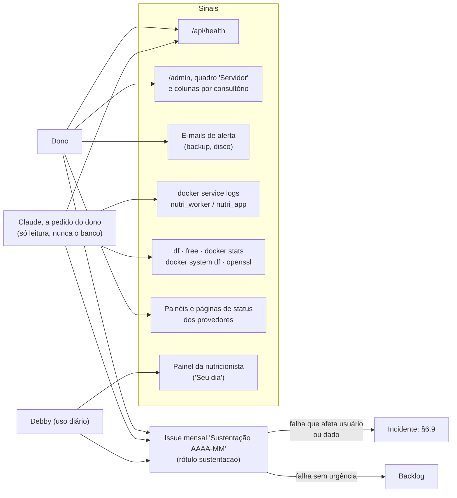
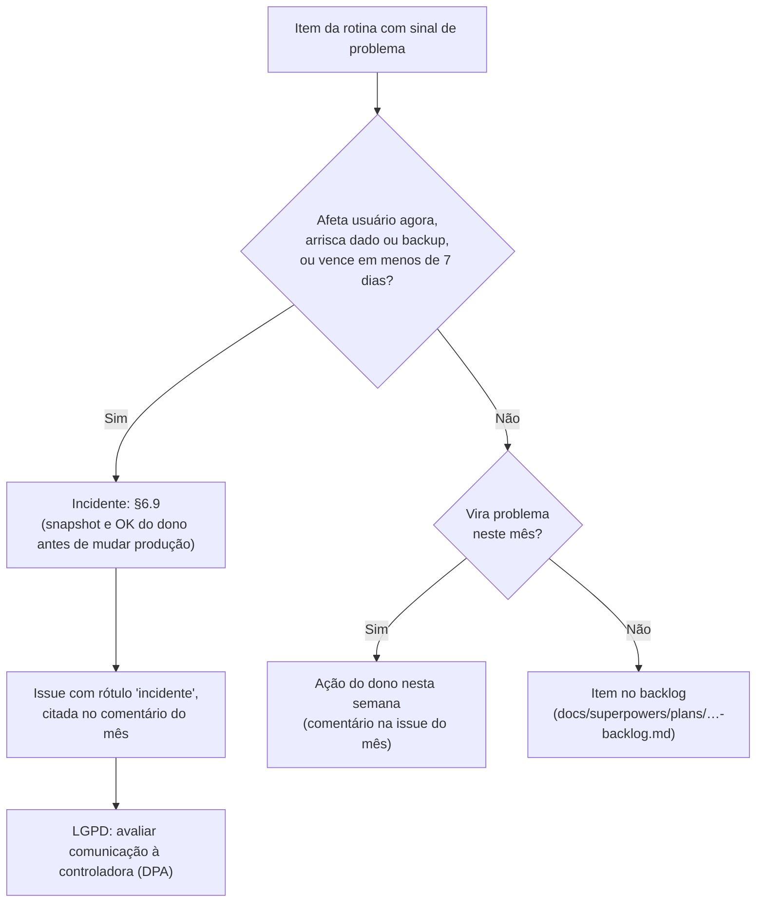

# 8. Sustentação

Este capítulo diz **o que conferir, quando, como e por quem** para manter o NutriDebby em produção: a rotina periódica
(diária a anual), o catálogo dos serviços externos de que ele depende, quem faz cada verificação, onde ela fica
registrada e o que hoje não é vigiado por nada.

Não repete o capítulo 6. O funcionamento do worker e das filas está em
[§6.2](06-worker-seguranca-operacao.md#62-worker-pg-boss), o `/api/health` e o Sentry em
[§6.4](06-worker-seguranca-operacao.md#64-observabilidade), o backup em
[§6.5](06-worker-seguranca-operacao.md#65-backup-e-restauração-rnf-05-regra-10), os incidentes em
[§6.9](06-worker-seguranca-operacao.md#69-rotina-de-incidentes) e o que só o dono faz em
[§6.10](06-worker-seguranca-operacao.md#610-o-que-só-o-dono-faz). Aqui ficam o "como verificar", o "sinal de
problema" e a "ação" de cada item.

| Item | Valor |
|---|---|
| Conferido contra | `main` em `bbf2adf` (merge do PR #18), em 05/10/2026, mais leitura da VPS só com os comandos livres da regra 2 do servidor |
| Checklist curto | [`docs/operacao/sustentacao.md`](../operacao/sustentacao.md) (caixas por periodicidade, apontando para este capítulo) |
| Registro | Issue mensal no GitHub, rótulo `sustentacao` ([§8.5.2](#852-onde-registrar-issue-mensal-no-github)) |

Convenções:

- Caminhos são relativos à raiz do repositório. `arquivo:N` aponta a linha no commit acima.
- Horários: os crons do pg-boss usam `America/Sao_Paulo` (BRT). A VPS e os logs estão em **UTC**, 3 h à frente
  ([§6.2.3](06-worker-seguranca-operacao.md#623-filas)). Cada horário abaixo aparece nos dois fusos.
- Segredos aparecem só pelo **nome**. Nenhum comando deste capítulo imprime valor de variável.
- **O Claude nunca lê o banco de produção**, nem com comando de leitura (regra 5 do projeto). Onde o dado só existe
  lá (tamanho de tabela, `pgboss.job`, `stored_files`), o item é do dono (regra 3 do servidor).
- O Plano 10A (receita, PR #19, sem merge) traz filas e varreduras de documento novas. Elas entram na tabela de
  [§8.2.1](#821-crons-e-a-linha-de-log-que-prova-que-rodaram) quando o PR for para a `main`.

---

## 8.1 Visão geral



### 8.1.1 Estado que muda a rotina hoje (05/10/2026)

Quatro peças de vigilância previstas ainda não existem em produção. Enquanto faltarem, a rotina manual cobre o buraco
([§8.6](#86-lacunas-o-que-hoje-não-é-vigiado)).

| Peça | Estado | Efeito na rotina | Prova |
|---|---|---|---|
| Backup no host (P02-11) | **Parcial**: scripts e unidades no host desde 30/09/2026; timer desabilitado (`systemctl list-unit-files 'nutri*'`: `nutri-backup.service static`, `nutri-backup.timer disabled`); falta o passo do dono (chaves no `backup.env` e habilitar o timer, P02-11 passo 6) | O `monitor-backup` manda `alerta_backup` aos admins **todo dia às 07h BRT** (visto no log do worker: `"tipo":"alerta_backup"`, `e-mail enviado`). Até a instalação, esse e-mail é esperado; depois dela, todo `alerta_backup` é incidente | [§6.5.10](06-worker-seguranca-operacao.md#6510-estado-atual) |
| Sentry (E-07) | **Desligado**: `SENTRY_DSN` ausente no `nutri_app` e no `nutri_worker` (só os nomes conferidos por `docker service inspect`) | Erro de job e de requisição só aparece no log, que é curto ([§8.2.3](#823-alcance-dos-logs)) | `iniciarSentry`, `src/lib/sentry.ts:115-120` |
| Monitor externo (P08-02) | **A configurar** pelo dono | Queda da VPS inteira não avisa ninguém: os alertas internos caem junto | [§6.4.3](06-worker-seguranca-operacao.md#643-apihealth) |
| WhatsApp (E-04) | **Desligado**: sem `EVOLUTION_*`, sem `nutri_evolution`; log `canal de WhatsApp` = `desligado` | Itens de WhatsApp da rotina ficam "quando ligar" | `src/env.ts`; [§5.4.2](05-agenda-portal-conteudo.md#542-whatsapp-pela-evolution-api-int-01-p05-d1d5) |

Fotografia da VPS nessa data (só leitura): `nutri_app`, `nutri_worker` e `nutri_db` em 1/1; disco `/` com 387 G e 15%
usado; 31 GiB de RAM, ~26 GiB livres; app e worker limitados a 1 vCPU / 1 GiB e o banco a 1 GiB; `/srv/nutri/data` com
40 K; certificado TLS válido até 29/12/2026; `oom_kill = 0` em `/proc/vmstat` desde o boot de 03/10/2026 14:19 UTC
(`uptime -s`) e `OOMKilled=false` nos três contêineres; 38 pacotes com atualização pendente, entre eles `docker-ce`
29.7.2 → 29.8.2, `containerd.io` 2.3.4 → 2.3.6 e o kernel 6.8.0-146 (roda o 142); Easypanel em
`easypanel/easypanel:latest` e Traefik em `traefik:3.6.7`.

**O usuário `deploy` não lê o journal do sistema** (fora dos grupos `adm` e `systemd-journal`): `journalctl -k` e
`journalctl -u nutri-backup` só mostram o aviso "You are currently not seeing messages from other users and the
system" e devolvem vazio, sem erro. Por isso nenhum item do Claude usa `journalctl`; o log do sistema fica com o dono,
por `sudo journalctl …`.

---

## 8.2 O que roda sozinho e onde ver que rodou

### 8.2.1 Crons e a linha de log que prova que rodaram

A tabela completa das filas (payload, tentativas, redes de segurança) está em
[§6.2.3](06-worker-seguranca-operacao.md#623-filas). Aqui só o que a rotina confere.

| Fila | Quando (BRT / UTC) | Agendamento | Prova de que rodou | Sinal de problema |
|---|---|---|---|---|
| `heartbeat` | todo minuto | `src/worker/index.ts:58` | `/api/health` 200 | 503 "worker sem heartbeat…" |
| `notificacoes` | todo minuto | `src/worker/index.ts:85` | Seção "Lembretes" da consulta (`src/app/painel/agenda/consultas/[id]/page.tsx:76-87`) | Lembrete com hora passada ainda pendente, ou "falhou" |
| `expirar-diario-foto`, `expirar-plano-pdf` | a cada 15 min | `src/worker/index.ts:190`, `:194` | Foto do diário "processando" vira falha depois de 30 min (`FOTO_PENDENTE_MAX_MS`, `src/modules/portal/diario-foto-job.ts:203`); PDF do plano "gerando" vira "falhou" depois de 1 h (`PDF_PENDENTE_MAX_MS`, `src/modules/plano-alimentar/plano-pdf-job.ts:114`) | Foto "processando" há mais de 45 min; PDF "gerando" há mais de 1 h 15 (prazo + uma passada da varredura) |
| `expirar-documento-pdf` (Plano 10A) | a cada 15 min | `src/worker/index.ts:210` | Receita "Preparando o PDF" ou "Montando o PDF digitalizado…" vira falha depois de 1 h (`PDF_DOCUMENTO_PENDENTE_MAX_MS`, `src/modules/documentos/documento-pdf-job.ts:101`); só loga quando falha (`falha ao expirar PDFs de documento pendentes`, `falha ao limpar arquivos órfãos de documentos`) | Uma dessas linhas no log; a nutricionista vendo "Preparando o PDF…" por mais de 1 h 15 |
| `monitor-disco` | hh:00 | `src/worker/index.ts:128` | `/admin`, "Disco da VPS: N% usado" (`src/app/admin/painel-infra.tsx:26`) | ≥ 70% (`DISCO_LIMITE`, `src/modules/plataforma/monitoramento.ts:11`) |
| `retencao-lgpd` | 04h00 / 07h00 | `src/worker/index.ts:140` | Log `retenção LGPD concluída` e `exportações vencidas apagadas` | Linha ausente no dia |
| `limpar-tmp` | 04h00 / 07h00 | `src/worker/index.ts:198` | `find /srv/nutri/data -regextype posix-extended -regex '.*\.[0-9]+\.tmp' -mtime +1 \| wc -l` = 0 | > 0 em dias seguidos |
| `agenda-limpeza` | 04h30 / 07h30 | `src/worker/index.ts:103` | Log `limpeza da agenda pública` (com `pedidos`, `limites`, `acessos` e, desde o Plano 10A, `codigos` — códigos vencidos do link do documento) | Linha ausente no dia |
| `monitor-backup` | 07h00 / 10h00 | `src/worker/index.ts:118` | `/admin`, "Backup do banco/dos arquivos: concluído em …" (`painel-infra.tsx:9-13`) | E-mail `alerta_backup`; "FALHOU"; "nenhum backup registrado" |

Comando único para as linhas da madrugada (leitura livre, regra 2 do servidor):

```bash
docker service logs nutri_worker --since 24h --timestamps --raw \
  | grep -E 'retenção LGPD concluída|exportações vencidas apagadas|limpeza da agenda pública'
```

Esperado: três linhas, entre 07h00 e 07h31 UTC do dia. Se a `retencao-lgpd` ou a `agenda-limpeza` falhar, a nova
tentativa vem 10 min depois (`retryDelay` 600 s, até 2 vezes), e a linha pode sair até umas 07h50 UTC: só é falta
depois disso. O campo `time` do JSON está em milissegundos; o prefixo do `--timestamps` já está em UTC legível. O
dono pode colar o comando sozinho, sem o Claude (o log dura cerca de um dia, [§8.2.3](#823-alcance-dos-logs)).

`limpar-tmp` só apaga arquivos no padrão `.N.tmp` (regex `/\.\d+\.tmp$/`, o temporário de `salvarArquivo`), e o log
`arquivos .tmp órfãos removidos` só sai quando apagou algum. Por isso a conferência usa o mesmo padrão: um `.tmp` de
outro formato não é da fila e não é sinal de que ela parou.

### 8.2.2 Cron perdido não volta

O pg-boss 12 grava as agendas com a política `skip` (`node_modules/pg-boss/dist/timekeeper.js`, comentário da política
de recuperação): se o worker estiver fora no minuto do cron, aquela execução **não roda depois**, só no dia seguinte.
Cada merge na `main` é um deploy (`.github/workflows/deploy.yml:3-5`, sem filtro de caminho) e reinicia o worker. Um
merge entre 03h e 07h30 BRT pode pular a `retencao-lgpd`, a `agenda-limpeza` ou o `monitor-backup` do dia. Regra
prática: **não fazer merge entre 03h e 07h30 BRT (06h–10h30 UTC)**; se acontecer, conferir no dia seguinte que as
linhas de [§8.2.1](#821-crons-e-a-linha-de-log-que-prova-que-rodaram) voltaram.

### 8.2.3 Alcance dos logs

Medido em 05/10/2026: a rotação existe (`json-file`, `max-size 10m`, `max-file 3` no `/etc/docker/daemon.json` e na spec
dos três serviços), e o Swarm guarda as **5 últimas tarefas** de cada serviço
(`docker info --format '{{.Swarm.Cluster.Spec.Orchestration.TaskHistoryRetentionLimit}}'` = 5). O
`docker service logs` só lê os contêineres dessas tarefas. Com quatro deploys num dia, o log do worker alcançava só
~23 h para trás.

Consequência para a rotina: **as linhas da madrugada se conferem no mesmo dia** (item D3). Uma verificação semanal
sobre o log não acha a semana. Em incidente, guarde cedo o trecho que interessa (só fila, código e horário; nada de
dado de paciente, regra 3). O §6.4.1 ainda diz que o log do Swarm não tem rotação: divergência
[#1](#divergências-encontradas).

### 8.2.4 Alertas que o sistema já manda

| Alerta | Gatilho | Para quem | Frequência máxima | Código |
|---|---|---|---|---|
| `alerta_backup` (e-mail) | `monitor-backup` acha falta, falha ou atraso > 26 h de `banco` ou `arquivos` | Todos os admins | 1 por dia | `monitoramento.ts:10`, `:96-98` |
| `alerta_disco` (e-mail) | Disco de `DATA_DIR` ≥ 70% | Admins | 1 a cada 24 h (marca `system_heartbeat` `alerta_disco`) | `monitoramento.ts:102-125` |
| Nenhum admin cadastrado | Qualquer dos dois | Ninguém; só o log `alerta de monitoramento sem destinatário` | — | `monitoramento.ts:91` |
| `whatsapp_desconectado` (e-mail) | Sessão do WhatsApp cai | Nutricionista | 1 a cada 6 h | `src/modules/notificacoes/whatsapp/conexao.ts:165` |
| `cota_whatsapp` (e-mail) | 80% da cota mensal | Nutricionista | 1 por mês | `src/modules/notificacoes/whatsapp/cota.ts:72` |
| Cota de armazenamento 80% / esgotada | `nivelDeUso` | Só **na tela** "Seu dia" da nutricionista (`src/app/painel/page.tsx:52-55`); o admin vê a coluna "Armazenamento" em `/admin` | — | `src/modules/plataforma/armazenamento.ts:12-14` |
| "Pedidos do titular" com prazo | Pedido de exclusão ou de dados aberto | Só **na tela** "Seu dia" (`src/app/painel/page.tsx:156-166`) | — | `PRAZO_RESPOSTA_DIAS = 15`, `src/modules/pacientes/lgpd.ts:23` |
| Erros | Exceção no app, no worker ou no navegador | Sentry (quando ligado), com tetos ([§6.4.4](06-worker-seguranca-operacao.md#644-sentry-d1-do-plano-08)) | Job: mesma `fila\|motivo` 1×/h, 50/dia (`src/lib/sentry.ts:43-48`) | `src/lib/sentry.ts` |
| Site fora | Monitor externo em `/api/health` e `/entrar` | E-mail e celular do dono | 5 min | A configurar (P08-02) |

Todos os e-mails acima saem pela fila `email` do worker, pelo Resend. Resend fora, ou cota do dia estourada, silencia
os alertas também ([§8.4.2](#842-pontos-únicos-e-dependências-cruzadas)).

---

## 8.3 Rotina periódica

Cada item tem um código (D = diária, S = semanal, M = mensal, T = trimestral, A = anual) usado no checklist
([`docs/operacao/sustentacao.md`](../operacao/sustentacao.md)) e no registro. "Quem": **Dono**; **Claude** = o Claude
a pedido do dono, só com comandos de leitura e nunca no banco de produção; **Debby** = a nutricionista no uso diário
([§8.5.1](#851-quem-faz-o-quê)).

Comandos de leitura usados abaixo (todos livres pela regra 2 do servidor): `curl`, `openssl s_client`, `df`, `free`,
`du`, `find … | wc -l`, `docker service ls/ps/logs/inspect` (sem imprimir valores), `docker stats --no-stream`,
`docker system df`, `docker inspect`, `systemctl list-timers/list-unit-files/show/status`, `apt list --upgradable`,
`uname -r`, `uptime -s`, `cat /proc/vmstat`. O `journalctl` não serve ao Claude: como `deploy`, ele volta vazio
([§8.1.1](#811-estado-que-muda-a-rotina-hoje-05102026)); o log do sistema é do dono, com `sudo`. Qualquer limpeza, reinício ou troca de configuração que um
sinal pedir é **ação do dono** (regras 1, 3 e 5 do servidor).

### 8.3.1 Diária

Uns 3 minutos, de manhã, depois das 07h30 BRT (para pegar o `monitor-backup` e as rotinas da madrugada).

| # | O que verificar | Como | Sinal de problema | Ação | Quem |
|---|---|---|---|---|---|
| D1 | Site e worker no ar | `curl -s -w ' %{http_code}\n' https://nutri.wsscloud.tech/api/health` → `{"status":"ok"} 200` | 503 com `reason`; sem resposta | Incidente pelo ramo do `reason` ([§6.9](06-worker-seguranca-operacao.md#69-rotina-de-incidentes)) | Dono ou Claude |
| D2 | Backup da noite e disco | `/admin`, quadro "Servidor": "Backup do banco" e "Backup dos arquivos" concluídos hoje por volta das 03h; "Disco da VPS" < 70% | "FALHOU", data de ontem ou mais velha, "nenhum backup registrado", disco em vermelho | Backup: `systemctl show nutri-backup.service -p Result,ExecMainExitTimestamp` (ou `systemctl status nutri-backup`, funcionam sem root); o log completo é do dono, `sudo journalctl -u nutri-backup --since today` (`today` em **UTC**: começa às 21h BRT da véspera); e ramo "E-mail de backup" de §6.9. Disco: [§8.3.3](#833-mensal) item M3 já, e ramo "Disco ≥ 70%" de §6.9. **Hoje** "nenhum backup registrado" é esperado (P02-11) | Dono |
| D3 | Rotinas da madrugada rodaram | Comando de [§8.2.1](#821-crons-e-a-linha-de-log-que-prova-que-rodaram): três linhas entre 07h00 e 07h31 UTC | Linha faltando | Houve deploy perto da hora? ([§8.2.2](#822-cron-perdido-não-volta)) Se não, worker com erro: `docker service logs nutri_worker --since 24h --raw \| grep -E '"level":(40\|50)'`. Dois dias seguidos = incidente | Claude |
| D4 | Caixa de entrada dos admins | E-mails `alerta_backup` e `alerta_disco` | Qualquer um (depois de o backup existir) | Ramo correspondente de §6.9 | Dono |
| D5 | Erros novos | Sentry, quando ligado: issues novos do dia. Até lá: `docker service logs nutri_worker --since 24h --raw \| grep -cE '"level":50'` e o mesmo para `nutri_app` | Issue novo; contagem > 0 | Ler a linha (`request_id` → `erro na requisição`, §6.4.2); falha repetida → incidente; isolada → backlog | Dono (Sentry) / Claude (log) |
| D6 | Painel da nutricionista | Tela "Seu dia": avisos de armazenamento, de WhatsApp desconectado e de cota de WhatsApp; cartão "Pedidos do titular" e o prazo de cada pedido | Aviso novo; pedido com prazo nos próximos 3 dias; paciente dizendo que não recebeu lembrete ou e-mail | Avisar o dono. Pedido do titular: atender no prazo de 15 dias (US-018). Lembrete não recebido: abrir a consulta, seção "Lembretes", e mandar ao dono o status | Debby |
| D7 | Monitor externo | Nenhum alerta do UptimeRobot (quando configurado) | Alerta de queda | §6.9; o `/api/health` diz o ramo | Dono |

### 8.3.2 Semanal

Uns 10 minutos, toda segunda de manhã. Registre um comentário na issue do mês com o resultado das diárias da semana e
destes itens ([§8.5.2](#852-onde-registrar-issue-mensal-no-github)).

| # | O que verificar | Como | Sinal de problema | Ação | Quem |
|---|---|---|---|---|---|
| S1 | Reinícios inesperados | `docker service ps nutri_app nutri_worker nutri_db --format '{{.Name}} {{.CurrentState}} {{.Error}}'` e `uptime -s` (último boot do host) | Tarefa `Failed`/`Rejected` fora de um deploy e fora de um reboot do host, ou `non-zero exit` isolado (o `exit (255)` do `nutri_db` em 03/10/2026 bate com o boot de 03/10/2026 14:19 UTC: foi o reboot, não uma queda) | Ler o log da tarefa que caiu; se repetir, incidente. Reinício só com OK do dono | Claude |
| S2 | Memória e OOM | `docker stats --no-stream`; `grep oom_kill /proc/vmstat` (contador desde o boot, junto com `uptime -s`); `docker inspect --format '{{.Name}} OOMKilled={{.State.OOMKilled}}' $(docker ps -q --filter name=nutri_)` | Serviço acima de ~800 MiB (limite 1 GiB); `oom_kill` maior que na semana anterior (sem reboot no meio); `OOMKilled=true` | Dono revê os limites no Easypanel (regra 1 do servidor; go-live, "Limites do Easypanel") | Claude → Dono |
| S3 | Cota diária do Resend | Painel do Resend → *Usage* (pico diário da semana) | Dia com mais de 80 e-mails (limite 100/dia no plano gratuito) | Dono decide: plano pago ou reduzir envio. Sem custo extra sem pedir | Dono |
| S4 | `.tmp` órfãos | `find /srv/nutri/data -name '*.tmp' -mtime +1 \| wc -l` | > 0 | `limpar-tmp` não roda: D3 e log do worker | Claude |
| S5 | Deploys fora de hora | `docker service ps nutri_worker --format '{{.CurrentState}}'` e o horário do merge (`git fetch -q && git log --first-parent origin/main --format='%ci %s' -5`) | Deploy entre 03h e 07h30 BRT | Conferir D3 do dia seguinte | Claude |
| S7 | Produção roda a última imagem da `main` | Digest de `docker service inspect nutri_app nutri_worker --format '{{.Spec.TaskTemplate.ContainerSpec.Image}}'` comparado com o do último push no GHCR (GitHub → Packages, ou a última execução do `deploy.yml`) | Digest diferente depois de um merge (webhook aceito, mas o pull falhou: token do GHCR vencido, GHCR fora) | Dono confere o deploy no Easypanel e o token (T2) | Claude → Dono |
| S8 | Receitas presas (Plano 10A; só depois de o admin ligar "Documentos" para algum consultório) | `docker service logs nutri_worker --since 7d --raw \| grep -cE 'PDF do documento não gerado\|PDF da digitalização não montado\|digitalização recusada'` (só contagem; as linhas levam só ids e o motivo fixo, regra 3) e a Debby | Contagem que cresce; receita em "Preparando o PDF…" ou "Montando o PDF digitalizado…" por mais de 1 h; "digitalização recusada" repetida com o mesmo motivo | Motivo `cota` → M4 (armazenamento); `foto`/`pixels` → orientar a Debby (fotos menores, uma por página); erro repetido → incidente. Lembrete: a Debby precisa do 2FA ativo para assinar | Claude → Dono / Debby |
| S6 | Status dos provedores | Páginas de status de [§8.4.1](#841-catálogo) (ou as notificações por e-mail delas, [§8.6](#86-lacunas-o-que-hoje-não-é-vigiado) item 5) | Incidente aberto que afete Resend, Cloudflare, Hostinger ou GitHub | Registrar; se afetou usuário, §6.9 | Dono |

### 8.3.3 Mensal

Uns 45 minutos, no primeiro dia útil do mês. Abre a issue do mês nova e fecha a anterior com os números.

| # | O que verificar | Como | Sinal de problema | Ação | Quem |
|---|---|---|---|---|---|
| M1 | Teste de restauração | Roteiro em `docs/operacao/restauracao.md`, com OK do dono a cada execução ([§6.5.8](06-worker-seguranca-operacao.md#658-teste-de-restauração-mensal)) | Qualquer guarda diferente do esperado; sem `restauracao ok`; duração > 1 h | Não marcar como feito; incidente (backup que não restaura = sem backup). Registro em `docs/operacao/restauracao-AAAA-MM.md`. Só depois do P02-11 | Dono |
| M2 | Crescimento do Docker no host | `docker system df` | Mais de ~20 GB recuperáveis (05/10/2026: 7,8 GB de imagens, 9,2 GB de cache de build, 2,7 GB de volumes) | Pedir ao dono `docker image prune` / `docker builder prune`; **apagar exige OK** (regra 3 do servidor). Nunca `volume prune` sem ver de quem é o volume (há outros projetos) | Claude → Dono |
| M3 | Disco e dados | `df -h /`; `du -sh /srv/nutri/data`; banco: `docker exec $(docker ps -q -f name=nutri_db \| head -n1) du -sh /var/lib/postgresql/data` (só o tamanho da pasta, sem consultar o banco; os dados são um bind em `/etc/easypanel/projects/nutri/db/data`, fora de `/srv/nutri/data`). Depois do P02-11, também o `banco ok (N bytes)` do log do backup (dono) como tendência | Uso subindo mais de 5 pontos no mês; ≥ 60% (antes do alerta de 70%); banco crescendo mais que o de costume | Ver o que cresceu (M2, `/data`, banco; journald: `du -sh /var/log/journal`, ou `sudo journalctl --disk-usage` pelo dono); ramo "Disco" de §6.9 | Claude |
| M4 | Consultórios: armazenamento e WhatsApp | `/admin`, colunas "Armazenamento" (`N de 5 GB`), "WhatsApp no mês" e "Cota de WhatsApp" (`src/app/admin/page.tsx:71-73`) | Armazenamento > 80% (o aviso só aparece para a nutricionista); WhatsApp > 80% da cota | Falar com a nutricionista; aumentar o armazenamento é mudança de código (`COTA_BYTES`); a cota de WhatsApp o admin edita | Dono |
| M5 | Cotas externas do mês | Resend (3 mil/mês), R2 (tamanho do bucket; 10 GB grátis), GHCR (Packages; 500 MB), Actions (minutos; 2 mil/mês), Sentry (5 mil erros, quando ligado) | Qualquer uma acima de 70% | Rever com o dono antes de virar custo ([§8.4.1](#841-catálogo)) | Dono |
| M6 | Cobrança e avisos do hPanel | hPanel (assinatura da VPS, cartão, alertas do Monarx), Cloudflare (*Billing*: R2 sem cobrança), GitHub (*Billing*) | Cartão perto de vencer; cobrança inesperada | Dono atualiza | Dono |
| M7 | Certificado TLS | `echo \| openssl s_client -connect nutri.wsscloud.tech:443 -servername nutri.wsscloud.tech 2>/dev/null \| openssl x509 -noout -enddate` | Menos de 20 dias para vencer (o Traefik renova ~30 dias antes; o atual vence em 29/12/2026). O Let's Encrypt vai encurtar a validade (64 e depois 45 dias, a partir de 2027): o T9 revê esse limiar | `docker service logs easypanel-traefik --since 24h \| grep -i acme`; avisar o dono. **Nunca** reiniciar o Easypanel (regra 4 do servidor) | Claude |
| M8 | Pacotes do host, Docker e kernel | `apt list --upgradable 2>/dev/null \| grep -cv '^Listing'`; `apt list --upgradable 2>/dev/null \| grep -E '^(docker-ce\|containerd.io\|linux-image)'`; `uname -r` comparado com `ls /boot/vmlinuz-*`; `ls /var/run/reboot-required` | Pacote do Docker/containerd ou kernel parado há mais de 30 dias (o unattended-upgrades só aplica as origens do Ubuntu e `-security`; o `docker.list` não está entre elas, então **o Docker nunca se atualiza sozinho**); kernel instalado mais novo que o em uso; arquivo de reinício pendente. O `reboot-required` sozinho dá verde falso: em 05/10/2026 ele não existia com Docker, containerd e kernel pendentes | O dono marca a janela (regra 3 do servidor), com snapshot (regra 5), fora das 03h–07h30 BRT. **Atualizar o Docker reinicia todos os contêineres**, inclusive o `cursoia_crm` e o Easypanel | Claude → Dono |
| M9 | Segredos no repositório | Painel do GitGuardian e o check do último PR | Incidente aberto que não seja falso positivo conhecido (backlog: `oembed.ts` e a senha fictícia do `scripts/e2e-seed.ts`) | Segredo real: [§6.9.1](06-worker-seguranca-operacao.md#691-segredo-vazado) | Dono |
| M10 | Pendências que bloqueiam a vigilância | Backlog: P02-11 (backup), E-07 (Sentry), P08-02 (monitor externo) | Ainda abertas | Lembrar o dono na issue do mês; nada de paciente real sem o backup (go-live, "Bloqueia") | Claude |
| M11 | Avisos de segurança das dependências | `pnpm audit --prod --audit-level high` no ambiente de **dev** (nunca no host de produção); alertas do Dependabot no GitHub, quando ligados ([§8.6](#86-lacunas-o-que-hoje-não-é-vigiado) item 14) | Aviso alto ou crítico | Em `next`, `react`, `better-auth`, `pg-boss`, `drizzle-orm` ou no Node 24: **incidente**, PR de correção em até 72 h ([§8.5.3](#853-quando-uma-verificação-falha)). Nos outros: PR na semana. Anotar o número de avisos na issue | Claude → Dono |

### 8.3.4 Trimestral

Em janeiro, abril, julho e outubro, na issue mensal do mês.

| # | O que verificar | Como | Sinal de problema | Ação | Quem |
|---|---|---|---|---|---|
| T1 | Quem tem acesso | (a) `/admin` (admins e contas de nutricionista, suspensas ou não); GitHub → *Collaborators*; usuários do Easypanel; membros da Cloudflare, do Resend e do Sentry. (b) **Conta do hPanel com 2FA** (controla console root, snapshot, DNS e domínio: o ponto único de [§8.4.2](#842-pontos-únicos-e-dependências-cruzadas) item 3). (c) 2FA das contas do dono no GitHub, na Cloudflare, no Resend e no Easypanel; senha forte no Easypanel. (d) SSH: `authorized_keys` de cada usuário, sudoers e a configuração **efetiva** do sshd: `sudo sshd -T \| grep -iE '^(passwordauthentication\|permitrootlogin)'` (esperado `no` e `no` ou `prohibit-password`). (e) Easypanel publicado na porta 3000 em modo host (`docker service inspect easypanel` → `PublishMode: host`): porta publicada pelo Docker passa por cima do UFW, então o painel fica aberto na internet | Conta que não devia existir; conta sem 2FA; `passwordauthentication yes`; 3000 aberta sem necessidade | Dono remove ou suspende (US-004), liga o 2FA e decide se a 3000 precisa ficar aberta. Mexer no SSH ou no firewall: só com OK do dono e snapshot (regras 3 e 5 do servidor) | Dono |
| T2 | Tokens com validade | Token do GHCR cadastrado no Easypanel (escopo `read:packages`); chave do R2 (escopo só no bucket); token do MCP do GitHub (E-01); PATs do GitHub (*Developer settings*); segredos `EASYPANEL_DEPLOY_HOOK_*` do repositório (data de criação em *Settings → Secrets*) | Vence nos próximos 90 dias; PAT sem uso ou sem validade | Dono gera o novo e troca no lugar certo; anota a nova data na issue | Dono |
| T3 | Variáveis presentes em produção | `docker service inspect nutri_app --format '{{range .Spec.TaskTemplate.ContainerSpec.Env}}{{println (index (split . "=") 0)}}{{end}}'` (e `nutri_worker`): **só os nomes** | Faltou uma obrigatória; `VAPID_PUBLIC_KEY` ausente de um dos dois; `SENTRY_DSN` ainda ausente | Dono corrige no Easypanel. Tabela das variáveis: [§1.9](01-visao-geral-e-arquitetura.md#19-variáveis-de-ambiente) | Claude |
| T4 | Gerenciador de senhas | Conferir que cada nome da lista de §6.10 está lá e abre (sem mostrar a ninguém). Que a chave do backup **funciona** é o T11 | Faltando | Dono completa; sem eles o backup não recupera o serviço (`docs/operacao/restauracao.md`) | Dono |
| T5 | Volta atrás possível | GitHub → Packages: duas versões da imagem (`:latest` e a anterior); hPanel: política de snapshot | Só uma versão; snapshot velho | Ver poda no `deploy.yml:53-57`; roteiro em [§6.8.1](06-worker-seguranca-operacao.md#681-roteiro-de-volta-atrás) | Dono / Claude |
| T6 | Tamanho do banco | Tamanho do banco e das maiores tabelas (`audit_log`, `notifications`, `pgboss.job`, `session`) por `docker exec` no `nutri_db` | Tabela sem expurgo crescendo mais que o resto ([§8.6](#86-lacunas-o-que-hoje-não-é-vigiado) item 10) | Item no backlog para uma varredura. **É banco de produção:** só o dono | Dono |
| T7 | E-mail do domínio | `dig +short TXT _dmarc.wsscloud.tech`; Resend → *Domains* com DKIM e SPF *Verified* | DMARC ainda `p=none` (o go-live pede `p=quarantine`); domínio não verificado | Dono ajusta o DNS no hPanel | Claude → Dono |
| T8 | Dependências e imagens base | `pnpm outdated` no ambiente de dev (versões; os avisos de segurança são o M11, mensal). A `node:24-bookworm-slim` só é refeita quando há merge: trimestre sem merge = imagem base parada. O `postgres:16` é tag flutuante: o menor (16.x) só muda quando o dono reimplanta o `nutri_db` no Easypanel; conferir com `docker exec $(docker ps -q -f name=nutri_db \| head -n1) postgres --version` (não toca no banco) | Versão principal atrasada; 16.x antigo; imagem base sem rebuild há mais de 90 dias | Plano curto (PR normal, revisão, merge com OK). O reimplante do `nutri_db` tem parada (`stop-first`): só pelo Easypanel, com snapshot | Claude → Dono |
| T9 | Este capítulo | Lacunas de [§8.6](#86-lacunas-o-que-hoje-não-é-vigiado) resolvidas; itens novos (filas do Plano 10A, WhatsApp, Sentry); limiar do M7 diante da validade menor do Let's Encrypt | Texto desatualizado | PR curto de docs (merge fora da janela de 03h–07h30 BRT) | Claude |
| T10 | Easypanel e Traefik | Versão em uso: `docker service inspect easypanel easypanel-traefik --format '{{.Spec.TaskTemplate.ContainerSpec.Image}}'` (05/10/2026: `easypanel/easypanel:latest`, `traefik:3.6.7`), comparada com o changelog do Easypanel e os avisos de segurança do Traefik | Versão com aviso de segurança; atualização pendente há mais de um trimestre | A atualização é **só pelo painel**, feita pelo dono, com snapshot. O Claude nunca reinicia o Easypanel (regra 4 do servidor) | Claude → Dono |
| T11 | Chave do backup no gerenciador de senhas | **Fora da VPS** (máquina do dono): config temporária do rclone numa pasta 0700, montada só com valores do gerenciador (`rclone obscure` da passphrase e do salt; chave do R2); `rclone lsl cripto:db/diario`; apagar a config. Opcional: comparar o `sha256sum` de `AUTH_SECRET` e `ENCRYPTION_KEY` do gerenciador com o do Easypanel, sem exibir o valor | Nomes `nutri-AAAA-MM-DD.dump` não aparecem decifrados (passphrase, salt ou chave do R2 errados); hash diferente | Corrigir o gerenciador **já**: perdida a VPS, é a única chave. Registrar "chave do gerenciador ok" na issue. Passo em `docs/operacao/restauracao.md`, "Teste da chave fora da VPS". Só depois do P02-11 | Dono |

### 8.3.5 Anual

Em julho (dois meses antes do vencimento do domínio).

| # | O que verificar | Como | Sinal de problema | Ação | Quem |
|---|---|---|---|---|---|
| A1 | Domínio `wsscloud.tech` | hPanel → Domínios (vence em **26/09/2027**; registrado na Hostinger) | Renovação automática desligada; cartão vencido | Dono liga a renovação. Domínio vencido derruba site, e-mail e Turnstile juntos | Dono |
| A2 | Plano da VPS e do Easypanel | hPanel; painel do Easypanel (plano, limite de projetos) | Renovação perto; limite de projetos atingido | Dono decide | Dono |
| A3 | Termos dos planos gratuitos | UptimeRobot (uso comercial), Resend, Sentry, R2, GitHub | Mudança de cota ou de termos | Rever com o dono; alternativas já previstas em D3 do Plano 08 | Dono |
| A4 | Textos legais e prazos | Termo do paciente e DPA (versão em vigor), prazo de guarda de 20 anos (`PRAZO_GUARDA_ANOS`, `lgpd.ts:21`; P-01) com o advogado/CRN | Mudança de norma; texto ainda provisório | Item no backlog; mudança de texto gera novo aceite | Dono |
| A5 | Ensaio de desastre no papel | Ler [§6.5.9](06-worker-seguranca-operacao.md#659-restauração-de-desastre-resumo) e `docs/operacao/restauracao.md`, "Restauração de verdade", com os segredos do gerenciador à mão; o último T11 tem de estar ok (a chave do gerenciador abre o backup); conferir se o [§1.8](01-visao-geral-e-arquitetura.md#18-infraestrutura) basta para recriar os serviços no Easypanel (bind, limites, domínio, `start-first`/`stop-first`), porque a configuração do projeto (`/etc/easypanel`) só existe na VPS e no snapshot da Hostinger, o mesmo domínio de falha; estimar o RTO de 4 h | Passo que depende de algo que não existe mais; configuração que só existe no painel | Corrigir o runbook ou o §1.8 | Dono + Claude |
| A6 | Custos do ano | Somar o que foi pago (VPS, domínio) e o que ficou perto de virar pago | — | Planejar com o dono (sem custo novo sem pedido) | Dono |
| A7 | Incidentes do ano | Issues com rótulo `incidente`; comunicação à controladora (DPA) quando houve | Incidente sem registro de comunicação | Completar o registro | Dono |

---

## 8.4 Catálogo de serviços externos

### 8.4.1 Catálogo

Impacto: **Parada** = o NutriDebby fica fora do ar; **Degradação** = parte para; **Sem efeito** = perde só observação
ou entrega de código. "Dono" = conta pessoal do dono do projeto. Custo: o dono paga a assinatura da VPS e o domínio;
o resto está em plano gratuito (regra do projeto: nenhum custo extra sem pedir). Valores em reais estão no hPanel, não
no repositório.

| # | Serviço | Papel | Está no ar? | Cotas e vencimentos | Se cair | Conta | Custo |
|---|---|---|---|---|---|---|---|
| 1 | Hostinger VPS (KVM 8) | Roda tudo: Easypanel, Traefik, `nutri_app`, `nutri_worker`, `nutri_db` e os vizinhos ([§1.8](01-visao-geral-e-arquitetura.md#18-infraestrutura)) | https://statuspage.hostinger.com (data center da VPS) | Assinatura mensal no cartão; disco (alerta a 70%), memória (limites por serviço) | **Parada** total, inclusive dos alertas internos; só o monitor externo avisa | Dono | Assinatura mensal |
| 2 | Hostinger hPanel: snapshot, domínio, DNS | Snapshot antes de mudança e de merge; registro e zona de `wsscloud.tech` (A `nutri`, DKIM `resend._domainkey`, `send`, `_dmarc`) | Mesma página do item 1 | Domínio vence **26/09/2027**; política de snapshot a confirmar | DNS fora: **parada** para quem não tem o nome em cache; hPanel fora: sem snapshot | Dono | Domínio anual |
| 3 | Easypanel + Docker Swarm + Traefik | Orquestra os serviços, recebe o HTTPS, emite o certificado, recebe os webhooks de deploy | Sem página (roda na VPS): `docker service ls` | Plano/limite de projetos; token do GHCR cadastrado (se vencer, o deploy não puxa a imagem) | Easypanel fora: serviços seguem, sem deploy nem troca de variável. Traefik fora: **parada** do site | Dono | A confirmar |
| 4 | Let's Encrypt | Certificado TLS, renovado pelo Traefik | https://letsencrypt.status.io | Certificado atual vence **29/12/2026** (renova ~30 dias antes) | Nada até o vencimento; vencido = **parada** (HSTS de 2 anos não deixa ignorar o aviso) | — | Grátis |
| 5 | PostgreSQL `nutri_db` (`postgres:16`) | Banco e fila do pg-boss | `/api/health` (503 "banco indisponível") | Limite 1 GiB; disco do host | **Parada** total | — | — (na VPS) |
| 6 | Docker Hub | Imagens `postgres:16`, `traefik`, `postgres:16-alpine` (teste de restauração), `grafana/k6` | https://www.dockerstatus.com | Limite de *pulls* anônimos por IP | Sem efeito no que roda; sem recriar o `nutri_db` nem testar restauração | — | Grátis |
| 7 | GitHub: repositório, Actions, GHCR | Código privado, CI, imagem `ghcr.io/fabianojp06/nutridebby`, webhooks de deploy ([§7.7](07-testes-qualidade-e-processo.md#77-pipeline-do-ci-e-deploy)) | https://www.githubstatus.com | Actions 2 mil min/mês; Packages 500 MB (poda para 2 versões); cache 10 GB (hoje ~10,7 GB, despeja o mais antigo) | Sem CI, merge nem deploy; produção segue; volta atrás também precisa do GHCR | Dono (`fabianojp06`) | Grátis |
| 8 | GitGuardian | Varredura de segredos em push e PR | https://status.gitguardian.com | — | Sem efeito | Dono | Grátis |
| 9 | npm registry | `pnpm install` no CI e no build | https://status.npmjs.org | — | Sem CI e sem build; produção segue | — | Grátis |
| 10 | Cloudflare R2 | Destino do backup cifrado ([§6.5](06-worker-seguranca-operacao.md#65-backup-e-restauração-rnf-05-regra-10)) | https://www.cloudflarestatus.com (R2) | 10 GB e 1 mi de operações A / 10 mi B por mês grátis; cartão cadastrado (acima disso, cobra); chave com escopo no bucket | Backup da noite falha; `alerta_backup` às 07h (se o Resend estiver no ar). App não sente | Dono | Grátis até a cota |
| 11 | Cloudflare Turnstile | Anti-robô em "Esqueci minha senha" e na página pública ([§6.3.5](06-worker-seguranca-operacao.md#635-turnstile-int-06)) | https://www.cloudflarestatus.com (Turnstile) | Widget amarrado ao hostname | **Degradação**: esses dois fluxos param ("Tente novamente em alguns minutos"); login, painel e portal seguem | Dono | Grátis |
| 12 | Resend | Todo e-mail: convites, senha, lembretes, exportação, **alertas de backup e disco** | https://resend-status.com | 100/dia e 3 mil/mês; domínio verificado (DKIM, SPF); DMARC `p=none` hoje | **Degradação** séria: 3 novas tentativas (60 s, crescente) e o e-mail se perde; os alertas param junto | Dono | Grátis |
| 13 | Web Push (FCM, APNs, Mozilla, Windows) | Notificação no celular do paciente (`SERVICOS_DE_PUSH`, `src/modules/notificacoes/push-endpoint.ts:13`) | https://status.firebase.google.com; https://developer.apple.com/system-status/ | Chaves VAPID não vencem (trocar invalida as inscrições, §6.9.1) | **Degradação**: push não chega; o e-mail do mesmo lembrete segue | — | Grátis |
| 14 | YouTube e Vimeo | oEmbed e vídeo dos conteúdos (`src/modules/conteudo/oembed.ts`) | https://www.vimeostatus.com (YouTube não tem) | — | **Degradação**: capa padrão; vídeo não toca | Conta da Debby (vídeos dela) | Grátis |
| 15 | Sentry | Erros do app e do worker ([§6.4.4](06-worker-seguranca-operacao.md#644-sentry-d1-do-plano-08)) | https://status.sentry.io | 5 mil erros/mês; *Rate Limit* diário da chave | Sem efeito. **Hoje desligado** (E-07) | Dono | Grátis |
| 16 | UptimeRobot | Monitor externo de `/api/health` e `/entrar` (D3 do Plano 08) | https://status.uptimerobot.com | Termos do Free para uso comercial (alternativa: HetrixTools) | Sem efeito; perde o alarme. **A configurar** (P08-02) | Dono | Grátis |
| 17 | Evolution API (WhatsApp) | Lembretes por WhatsApp, autohospedada (`nutri_evolution`) | Sem página (VPS); WhatsApp: https://metastatus.com | Cota por consultório (padrão 500/mês); risco de bloqueio do número | **Degradação**: lembrete só por e-mail e push. **Não implantada** (E-04) | Número da Debby | — (na VPS) |
| 18 | Monarx (agente da Hostinger) | Antimalware instalado no host pela Hostinger (`/etc/apt/sources.list.d/monarx.list`) | Sem página; alertas no hPanel | — | Sem efeito no app; os alertas dele vão para o hPanel, que ninguém confere ([§8.6](#86-lacunas-o-que-hoje-não-é-vigiado) item 19) | Hostinger / dono | Incluso na VPS |

Futuros, nada na `main`: Anthropic (IA Nutri e exames, specs de 03/10/2026; status em https://status.claude.com, custo
por token), gov.br/ITI (Plano 10B) e Asaas/Efí (viabilidade da loja). Mailpit só existe em dev e no CI.

### 8.4.2 Pontos únicos e dependências cruzadas

1. **A VPS derruba também os alertas.** O worker que mede disco e backup roda nela. Só um monitor de fora avisa de
   uma queda total.
2. **O Resend carrega os alertas.** `alerta_backup` e `alerta_disco` saem pelo Resend. Resend fora, conta suspensa ou
   100 e-mails do dia gastos com lembretes: os alertas não saem.
3. **A Hostinger concentra VPS, snapshot, domínio e DNS.** Conta suspensa ou cartão recusado afeta tudo. O backup no
   R2 é a única cópia fora da Hostinger, e ainda não roda.
4. **Não há Cloudflare na frente do site** (registro A direto para a VPS, sem cabeçalho `cf-*`). O item do go-live
   sobre Rocket Loader e Email Obfuscation só passa a valer se o DNS for para a Cloudflare com proxy.
5. **O domínio não recebe e-mail.** O MX de `wsscloud.tech` aponta para a VPS, que não escuta porta de e-mail. O e-mail
   dos admins (destino dos alertas) e o do monitor externo têm de ser de fora do domínio.

### 8.4.3 Calendário de vencimentos

| Quando | O quê | Onde conferir | Item |
|---|---|---|---|
| Todo mês | Assinatura da VPS (cartão); cotas do Resend, R2, GHCR, Actions, Sentry | hPanel; painel de cada um | M5, M6 |
| ~29/11/2026 | Renovação do certificado (vence 29/12/2026) | `openssl s_client … -enddate` | M7 |
| A cada trimestre | Validade do token do GHCR no Easypanel, da chave do R2 e dos PATs do GitHub | Easypanel; GitHub → *Developer settings*; Cloudflare | T2 |
| A partir de 2027 | Let's Encrypt encurta a validade dos certificados (64 e depois 45 dias): rever o limiar do M7 e o "renova ~30 dias antes" | Anúncios do Let's Encrypt | T9 |
| Julho de 2027 | Renovação do domínio (vence 26/09/2027) | hPanel → Domínios | A1 |
| Abril de 2028 | Fim de suporte do Node 24 | Calendário do Node.js | T8 |
| Novembro de 2028 | Fim de suporte do PostgreSQL 16 | Calendário do PostgreSQL | T8 |
| Maio de 2029 | Fim do suporte padrão do Ubuntu 24.04 | Calendário do Ubuntu | A2 |
| Conforme o Next.js | Janela de suporte do Next 16 (a versão principal seguinte encurta o suporte da anterior) | Política de suporte do Next.js | T8 |

---

## 8.5 Responsáveis e registro

### 8.5.1 Quem faz o quê

| Papel | Faz | Nunca faz |
|---|---|---|
| **Dono** | Itens que pedem painel de provedor (hPanel, Easypanel, Resend, Cloudflare, GitHub *Billing*, Sentry, GitGuardian), a caixa dos admins, o `/admin`; toda ação que muda produção (limpeza, reinício, variável, limite, snapshot, merge) e qualquer leitura do banco de produção; abre e fecha a issue do mês | — |
| **Claude, a pedido do dono** | Os itens de leitura do host e dos logs (D1, D3, D5, S1, S2, S4, S5, S7, M2, M3, M7, M8, M11, T3, T7, T8, T10); escreve o resultado na issue do mês pelo `gh`; propõe a ação | Consultar o banco de produção, nem para ler (regra 5 do projeto); imprimir valor de variável ou ler `/etc/nutri-backup/backup.env`; reiniciar, limpar (`prune`), `docker service update`, editar `/etc/easypanel` (regras 1, 3, 4 e 6 do servidor) |
| **Debby** | D6: olha a tela "Seu dia" no uso normal, atende os pedidos do titular no prazo e avisa o dono de qualquer aviso novo ou queixa de paciente | Mexer em configuração da plataforma |

O alerta automático (e-mail de backup e disco, monitor externo) não substitui a rotina: ele avisa do que já quebrou;
a rotina pega o que vai quebrar (cota, certificado, token, cartão) e confere se os próprios alertas estão vivos.

**Ausência do dono** (férias, doença): hoje todos os alertas e o monitor externo só chegam a ele. Antes de uma ausência
longa, o dono combina quem recebe os alertas (um segundo e-mail de admin fora do domínio, ou o contato do monitor
externo) e o que a Debby faz se o site cair: avisar os pacientes do dia por fora do sistema e esperar o dono, sem
tentar reiniciar nada ([§8.6](#86-lacunas-o-que-hoje-não-é-vigiado) item 20).

### 8.5.2 Onde registrar: issue mensal no GitHub

**Decisão:** uma issue por mês no repositório `fabianojp06/nutridebby`, título `Sustentação AAAA-MM`, rótulo
`sustentacao`, com o corpo copiado de [`docs/operacao/sustentacao.md`](../operacao/sustentacao.md).

Por que não um arquivo versionado no repositório (ex.: `docs/operacao/registro-sustentacao.md`):

| Critério | Arquivo no repositório | Issue mensal |
|---|---|---|
| Custo de cada registro | Um commit na `main` = **um deploy** (`deploy.yml:3-5` dispara em todo push na `main`, sem filtro de caminho): CI completo, minutos do Actions (2 mil/mês) e reinício do worker, que pode pular um cron ([§8.2.2](#822-cron-perdido-não-volta)) | Nenhum deploy, nenhum minuto do Actions |
| Quem registra | Precisa de PR e OK do dono para o merge (regra 6) | Dono pelo celular; Claude pelo `gh issue comment` |
| Histórico | Git | Histórico de edição da issue, comentários com data e autor; issues fechadas ficam buscáveis pelo rótulo |
| Privacidade | Repositório privado | O mesmo repositório privado |

O que continua em arquivo, porque é registro formal pedido por runbook: o teste de restauração
(`docs/operacao/restauracao-AAAA-MM.md`, regra de `docs/operacao/restauracao.md`) e os relatórios de carga. Eles entram
no PR de docs seguinte, fora da janela de 03h–07h30 BRT.

Como usar:

1. **No primeiro dia útil do mês** (dono, ou Claude com o OK do dono para criar a issue):
   `gh issue create --title "Sustentação 2026-11" --label sustentacao --body-file docs/operacao/sustentacao.md`.
   Os rótulos ainda não existem no repositório (sem eles o `gh issue create --label` falha); criar uma vez, antes da
   primeira issue: `gh label create sustentacao` e `gh label create incidente`. Nos meses de trimestre (jan, abr, jul, out) e no de
   julho, as seções trimestral e anual valem; nos outros, ficam como "não se aplica".
2. **Diária:** registrar só a exceção, num comentário (`D2 falhou: backup do banco "FALHOU" às 03h05 BRT → incidente #NN`).
3. **Semanal:** um comentário por semana: dias em que as diárias foram feitas, resultado de S1–S7.
4. **Mensal:** marcar as caixas do corpo; um comentário final com os números do mês (disco %, `/data`, `docker system
   df` recuperável, Resend no mês e pico do dia, R2, GHCR, minutos do Actions, data do certificado) e fechar a issue.
5. Item sem registro = não foi feito. Para as diárias, o registro é a contagem "diárias em __ de 7 dias" do comentário
   semanal (o comentário diário só existe quando há exceção); para os outros, a caixa marcada ou o comentário.

Regras do registro: nada de valor de segredo, nome de paciente, e-mail de paciente ou dado de saúde (regra 3); só o
código do item, o sinal (status, contagem, porcentagem, código de erro) e o link da issue do incidente.

### 8.5.3 Quando uma verificação falha



| Gravidade | Exemplos | Prazo |
|---|---|---|
| Incidente | `/api/health` 503; backup "FALHOU" ou atrasado (depois do P02-11); disco ≥ 85%; certificado com menos de 7 dias; segredo vazado; restauração mensal falhou; OOM repetido; aviso de segurança crítico ou alto em `next`, `react`, `better-auth`, `pg-boss`, `drizzle-orm` ou no Node 24 (M11); chave do gerenciador não abre o backup (T11) | Imediato, pela [§6.9](06-worker-seguranca-operacao.md#69-rotina-de-incidentes). Aviso de dependência: PR de correção em até 72 h (PR normal, merge com OK do dono, fora da janela de 03h–07h30 BRT) |
| Atenção | Cron pulado um dia; cota do Resend acima de 80/dia; memória acima de 800 MiB; disco ≥ 60%; token vencendo em 90 dias; armazenamento de um consultório > 80% | Na semana, comentário na issue |
| Melhoria | Docker com espaço recuperável; tabela sem expurgo crescendo; DMARC em `p=none` | Backlog |

---

## 8.6 Lacunas: o que hoje não é vigiado

| # | Lacuna | Risco | Proposta | Quem / custo |
|---|---|---|---|---|
| 1 | Queda total da VPS não avisa ninguém | O site cai à noite e só se descobre de manhã, por queixa | Configurar o UptimeRobot da D3 (P08-02): `/api/health` com a palavra `"ok"` e `/entrar`, 5 min, e-mail **fora** de `wsscloud.tech` e app no celular | Dono; grátis |
| 2 | Backup parcial: scripts e unidades no host desde 30/09/2026, timer desabilitado (`systemctl list-unit-files 'nutri*'`); o `alerta_backup` diário virou ruído | Quando o backup rodar e falhar, o alerta já estará "normal" para quem lê | Falta o passo do dono (chaves no `backup.env` e habilitar o timer, P02-11 passo 6, [§6.5.10](06-worker-seguranca-operacao.md#6510-estado-atual)), antes de dado real; não refazer a instalação do zero. Até lá, D2 anota "esperado" | Dono, com OK |
| 3 | Sentry desligado | Falha de job só aparece no log, que dura ~1 dia ([§8.2.3](#823-alcance-dos-logs)); `pgboss.job` é banco de produção | Ligar o Sentry (E-07) com a *Alert Rule* "issue novo → e-mail do dono"; até lá, D5 pelo log | Dono; grátis |
| 4 | `/api/health` só olha banco e `heartbeat` | Worker vivo com a fila `email` falhando, ou cron que não rodou, aparece "ok" (divergência 40 do README) | Backlog: o quadro "Servidor" do `/admin` mostrar a última execução bem-sucedida de cada cron (o worker grava uma marca por cron em `system_heartbeat`, como já faz o `alerta_disco`) | Dev; código |
| 5 | Os alertas dependem do Resend | Resend fora ou cota estourada silencia backup e disco | Assinar por e-mail as páginas de status do Resend, Cloudflare, Hostinger e GitHub (grátis, e-mail de fora do domínio); acompanhar o pico diário em S3 | Dono; grátis |
| 6 | Cron perdido no deploy | `retencao-lgpd` (obrigação LGPD) ou `agenda-limpeza` (RN-16) pulados | Janela sem merge das 03h às 07h30 BRT ([§8.2.2](#822-cron-perdido-não-volta)); D3 confere | Dono / Dev |
| 7 | Log curto (5 tarefas, 30 MB por contêiner) | Incidente de ontem já sem log depois de alguns deploys | Guardar o trecho no começo do incidente (sem dado sensível); avaliar com o dono subir o histórico ou o tamanho do log pelo Easypanel (regra 1 do servidor) | Dono |
| 8 | Prazo de 15 dias do pedido do titular sem lembrete | Pedido LGPD vencido sem resposta | Hoje: D6 (Debby). Backlog: e-mail à nutricionista a 3 dias do prazo | Debby; código |
| 9 | Cota de armazenamento sem e-mail | Consultório chega a 100% e recusa upload | Hoje: M4. Backlog: `alerta` por e-mail aos admins a 80% | Dev; código |
| 10 | Tabelas sem expurgo (`notifications`, `content_views`, `session`, `verification`, `rate_limit`, `invites` vencidos, `backup_runs`; `audit_log` é registro legal e não se apaga) | Banco cresce sem limite | T6 trimestral; item no backlog para uma varredura quando alguma pesar | Dono / Dev |
| 11 | Docker, containerd e kernel nunca recebem correção sozinhos | O unattended-upgrades só aplica as origens do Ubuntu e `-security`; o `docker.list` (download.docker.com) não está em `Allowed-Origins`. Em 05/10/2026: `docker-ce` 29.7.2 → 29.8.2 e `containerd.io` 2.3.4 → 2.3.6 parados, kernel 146 instalável com o 142 em uso, e nenhum `/var/run/reboot-required`. Falha de segurança do runtime fica aberta até alguém notar. (O `apt-daily-upgrade` das ~06h UTC só mexe em pacotes do Ubuntu e em reinícios pelo `needrestart`) | M8 mensal com `apt list --upgradable`; o dono marca a janela, com snapshot, fora das 03h–07h30 BRT, sabendo que atualizar o Docker reinicia todos os contêineres (inclusive `cursoia_crm`) | Dono, com OK (regras 3 e 5 do servidor) |
| 12 | Merge só de docs também faz deploy | Minutos do Actions e reinício sem necessidade | Avaliar `paths-ignore` (ex.: `docs/**`) no `deploy.yml`, num PR normal | Dono decide; código |
| 13 | Tokens com validade (GHCR no Easypanel, chave do R2, PATs) sem data anotada | Deploy ou backup param no dia do vencimento | T2: anotar a data na issue de cada trimestre | Dono |
| 14 | Dependabot desligado (`gh api repos/fabianojp06/nutridebby/vulnerability-alerts` → 404 "Vulnerability alerts are disabled"; sem `.github/dependabot.yml`) | Aviso crítico em `next` ou `react` (já houve RCE) só seria visto no trimestre; `pnpm outdated` não aponta CVE | Dono liga *Settings → Code security → Dependabot alerts* (grátis em repositório privado), com e-mail de fora de `wsscloud.tech`; M11 mensal com `pnpm audit` | Dono; grátis |
| 15 | Endurecimento do SSH pode não valer | O sshd fica com o **primeiro** valor de cada opção. O `50-cloud-init.conf` (root, 0600, 27 bytes, sem leitura sem root; o tamanho bate com `PasswordAuthentication yes`) vem antes do `60-cloudimg-settings.conf` e do `99-hardening.conf`, que dizem `no`. Senha pelo SSH aberta à força bruta | Dono confere já: `sudo sshd -T \| grep -iE '^(passwordauthentication\|permitrootlogin)'`; se der `yes`, corrigir o `50-cloud-init.conf` (com OK e snapshot); T1 confere a cada trimestre | Dono, com OK (regras 3 e 5 do servidor) |
| 16 | Easypanel exposto na internet | Publicado em modo host na 3000; o Docker passa por cima do UFW. Quem passar pelo login controla todo o Docker da VPS | T1: 2FA e senha forte no Easypanel; dono decide se a 3000 precisa ficar aberta (acesso por túnel SSH, ou regra no `DOCKER-USER`) | Dono, com OK (firewall = regra 3) |
| 17 | Chave do backup no gerenciador nunca testada | O teste mensal usa o `backup.env` da VPS; perdida a VPS, um erro de digitação na passphrase, um salt trocado ou uma chave do R2 já rodada só aparecem no desastre, e o backup fica irrecuperável | T11 trimestral fora da VPS (`rclone lsl` com config montada só do gerenciador) | Dono; grátis |
| 18 | Atualização do Easypanel e do Traefik sem acompanhamento | `easypanel:latest` e `traefik:3.6.7` sem conferência de versão nem de aviso de segurança | T10 trimestral; atualização só pelo painel, com snapshot | Dono |
| 19 | Alertas do Monarx (antimalware da Hostinger) só no hPanel | Malware detectado no host sem ninguém ver | Dono confere o hPanel no M6 e liga o aviso por e-mail, se houver | Dono |
| 20 | Alertas só chegam ao dono | Na ausência dele, queda e falha de backup passam sem resposta | Linha "Ausência do dono" de [§8.5.1](#851-quem-faz-o-quê) | Dono |
| 21 | Configuração do Easypanel só na VPS e no snapshot da Hostinger | Perdida a conta ou o data center, recriar os serviços depende de memória | A5 confere se o §1.8 basta (bind, limites, domínio, `start-first`/`stop-first`) | Dono + Claude |
| 22 | Nada confere que produção roda a última imagem | Webhook aceito com pull falhando deixa a versão velha no ar, sem aviso | S7 semanal (digest do serviço × último push no GHCR) | Claude → Dono |
| 23 | Liberação dos documentos sem registro (Plano 10A, D20) | Ligar ou desligar "Documentos" de um consultório só deixa a linha `documentos assinados liberados/bloqueados pelo admin` no log, que dura ~1 dia; desligar depois do uso real tira do consultório "Cancelar documento" e a entrega | Registrar na issue do mês quem ligou e quando; backlog P10A-18 (auditoria da plataforma) | Dono; código |
| 24 | `APP_URL` impresso nas receitas (Plano 10A) | O QR e o rodapé de toda receita apontam para `https://nutri.wsscloud.tech/v/<código>`; perder ou trocar o domínio quebra a verificação de receitas já entregues | Renovar o domínio com folga (A1); numa troca, manter `/v/*` respondendo no domínio antigo | Dono |

---

## Divergências encontradas

1. **Rotação do log — §6.4.1.** O §6.4.1 e o comentário de `src/app/api/csp-relatorio/route.ts:14-15` dizem que o log
   do Swarm não tem rotação. Na VPS há rotação (`json-file`, 10 MB × 3, no `daemon.json` e na spec dos serviços), e o
   histórico é limitado também pelas 5 tarefas guardadas pelo Swarm ([§8.2.3](#823-alcance-dos-logs)). O cuidado do
   comentário (não criar log por requisição) continua certo, pelo motivo oposto: o log some depressa.
2. **Imagem do teste de restauração — runbook.** `docs/operacao/restauracao.md` ("Instalação no host") diz que
   `postgres:16-alpine` é "a mesma do `nutri_db`"; o `nutri_db` roda `postgres:16` (Debian), como diz o §1.8. Mesma
   versão principal, imagem diferente.
3. **DMARC — pendência.** O DNS publica `p=none`; a spec (INT-02) e o go-live pedem `p=quarantine`.
4. **MX do domínio — pendência.** O MX de `wsscloud.tech` aponta para a VPS, que não recebe e-mail. Endereço
   `@wsscloud.tech` em `EMAIL_FROM`, `VAPID_SUBJECT` ou na conta de admin perde as respostas e os alertas (os valores
   não foram lidos).
