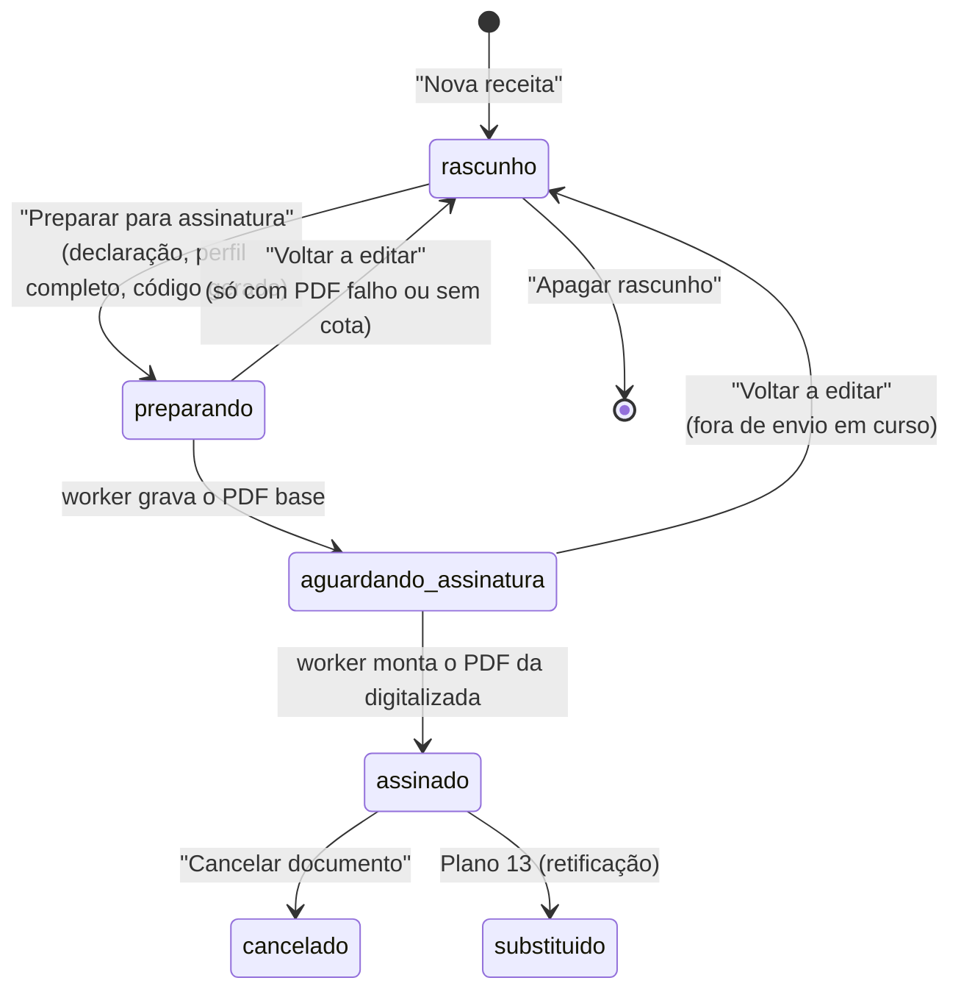

# 9. Documentos assinados e receita (Plano 10A)

> **Manual técnico do NutriDebby.** Este capítulo descreve o módulo `src/modules/documentos`: a base de "documento
> assinado" e a receita de suplementos e fitoterápicos com assinatura **digitalizada** (Plano 10A, PR #19, em produção
> desde 06/10/2026). A assinatura gov.br e ICP-Brasil (Plano 10B) e o parecer (Plano 13) ainda não existem no código.

| Item | Valor |
|---|---|
| Conferido contra | `main` em `3991c7d` (merge do PR #19), 06/10/2026 |
| Spec | `docs/superpowers/specs/2026-10-03-nutridebby-documentos-assinados-design.md` **v0.4** (abreviada "spec B"; "§10" = modelo de dados dela) |
| Plano | `docs/superpowers/plans/2026-10-05-nutridebby-10a-receita.md` ("Plano 10A, Dx") |
| Migrations | `0089`–`0093` |
| Segredos | Só nomes de variáveis. Nenhuma variável nova: as chaves do link derivam de `ENCRYPTION_KEY` por HKDF |

---

## 9.1 Visão geral

A nutricionista monta a receita no prontuário, prepara um PDF com a marca, o código de verificação e o QR, imprime,
assina à mão e envia fotos das páginas com o código do 2FA. O worker monta um PDF novo com as fotos; o banco trava o
documento; o paciente recebe pelo portal, por um link de uso único com código (sem conta) ou pessoalmente, e confirma o
recebimento; qualquer pessoa confere o código numa página pública sem dado de saúde; a nutricionista pode cancelar; as
exportações, o bloqueio e a anonimização cobrem as receitas.

**Interruptor do admin (Plano 10A, D20).** `tenants.documentos_liberados` (padrão `false`, `src/db/schema/platform.ts`).
Desligado: a aba "Documentos" não aparece (`Abas`, `src/app/painel/pacientes/[id]/abas.tsx`), as páginas e as Server
Actions do painel dão 404 (`acesso()` em `src/app/painel/pacientes/[id]/documentos/actions.ts`), as rotas
`/api/painel/documentos/*` e `/api/p/documentos/*` dão 404, o portal não conta nem mostra documento (`ativo()` em
`src/modules/documentos/portal.ts`), o link do e-mail fica indisponível e não envia código (`abrirLink` em
`link-documento.ts`) e a entrega da assinatura não sai (`entregarDocumento`). A verificação pública continua respondendo.
O admin liga em `/admin` (coluna "Documentos", `definirDocumentosAction` → `definirDocumentosLiberados`,
`src/modules/plataforma/contas.ts`), que só grava log (`logger.info`), sem auditoria durável (débito P10A-18). Não
desligar depois do uso real: o consultório perderia também "Cancelar documento" e "Entregue pessoalmente".

## 9.2 Arquivos do módulo

| Arquivo | Responsabilidade | Quem importa |
|---|---|---|
| `constantes.ts` | Textos, estados, `AREA_ASSINATURA` (quadro de 208 × 70 pt), `DECLARACAO_RECEITA` (D5, rascunho), `envioEmCurso`, `podeVoltarAEditar`, `MAX_PIXELS_FOTO`, `DIGITALIZACAO_MAX_MS`. **Sem imports** (componentes `'use client'` leem daqui) | Todos |
| `erros.ts` | `DocumentoNaoEncontradoError`, `DocumentoError` (erros por campo), `TransicaoInvalidaError` ("Este documento mudou de situação. Recarregue a página."), `RecusaAssinaturaError` e `MSG_RECUSA` | Todos |
| `perfil-profissional.ts` | US-140: `salvarDadosParaDocumentos`, `declararFitoterapia`, `retirarFitoterapia`, `copiaDoPerfil` (cópia congelada, RN-154), `PerfilIncompletoError`, `TERMO_FITOTERAPIA` (versionado) | Painel, `documentos.ts` |
| `codigo.ts` | Código Crockford de 60 bits (`gerarCodigo`, `normalizarCodigo`, `formatarCodigo`) | Preparo, verificação |
| `prescricao.ts` | Esquema Zod da receita (4 tipos de item), `validarRascunho`, `validarParaPreparar`, `descreverItem`; "prescrição" nos nomes para não colidir com as receitas culinárias (D16) | Editor, PDF, exportação |
| `documentos.ts` | Ciclo do rascunho ao preparo: `criarReceita`, `salvarRascunhoReceita`, `apagarRascunho`, `prepararParaAssinatura` (enfileira `documento-pdf`), `voltarAEditar`, `pedirNovoPdfDocumento`, `listarDocumentos` (sem `auditRead`), `lerDocumento` (com `auditRead`), `estadoDoDocumento`, `caminhoDoPdfNoPainel` (com `auditRead`), `contarAguardandoAssinatura`, `RESET_PREPARO` | Painel, rotas |
| `arquivos-do-preparo.ts` | `soltarArquivosDoPreparo` (apaga fotos e base um a um, cada ponteiro no `naMesmaTransacao` do próprio `apagarArquivo`) e `travarDocumentoAntesDaCota` (ordem de travas documento → tenant). Sem sessão | Painel, worker |
| `documento-pdf.tsx`* · `documento-pdf-job.ts`* | PDF preparado (`renderizarDocumento`) e o job `gerarPdfDoDocumento`; as varreduras `expirarPdfsDeDocumentoPendentes` e `limparArquivosOrfaosDeDocumentos` | Só o worker |
| `digitalizada.ts` | `receberDigitalizada` (envio das fotos + 2FA, D24), `MSG_DIGITALIZADA` | Rota da digitalizada |
| `digitalizada-job.tsx`* | `montarPdfDigitalizado` (normaliza as fotos, monta o PDF, assina) | Só o worker |
| `registrar-assinatura.ts` | `registrarAssinatura` (ida a "assinado" amarrada à versão lida, verificação e entrega na mesma transação), `exigirHabilitacaoAtual`, tipos `AcessoAssinatura`/`DepsAssinar`/`VersaoLida`. **Sem dependência de sessão** (D23) | Worker; o Plano 10B |
| `verificacao.ts` | **Único** arquivo que toca `document_verifications`: `registrarVerificacao`, `mudarSituacao`, `consultarVerificacao` (30/h por IP) | Assinatura, cancelamento, `/v` |
| `entrega.ts` | `entregarDocumento` (portal + push + e-mail, ou link de uso único), `reenviarLink`, `situacaoDaEntrega`, `MSG_ENTREGA` | `registrar-assinatura.ts`, painel |
| `recebimento.ts` | `registrarRecibo` (só INSERT, `ON CONFLICT DO NOTHING`), `marcarEntreguePessoalmente` | Portal, link, painel |
| `link-documento.ts` | Token do link (`assinarLinkDocumento`, `lerLinkDocumento`), código de 6 dígitos (`pedirCodigoDocumento`, `confirmarCodigoDocumento`), sessão curta, `pdfDoLink`, `confirmarRecebimentoPeloLink`, `limparCodigosDeDocumentoVencidos`. Contexto `paciente` + `semConta` | Rotas `/api/documento/*`, `/documento/[token]`, worker |
| `portal.ts` | `documentosDoPaciente` (lista sem `auditRead`), `novosNoPortal`, `caminhoDoPdfNoPortal` (com `auditRead` + recibo "aberto"), `confirmarRecebimentoNoPortal` | Portal |
| `cancelamento.ts` | `cancelarDocumento` (US-149), `MSG_CANCELAMENTO` | Painel |
| `lgpd-documentos.ts` | `documentosParaExportacao`, `anonimizarDocumentosDoPaciente`, `pdfsDeDocumentosRestantes` | `exportacao-job.ts`, `lgpd.ts` |

\* Fora do grafo do Next (só o worker): guarda em `src/modules/pacientes/exportacao.test.ts` ("o PDF e o ZIP ficam fora
do grafo do Next…", que lista `documento-pdf.tsx`, `documento-pdf-job.ts` e `digitalizada-job.tsx`). A guarda de
`registrar-assinatura.test.ts` ("D23…") confere que `registrar-assinatura.ts` não puxa `@/lib/auth`, `confirmar-2fa` nem
`tenant-session`, nem pelos imports dos imports.

Fora do módulo: `src/lib/confirmar-2fa.ts` (`confirmarCodigo2fa`, `liberarCodigo2fa`; §9.6), `src/lib/ler-cookie.ts`
(`lerCookie` sem `server-only`, reexportado por `paciente-session.ts`), `src/app/conta/seguranca/ajuda-seguranca.tsx`.

## 9.3 Banco

### 9.3.1 Tabelas

| Tabela | Conteúdo | Proteção | Migrations |
|---|---|---|---|
| `signed_documents` | `tipo` (só `receita`), `status` (6 estados), `versao`, `retifica_id`, `conteudo jsonb` (itens, orientações e, ao preparar, `copia.profissional`, `copia.paciente.nome` e a declaração), `codigo`, `declaracao_em`, base (`base_pdf_path`, `base_pdf_sha256`, `base_pdf_bytes`, `area_assinatura`), `pdf_status` (`pendente`/`pronto`/`falhou`/`sem_cota`), `pdf_pedido_em`, final (`pdf_path`, `pdf_sha256`), `assinatura_tipo` (só `digitalizada`), `assinatura_emissor`, `assinante_nome`, `assinado_em`, `assinado_por`, `entregue_em`, `cancelado_em`, `substituido_em`, `anonimizado_em`, `digitalizacao jsonb` (array de caminhos), `digitalizacao_status` (`recebendo`/`pendente`/`falhou`), `digitalizacao_em` | T, P, A `documentos`, X `paciente_so_emitidos`, gatilho `documento_imutavel` | 0089, 0090, 0091, 0092, 0093 |
| `signed_document_notes` | `justificativa_uso` (≤ 2000), `motivo_cancelamento` (≤ 500) | T, P, S, A `documentos`, gatilho `notas_imutaveis` | 0089, 0090, 0091 |
| `signed_document_receipts` | `evento` (`aberto`/`recebido`), `via` (`portal`/`link_email`/`pessoalmente`), `em`, `registrado_por` | T, P, A `documentos`, PE `insert`, X `paciente_recibo_proprio` e `recibo_fora_do_paciente`; `REVOKE UPDATE, DELETE` | 0089, 0090, 0092 |
| `document_access_codes` | `codigo_hash` (HMAC amarrado ao id do pedido), `expira_em` (10 min), `tentativas` (0–5), `usado_em`, `sessao_hash`, `sessao_expira_em` | T, P, PE `insert`/`update`, X `paciente_codigo_de_assinado`, gatilho `codigo_acesso_regras`; sem auditoria (`AUDIT_EXCEPTIONS`) | 0089, 0090, 0091, 0092 |
| `document_verifications` | PK `codigo`, `tenant_id`, `documento_id` (UNIQUE), `tipo`, `situacao` (`valido`/`substituido`/`cancelado`/`eliminado`), `situacao_em`, `assinado_em`, `emissor_nome`, `emissor_crn`, `assinante_nome` (nulo na digitalizada), `assinatura_tipo`, `pdf_sha256` — nada do paciente | **Fora da RLS** (`RLS_EXCEPTIONS`); `REVOKE UPDATE, DELETE` + `GRANT UPDATE (situacao, situacao_em)`; gatilho `verificacao_situacao`; FK (`tenant_id`, `documento_id`, `codigo`) → `signed_documents` | 0089, 0090, 0092 |

Legenda como em [§2.5](02-banco-de-dados.md#25-catálogo-de-tabelas). Colunas novas em `tenants` (0089):
`nome_profissional` (5–120), `contato_email`, `contato_telefone_e164`, `fitoterapia_registro` (1–60),
`fitoterapia_declarada_em`, `fitoterapia_termo_versao` (os três juntos ou nulos) e `documentos_liberados`.
`stored_files.tipo` ganhou `documento_base`, `documento_assinado` e `documento_digitalizado` (os três com dono, em
`TIPOS_DO_PACIENTE`, `src/modules/plataforma/armazenamento.ts:21`); `notifications.tipo` ganhou `documento_novo` e
`documento_atualizado`.

Chaves e restrições que importam:

- **FKs `NO ACTION` para `stored_files.caminho`** (`base_pdf_path`, `pdf_path`): as primeiras do projeto (todas as outras
  são `SET NULL`). Um `apagarArquivo` avulso do PDF de um documento é recusado pela FK. Por isso `stored_files` e
  `signed_documents` estão em `ULTIMAS` do teste de isolamento.
- **CHECK `signed_documents_arquivos_do_tenant`** (0093, `starts_with`): o base em `<tenant>/documento_base/`, o PDF final
  só em `<tenant>/documento_assinado/` (a 0089 usava `LIKE '<tenant>/documento_%'`, que aceitava o base e as fotos).
- **CHECK `signed_documents_emitido_com_pdf`**: fora da anonimização, PDF, SHA-256, data e tipo da assinatura existem
  ⇔ o status é emitido. `codigo` nulo ⇔ `rascunho`; formato Crockford por regex; `codigo` UNIQUE.
- Índice único parcial `signed_documents_retificacao_aberta` (`retifica_id` com status não emitido) já existe para o
  Plano 13 (RN-146).

### 9.3.2 Políticas próprias

| Política | Tabela | Regra | Migration |
|---|---|---|---|
| `paciente_so_emitidos` | `signed_documents` | RESTRICTIVE ALL: o paciente vê só `assinado`/`substituido`/`cancelado` e nunca grava | 0090 |
| `paciente_recibo_proprio` | `signed_document_receipts` | RESTRICTIVE INSERT: o paciente só grava recibo de documento `assinado` dele (a subconsulta passa pela RLS dele), `via` ≠ `pessoalmente`, `registrado_por` nulo | 0090 |
| `recibo_fora_do_paciente` | `signed_document_receipts` | RESTRICTIVE INSERT: fora da sessão de paciente, só `pessoalmente` com `registrado_por = app_current_user()` | 0092 |
| `paciente_codigo_de_assinado` | `document_access_codes` | RESTRICTIVE INSERT: a sessão de paciente só cria código de documento `assinado` | 0092 |
| `paciente_arquivos` (refeita) | `stored_files` | O paciente vê os próprios arquivos **menos** `documento_base` e `documento_digitalizado` | 0090 |

### 9.3.3 Gatilhos e funções

| Objeto | Migration | O que garante |
|---|---|---|
| `app_documento_imutavel()` (`documento_imutavel`, `BEFORE UPDATE OR DELETE`) | 0091, refeita na 0093 | RN-140/141 no banco. Colunas fixas (`id`, `tenant_id`, `patient_id`, `tipo`, `versao`, `retifica_id`, `created_at`); `DELETE` só de rascunho; UPDATE que não muda nada passa. **Rascunho:** só `rascunho → preparando`; nada de PDF, assinatura, cancelamento, substituição nem digitalizada; o preparo exige `declaracao_em` e `pdf_status = 'pendente'` (0093). **Preparando/aguardando:** "Voltar a editar" zera tudo do preparo; `preparando → aguardando_assinatura` só pelo `worker`, gravando o base uma vez; no mesmo estado, só `pdf_status`/`pdf_pedido_em` (e a digitalizada só em `aguardando_assinatura`); a ida a `assinado` só com as colunas da assinatura e um `stored_files` `documento_assinado` do mesmo tenant e paciente (0093). **Emitido:** os ponteiros do preparo (base, fotos) só **saem** (fotos: o array só encolhe, `jsonb_typeof = 'array'`); `entregue_em` uma vez; `assinado → cancelado` com `cancelado_em`; `assinado → substituido` com `substituido_em`. **Anonimização:** só `worker`, só emitido, só limpar (`conteudo = '{}'`, ponteiros nulos). Erro `42501` |
| `app_notas_imutaveis()` (`notas_imutaveis`) | 0091 | A justificativa fica fixa de `preparando` em diante; o motivo entra uma vez, com o documento já `cancelado`; DELETE só na cascata do rascunho; anonimizado só limpa |
| `app_codigo_acesso_regras()` (`codigo_acesso_regras`) | 0091 | Em `document_access_codes`, vale para todo papel: colunas fixas; `tentativas` só sobe de 1 em 1; `usado_em` + sessão nascem juntos, uma vez |
| `app_verificacao_situacao()` (`verificacao_situacao`) | 0092 | A situação pública só avança (`valido` → `substituido`/`cancelado`/`eliminado`; `substituido`/`cancelado` → `eliminado`; `eliminado` final; data só muda com a situação) |
| `app_anonimizar_documentos(uuid)` | 0091 | **`SECURITY INVOKER`** (desvio consciente da spec v0.3, que dizia DEFINER: o gatilho já exige o `worker`). Só no contexto `worker` de um tenant, documento emitido de paciente `bloqueado` ainda não anonimizado (`FOR UPDATE`); marca `anonimizado_em`, limpa conteúdo, ponteiros e notas, passa a verificação a `eliminado`, apaga os códigos do link e devolve o caminho do PDF. `REVOKE ALL FROM PUBLIC`, `GRANT EXECUTE` ao `nutri_app_role` |

### 9.3.4 Listas das guardas

| Lista | Entrada nova | Arquivo |
|---|---|---|
| `RLS_EXCEPTIONS` | `document_verifications` | `src/db/rls-guard.ts:15` |
| `STAFF_ONLY` | `signed_document_notes` | `src/db/rls-guard.ts:113` |
| `PACIENTE_ESCREVE` | `signed_document_receipts` (`insert`), `document_access_codes` (`insert`, `update`) | `src/db/rls-guard.ts:196-197` |
| `AUDIT_EXCEPTIONS` | `document_access_codes` | `src/db/audit-guard.ts:15` |
| `SEM_CONTA_PERMITIDOS` | `src/modules/documentos/link-documento.ts` (quatro arquivos) | `src/db/tenant.ts:34` |
| `ENTIDADE_ROTULO` | `documentos` ("Documentos assinados"), `perfil_profissional` ("Perfil profissional"), `tentativa_assinatura` ("Tentativa de assinatura com código recusado") | `src/modules/plataforma/audit.ts:64-66` |
| `FABRICAS`, `SO_INSERE`, `IMUTAVEIS`, `SO_APAGA`, `ULTIMAS` | As 4 tabelas com RLS; recibo só insere; documento, notas e códigos imutáveis; só rascunho é apagado; `signed_documents` e `stored_files` por último (D19) | `test/isolamento.test.ts` |
| Script de restauração | `document_verifications` fora da conta das tabelas sem RLS (teste compara a lista do script com `RLS_EXCEPTIONS`) | `scripts/backup/nutri-restauracao-teste.sh`; `src/db/rls-guard.test.ts` |

Outras guardas: só `verificacao.ts` cita `document_verifications` (`src/modules/documentos/verificacao.test.ts`); as
listas do painel e do portal não devolvem itens, orientações nem justificativa (testes das chaves em
`documentos.test.ts` e `portal.test.ts`).

## 9.4 Ciclo do documento

### 9.4.1 Rascunho e preparo

- `criarReceita` exige paciente não bloqueado (`carregarPacienteParaEscrita`); arquivado pode (D14).
- `salvarRascunhoReceita` valida o conteúdo com `validarRascunho` e grava a justificativa em `signed_document_notes`.
  O fitoterápico formulado exige `tenants.fitoterapia_registro` (conferido ao salvar, ao preparar e ao assinar,
  `exigirHabilitacaoAtual`).
- `prepararParaAssinatura` (declaração `on` → `copiaDoPerfil` → trava o rascunho → `validarParaPreparar` → `status =
  'preparando'`, `codigo = gerarCodigo()`, `conteudo.copia`, `pdf_status = 'pendente'` → `boss.send('documento-pdf')` na
  mesma transação). A tela manda "Salvar rascunho" e "Preparar para assinatura" no **mesmo formulário**
  (`receita-form.tsx`): o preparo grava o que está na tela e prepara.
- Job `documento-pdf` (`gerarPdfDoDocumento`): lê o documento `preparando`/`pendente` com o código; tenant suspenso ou
  paciente bloqueado → `falhou`; renderiza (`renderizarDocumento`: marca, carimbo, quadro "Assinatura digital" e rodapé
  com QR e código em cada página); `salvarArquivo({ tipo: 'documento_base' })` com `antesDaReserva` (trava paciente e
  documento antes da cota) e `registrar` amarrado à versão lida (id + `preparando` + `pendente` + **código**); cota
  esgotada → `sem_cota`; última tentativa → `falhou`.
- "Voltar a editar" (`voltarAEditar`): recusado com envio digitalizado em curso; solta as fotos, depois apaga o base com a
  volta ao rascunho (`RESET_PREPARO`) no `naMesmaTransacao`. Na tela, `podeVoltarAEditar` (em "Preparando o PDF" só com
  `falhou`/`sem_cota`).

### 9.4.2 Assinatura digitalizada (RN-157, D4, D24)

1. Rota `POST /api/painel/documentos/[id]/digitalizada` (`mesmaOrigem`, `requireApiNutri`, D20, `idValido`, corpo ≤
   10 MB + 64 KB em até 60 s; no máximo 2 envios processando e 1 por usuária, a vaga ocupada **depois** de ler o corpo).
2. `receberDigitalizada`: 2FA ativo; 1 a 5 fotos, ≤ 10 MB, JPEG/PNG pelo conteúdo, ≤ 40 MP pelo cabeçalho (`sharp`
   `metadata`, sem decodificar); versão lida e paciente; habilitação; `confirmarCodigo2fa` (recusa → `recordAudit` da
   entidade `tentativa_assinatura`); **trava** `recebendo` + `digitalizacao_em` (outro envio → 409); fotos antigas
   apagadas e as novas gravadas (`documento_digitalizado`, `travarDocumentoAntesDaCota`), cada uma amarrada à versão;
   `pendente` + `boss.send('documento-digitalizado')`. Erro depois da trava → `falhou` e `liberarCodigo2fa`.
3. Job `documento-digitalizado` (`montarPdfDigitalizado`): tenant ativo; normaliza cada foto (orientação aplicada, JPEG
   sem metadados, até 3.508 px); renderiza (foto + rodapé "Documento digitalizado · Código de verificação: …" e QR);
   `salvarArquivo({ tipo: 'documento_assinado' })` com `registrar` = `registrarAssinatura` amarrado a código +
   `pendente` + **as mesmas fotos** (`fotosLidas`); depois `soltarArquivosDoPreparo(…, EMITIDOS)`. Foto ilegível ou
   cota → `falhou` sem nova tentativa.
4. `registrarAssinatura`: `UPDATE … status = 'assinado'` só na versão lida (senão `TransicaoInvalidaError` e o
   `salvarArquivo` desfaz tudo) **mantendo** os ponteiros do base e das fotos (regra 9; desvio consciente da RN-140 b
   corrigido na spec v0.4); `registrarVerificacao` (`valido`); `entregarDocumento`; `entregue_em` só se houve entrega.

### 9.4.3 Entrega, recebimento e cancelamento

- `entregarDocumento` (na transação da assinatura): paciente ativo com conta → notificação push `documento_novo`, e-mail
  `documento_novo` (link `telaDoPortal('/p/documentos', tenantId)`) e `dispararEnvio`; ativo sem conta → e-mail
  `documento_link` com o token; arquivado, D20 desligado ou tenant sem liberação → nada.
- `reenviarLink`: só `assinado` de paciente ativo sem conta; token novo; grava `entregue_em` se ainda nulo.
- Recibos: portal (`caminhoDoPdfNoPortal` grava `aberto`; `confirmarRecebimentoNoPortal` grava `recebido`), link
  (`pdfDoLink`, `confirmarRecebimentoPeloLink`, `via = 'link_email'`, auditoria sem ator) e painel
  (`marcarEntreguePessoalmente`, `via = 'pessoalmente'`, com `registrado_por`).
- `cancelarDocumento`: motivo 1–500 em `signed_document_notes`, `status = 'cancelado'`, verificação `cancelado`,
  e-mail `documento_atualizado` (com conta: link do portal + push `documento_atualizado`; sem conta: link de uso único
  novo, que abre "indisponível"); arquivado, nada sai.

### 9.4.4 LGPD (US-150 base, Plano 10A D1)

- Exportação (`documentosParaExportacao`, chamada por `src/modules/pacientes/exportacao-job.ts`): chave `documentos` no
  `dados.json` e os PDFs assinados em `documentos/<aaaa-mm-dd>-NN.pdf` (no mesmo teto de memória dos laudos). Equipe:
  todos, com a justificativa; titular: só os emitidos, com a justificativa (D15 = (b)) e o recebimento. Nunca o PDF
  preparado nem o motivo de cancelamento.
- Bloqueio: as escritas recusam (`carregarPacienteParaEscrita`); o portal e o link deixam de mostrar; a verificação
  continua. O base e as fotos de um documento não emitido ficam até a anonimização (débito P10A-18).
- Anonimização (`anonimizarDocumentosDoPaciente`, chamada por `src/modules/pacientes/lgpd.ts` **antes** do laço de
  anexos de `anonimizarVencidos`): emitido → `soltarArquivosDoPreparo` e `apagarArquivo` do PDF com
  `app_anonimizar_documentos` no `naMesmaTransacao` (`removerAntesDoCommit`); não emitido → volta a rascunho e é apagado
  no apagar do base. Conferência final: `pdfsDeDocumentosRestantes` (nenhum `pdf_path` ou `base_pdf_path` pode sobrar).

## 9.5 Link de uso único e verificação pública

**Link (RN-158).** Token sem estado: tenant + paciente + documento + emissão, com MAC (HKDF de `ENCRYPTION_KEY`, info
`nutridebby:link-documento:v1`, `chaveDoLinkDocumento`) sobre o **e-mail atual** do paciente; vale 30 dias e enquanto o
documento estiver `assinado`, o paciente ativo e não anonimizado, o tenant ativo e liberado. O `GET` da página não
consome nada. Pedido do código: Turnstile → 20/h por IP (`documento-ip`) → trava consultiva por documento → 1 por
minuto e 5/h por documento (`documento-envio`) → código de 6 dígitos (HMAC com o id do pedido) → e-mail
`codigo_documento`. Confirmação: 30/h por IP (`documento-codigo-ip`); o pedido mais recente; 5 erros invalidam (o
incremento é gravado mesmo na recusa: o erro é devolvido pelo callback e lançado fora do `withTenant`); acerto → sessão
de 15 min (cookie `nd_doc`, só o hash no banco, gravado em `Path=/documento/<token>` e `Path=/api/documento/<token>`,
`HttpOnly`, `SameSite=Strict`, `Secure` em https; `cookiesDaSessao`, `src/app/api/documento/[token]/link.ts`). Trocar a
`ENCRYPTION_KEY` invalida todos os links (o remédio é "Reenviar link por e-mail") e zera os contadores.

**Verificação (RN-156).** `/v` (formulário GET, sem JavaScript) e `/v/[codigo]` (`consultarVerificacao`): 30/h por IP
(`verificacao-ip`, balde /64 no IPv6); mesma resposta para inexistente e malformado; sem contexto de tenant (tenant
suspenso continua respondendo). Mostra situação, tipo, emissor e CRN, data no horário de Brasília, tipo de assinatura,
código e o SHA-256 em grupos de 4.

**Cabeçalhos e Sentry.** `next.config.ts:19-22`: `Referrer-Policy: no-referrer` e `Cache-Control: no-store` em
`/documento/:token*` e `/api/documento/:token*`; `no-referrer` em `/v/:path*`. As páginas têm `robots: noindex` e
`referrer: 'no-referrer'` no `metadata`. `caminhoSeguro` (`src/lib/sentry-filtro.ts:53-54`) troca o token por `:token` e
o código por `:codigo` (12 caracteres não pegam na regra dos 20).

## 9.6 Código do 2FA no momento de assinar (RN-145, D13)

`confirmarCodigo2fa` (`src/lib/confirmar-2fa.ts`) confere o código pela API do Better Auth (`auth.api.verifyTOTP` com a
sessão da própria usuária, fora de transação), com 5 tentativas em 15 min por usuária (`totp-erro`, zerado no acerto) e
a recusa do mesmo código já aceito em 90 s (`totp-usado`). `liberarCodigo2fa` devolve a marca anti-repetição quando a
ação falha depois do código aceito. Em `src/lib/auth.ts`, o `verify-totp` chamado pela web com sessão aberta e 2FA já
ativo é recusado (`TWO_FACTOR_JA_ATIVO`), para não ser um oráculo do código fora do limite por usuária; o login e a
ativação continuam. A tela `/conta/seguranca` mostra o guia `seguranca` num bloco "Como funciona" (`AjudaSeguranca`).

## 9.7 Rotas

| Rota | Tipo | Guarda | Uso |
|---|---|---|---|
| `/painel/pacientes/[id]/documentos` | Página | `requireNutri` (pelo prontuário) + D20 | Lista e "Nova receita" |
| `/painel/pacientes/[id]/documentos/[docId]` | Página | idem + `idValido` | Editor, preparo, digitalizada, entrega, cancelar |
| `GET /api/painel/documentos/[id]/pdf` | Route Handler | `requireApiNutri` + D20 | `?estado=1` → JSON sem auditoria; `?base=1` → 303 para o PDF preparado (só em aguardando); sem parâmetro → 303 para o PDF assinado; as duas leituras com `auditRead` |
| `POST /api/painel/documentos/[id]/digitalizada` | Route Handler | `mesmaOrigem` + `requireApiNutri` + D20 + corpo limitado | Fotos + código do 2FA (422 com `codigo`, 404, 408, 409, 413, 429, 507) |
| `/p/documentos` | Página | `requirePaciente` + D20 | Lista, "Abrir PDF", "Confirmo que recebi este documento" (Server Action `confirmarRecebimentoAction`) |
| `GET /api/p/documentos/[id]/pdf` | Route Handler | `requireApiPaciente` + D20 | 303 para a URL assinada; `auditRead` + recibo "aberto" |
| `/documento/[token]` | Página sem login | Token + sessão `nd_doc` | Pedir/confirmar o código; abrir; confirmar o recebimento |
| `POST /api/documento/[token]/codigo`, `/confirmar`, `/recebido` · `GET …/pdf` | Route Handlers sem login | `mesmaOrigem` nos POST; corpo JSON limitado (`lerJson` da página pública) | RN-158 |
| `/v`, `/v/[codigo]` | Páginas públicas | Limite por IP | Verificação |

Toda página nova do painel está em `ROTAS_DO_PAINEL` (`e2e/painel-rotas.ts`) e tem guia (`documentos`). Os PDFs saem
sempre por `signFileUrl` (5 min) com a URL nascendo no clique (303).

## 9.8 Filas e varreduras

| Fila | Gatilho | O que faz | retry / atraso / expira / apaga | Payload |
|---|---|---|---|---|
| `documento-pdf` | `prepararParaAssinatura`, `pedirNovoPdfDocumento` | PDF preparado (`gerarPdfDoDocumento`) | 2 / 30↗ / 120 / 86 400 | `{ tenantId, documentoId }` |
| `documento-digitalizado` | `receberDigitalizada` | PDF das fotos e assinatura (`montarPdfDigitalizado`) | 2 / 30↗ / 180 / 86 400 | `{ tenantId, documentoId, userId }` |
| `expirar-documento-pdf` | cron `*/15 * * * *` (`src/worker/index.ts:210`) | PDF `pendente` há mais de 1 h → `falhou`; digitalização `recebendo`/`pendente` há mais de 1 h → `falhou`; base e fotos sem referência há mais de 1 h → apagados; ponteiros que sobraram num emitido → `soltarArquivosDoPreparo` | 1 / 60 / 300 / — | `{}` |
| `agenda-limpeza` (existente) | cron `30 4 * * *` | Também apaga os códigos do link vencidos há mais de 1 dia (`limparCodigosDeDocumentoVencidos`); o log "limpeza da agenda pública" ganhou o campo `codigos` (`src/worker/index.ts:111-112`) | — | `{}` |

## 9.9 Manual guiado

`src/modules/ajuda/conteudo.ts`: guia `documentos` v1 (6 passos: `nova-receita`, `editor-receita`, `preparar-documento`,
`assinar-documento`, `entrega-documento`, `cancelar-documento`), `configuracoes` v2 (seção "Dados para documentos",
passo `dados-documentos`) e `seguranca` v1 (`/conta/seguranca`, passo `ativar-2fa`). O teste do manual passou a cobrir
`src/app/conta`. O guia `prontuario` não cita a aba Documentos e fica na v1 enquanto ela depender do interruptor
(P10A-17).

## 9.10 Operação

- **Liberação para uso real:** checklist em `docs/operacao/go-live.md`, seção "Plano 10A — receita" (CRN-3, textos
  revistos pela Debby, termo e DPA, backup no host, cota do Resend, ligar "Documentos" e não desligar, teste manual).
  Pré-requisito implícito: a nutricionista com o 2FA ativo (sem ele, a digitalizada recusa).
- **`APP_URL` permanente:** o QR e o rodapé de toda receita levam `APP_URL/v/<código>`; trocar o domínio exige manter
  `/v/*` respondendo no domínio antigo.
- **E-mails a mais:** link e código somam até 2 e-mails por documento de paciente sem app (mais os reenvios), na cota do
  Resend.
- **Sinais no log:** "digitalização recebida", "digitalização recusada" (com o motivo técnico fixo), "código do 2FA
  recusado ao assinar", "PDF do documento não gerado", "PDF da digitalização não montado", "falha ao expirar PDFs de
  documento pendentes", "falha ao limpar arquivos órfãos de documentos", "documentos assinados liberados/bloqueados pelo
  admin". Nenhum leva conteúdo, nome, código, token ou caminho (regra 3).

## Divergências encontradas

| # | Spec / documento | Código | Onde |
|---|---|---|---|
| 1 | Spec B §10 (`tenants`): a declaração e a retirada da Fitoterapia gravam `recordAudit(acao: 'alterar', entidadeId: tenantId)` | A declaração grava `criar` com `entidade_id = 'fitoterapia:<versão do termo>'`; a retirada, `excluir` com `'fitoterapia'`; salvar os dados, `alterar` com o tenant (registrado na spec v0.4, US-140) | `src/modules/documentos/perfil-profissional.ts` |
| 2 | Spec B US-147: "Impressão digital do arquivo (SHA-256): {64 caracteres}" | Em grupos de 4 (`textoSha256`), como a RN-143 | `src/modules/documentos/verificacao.ts` |
| 3 | Portal e painel formatam as datas no fuso do consultório (`tenant.fuso`) | `/documento/[token]` formata no fuso fixo `America/Sao_Paulo` (débito P10A-19) | `src/app/documento/[token]/page.tsx` |
| 4 | Spec B §4 / D20 do plano: liberação pelo admin com registro | Só `logger.info`, sem `audit_log` da plataforma (débito P10A-18) | `src/modules/plataforma/contas.ts` (`definirDocumentosLiberados`) |
