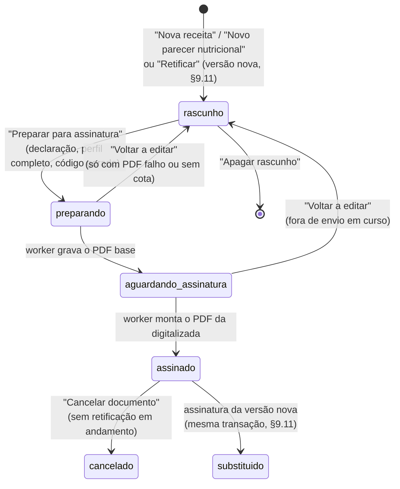

# 9. Documentos assinados: receita e parecer (Planos 10A e 13)

> **Manual técnico do NutriDebby.** Este capítulo descreve o módulo `src/modules/documentos`: a base de "documento
> assinado", a receita de suplementos e fitoterápicos com assinatura **digitalizada** (Plano 10A, PR #19, em produção
> desde 06/10/2026) e, desde o Plano 13, o **parecer nutricional** sobre os exames e a **retificação** por versão nova
> (§9.11). A assinatura gov.br e ICP-Brasil (Plano 10B) ainda não existe no código.

| Item | Valor |
|---|---|
| Conferido contra | `main` em `3991c7d` (merge do PR #19), 06/10/2026; a §9.11 e as atualizações do Plano 13 contra o branch `plano-13-parecer` em `2d4b84c` (Tarefas 1–11 integradas, antes do merge), 08/10/2026 |
| Spec | `docs/superpowers/specs/2026-10-03-nutridebby-documentos-assinados-design.md` **v0.6** (abreviada "spec B"; "§10" = modelo de dados dela; a parte do Plano 13 na seção "Plano 13 — preparação (v0.5)") |
| Plano | `docs/superpowers/plans/2026-10-05-nutridebby-10a-receita.md` ("Plano 10A, Dx") e `docs/superpowers/plans/2026-10-08-nutridebby-13-parecer.md` ("Plano 13", decisões D-P1 a D-P8, Q13-1 a Q13-6, desvios 1–11) |
| Migrations | `0089`–`0093` (Plano 10A) e `0104_parecer` (gerada) / `0105_parecer_regras` (custom) (Plano 13) |
| Segredos | Só nomes de variáveis. Nenhuma variável nova: as chaves do link derivam de `ENCRYPTION_KEY` por HKDF; o Plano 13 não criou variável nem interruptor |

---

## 9.1 Visão geral

A nutricionista monta a receita no prontuário, prepara um PDF com a marca, o código de verificação e o QR, imprime,
assina à mão e envia fotos das páginas com o código do 2FA. O worker monta um PDF novo com as fotos; o banco trava o
documento; o paciente recebe pelo portal, por um link de uso único com código (sem conta) ou pessoalmente, e confirma o
recebimento; qualquer pessoa confere o código numa página pública sem dado de saúde; a nutricionista pode cancelar; as
exportações, o bloqueio e a anonimização cobrem as receitas. O **parecer nutricional** (Plano 13) segue o mesmo ciclo,
com outro conteúdo (os exames escolhidos, copiados do prontuário, e a avaliação); um documento assinado é corrigido só
por **retificação**: uma versão nova que, ao ser assinada, leva a anterior a "substituido" (§9.11).

**Interruptor do admin (Plano 10A, D20).** `tenants.documentos_liberados` (padrão `false`, `src/db/schema/platform.ts`).
Desligado: a aba "Documentos" não aparece (`Abas`, `src/app/painel/pacientes/[id]/abas.tsx`), as páginas e as Server
Actions do painel dão 404 (`acesso()` em `src/app/painel/pacientes/[id]/documentos/actions.ts`), as rotas
`/api/painel/documentos/*` e `/api/p/documentos/*` dão 404, o portal não conta nem mostra documento (`ativo()` em
`src/modules/documentos/portal.ts`), o link do e-mail fica indisponível e não envia código (`abrirLink` em
`link-documento.ts`) e a entrega da assinatura não sai (`entregarDocumento`). A verificação pública continua respondendo.
O admin liga em `/admin` (coluna "Documentos", `definirDocumentosAction` → `definirDocumentosLiberados`,
`src/modules/plataforma/contas.ts`), que só grava log (`logger.info`), sem auditoria durável (débito P10A-18). Não
desligar depois do uso real: o consultório perderia também "Cancelar documento" e "Entregue pessoalmente". O parecer
e a retificação seguem o **mesmo** interruptor, sem interruptor próprio (Plano 13, Q13-6): num consultório já liberado,
eles aparecem no deploy (runbook do Plano 13 em `docs/operacao/go-live.md`, passo 2).

## 9.2 Arquivos do módulo

| Arquivo | Responsabilidade | Quem importa |
|---|---|---|
| `constantes.ts` | Textos, estados, `AREA_ASSINATURA` (quadro de 208 × 70 pt), `DECLARACAO_RECEITA` (D5, rascunho), `envioEmCurso`, `podeVoltarAEditar`, `MAX_PIXELS_FOTO`, `DIGITALIZACAO_MAX_MS`. Plano 13: `TIPO_DOCUMENTO_ROTULO` ("Receita", "Parecer nutricional"), `TipoDocumento`, `TIPO_DOCUMENTO_COM_ARTIGO`, `DECLARACAO_PARECER` e `RESSALVA_PARECER` (D5, rascunho), `DECLARACAO_POR_TIPO`, `rotuloDaVersao`, `linhaDaVersao`, `MSG_RETIFICACAO`. **Sem imports** (componentes `'use client'` leem daqui) | Todos |
| `erros.ts` | `DocumentoNaoEncontradoError`, `DocumentoError` (erros por campo), `TransicaoInvalidaError` ("Este documento mudou de situação. Recarregue a página."), `RecusaAssinaturaError` e `MSG_RECUSA` | Todos |
| `perfil-profissional.ts` | US-140: `salvarDadosParaDocumentos`, `declararFitoterapia`, `retirarFitoterapia`, `copiaDoPerfil` (cópia congelada, RN-154), `PerfilIncompletoError`, `TERMO_FITOTERAPIA` (versionado) | Painel, `documentos.ts` |
| `codigo.ts` | Código Crockford de 60 bits (`gerarCodigo`, `normalizarCodigo`, `formatarCodigo`) | Preparo, verificação |
| `prescricao.ts` | Esquema Zod da receita (4 tipos de item), `validarRascunho`, `validarParaPreparar`, `descreverItem`; "prescrição" nos nomes para não colidir com as receitas culinárias (D16) | Editor, PDF, exportação |
| `parecer.ts` (Plano 13) | Tipos do parecer (`ConteudoParecer`, `ExameCopiado`, `ValorCopiado`, `ConteudoDocumento` = receita ou parecer), limites (`PARECER_MAX_EXAMES` = 20, `AVALIACAO_MAX`/`CONDUTA_MAX` = 5000, `ENCAMINHAMENTOS_MAX` = 1000), `MSG_PARECER`, `CABECALHO_VALORES`, `validarRascunhoParecer`, `validarParecerParaPreparar`, `mesmoExame`, `rotuloDoExame`, `linhaDoValor`. Sem imports do servidor (só `zod` e tipos) | Editor, PDF, exportação |
| `parecer-exames.ts` (Plano 13) | `copiarExames` (a cópia dos exames do próprio paciente, na transação de quem chama) e `situacaoDosExames` (`igual`/`mudou`/`excluido`, sem `auditRead`, D-P2) | `documentos.ts`, página do documento |
| `documentos.ts` | Ciclo do rascunho ao preparo: `criarReceita`, `criarParecer` (Plano 13), `salvarRascunhoReceita`, `salvarRascunhoParecer` (Plano 13), `apagarRascunho`, `prepararParaAssinatura` (por tipo; enfileira `documento-pdf`), `voltarAEditar`, `pedirNovoPdfDocumento`, `listarDocumentos` (sem `auditRead`), `lerDocumento` (com `auditRead`; com `versoes`, `motivoRetificacao`, `substituidoEm` desde o Plano 13), `estadoDoDocumento`, `caminhoDoPdfNoPainel` (com `auditRead`), `contarAguardandoAssinatura`, `RESET_PREPARO` | Painel, rotas |
| `retificacao.ts` (Plano 13) | `retificarDocumento` (US-148), `retificacaoEmAndamento`, `lerMotivoRetificacao` (Q13-1) | Painel, `cancelamento.ts` |
| `arquivos-do-preparo.ts` | `soltarArquivosDoPreparo` (apaga fotos e base um a um, cada ponteiro no `naMesmaTransacao` do próprio `apagarArquivo`) e `travarDocumentoAntesDaCota` (ordem de travas paciente → documento → tenant; na assinatura de uma retificação, paciente → original → versão nova → tenant, D-P1 e P13-16 a). Sem sessão | Painel, worker |
| `documento-pdf.tsx`* · `documento-pdf-job.ts`* | PDF preparado (`renderizarDocumento`: corpo da receita ou do parecer pelo `conteudo.tipo`, título `TIPO_DOCUMENTO_ROTULO`, linha da versão numa retificação) e o job `gerarPdfDoDocumento`; as varreduras `expirarPdfsDeDocumentoPendentes` e `limparArquivosOrfaosDeDocumentos` | Só o worker |
| `digitalizada.ts` | `receberDigitalizada` (envio das fotos + 2FA, D24), `MSG_DIGITALIZADA` | Rota da digitalizada |
| `digitalizada-job.tsx`* | `montarPdfDigitalizado` (normaliza as fotos, monta o PDF, assina; título do PDF "{tipo} (digitalizada)" pela coluna `tipo`, R2 do Plano 13) | Só o worker |
| `registrar-assinatura.ts` | `registrarAssinatura` (ida a "assinado" amarrada à versão lida, verificação com o tipo real e entrega na mesma transação; numa retificação, a anterior a "substituido" também), `exigirHabilitacaoAtual` (só na receita), tipos `AcessoAssinatura`/`DepsAssinar`/`VersaoLida`. **Sem dependência de sessão** (D23); não importa `retificacao.ts` | Worker; o Plano 10B |
| `verificacao.ts` | **Único** arquivo que toca `document_verifications`: `registrarVerificacao`, `mudarSituacao`, `consultarVerificacao` (30/h por IP) | Assinatura, cancelamento, `/v` |
| `entrega.ts` | `entregarDocumento` (portal + push + e-mail, ou link de uso único), `reenviarLink`, `situacaoDaEntrega`, `MSG_ENTREGA` | `registrar-assinatura.ts`, painel |
| `recebimento.ts` | `registrarRecibo` (só INSERT, `ON CONFLICT DO NOTHING`), `marcarEntreguePessoalmente` | Portal, link, painel |
| `link-documento.ts` | Token do link (`assinarLinkDocumento`, `lerLinkDocumento`), código de 6 dígitos (`pedirCodigoDocumento`, `confirmarCodigoDocumento`), sessão curta, `pdfDoLink`, `confirmarRecebimentoPeloLink`, `limparCodigosDeDocumentoVencidos`. Contexto `paciente` + `semConta` | Rotas `/api/documento/*`, `/documento/[token]`, worker |
| `portal.ts` | `documentosDoPaciente` (lista sem `auditRead`), `novosNoPortal`, `caminhoDoPdfNoPortal` (com `auditRead` + recibo "aberto"), `confirmarRecebimentoNoPortal` | Portal |
| `cancelamento.ts` | `cancelarDocumento` (US-149; recusa com retificação em andamento, RN-147), `MSG_CANCELAMENTO` | Painel |
| `lgpd-documentos.ts` | `documentosParaExportacao` (receita ou parecer, `versao`, `retificaCodigo`), `anonimizarDocumentosDoPaciente`, `pdfsDeDocumentosRestantes` | `exportacao-job.ts`, `lgpd.ts` |

\* Fora do grafo do Next (só o worker): guarda em `src/modules/pacientes/exportacao.test.ts` ("o PDF e o ZIP ficam fora
do grafo do Next…", que lista `documento-pdf.tsx`, `documento-pdf-job.ts` e `digitalizada-job.tsx`). A guarda de
`registrar-assinatura.test.ts` ("D23…") confere que `registrar-assinatura.ts` não puxa `@/lib/auth`, `confirmar-2fa` nem
`tenant-session`, nem pelos imports dos imports.

Fora do módulo: `src/lib/confirmar-2fa.ts` (`confirmarCodigo2fa`, `liberarCodigo2fa`; §9.6), `src/lib/ler-cookie.ts`
(`lerCookie` sem `server-only`, reexportado por `paciente-session.ts`), `src/app/conta/seguranca/ajuda-seguranca.tsx`.

## 9.3 Banco

### 9.3.1 Tabelas

| Tabela | Conteúdo | Proteção | Migrations |
|---|---|---|---|
| `signed_documents` | `tipo` (`receita` ou `parecer`, CHECK `signed_documents_tipo_valido`, 0104), `status` (6 estados), `versao`, `retifica_id`, `conteudo jsonb` (receita: itens e orientações; parecer: `exames`, `avaliacao`, `conduta`, `encaminhamentos`; ao preparar, `copia.profissional`, `copia.paciente.nome`, numa retificação `copia.retificacao` e a declaração), `codigo`, `declaracao_em`, base (`base_pdf_path`, `base_pdf_sha256`, `base_pdf_bytes`, `area_assinatura`), `pdf_status` (`pendente`/`pronto`/`falhou`/`sem_cota`), `pdf_pedido_em`, final (`pdf_path`, `pdf_sha256`), `assinatura_tipo` (só `digitalizada`), `assinatura_emissor`, `assinante_nome`, `assinado_em`, `assinado_por`, `entregue_em`, `cancelado_em`, `substituido_em`, `anonimizado_em`, `digitalizacao jsonb` (array de caminhos), `digitalizacao_status` (`recebendo`/`pendente`/`falhou`), `digitalizacao_em` | T, P, A `documentos`, X `paciente_so_emitidos`, gatilhos `documento_imutavel` e `documento_versao` (0105) | 0089, 0090, 0091, 0092, 0093, 0104, 0105 |
| `signed_document_notes` | `justificativa_uso` (≤ 2000), `motivo_cancelamento` (≤ 500), `motivo_retificacao` (≤ 500, só numa retificação; Plano 13, Q13-1) | T, P, S, A `documentos`, gatilho `notas_imutaveis` | 0089, 0090, 0091, 0104, 0105 |
| `signed_document_receipts` | `evento` (`aberto`/`recebido`), `via` (`portal`/`link_email`/`pessoalmente`), `em`, `registrado_por` | T, P, A `documentos`, PE `insert`, X `paciente_recibo_proprio` e `recibo_fora_do_paciente`; `REVOKE UPDATE, DELETE` | 0089, 0090, 0092 |
| `document_access_codes` | `codigo_hash` (HMAC amarrado ao id do pedido), `expira_em` (10 min), `tentativas` (0–5), `usado_em`, `sessao_hash`, `sessao_expira_em` | T, P, PE `insert`/`update`, X `paciente_codigo_de_assinado`, gatilho `codigo_acesso_regras`; sem auditoria (`AUDIT_EXCEPTIONS`) | 0089, 0090, 0091, 0092 |
| `document_verifications` | PK `codigo`, `tenant_id`, `documento_id` (UNIQUE), `tipo` (`receita`/`parecer`, CHECK `document_verifications_tipo_valido`, 0104), `situacao` (`valido`/`substituido`/`cancelado`/`eliminado`), `situacao_em`, `assinado_em`, `emissor_nome`, `emissor_crn`, `assinante_nome` (nulo na digitalizada), `assinatura_tipo`, `pdf_sha256` — nada do paciente | **Fora da RLS** (`RLS_EXCEPTIONS`); `REVOKE UPDATE, DELETE` + `GRANT UPDATE (situacao, situacao_em)`; gatilho `verificacao_situacao`; FK (`tenant_id`, `documento_id`, `codigo`) → `signed_documents` | 0089, 0090, 0092, 0104 |

Legenda como em [§2.5](02-banco-de-dados.md#25-catálogo-de-tabelas). Colunas novas em `tenants` (0089):
`nome_profissional` (5–120), `contato_email`, `contato_telefone_e164`, `fitoterapia_registro` (1–60),
`fitoterapia_declarada_em`, `fitoterapia_termo_versao` (os três juntos ou nulos) e `documentos_liberados`.
`stored_files.tipo` ganhou `documento_base`, `documento_assinado` e `documento_digitalizado` (os três com dono, em
`TIPOS_DO_PACIENTE`, `src/modules/plataforma/armazenamento.ts:21`); `notifications.tipo` ganhou `documento_novo` e
`documento_atualizado`.

Chaves e restrições que importam:

- **FKs `NO ACTION` para `stored_files.caminho`** (`base_pdf_path`, `pdf_path`): as primeiras do projeto (todas as outras
  são `SET NULL`). Um `apagarArquivo` avulso do PDF de um documento é recusado pela FK. Por isso `stored_files` e
  `signed_documents` estão em `ULTIMAS` do teste de isolamento.
- **CHECK `signed_documents_arquivos_do_tenant`** (0093, `starts_with`): o base em `<tenant>/documento_base/`, o PDF final
  só em `<tenant>/documento_assinado/` (a 0089 usava `LIKE '<tenant>/documento_%'`, que aceitava o base e as fotos).
- **CHECK `signed_documents_emitido_com_pdf`**: fora da anonimização, PDF, SHA-256, data e tipo da assinatura existem
  ⇔ o status é emitido. `codigo` nulo ⇔ `rascunho`; formato Crockford por regex; `codigo` UNIQUE.
- Índice único parcial `signed_documents_retificacao_aberta` (`retifica_id` com status não emitido, 0089): no máximo uma
  retificação em andamento por documento (RN-146; segunda → `23505`). O Plano 13 o usa como barreira do banco; o módulo
  já serializa pela trava da original (desvio 2, §9.11.3).

### 9.3.2 Políticas próprias

| Política | Tabela | Regra | Migration |
|---|---|---|---|
| `paciente_so_emitidos` | `signed_documents` | RESTRICTIVE ALL: o paciente vê só `assinado`/`substituido`/`cancelado` e nunca grava | 0090 |
| `paciente_recibo_proprio` | `signed_document_receipts` | RESTRICTIVE INSERT: o paciente só grava recibo de documento `assinado` dele (a subconsulta passa pela RLS dele), `via` ≠ `pessoalmente`, `registrado_por` nulo | 0090 |
| `recibo_fora_do_paciente` | `signed_document_receipts` | RESTRICTIVE INSERT: fora da sessão de paciente, só `pessoalmente` com `registrado_por = app_current_user()` | 0092 |
| `paciente_codigo_de_assinado` | `document_access_codes` | RESTRICTIVE INSERT: a sessão de paciente só cria código de documento `assinado` | 0092 |
| `paciente_arquivos` (refeita) | `stored_files` | O paciente vê os próprios arquivos **menos** `documento_base` e `documento_digitalizado` | 0090 |

### 9.3.3 Gatilhos e funções

| Objeto | Migration | O que garante |
|---|---|---|
| `app_documento_versao()` (`documento_versao`, `BEFORE INSERT`) | 0105 | Plano 13 (RN-146): sem `retifica_id`, só a versão 1; com `retifica_id`, só em `rascunho`, da original do mesmo tenant, paciente e tipo, ainda `assinado` e não anonimizada (lida com `FOR SHARE`), e com `versao` = a dela + 1. Detalhe em §9.11.4 |
| `app_documento_imutavel()` (`documento_imutavel`, `BEFORE UPDATE OR DELETE`) | 0091, refeita na 0093 e na 0105 | RN-140/141 no banco. Colunas fixas (`id`, `tenant_id`, `patient_id`, `tipo`, `versao`, `retifica_id`, `created_at`); `DELETE` só de rascunho; UPDATE que não muda nada passa. **Rascunho:** só `rascunho → preparando`; nada de PDF, assinatura, cancelamento, substituição nem digitalizada; o preparo exige `declaracao_em` e `pdf_status = 'pendente'` (0093). **Preparando/aguardando:** "Voltar a editar" zera tudo do preparo; `preparando → aguardando_assinatura` só pelo `worker`, gravando o base uma vez; no mesmo estado, só `pdf_status`/`pdf_pedido_em` (e a digitalizada só em `aguardando_assinatura`); a ida a `assinado` só com as colunas da assinatura e um `stored_files` `documento_assinado` do mesmo tenant e paciente (0093). **Emitido:** os ponteiros do preparo (base, fotos) só **saem** (fotos: o array só encolhe, `jsonb_typeof = 'array'`); `entregue_em` uma vez; `assinado → cancelado` com `cancelado_em`; `assinado → substituido` com `substituido_em`. **Anonimização:** só `worker`, só emitido, só limpar (`conteudo = '{}'`, ponteiros nulos). Erro `42501`. **0105 (Plano 13):** três regras novas — (a) o preparo de uma retificação exige o motivo na nota; (b) `assinado → cancelado` recusado com retificação em andamento; (c) `assinado → substituido` só com a retificação já `assinado` — e `SET search_path`; o resto, linha a linha da 0093 (§9.11.4) |
| `app_notas_imutaveis()` (`notas_imutaveis`) | 0091, refeita na 0105 | A justificativa fica fixa de `preparando` em diante; o motivo de cancelamento entra uma vez, com o documento já `cancelado`; DELETE só na cascata do rascunho; anonimizado só limpa. **0105:** `motivo_retificacao` só num documento com `retifica_id`, livre no rascunho e fixo do preparo em diante, como a justificativa |
| `app_codigo_acesso_regras()` (`codigo_acesso_regras`) | 0091 | Em `document_access_codes`, vale para todo papel: colunas fixas; `tentativas` só sobe de 1 em 1; `usado_em` + sessão nascem juntos, uma vez |
| `app_verificacao_situacao()` (`verificacao_situacao`) | 0092 | A situação pública só avança (`valido` → `substituido`/`cancelado`/`eliminado`; `substituido`/`cancelado` → `eliminado`; `eliminado` final; data só muda com a situação) |
| `app_anonimizar_documentos(uuid)` | 0091, refeita na 0105 | **`SECURITY INVOKER`** (desvio consciente da spec v0.3, que dizia DEFINER: o gatilho já exige o `worker`). Só no contexto `worker` de um tenant, documento emitido de paciente `bloqueado` ainda não anonimizado (`FOR UPDATE`); marca `anonimizado_em`, limpa conteúdo, ponteiros e notas, passa a verificação a `eliminado`, apaga os códigos do link e devolve o caminho do PDF. `REVOKE ALL FROM PUBLIC`, `GRANT EXECUTE` ao `nutri_app_role`. **0105:** limpa também `motivo_retificacao` |

### 9.3.4 Listas das guardas

| Lista | Entrada nova | Arquivo |
|---|---|---|
| `RLS_EXCEPTIONS` | `document_verifications` | `src/db/rls-guard.ts:15` |
| `STAFF_ONLY` | `signed_document_notes` | `src/db/rls-guard.ts:113` |
| `PACIENTE_ESCREVE` | `signed_document_receipts` (`insert`), `document_access_codes` (`insert`, `update`) | `src/db/rls-guard.ts:197-198` |
| `AUDIT_EXCEPTIONS` | `document_access_codes` | `src/db/audit-guard.ts:15` |
| `SEM_CONTA_PERMITIDOS` | `src/modules/documentos/link-documento.ts` (quatro arquivos) | `src/db/tenant.ts:34` |
| `ENTIDADE_ROTULO` | `documentos` ("Documentos assinados"), `perfil_profissional` ("Perfil profissional"), `tentativa_assinatura` ("Tentativa de assinatura com código recusado") | `src/modules/plataforma/audit.ts:64-66` |
| `FABRICAS`, `SO_INSERE`, `IMUTAVEIS`, `SO_APAGA`, `ULTIMAS` | As 4 tabelas com RLS; recibo só insere; documento, notas e códigos imutáveis; só rascunho é apagado; `signed_documents` e `stored_files` por último (D19) | `test/isolamento.test.ts` |
| Script de restauração | `document_verifications` fora da conta das tabelas sem RLS (teste compara a lista do script com `RLS_EXCEPTIONS`) | `scripts/backup/nutri-restauracao-teste.sh`; `src/db/rls-guard.test.ts` |

Outras guardas: só `verificacao.ts` cita `document_verifications` (`src/modules/documentos/verificacao.test.ts`); as
listas do painel e do portal não devolvem itens, orientações, justificativa nem nada do parecer — só tipo, data,
situação, assinatura, recibos e, desde o Plano 13, a versão (testes das chaves em `documentos.test.ts` e
`portal.test.ts`). O Plano 13 não acrescentou entrada a nenhuma lista acima (nenhuma tabela nova); os casos novos do
gatilho, inclusive entre consultórios e entre pacientes, ficam em `src/db/documentos-versoes.test.ts` (desvio 11).

## 9.4 Ciclo do documento

### 9.4.1 Rascunho e preparo

- `criarReceita` exige paciente não bloqueado (`carregarPacienteParaEscrita`); arquivado pode (D14). O parecer
  (`criarParecer`, `salvarRascunhoParecer`) está em §9.11.2.
- `salvarRascunhoReceita` valida o conteúdo com `validarRascunho` e grava a justificativa em `signed_document_notes`.
  O fitoterápico formulado exige `tenants.fitoterapia_registro` (conferido ao salvar, ao preparar e ao assinar,
  `exigirHabilitacaoAtual`).
- `prepararParaAssinatura` (declaração `on` → `copiaDoPerfil` → trava o rascunho → `validarParaPreparar` → `status =
  'preparando'`, `codigo = gerarCodigo()`, `conteudo.copia`, `pdf_status = 'pendente'` → `boss.send('documento-pdf')` na
  mesma transação). A tela manda "Salvar rascunho" e "Preparar para assinatura" no **mesmo formulário**
  (`receita-form.tsx`): o preparo grava o que está na tela e prepara.
- Job `documento-pdf` (`gerarPdfDoDocumento`): lê o documento `preparando`/`pendente` com o código; tenant suspenso ou
  paciente bloqueado → `falhou`; renderiza (`renderizarDocumento`: marca, carimbo, quadro "Assinatura digital" e rodapé
  com QR e código em cada página); `salvarArquivo({ tipo: 'documento_base' })` com `antesDaReserva` (trava paciente e
  documento antes da cota) e `registrar` amarrado à versão lida (id + `preparando` + `pendente` + **código**); cota
  esgotada → `sem_cota`; última tentativa → `falhou`.
- "Voltar a editar" (`voltarAEditar`): recusado com envio digitalizado em curso; solta as fotos, depois apaga o base com a
  volta ao rascunho (`RESET_PREPARO`) no `naMesmaTransacao`. Na tela, `podeVoltarAEditar` (em "Preparando o PDF" só com
  `falhou`/`sem_cota`).

### 9.4.2 Assinatura digitalizada (RN-157, D4, D24)

1. Rota `POST /api/painel/documentos/[id]/digitalizada` (`mesmaOrigem`, `requireApiNutri`, D20, `idValido`, corpo ≤
   10 MB + 64 KB em até 60 s; no máximo 2 envios processando e 1 por usuária, a vaga ocupada **depois** de ler o corpo).
2. `receberDigitalizada`: 2FA ativo; 1 a 5 fotos, ≤ 10 MB, JPEG/PNG pelo conteúdo, ≤ 40 MP pelo cabeçalho (`sharp`
   `metadata`, sem decodificar); versão lida e paciente; habilitação; `confirmarCodigo2fa` (recusa → `recordAudit` da
   entidade `tentativa_assinatura`); **trava** `recebendo` + `digitalizacao_em` (outro envio → 409); fotos antigas
   apagadas e as novas gravadas (`documento_digitalizado`, `travarDocumentoAntesDaCota`), cada uma amarrada à versão;
   `pendente` + `boss.send('documento-digitalizado')`. Erro depois da trava → `falhou` e `liberarCodigo2fa`.
3. Job `documento-digitalizado` (`montarPdfDigitalizado`): tenant ativo; normaliza cada foto (orientação aplicada, JPEG
   sem metadados, até 3.508 px); renderiza (foto + rodapé "Documento digitalizado · Código de verificação: …" e QR);
   `salvarArquivo({ tipo: 'documento_assinado' })` com `registrar` = `registrarAssinatura` amarrado a código +
   `pendente` + **as mesmas fotos** (`fotosLidas`); depois `soltarArquivosDoPreparo(…, EMITIDOS)`. Foto ilegível ou
   cota → `falhou` sem nova tentativa.
4. `registrarAssinatura`: `UPDATE … status = 'assinado'` só na versão lida (senão `TransicaoInvalidaError` e o
   `salvarArquivo` desfaz tudo) **mantendo** os ponteiros do base e das fotos (regra 9; desvio consciente da RN-140 b
   corrigido na spec v0.4); `registrarVerificacao` (`valido`); `entregarDocumento`; `entregue_em` só se houve entrega.

### 9.4.3 Entrega, recebimento e cancelamento

- `entregarDocumento` (na transação da assinatura): paciente ativo com conta → notificação push `documento_novo`, e-mail
  `documento_novo` (link `telaDoPortal('/p/documentos', tenantId)`) e `dispararEnvio`; ativo sem conta → e-mail
  `documento_link` com o token; arquivado, D20 desligado ou tenant sem liberação → nada.
- `reenviarLink`: só `assinado` de paciente ativo sem conta; token novo; grava `entregue_em` se ainda nulo.
- Recibos: portal (`caminhoDoPdfNoPortal` grava `aberto`; `confirmarRecebimentoNoPortal` grava `recebido`), link
  (`pdfDoLink`, `confirmarRecebimentoPeloLink`, `via = 'link_email'`, auditoria sem ator) e painel
  (`marcarEntreguePessoalmente`, `via = 'pessoalmente'`, com `registrado_por`).
- `cancelarDocumento`: motivo 1–500 em `signed_document_notes`, `status = 'cancelado'`, verificação `cancelado`
  (desde o Plano 13, recusado com retificação em andamento: §9.11.3),
  e-mail `documento_atualizado` (com conta: link do portal + push `documento_atualizado`; sem conta: link de uso único
  novo, que abre "indisponível"); arquivado, nada sai.

### 9.4.4 LGPD (US-150 base, Plano 10A D1)

- Exportação (`documentosParaExportacao`, chamada por `src/modules/pacientes/exportacao-job.ts`): chave `documentos` no
  `dados.json` e os PDFs assinados em `documentos/<aaaa-mm-dd>-NN.pdf` (no mesmo teto de memória dos laudos). Equipe:
  todos, com a justificativa; titular: só os emitidos, com a justificativa (D15 = (b)) e o recebimento. Nunca o PDF
  preparado nem o motivo de cancelamento. O parecer, a versão e o motivo da retificação na exportação: §9.11.6.
- Bloqueio: as escritas recusam (`carregarPacienteParaEscrita`); o portal e o link deixam de mostrar; a verificação
  continua. O base e as fotos de um documento não emitido ficam até a anonimização (débito P10A-18).
- Anonimização (`anonimizarDocumentosDoPaciente`, chamada por `src/modules/pacientes/lgpd.ts` **antes** do laço de
  anexos de `anonimizarVencidos`): emitido → `soltarArquivosDoPreparo` e `apagarArquivo` do PDF com
  `app_anonimizar_documentos` no `naMesmaTransacao` (`removerAntesDoCommit`); não emitido → volta a rascunho e é apagado
  no apagar do base. Conferência final: `pdfsDeDocumentosRestantes` (nenhum `pdf_path` ou `base_pdf_path` pode sobrar).

## 9.5 Link de uso único e verificação pública

**Link (RN-158).** Token sem estado: tenant + paciente + documento + emissão, com MAC (HKDF de `ENCRYPTION_KEY`, info
`nutridebby:link-documento:v1`, `chaveDoLinkDocumento`) sobre o **e-mail atual** do paciente; vale 30 dias e enquanto o
documento estiver `assinado`, o paciente ativo e não anonimizado, o tenant ativo e liberado. O `GET` da página não
consome nada. Pedido do código: Turnstile → 20/h por IP (`documento-ip`) → trava consultiva por documento → 1 por
minuto e 5/h por documento (`documento-envio`) → código de 6 dígitos (HMAC com o id do pedido) → e-mail
`codigo_documento`. Confirmação: 30/h por IP (`documento-codigo-ip`); o pedido mais recente; 5 erros invalidam (o
incremento é gravado mesmo na recusa: o erro é devolvido pelo callback e lançado fora do `withTenant`); acerto → sessão
de 15 min (cookie `nd_doc`, só o hash no banco, gravado em `Path=/documento/<token>` e `Path=/api/documento/<token>`,
`HttpOnly`, `SameSite=Strict`, `Secure` em https; `cookiesDaSessao`, `src/app/api/documento/[token]/link.ts`). Trocar a
`ENCRYPTION_KEY` invalida todos os links (o remédio é "Reenviar link por e-mail") e zera os contadores.

**Verificação (RN-156).** `/v` (formulário GET, sem JavaScript) e `/v/[codigo]` (`consultarVerificacao`): 30/h por IP
(`verificacao-ip`, balde /64 no IPv6); mesma resposta para inexistente e malformado; sem contexto de tenant (tenant
suspenso continua respondendo). Mostra situação, tipo ("Receita" ou "Parecer nutricional", gravado do documento pela
assinatura desde o Plano 13), emissor e CRN, data no horário de Brasília, tipo de assinatura, código e o SHA-256 em
grupos de 4. Nada do conteúdo do parecer.

**Cabeçalhos e Sentry.** `next.config.ts:19-22`: `Referrer-Policy: no-referrer` e `Cache-Control: no-store` em
`/documento/:token*` e `/api/documento/:token*`; `no-referrer` em `/v/:path*`. As páginas têm `robots: noindex` e
`referrer: 'no-referrer'` no `metadata`. `caminhoSeguro` (`src/lib/sentry-filtro.ts:53-54`) troca o token por `:token` e
o código por `:codigo` (12 caracteres não pegam na regra dos 20).

## 9.6 Código do 2FA no momento de assinar (RN-145, D13)

`confirmarCodigo2fa` (`src/lib/confirmar-2fa.ts`) confere o código pela API do Better Auth (`auth.api.verifyTOTP` com a
sessão da própria usuária, fora de transação), com 5 tentativas em 15 min por usuária (`totp-erro`, zerado no acerto) e
a recusa do mesmo código já aceito em 90 s (`totp-usado`). `liberarCodigo2fa` devolve a marca anti-repetição quando a
ação falha depois do código aceito. Em `src/lib/auth.ts`, o `verify-totp` chamado pela web com sessão aberta e 2FA já
ativo é recusado (`TWO_FACTOR_JA_ATIVO`), para não ser um oráculo do código fora do limite por usuária; o login e a
ativação continuam. A tela `/conta/seguranca` mostra o guia `seguranca` num bloco "Como funciona" (`AjudaSeguranca`).

## 9.7 Rotas

| Rota | Tipo | Guarda | Uso |
|---|---|---|---|
| `/painel/pacientes/[id]/documentos` | Página | `requireNutri` (pelo prontuário) + D20 | Lista ("{tipo} de dd/mm/aaaa", com " · Versão N" a partir da 2), "Nova receita" e "Novo parecer nutricional" |
| `/painel/pacientes/[id]/documentos/[docId]` | Página | idem + `idValido` | Editor (receita ou parecer), preparo, digitalizada, entrega, retificar, cancelar, documento substituído |
| `GET /api/painel/documentos/[id]/pdf` | Route Handler | `requireApiNutri` + D20 | `?estado=1` → JSON sem auditoria; `?base=1` → 303 para o PDF preparado (só em aguardando); sem parâmetro → 303 para o PDF assinado; as duas leituras com `auditRead` |
| `POST /api/painel/documentos/[id]/digitalizada` | Route Handler | `mesmaOrigem` + `requireApiNutri` + D20 + corpo limitado | Fotos + código do 2FA (422 com `codigo`, 404, 408, 409, 413, 429, 507) |
| `/p/documentos` | Página | `requirePaciente` + D20 | Lista ("{tipo} · dd/mm/aaaa", " · Versão N" a partir da 2; "Substituído por uma versão mais nova."), "Abrir PDF", "Confirmo que recebi este documento" (Server Action `confirmarRecebimentoAction`) |
| `GET /api/p/documentos/[id]/pdf` | Route Handler | `requireApiPaciente` + D20 | 303 para a URL assinada; `auditRead` + recibo "aberto" |
| `/documento/[token]` | Página sem login | Token + sessão `nd_doc` | Pedir/confirmar o código; abrir; confirmar o recebimento |
| `POST /api/documento/[token]/codigo`, `/confirmar`, `/recebido` · `GET …/pdf` | Route Handlers sem login | `mesmaOrigem` nos POST; corpo JSON limitado (`lerJson` da página pública) | RN-158 |
| `/v`, `/v/[codigo]` | Páginas públicas | Limite por IP | Verificação |

Toda página nova do painel está em `ROTAS_DO_PAINEL` (`e2e/painel-rotas.ts`) e tem guia (`documentos`). O Plano 13 não
criou rota: o parecer e a retificação usam as páginas acima (Server Actions novas em §9.11.7). Os PDFs saem
sempre por `signFileUrl` (5 min) com a URL nascendo no clique (303).

## 9.8 Filas e varreduras

| Fila | Gatilho | O que faz | retry / atraso / expira / apaga | Payload |
|---|---|---|---|---|
| `documento-pdf` | `prepararParaAssinatura`, `pedirNovoPdfDocumento` | PDF preparado (`gerarPdfDoDocumento`) | 2 / 30↗ / 120 / 86 400 | `{ tenantId, documentoId }` |
| `documento-digitalizado` | `receberDigitalizada` | PDF das fotos e assinatura (`montarPdfDigitalizado`) | 2 / 30↗ / 180 / 86 400 | `{ tenantId, documentoId, userId }` |
| `expirar-documento-pdf` | cron `*/15 * * * *` (`src/worker/index.ts:210`) | PDF `pendente` há mais de 1 h → `falhou`; digitalização `recebendo`/`pendente` há mais de 1 h → `falhou`; base e fotos sem referência há mais de 1 h → apagados; ponteiros que sobraram num emitido → `soltarArquivosDoPreparo` | 1 / 60 / 300 / — | `{}` |
| `agenda-limpeza` (existente) | cron `30 4 * * *` | Também apaga os códigos do link vencidos há mais de 1 dia (`limparCodigosDeDocumentoVencidos`); o log "limpeza da agenda pública" ganhou o campo `codigos` (`src/worker/index.ts:111-112`) | — | `{}` |

## 9.9 Manual guiado

`src/modules/ajuda/conteudo.ts`: guia `documentos` **v2** desde o Plano 13 ("Documentos: receita e parecer", 9 passos:
`nova-receita`, `novo-parecer`, `editor-receita`, `editor-parecer`, `preparar-documento`, `assinar-documento`,
`entrega-documento`, `retificar-documento`, `cancelar-documento`; v1 no 10A, com 6), `configuracoes` **v4** (seção
"Dados para documentos", passo `dados-documentos`: "carimbo das receitas e dos pareceres", Plano 13) e `seguranca` v1
(`/conta/seguranca`, passo `ativar-2fa`). Os textos novos do Plano 13 são rascunho para a Debby (desvio 9). O teste do manual passou a cobrir
`src/app/conta`. O guia `prontuario` não cita a aba Documentos e fica na v1 enquanto ela depender do interruptor
(P10A-17).

## 9.10 Operação

- **Liberação para uso real:** checklist em `docs/operacao/go-live.md`, seção "Plano 10A — receita" (CRN-3, textos
  revistos pela Debby, termo e DPA, backup no host, cota do Resend, ligar "Documentos" e não desligar, teste manual).
  Pré-requisito implícito: a nutricionista com o 2FA ativo (sem ele, a digitalizada recusa). O parecer e a retificação
  (Plano 13) seguem o mesmo interruptor; o runbook do dono está na seção "Plano 13 — parecer nutricional e retificação"
  do mesmo arquivo (conferir no `/admin`, antes do merge, que nenhum consultório está com "Documentos: Liberados").
- **`APP_URL` permanente:** o QR e o rodapé de toda receita levam `APP_URL/v/<código>`; trocar o domínio exige manter
  `/v/*` respondendo no domínio antigo.
- **E-mails a mais:** link e código somam até 2 e-mails por documento de paciente sem app (mais os reenvios), na cota do
  Resend.
- **Sinais no log:** "digitalização recebida", "digitalização recusada" (com o motivo técnico fixo), "código do 2FA
  recusado ao assinar", "PDF do documento não gerado", "PDF da digitalização não montado", "falha ao expirar PDFs de
  documento pendentes", "falha ao limpar arquivos órfãos de documentos", "documentos assinados liberados/bloqueados pelo
  admin". Nenhum leva conteúdo, nome, código, token ou caminho (regra 3).

## 9.11 Parecer nutricional e retificação (Plano 13)

Plano `docs/superpowers/plans/2026-10-08-nutridebby-13-parecer.md`, spec B v0.5 (seção "Plano 13 — preparação") e a
revisão 0.6. Escopo: US-141 (parecer), US-148 (retificar, receita e parecer), US-149 (só a recusa com retificação em
andamento), US-150 (LGPD do parecer e das versões), o que o portal (US-146) e a verificação pública (US-147) mostram do
parecer. Nenhuma tabela nova, nenhuma rota nova, nenhum interruptor novo, nenhuma dependência nova. O item à parte do
plano, P09-07 (páginas e busca do `/admin`), está no [§4.1.1](04-modulos-clinicos.md#411-contas-de-nutricionista-e-convites-us-001-us-002-us-004).

### 9.11.1 Decisões que valem no código

O dono aprovou o plano em 08/10/2026 com a **D2 = (a)** e as Q13-1 a Q13-6 **como recomendadas**:

| # | Decisão | No código |
|---|---|---|
| D2 | O parecer tem o mesmo nível de assinatura da receita | Digitalizada com o 2FA em todo envio (§9.4.2); gov.br e ICP-Brasil quando o 10B sair. Sem `assinatura_tipo = 'plataforma'` nem a variante `preparando → assinado` |
| Q13-1 | Motivo da retificação obrigatório | "Motivo da retificação" (1–500) exigido no **preparo** da versão nova, pelo módulo e pelo banco (regra (a) da 0105); fica em `signed_document_notes.motivo_retificacao` (só a equipe, como o motivo de cancelamento); sai na exportação da **equipe** e **não** na do titular — a conferir com o advogado (E-09), junto com o motivo de cancelamento da D15 |
| Q13-2 | Origem dos valores só na cópia | `iaTarefaId` por linha e `enviadoPeloPaciente` por exame ficam na cópia guardada e viram `lidoComIa`/`enviadoPeloPaciente` na exportação; **nunca** no PDF. A pergunta do art. 37 da Res. CFN 856/2026 vai ao CRN-3 (P-B1) antes de 23/01/2027; com "sim", a nota de origem no PDF (Q13-2 (b), backlog) |
| Q13-3 | Um e-mail só | A assinatura da versão nova manda só o "documento novo" da entrega do 10A (`entregarDocumento`); nenhum `documento_atualizado` da anterior. O e-mail não diz que a anterior deixou de valer: o paciente vê no portal e na verificação |
| Q13-4 | Sem coluna `exam_ids` | Os ids dos exames ficam na cópia (`conteudo.exames[].id`) |
| Q13-5 | Versão visível ao paciente | " · Versão N" (a partir da 2) no portal e no link; "Versão {n} — substitui o documento {código}" no PDF e no painel |
| Q13-6 | Sem interruptor próprio | O parecer segue `tenants.documentos_liberados` (D20 do 10A); antes do merge, conferir no `/admin` que nenhum consultório está liberado (runbook, passo 2; risco R9 do plano) |

Decisões técnicas do plano: **D-P1** (ordem de travas, §9.11.5), **D-P2** (`situacaoDosExames` sem `auditRead`),
**D-P3** (regras a mais no banco: cancelar com retificação em andamento, preparar retificação sem motivo e versão nova
só em rascunho), **D-P4** (rascunho do parecer aceita 0 exames e avaliação vazia; o preparo exige), **D-P5** e
**D-P6** (`/admin`, §4.1.1), **D-P7** (ordem das tarefas) e **D-P8** (janela do deploy, §9.11.4).

### 9.11.2 Parecer: do rascunho à assinatura

Fluxo: `criarParecer` → `salvarRascunhoParecer` (com `copiarExames`) → `prepararParaAssinatura` → job `documento-pdf`
(`renderizarDocumento`, `documento-pdf.tsx`) → digitalizada (§9.4.2) → `registrarAssinatura`.

- **Conteúdo** (`ConteudoParecer`, `src/modules/documentos/parecer.ts`): `{ versao: 1, tipo: 'parecer', exames,
  avaliacao, conduta, encaminhamentos }` e, depois do preparo, `copia` e `declaracao` (como a receita). O `versao: 1`
  aqui é a versão do **formato** do conteúdo, não a do documento (`signed_documents.versao`). `ConteudoDocumento` =
  receita ou parecer; quem lê estreita por `conteudo.tipo` (o anonimizado é `{}`, sem `tipo`).
- **`criarParecer`** (`documentos.ts`): como `criarReceita` (paciente não bloqueado; arquivado pode), com o conteúdo
  vazio do parecer.
- **`salvarRascunhoParecer`**: `validarRascunhoParecer` (até 20 exames e 5000/5000/1000 caracteres também no salvar,
  D-P4) → paciente → documento `rascunho` (`travarDocumento`; num documento que não é parecer, `TransicaoInvalidaError`,
  e o `salvarRascunhoReceita` recusa o parecer do mesmo jeito) → `copiarExames` → grava o conteúdo. Numa retificação,
  grava também o motivo na nota quando o campo veio (§9.11.3).
- **A cópia** (`copiarExames`, `parecer-exames.ts`, na transação de quem chama): ids deduplicados; só exames do
  **próprio paciente** (filtro `patient_id` dentro do `withTenant` da nutricionista); um id de outro paciente, de outro
  consultório ou excluído → "Um dos exames selecionados foi excluído. Revise a seleção." e nada é gravado. Entram `id`,
  `data`, `titulo` e cada linha de `valores` (`nome`, `valor`, `unidade`, `referencia` e, se veio da IA do Plano 11,
  `iaTarefaId`); `enviadoPeloPaciente: true` quando o exame nasceu de um envio aceito do paciente (Plano 12,
  `exam_submissions`). **Nunca entra o laudo** (`exams.arquivo_path`, RN-148): o parecer não copia arquivo nenhum. A
  cópia é refeita a cada salvar e, por último, no preparo (RN-148): o que a IA acrescentou depois do último salvar entra;
  exame excluído entre o salvar e o preparo recusa o preparo. Não trava os exames: um `excluirExame` que confirme depois
  da cópia deixa o exame na cópia congelada, e a tela mostra "excluído" (é cópia, não referência).
- **Preparo** (`prepararParaAssinatura`, por `d.tipo`): no parecer, `validarParecerParaPreparar` ("Selecione ao menos um
  exame.", "Escreva a avaliação nutricional (até 5000 caracteres).") → `copiarExames` de novo → `conteudo.copia`
  (perfil e nome do paciente, RN-154) e `declaracao = DECLARACAO_POR_TIPO.parecer` (`DECLARACAO_PARECER`, D5,
  **rascunho** até a Debby e o CRN-3). A receita continua como antes (`validarParaPreparar` com a justificativa).
- **PDF** (`renderizarDocumento`, só no worker): título `TIPO_DOCUMENTO_ROTULO[conteudo.tipo]` ("Parecer nutricional",
  também no `<Document title>`); numa retificação, a linha `linhaDaVersao` abaixo do título; "Exames considerados" com
  "{título} — dd/mm/aaaa" (`rotuloDoExame`) e a tabela "Marcador · Valor · Unidade · Referência" (`CABECALHO_VALORES`,
  `linhaDoValor`), ou "(laudo no prontuário, sem valores lançados)"; depois "Avaliação nutricional", "Conduta e
  orientações" e "Encaminhamentos" (as duas só se preenchidas) e a `RESSALVA_PARECER` (D5, rascunho). Exame longo quebra
  página: `wrap={false}` só por linha e `minPresenceAhead` no título e no cabeçalho (padrão do `plano-pdf.tsx`; teste
  com 50 linhas em ≥ 2 páginas). A origem dos valores não sai (Q13-2).
- **Assinatura:** a mesma digitalizada da receita (D2 = (a)). `exigirHabilitacaoAtual` só confere a Fitoterapia na
  receita (`conteudo.tipo !== 'receita'` sai antes: parecer e anonimizado). O PDF montado das fotos leva o título
  "Parecer nutricional (digitalizada)" (`renderizarDigitalizada` com `titulo`, `montarPdfDigitalizado` passa o rótulo da
  coluna `tipo`; R2 do pre-flight do Plano 13 — antes ficava "Receita (digitalizada)").
- **Tela do parecer** (`[docId]/page.tsx`): no rascunho não bloqueado, a seleção vem de `listarExames` (com `auditRead`
  da entidade `exames`, sem exceção nova) e o editor `ParecerForm` (`[docId]/parecer-form.tsx`, `data-guia=
  "editor-parecer"`): caixas "Exames considerados" (até 20; ao chegar a 20, as outras ficam desabilitadas), a lista de
  valores atuais de cada exame marcado (correção da revisão da T8, US-141), "(laudo no prontuário, sem valores
  lançados)", "Nenhum exame lançado. Lance os exames na aba Exames." e, se a cópia tem um exame que não está mais na
  lista, o aviso "Um dos exames selecionados foi excluído. Revise a seleção." (ele não fica marcado; desvio 10). Fora do
  rascunho, os cartões "Exames considerados" (a cópia) e "Avaliação nutricional"; em `aguardando_assinatura` e
  `assinado` (não anonimizado), `situacaoDosExames` compara a cópia com o exame atual e o cartão mostra, abaixo do exame
  afetado (`AvisoDoExame`, `aviso-exame.tsx`; desvio 4), "Os valores deste exame mudaram depois do parecer." ou "O exame
  {título — data} foi excluído depois do parecer.".
- **`situacaoDosExames`** abre o próprio `withTenant` e devolve só `igual`/`mudou`/`excluido` por id da cópia (compara
  título, data e linhas, `mesmoExame`); nenhum valor sai, por isso **sem `auditRead`** (D-P2; a página já audita a
  leitura do documento). Exame de outro paciente (id forjado) conta como excluído. O teste confere que nenhuma leitura
  auditada é gravada no tenant (`parecer-documentos.test.ts`).

### 9.11.3 Retificação (US-148, RN-146, RN-147)

- **`retificarDocumento`** (`retificacao.ts`): paciente para escrita (`FOR UPDATE`, recusa bloqueado ou anonimizado) →
  a **original** `FOR UPDATE` (do paciente da rota) → só `assinado` e não anonimizada (senão `TransicaoInvalidaError`) →
  havendo retificação aberta (`retificacaoEmAndamento`: `rascunho`, `preparando` ou `aguardando_assinatura`), devolve a
  mesma (dois cliques se enfileiram na trava da original, desvio 2) → senão INSERT da versão `versao + 1` com
  `retifica_id`, o mesmo `tipo` e o conteúdo da vigente **sem** `copia` nem `declaracao` (NGS1.12.02; nascem de novo no
  preparo) → nota da versão nova: na receita, herda a justificativa de uso (desvio 6; a habilitação é conferida de novo
  ao salvar, preparar e assinar); o motivo nasce vazio.
- **Motivo** (Q13-1): `lerMotivoRetificacao` troca CRLF por LF, apara e recusa acima de 500 ("Escreva o motivo da
  retificação (até 500 caracteres)."); vazio vira nulo. Os dois `salvarRascunho*` gravam o motivo só numa retificação e
  só quando o campo veio (`motivoRetificacao` ausente = não mexe). `prepararParaAssinatura` recusa a retificação sem
  motivo com a mesma mensagem e congela `copia.retificacao = { versao, substitui: <código da anterior> }` (desvio 5),
  para o PDF imprimir "Versão {n} — substitui o documento {código}" sem o worker ler outra linha.
- **Substituição** (`registrarAssinatura`, na transação da assinatura da versão nova): `returning` traz `retificaId`;
  a anterior passa de `assinado` a `substituido` (`substituido_em`) e a verificação dela a `substituido`
  (`mudarSituacao`). Se a anterior não estiver mais `assinado`, `TransicaoInvalidaError` e o `salvarArquivo` desfaz tudo.
  E-mail só o da entrega da versão nova (Q13-3). O arquivo não importa `retificacao.ts` (guarda de grafo do worker).
- **Cancelamento** (`cancelarDocumento`): com a original travada, uma retificação aberta recusa com "Há uma retificação
  em andamento (versão N). Conclua ou apague a retificação antes de cancelar." (em `geral`; o gatilho também recusa,
  regra (b)).
- **Apagar a retificação:** é o "Apagar rascunho" de sempre (só rascunho; a nota sai na cascata).

### 9.11.4 Banco: 0104 e 0105

**`0104_parecer` (gerada):** CHECK `signed_documents_tipo_valido` → `('receita','parecer')`; coluna
`signed_document_notes.motivo_retificacao text` com o limite de 500 no CHECK `signed_document_notes_tamanhos`; CHECK
novo `document_verifications_tipo_valido` (`'receita'`, `'parecer'`). Sem `exam_ids` (Q13-4).

**`0105_parecer_regras` (custom; sem `DISABLE TRIGGER` e sem migração de dados, SBIS NGS1.07.01):**

1. Função e gatilho **novos** `app_documento_versao` / `documento_versao` (`BEFORE INSERT` em `signed_documents`).
2. `app_documento_imutavel` refeita **inteira**: o texto da 0093 linha a linha (conferido na revisão da T1; o teste de
   imutabilidade do 10A roda de novo) mais as regras (a), (b) e (c) abaixo e `SET search_path = public, pg_temp`.
3. `app_notas_imutaveis` com o motivo da retificação.
4. `app_anonimizar_documentos` limpando também o motivo.

Transições que o Plano 13 acrescenta ou muda (todas `42501`; o resto da tabela de §9.3.3 continua):

| Operação | Regra no banco | Mensagem na recusa |
|---|---|---|
| INSERT sem `retifica_id` | Só `versao = 1` (em qualquer estado: a fábrica do isolamento e os helpers inserem emitidos direto) | `versão sem retificação (RN-146)` |
| INSERT com `retifica_id` | Só em `rascunho`; a original no mesmo tenant e paciente, do mesmo `tipo`, `assinado`, não anonimizada, lida com `FOR SHARE` (um cancelamento ou uma substituição concorrentes esperam); `versao` = a dela + 1 | `retificação fora da regra (RN-146): …` |
| `rascunho → preparando` de uma retificação | (a) a nota tem `motivo_retificacao` com 1–500 caracteres depois de `btrim` de espaço, tabulação, CR e LF | `retificação sem motivo (RN-146, SBIS NGS1.12.01)` |
| `assinado → cancelado` | (b) recusado se houver versão nova com `retifica_id` = este documento em `rascunho`, `preparando` ou `aguardando_assinatura` | `cancelamento com retificação em andamento (RN-147)` |
| `assinado → substituido` | (c) só se já existe a versão nova `assinado` (na prática, na mesma transação da assinatura dela) | `substituição só com a retificação assinada (RN-146)` |
| Nota com `motivo_retificacao` | Só num documento com `retifica_id`; livre no rascunho; fixo do preparo em diante ("nota congelada desde o preparo (RN-140)"); limpo na anonimização | `motivo de retificação só numa retificação (RN-146)` |
| Segunda retificação aberta | Índice `signed_documents_retificacao_aberta` (0089) | `23505` |

A versão nova só nasce em rascunho: um INSERT direto já `preparando`/`assinado` pularia o motivo e deixaria duas
versões `assinado` em vigor (correção 1 da revisão do plano). Os testes passam pelo caminho dos gatilhos
(`outroDocumento(…, { retifica })`: INSERT em rascunho, nota com o motivo, preparo; `retificacaoAssinadaNoBanco`).
Cobertura: `src/db/documentos-versoes.test.ts` (10 testes, inclusive outro consultório e anonimizada; desvio 11),
`documentos-imutaveis.test.ts` (o substituído agora exige a retificação assinada) e `documentos-schema.test.ts` (recusa
`'atestado'`).

**Janela do expand/contract no deploy (D-P8, aceita).** O `nutri_worker` novo pode subir antes de a 0104 terminar: a
leitura de `signed_document_notes` (`select()` sem colunas em `lerDocumentoNaTransacao` e o `motivoRetificacao` da
exportação) dá `42703` até a migration acabar; a 0104 é curta e os jobs repetem (pg-boss). No sentido inverso, um
worker **antigo** que pegue o job de um parecer preparado no app novo falha do lado seguro (o corpo antigo lê
`c.itens`; o PDF fica `falhou` e a nutricionista prepara de novo), e um worker antigo que assine uma versão nova não
levaria a anterior a `substituido` (revisões das T4 e T7). As duas janelas só existem com algum consultório liberado no
deploy — o runbook (passo 2) pede o merge com todos desligados.

### 9.11.5 Ordem de travas (D-P1)

Ordem única, para não haver deadlock entre assinar a versão nova e cancelar ou retificar a original:
**paciente → original → versão nova → tenant**.

| Caminho | Ordem |
|---|---|
| `retificarDocumento` | paciente → original (`FOR UPDATE`) → INSERT da versão nova (o gatilho lê a original `FOR SHARE`, já travada) |
| `cancelarDocumento` | paciente → documento (era assim no 10A) → `retificacaoEmAndamento` |
| Todo `salvarArquivo` de um documento (PDF base, fotos, PDF assinado) | `antesDaReserva` = `travarDocumentoAntesDaCota`: paciente (`FOR NO KEY UPDATE`, reconferido bloqueado/anonimizado) → original (só com `original: true`, no PDF assinado, se `retifica_id`) → versão nova (`FOR NO KEY UPDATE`) → reserva da cota (tenant) → `registrar` (no PDF assinado, `registrarAssinatura` com o UPDATE da original já travada) |

O teste "ordem de travas (D-P1)" de `retificacao.test.ts` fica vermelho se `travarDocumentoAntesDaCota` deixar de travar
a original (mutação conferida na T7). O paciente vem primeiro também no envio das fotos (code review do PR #27, P13-16 a):
o INSERT em `stored_files` pede `FOR KEY SHARE` no paciente (FK), e travar a original sem ele fechava ciclo com o
cancelamento e a retificação da original (`40P01`) — teste "fotos da versão nova × cancelar/retificar a original". No PDF
base e nas fotos a original não muda e não é travada. Risco R3 do plano: monitorar `40P01` no log nas primeiras semanas.

### 9.11.6 Exportação e anonimização (US-150)

- `documentosParaExportacao` (`lgpd-documentos.ts`): `DocumentoExportado = BaseExportada & (ReceitaExportada |
  ParecerExportado)`. Base: `tipo` pelo documento ("Receita" ou "Parecer nutricional"), **`versao`**, **`retificaCodigo`**
  (o código formatado da versão anterior, tirado da própria lista: a FK composta garante o mesmo paciente e só se
  retifica um documento `assinado`, então a anterior também está na lista do titular), situação, datas, código, SHA-256,
  assinatura, recebimentos e o PDF. Receita: `itens`, `orientacoes`, `justificativaDeUso`. Parecer: `exames` (`titulo`,
  `data`, `enviadoPeloPaciente`, `valores` com `lidoComIa`; sem o id do exame nem o `iaTarefaId`), `avaliacao`,
  `conduta`, `encaminhamentos`; um parecer anonimizado sai com listas e textos vazios.
- **`motivoDaRetificacao` só no escopo `equipe`**: na exportação do titular a chave não existe (Q13-1; o teste confere a
  chave e o texto no JSON inteiro). Se o advogado disser que o titular tem direito a ele, tirar a condição
  `escopo === 'equipe'` (uma linha) e o `not.toHaveProperty` do teste. O motivo de cancelamento continua fora das duas.
- A exportação do titular continua só com os emitidos (o rascunho de uma retificação não sai).
- **Anonimização** sem mudança de código: cada versão emitida é anonimizada na sua chamada (`app_anonimizar_documentos`,
  que desde a 0105 limpa também o motivo) e uma retificação ainda não emitida volta a rascunho e é apagada (caminho do
  não emitido, §9.4.4).

### 9.11.7 Painel, portal, link e verificação pelo tipo e pela versão

- **Painel** (`src/app/painel/pacientes/[id]/documentos/`): "Novo parecer nutricional" ao lado de "Nova receita"
  (`data-guia="novo-parecer"`), só sem bloqueio; Server Actions novas `criarParecerAction`, `salvarParecerAction`,
  `prepararParecerAction` e `retificarAction` (todas com `acesso()` → `requireNutri` na primeira linha; guarda
  `acoes-de-paciente.test.ts`). `retificarAction` redireciona para a versão nova (ou a aberta); fora de `assinado`, "Este
  documento mudou de situação. Recarregue a página.". Na página do documento: "Versão N — substitui o documento
  XXXX-XXXX-XXXX" no cabeçalho de uma retificação; fora do rascunho, "Motivo da retificação (só no prontuário): …";
  nos editores de uma retificação, o campo "Motivo da retificação" com a dica "Fica só no prontuário."
  (`motivo-retificacao.tsx`); no cartão "Documento assinado", "Retificar" (`data-guia="retificar-documento"`, não com
  paciente bloqueado) antes de "Cancelar documento"; no substituído, o cartão "Documento substituído"
  (`id="documento-substituido"`): "Substituído em dd/mm/aaaa pela versão N.", "Abrir a versão N" e o PDF assinado,
  sem Retificar nem Cancelar.
- **Portal** (`documentosDoPaciente`): `DocumentoNoPortal` ganhou `tipo`, `titulo` (o rótulo do tipo) e `versao`; o
  `select` lê só `tipo` e `versao` a mais, nenhuma coluna de conteúdo (D17 do 10A), e continua sem `auditRead`. A tela
  mostra "{título} · dd/mm/aaaa" e " · Versão N" a partir da 2; o texto do leitor de tela do "Abrir PDF" usa
  `TIPO_DOCUMENTO_COM_ARTIGO` ("do parecer nutricional"). A versão substituída aparece com "Substituído por uma versão
  mais nova.".
- **Link** (`estadoDoLink`): o estado "aberto" traz `titulo` e `versao` (mesmo sufixo na página `/documento/[token]`); a
  versão substituída cai em "indisponível" (o link só serve `assinado`).
- **Verificação** (`registrarVerificacao`/`consultarVerificacao`): o tipo gravado é o da linha assinada (`returning`
  do UPDATE da assinatura, não mais `'receita'` fixo); a página mostra "Tipo: Parecer nutricional" e, na versão
  anterior, "Documento substituído — Este documento foi substituído por uma versão retificada em …". As 10 chaves da D8
  não mudaram; nada do parecer sai.
- **Manual guiado:** §9.9 (guia `documentos` v2, `configuracoes` v4). **E2E:** `e2e/parecer.spec.ts` (parecer de ponta
  a ponta, retificação, portal e verificação; IPs `10.9.17.46`–`.48`, o `.48` zerado no seed) com o ajudante
  `assinarDigitalizada` (`e2e/documentos.ts`), que reenvia no 422 do código do 2FA e no 429 "Outro envio está em
  andamento" (três specs assinam com a mesma conta).

### 9.11.8 Desvios conscientes da spec v0.5 (plano, "Desvios conscientes")

| # | Desvio | Onde |
|---|---|---|
| 1 | Rascunho do parecer aceita 0 exames e avaliação vazia; o preparo exige (D-P4) | `validarRascunhoParecer`, `validarParecerParaPreparar` |
| 2 | "Uma retificação por vez" pela trava da original, não pelo `23505`: o segundo clique abre a mesma versão; o índice da 0089 segue como barreira | `retificarDocumento` |
| 3 | Regras a mais no banco: cancelar com retificação em andamento e preparar retificação sem motivo (D-P3) | 0105, regras (a) e (b) |
| 4 | Avisos de exame no cartão do conteúdo, abaixo de cada exame; "Voltar a editar" e "Retificar" nos cartões de sempre | `[docId]/page.tsx`, `aviso-exame.tsx` |
| 5 | `copia.retificacao` (`{ versao, substitui }`) congelada no preparo | `prepararParaAssinatura` |
| 6 | A retificação da receita copia a justificativa de uso para a nota da versão nova | `retificarDocumento` |
| 7 | `travarDocumentoAntesDaCota` trava o paciente e, na assinatura, a original antes da versão nova (D-P1, P13-16 a) | `arquivos-do-preparo.ts` |
| 8 | `/admin`: depois de uma ação, o redirecionamento volta à primeira página, sem a busca | `src/app/admin/actions.ts` (backlog) |
| 9 | Textos novos ou "(proposto)" da spec, rascunho até a Debby (lista no plano) | constantes, telas, guia `documentos` v2 |
| 10 | Exame excluído na seleção do editor: aviso acima da lista e não marcado; o servidor recusa com a mesma mensagem | `parecer-form.tsx`, `copiarExames` |
| 11 | Isolamento da retificação em `src/db/documentos-versoes.test.ts`, não em `IMUTAVEIS` de `test/isolamento.test.ts` (as fábricas só inserem a versão 1); a frase da spec ("Migrations propostas") foi corrigida | `documentos-versoes.test.ts` |

O desvio 11 **da spec** v0.5 (cabeçalho do cap. 11 com "ainda sem merge") já estava resolvido na `main` (`672cb6a`,
fechamento do Plano 12): o cap. 11 diz "em produção desde 08/10/2026, PR #25, merge `3b59c38`" (R3 do pre-flight do
Plano 13).

## Divergências encontradas

| # | Spec / documento | Código | Onde |
|---|---|---|---|
| 1 | Spec B §10 (`tenants`): a declaração e a retirada da Fitoterapia gravam `recordAudit(acao: 'alterar', entidadeId: tenantId)` | A declaração grava `criar` com `entidade_id = 'fitoterapia:<versão do termo>'`; a retirada, `excluir` com `'fitoterapia'`; salvar os dados, `alterar` com o tenant (registrado na spec v0.4, US-140) | `src/modules/documentos/perfil-profissional.ts` |
| 2 | Spec B US-147: "Impressão digital do arquivo (SHA-256): {64 caracteres}" | Em grupos de 4 (`textoSha256`), como a RN-143 | `src/modules/documentos/verificacao.ts` |
| 3 | Portal e painel formatam as datas no fuso do consultório (`tenant.fuso`) | `/documento/[token]` formata no fuso fixo `America/Sao_Paulo` (débito P10A-19) | `src/app/documento/[token]/page.tsx` |
| 4 | Spec B §4 / D20 do plano: liberação pelo admin com registro | Só `logger.info`, sem `audit_log` da plataforma (débito P10A-18) | `src/modules/plataforma/contas.ts` (`definirDocumentosLiberados`) |
| 5 | Plano 13 ("Pontos menores"): o tipo do documento numa fonte só | `exigirHabilitacaoAtual` e o corpo e o título do PDF base decidem por `conteudo->>'tipo'` (jsonb gravável no rascunho); o título da digitalizada, pela coluna `signed_documents.tipo` (fixa pelo gatilho). Nada no banco amarra os dois; todos os caminhos gravam o `tipo` certo. Defesa no backlog: `CHECK (conteudo = '{}'::jsonb OR conteudo->>'tipo' = tipo)` numa migration própria (P13-14) | `registrar-assinatura.ts`, `documento-pdf.tsx`, `digitalizada-job.tsx` |
| 6 | Plano 13 ("Pontos menores"): o tipo da verificação é o do documento | O CHECK novo de `document_verifications.tipo` não o liga ao documento: a FK `document_verifications_documento_fk` (0092) é `(tenant_id, documento_id, codigo)`. Hoje só `registrarVerificacao` grava, com o `tipo` lido da própria linha (backlog P13-14) | `verificacao.ts`, 0092/0104 |
| 7 | Spec B RN-146: uma versão em vigor | O banco fecha o INSERT (só em rascunho, da `assinado`) e a ida a `substituido` (só com a nova `assinado`), mas não exige que a assinatura da versão nova leve a anterior a `substituido` na mesma transação: isso depende de `registrarAssinatura` (revisões das T1 e T7; restrição `DEFERRABLE` ou `UNIQUE (retifica_id)` no backlog P13-15) | 0105, `registrar-assinatura.ts` |
| 8 | Spec B US-150 / Q13-1: o titular não recebe o motivo da retificação | Fora da exportação do titular até a resposta do advogado (E-09); com "sim", uma linha em `lgpd-documentos.ts` | `lgpd-documentos.ts` |
| 9 | Spec da IA §5.10 (art. 37 da Res. CFN 856/2026) | Valores lidos pela IA e conferidos chegam ao paciente no PDF do parecer sem indicação de IA (Q13-2 (a)); pergunta ao CRN-3 (P-B1) antes de 23/01/2027; com "sim", a nota de origem no PDF (Q13-2 (b), backlog P13-14) | `documento-pdf.tsx` |
| 10 | Spec B US-149 (cancelar) com retificação em andamento | A tela da versão 1 continua mostrando "Cancelar documento"; a recusa vem depois da confirmação (Minor da revisão da T9, backlog P13-15) | `[docId]/page.tsx` |
