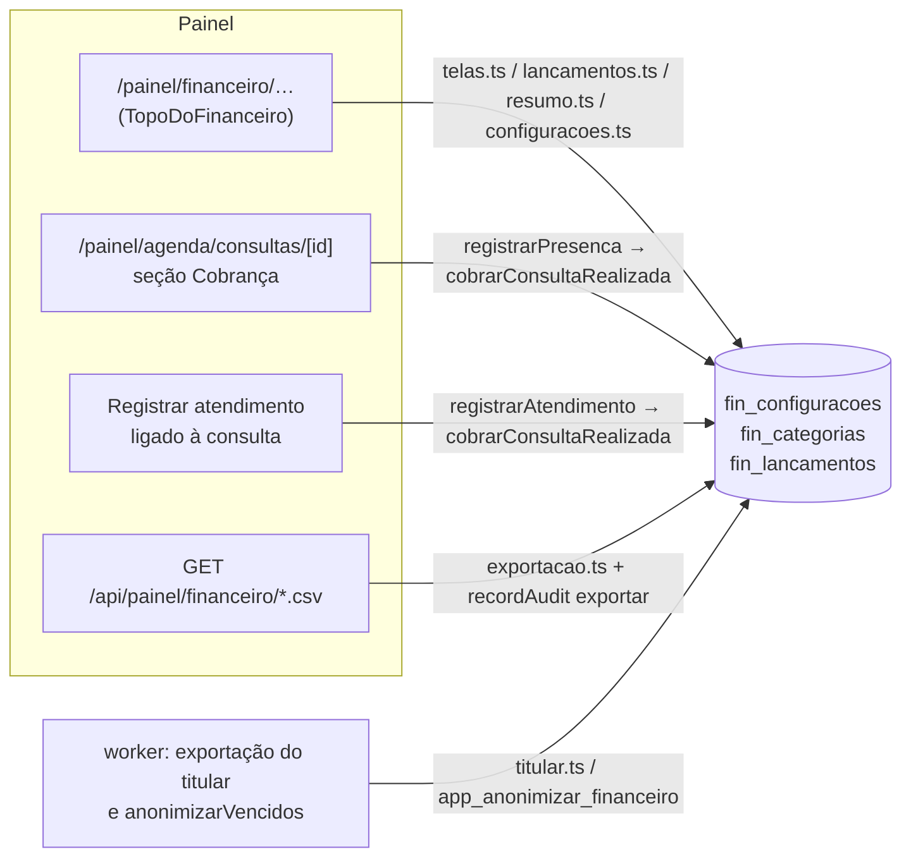

# 12. Financeiro do consultório (Plano 20)

Conferido contra o branch `plano-20-financeiro` em `7a0e919` (17/11/2026; Tarefas 2–11 do PR 2 e a onda de correção da revisão final, antes do merge),
rebaseado na `main` `6c3ee8f`, onde já está o **PR 1** (fundação: tabelas, RLS, gatilhos e guardas, PR #53, merge em
17/11/2026). Migrations `0122_financeiro` e `0123_rls_financeiro` (do PR 1); o PR 2 não tem migration. Spec
`docs/superpowers/specs/2026-11-16-nutridebby-20-financeiro-design.md` (v0.2, com os ajustes da §18) e plano
`docs/superpowers/plans/2026-11-16-nutridebby-20-financeiro.md` (Tarefas 1–12, com a "Revisão do plano" e as "Decisões da
orquestradora"). Runbook do dono: [`docs/operacao/financeiro.md`](../operacao/financeiro.md).

As decisões da spec usam o prefixo **F-D** (F-D1 a F-D30) e as pendências externas **F-P** (F-P1 a F-P5), para não
colidir com o Dx dos planos. Nenhuma variável de ambiente nova, nenhuma fila nova, nenhuma dependência nova.

A **seção "Financeiro" no Início da ficha** (US-308, RN-329, PD-33) **ainda não existe**: é a Tarefa 12, num PR 3
([§12.13](#1213-divergências-conhecidas), #11).

## 12.1 Visão

O Financeiro é o caixa do consultório, **só da nutricionista**: nada vai ao paciente, nem ao portal, nem à página pública,
nem por push, e-mail ou WhatsApp (C-302, F-D1, F-D13). Cinco telas em `/painel/financeiro`, com o item "Financeiro" no
menu entre "Conteúdos" e "Configurações" para toda nutricionista, sem interruptor e sem contador (RN-327):

| Tela | Rota | O que faz |
|---|---|---|
| Resumo | `/painel/financeiro` | Saldo atual, entradas e saídas do mês (realizadas, a realizar e em atraso de meses anteriores), pagamentos pendentes, os 10 últimos lançamentos; sem configuração, o primeiro acesso ("Comece por aqui") |
| Lançamentos | `/painel/financeiro/lancamentos` (+ `novo?tipo=entrada\|saida[&paciente=<id>]`, `[id]`) | Lista com filtros e totais; "Nova entrada", "Nova saída", editar, marcar recebido/pago, desfazer, cancelar com motivo |
| Pagamentos pendentes | `/painel/financeiro/pendencias` (+ `[patientId]`) | Entradas de pacientes em aberto, por paciente, e o detalhe com "Marcar como recebido" |
| Relatórios | `/painel/financeiro/relatorios?ano=AAAA` | Fluxo de caixa do ano, entradas e saídas dos últimos 12 meses (tabela e barras) e o CSV para o contador |
| Configurações | `/painel/financeiro/configuracoes` | Saldo do caixa numa data, valor da consulta, categorias |

Fora delas, a **cobrança da consulta** (PD-31): marcar a consulta como "Realizada" — pela tela da consulta ou ao registrar o
atendimento ligado a ela — cria a entrada com o valor da consulta configurado, e a seção "Cobrança" da tela da consulta
ajusta o valor, recebe e cancela ([§12.5](#125-cobrança-da-consulta-us-303-rn-310-a-rn-314)).

Regras de base:

- **Centavos inteiros** do formulário ao banco (`paraCentavos`, `src/modules/financeiro/dinheiro.ts:16`, sem
  `parseFloat`); somas em `bigint` no SQL, devolvidas como texto e convertidas para `number` só abaixo de
  `Number.MAX_SAFE_INTEGER` (`centavos`, `src/modules/financeiro/dinheiro.ts`, usado pelo Resumo, pelo fluxo, pelas
  pendências e pelos totais da lista; RNF-304).
- **Datas de calendário** (`date`) no fuso do consultório: "hoje" é sempre `hojeNoFuso(tenant.fuso, agora)`
  (`src/modules/pacientes/datas.ts`); os meses saem de `src/modules/financeiro/meses.ts` (`mesDe`, `intervaloDoMes`,
  `ultimos12Meses`, `nomeDoMes`, `periodoValido`), nunca da data UTC do servidor (F-D3, RNF-305).
- **Situação calculada, sem coluna** (F-D4, RN-305, `situacaoDoLancamento`, `src/modules/financeiro/situacao.ts:13`):
  `cancelado_em` preenchido → **Cancelado**; senão, `pago_em` preenchido → **Recebido** (entrada) / **Pago** (saída); senão,
  vencimento antes de hoje → **Em atraso**; senão → **Previsto**.
- **Data de referência** (RN-306, `dataDeReferencia`, `situacao.ts:23`): o recebido/pago conta no mês do pagamento; o em
  aberto, no mês do vencimento. A lista, o Resumo e o CSV usam essa data; o cancelado aparece na lista e nunca nos totais.
- **Sem DELETE**: lançamento se cancela com motivo, sem volta; recebido/pago também se cancela (é assim que se registra uma
  devolução: o valor sai do saldo) (F-D5, RN-309).

## 12.2 Peças

Módulo `src/modules/financeiro/`. Toda função exportada que lê ou grava as tabelas chama `exigirNutri(ctx)`
(`src/modules/financeiro/erros.ts:42`) **antes** de abrir a transação: numa sessão de paciente, o `staff_only` devolveria
vazio em silêncio, e a tela mostraria "nenhum lançamento" em vez de um erro (RN-300, §4.2 da spec). As exceções são
`titular.ts` e a função SQL `app_anonimizar_financeiro`, do contexto `worker`.

| Arquivo | Conteúdo |
|---|---|
| `constantes.ts` | `MSG_FINANCEIRO` (`:63`, todos os textos da §6.2, inclusive os que vão a outros arquivos, em `lgpd`), `CATEGORIAS_INICIAIS` (`:29`, as 12 da RN-302), `ROTULO_FORMA`, limites (`VALOR_MAX_CENTAVOS`, `SALDO_MAX_CENTAVOS`, `DESCRICAO_MAX`, `MOTIVO_MAX`, `NOME_CATEGORIA_MAX`). Sem drizzle (guarda em `guardas.test.ts`): componentes cliente o importam |
| `tipos.ts` | `LinhaCsv`, `LinhaFluxo`, `FluxoDoAno`, `SituacaoDoFiltro`, `FiltrosLista`, `TotaisDaLista`, `LancamentoNaTela` |
| `dinheiro.ts` | `paraCentavos` ("1250", "1250,5", "1.250,50", "R$ 1.250,50", "-320,00", "−320,00"; recusa "1.25" e mais de 2 casas), `formatarReais` (`Intl` pt-BR; espaço não separável depois de "R$"), `valorParaCampo` |
| `situacao.ts` | `situacaoDoLancamento`, `dataDeReferencia`, `ROTULO_SITUACAO` |
| `meses.ts` | Meses e períodos em texto `AAAA-MM`/`AAAA-MM-DD`, sem `Date` local; `PERIODO_MAX_DIAS = 366` |
| `csv.ts` | `celulaTexto` (`:24`), `csvLancamentos` (`:38`), `csvFluxo` (`:58`) — puros ([§12.7](#127-csv-para-o-contador-us-306-rn-321)) |
| `erros.ts` | `FinanceiroError` (erros por campo, sempre com textos de `MSG_FINANCEIRO`, nunca o digitado), `FinanceiroNaoConfiguradoError`, `LancamentoNaoEncontradoError`, `CategoriaNaoEncontradaError`, `exigirNutri` |
| `configuracoes.ts` | `lerConfiguracoes`, `salvarConfiguracoes` (`:72`), categorias (`listarCategorias`, `criarCategoria`, `renomearCategoria`, `arquivarCategoria`, `reativarCategoria`, `excluirCategoria`); `configuracaoNaTransacao` e `categoriasNaTransacao` para as telas |
| `lancamentos.ts` | `criarLancamento` (`:121`), `editarLancamento` (`:222`), `ajustarValor` (`:249`, o "Salvar valor" da seção da consulta), `marcarRecebido` (`:264`), `desfazerRecebimento` (`:285`), `cancelarLancamento` (`:293`), `diaMaisAntigoNaTransacao` (`:317`), `listarLancamentos`/`listaNaTransacao` (`:412`), `abrirLancamento`/`lancamentoNaTransacao` (`:458`), `pacientesParaLancamento`, `pacienteDoFinanceiro` |
| `resumo.ts` | `resumoDoMes` (`:69`), `fluxoDeCaixaDoAno`/`fluxoNaTransacao` (`:131`), `entradasESaidas12Meses`/`dozeMesesNaTransacao` (`:222`), `pagamentosPendentes`/`pendentesNaTransacao` (`:251`), `pendenciasDoPaciente` (`:275`) |
| `telas.ts` | Uma transação por tela (RNF-301): `telaDeLancamentos` (`:45`), `formularioNovo` (`:79`), `telaDeEdicao` (`:110`), `telaDeConfiguracoes` (`:136`, `/code-review` do PR #55), `telaDePendencias` (`:152`), `telaDeRelatorios` (`:182`), com as mesmas consultas e a mesma auditoria das funções avulsas. O "Mês" da lista e o "Ano" de Relatórios vêm de `diaMaisAntigoNaTransacao` (`lancamentos.ts`): o mesmo `min(coalesce(pago_em, vencimento))`, em três partes com `tenant_id` explícito para os índices parciais |
| `cobranca.ts` | `cobrarConsultaRealizada` (`:97`), `aoCorrigirParaFaltou` (`:110`), `cobrancaDaConsulta` (`:129`), `registrarCobrancaManual` (`:160`), `valorDaCobrancaDoAtendimento` (`:195`) |
| `exportacao.ts` | `exportarLancamentosCsv` (`:34`) e `exportarFluxoCsv` (`:83`): leitura, `exportar` e montagem numa transação |
| `titular.ts` | `financeiroParaExportacao(tx, patientId, hoje)` (`:36`), a seção `financeiro` do `dados.json` (contexto `worker`) |

Schema: `src/db/schema/financeiro.ts` (`finConfiguracoes` `:23`, `finCategorias` `:47`, `finLancamentos` `:79`,
`TIPOS_DE_LANCAMENTO`, `TipoLancamento`) e `src/db/schema/financeiro-formas.ts` (`FORMAS_DE_PAGAMENTO`, `FormaPagamento`:
fonte única das sete formas, usada pelo CHECK da coluna e reexportada por `constantes.ts`; arquivo sem drizzle, para o cliente
não levar o `pg-core`).

Telas (`src/app/painel/financeiro/`): `layout.tsx` (só o contêiner, até 1360 px), `topo.tsx` (`TopoDoFinanceiro`: h1 com
`tabIndex={-1}`, a navegação interna, as ações da tela e a região de mensagens), `secoes.tsx` (`nav aria-label="Seções do
Financeiro"` com `aria-current`), `mensagens.tsx` (região `role="status"` sempre montada), `foco.ts` (`ID_TITULO`,
`focarTitulo`), `page.tsx` (Resumo), `configuracoes/` (`page.tsx`, `form-saldo.tsx`, `categorias.tsx`, `actions.ts`),
`lancamentos/` (`page.tsx`, `filtros.tsx`, `novo/page.tsx`, `[id]/page.tsx`, `form-lancamento.tsx`, `receber.tsx`,
`cancelar.tsx`, `comum.tsx`, `url.ts`, `actions.ts`), `pendencias/` (`page.tsx`, `[patientId]/page.tsx`), `relatorios/`
(`page.tsx`, `fluxo.tsx`, `barras.tsx`, `baixar-csv.tsx`). Na agenda: `src/app/painel/agenda/consultas/[id]/cobranca.tsx`
(`SecaoCobranca`), `cobranca-actions.ts` e `ids.ts`. Rotas CSV: `src/app/api/painel/financeiro/lancamentos.csv/route.ts`,
`fluxo-de-caixa.csv/route.ts` e `navegacao.ts` (recusas em navegação).

## 12.3 Banco

Três tabelas com `tenant_id`, todas `staff_only` (catálogo, colunas, CHECKs, FKs e índices em
[§2.5.12](02-banco-de-dados.md#2512-financeiro-financeirots-plano-20)). Migration gerada `0122_financeiro` e custom
`0123_rls_financeiro` (`drizzle/0123_rls_financeiro.sql`), regeneradas no PR 1 em cima da `0121` do Plano 17
(`docs/operacao/sessoes-paralelas.md`, §5).

| Tabela | Proteção |
|---|---|
| `fin_configuracoes` | T, S (sem `patient_id`, sem gatilho de auditoria: o módulo grava `recordAudit` de `financeiro_configuracoes`); `REVOKE DELETE, TRUNCATE` (apagar a linha faria a próxima "primeira gravação" semear as categorias de novo) |
| `fin_categorias` | T, S; gatilho `fin_categorias_fixas` |
| `fin_lancamentos` | T, P, S, A `financeiro`; `REVOKE DELETE, TRUNCATE`; gatilho `fin_lancamentos_regras` |

Nada em `PUBLICO_LIBERADO` nem em `PACIENTE_ESCREVE`; nenhuma em `AUDIT_EXCEPTIONS` (só `fin_lancamentos` tem
`patient_id`, e tem o gatilho).

### 12.3.1 Gatilho `fin_categorias_fixas` (RN-303)

`app_fin_categorias_fixas()` (`0123_rls_financeiro.sql:28-44`, BEFORE UPDATE OR DELETE): `tipo` e `chave` não mudam;
DELETE de linha com `chave` preenchida ("Consultas") → 42501, mesmo sem lançamento. O arquivamento de "Consultas" é
recusado pelo CHECK `fin_categorias_chave_nunca_arquivada`. Assim a categoria da cobrança automática existe sempre que há
configuração; renomear é livre.

### 12.3.2 Gatilho `fin_lancamentos_regras` (RN-304, RN-308, RN-309, RN-315, RN-316)

`app_fin_lancamentos_regras()` (`0123_rls_financeiro.sql:56-163`, BEFORE INSERT OR UPDATE, `SET search_path = public,
pg_temp`, nomes com `public.`, recusas com `ERRCODE = '42501'`). O `BEFORE` roda antes do `WITH CHECK` da RLS, por isso a
ordem importa (spec §9.4; "não consertar afrouxando o teste"):

1. **Contexto vazio** → 42501 (INSERT e UPDATE).
2. **INSERT:** `worker` → 42501; qualquer papel diferente de `nutri` (paciente, `publico`, `conta`) → `RETURN NEW` **sem
   ler `patients`**, para a recusa vir da RLS da própria tabela (`paciente_sem_insert`, `publico_negado`,
   `tenant_isolation`) e o teste de isolamento ver a mensagem de RLS (`violaRlsDe`). Na sessão `nutri`: `criado_por :=
   app_current_user()` (autoria pelo banco, seja qual for o valor do módulo), cancelamento e anonimização nulos; com
   paciente, lê `status, anonimizado_em` com `FOR KEY SHARE` (espera o `FOR UPDATE` de um bloqueio em andamento e lê a
   versão nova) e recusa paciente `bloqueado` ou anonimizado.
3. **UPDATE, para todo papel:** `id`, `tenant_id`, `tipo`, `patient_id`, `appointment_id`, `criado_por` e `created_at`
   fixos (`IS DISTINCT FROM`: o UPDATE sem mudança passa) — por isso `fin_lancamentos` está em `IMUTAVEIS` do teste de
   isolamento.
4. **UPDATE pelo `worker`:** só o ramo da anonimização. Exige o marcador local `app.fin_anonimizando = '1'` (com
   `coalesce`: um NULL não deixa passar), `OLD.anonimizado_em` nulo e `NEW.anonimizado_em` preenchido, e só deixa mudar
   `anonimizado_em`, `descricao`, `motivo_cancelamento`, `cancelado_em`, `cancelado_por` e `updated_at` (comparação de
   `to_jsonb` sem essas chaves). Não confia no marcador: confere de novo o paciente (`FOR KEY SHARE OF p`) — `bloqueado`,
   ainda não anonimizado e com `anonimizar_apos` antes de hoje no fuso do tenant (`public.tenants`) —, recusa cancelar um
   lançamento **pago** e, no em aberto que a anonimização cancela, grava `cancelado_em := clock_timestamp()` e
   `cancelado_por` nulo (a data mandada pelo UPDATE não vale). Correção do `/code-review high` do PR 1.
5. **UPDATE pela sessão `nutri`:** sem mudança → passa; lançamento cancelado ou anonimizado → 42501; `anonimizado_em`
   só pela função; o cancelamento (`cancelado_em` preenchido) grava `cancelado_em := clock_timestamp()` e `cancelado_por :=
   app_current_user()` (o motivo é conferido pelo CHECK `fin_lancamentos_cancelamento_coerente`); com paciente, lê-o com
   `FOR KEY SHARE`: anonimizado → 42501; `bloqueado` → só `pago_em`, `forma_pagamento`, `valor_centavos` **para menor ou
   igual**, o cancelamento e `updated_at` (RN-315).
6. Outros papéis no UPDATE (paciente, `publico`, `conta`) → `RETURN NEW` e a RLS recusa.

### 12.3.3 Função `app_anonimizar_financeiro(uuid)` (RN-316, F-D23)

`0123_rls_financeiro.sql:174-205`, molde da `app_anonimizar_aceites` (0065) e do marcador da 0117. **`SECURITY INVOKER`**
(no contexto `worker`, `tenant_isolation`, `patient_isolation`, `staff_only` e `paciente_sem_*` deixam passar, e o UPDATE
não está revogado), `SET search_path = public, pg_temp`, `REVOKE ALL … FROM PUBLIC`, `GRANT EXECUTE … TO
nutri_app_role`.

- Recusa fora do contexto `worker` de um tenant (42501).
- Trava o paciente `FOR UPDATE OF p` e exige `bloqueado`, `anonimizado_em` nulo e `anonimizar_apos` antes de hoje no fuso
  do tenant (defesa a mais da revisão do plano, como o filtro de `anonimizarVencidos`).
- Liga `app.fin_anonimizando`, faz o UPDATE (em todos os lançamentos do paciente ainda não anonimizados: `descricao` e
  `motivo_cancelamento` nulos, `anonimizado_em`; os em aberto — sem `pago_em` e sem cancelamento — viram cancelados) e
  **desliga** o marcador no fim, para ele não valer até o fim da transação de `anonimizarVencidos`.
- Valor, datas, categoria, forma, tipo e o vínculo com o paciente (agora anonimizado) ficam: os relatórios antigos não mudam.

Chamada por `anonimizarVencidos` (`src/modules/pacientes/lgpd.ts:558`) **só quando o paciente tem lançamento** (uma
leitura `limit 1` antes), depois de `app_anonimizar_aceites` e antes do UPDATE de `patients` (a função exige o paciente
ainda não anonimizado). O porquê de não chamar sempre: a função confere o prazo pelo relógio do banco, e o `now` do job
pode ser outro (testes que avançam o relógio) — sem lançamento, não há nada a anonimizar e a recusa derrubaria a
anonimização inteira ([§12.13](#1213-divergências-conhecidas), #1). Testes em `src/modules/financeiro/banco.test.ts`,
`src/modules/pacientes/lgpd.test.ts` e `src/db/migrate-owner.test.ts` (o app executa a função com o dono sem superusuário).

### 12.3.4 Travas (RN-317)

Ordem paciente → consulta → lançamento, a mesma da agenda e do atendimento:

- **Criação** (`criarLancamento`, `registrarCobrancaManual`): paciente `FOR KEY SHARE` e a conferência de `status` e
  `anonimizado_em` **sob a trava**, antes do INSERT — sem isso, um bloqueio que confirma no meio deixaria passar um
  lançamento novo (a FK só espera e não confere a situação). Nunca `carregarPacienteParaEscrita` (`FOR UPDATE`, e recusaria
  o bloqueado sem a mensagem do Financeiro).
- **Alteração** (`travarLancamento`, `lancamentos.ts`): paciente `FOR KEY SHARE` → lançamento `FOR UPDATE`, a ordem do
  gatilho; a inversa daria deadlock com a anonimização (paciente `FOR UPDATE` → lançamentos).
- **Configurações:** linha de `fin_configuracoes` `FOR UPDATE`.
- **42501 que escapar** (corrida que as travas não cobrem: cancelamento, bloqueio ou anonimização no meio) vira
  `FinanceiroError` com a mensagem certa: `traduzirRecusaDoGatilho` relê a situação numa transação nova; o erro já vem limpo
  do `withTenant` (`DbError`, sem valores).

## 12.4 Configurações, lançamentos e agregados

### 12.4.1 Configurações e categorias (US-300, RN-301 a RN-303, RN-320, RN-324, RN-325)

- **Primeiro acesso (RN-301, F-D25).** Sem a linha de `fin_configuracoes`, o Resumo, a lista, as pendências e os relatórios
  mostram "Comece por aqui" e o botão "Configurar o Financeiro" (sem "Nova entrada"/"Nova saída"); `lancamentos/novo` e as
  actions de criar redirecionam para `/painel/financeiro/configuracoes?aviso=informeSaldo` ("Informe o saldo do caixa para
  começar."). Nenhuma leitura grava; a conta da nutricionista (`contas.ts`) não cria nada.
- **`salvarConfiguracoes`** (`configuracoes.ts:72`): trava a linha (`FOR UPDATE`); sem linha, `INSERT … ON CONFLICT DO
  NOTHING RETURNING` e **só quem inseriu** semeia as 12 categorias iniciais, também com `ON CONFLICT DO NOTHING` (duas abas
  ao mesmo tempo → um conjunto só); com linha, UPDATE. Toda gravação grava `recordAudit({ acao: 'alterar', entidade:
  'financeiro_configuracoes', entidadeId: tenantId, patientId: null })` (RN-320): fora do Histórico do paciente e sem
  rótulo em `ENTIDADE_ROTULO`; categorias sem trilha.
- **Validação:** data do saldo de 01/01/2000 até hoje no fuso; saldo de −R$ 10.000.000,00 a R$ 10.000.000,00 (negativo vale);
  valor da consulta opcional, de R$ 0,01 a R$ 1.000.000,00 — vazio apaga o valor, e as consultas deixam de gerar cobrança
  (F-D21). Mudar o valor só vale para as cobranças criadas depois (RN-324).
- **Categorias** (RN-303): nome de 1 a 60 caracteres, único por consultório e tipo sem diferença de maiúsculas (índice
  `fin_categorias_nome_unique` com `lower(nome)`); tipo fixo; com lançamento, não se exclui (FK `NO ACTION`) — arquiva-se:
  some dos formulários e fica nos lançamentos antigos e nos relatórios; "Reativar" volta. "Consultas" renomeia, nunca
  arquiva nem exclui. A tela (`categorias.tsx`) tem "Excluir" em toda categoria menos "Consultas"; o "Arquivar" de
  "Consultas" existe e a recusa do módulo explica o porquê. O resultado de cada ação vai a uma região `role="status"`
  própria da seção ("Categoria {nome} criada." etc., `MSG_FINANCEIRO.configuracoes.feito`, fora da §6.2).

### 12.4.2 Lançamentos (US-301, US-302, RN-304, RN-306, RN-308, RN-309, RN-315)

- **Campos (RN-304):** tipo `entrada`/`saida` (fixo); categoria **ativa do mesmo tipo** (o formato é conferido no módulo;
  o tipo, pela FK composta); valor de R$ 0,01 a R$ 1.000.000,00; vencimento de 01/01/2000 até 31/12 do ano de hoje + 5;
  data do recebimento/pagamento opcional (vazia = ainda não aconteceu), até hoje no fuso; forma obrigatória com essa data
  (sem a data, a forma enviada é descartada); descrição opcional de até 200 caracteres. **Paciente só na entrada**, opcional;
  saída com paciente é envio forjado e lança erro (F-D24).
- **Seletor "Paciente (opcional)"** (`pacientesNaTransacao`): ativos e arquivados ("(arquivado)"), sem bloqueados nem
  anonimizados, pelo nome de exibição e na ordem dele (`nomeDeExibicao`, `src/modules/financeiro/nome.ts`: o nome social de
  `patient_cadastro` quando há, senão `patients.nome` — Plano 18, D7/RN-266; o mesmo no chip "Paciente: {nome}", na lista, no
  detalhe e nos pagamentos pendentes; o CSV e o `dados.json` ficam com o nome civil). `novo?tipo=entrada&paciente=<id>` pré-seleciona o paciente se ele puder
  receber lançamento; bloqueado → formulário sem paciente e o aviso `bloqueado`; `paciente=` com `tipo=saida` é ignorado.
- **Depois de salvar** (`voltarALista`, `lancamentos/actions.ts`): a lista no mês de referência do lançamento, com
  `?ok=salvo`, `&aviso=antes_do_saldo` quando a data do recebimento ou do pagamento é anterior à data do saldo ("Este
  lançamento é anterior ao saldo do caixa ({data}) e não altera o saldo atual.") e `&envio=<n>` (muda a cada resposta:
  foco no h1 e anúncio de novo).
- **Receber, desfazer e cancelar** voltam à tela de onde vieram (`destino`): só a lista (com os filtros conhecidos), a
  edição de um lançamento ou "Pagamentos pendentes de {nome}", no mesmo site (`CAMINHO_DE_VOLTA`); qualquer outro `volta`
  cai na lista.
- **Edição** (`/painel/financeiro/lancamentos/[id]`, `telaDeEdicao`): h1 "Entrada — {categoria}" / "Saída — {categoria}"
  (sem paciente nem data); tipo e paciente como texto; a consulta ligada como link "Cobrança da consulta de {data},
  {hora}". Cancelado ou anonimizado: só leitura, com a mensagem ("Este lançamento foi cancelado e não pode mais ser
  alterado." / "…anonimizado…"; de paciente anonimizado, o aviso `pacienteAnonimizado`). Paciente bloqueado: o aviso
  `bloqueado`, categoria, vencimento e descrição só como texto, valor só para menor ou igual, receber/desfazer e cancelar.
  O anonimizado continua `bloqueado` no banco, mas na tela `paciente.bloqueado` só vale sem `anonimizado_em`
  (`situacaoDoPaciente`, `lancamentos.ts`; TRI-17-20 #130): o aviso `bloqueado` ("As cobranças em aberto continuam
  valendo…") nunca sai para ele — nem aqui, nem em "Pagamentos pendentes de {nome}" ou na seção "Cobrança" da consulta,
  que mostram o `pacienteAnonimizado`.
- **Bloqueado (RN-315, F-D20):** módulo e gatilho recusam o mesmo — nenhum lançamento novo; nos existentes, só receber,
  desfazer, reduzir o valor e cancelar ("Paciente bloqueado por pedido de exclusão: só é possível registrar o recebimento,
  reduzir o valor ou cancelar."). Anonimizado: nada muda.
- **Lista** (`listaNaTransacao`, `lancamentos.ts:412`): pela data de referência; sem `mes`, o mês atual no fuso; com
  `paciente` e sem `mes`, **todos os meses**, até 200 linhas (`LIMITE_SEM_MES`), com o aviso "Mostrando os 200 mais
  recentes. Escolha um mês para ver os outros." e a opção "Todos os meses" no `<select>`. O `<select>` de mês vai do mês
  atual ao do lançamento mais antigo do consultório (não `<input type="month">`, que o Firefox desktop não tem), com os links
  "Mês anterior"/"Próximo mês". Filtros: tipo, categoria, situação (`SituacaoDoFiltro`: previsto, em atraso, "Recebido ou
  pago", cancelado) e forma; valores inválidos na URL são ignorados. Totais do filtro inteiro, sem os cancelados, em duas
  linhas ("Recebido ou pago: entradas … · saídas … · resultado …" e "Em aberto: …"). Formulário GET ("Filtrar"), sem
  JavaScript (`filtros.tsx`, `url.ts`).

### 12.4.3 Resumo, fluxo, 12 meses e pendências (US-304 a US-306, RN-307, RN-311)

Agregação no SQL (`sum(valor_centavos::bigint) filter (where …)`), uma transação por tela, sem N+1 (RNF-301; contagem de
consultas por um `pg.Pool` embrulhado em `resumo.test.ts`; `resumo.tempo.test.ts` exige `resumoDoMes` abaixo de 800 ms com
5.000 lançamentos, só em `pnpm test:tempo`).

- **Saldo atual (RN-307, F-D29):** saldo do caixa + Σ entradas recebidas − Σ saídas pagas, não canceladas, com `pago_em`
  **no dia do saldo ou depois** (o saldo informado é o do início desse dia). Pagamento anterior aparece na lista e nos
  relatórios, mas não muda o saldo.
- **Cartões do mês** (`resumoDoMes`, `resumo.ts:63`): "Recebido"/"Pago" pelo pagamento no mês; "A receber"/"A pagar" em
  aberto com vencimento no mês; "Em atraso de meses anteriores" em aberto com vencimento antes do dia 1º, só quando > 0;
  "Pagamentos pendentes" como a RN-311. O `WHERE` só deixa passar o que algum `filter` usa, no formato dos índices
  parciais (`pago_idx` com a faixa de `pago_em`, `aberto_idx`): nunca a tabela de todos os consultórios.
- **Últimos lançamentos:** os 10 **lançados por último** (`order by created_at desc, id desc limit 10`, pelo índice
  `fin_lancamentos_criado_idx`), cancelados incluídos, como na lista ([§12.13](#1213-divergências-conhecidas), #5).
- **Fluxo de caixa do ano** (`fluxoNaTransacao`, `resumo.ts:125`): só recebidos e pagos, não cancelados, pelo mês do
  pagamento; uma linha por categoria do tipo ("Consultas" primeiro, depois pelo nome; as arquivadas só se tiveram movimento
  no ano); totais e resultado; linhas de saldo nulas ("—") antes do mês do saldo do caixa; **no mês do saldo**, início nulo
  e fim = saldo + movimentos desde a data do saldo; depois, início = fim anterior e fim = início + resultado. O ano mostrado
  vem de `?ano=` se estiver na lista (do ano atual até o do saldo ou do lançamento mais antigo), senão o atual.
- **12 meses** (`dozeMesesNaTransacao`): entradas, saídas e resultado de `ultimos12Meses(hoje)`, tabela no contêiner
  rolável e barras SVG `aria-hidden` com cor só por classe de token (`barras.tsx`).
- **Pagamentos pendentes (RN-311, F-D26):** entradas **com paciente**, não canceladas e sem recebimento, **previstas ou em
  atraso**, agrupadas por paciente (total, quantidade, vencimento mais antigo e "Em atraso" se alguma venceu), da mais antiga
  para a mais nova. O rótulo é sempre "Pagamentos pendentes", nunca só "Pendências" (a agenda já tem
  `/painel/agenda/pendencias`, de presença). O detalhe (`pendenciasDoPaciente`) traz as linhas com "Marcar como recebido";
  sem pendência, o estado vazio "Nenhum pagamento pendente de {nome}." com "Voltar aos pagamentos pendentes".

O CS-301 (os totais batem centavo a centavo, inclusive na virada do mês no fuso) é provado por
`resumo-propriedade.test.ts`: 200 rodadas com a semente `20261117`, lançamentos aleatórios com datas nas bordas (dia 1º,
último dia, 00h00 e 23h59 locais, cancelados, antes do saldo), comparando o Resumo, o fluxo, os 12 meses e o CSV do mês com
a soma em memória.

## 12.5 Cobrança da consulta (US-303, RN-310 a RN-314)

**Um lugar só** (F-D13): `cobrarConsultaRealizada(tx, …)` (`cobranca.ts:97`), chamada **na transação** dos dois caminhos que
levam a consulta de outra situação a "Realizada", depois das travas deles (paciente → consulta):

| Caminho | Onde chama | Fuso | Retorno |
|---|---|---|---|
| "Realizada" na tela da consulta | `registrarPresenca` (`src/modules/agenda/presenca.ts:35`, chamada em `:57`) | Lê `tenants.fuso` na transação | `{ cobranca: ResultadoCobranca \| null }` (nulo quando a situação não mudou) |
| "Registrar atendimento" ligado a uma consulta que não era "Realizada" | `registrarAtendimento` (`src/modules/pacientes/atendimentos.ts:69`, chamada em `:95`) | `tenant.fuso` | `{ id, cobranca }` (nulo sem consulta ou com ela já "Realizada": sem retroativo) |

O que `cobrarConsultaRealizada` faz, nesta ordem:

1. Lê o paciente com `FOR KEY SHARE` e a situação **sob a trava** (`pacienteSemBloqueio`) — nunca recebe o estado de fora:
   lido antes da trava, um bloqueio no meio faria o gatilho recusar com 42501 e derrubar a presença inteira. Bloqueado ou
   anonimizado → `bloqueado` (F-D20). A presença é gravada mesmo assim (ela vale para bloqueado, Plano 05).
2. Cobrança ativa da consulta → `ja_existia`.
3. Sem configuração ou sem valor da consulta → `sem_valor` (F-D21).
4. `INSERT … ON CONFLICT (tenant_id, appointment_id) WHERE appointment_id IS NOT NULL AND cancelado_em IS NULL DO NOTHING
   RETURNING id` — o predicado igual ao do índice `fin_lancamentos_consulta_ativa_unique`; quem perde a corrida espera o
   outro confirmar e não insere (`ja_existia`). Entrada na categoria de `chave = 'consultas'`, valor da consulta,
   vencimento = data do início da consulta no fuso, paciente e consulta ligados, sem forma nem descrição, `criado_por` =
   quem marcou "Realizada" → `criada` com o valor.

**Correção para "Faltou" (RN-312, F-D19, F-P5 fechada em 17/11/2026: fica a v0.2).** `registrarPresenca(…, 'faltou')` de uma
consulta "Realizada" chama `aoCorrigirParaFaltou` (`cobranca.ts:110`), que **só lê** a cobrança ativa e devolve `aberta`,
`recebida` ou `nenhuma`; nada é gravado no Financeiro. A cobrança em aberto continua em "Pagamentos pendentes" até a
nutricionista cancelar ou receber; voltar para "Realizada" com cobrança ativa não cria outra (`ja_existia`, o valor
ajustado fica). Falta não gera cobrança automática (RN-313).

**Mensagens.** As actions levam só o tipo do resultado na URL — `presencaAction` (`src/app/painel/agenda/actions.ts`):
`?ok=presenca&cobranca=<tipo>`; `registrarAtendimentoAction`: `?ok=atendimento&cobranca=<tipo>` só com consulta ligada e
`cobranca` não nula (sem consulta, a URL continua terminando no id). **O valor nunca vai na URL** (ficaria no histórico do
navegador): a tela da consulta o lê da própria cobrança (`cobrancaDaConsulta`), e a página do atendimento por
`valorDaCobrancaDoAtendimento` (`cobranca.ts:195`, que grava um `ler`, [§12.13](#1213-divergências-conhecidas), #9). Só as
chaves conhecidas viram texto (`mensagemDaPresenca`, `src/app/painel/agenda/consultas/[id]/page.tsx`): `criada` → "Presença
registrada. Cobrança de {valor} criada no Financeiro."; `sem_valor` → "…A cobrança não foi criada: informe o valor da
consulta nas configurações do Financeiro." (link); `aberta` e `recebida` → os avisos da §6.2; `bloqueado`, `ja_existia` e
`nenhuma` → só "Presença registrada.". No atendimento, só `criada` e `sem_valor` têm mensagem.

**Seção "Cobrança"** (`SecaoCobranca`, `cobranca.tsx`), abaixo de "Registrar presença", em consulta "Realizada" ou com
cobrança (inclusive "Faltou"); h2 com `tabIndex={-1}` que recebe o foco depois das ações (`ALVOS_DA_COBRANCA`):

- Com cobrança: "{valor} · {situação}" (recebida: "{valor} · Recebido em {data} · {forma}") e "Abrir no Financeiro"; em
  aberto, também "Valor" + "Salvar valor" (`ajustarValor`), "Marcar como recebido" e "Cancelar lançamento".
- Sem cobrança: "Esta consulta não tem cobrança." e, se pode (RN-314: consulta "Realizada", sem cobrança ativa, paciente nem
  bloqueado nem anonimizado e Financeiro configurado), "Valor" (o da consulta sugerido) + "Registrar cobrança"
  (`registrarCobrancaManual`: paciente `FOR KEY SHARE` → consulta `FOR SHARE` → INSERT; a aba que perde a corrida vê "Esta
  consulta já tem uma cobrança."). Senão, "Configure o Financeiro para registrar cobranças." (link) ou o aviso do bloqueado.
- As actions (`cobranca-actions.ts`: `registrarCobrancaAction`, `salvarValorCobrancaAction`, `receberCobrancaAction`,
  `cancelarCobrancaAction`) voltam à consulta com `?ok=cobranca_registrada|cobranca_salva|cobranca_recebida|cobranca_cancelada`.
  O id do lançamento vem do formulário: salvar o valor, receber e cancelar passam `daConsulta` (a consulta do `bind`) e
  o módulo (`travarLancamento`, `lancamentos.ts:176`) recusa, antes de qualquer trava e de novo na linha travada, o
  lançamento que não é a cobrança desta consulta (`appointment_id`, no tenant da sessão) com `LancamentoNaoEncontradoError`
  → 404, sem alterar nada; a ordem de travas (paciente → lançamento) não muda (`/code-review` do PR #55).

## 12.6 Telas, navegação e manual guiado

- **Topo por página** (`TopoDoFinanceiro`, `topo.tsx`): o h1 de algumas telas depende do que a página carrega ("Entrada —
  {categoria}", "Pagamentos pendentes de {nome}"), e um layout não recebe dados da página; por isso o h1, a navegação interna
  (`SecoesDoFinanceiro`: Resumo · Lançamentos · Pagamentos pendentes · Relatórios · Configurações, sublinhado e negrito na
  atual) e a região de mensagens estão em cada página, não no `layout.tsx` (#3). O layout não é barreira: cada página chama
  `requireNutri`, com `dynamic = 'force-dynamic'` (RNF-307).
- **Uma transação por tela** (`telas.ts`, RNF-301): a lista, o formulário novo, a edição, as pendências e os relatórios leem
  tudo o que mostram num `withTenant` só (uma conexão do pool por requisição, uma fotografia consistente), com a mesma
  auditoria das funções avulsas.
- **Mensagens e foco (§7 da spec):** `?ok=<chave>` (só chaves de `MSG_FINANCEIRO.ok`) e `?aviso=` viram texto numa região
  `role="status"` sempre montada (`Mensagens`), fora das linhas (a linha recebida pode sair da lista); o h1 recebe o foco
  quando a URL chega com `ok=`; `?envio=<n>` (só dígitos) faz cada salvamento focar e anunciar de novo. Erros em
  `role="alert"` junto do campo; o formulário devolve `valores` e remonta com `key={envio}` (no React 19 os campos não
  controlados voltam ao padrão depois da action).
- **Menu** (`ITENS_DO_MENU`, `src/app/painel/navegacao.ts:6-16`): sete itens fixos no Plano 20, com "Financeiro" antes de
  "Configurações"; com "Exames recebidos" e "Dúvidas dos pacientes", nove (o cabeçalho quebra a linha, R-310). Desde o
  Plano 26, oito fixos ("Relatórios" entre "Financeiro" e "Configurações") e dez com os condicionais. `itemAtual`
  marca "Financeiro" em todo `/painel/financeiro/…`.
- **Manual guiado** (`src/modules/ajuda/conteudo.ts`): guia novo `financeiro` (v1, último de `GUIAS`, `padrao`
  `^/painel/financeiro(/.*)?$`, 12 passos com os alvos `financeiro-secoes`, `-cartoes`, `-saldo`, `-valor-consulta`,
  `-categorias`, `-filtros`, `-novo`, `-receber`, `-cancelar`, `-pendentes`, `-relatorios`, `-csv`); `boas-vindas` na **v4**
  (o passo do menu cita "Financeiro"); `agenda` na **v2** (o passo a passo cita a cobrança ao marcar "Realizada"; a
  pergunta sobre "Faltou" e um terceiro passo sem alvo, "Cobrança da consulta", que abre no centro). Os textos dos dois
  guias são os finais do revisor-interface (17/11/2026, `/code-review` do PR #55); os títulos dos passos de outras telas do
  Financeiro começam pelo nome da tela, porque o passo sem o alvo na tela abre no centro. Todas as
  telas novas casam o guia `financeiro`: nada em `SEM_AJUDA`. `src/modules/financeiro` entrou em `TSX_FORA` do teste do
  manual (os rótulos citados entre aspas moram em `MSG_FINANCEIRO`). Detalhe em
  [§5.8.1](05-agenda-portal-conteudo.md#581-conteúdo).

## 12.7 CSV para o contador (US-306, RN-321)

| Rota | Parâmetros | Arquivo |
|---|---|---|
| `GET /api/painel/financeiro/lancamentos.csv` | `de`, `ate` (`AAAA-MM-DD`, até 366 dias, `de` ≤ `ate`), `pacientes=0\|1` | `lancamentos-<de>-a-<ate>.csv` |
| `GET /api/painel/financeiro/fluxo-de-caixa.csv` | `ano` (2000 a 2100) | `fluxo-de-caixa-<ano>.csv` |

- **Download é navegação, não `fetch`** (`baixar-csv.tsx` confere o período no cliente e mostra "Escolha um período de até 12
  meses." junto do campo "Até"), então a rota **nunca responde JSON à nutricionista** (`recusaNaNavegacao`,
  `src/app/api/painel/financeiro/navegacao.ts`): sem sessão → 303 para `/entrar?volta=/painel/financeiro/relatorios`; DPA
  pendente → 303 para `/painel/dpa`; papel errado (paciente, admin, conta sem consultório) → o 403 JSON `{ erro: 'Acesso
  negado' }` de sempre (a guarda `src/app/api/painel/acesso-negado.test.ts` chama toda `route.ts` de `/api/painel`). Os
  dois 403 se distinguem pelo `motivo` que `requireApiNutri` passou a devolver (`MotivoDaRecusa`,
  `src/lib/tenant-session.ts:37`: `sem_sessao`, `dpa_pendente`, `papel`; os da sessão vêm de `requireApiUser`, que já
  conhece a decisão, nunca do status), nunca lendo o corpo. Período inválido → 303 para
  `/painel/financeiro/relatorios?erro=periodo`; ano inválido → 303 para Relatórios.
- **Só da própria origem, sem HEAD** (revisão final do PR 2): o cookie da sessão é SameSite=Lax e vai junto numa navegação
  vinda de outro site, e o download grava `exportar` em nome da nutricionista. Depois da guarda de papel e antes do módulo,
  `recusaDeOrigem` (`navegacao.ts`) só segue com `Sec-Fetch-Site` `same-origin` (o link e o formulário de Relatórios)
  ou `none` (endereço digitado); `cross-site` ou `same-site` → 303 para Relatórios, sem ler nem gravar. Sem o cabeçalho
  (Safari antes do 16.4, proxies; `/code-review` do PR #55): segue só se `Origin` — ou, sem ele, `Referer` — tiver a
  origem do APP_URL (o critério de `src/app/sair/route.ts`); senão, 303 para `ERRO_DE_ORIGEM[csv]` (`?erro=origem` no
  CSV dos lançamentos, `?erro=origem&csv=fluxo` no do fluxo de caixa), e Relatórios mostra `MSG_FINANCEIRO.csv.erroOrigem`
  (`AlertaDoCsv`, `role="alert"`) junto do controle que causou o erro — o botão "Baixar CSV" do formulário ou o link
  "Baixar CSV" do cartão do fluxo —, ligado a ele por `aria-describedby`, e leva o foco a esse controle na montagem (a
  página chega do zero, no topo; o leitor de tela lê o controle e a mensagem). Com `?erro=periodo`, o foco vai para o
  "Até", que traz o erro. Testes em `relatorios/page.test.ts`. As duas rotas exportam `HEAD` com 405 (`semHead`):
  o HEAD automático do Next chamaria o GET. Testes em `src/app/api/painel/financeiro/csv.test.ts`.
- **Formato** (`csv.ts`): UTF-8 com BOM, `;`, CRLF, datas `dd/mm/aaaa`, valores com vírgula e sem "R$" ("-750,00" no
  resultado negativo). Lançamentos: "Vencimento;Pagamento;Tipo;Categoria;Descrição;[Paciente;]Forma de pagamento;Valor;Situação",
  pela data de referência, cancelados incluídos com a situação, do mais antigo ao mais novo. **Sem** "Incluir o nome dos
  pacientes" (padrão), não há a coluna "Paciente" **e** a "Descrição" sai vazia nas entradas com paciente (a descrição livre
  pode identificar, F-D27); com a opção, o nome **civil** (`patients.nome`, documento fiscal) e a descrição em toda linha.
  Célula de texto (descrição, categoria, paciente) que começa com `=`, `+`, `-`, `@`, tabulação ou CR, também depois de
  espaços na frente (os Unicode, o BOM e os de largura zero; TRI-17-20 #107), ganha `'` antes do texto original
  (`celulaTexto`); números gerados pelo sistema não.
- **Cabeçalhos** (`arquivoCsv`): `Content-Type: text/csv; charset=utf-8`, `Content-Disposition: attachment; filename="…"`
  (nome montado só com datas e ano já validados), `Cache-Control: no-store`.
- **Registro** (`exportacao.ts`): a leitura, o `recordAudit` `exportar` (entidade `financeiro`) e a montagem numa
  transação só — falha depois da leitura não deixa o registro (regra 8). Com a opção e pacientes no período, **um
  `exportar` por paciente presente** (aparece no Histórico de acessos de cada um); sem a opção, sem paciente no período ou
  no CSV do fluxo, um `exportar` sem paciente.

## 12.8 Auditoria e privacidade

| Ponto | Registro | Fonte |
|---|---|---|
| Escritas em `fin_lancamentos` | Gatilho `audit_row_change` (entidade `financeiro`, rótulo "Financeiro"): "Criou", "Alterou" (inclusive o cancelamento e a anonimização, esta com ator nulo); o `audit_log` não guarda antes/depois (R-311, P20-14) | `0123_rls_financeiro.sql:18`; `src/modules/plataforma/audit.ts:81` |
| Lista filtrada por paciente | **Um** `ler` (`entidadeId` nulo, o paciente do filtro) por abertura, só quando devolve linha — nunca um por lançamento | `listaNaTransacao`, `lancamentos.ts:440` |
| Edição de lançamento com paciente | `ler` com o id do lançamento | `lancamentoNaTransacao`, `lancamentos.ts:461` |
| "Pagamentos pendentes de {nome}" | Um `ler` por abertura, só com linha | `pendenciasDoPaciente`, `resumo.ts:281` |
| Seção "Cobrança" da consulta | `ler` com o id da cobrança, só quando há cobrança | `cobrancaDaConsulta`, `cobranca.ts:142` |
| Mensagem do atendimento com a cobrança criada | `ler` com o id da cobrança | `valorDaCobrancaDoAtendimento`, `cobranca.ts:210` |
| CSV | `exportar` (§12.7) | `exportacao.ts` |
| Configurações | `alterar` de `financeiro_configuracoes`, sem paciente | `configuracoes.ts:95` |
| **Sem** `auditRead` | Resumo, lista sem filtro de paciente, lista de pagamentos pendentes (nome, total, data), relatórios, o chip "Paciente: {nome}" e o aviso do bloqueado (`pacienteNaTransacao`: só nome e situação) — como a agenda (Plano 05, D10) | RN-318 |

- **Nada em log, Sentry ou mensagem** (RN-322, F-D9, RNF-300): `FinanceiroError` carrega só textos de `MSG_FINANCEIRO`; os
  erros do banco já saem limpos do `withTenant`. `src/modules/financeiro/log.test.ts` força erros em `criarLancamento`,
  `editarLancamento`, `cancelarLancamento`, `salvarConfiguracoes`, `renomearCategoria` e nas actions, e confere que o logger
  capturado e o `beforeSend` do Sentry (`src/lib/sentry-filtro.ts`) não recebem valor, descrição, motivo, categoria nem
  nome; e que os formulários do Financeiro ficam fora dos breadcrumbs (cliques e digitação somem; a navegação leva só a origem).
- **Fora da IA** (RN-323): `src/modules/financeiro/guardas.test.ts` percorre o grafo de imports a partir de
  `src/modules/ia/**` (`test/grafo-de-imports.ts`) e exige que nenhum arquivo alcançável seja do módulo do Financeiro e que o
  schema `financeiro.ts` só seja alcançado pelo barril (`@/db/schema`), nunca importado direto; e que nenhum arquivo de
  `src/modules/ia/**` (testes incluídos) contenha `fin_` nem cite as tabelas do Drizzle. Consequência prática: `dpa.ts`
  está no grafo da IA (`ia/ativacao.ts`), por isso `DPA_O_QUE_MUDOU` é um literal em `dpa.ts`, não um import de
  `MSG_FINANCEIRO.lgpd.dpaOQueMudou`, e a igualdade dos dois fica no teste (`textos-legais.test.ts`) (#2).
- **Fora do service worker** (RNF-307): `src/app/sw.ts` não cita o Financeiro (mesmo teste); as rotas CSV têm `no-store`.

## 12.9 LGPD (US-307, US-309, F-D16, F-D17, F-D22, F-D23)

- **Exportação do titular** (`financeiroParaExportacao`, `titular.ts:36`, chamada por `montarDados` em
  `src/modules/pacientes/exportacao-job.ts:435`): chave `financeiro` (a última de `DadosExportacao`), **nos dois escopos**,
  por inclusão explícita (`fin_lancamentos` é `staff_only`, como `ia_tarefas`), do vencimento mais antigo ao mais novo, com
  `vencimento`, `pagoEm`, `valorCentavos`, `valor` ("R$ 250,00"), `formaDePagamento` e o rótulo, `situacao` e o rótulo (no
  dia da exportação, no fuso), `categoria` (nome), `descricao`, `consultaInicio`, `canceladoEm` e `motivoCancelamento`.
  **Nunca** quem lançou nem quem cancelou (dado da equipe). Cópia integral do que é do titular (LGPD, art. 19, § 3º; a base
  é execução do contrato, não a do prontuário). Só no `dados.json`: o `prontuario.pdf` não muda e não há LEIA-ME.
- **Pedido de exclusão atendido**: nada muda nos lançamentos (o bloqueio não suspende o Financeiro: obrigação fiscal e
  cobrança da pendência); a partir dele, só receber, desfazer, reduzir e cancelar (§12.4.2).
- **Anonimização**: `app_anonimizar_financeiro` em `anonimizarVencidos`, junto com o prontuário (20 anos do bloqueio; F-D16;
  §12.3.3).
- **Textos da exclusão** (transparência, art. 18, § 4º, II), todos em `MSG_FINANCEIRO.lgpd` (`constantes.ts:322`):
  aba Privacidade do painel (parágrafo próprio depois do texto do bloqueio,
  `src/app/painel/pacientes/[id]/privacidade/page.tsx`); confirmação do portal (`CONFIRMAR_EXCLUSAO`, agora exportado,
  `src/app/p/(portal)/perfil/privacidade.tsx`); e-mails `pedido_exclusao_registrado` (troca a frase do prontuário) e
  `exclusao_atendida` (frase nova antes de "Se tiver dúvidas…") em `src/email/templates.tsx`. Para o pacote do advogado
  (E-09, F-P1).
- **DPA 1.1** (US-309, F-D17; `src/modules/plataforma/dpa.ts`): `DPA_VERSAO = '1.1'` (`:16`), `DPA_VERSAO_DATA = '2026-11-17'`
  (`:21`, fixa no PR e conferida antes do merge, R-309); `DPA_1_1` (`:67`) muda só as cláusulas 2 (dados: "…registros de
  acesso e registros financeiros do consultório, inclusive os pagamentos dos pacientes"; serviços: "…conteúdos, financeiro
  do consultório e as funções que a CONTROLADORA ativar") e 5 ("…o cadastro, os aceites, os documentos e os registros de
  pagamento são anonimizados") e a linha da versão; a numeração fica (o aditivo de IA remete à cláusula 8). A 1.0 ficou
  **congelada** no mapa (`DPA_TEXTOS`) com chave por constante (`DPA_VERSAO_1_0`, nunca o literal `'1.0'`, que o Turbopack
  descartou no PR #38) e data literal (`'2026-10-15'`, "Versão 1.0, de 15/10/2026."). `/painel/dpa` mostra, abaixo de
  `DPA_MUDOU`, `DPA_O_QUE_MUDOU` ("O que mudou: o contrato passa a citar os registros financeiros do consultório, inclusive os
  pagamentos dos pacientes (Financeiro)."). Detalhe do aceite em
  [§3.12](03-autenticacao-e-acesso.md#312-aceites-dpa-e-termo-do-paciente-consents).
- **Termo do paciente**: não muda agora (F-D17); a versão 1.1 com "registro de pagamentos das consultas" nas finalidades é o
  item P20-13 do backlog.

## 12.10 Testes e E2E

| Teste | O que prova |
|---|---|
| `src/modules/financeiro/banco.test.ts` | RLS e `staff_only` nos quatro contextos; INSERT de paciente/`publico`/`conta` recusado pela RLS da própria `fin_lancamentos` (prova que o `COM_MAE` do isolamento não esconde a política, spec §9.5) e pelo `worker` com 42501; autoria pelo banco; colunas fixas; cancelamento; CHECKs e FK composta; paciente bloqueado (inclusive concorrente); anonimização (só no `worker`, só com o prazo vencido, marcador desligado depois, imutável); uma cobrança ativa por consulta; "Consultas" fixa; DELETE/TRUNCATE revogados; `audit_log` com e sem paciente |
| `configuracoes.test.ts`, `lancamentos.test.ts`, `resumo.test.ts`, `resumo-propriedade.test.ts`, `resumo-plano.test.ts`, `resumo.tempo.test.ts`, `cobranca.test.ts`, `telas.test.ts`, `titular.test.ts`, `csv.test.ts`, `dinheiro.test.ts`, `situacao.test.ts`, `meses.test.ts`, `constantes.test.ts` | Regras do módulo, travas e corridas (Review Focus 3), fuso e virada do mês (Review Focus 4), CS-301, RNF-301, os textos exatos |
| `guardas.test.ts`, `log.test.ts` | RN-323 (grafo e texto), RNF-307, constantes sem drizzle; RNF-300 |
| `src/db/migrate.test.ts` | **Guarda do journal** (Plano 20, spec §9): `drizzle/meta/_journal.json` com `idx` sem buraco e `when` estritamente crescente — o migrador do Drizzle só aplica migration com `when` maior que o da última aplicada, e uma migration de branch paralelo com `when` antigo seria pulada em silêncio em produção |
| `src/db/migrate-owner.test.ts` | O app executa `app_anonimizar_financeiro` com o dono sem superusuário; DELETE em `fin_lancamentos` e `fin_configuracoes` → 42501 |
| Telas e actions | `src/app/painel/financeiro/**/*.test.ts`, `src/app/api/painel/financeiro/csv.test.ts`, `src/app/painel/agenda/actions.test.ts` (novo), `cobranca-actions.test.ts`, `[atendimentoId]/page.test.ts` e `privacidade/page.test.ts` (novos), `navegacao.test.ts`, `tenant-session.test.ts`, `dpa.test.ts`, `textos-legais.test.ts`, `render.test.ts` |

`test/isolamento.test.ts`: as três tabelas em `FABRICAS` (`fin_configuracoes` com `ON CONFLICT DO NOTHING`; `fin_categorias`
com nome único por chamada; `fin_lancamentos` como entrada com paciente, sem consulta, criando a categoria por CTE);
`fin_lancamentos` em `COM_MAE` e `IMUTAVEIS`; `fin_lancamentos` e `fin_configuracoes` em `SEM_DELETE` e `DELETE_REVOGADO`;
`SO_APAGA.patients` com o filtro de quem tem lançamento e `SO_APAGA.fin_categorias` (sem lançamento e sem `chave`);
`fin_categorias` **fora** de `ULTIMAS` (a única filha está em `SEM_DELETE`).

**E2E** (bloco de IP `10.9.20.x`, sufixo = número do plano):

- `e2e/financeiro.spec.ts` (3 testes, `serial`, conta `E2E_FIN_NOVO` em `10.9.20.1`): primeiro acesso ("Comece por aqui" →
  Configurações → Resumo); **CS-300** (consulta já começada → "Realizada" → "Presença registrada. Cobrança de R$ 250,00 criada
  no Financeiro." → "Marcar como recebido" com Pix → "Recebimento registrado." → sai de "Pagamentos pendentes" → aparece no
  Resumo), com axe da seção "Cobrança" nos dois temas a 1280 e 360 px; CSV (13 meses → alerta sem baixar; 1 mês → download
  sem a coluna Paciente). As asserções são sobre o paciente da execução, nunca sobre os totais do consultório.
- `e2e/acessibilidade-painel.spec.ts`: o teste "Plano 20" (conta `E2E_FIN_AXE` em `10.9.20.2`) passa o axe no Financeiro
  **não configurado** (Resumo, pendências e Configurações), no detalhe de pendências vazio e no formulário de lançamento com
  erro ("Informe o valor." e "Escolha a forma de pagamento."), claro e escuro, 1280 e 360 px (a 360 px, sem rolagem lateral),
  e as telas do Financeiro de `ROTAS_DO_PAINEL` também a 360 px; o teste do teclado no menu passou a 9 itens (10 desde o Plano 26).
- `e2e/painel-rotas.ts`: oito rotas do Financeiro em `ROTAS_DO_PAINEL`; `prepararTelasComId` (`e2e/painel.ts`) cria pela
  tela "Nova entrada" um lançamento do paciente e devolve `lancamento` em `IdsDoPainel`.
- **Semente** (`scripts/e2e-seed.ts`): o consultório do E2E sai configurado (saldo de R$ 1.000,00 no dia 1º do mês corrente
  no fuso, consulta a R$ 250,00, categorias iniciais, tudo com `ON CONFLICT DO NOTHING`, no contexto `worker`). A limpeza da
  agenda apaga só as consultas **sem** lançamento e leva as outras a `cancelada` pelo "sistema" (a FK da cobrança é `NO
  ACTION`, o DELETE de `fin_lancamentos` está revogado; o `EXCLUDE` ignora as canceladas): depois do PR 2, todo
  "Realizada" no consultório do E2E deixa a consulta para sempre (R-312), e nenhum E2E pode esperar a agenda vazia. O
  primeiro acesso é repetível no banco reaproveitado: a cada execução, **dois consultórios novos** sem Financeiro (slug com
  sufixo único, DPA aceito) e as contas `E2E_FIN_NOVO` e `E2E_FIN_AXE` recriadas apontando para eles; os consultórios das
  execuções anteriores ficam no banco de dev, sem conta.

## 12.11 Operação

Runbook [`docs/operacao/financeiro.md`](../operacao/financeiro.md): conferir `DPA_VERSAO_DATA` e avisar a Debby antes do
deploy do PR 2 (o painel trava em `/painel/dpa` até o aceite da 1.1, R-309); começo a partir do Dietbox à mão (saldo na data
da virada e as pendências abertas como entradas previstas, F-D28); conferência do primeiro mês (CS-303); nota da Res. CFN
856/2026, art. 68, II (informar o valor dos honorários antes; vigência a conferir no DOU); sigilo do CSV com nomes.

**Volta atrás da imagem do PR 2** ([§6.8.1](06-worker-seguranca-operacao.md#681-roteiro-de-volta-atrás)): o PR 2 não tem
migration, mas a imagem anterior (a) não chama `app_anonimizar_financeiro` nem exporta a seção `financeiro` — o paciente
vencido no meio ganha `anonimizado_em` e os lançamentos dele nunca mais são anonimizados pela função (R-314, P20-16;
o primeiro vencimento é bloqueio + 20 anos, nenhum antes de 2046); e (b) volta ao DPA 1.0, e quem já aceitou a 1.1 fica
presa em `/painel/dpa` até o dono destravar com SQL (runbook §6, "Volta atrás e DPA (#153)") — ver #12.

## 12.12 Como estender

- **Coluna ou regra nova em `fin_lancamentos`:** a regra vai **também** no gatilho (`app_fin_lancamentos_regras`), refeito a
  partir da `0123` linha a linha; coluna nova que a anonimização limpa entra na lista de chaves do ramo `worker` e na
  função. Teste em `banco.test.ts`.
- **Leitura nova que devolve o financeiro de um paciente identificado:** `auditRead` (entidade `financeiro`) **uma vez por
  abertura**, só quando devolve linha; nunca um por lançamento.
- **Tela nova:** em `src/app/painel/financeiro/…` ela cai no guia `financeiro` (padrão) — suba a `versao` se acrescentar
  passo; `TopoDoFinanceiro` com o h1 dela; uma transação (`telas.ts`); rota em `ROTAS_DO_PAINEL`.
- **Algo no Início da ficha:** a seção "Financeiro" do PR 3 entra pelo registro (`SECOES_DA_FICHA`) com `leitura: {
  entidade: 'financeiro' }` (o `auditRead` é central, em `inicio.ts`; decisão (a) da orquestradora,
  [§4.2.10](04-modulos-clinicos.md#4210-ficha-do-paciente-início-perfil-cabeçalho-e-registro-de-seções-plano-18-pr-1)).
- **Nunca** importar `@/modules/financeiro` ou `@/db/schema/financeiro` de `src/modules/ia/**` nem de nada que a IA alcance
  (`guardas.test.ts`); nunca mandar valor ou nome do Financeiro ao paciente (C-302).
- **CSV novo:** navegação com `recusaNaNavegacao`, `arquivoCsv`, `celulaTexto` em toda célula de texto e o `exportar` na
  mesma transação da leitura.

## 12.13 Divergências conhecidas

Spec v0.2 (com a §18) e plano × código em `7a0e919`. Na lista consolidada do [README](README.md#financeiro-do-consultório-plano-20),
#142 a #153.

| # | Fonte | Diz | Código | Tipo |
|---|---|---|---|---|
| 1 | RN-316; plano, Tarefa 9 | `anonimizarVencidos` chama `app_anonimizar_financeiro(<paciente>)` | Só quando o paciente tem lançamento (`lgpd.ts:557-558`): a função confere o prazo pelo relógio do banco, e o `now` do job pode ser outro; sem lançamento, não há o que anonimizar | Reg. (execução, T9) |
| 2 | Spec §6.2 e plano, Tarefa 10 | `DPA_O_QUE_MUDOU` = `MSG_FINANCEIRO.lgpd.dpaOQueMudou` | Literal em `dpa.ts:34`, com teste de igualdade em `textos-legais.test.ts`: `dpa.ts` está no grafo da IA, e a guarda RN-323 proíbe a IA alcançar o módulo do Financeiro | Reg. (execução, T10) |
| 3 | Plano, Tarefa 5 ("Files") | `layout.tsx` com o h1 por página e a `nav aria-label="Seções do Financeiro"` | `TopoDoFinanceiro` (`topo.tsx`) em cada página, com o h1, a navegação e a região de status; o layout é só o contêiner (o h1 depende de dados da página) | Reg. (execução, T5) |
| 4 | Spec §4.2 | Módulo com `constantes`, `dinheiro`, `situacao`, `configuracoes`, `lancamentos`, `cobranca`, `resumo` (com `saldoAtual`), `csv`, `titular` | Também `telas.ts` (uma transação por tela), `tipos.ts`, `meses.ts`, `erros.ts` e `exportacao.ts`; sem `saldoAtual` (o saldo sai de `resumoDoMes`); funções a mais (`ajustarValor`, `pacienteDoFinanceiro`, `valorDaCobrancaDoAtendimento`) e `marcarRecebido` devolve também o `tipo` | Doc |
| 5 | US-305 ("os 10 mais recentes") e o esboço da §7 (por data) | "Últimos lançamentos" pela data | Os 10 **lançados por último** (`created_at desc, id desc`, índice `fin_lancamentos_criado_idx`), cancelados incluídos; a linha mostra a data de referência | Doc |
| 6 | Plano, Tarefa 2 (`tipos.ts`) | `FiltrosLista.situacao?: Situacao`, sem forma | `situacao?: SituacaoDoFiltro` (`previsto`, `em_atraso`, `recebido_ou_pago`, `cancelado`: o filtro junta recebido e pago) e `forma?: FormaPagamento` | Doc |
| 7 | Plano, Tarefa 1 ("Interfaces") | `FORMAS_DE_PAGAMENTO` e `FormaPagamento` em `src/db/schema/financeiro.ts` | Em `src/db/schema/financeiro-formas.ts` (sem drizzle, para os componentes cliente), reexportadas pelo schema e por `constantes.ts` | Doc |
| 8 | Spec §14.3 (F-P5 ★) | Pergunta ao dono: cancelar sozinho ou só avisar na correção para "Faltou" | **Fechada em 17/11/2026:** fica a v0.2 (avisa, não cancela), como já está no código; a spec ainda a lista como pendente | Doc |
| 9 | RN-318 | Lista as leituras auditadas (detalhe das pendências, lista por paciente, edição, seção "Cobrança", seção da ficha) | A página do atendimento também grava um `ler` ao mostrar "Atendimento registrado. Cobrança de {valor}…" (`valorDaCobrancaDoAtendimento`): o valor nunca vai na URL | Doc |
| 10 | Spec §6.2 (textos) | Lista fechada dos textos | Textos novos fora da §6.2, à espera da aprovação do dono: "Categoria {nome} criada/renomeada para/arquivada/reativada/excluída." (`configuracoes.feito`), a opção vazia "Selecione" dos seletores, "Nenhum" no seletor de paciente, o título "CSV dos lançamentos" e o botão "Confirmar" do recebimento | Pend. (F-P4) |
| 11 | US-308, RN-329, F-09 | Seção "Financeiro" no Início da ficha | Não existe: Tarefa 12, PR 3, sobre o contrato estendido do Plano 18 (opção (a)); `CLAUDE.md`, regra 8, já cita a "seção da ficha" entre as leituras com `auditRead` | Pend. |
| 12 | Spec R-314 (volta atrás) | Só a anonimização fica sem a função | Também o DPA: depois do aceite da 1.1, a imagem anterior (`DPA_VERSAO = '1.0'`) leva toda nutricionista a `/painel/dpa`, e o aceite não destrava — o `registrarAceiteDpa` da imagem anterior não grava `tenants.dpa_versao` quando a linha `dpa-1.0` de `consents` já existe (`onConflictDoNothing`, T6-R2b). Preferir corrigir para a frente; se a volta for inevitável, com o OK do dono e o role migrator, `UPDATE tenants SET dpa_versao = '1.0' WHERE dpa_versao = '1.1'` (motivo registrado; os aceites `dpa-1.1` ficam em `consents`), runbook `financeiro.md` §6. Desde a revisão final do PR 2, o `registrarAceiteDpa` regrava o tenant quando a linha da versão já existe e o tenant está noutra versão (com o `aceito_em` da prova, sem linha nova): o avanço seguinte destrava pelo reaceite. A imagem anterior também não chama `app_anonimizar_financeiro` (nenhum prazo vence antes de 2046) | Comp. |

Resolvidas antes do fechamento (a spec já traz o que o código faz): os índices `fin_lancamentos_criado_idx` (correção da T4)
e `fin_lancamentos_categoria_idx` (`/code-review high` do PR 1) estão na §9.3; o ramo `worker` do gatilho que exige o prazo,
não cancela o pago e data o cancelamento pelo relógio do banco está na §9.4.
