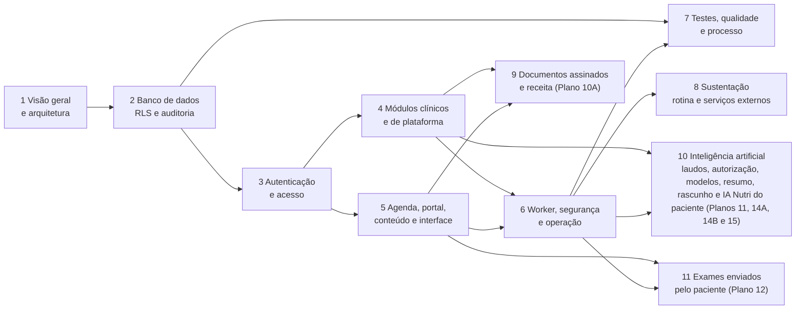

# Manual técnico do NutriDebby

Especificação técnica do produto como ele está no código. Explica o que existe, por que foi feito assim, como
funciona e como operar e estender sem quebrar o isolamento, a LGPD ou a produção.

| Item | Valor |
|---|---|
| Produto | SaaS multi-tenant de gestão de consultório de nutrição, com portal do paciente (PWA) e dado de saúde (LGPD) |
| Produção | `https://nutri.wsscloud.tech` (Easypanel, projeto `nutri`: `nutri_app`, `nutri_worker`, `nutri_db`) |
| Conferido contra | `main` em `62615b9` (PR #15, fechamento do Plano 08), em 05/10/2026; o cap. 8 contra `bbf2adf` (PR #18), na mesma data; o cap. 9 e as atualizações do Plano 10A contra `3991c7d` (PR #19), em 06/10/2026; o cap. 10 e as atualizações do Plano 11 contra `2efa27b` (PR #23, merge na `main`), em 07/10/2026; o cap. 11 e as atualizações do Plano 12 contra o branch `plano-12-exames-paciente` (Tarefas 1–14 integradas, antes do merge), em 07/10/2026; a §9.11 (parecer e retificação) e as atualizações do Plano 13 (inclusive a P09-07 no §4.1.1) contra o branch `plano-13-parecer` em `2d4b84c` (Tarefas 1–11 integradas, antes do merge), em 08/10/2026; as atualizações do Plano 16 (portal no layout G, §5.5.2 e §5.5.11–§5.5.14, §5.7.6, §5.8.4, a seção "Onde fica no portal" do cap. 11 e o `/admin` em abas da T17 nos caps. 1, 4, 6 e 8) contra o branch `plano-16-app-paciente` em `7b9f54e` (Tarefas 1–15 e 17 integradas, antes do merge; mergeado no PR #28, `3fe7452`, em 08/10/2026), em 08/10/2026; as atualizações do Plano 14A (autorização do paciente para IA e provedor na UE: §10.10–§10.11 e os caps. 1, 2 e 6) contra o branch `plano-14-ia-nutricionista` em `fa7f712` (Tarefas 1–11 integradas, antes do merge), em 09/10/2026; as atualizações do Plano 14B-1 (modelos sugeridos pela IA por área: §10.12 e os caps. 1, 2, 4 e 6) contra o branch `plano-14b-ia-nutri` (Tarefas 1–5 e o fechamento 5F, antes do merge; mergeado no PR #34, `95b2728`, em 13/10/2026), em 10/10/2026; as atualizações do Plano 14B-2 (resumo do histórico e rascunho de plano pela IA, com dado de paciente pseudonimizado: §10.13, as marcas "Plano 14B-2" do cap. 10 e os caps. 1, 2, 4 e 6) contra o branch `plano-14b-2-resumo-rascunho` em `1a92740` (Tarefas 6–12 integradas, antes do merge), em 14/10/2026; o CI no runner próprio da VPS (§7.7, §1.8, §1.9, §1.10 e os caps. 2, 6 e 8) contra o branch `runner-proprio` em `bbd7728` (antes do merge; mergeado no PR #33, `8a8d202`, em 13/10/2026), em 12/10/2026; as atualizações do Plano 15 (IA Nutri do paciente: §10.14, as marcas "Plano 15" do cap. 10 e os caps. 1, 2, 4, 5 e 6) contra o branch `plano-15-ia-nutri-paciente` em `4f8fade` (Tarefas 1–13 integradas, antes do merge; mergeado no PR #37, `528ae7b`, em 15/10/2026), em 15/10/2026; as atualizações do Plano 17 (lembretes de rotina por push: §5.3.9, §2.5.11 e os caps. 1, 2, 5, 6 e 7, com as linhas de `src/worker/index.ts`, `src/db/rls-guard.ts` e `test/isolamento.test.ts` refeitas) contra o branch `plano-17-lembretes-rotina` em `df641d3` (Tarefas 1–7 e o E2E integrados, antes do merge; base `5482450`; mergeado no PR #51, `667c952`, em 16/11/2026), em 17/11/2026; as atualizações do Plano 18, PR 1 (ficha do paciente: abas Início e Perfil, cabeçalho com a última avaliação e registro de seções — §4.2.10, §2.8.3, §5.8.1 e os caps. 1, 3, 5, 7, 9 e 10) contra o branch `plano-18-ficha-cadastro` em `d9066f9` (Tarefas 1–4, antes do merge; base `667c952`; mergeado no PR #52, `9eeacaf`), em 17/11/2026; as do Plano 18, PR 2 (cadastro complementar `patient_cadastro`, CPF, formulário em seções, lista nova, "No app do paciente", LGPD, nome social na IA, E2E e carga — §4.2.11, §2.5, §2.6, §2.8.3, §3.8, §5.8.1, §6.6, §6.8.1, §10.13.1, §10.14.3 e os caps. 1 e 7) contra o branch local `plano-18-pr2` em `3799409` (Tarefas 5–12b; base `6c3ee8f`, merge do PR #53), em 17/11/2026, com as citações `arquivo:linha` que o PR 2 e o PR 1 do Plano 20 deslocaram reconferidas sobre `e4dc52b` na revisão da P18-12c |
| Escopo | Planos 01–08, 09 (itens P09-01 a P09-05 e, pelo Plano 13, a P09-07), 10A, 11, 12 (parte F3-04 e a sessão da equipe) 13 (parecer nutricional e retificação, F3-05), 16 (app do paciente no layout G, G-01 e G-02, com a T17 do `/admin`) 14A (autorização do paciente para IA e provedor AWS na UE), 14B-1 (modelos de plano e de anamnese sugeridos pela IA por área, sem dado de paciente) 14B-2 (resumo do histórico e rascunho de plano pela IA, com dado de paciente pseudonimizado, e textos de IA 1.1) 15 (IA Nutri do paciente, F3-02: conversa sobre o próprio plano com resposta montada pelo sistema, consentimento próprio 1.0 e aditivo 1.2) 17 (lembretes de rotina por push, configurados pela nutricionista por paciente) e 18 (PR 1 e PR 2: ficha do paciente — abas Início e Perfil, cabeçalho e registro de seções — e o cadastro complementar `patient_cadastro`, CPF, formulário em seções, lista nova, "No app do paciente", LGPD e nome social na IA), spec do MVP v1.13, spec de documentos assinados v0.6, spec da IA v0.4 (§5.10 com a nota do Plano 13) spec C v0.3 (parte F3-04) e spec G v0.1 (app do paciente) e spec da IA v0.5.1 (parte do 14A) e v0.6 (parte da 14B-1) e v0.7 (parte da 14B-2) e a spec dos lembretes de rotina (13/11/2026) e a da ficha e cadastro (v0.3, 17/11/2026), migrations `0000`–`0125` (126 arquivos em `drizzle/`; as `0124`–`0125` são do Plano 18, §2.5.4, e os números mudam no rebase do PR 2 — pendência 3 do plano; as `0122`–`0123` são do Plano 20 (PR 1), a descrever no fechamento dele; as `0118`–`0121` são do Plano 17, §2.5.11; a `0106` é do Plano 16, §5.5.12 e §5.5.14; a `0110` é a migration de dados do prazo de guarda, JUR-01; o cap. 10 cobre `0098`–`0100`, do Plano 14A, `0107`–`0109`, do Plano 14B-1, `0111`–`0112`, do Plano 14B-2, `0113`–`0114` e, do Plano 15, `0115`–`0117`; o cap. 11, `0101`–`0102`, e o cap. 9, `0089`–`0093` e `0104`–`0105`; a `0103` é da sessão da equipe, Tarefa 14 do Plano 12) |
| Segredos | Só **nomes** de variáveis. Nenhum valor de `.env`, senha, token ou chave aparece no manual |

---

## Para quem é

- **Desenvolvedor que vai manter o sistema** sem ter participado do projeto. Comece pelo
  [cap. 1](01-visao-geral-e-arquitetura.md) e pelo [Guia do primeiro dia](07-testes-qualidade-e-processo.md#712-guia-do-primeiro-dia).
- **Revisor** de um PR: as regras e o que as guardas conferem estão no [cap. 2](02-banco-de-dados.md) e no
  [cap. 7](07-testes-qualidade-e-processo.md).
- **Quem opera** o servidor (dono): [cap. 6](06-worker-seguranca-operacao.md), em especial
  [O que só o dono faz](06-worker-seguranca-operacao.md#610-o-que-só-o-dono-faz) e a
  [Rotina de incidentes](06-worker-seguranca-operacao.md#69-rotina-de-incidentes); e o [cap. 8](08-sustentacao.md)
  para a rotina periódica, os serviços externos e o registro (checklist em
  [`docs/operacao/sustentacao.md`](../operacao/sustentacao.md)).

Não é manual de uso. O manual da nutricionista é o "manual guiado" dentro do painel
([§5.8](05-agenda-portal-conteudo.md#58-manual-guiado-p08-10-p08-d26-d27)).

## Ordem de autoridade

1. **Código** (`src/`, `drizzle/`, `scripts/`, `test/`, `e2e/`, `Dockerfile`, `next.config.ts`, `package.json`,
   `.github/workflows/`).
2. Spec do MVP: `docs/superpowers/specs/2026-09-27-nutridebby-mvp-design.md` e `…-mvp-historias.md`.
3. Planos, índice e backlog: `docs/superpowers/plans/`.
4. Runbooks: `docs/operacao/` (`go-live.md`, `restauracao.md`, `carga.md`, `sustentacao.md`, `ia.md`, `exames-enviados.md`, `app-paciente.md`).
5. `CLAUDE.md` do projeto.

Quando a spec e o código divergem, o manual descreve o código e registra a divergência no fim do capítulo. A lista
consolidada está em [Divergências spec × código](#divergências-spec--código-consolidadas).

Convenções de citação: `arquivo:N` aponta a linha no commit acima; quando a linha muda com facilidade, o manual cita o
nome da função. "Plano NN, Dx" é a decisão `Dx` do plano NN (o cap. 5 abrevia como "P05 D9"). "§x" é a seção da spec
de design. "Regra n" é a regra obrigatória n do `CLAUDE.md` do projeto.

---

## Índice

| Cap. | Arquivo | Assunto | Dono de |
|---|---|---|---|
| 1 | [01-visao-geral-e-arquitetura.md](01-visao-geral-e-arquitetura.md) | Produto, perfis, stack, monólito modular + worker, mapa do código, rotas, infraestrutura, variáveis, cronologia dos planos | Variáveis de ambiente (tabela única), infraestrutura, cronologia |
| 2 | [02-banco-de-dados.md](02-banco-de-dados.md) | Roles, migrations, catálogo de tabelas, RLS, contextos, funções SQL, guardas, auditoria | RLS, listas de `src/db/rls-guard.ts`, passo a passo de tabela nova |
| 3 | [03-autenticacao-e-acesso.md](03-autenticacao-e-acesso.md) | Better Auth, senha, 2FA, sessão, guardas por papel, vínculos do paciente, convites, aceites, proxy, suspensão, sair | Sessão e autorização, limites de login, proxy |
| 4 | [04-modulos-clinicos.md](04-modulos-clinicos.md) | Plataforma (contas, marca, armazenamento, monitoramento, métricas), prontuário, LGPD, exportação, alimentos, plano alimentar | Armazenamento e URL assinada, monitoramento de backup/disco, LGPD |
| 5 | [05-agenda-portal-conteudo.md](05-agenda-portal-conteudo.md) | Agenda, página pública, motor de notificações, canais (e-mail, WhatsApp, push), portal PWA, conteúdos, interface V2, manual guiado | Notificações, contexto `publico`, portal, audiência do conteúdo |
| 6 | [06-worker-seguranca-operacao.md](06-worker-seguranca-operacao.md) | pg-boss, filas, payload cifrado, cabeçalhos e CSP, limites, Turnstile, logs, Sentry, health, backup, carga, go-live, incidentes | Tabela única das 33 filas, segurança HTTP, backup e restauração |
| 7 | [07-testes-qualidade-e-processo.md](07-testes-qualidade-e-processo.md) | Vitest + Testcontainers, guardas, matriz de isolamento, E2E, CI/CD, ambiente de dev, regras do `CLAUDE.md`, revisão, plano novo, primeiro dia | Pipeline de CI e deploy, matriz de isolamento, processo |
| 8 | [08-sustentacao.md](08-sustentacao.md) | Rotina diária a anual (o que verificar, como, sinal e ação), alertas existentes, catálogo de serviços externos, responsáveis, registro na issue mensal, lacunas | Rotina de sustentação, catálogo de serviços externos e calendário de vencimentos |
| 9 | [09-documentos-assinados.md](09-documentos-assinados.md) | Módulo `documentos` (Planos 10A e 13): receita e parecer nutricional, retificação por versão nova, estados, imutabilidade no banco, PDF preparado e digitalizada no worker, 2FA ao assinar, entrega e recebimento, link de uso único, verificação pública, cancelamento, LGPD, interruptor do admin | Tabelas e gatilhos dos documentos, link `/documento/<token>`, verificação `/v` |
| 10 | [10-ia.md](10-ia.md) | Módulo `ia` (Plano 11): leitura de laudos com IA, provedor e sandbox, preparo do laudo no worker, portão do envio, cota e custo, erros e novas tentativas, privacidade (o que sai, ZDR, nada em log), como estender, divergências conhecidas; Plano 14A: autorização do paciente (banco só de inclusão, vigência e destino, retirada, canais app, link e papel, e-mails, exportação e anonimização), provedor `bedrock-eu`, `IA_RETENCAO_ZERO`, desvios conscientes; Plano 14B-1: modelos sugeridos por área (`gerar` com ferramentas, laço só de inclusão, validação, origem e aprovação dos modelos, avaliação dos pacotes); Plano 14B-2: resumo do histórico e rascunho de plano (o contrato do que sai, pseudonimização, portão do paciente, fontes conferidas, "Usar como rascunho", selo, rótulos do histórico, textos 1.1, avaliação com prontuários fictícios); Plano 15: IA Nutri do paciente (fluxo do app ao worker, resposta montada e textos fixos, filtro de risco, cota por escopo, pausa de emergência, consentimento e revogação, retenção, fila "Dúvidas dos pacientes", avaliação da conversa) | Tabelas `ia_tarefas`/`ia_uso`/`ia_gasto_plataforma`/`ia_autorizacoes`/`ia_geracoes_modelos` e as da IA Nutri (`ia_nutri_participacoes`/`ia_nutri_mensagens`/`ia_nutri_consentimentos`/`ia_nutri_pausa`), filas `ia`, `ia-retirada`, `ia-assistente` e as cinco da IA Nutri, cota de IA; runbook em [`docs/operacao/ia.md`](../operacao/ia.md) |
| 11 | [11-exames-enviados.md](11-exames-enviados.md) | Envio de exames pelo paciente (Plano 12, F3-04): fluxo do portal ao worker, rasterização do PDF num processo filho (PDFium em WASM), PDF limpo só com imagens, fila "Exames recebidos", aceite e recusa, transições conferidas no banco, cota, varredura, privacidade e LGPD, como estender, divergências | Tabelas `exam_submissions`/`exam_submission_files`, filas `exame-envio`, `exame-envio-limpar` e `expirar-exame-envio`, orçamento de memória da rasterização (RNF-162); runbook em [`docs/operacao/exames-enviados.md`](../operacao/exames-enviados.md) |

### Seções principais

**1. Visão geral e arquitetura** — [1.1 O produto](01-visao-geral-e-arquitetura.md#11-o-produto) ·
[1.2 Perfis de acesso](01-visao-geral-e-arquitetura.md#12-perfis-de-acesso) ·
[1.3 Stack](01-visao-geral-e-arquitetura.md#13-stack) ·
[1.4 Arquitetura](01-visao-geral-e-arquitetura.md#14-arquitetura-monólito-modular--worker) ·
[1.5 Mapa de `src/`](01-visao-geral-e-arquitetura.md#15-mapa-de-src-e-da-raiz-do-repositório) ·
[1.6 Módulos de domínio](01-visao-geral-e-arquitetura.md#16-módulos-de-domínio-srcmodules) ·
[1.7 Rotas](01-visao-geral-e-arquitetura.md#17-rotas-principais) ·
[1.8 Infraestrutura](01-visao-geral-e-arquitetura.md#18-infraestrutura) ·
[1.9 Variáveis de ambiente](01-visao-geral-e-arquitetura.md#19-variáveis-de-ambiente) ·
[1.10 Cronologia dos planos](01-visao-geral-e-arquitetura.md#110-cronologia-dos-planos) ·
[1.11 Como estender](01-visao-geral-e-arquitetura.md#111-como-estender-com-segurança-resumo)

**2. Banco de dados** — [2.2 Roles](02-banco-de-dados.md#22-roles-e-credenciais) ·
[2.3 Rodar](02-banco-de-dados.md#23-rodar-as-migrations) e [2.4 criar migrations](02-banco-de-dados.md#24-criar-migrations) ·
[2.5 Catálogo de tabelas](02-banco-de-dados.md#25-catálogo-de-tabelas) ·
[2.6 RLS em detalhe](02-banco-de-dados.md#26-rls-em-detalhe) ·
[2.7 Guardas no CI](02-banco-de-dados.md#27-guardas-no-ci) ·
[2.8 Auditoria](02-banco-de-dados.md#28-auditoria) ·
[2.9 Tabelas fora da RLS](02-banco-de-dados.md#29-tabelas-fora-da-rls-e-quem-as-acessa) ·
[2.10 Seeds](02-banco-de-dados.md#210-seeds) ·
[2.11 Tabela nova com `tenant_id`](02-banco-de-dados.md#211-passo-a-passo-tabela-nova-com-tenant_id)

**3. Autenticação e acesso** — [3.2 Papéis](03-autenticacao-e-acesso.md#32-papéis) ·
[3.3 Better Auth](03-autenticacao-e-acesso.md#33-configuração-do-better-auth-srclibauthts) ·
[3.5 2FA](03-autenticacao-e-acesso.md#35-verificação-em-duas-etapas-2fa) ·
[3.6 Sessão](03-autenticacao-e-acesso.md#36-sessão-inatividade-e-renovação) ·
[3.7 Guardas por papel](03-autenticacao-e-acesso.md#37-guardas-por-papel) ·
[3.8 Vínculos e `nd_vinculo`](03-autenticacao-e-acesso.md#38-sessão-do-paciente-vínculos-nd_vinculo-e-contexto-conta) ·
[3.10 Convites](03-autenticacao-e-acesso.md#310-convites) ·
[3.12 Aceites](03-autenticacao-e-acesso.md#312-aceites-dpa-e-termo-do-paciente-consents) ·
[3.13 Proxy](03-autenticacao-e-acesso.md#313-proxy-e-redirecionamento-seguro) ·
[3.14 Suspensão](03-autenticacao-e-acesso.md#314-suspensão-de-conta-rn-15-us-004) ·
[3.16 Fluxo de login](03-autenticacao-e-acesso.md#316-fluxo-de-login-completo)

**4. Módulos clínicos e de plataforma** — [4.0 Convenções](04-modulos-clinicos.md#40-convenções-que-todos-os-módulos-seguem) ·
[4.1 Plataforma](04-modulos-clinicos.md#41-plataforma) ·
[4.2 Pacientes e prontuário](04-modulos-clinicos.md#42-pacientes-e-prontuário) ·
[4.2.10 Ficha: Início, Perfil e registro de seções](04-modulos-clinicos.md#4210-ficha-do-paciente-início-perfil-cabeçalho-e-registro-de-seções-plano-18-pr-1) ·
[4.2.11 Cadastro complementar, lista e "No app"](04-modulos-clinicos.md#4211-cadastro-complementar-lista-e-no-app-do-paciente-plano-18-pr-2) ·
[4.3 Alimentos](04-modulos-clinicos.md#43-alimentos) ·
[4.4 Plano alimentar](04-modulos-clinicos.md#44-plano-alimentar) ·
[4.6 Como estender](04-modulos-clinicos.md#46-como-estender-com-segurança)

**5. Agenda, portal, conteúdo e interface** — [5.1 Agenda](05-agenda-portal-conteudo.md#51-agenda) ·
[5.2 Página pública](05-agenda-portal-conteudo.md#52-página-pública-nslug-rn-16-p05-d11d13) ·
[5.3 Motor de notificações](05-agenda-portal-conteudo.md#53-motor-de-notificações-rn-05-p05-d6-d7) e
[5.3.9 lembretes de rotina](05-agenda-portal-conteudo.md#539-lembretes-de-rotina-por-push-plano-17) ·
[5.4 Canais](05-agenda-portal-conteudo.md#54-canais) ·
[5.5 Portal do paciente](05-agenda-portal-conteudo.md#55-portal-do-paciente-p-plano-06-layout-g-no-plano-16) ([5.5.2 seções](05-agenda-portal-conteudo.md#552-rotas-e-seções), [5.5.11 mural de Hoje](05-agenda-portal-conteudo.md#5511-hoje-o-mural-plano-16-us-191-43), [5.5.12 respostas](05-agenda-portal-conteudo.md#5512-respostas-no-diário-plano-16-us-192-rn-197-rn-198), [5.5.13 Jornada](05-agenda-portal-conteudo.md#5513-jornada-plano-16-us-194-45), [5.5.14 peso oculto](05-agenda-portal-conteudo.md#5514-não-mostrar-peso-no-app-plano-16-us-195-rn-203-a-rn-206)) ·
[5.6 Conteúdos](05-agenda-portal-conteudo.md#56-conteúdos-plano-07) ·
[5.7 Interface do painel](05-agenda-portal-conteudo.md#57-interface-do-painel-plano-08) ·
[5.8 Manual guiado](05-agenda-portal-conteudo.md#58-manual-guiado-p08-10-p08-d26-d27) ·
[5.9 Como estender](05-agenda-portal-conteudo.md#59-como-estender-com-segurança)

**6. Worker, segurança e operação** — [6.2 Worker pg-boss](06-worker-seguranca-operacao.md#62-worker-pg-boss) ·
[6.3 Segurança](06-worker-seguranca-operacao.md#63-segurança) ·
[6.4 Observabilidade](06-worker-seguranca-operacao.md#64-observabilidade) ·
[6.5 Backup e restauração](06-worker-seguranca-operacao.md#65-backup-e-restauração-rnf-05-regra-10) ·
[6.6 Carga (k6)](06-worker-seguranca-operacao.md#66-teste-de-carga-k6) ·
[6.7 Go-live](06-worker-seguranca-operacao.md#67-checklist-do-go-live) ·
[6.8 Deploy e volta](06-worker-seguranca-operacao.md#68-deploy-e-volta-atrás) ·
[6.9 Incidentes](06-worker-seguranca-operacao.md#69-rotina-de-incidentes) ·
[6.10 O que só o dono faz](06-worker-seguranca-operacao.md#610-o-que-só-o-dono-faz) ·
[6.11 Decisões](06-worker-seguranca-operacao.md#611-decisões-de-projeto-deste-capítulo)

**7. Testes, qualidade e processo** — [7.3 Vitest + Testcontainers](07-testes-qualidade-e-processo.md#73-vitest--testcontainers) ·
[7.4 Guardas do CI](07-testes-qualidade-e-processo.md#74-guardas-do-ci) ·
[7.5 E2E](07-testes-qualidade-e-processo.md#75-e2e-com-playwright) ·
[7.7 CI e deploy](07-testes-qualidade-e-processo.md#77-pipeline-do-ci-e-deploy) ·
[7.8 Ambiente de dev](07-testes-qualidade-e-processo.md#78-ambiente-de-desenvolvimento) ·
[7.9 Regras do `CLAUDE.md`](07-testes-qualidade-e-processo.md#79-as-10-regras-do-claudemd-com-o-porquê) ·
[7.10 Revisão](07-testes-qualidade-e-processo.md#710-fluxo-de-revisão-a-cada-entrega) ·
[7.11 Plano novo](07-testes-qualidade-e-processo.md#711-como-abrir-um-plano-novo) ·
[7.12 Primeiro dia](07-testes-qualidade-e-processo.md#712-guia-do-primeiro-dia)

**8. Sustentação** — [8.1 Visão geral e estado atual](08-sustentacao.md#81-visão-geral) ·
[8.2 O que roda sozinho](08-sustentacao.md#82-o-que-roda-sozinho-e-onde-ver-que-rodou) ·
[8.3 Rotina periódica](08-sustentacao.md#83-rotina-periódica) ·
[8.4 Serviços externos](08-sustentacao.md#84-catálogo-de-serviços-externos) ·
[8.5 Responsáveis e registro](08-sustentacao.md#85-responsáveis-e-registro) ·
[8.6 Lacunas](08-sustentacao.md#86-lacunas-o-que-hoje-não-é-vigiado)

**9. Documentos assinados e receita** — [9.1 Visão geral e interruptor](09-documentos-assinados.md#91-visão-geral) ·
[9.2 Arquivos do módulo](09-documentos-assinados.md#92-arquivos-do-módulo) ·
[9.3 Banco](09-documentos-assinados.md#93-banco) ·
[9.4 Ciclo do documento](09-documentos-assinados.md#94-ciclo-do-documento) ·
[9.5 Link e verificação](09-documentos-assinados.md#95-link-de-uso-único-e-verificação-pública) ·
[9.6 2FA ao assinar](09-documentos-assinados.md#96-código-do-2fa-no-momento-de-assinar-rn-145-d13) ·
[9.7 Rotas](09-documentos-assinados.md#97-rotas) ·
[9.8 Filas](09-documentos-assinados.md#98-filas-e-varreduras) ·
[9.10 Operação](09-documentos-assinados.md#910-operação) ·
[9.11 Parecer e retificação](09-documentos-assinados.md#911-parecer-nutricional-e-retificação-plano-13)

**10. Inteligência artificial** — [10.1 Visão](10-ia.md#101-visão) ·
[10.2 Peças](10-ia.md#102-peças) ·
[10.3 Fluxo](10-ia.md#103-fluxo) ·
[10.4 Banco](10-ia.md#104-banco) ·
[10.5 Cota e custo](10-ia.md#105-cota-e-custo) ·
[10.6 Erros](10-ia.md#106-erros-e-novas-tentativas-d4-rn-105) ·
[10.7 Privacidade](10-ia.md#107-privacidade) ·
[10.8 Como estender](10-ia.md#108-como-estender) ·
[10.9 Divergências](10-ia.md#109-divergências-conhecidas) ·
[10.10 Autorização do paciente e provedor na UE](10-ia.md#1010-autorização-do-paciente-e-provedor-na-ue-plano-14a) ·
[10.11 Desvios do Plano 14A](10-ia.md#1011-divergências-do-plano-14a-desvios-conscientes) ·
[10.12 Modelos sugeridos pela IA (Plano 14B-1)](10-ia.md#1012-modelos-sugeridos-pela-ia-plano-14b-1) ·
[10.13 IA Nutri — resumo e rascunho (Plano 14B-2)](10-ia.md#1013-ia-nutri--resumo-e-rascunho-plano-14b-2) ·
[10.14 IA Nutri do paciente (Plano 15)](10-ia.md#1014-ia-nutri-do-paciente-plano-15)

**11. Exames enviados pelo paciente** — [11.1 Visão](11-exames-enviados.md#111-visão) ·
[11.2 Peças](11-exames-enviados.md#112-peças) ·
[11.3 Banco](11-exames-enviados.md#113-banco) ·
[11.4 Arquivos e cota](11-exames-enviados.md#114-arquivos-e-cota) ·
[11.5 Rasterização](11-exames-enviados.md#115-rasterização) ·
[11.6 Privacidade](11-exames-enviados.md#116-privacidade) ·
[11.7 Como estender](11-exames-enviados.md#117-como-estender) ·
[11.8 Divergências](11-exames-enviados.md#118-divergências-conhecidas)

### Onde cada assunto mora

Cada assunto tem um capítulo dono, com o detalhe. Os outros capítulos trazem um resumo de uma ou duas frases e um link.

| Assunto | Capítulo dono | Citado também em |
|---|---|---|
| Variáveis de ambiente (todas) | [§1.9](01-visao-geral-e-arquitetura.md#19-variáveis-de-ambiente) | §3.18, §5.10, §6.2.1, §6.5.3 (só as do assunto) |
| Listas e guardas de RLS/auditoria | [§2.7](02-banco-de-dados.md#27-guardas-no-ci) | §7.4.1 (o porquê) |
| Tabela nova com `tenant_id` | [§2.11](02-banco-de-dados.md#211-passo-a-passo-tabela-nova-com-tenant_id) | §1.11, §7.4.4 |
| Limites de login | [§3.3](03-autenticacao-e-acesso.md#limite-de-tentativas) | §6.3.4 (todos os limites) |
| Proxy e rotas protegidas | [§3.13](03-autenticacao-e-acesso.md#313-proxy-e-redirecionamento-seguro) | §6.3.3 |
| Suspensão do tenant | [§3.14](03-autenticacao-e-acesso.md#314-suspensão-de-conta-rn-15-us-004) | §5.3.8 (lembretes) |
| Armazenamento, cota e URL assinada | [§4.1.3](04-modulos-clinicos.md#413-armazenamento-com-cota-e-url-assinada-rn-18-regra-9-do-claudemd) | §6.3.6, §6.3.7 |
| Monitor de backup e disco | [§4.1.4](04-modulos-clinicos.md#414-monitoramento-de-backup-e-disco-rnf-05-rnf-13) | §6.5.6 |
| Filas do worker (33) | [§6.2.3](06-worker-seguranca-operacao.md#623-filas) | §4.5, §5.10, §9.8 |
| Lembretes de rotina por push (configuração, plano do dia, envio, "a nutricionista não religa", LGPD) | [§5.3.9](05-agenda-portal-conteudo.md#539-lembretes-de-rotina-por-push-plano-17) | §1.6, §1.10, §2.5.11, §2.7, §2.8, §6.2.3 |
| Ficha do paciente (abas Início e Perfil, cabeçalho com a última avaliação, registro de seções do Início, Adicionar) | [§4.2.10](04-modulos-clinicos.md#4210-ficha-do-paciente-início-perfil-cabeçalho-e-registro-de-seções-plano-18-pr-1) | §1.6, §1.7, §1.10, §1.11, §2.8.3, §5.8.1, §7.4.3, §7.4.5, §9.1, §10.13 |
| Cadastro complementar e CPF, nome social, lista de pacientes (abas, ordem, menu "Ações"), "Cadastro incompleto", "No app do paciente" (Plano 18, PR 2) | [§4.2.11](04-modulos-clinicos.md#4211-cadastro-complementar-lista-e-no-app-do-paciente-plano-18-pr-2) | §2.5.1 e §2.5.4 (`patient_cadastro`), §2.6.2 e §3.8 (contexto do paciente aberto pela nutricionista), §4.2.8 e §4.2.9 (LGPD), §6.8.1 (volta atrás), §10.13.1 (nome social na máscara), §6.6 (carga, CS-263) |
| Documentos assinados (receita, parecer, retificação, link, verificação) | [cap. 9](09-documentos-assinados.md) | §1.6, §1.7, §2.5, §2.7, §2.9, §6.2.3, §6.3, §7.4 |
| Backup e restauração | [§6.5](06-worker-seguranca-operacao.md#65-backup-e-restauração-rnf-05-regra-10) | §1.8 |
| CI, imagem e deploy | [§7.7](07-testes-qualidade-e-processo.md#77-pipeline-do-ci-e-deploy) | §1.8 (diagrama), §6.8; runner próprio: `docs/operacao/runner-proprio.md` e `infra/runner/` |
| Matriz de isolamento | [§7.4.2](07-testes-qualidade-e-processo.md#742-a-matriz-de-isolamento-testisolamentotestts) | §2.7 |
| Tela nova (painel e portal) | [§7.4.5](07-testes-qualidade-e-processo.md#745-checklist-tela-nova) | §1 (rotas), §3.17, §5.9 |
| Volta atrás de um deploy | [§6.8.1](06-worker-seguranca-operacao.md#681-roteiro-de-volta-atrás) | §1.8, §7.7 |
| Segredo vazado (troca de variável) | [§6.9.1](06-worker-seguranca-operacao.md#691-segredo-vazado) | §6.10 |
| Rotina periódica, registro e responsáveis | [§8.3](08-sustentacao.md#83-rotina-periódica), [§8.5](08-sustentacao.md#85-responsáveis-e-registro) | §6.10; `docs/operacao/sustentacao.md` |
| Serviços externos, cotas e vencimentos | [§8.4](08-sustentacao.md#84-catálogo-de-serviços-externos) | §1.8, §6.4, §6.5 |
| IA de laudos (provedor, cota, privacidade, liberação), autorização do paciente (Plano 14A), modelos sugeridos por área (Plano 14B-1), resumo do histórico e rascunho de plano (Plano 14B-2), IA Nutri do paciente (Plano 15) | [cap. 10](10-ia.md) | §1.9, §2.5.10, §2.6.8, §6.2.3, §6.3.8, §6.10, §7.4, §8.4; `docs/operacao/ia.md` (runbook), `docs/operacao/go-live.md` |
| Portal do paciente no layout G (seções, mural de Hoje, respostas, Jornada, peso oculto, guia do portal) | [§5.5](05-agenda-portal-conteudo.md#55-portal-do-paciente-p-plano-06-layout-g-no-plano-16), [§5.7.6](05-agenda-portal-conteudo.md#576-portal-tokens-faixa-e-fontes-p08-d18-layout-g-no-plano-16), [§5.8.4](05-agenda-portal-conteudo.md#584-manual-guiado-do-portal-plano-16-t14-us-199-rn-212-pm-g10) | §1.7, §1.10, §4 (exportação), §6.8.1 (voltar atrás), §7.4.5, cap. 11; `docs/operacao/app-paciente.md` (runbook) |
| Exames enviados pelo paciente (envio, rasterização, revisão, memória) | [cap. 11](11-exames-enviados.md) | §6.4 (#3, limites do worker), §7.7 (orçamento da imagem e filtro de documentação); `docs/operacao/exames-enviados.md` (runbook) |

---

## Como manter este manual

**Quando.** No **fechamento de cada plano**, no mesmo PR curto de docs que sobe a spec para a versão seguinte e
atualiza o backlog (ex.: PR #15, `plano-08-fechamento`; passo 9 de
[§7.11](07-testes-qualidade-e-processo.md#711-como-abrir-um-plano-novo)). Correção pontual (bug, débito) que muda o que
um capítulo afirma também atualiza o capítulo no próprio PR.

**Fonte de verdade = código.** Toda afirmação técnica cita o arquivo e a linha ou a função. Ao atualizar, confira no
código, não na memória nem só na spec.

Roteiro do fechamento:

1. Atualize "Conferido contra" (commit e data) aqui e no [cap. 1](01-visao-geral-e-arquitetura.md), e a faixa de
   migrations (`ls drizzle/*.sql`).
2. Para cada tabela nova: linha no catálogo ([§2.5](02-banco-de-dados.md#25-catálogo-de-tabelas)) e na matriz de
   proteção; listas novas ou alteradas de `src/db/rls-guard.ts` e `src/db/audit-guard.ts` em [§2.7](02-banco-de-dados.md#27-guardas-no-ci).
3. Fila nova em `QUEUES` (`src/jobs/queues.ts`): linha em [§6.2.3](06-worker-seguranca-operacao.md#623-filas).
4. Variável nova em `src/env.ts`: linha em [§1.9](01-visao-geral-e-arquitetura.md#19-variáveis-de-ambiente).
5. Módulo, rota ou tela nova: [§1.6](01-visao-geral-e-arquitetura.md#16-módulos-de-domínio-srcmodules),
   [§1.7](01-visao-geral-e-arquitetura.md#17-rotas-principais) e o capítulo do domínio.
6. Decisões do plano (Dx) que mudam arquitetura: no capítulo do assunto, com o número da decisão; linha nova na
   [cronologia](01-visao-geral-e-arquitetura.md#110-cronologia-dos-planos).
7. Confira as divergências: remova as resolvidas (spec corrigida ou código alterado), registre as novas no capítulo e
   na [lista consolidada](#divergências-spec--código-consolidadas).
8. Linhas citadas (`arquivo:N`) envelhecem rápido. Prefira citar a função quando o arquivo mudou muito.
9. Confira os links internos (cada link `capítulo.md#âncora` aponta para um título que existe; a âncora é o título em
   minúsculas, sem pontuação, com hífens no lugar dos espaços) e não duplique detalhe:
   escreva no capítulo dono e ponha um link nos outros ([Onde cada assunto mora](#onde-cada-assunto-mora)).

Nunca copie valor de segredo, nem os valores fictícios do CI, do `Dockerfile` ou do seed do E2E. Nunca consulte o banco
de produção para escrever o manual (regra 5 do `CLAUDE.md`).

---

## Glossário

### Domínio

| Termo | Significado | Fonte |
|---|---|---|
| Tenant | A conta de uma nutricionista (consultório). Isola todos os dados dela. Linha em `tenants` | Spec, Apêndice B; [§2.5](02-banco-de-dados.md#25-catálogo-de-tabelas) |
| Debby | A primeira cliente (piloto) do produto | Spec §1 |
| Dono | Dono do servidor e do produto. Aprova merge, reinício, mudança no Easypanel e no banco de produção | `CLAUDE.md`, regra 6; [§6.10](06-worker-seguranca-operacao.md#610-o-que-só-o-dono-faz) |
| Admin | Usuário da plataforma que cria e suspende contas. Não tem contexto de tenant e nunca lê tabela 🔒 | Spec §3; `src/db/tenant.ts:56` |
| Paciente / titular | A pessoa atendida. "Titular" é o termo da LGPD para o dono dos dados (pedidos de exportação e exclusão) | Spec, US-018 e US-046 |
| Vínculo | Relação (consultório, prontuário) de uma conta de paciente. Uma conta pode ter vínculos em vários consultórios; o escolhido fica no cookie `nd_vinculo` | Spec, Apêndice B; `src/lib/paciente-session.ts` (`COOKIE_VINCULO`) |
| DPA | Contrato de tratamento de dados entre a nutricionista (controladora) e a plataforma (operadora); aceite em `consents` | Spec, Apêndice B; [§3.12](03-autenticacao-e-acesso.md#312-aceites-dpa-e-termo-do-paciente-consents) |
| Termo | Termo de consentimento do paciente, versionado; aceite em `consents` | [§3.12](03-autenticacao-e-acesso.md#312-aceites-dpa-e-termo-do-paciente-consents) |
| Prazo de guarda / anonimização | Tempo que o prontuário bloqueado é guardado antes de o job `retencao-lgpd` anonimizar o titular | [§4.2.8](04-modulos-clinicos.md#428-lgpd-arquivar-pedido-de-exclusão-e-anonimização-us-018-rnf-08) |
| Plano publicado | Versão imutável do plano alimentar; no máximo 1 por paciente (RN-01) | [§4.4.3](04-modulos-clinicos.md#443-publicação-com-versão-rn-01-us-025-plano-04-d10) |
| TACO | Tabela Brasileira de Composição de Alimentos, 4ª ed. (INT-04), carregada por migration | [§4.3.1](04-modulos-clinicos.md#431-taco-4ª-ed-e-seed-int-04-us-020) |
| TMB / GET / VET | Taxa metabólica basal / gasto energético total / valor energético total do plano | Spec, Apêndice A e B |
| Audiência | Quem vê um conteúdo da biblioteca (todos, etiqueta ou pacientes escolhidos), aplicada no banco (RN-12) | [§5.6.5](05-agenda-portal-conteudo.md#565-audiência-no-banco-rn-12-p07-d2) |
| Link da consulta | `/consulta/<token>`, assinado por HMAC e amarrado ao e-mail do paciente; ação sem login | Spec, Apêndice B; [§5.1.7](05-agenda-portal-conteudo.md#517-link-assinado-da-consulta-p05-d20) |
| Página pública | `/n/<slug>`: agendamento sem login, com Turnstile e código por e-mail (RN-16) | [§5.2](05-agenda-portal-conteudo.md#52-página-pública-nslug-rn-16-p05-d11d13) |
| Evolution API | Serviço autohospedado que conecta o WhatsApp de cada consultório (INT-01, Plano 05) | [§5.4.2](05-agenda-portal-conteudo.md#542-whatsapp-pela-evolution-api-int-01-p05-d1d5) |
| Manual guiado | Ajuda dentro do painel para a nutricionista (`src/modules/ajuda`, Plano 08) | [§5.8](05-agenda-portal-conteudo.md#58-manual-guiado-p08-10-p08-d26-d27) |
| Documento assinado / receita | Documento com validade profissional emitido no prontuário (receita de suplementos e fitoterápicos, Plano 10A; parecer nutricional, Plano 13), imutável depois do preparo e verificável por código | [cap. 9](09-documentos-assinados.md) |
| Parecer nutricional | Documento assinado sobre os exames lançados: cópia congelada dos exames escolhidos (nunca o laudo), avaliação, conduta e encaminhamentos, sem diagnóstico de doença (Plano 13, US-141) | [§9.11.2](09-documentos-assinados.md#9112-parecer-do-rascunho-à-assinatura) |
| Retificação / versão | Correção de um documento assinado por uma versão nova (`versao + 1`, `retifica_id`) com motivo obrigatório; assinada, leva a anterior a "substituido" (Plano 13, US-148, RN-146) | [§9.11.3](09-documentos-assinados.md#9113-retificação-us-148-rn-146-rn-147) |
| Código de verificação | 12 caracteres Crockford (`XXXX-XXXX-XXXX`) impressos com o QR no PDF; a verificação pública em `/v/<código>` não mostra nada do paciente | [§9.5](09-documentos-assinados.md#95-link-de-uso-único-e-verificação-pública) |
| Digitalizada | Assinatura à mão: a nutricionista envia fotos das páginas assinadas com o código do 2FA e o worker monta um PDF novo (opção E da D1 da spec de documentos) | [§9.4.2](09-documentos-assinados.md#942-assinatura-digitalizada-rn-157-d4-d24) |
| Link do documento | `/documento/<token>`: entrega a quem não tem o app, com código de 6 dígitos por e-mail e sessão de 15 min | [§9.5](09-documentos-assinados.md#95-link-de-uso-único-e-verificação-pública) |
| Interruptor "Documentos" | `tenants.documentos_liberados`, ligado pelo admin só depois da liberação para uso real (Plano 10A, D20). Desde a `0100`, só muda fora de `withTenant` | [§9.1](09-documentos-assinados.md#91-visão-geral) |
| Leitura de laudo com IA | A IA lê o laudo anexado ao exame e devolve os valores como **sugestão**; nada entra no prontuário sem a nutricionista marcar e salvar (F3-01, Plano 11) | [cap. 10](10-ia.md) |
| Tarefa de IA / sugestão | Uma linha de `ia_tarefas` por pedido; a sugestão (`resultado`) fica guardada até ser aplicada, descartada, cancelada ou vencer (7 dias) e depois é esvaziada | [§10.4](10-ia.md#104-banco) |
| Interruptor "IA" | `tenants.ia_liberada`, ligado pela admin na coluna "IA" só depois da liberação para uso real (A-06); em produção, recusado com textos provisórios (D22) | [§10.1](10-ia.md#101-visão) |
| Aditivo de IA | Complemento do DPA aceito pela nutricionista ao ativar a IA; linha `ia-aditivo-<versão>` em `consents` (A-D20) | [§10.2](10-ia.md#102-peças) |
| Aviso de IA / ciência do paciente | **Legado do Plano 11** (substituído pela autorização no Plano 14A, RN-128): aviso de privacidade sobre IA entregue a cada paciente (por e-mail ou em mãos). As colunas ficam em `patients`, congeladas desde a `0109`; a exportação as mostra só se preenchidas | [§10.7](10-ia.md#107-privacidade) |
| "Não usar IA" | **Legado do Plano 11**: recusa do paciente marcada pela nutricionista (`patients.ia_recusada_em`, US-103), congelada desde a `0109`; no lugar dela, a retirada da autorização | [§10.7](10-ia.md#107-privacidade) |
| Autorização de IA | Consentimento específico do paciente para o uso de IA com os dados dele (Plano 14A, A-D23 a A-D25): um evento por linha em `ia_autorizacoes` (`autorizou`, `retirou`, `pedido_email`), só de inclusão; vale para a versão, os usos e o **destino** em que foi dada. Canais: app, link do e-mail (sem login) e termo em papel | [§10.10](10-ia.md#1010-autorização-do-paciente-e-provedor-na-ue-plano-14a) |
| Destino (IA) | Para onde o dado vai: `anthropic-us`, `bedrock-eu` ou `teste` (`DESTINO_DO_PROVEDOR`); gravado na autorização e, no portão do envio, em `ia_tarefas.destino` (RN-109, D6) | [§10.10.3](10-ia.md#10103-destino-rn-109-d6) |
| Retenção zero (`IA_RETENCAO_ZERO`) | Interruptor que o dono liga quando a retenção zero do provedor está confirmada; sem ele, nenhum uso com dado de paciente (D9, `estadoIaComPaciente`) | [§10.7](10-ia.md#107-privacidade) |
| Código de referência (termo) | 12 caracteres Crockford (`XXXX-XXXX-XXXX`) de tenant, paciente, versão e destino, impressos em cada página do termo em papel da autorização de IA; a nutricionista digita o código lido no papel ao salvar e o sistema recusa o de outro texto | [§10.10.5](10-ia.md#10105-os-canais-app-link-e-papel) |
| Cota de IA / teto da plataforma | Limite mensal em US$ por consultório (`ia_cota_mensal_usd`, padrão 15) e teto mensal da plataforma inteira (`IA_TETO_GLOBAL_MENSAL_USD`); o custo é reservado antes do envio e acertado depois | [§10.5](10-ia.md#105-cota-e-custo) |
| ZDR | *Zero data retention*: o provedor não guarda o laudo depois da resposta; pré-condição para dado real (A-D4) | [§10.7](10-ia.md#107-privacidade) |
| Sandbox / fake (IA) | Provedores sem rede: `sandbox` (resposta fixa, dev e E2E) e `fake` (programável, testes). Os dois são recusados em produção | [§10.2](10-ia.md#102-peças) |
| Resumo do histórico / rascunho de plano (IA) | Os dois usos da IA Nutri com dado de paciente pseudonimizado (Plano 14B-2): o resumo do prontuário antes da consulta, com cada frase ligada ao registro de onde veio, e o primeiro rascunho do plano a partir das metas da nutricionista, com as contas do sistema. Tipos `resumo_historico` e `rascunho_plano` de `ia_tarefas` | [§10.13](10-ia.md#1013-ia-nutri--resumo-e-rascunho-plano-14b-2) |
| Pseudonimização / contrato do que sai | Só as categorias de `CATEGORIAS_POR_USO` (`campos-enviados.ts`) saem, com a idade no lugar do nascimento, índices locais `#n` e o texto livre pela máscara (`pseudonimizar.ts`: nome, e-mail, telefone e CPF do paciente); um teste compara o contrato com o texto da autorização 1.1 | [§10.13.1](10-ia.md#10131-o-que-sai-e-a-pseudonimização-d8d11-rn-115-rn-120) |
| Selo de IA | "Elaborado com apoio de IA e revisado pela nutricionista" no PDF e no app do plano publicado que nasceu de "Usar como rascunho" (`meal_plans.ia_origem_em`, RN-117, art. 37 da Res. CFN nº 856/2026); no editor, "Criado com apoio de IA" | [§10.13.4](10-ia.md#10134-selo-rn-117-a-d13-d16) |
| IA Nutri do paciente | A conversa do paciente com a IA sobre o **próprio plano publicado** e as orientações publicadas, dentro de Plano no app (`/p/plano/ia`, F3-02, Plano 15): liberada pela nutricionista paciente por paciente e com consentimento próprio (`ia_nutri_consentimentos`, 1.0); o modelo só classifica e aponta trechos. O nome visto pelo paciente é `NOME_IA_NUTRI`; não confundir com o lado da nutricionista da §10.13 | [§10.14](10-ia.md#1014-ia-nutri-do-paciente-plano-15) |
| Resposta montada | O texto que o paciente lê quando a pergunta é sobre o plano: frase fixa do tipo + os trechos citados, **relidos do banco** na sessão de paciente, com a fonte + frase final (`montarResposta`, RN-172, D21); nenhuma palavra do modelo | [§10.14.1](10-ia.md#10141-o-fluxo-42-com-os-nomes-reais) |
| Texto fixo | Resposta pronta de `TEXTOS_FIXOS` (`textos.ts`) para risco, sintoma, suplemento ou remédio, mudança de plano, peso, fora do escopo, "Não encontrei…", falha e indisponível; o banco guarda só o código (`ia_nutri_mensagens.texto_fixo`, DP-4) e a tela traduz | [§10.14.10](10-ia.md#101410-telas-textos-fixos-e-manual-guiado) |
| Pausa da plataforma (IA Nutri) | Desligamento de **emergência** da IA Nutri em todos os consultórios (RN-185): a linha única de `ia_nutri_pausa`, que nasce não pausada (★ DO-1 = não, D37), com "Pausar"/"Retomar" em Admin › Servidor; `IA_NUTRI_DESLIGADA=1` é a segunda barreira | [§10.14.5](10-ia.md#10145-a-pausa-de-emergência-e-as-duas-barreiras-rn-185-dp-1-do-1-do-5) |
| Fila "Dúvidas dos pacientes" | As perguntas que o paciente enviou à nutricionista pela IA Nutri e as mensagens com sinal de risco (no topo); ela abre e **marca como vista** — sem resposta escrita pela plataforma (D24 = b) | [§10.14.10](10-ia.md#101410-telas-textos-fixos-e-manual-guiado) |
| Seção (portal) | Uma das cinco partes do app do paciente na faixa do topo — Hoje, Jornada, Plano, Exames (condicional), Eu; toda tela do portal marca uma (Plano 16) | [§5.5.2](05-agenda-portal-conteudo.md#552-rotas-e-seções) |
| Mural (Hoje) | A lista de Hoje no app do paciente: refeição perto do horário, registros, comentários da nutricionista e avisos do consultório, composta na leitura (sem tabela, não é chat) | [§5.5.11](05-agenda-portal-conteudo.md#5511-hoje-o-mural-plano-16-us-191-43) |
| Resposta à refeição | "Comi assim" / "Comi outra coisa": registro do diário com `resposta` e a cópia `refeicao_do_plano` ("{nome} · {HH:MM}") | [§5.5.12](05-agenda-portal-conteudo.md#5512-respostas-no-diário-plano-16-us-192-rn-197-rn-198) |
| Jornada | Seção do app com a linha do tempo dos atendimentos, as medidas, as orientações e a próxima consulta; a mini-jornada é o resumo na faixa de Hoje | [§5.5.13](05-agenda-portal-conteudo.md#5513-jornada-plano-16-us-194-45) |
| "Não mostrar peso no app" | Opção por paciente, ligada só pela equipe (`patients.peso_oculto_no_app_em`): peso e IMC não chegam ao aparelho; o prontuário e as exportações não mudam | [§5.5.14](05-agenda-portal-conteudo.md#5514-não-mostrar-peso-no-app-plano-16-us-195-rn-203-a-rn-206) |
| Lembrete de rotina | Aviso por push configurado pela nutricionista por paciente — água, refeições do plano (com o pedido opcional de registro no diário), suplemento ou lembrete livre —, enviado pelo job `lembretes-rotina` entre 06:00 e 22:00 no fuso do consultório, no máximo 24 por dia; nunca por WhatsApp, e-mail ou `notifications` (Plano 17). O paciente desliga cada um ou pausa todos; a nutricionista não religa | [§5.3.9](05-agenda-portal-conteudo.md#539-lembretes-de-rotina-por-push-plano-17); `src/modules/lembretes/` |
| Slot (lembrete de rotina) | Um instante de envio do plano do dia (`Slot`, `src/modules/lembretes/slots.ts:15`): o minuto local, o tipo que define o texto e os ids dos lembretes fundidos naquele minuto. Sai no máximo uma vez, até 10 min depois do horário | [§5.3.9](05-agenda-portal-conteudo.md#539-lembretes-de-rotina-por-push-plano-17) |
| Marca de envio | `lembretes_rotina_envios.ultimo_slot_em`: o último slot enviado de cada lembrete, gravado pelo worker com upsert condicional **antes** do envio (o que garante o "no máximo uma vez"); `staff_only` e fora da auditoria | [§2.5.11](02-banco-de-dados.md#2511-lembretes-de-rotina-lembretests-plano-17) |
| Ficha do paciente (Início, Perfil) | O prontuário no painel (`/painel/pacientes/{id}`), em abas. **Início** reúne o que já foi feito (cartão Resumo, botão Adicionar, bloco da IA e as seções); **Perfil** guarda o cadastro, o "Acesso ao app" e as etiquetas (Plano 18, D12) | [§4.2.10](04-modulos-clinicos.md#4210-ficha-do-paciente-início-perfil-cabeçalho-e-registro-de-seções-plano-18-pr-1) |
| Seção do Início / registro de seções | Cada bloco do Início ("Plano alimentar (2)"…): contador e os 3 últimos com rótulo genérico, data e situação, sem conteúdo clínico nem `auditRead`. Uma `SecaoDaFicha` por arquivo em `src/modules/ficha/secoes/`, na lista `SECOES_DA_FICHA`, onde os outros planos penduram as suas (Plano 18, D14) | [§4.2.10](04-modulos-clinicos.md#4210-ficha-do-paciente-início-perfil-cabeçalho-e-registro-de-seções-plano-18-pr-1) |
| Adicionar (ficha) | Botão único do Início que abre o diálogo "Adicionar ao prontuário" (grupos Avaliações, Prescrições e, quando usado, Outros): link para a aba com o foco no formulário, ou a Server Action da aba Documentos (Plano 18, D15, D25) | [§4.2.10](04-modulos-clinicos.md#4210-ficha-do-paciente-início-perfil-cabeçalho-e-registro-de-seções-plano-18-pr-1) |
| Contrato do registro (`SecaoDaFicha`) | O que uma seção do Início declara: `id`, `titulo`, `aba` ou `verTodos` (caminho absoluto em `/painel/`, para "Ver todos" fora da ficha), `disponivel` (monótona no total), `resumo`, `leitura?: { entidade }` (só a seção que devolve dado auditado: `inicio.ts` grava **um** `auditRead` dela quando há itens), `adicionar?` (grupos Avaliações, Prescrições e Outros; destino `href` ou ação) e `noApp?` (contagem no contexto do paciente) | `src/modules/ficha/tipos.ts:38`; [§4.2.10](04-modulos-clinicos.md#4210-ficha-do-paciente-início-perfil-cabeçalho-e-registro-de-seções-plano-18-pr-1) |
| Cadastro complementar | Os campos da Res. CFN 594/2017 que não estão em `patients` (CPF, nome social, identidade de gênero, estado civil, escolaridade, ocupação, nacionalidade, naturalidade, telefone fixo, endereço, observação), na tabela filha `patient_cadastro`, uma linha por paciente; os valores só na aba Perfil (Plano 18, D1, D20) | [§4.2.11](04-modulos-clinicos.md#4211-cadastro-complementar-lista-e-no-app-do-paciente-plano-18-pr-2); [§2.5.4](02-banco-de-dados.md#254-prontuário-pacientests) |
| Nome social | Nome pelo qual o paciente pede para ser chamado (preenchido só a pedido dele): primeiro na tela da ficha e o único na lista; na impressão e no `prontuario.pdf`, o nome civil vem primeiro e "Nome social: …" logo depois; na IA, só na máscara (Plano 18, D7, RN-266, RN-282) | [§4.2.11](04-modulos-clinicos.md#4211-cadastro-complementar-lista-e-no-app-do-paciente-plano-18-pr-2) |
| "Cadastro incompleto" | Nota do cartão Resumo do Início com os dados da lista fechada que faltam ("faltam {itens}." ou "faltam {n} dados."), calculada só pela presença dos campos, sem `auditRead` (Plano 18, RN-269) | `src/modules/ficha/incompleto.ts` |
| "No app do paciente" | O que o paciente vê hoje no app, pela nutricionista: o cartão do Início, o selo "No app" nos itens das seções e a página `/painel/pacientes/{id}/app`; contado com a RLS do paciente (contexto sem login aberto por `no-app.ts`), só números, datas e ids (Plano 18, D16, D24, RN-279, RN-281) | `src/modules/ficha/no-app.ts:84`; [§4.2.11](04-modulos-clinicos.md#4211-cadastro-complementar-lista-e-no-app-do-paciente-plano-18-pr-2) |
| `TxDePaciente` | Tipo marcado da transação no contexto do paciente: só `no-app.ts` o cria (depois de conferir no banco o papel e o paciente) e só os `noApp.contar`/`noApp.visiveis` das seções o recebem; impede contar o "No app" numa transação `nutri` por engano | `src/modules/ficha/tipos.ts:22`; [§3.8](03-autenticacao-e-acesso.md#38-sessão-do-paciente-vínculos-nd_vinculo-e-contexto-conta) |
| Selo "No app" | Marca nos itens das seções do Início que o paciente vê no app, decidida pelos ids que `noAppDoPaciente` acha no contexto do paciente (nunca reproduzida na sessão `nutri`) | `src/app/painel/pacientes/[id]/page.tsx:27` |

### Isolamento e banco

| Termo | Significado | Fonte |
|---|---|---|
| RLS | Row-Level Security: o Postgres filtra as linhas pelo contexto da transação. Habilitada **e forçada** em toda tabela com `tenant_id` | `drizzle/0000_base_roles_e_rls.sql:30`; [§2.6](02-banco-de-dados.md#26-rls-em-detalhe) |
| 🔒 | Na spec §7 e no manual: tabela com `tenant_id` sob RLS | Spec §7 |
| GUC (`app.*`) | Variáveis de sessão do Postgres que a RLS lê: `app.tenant_id`, `app.role`, `app.patient_id`, `app.user_id`, `app.ip` | `src/db/tenant.ts:94-99`; [§2.6.1](02-banco-de-dados.md#261-os-gucs-do-contexto) |
| `withTenant(ctx, fn)` | Abre a transação com o contexto aplicado (`set_config(…, true)`). Toda consulta a tabela com `tenant_id` passa por ele (regra 1) | `src/db/tenant.ts:86` |
| `withConta(userId, fn)` | Contexto `conta`: a conta de paciente, sem tenant, procurando os próprios vínculos. Só `src/modules/portal/vinculos.ts` usa | `src/db/tenant.ts:114`; Plano 06, D2 |
| Contexto (papel) | Valor de `app.role`: `nutri`, `paciente`, `worker` ou `publico` (`TenantRole`), mais `conta` via `withConta`. O admin não tem contexto | `src/db/tenant.ts:14`; [§2.6.3](02-banco-de-dados.md#263-contextos) |
| Contexto `publico` | Páginas sem login (página pública, link da consulta, horários livres). Negado em toda tabela por `publico_negado`, salvo o que `PUBLICO_LIBERADO` lista | `src/db/tenant.ts:8-13`; Plano 05, D11 |
| `semConta` | Paciente agindo sem sessão de login (link da consulta, WhatsApp, convite, link do documento, link da autorização de IA; desde o Plano 15, o contexto da IA Nutri lido pelo worker; desde o Plano 18, a contagem do "No app do paciente" pela nutricionista, em `no-app.ts`). Lista fechada em `SEM_CONTA_PERMITIDOS`; não lê `patient_cadastro` | `src/db/tenant.ts:39` |
| `tenant_isolation` / `patient_isolation` | Políticas base: linha do tenant do contexto; na sessão de paciente, só as linhas do próprio `patient_id` | `drizzle/0000_base_roles_e_rls.sql:30-50` |
| `STAFF_ONLY` | Lista de tabelas que o paciente nunca vê, nem as próprias linhas (notas privadas, etiquetas, regras da agenda…). Política RESTRICTIVE `staff_only` por `app_enable_staff_only` | `src/db/rls-guard.ts:105`; `drizzle/0020_rls_etiquetas.sql:3` |
| `PUBLICO_LIBERADO` | Tabelas e comandos que o contexto `publico` pode usar, cada um com o motivo. `app_allow_publico` no SQL | `src/db/rls-guard.ts:141`; `drizzle/0051_rls_consultas.sql:19` |
| `PACIENTE_ESCREVE` | Tabelas e comandos que a sessão de paciente pode gravar. O resto nega por `paciente_sem_<cmd>`. `app_allow_paciente_escrita` no SQL | `src/db/rls-guard.ts:188`; `drizzle/0070_paciente_sem_escrita.sql:25` |
| `CONTEUDO_POR_AUDIENCIA` | Tabelas de conteúdo sem `patient_id` que o paciente lê pela audiência (política `paciente_conteudo_visivel`) | `src/db/rls-guard.ts:245`; `drizzle/0083_audiencia_conteudos.sql:42` |
| `RLS_EXCEPTIONS` | Tabelas com `tenant_id` fora da RLS: `user`, `consents`, `invites`, `document_verifications`, cada uma com quem pode acessá-la | `src/db/rls-guard.ts:9`; [§2.9](02-banco-de-dados.md#29-tabelas-fora-da-rls-e-quem-as-acessa) |
| `AUDIT_EXCEPTIONS` | Tabelas com `patient_id` sem gatilho de auditoria, com justificativa | `src/db/audit-guard.ts:4` |
| `liberarReceitasDoPlano` | Exceção da RN-12: libera, na transação, as receitas sugeridas no plano publicado do próprio paciente | `src/modules/conteudo/audiencia.ts:45` |
| Guarda | Teste que confere uma regra do projeto (não uma função) e quebra o CI se alguém a esquecer | [§7.4](07-testes-qualidade-e-processo.md#74-guardas-do-ci) |
| `FABRICAS` / `ULTIMAS` | Fábricas de linha por tabela na matriz de isolamento; `ULTIMAS` = tabelas-mãe apagadas por último | `test/isolamento.test.ts:24`, `:113` |
| Gatilho `audit_row_change` | Grava `audit_log` em toda escrita de tabela de dado de saúde (`app_enable_audit`) | `drizzle/0007_auditoria_funcoes.sql:36`; [§2.8](02-banco-de-dados.md#28-auditoria) |
| `auditRead` | Registra a leitura de dado de saúde, na mesma transação (regra 8) | `src/modules/plataforma/audit.ts:28` |
| Migrator / `nutri_app_role` | Migrator = role dono do schema (`DATABASE_URL_MIGRATOR`), só nas migrations. `nutri_app_role` = grupo sem login que recebe os privilégios; o role de `DATABASE_URL` é membro dele, sem `BYPASSRLS` | `drizzle/0000_base_roles_e_rls.sql:10-19`; [§2.2](02-banco-de-dados.md#22-roles-e-credenciais) |
| Expand/contract | Migration em duas fases (acrescenta, depois remove), porque app novo e antigo convivem no deploy `start-first` | Spec §9.7 |
| `SECURITY DEFINER` | Função SQL que roda com o dono e devolve só o mínimo (métricas do admin, anonimização de aceites…). A anonimização dos documentos (`app_anonimizar_documentos`) é `SECURITY INVOKER` | [§2.6.8](02-banco-de-dados.md#268-funções-security-definer) |

### Aplicação e operação

| Termo | Significado | Fonte |
|---|---|---|
| `requireNutri` / `requirePaciente` | Guardas de página que devolvem o contexto para o `withTenant`; `requireApi*` nas rotas de API | `src/lib/tenant-session.ts:22`; `src/lib/paciente-session.ts` (`requirePaciente`); [§3.7](03-autenticacao-e-acesso.md#37-guardas-por-papel) |
| Proxy | `src/proxy.ts`, o interceptador do Next 16 (antes `middleware.ts`). Não cobre `/api/*` | [§3.13](03-autenticacao-e-acesso.md#313-proxy-e-redirecionamento-seguro) |
| `salvarArquivo` / `apagarArquivo` / `signFileUrl` | Únicas portas de gravação, remoção e entrega de arquivo (regra 9) | `src/modules/plataforma/armazenamento.ts:64`, `:160`; `src/lib/signed-url.ts:16` |
| Worker | Processo pg-boss (mesma imagem, `APP_ROLE=worker`) que executa e-mail, lembretes, PDF, ZIP, fotos e varreduras | [§6.2](06-worker-seguranca-operacao.md#62-worker-pg-boss) |
| Payload selado | Payload de job cifrado com AES-256-GCM (`ENCRYPTION_KEY`) para não guardar dado sensível na fila | [§6.2.5](06-worker-seguranca-operacao.md#625-payload-cifrado-aes-256-gcm) |
| `workSemDetalhe` | Registro de job que limpa o erro antes de o pg-boss gravá-lo (regra 3) | `src/worker/sem-detalhe.ts:38` |
| Portão do envio | Transação do worker logo antes de chamar a IA: trava paciente, exame e tenant, reconfere a RN-100 e marca `enviado_em`/`saiu_em`; só depois do commit o laudo sai, uma vez | [§10.3](10-ia.md#103-fluxo) |
| Heartbeat | Batida do worker em `system_heartbeat`, lida pelo `/api/health` | [§6.2.6](06-worker-seguranca-operacao.md#626-heartbeat), [§6.4.3](06-worker-seguranca-operacao.md#643-apihealth) |
| Easypanel | Painel sobre Docker Swarm que roda os serviços. Configuração muda só por ele (regra 6) | [§1.8](01-visao-geral-e-arquitetura.md#18-infraestrutura) |
| GHCR | GitHub Container Registry, onde o deploy publica a imagem | [§7.7](07-testes-qualidade-e-processo.md#77-pipeline-do-ci-e-deploy) |
| Runner próprio | Runner do GitHub Actions instalado na VPS (desde 12/10/2026, rótulo `nutri-ci`), isolado da produção: usuário `gh-runner`, Docker rootless, `user-1500.slice`, disco de 100 GB e filtro de saída. Roda os jobs do `ci.yml`; o `decidir` e o `publish` do deploy ficam no GitHub | [§7.7](07-testes-qualidade-e-processo.md#77-pipeline-do-ci-e-deploy); `docs/operacao/runner-proprio.md` |
| Publicação de emergência | Disparo manual do `deploy.yml` na `main` com `PUBLICAR-SEM-CI`: publica sem CI quando o runner próprio está fora do ar, só com validação local e OK do dono | [§7.7](07-testes-qualidade-e-processo.md#77-pipeline-do-ci-e-deploy) |

### Identificadores da spec, dos planos e do backlog

| Prefixo | O que é | Onde está |
|---|---|---|
| M1–M6 | Módulos do MVP (plataforma, prontuário, plano alimentar, agenda, portal, conteúdo) | Spec §2.1 |
| US-xxx | Histórias de usuário (46). A dezena indica o módulo: US-00x M1, US-01x M2, US-02x M3, US-03x M4, US-04x M5, US-05x M6 | `…-mvp-historias.md` |
| US-14x, RN-14x/15x, RNF-14x, P-Bx | Histórias, regras, requisitos e pendências da spec de documentos assinados (faixa 140–159; subprojeto B) | `2026-10-03-nutridebby-documentos-assinados-design.md` |
| US-10x a US-12x, RN-1xx, RNF-100–110, INT-07, R-1xx, CS-10x, PM-n | Histórias, regras, requisitos, integração, riscos, critérios e pontos menores da spec da IA (faixa 100–129; subprojeto A) | `2026-10-03-nutridebby-ia-nutricionista-design.md` |
| A-Dn | Decisões da spec da IA (A-D1 a A-D22; o prefixo "A-" evita colisão com o Dx dos planos) | Spec da IA §16 |
| RN-xx | Regras de negócio (RN-01 a RN-18) | Spec §8 |
| RNF-xx | Requisitos não funcionais (RNF-01 a RNF-13) | Spec §5 |
| INT-xx | Integrações (INT-01 WhatsApp a INT-06 Turnstile) | Spec §6 |
| CS-xx | Critérios de sucesso do MVP (CS-01 a CS-03) | Spec §1.1 |
| D-xx (com hífen) | Premissas e decisões **da spec** (D-01 a D-11) | Spec §1.2 |
| Dx (sem hífen) | Decisão **de um plano**, na tabela "Decisões de desenho" (Planos 04–08). ★ = decidida pelo dono. Os Planos 01–03 registram decisões em tabelas sem número ("Decisões de desenho", "Desvios conscientes da spec") e são citados pelo nome da linha | `docs/superpowers/plans/` |
| P-xx | Riscos e pendências da spec (P-01 a P-18) | Spec §11 |
| Pnn-mm | Item do backlog do Plano nn (ex.: P02-11 = instalação do backup no host; P08-10 = manual guiado) | `2026-09-27-nutridebby-backlog.md` |
| E-xx | Trilha externa (fora do código): contas, domínio, Evolution, Sentry, textos do advogado | Backlog, "Trilha externa" |
| F3-xx, F4-01 | Itens pós-MVP (Fase 3 e Fase 4) | Backlog, "Pós-MVP" |
| Tarefa N | Tarefa numerada dentro de um plano | Cada plano, seção "Tasks" |
| S-, B-, W-, F-, L-, T-, X- | Códigos dos débitos do Plano 06, dados na triagem da preparação do Plano 07 (ex.: B-5) | Backlog, "P06-12" |
| R1–R11 | Decisões da varredura prévia do Plano 07 contra a `main`. No Plano 11, R1–R10 são as decisões do pre-flight (resumo na spec da IA §17.3) | Índice dos planos, "Registro do processo — Plano 07"; spec da IA §17.3 |
| N7, M8, G7, PF-F3, T8-R2a… | Rótulos de achados das revisões, citados em comentários do código. Procure o rótulo no plano ou no backlog do período | Planos e backlog |
| NORMAS-DECISAO-n, NORMAS-0n | Decisões e achados da lente de normas (CFN, LGPD) na revisão de um plano; no Plano 17: NORMAS-DECISAO-1 (nome da refeição no push só da lista fechada), NORMAS-DECISAO-2 (suplemento sem vínculo com a receita) e NORMAS-03 (configuração dos lembretes = ajuste do app) | Plano 17, "Revisão do plano (16/11/2026)" |
| Regra n | Regra obrigatória n do `CLAUDE.md` do projeto (1 a 10) | [§7.9](07-testes-qualidade-e-processo.md#79-as-10-regras-do-claudemd-com-o-porquê) |

---

## Divergências spec × código (consolidadas)

Lista única, sem repetição, das divergências registradas no fim de cada capítulo (conferência de 05/10/2026; IA e exames enviados em 07/10/2026; parecer e app do paciente G em 08/10/2026; autorização de IA do Plano 14A em 09/10/2026; modelos sugeridos do Plano 14B-1 em 10/10/2026; IA Nutri do paciente do Plano 15 em 15/10/2026; CI no runner próprio em 12/10/2026; resumo e rascunho do Plano 14B-2 em 14/10/2026; lembretes de rotina do Plano 17 em 17/11/2026; ficha do Plano 18, PR 1, em 17/11/2026). O
código é a referência. "Cap." aponta onde está o detalhe.

**Tipo:** **Doc** = só o documento está desatualizado · **Comp.** = o comportamento difere do texto e alguém deve
decidir (corrigir a spec ou o código) · **Pend.** = pendência conhecida, não erro · **Reg.** = desvio consciente já
registrado na spec v1.11.

Seções de origem: [cap. 1](01-visao-geral-e-arquitetura.md#divergências-encontradas) ·
[cap. 2](02-banco-de-dados.md#divergências-encontradas) ·
[cap. 3](03-autenticacao-e-acesso.md#divergências-encontradas) ·
[cap. 4](04-modulos-clinicos.md#divergências-encontradas) ·
[cap. 5](05-agenda-portal-conteudo.md#divergências-encontradas) ·
[cap. 6](06-worker-seguranca-operacao.md#divergências-encontradas) ·
[cap. 7](07-testes-qualidade-e-processo.md#713-divergências-encontradas) ·
[cap. 8](08-sustentacao.md#divergências-encontradas) ·
[cap. 9](09-documentos-assinados.md#divergências-encontradas) ·
[cap. 10](10-ia.md#109-divergências-conhecidas) ·
[cap. 11](11-exames-enviados.md#118-divergências-conhecidas)

### Arquitetura, stack, infraestrutura e CI

| # | Fonte | Diz | Código / produção | Tipo | Cap. |
|---|---|---|---|---|---|
| 1 | Spec §9.1 | UI com shadcn/ui, react-hook-form, Recharts, lucide-react | Nenhum no `package.json`; gráficos em SVG no servidor, componentes próprios em `src/components/ui/` | Doc | 1 #1, 4 #3 |
| 2 | Spec §9.2 | `@sentry/cli` em dev; `web-push` como dependência de dev | `@sentry/cli` não existe (sem source maps); `web-push` está em `dependencies` | Doc | 1 #2, 7 #5 |
| 3 | Spec §9.7 | "o worker espera a versão do schema" | **Resolvida no Plano 09 (P09-02 a):** `esperarVersaoDoSchema` (`src/worker/versao-schema.ts`, função `app_versao_do_schema()`, 0094) antes de registrar os consumidores ([§6.2.1](06-worker-seguranca-operacao.md#621-processo-e-ciclo-de-vida)) | — | 1 #3, 7 #1 |
| 4 | Spec §9.7 | Imagem com tag = SHA; etapas do PR em sequência | Tags `:<sha>` e `:latest` (serviços usam `:latest`), poda para 2 versões; jobs separados — em paralelo até 11/10/2026, um por vez no runner próprio desde 12/10/2026 (desde o Plano 12, `test`, `e2e` e `image` pulados em mudança só de documentação, R-D1), com orçamento de imagem de 265 MB (260 até o Plano 11) | Doc | 1 #4, 7 #2, 7 #3 |
| 5 | Spec §9.6 | Lista de variáveis | Faltam `TRUSTED_PROXIES` (obrigatória em produção, `src/env.ts:174-181`), `LOG_LEVEL`, `NODE_ENV`, `APP_ROLE`, `PORT` | Doc | 1 #5 |
| 6 | `.env.example` | `R2_*` e `BACKUP_PASSPHRASE` | Nenhum código lê; no host viram `RCLONE_CONFIG_*` do `backup.env` | Doc | 1 #6 |
| 7 | Spec §4.2 | `app.<dominio>`, domínio a definir | `https://nutri.wsscloud.tech` | Doc | 1 #7 |
| 8 | Spec RNF-03 | `nutri_worker` com 512 MB | Observado 1 vCPU / 1 GiB; `docs/operacao/carga.md` usa esse valor. **Plano 12 (R-D5):** 1 GiB conferido em 07/10/2026 e registrado na RNF-03 (spec do MVP) e na spec C (C-04, PM-6); a revisão geral dos limites depois do k6 continua pendente | Pend. | 1 #8, 6 #3 |
| 9 | Spec §4.1 | Rotas e UI nunca chamam o banco direto | `src/app/sair/route.ts:49` (`session`) e `/api/health` (`system_heartbeat`), ambas fora da RLS | Doc | 1 #9 |
| 10 | Mensagem de `src/env.ts:194` e `.env.example` | Exemplo `http://nutridebby_app:3000/…` | O serviço na rede interna é `nutri_app` | Comp. | 1 #10 |
| 11 | Spec §4 | `nutri_evolution` na VPS | Não implantado em 05/10/2026; go-live pode sair sem WhatsApp (Plano 08, D16) | Pend. | 1 #11 |

### Banco de dados e RLS

| # | Fonte | Diz | Código | Tipo | Cap. |
|---|---|---|---|---|---|
| 12 | Spec §7 | Política `tenant_id = current_setting('app.tenant_id')::uuid` | `app_current_tenant()` com `nullif(…, '')`: fora de contexto dá 0 linhas, não erro | Doc | 2 #1 |
| 13 | Spec §7 | `consultations.notas_privadas` | Tabela `consultation_notes` com `staff_only`; a spec não a cita | Doc | 2 #2, 4 #2 |
| 14 | Spec §7 | `invites.tipo` só `nutri`, sem tenant | `tipo` em (`nutri`, `paciente`), `tenant_id`, `patient_id`, CHECK `invites_alvo` | Doc | 2 #3 |
| 15 | Spec §4.1 | `users`, `consents`, `invites` sem `tenant_id` | As três têm `tenant_id` e estão em `RLS_EXCEPTIONS` | Doc | 2 #4 |
| 16 | Spec §7 e §4.1 | Não citam `system_heartbeat` | Tabela existe (`drizzle/0001_plataforma.sql:13-16`), fora da RLS | Doc | 2 #5 |
| 17 | Spec §4.1 | `withTenant` aplica 3 variáveis | Aplica 5: também `app.user_id` e `app.ip` | Doc | 2 #6 |
| 18 | `CLAUDE.md`, regra 2 | Guarda quebra o CI se esquecer a lista | A guarda de `STAFF_ONLY` só confere lista → banco: `staff_only` sem entrada na lista passa | Comp. | 2 #7 |
| 19 | Spec §7 e US-012 | `anamnesis_templates` com `nome` e `schema`; modelo padrão ao criar a conta | Também `padrao` e `arquivado_em`; o padrão nasce na primeira listagem (`garantirModeloPadrao`) | Doc | 4 #4 |
| 20 | Spec §7 | `exams.arquivo_path` livre | FK para `stored_files.caminho`, `ON DELETE SET NULL`, CHECK `exams_arquivo_do_tenant` | Doc | 4 #5 |
| 21 | Spec §7 | Não cita limite de duração da consulta | CHECK `appointments_periodo_valido` (8 h; migration `0050`); a aplicação limita a 240 min | Doc | 5 #4 |

### Autenticação e acesso

| # | Fonte | Diz | Código | Tipo | Cap. |
|---|---|---|---|---|---|
| 22 | US-001 | Primeiro admin recebe e-mail | `pnpm admin:criar` imprime o link no terminal (a spec §9.7 já diz isso) | Doc | 3 #1 |
| 23 | US-003 | `users.totp_secret_enc` em AES-256-GCM | Tabela `two_factor` do Better Auth, XChaCha20-Poly1305 com chave de `AUTH_SECRET` | Reg. | 3 #2 |
| 24 | US-002 | Bloqueio por e-mail + IP | Limite por IP + rota (`auth.ts:128`), 5 / 15 min | Reg. | 3 #3, 6 #8 |
| 25 | RNF-06 | "2FA TOTP para a nutricionista" | 2FA obrigatório só para o admin; opcional para a nutricionista (como a US-003) | Doc | 3 #4 |
| 26 | US-011; Plano 08, D14 | Termo e DPA na versão `1.0` | **Resolvida (P08-06, 15/10/2026):** `1.0` (`termo-paciente.ts:7`, `dpa.ts:13`), publicada pelo dono sem o advogado; a 0.1 provisória fica no mapa por versão | — | 3 #5, 4 #10 |
| 27 | US-002 | Paciente vai para `/p` | Vai para `/p/inicio` (`/p` redireciona) | Doc | 3 #6 |
| 28 | US-003 | 10 códigos de recuperação | Padrão do Better Auth 1.7.6, não fixado no código | Comp. | 3 #7 |

### Módulos clínicos

| # | Fonte | Diz | Código | Tipo | Cap. |
|---|---|---|---|---|---|
| 29 | Apêndice A e US-014 | Harris-Benedict do exemplo = 1371 | `formulas.ts:90` dá 1370,47 → **1370** (RN-14); desvio registrado no Plano 03, spec não atualizada | Doc | 4 #1 |
| 30 | US-021 | "…está em um plano e não pode ser excluído." | "…está em um plano ou receita…" (`MSG_ALIMENTO.emUso`; Plano 07, D12) | Doc | 4 #6 |
| 31 | US-018 | `dados.json` com todas as tabelas do paciente | Exclui tabelas `staff_only` e o motivo de cancelamento escrito pela nutricionista (decisão do Plano 03; US-046) | Doc | 4 #7 |
| 32 | US-018 | Prazo conta da última consulta | **Resolvida (JUR-01, 09/10/2026):** conta da data do bloqueio, o último registro do prontuário (`lgpd.ts:129-131`, migration `0110`); a US-018 foi corrigida | Comp. | 4 #8 |
| 33 | Plano 03 | Teto de laudos na exportação: 200 MB | `LIMITE_LAUDOS_BYTES = 100 MB` (Plano 06, D16, inclui fotos do diário) | Doc | 4 #9 |

### Agenda, portal e conteúdo

| # | Fonte | Diz | Código | Tipo | Cap. |
|---|---|---|---|---|---|
| 34 | Plano 07, D7; RNF-06 | Títulos `##`/`###` no markdown | Aceita `#` a `######` (`#`/`##` → `h2`, resto → `h3`), listas com `*` e `1)` | Doc | 5 #1 |
| 35 | INT-01 | JWT do webhook com `exp` de 10 min | Aceita `exp − iat` até 900 s + 60 s de folga (`VALIDADE_MAX_S`) | Comp. | 5 #2 |
| 36 | Spec §7 | `comentario_nutri` com 1–1000 caracteres | `comentarRegistro` conta unidades UTF-16; emojis são recusados antes de 1000 caracteres reais | Comp. | 5 #3 |
| 37 | Plano 05, D4 (b) | Repetição do webhook → 401 | 200 sem efeito (como a INT-01 v1.8) | Doc | 5 #5 |
| 38 | Plano 05, D20 | Token: versão + tenant + consulta + validade + HMAC | O MAC também amarra o SHA-256 do e-mail atual do paciente | Doc | 5 #6 |

### Worker, segurança e observabilidade

| # | Fonte | Diz | Código | Tipo | Cap. |
|---|---|---|---|---|---|
| 39 | Spec §4.1 | Todo job carrega `tenant_id` e roda em `withTenant` | Filas de cron com payload `{}` varrendo os tenants; `whatsapp-evento` leva só o selo; `email` aceita `tenantId: null`; monitores leem `user` e `backup_runs` fora de `withTenant` | Comp. | 6 #1 |
| 40 | RNF-04 | 503 se nenhum job for processado em 10 min | Mede só a fila `heartbeat`; outra fila travada não derruba o health | Comp. | 6 #2 |
| 41 | RNF-11 | `request_id` e `tenant_id` nos logs | `request_id` só na linha de erro e no Sentry; `tenant_id` nunca preenchido na tag (backlog) | Reg. | 6 #4 |
| 42 | RNF-04, RNF-06, Plano 02 | Monitor a cada 1 min; CSP "próprio + Sentry"; HSTS com subdomínios; backup no worker; `@sentry/nextjs` | Monitor a cada 5 min (D3); CSP com `'self'` e `'unsafe-inline'` em estilos (D1, D7); HSTS sem subdomínios (D8); backup no host (Plano 02; D6); `@sentry/node` (D1) | Reg. | 6 #5–#7, #9, #10 |

### Processo e documentos do repositório

| # | Fonte | Diz | Realidade | Tipo | Cap. |
|---|---|---|---|---|---|
| 43 | Spec RNF-10 | Axe em 42 rotas de `ROTAS_DO_PAINEL` | 43 entradas (uma por `page.tsx` de `src/app/painel`) + `/conta/seguranca` = 44 telas | Doc | 7 #4 |
| 44 | Índice dos planos, "Convenções" | Teste de isolamento na Tarefa 5 do Plano 01 | A Tarefa 5 criou o `rls-guard`; `test/isolamento.test.ts` nasceu no Plano 02, Tarefa 8 | Doc | 7 #6 |
| 45 | Índice dos planos | Spec "v1.2"; E-04 = Meta Business | Spec v1.11; WhatsApp pela Evolution desde a v1.8 | Doc | 7 #7 |
| 46 | Plano 01 | `/code-review high` 2× até sair limpo | Uma vez + re-revisão do diff (revisto em 02/10/2026) | Doc | 7 #8 |
| 47 | `README.md` da raiz | Texto do `create-next-app` (porta 3000, Vercel) | Porta 3100, `src/app`, deploy GHCR → Easypanel | Doc | 7 #9 |
| 48 | `.prettierrc` | `printWidth: 100` | O CI não roda o Prettier; muitos arquivos passam de 100 colunas | Doc | 7 #10 |

### Operação e sustentação

| # | Fonte | Diz | Produção / código | Tipo | Cap. |
|---|---|---|---|---|---|
| 49 | §6.4.1; `src/app/api/csp-relatorio/route.ts:14-15` | O log do Swarm não tem rotação | Rotação `json-file` 10 MB × 3 e só as 5 últimas tarefas do serviço: o log some depressa | Doc | 8 #1 |
| 50 | `docs/operacao/restauracao.md`, "Instalação no host" | `postgres:16-alpine` é a mesma imagem do `nutri_db` | O `nutri_db` roda `postgres:16` (Debian); mesma versão principal | Doc | 8 #2 |
| 51 | Spec INT-02; `docs/operacao/go-live.md` | DMARC `p=quarantine` | DNS publica `p=none` | Pend. | 8 #3 |
| 52 | — | (nada sobre receber e-mail no domínio) | MX de `wsscloud.tech` aponta para a VPS, que não recebe e-mail; alertas e respostas para `@wsscloud.tech` se perdem | Pend. | 8 #4 |

### Documentos assinados (Plano 10A)

| # | Fonte | Diz | Código | Tipo | Cap. |
|---|---|---|---|---|---|
| 53 | Spec de documentos §10 (`tenants`) | Declaração e retirada da Fitoterapia como `alterar` com o id do tenant | `criar` com `fitoterapia:<versão>` e `excluir` com `fitoterapia` (registrado na spec v0.4) | Reg. | 9 #1 |
| 54 | Spec de documentos US-147 | SHA-256 com os 64 caracteres seguidos | Em grupos de 4 (`textoSha256`), como a RN-143 | Doc | 9 #2 |
| 55 | Portal e painel (fuso do consultório) | — | `/documento/[token]` formata as datas em `America/Sao_Paulo` | Comp. | 9 #3 |
| 56 | D20 do Plano 10A | Liberação dos documentos pelo admin | Sem registro durável (só log) | Pend. | 9 #4 |

### IA de laudos (Plano 11)

| # | Fonte | Diz | Código | Tipo | Cap. |
|---|---|---|---|---|---|
| 57 | Spec da IA US-103/US-104 | Com a IA bloqueada, nada a fazer com o aviso | ~~"Enviar aviso por e-mail" e "Registrar entrega em mãos" continuam na Privacidade (P11-20 a)~~ — superada pelo Plano 14A (os botões saíram) | Doc | 10 |
| 58 | Spec da IA RN-111 | Só "ponto/vírgula + 3 dígitos" é ambíguo | "0,125" e "0.125" também caem em "Confira o valor" (P11-20 b) | Comp. | 10 |
| 59 | Spec da IA US-104 ("O e-mail do aviso não sai") | Toda desistência do job desfaz o "aguardando" | ~~Job que expira por tempo no pg-boss não passa pelo `aoDesistir`~~ (superada pelo Plano 14A: o aviso saiu); falha ao decifrar em consultório suspenso repete em vez de desistir (P11-20 e) | Comp. | 10 |
| 60 | Spec da IA US-101 | "Aditivo desatualizado" com o link do aceite | O aviso aparece sem o link (P11-21) | Pend. | 10 |
| 61 | Spec da IA §5.11 (NGS1.07) | Trilha da ativação e da desativação | Só o log (D21); tabela de eventos do consultório na fase F3 da SBIS (P11-21) | Reg. | 10 |
| 62 | `cota.ts`, comentário do topo | Acerto e estorno "só descem" | `acertar` pode subir (custo real acima do teto estimado) | Doc | 10 |
| 63 | Spec da IA §5.4 | PDF sem metadados nem anotações | JPEG 2000, imagem inline e bytes depois do 1º EOI do JPEG embutido passam sem limpeza; Widget sem `/AP` sai inteiro (P11-21) | Pend. | 10 |

### Exames enviados pelo paciente (Plano 12)

| # | Fonte | Diz | Código | Tipo | Cap. |
|---|---|---|---|---|---|
| 64 | Spec C §13.2 | `paciente_arquivos` esconde do paciente `exame_original` e `exame_pagina` | Esconde só `exame_pagina`: a política de INSERT da linha do original precisa enxergá-lo (Desvio 1) | Reg. | 11 |
| 65 | Spec C §13.2 | Métricas novas em `admin_tenant_metrics()` | Função própria `admin_metricas_exames_enviados()` (Desvio 2) | Reg. | 11 |
| 66 | Spec C RNF-162 | Pico do job com 5 fotos HEIC dentro do orçamento | HEIC decodificado no processo do worker; sem HEIC real no CI; acima de ~15 MP não garantido (Desvio 8; runbook, passo 3) | Pend. | 11 |
| 67 | Spec C R-170 | Tempo limitado por página | Prazo de 120 s do PDF inteiro, uma página por vez (Desvio 9) | Reg. | 11 |
| 68 | Spec C US-161 | Aceito = "Recebido no seu prontuário" | Exame excluído depois do aceite: o paciente continua vendo "Recebido no seu prontuário" (P12-16 c) | Comp. | 11 |

### Parecer nutricional e retificação (Plano 13)

| # | Fonte | Diz | Código | Tipo | Cap. |
|---|---|---|---|---|---|
| 69 | Plano 13, "Pontos menores" | O tipo do documento numa fonte só | `conteudo->>'tipo'` (jsonb) decide a habilitação e o PDF base; a coluna `tipo`, o título da digitalizada; sem CHECK que os amarre (P13-14) | Pend. | 9 #5 |
| 70 | Plano 13, "Pontos menores" | O tipo da verificação é o do documento | A FK da verificação é `(tenant_id, documento_id, codigo)`, sem `tipo` (P13-14) | Pend. | 9 #6 |
| 71 | Spec B RN-146 | Uma versão em vigor | A substituição da anterior na assinatura da versão nova depende de `registrarAssinatura`; o banco não a exige no fim da transação (P13-15) | Pend. | 9 #7 |
| 72 | Spec B US-150 / Q13-1 | Motivo da retificação fora da exportação do titular | Aplicado; depende da resposta do advogado (E-09) | Pend. | 9 #8 |
| 73 | Spec da IA §5.10 (art. 37) | A leitura de laudo não gera material entregue ao paciente | Desde o Plano 13, os valores lidos e conferidos chegam ao paciente no PDF do parecer, sem indicação de IA (Q13-2 (a)); consulta ao CRN-3 (P-B1) antes de 23/01/2027 | Pend. | 9 #9 |
| 74 | Spec B US-149 | Cancelar com retificação em andamento é recusado | Recusado, mas a tela ainda oferece "Cancelar documento" e só recusa depois da confirmação (P13-15) | Comp. | 9 #10 |

### App do paciente no layout G (Plano 16)

| # | Fonte | Diz | Código | Tipo | Cap. |
|---|---|---|---|---|---|
| 75 | Spec G RN-197 | Resposta repetida devolve o registro existente | Só o "Comi assim" sem texto nem foto; com conteúdo, vira registro comum (Desvio 1) | Reg. | 5 #7 |
| 76 | Spec G §4.7 | Tokens `--nd-p-fundo`, `--nd-p-texto`… próprios do portal | Reaproveita `TOKENS` (claros iguais; escuros atuais) + `TOKENS_PORTAL` com `p-marco-texto` (Desvio 2) | Reg. | 5 #8 |
| 77 | Spec G RN-06 / §4.3 | Sigla do fuso em toda hora | Hora da refeição do plano sem sigla (é hora de parede); itens, consulta e mini-jornada com (Desvio 3) | Reg. | 5 #9 |
| 78 | Spec G RN-200 | `auditRead` do mural em três entidades | Mini-jornada em outra transação, com o próprio `auditRead` de `antropometria` (Desvio 4) | Reg. | 5 #10 |
| 79 | Spec G §4.2 | "Foto da refeição" abre a câmera | Leva ao campo com `capture="environment"`; a câmera abre no toque (Desvio 6) | Reg. | 5 #11 |
| 80 | Spec G RN-196 / §4.3 | Resumo da refeição legível | Nomes da TACO com vírgulas, até 4 (Desvio 8, R6) | Pend. | 5 #13 |
| 81 | Spec G (textos) | Textos da spec | Textos novos fora da spec em constantes, em rascunho até a Debby (Desvio 10, G-D10) | Pend. | 5 #15 |
| 82 | Spec G §4.5 | Gráfico com tracejado até a próxima consulta | `GraficoLinha` sem o traço (Desvio 11) | Pend. | 5 #16 |
| 83 | Spec G RN-207 | Anel branco de 2 px em volta do foco | `:focus-visible` global e foco branco sobre a faixa (Desvio 15) | Pend. | 5 #18 |
| 84 | Plano 16, Desvio 16 | Receita no `summary` da refeição | Receita dentro da refeição, como a spec G (3 toques fora da próxima, G-D14 = a) | Doc | 5 #19 |

### Autorização de IA e provedor na UE (Plano 14A)

Desvios conscientes do plano, conferidos no branch `plano-14-ia-nutricionista` em `fa7f712`; detalhe na
[§10.11](10-ia.md#1011-divergências-do-plano-14a-desvios-conscientes).

| # | Fonte | Diz | Código | Tipo | Cap. |
|---|---|---|---|---|---|
| 85 | Spec da IA §11 | Fábrica do isolamento de canal `app` + `COM_MAE` | Fábrica `retirou`/`nutricionista`, fora de `COM_MAE`; o canal `app` coberto em `ia-autorizacoes.test.ts` (desvio 1) | Reg. | 10 |
| 86 | Spec da IA §4 | Link sem login por Server Action em `<form>` | Rotas de API com `fetch`, Turnstile e `mesmaOrigem`, como o link de documentos (desvio 2) | Reg. | 10 |
| 87 | Spec da IA RN-107 | `em = registrado_em` no app e no link | Em todo canal menos o papel (desvio 3); a equipe só grava `papel`, `nutricionista` e `pedido_email` em nome próprio (desvio 4) | Reg. | 10 |
| 88 | Spec da IA RN-107 | HMAC do e-mail em todo evento pelo link | Obrigatório só em `autorizou` e `pedido_email`; a retirada grava o do e-mail atual quando há (desvio 5) | Reg. | 10 |
| 89 | Parecer JUR-2026-013 (itens 4.1 e 4.2) | Redação do parecer | Adaptações (a)–(e) da §18.5 e as variantes do destino `teste` (desvio 6); textos provisórios até o advogado (runbook, passo 6) | Pend. | 10 |
| 90 | Spec da IA US-105/US-106 | Pedido e "Ler e decidir" com a IA ativa | Também exigem o perfil profissional completo (desvio 7); o bloco do app aparece com a IA ativa ou com registro (desvio 8) | Reg. | 10 |
| 91 | Spec da IA (textos) | Textos da spec | Textos novos (e-mails, F4, termo, arquivo, Turnstile, perfil, destino de teste) à espera da Debby, da revisão de interface e do advogado (desvio 9) | Pend. | 10 |
| 92 | Spec da IA US-113 | Campos legados sempre na exportação | `avisoIa`, `avisoIaEnviadoEm` e `recusouIaEm` só quando preenchidos (desvio 10) | Reg. | 10 |
| 93 | Plano 14A (manual guiado) | Texto novo do guia sobe a `versao` | Item do guia do portal sem subir a versão (desvio 11) | Reg. | 10 |
| 94 | Spec da IA US-108 | — (não previsto) | Termo em papel recusado com retirada no dia da assinatura ou depois (desvio 12); o advogado (E-09) decide se algum termo anterior pode valer | Pend. | 10 |
| 95 | Spec da IA US-108/RN-107 | A nutricionista confere na foto o código mostrado na tela; código de tenant, paciente e versão | O código inclui o destino; a nutricionista digita o código lido no papel e o servidor recusa o de outro texto; a confirmação cita o destino (desvio 13); textos novos à espera da Debby e do advogado | Pend. | 10 |

### Modelos sugeridos pela IA (Plano 14B-1)

Desvios conscientes do plano que valem na 14B-1, conferidos no branch `plano-14b-ia-nutri` em 10/10/2026; detalhe na
[§10.12.8](10-ia.md#10128-divergências-da-14b-1-desvios-conscientes).

| # | Fonte | Diz | Código | Tipo | Cap. |
|---|---|---|---|---|---|
| 96 | Spec da IA §5.6 | 300 s por chamada, com streaming | Sem streaming; `timeout` de 120 s por volta e prazo total de 12 min no laço (desvio 1) | Reg. | 10 |
| 97 | Spec da IA §5.6 | Fila `ia` | Fila nova `ia-assistente` (900 s; desvio 2) | Reg. | 10 |
| 98 | Spec da IA RN-124 | Até 12 voltas por modelo de plano | Um laço por pacote, até 24 voltas e o teto de US$ 1,00 do pacote inteiro (desvio 3) | Reg. | 10 |
| 99 | Spec da IA US-123 | O modelo de anamnese não aprovado não vira o padrão | Não há ação "tornar padrão"; fica o CHECK `anamnesis_templates_padrao_aprovado` (desvio 9) | Reg. | 10 |
| 100 | Spec da IA US-123 (c) | Aditivo `0.2-provisorio` | A 1.0 (A-D27) já cobre os modelos; a 14B-2 sobe para 1.1 (desvio 11) | Reg. | 10 |
| 101 | Spec da IA US-123 | "{n} itens…" por modelo | Contagem do pacote, mostrada em cada modelo enquanto for sugestão (desvio 12) | Reg. | 10 |

### Resumo e rascunho pela IA (Plano 14B-2)

Desvios conscientes do plano que valem na 14B-2, conferidos no branch `plano-14b-2-resumo-rascunho` em `1a92740`
(14/10/2026); detalhe na [§10.13.12](10-ia.md#101312-divergências-da-14b-2-desvios-conscientes). Os desvios 1 e 2 (sem
streaming, fila `ia-assistente`) valem também para o rascunho e o resumo (#96, #97).

| # | Fonte | Diz | Código | Tipo | Cap. |
|---|---|---|---|---|---|
| 103 | Spec da IA RN-120 | "Reaproveitar" pelo maior `updated_at` | Carimbo por SHA-256 da lista de registros usados (percebe registro apagado), regravado pelo worker no portão (desvio 4) | Reg. | 10 |
| 104 | Spec da IA §5.4 | Texto livre sem limite | Cortado em 2.000 pontos de código com "[…]" (desvio 5) | Reg. | 10 |
| 105 | Spec da IA RN-120 | As séries de marcadores dos exames | Os 10 exames mais recentes com valores (desvio 6) | Reg. | 10 |
| 106 | Spec da IA §5.5 | Teto de entrada fixo do pedido do resumo | Reserva pelo pedido montado × 1,5; o portão remonta e recusa sem enviar se passar (desvio 7) | Reg. | 10 |
| 107 | Spec da IA A-D17 | Instrução e avaliação contra a interpretação de exame | Também um filtro de código na seção de exames (desvio 8) | Reg. | 10 |
| 108 | Parecer JUR-2026-013 (itens 4.1 e 4.2, trechos `[14B]`) | Redação do parecer | Adaptações (a)–(e) com a revisão da T6 (lista exata do que sai, "documentos do cadastro", limite da máscara); publicadas como 1.1 sem advogado (A-D27), na lista do P14A-16 (desvio 10) | Pend. | 10 |
| 109 | Spec da IA US-123 (c) | Aditivo `0.2-provisorio` para os modelos | Com o aditivo 1.1, os modelos sugeridos também pedem o novo aceite (desvio 11) | Reg. | 10 |
| 110 | Spec da IA US-120 a US-122 (textos) | Textos da spec | Textos novos de tela à espera da Debby e da revisão de interface (desvio 13) | Pend. | 10 |
| 111 | Spec da IA US-121 | Meta do plano | A meta gravada é a da nutricionista; o `meta_kcal` do modelo é ignorado (RN-02, RN-116) | Reg. | 10 |

### IA Nutri do paciente (Plano 15)

Desvios conscientes do plano (seção "Desvios conscientes", 1–9), conferidos no branch `plano-15-ia-nutri-paciente` em
`4f8fade` (15/10/2026); detalhe na [§10.14.16](10-ia.md#101416-divergências-do-plano-15-desvios-conscientes). Registrados
também na spec C v0.5 (§18).

| # | Fonte | Diz | Código | Tipo | Cap. |
|---|---|---|---|---|---|
| 112 | Spec C §7.4, §13.1 | Mensagem `sistema` com o código do texto fixo; `texto` nulo depois da retenção | O código em coluna própria (`texto_fixo`, lista fechada), traduzido pela tela; a resposta montada fica inteira em `texto` (desvio 1, DP-4) | Reg. | 10 |
| 113 | Spec C RN-179 | Códigos `ok`/`limite_dia`/`limite_mes`/`em_andamento`/`indisponivel` | Também `sem_plano` (desvio 2, DP-5) | Reg. | 10 |
| 114 | Spec C D10 | Aviso de risco na transação do paciente | Job `ia-nutri-risco`, 1 a cada 15 min com o tenant travado, adiado e nunca descartado (desvio 3, DP-6) | Reg. | 10 |
| 115 | Spec C RNF-168 | Sandbox por hash da pergunta | Por marcadores na pergunta (desvio 4, DP-12) | Reg. | 10 |
| 116 | Spec C (textos) | Textos da spec | Textos novos marcados `// novo` (`MSG_IA_NUTRI`), o limite da máscara, as frases do aditivo 1.2, `AVISO_PORTAL.atualizado` e os rótulos de categoria, à espera da Debby e da revisão de interface (desvio 5) | Pend. | 10 |
| 117 | Spec C §13.2 | Rótulos do Histórico com o nome visto pelo paciente | Nome de trabalho ("IA Nutri (conversa com o paciente)", "IA Nutri — liberação"); "Enviou dúvida à nutricionista" é rótulo novo (desvio 6) | Reg. | 10 |
| 118 | Spec C §13.2 | Métricas da IA Nutri no admin, sem dizer onde | `admin_metricas_ia_nutri()` com os dois escopos num `SELECT`; o TS deixa de ler a 0099 (desvio 7, DP-11) | Reg. | 10 |
| 119 | Spec C §7.5 | "Enviar à nutricionista" no menu da conversa | Botão "Enviar direto para minha nutricionista" no formulário (desvio 8, DP-16) | Reg. | 10 |
| 120 | Spec C RN-171 | Consentimento e revogação só no app | Revogação também pela nutricionista, a pedido do paciente (canal `nutricionista`); o consultório suspenso fica fora (desvio 9, DP-17; P15-B10) | Reg. | 10 |

### Lembretes de rotina (Plano 17)

Conferido no branch `plano-17-lembretes-rotina` em `df641d3` (Tarefas 1–7 e o E2E, antes do merge; 17/11/2026), contra a
spec `docs/superpowers/specs/2026-11-13-nutridebby-lembretes-de-rotina-design.md` e o plano
`docs/superpowers/plans/2026-11-13-nutridebby-17-lembretes-rotina.md` (com a "Revisão do plano (16/11/2026)"); detalhe nas
divergências 20–27 do [cap. 5](05-agenda-portal-conteudo.md#divergências-encontradas) e 9–10 do
[cap. 2](02-banco-de-dados.md#divergências-encontradas).

| # | Fonte | Diz | Código | Tipo | Cap. |
|---|---|---|---|---|---|
| 121 | Spec §5.1, §7 | Push "Está chegando a hora: {nome da refeição}" | Só o rótulo da lista fechada do diário (`refeicaoDoDiario`), "Hora de: {rótulo}" na hora e texto genérico fora da lista (NORMAS-DECISAO-1); spec emendada (§9, 17/11/2026) | Reg. | 5 |
| 122 | Spec §5.2 | Fusão: refeição > suplemento > livre > água | O pedido do diário entra entre o livre e a água (`PRIORIDADE`) | Doc | 5 |
| 123 | Spec §5.5 | As tabelas "saem na anonimização" | Também na exclusão atendida, e a equipe apaga de fato (NORMAS-03: ajuste do app, não prontuário), salvo o lembrete desligado pelo paciente | Reg. | 5 |
| 124 | Plano, "Estrutura de arquivos" | Migrations `0118` e `0119` | Também a `0120` (`lembretes_rotina_sem_apagar`, revisão da Tarefa 1) e a `0121` (`diary_entries.refeicao_slot`, code review do PR #51) | Doc | 5 |
| 125 | Plano, Tarefa 6 | Seção "Lembretes" de Eu só com `temLembretes` | `temLembretesNaTela` (ligado pela equipe, mesmo com tudo desligado ou pausado pelo paciente: o único caminho para religar; revisão T6-01); o cartão de Hoje segue com `temLembretes` | Reg. | 5 |
| 126 | Plano, Tarefa 6 | Interruptor com `bg-destaque` | `bg-marca`/`border-marca` (ligado) e `campo` (desligado), pelo contraste no modo escuro (revisões das Tarefas 5 e 6) | Reg. | 5 |
| 127 | Spec §5.2 | Só "…alguns lembretes de água não serão enviados." | Essa frase quando só a água é cortada; "…alguns lembretes não serão enviados." quando outro tipo também | Doc | 5 |
| 128 | Spec §5.5 | "Configuração" no `dados.json` | Chave nova `lembretesDeRotina` (a `lembretes` é das consultas, Plano 05) e `paciente.lembretesPausadosEm` | Doc | 5 |
| 129 | Spec §5.5 e comentário da `0119` | A configuração "é parte da conduta" | Auditada como escrita sobre o titular, mas, para a guarda, "ajuste do app, não prontuário" (`lgpd.ts`): as duas leituras valem juntas | Doc | 2, 5 |
| 130 | `CLAUDE.md`, regras 2 e 8 | Cada plano anota as tabelas novas, listas e gatilhos | **Resolvida (revisão final do Plano 17, 17/11/2026):** a anotação do Plano 17 entrou no fim das regras 2 e 8 | — | 2 |
| 131 | `playwright.config.ts` | O `webServer` do E2E define `IA_RETENCAO_ZERO`, não `IA_PROVEDOR` | Local, `e2e/acessibilidade.spec.ts` (que ganhou Eu › Lembretes) só passa com `IA_PROVEDOR=sandbox` no ambiente do `next start` e do worker (o trecho da IA Nutri), se o `.env.local` não a definir; o CI já define a variável no job `e2e` | Pend. | 7 |

### Ficha do paciente (Plano 18, PR 1)

Conferido no branch `plano-18-ficha-cadastro` em `d9066f9` (Tarefas 1–4, antes do merge; 17/11/2026), contra a spec
`docs/superpowers/specs/2026-11-16-nutridebby-18-ficha-cadastro-design.md` e o plano
`docs/superpowers/plans/2026-11-16-nutridebby-18-ficha-cadastro.md`; detalhe nas divergências 11–16 do
[cap. 4](04-modulos-clinicos.md#divergências-encontradas).

| # | Fonte | Diz | Código | Tipo | Cap. |
|---|---|---|---|---|---|
| 132 | RN-277; plano, Tarefa 1 | O item de "Exames enviados pelo paciente" abre em `/painel/exames-recebidos/{id}` | Só em recebido, aceito e recusado; em processando, expirado e falhou, a aba Exames (`ABRE_A_REVISAO`, revisão final do PR 1: a revisão diria "Este envio já foi revisado.") | Doc | 4 #11 |
| 133 | RN-275 | Última avaliação: `order by data desc, created_at desc` | Também `id desc` como desempate, igual na seção Antropometria | Doc | 4 #12 |
| 134 | RN-277 | `resumo(tx, patientId)` | `resumo(tx, patientId, fuso)`: o fuso do tenant para as datas de instante | Doc | 4 #13 |
| 135 | Spec §8.3, passo `secoes-inicio` | "… O selo No app marca o que o paciente vê no app." | **Resolvida no PR 2 (Tarefa 9):** o guia `inicio-paciente` na v2 traz a frase e o passo `no-app-cartao` | — | 4 #14, 5 |
| 136 | Spec §8.3 | Nota "Cadastro incompleto", cartão "No app do paciente" e "Peso e IMC ocultos no app." no Início | **Resolvida no PR 2 (Tarefas 7b e 9)** | — | 4 #15 |
| 137 | `CLAUDE.md`, regra 8 | Lista as leituras que não chamam `auditRead` | **Resolvida na Tarefa 12c (17/11/2026):** a regra 8 ganhou a frase do Plano 18 (seções, cartão Resumo, nota "Cadastro incompleto" e "No app" sem `auditRead`; cabeçalho e Perfil com) | — | 4 #16 |

### Cadastro, lista e "No app" (Plano 18, PR 2)

Conferido no branch local `plano-18-pr2` em `3799409` (Tarefas 5–12b e as correções das revisões, antes da revisão
final e do rebase; 17/11/2026), contra a spec v0.3 e o plano do Plano 18; detalhe nas divergências 17–19 do
[cap. 4](04-modulos-clinicos.md#divergências-encontradas) e 11 do [cap. 2](02-banco-de-dados.md#divergências-encontradas).

| # | Fonte | Diz | Código | Tipo | Cap. |
|---|---|---|---|---|---|
| 138 | Spec §10 | "O LEIA-ME da exportação cita o bloco novo" (`paciente.cadastro`) | O ZIP não tem LEIA-ME; o bloco fica descrito só no tipo `CadastroExportado`. Mesma situação do Plano 20 com a seção `financeiro` (Normas M-4). Criar um LEIA-ME é decisão à parte, com texto ao titular revisto pelo `normas-cfn-lgpd` | Doc | 4 #17 |
| 139 | RN-283 | A rede idempotente roda "no fim" da varredura diária | No **início** de cada tenant, antes da listagem dos vencidos (`lgpd.ts:508`): no fim, o `continue` de uma listagem que falha pularia a rede. Mesmo efeito; a spec deve trocar o texto | Doc | 4 #18, 6 |
| 140 | Spec §9.1 | Dois gatilhos em `patient_cadastro` | Três: `_colunas_fixas` (também o `id`), `_sem_apagar` e `_titular_ativo` (nada grava o cadastro de titular anonimizado; revisão da T5) | Doc | 2 #11 |
| 141 | Plano, "Estrutura de arquivos" | Lista os arquivos do PR 2 | Mais `src/modules/pacientes/cadastro-textos.ts` e `src/app/painel/pacientes/textos.ts` (textos sem banco, importados pelo cliente) | Doc | 4 #19 |

### CI no runner próprio (12/10/2026)

Conferido no branch `runner-proprio` em `bbd7728` (antes do merge; mergeado no PR #33 em 13/10/2026); detalhe na
[§7.7](07-testes-qualidade-e-processo.md#77-pipeline-do-ci-e-deploy).

| # | Fonte | Diz | Código | Tipo | Cap. |
|---|---|---|---|---|---|
| 102 | Spec §9.7 ("Merge na `main`") e RNF-03 | Build da imagem no GitHub Actions, não na VPS, para não consumir CPU e memória do CRM | O CI roda na VPS, no runner próprio, inclusive o build de prova do job `image` (sem push), dentro da `user-1500.slice` (4 de 8 vCPU, 12 GB, sem swap); a imagem publicada segue montada no `publish` hospedado | Doc | 1 #13, 7 #11 |

**Para decidir com o dono** (tipo Comp.): #10, #18, #28, #32, #35, #36, #39, #40, #55, #58, #59, #68 e #74. As de tipo Doc entram na
próxima versão da spec ou do documento citado.
