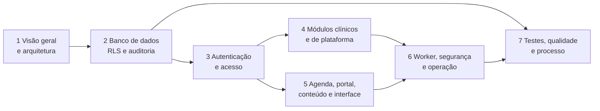

# Manual técnico do NutriDebby

Especificação técnica do produto como ele está no código. Explica o que existe, por que foi feito assim, como
funciona e como operar e estender sem quebrar o isolamento, a LGPD ou a produção.

| Item | Valor |
|---|---|
| Produto | SaaS multi-tenant de gestão de consultório de nutrição, com portal do paciente (PWA) e dado de saúde (LGPD) |
| Produção | `https://nutri.wsscloud.tech` (Easypanel, projeto `nutri`: `nutri_app`, `nutri_worker`, `nutri_db`) |
| Conferido contra | `main` em `62615b9` (PR #15, fechamento do Plano 08), em 05/10/2026 |
| Escopo | Planos 01–08, spec do MVP v1.11, migrations `0000`–`0088` (89 arquivos em `drizzle/`) |
| Segredos | Só **nomes** de variáveis. Nenhum valor de `.env`, senha, token ou chave aparece no manual |

---

## Para quem é

- **Desenvolvedor que vai manter o sistema** sem ter participado do projeto. Comece pelo
  [cap. 1](01-visao-geral-e-arquitetura.md) e pelo [Guia do primeiro dia](07-testes-qualidade-e-processo.md#712-guia-do-primeiro-dia).
- **Revisor** de um PR: as regras e o que as guardas conferem estão no [cap. 2](02-banco-de-dados.md) e no
  [cap. 7](07-testes-qualidade-e-processo.md).
- **Quem opera** o servidor (dono): [cap. 6](06-worker-seguranca-operacao.md), em especial
  [O que só o dono faz](06-worker-seguranca-operacao.md#610-o-que-só-o-dono-faz) e a
  [Rotina de incidentes](06-worker-seguranca-operacao.md#69-rotina-de-incidentes).

Não é manual de uso. O manual da nutricionista é o "manual guiado" dentro do painel
([§5.8](05-agenda-portal-conteudo.md#58-manual-guiado-p08-10-p08-d26-d27)).

## Ordem de autoridade

1. **Código** (`src/`, `drizzle/`, `scripts/`, `test/`, `e2e/`, `Dockerfile`, `next.config.ts`, `package.json`,
   `.github/workflows/`).
2. Spec do MVP: `docs/superpowers/specs/2026-09-27-nutridebby-mvp-design.md` e `…-mvp-historias.md`.
3. Planos, índice e backlog: `docs/superpowers/plans/`.
4. Runbooks: `docs/operacao/` (`go-live.md`, `restauracao.md`, `carga.md`).
5. `CLAUDE.md` do projeto.

Quando a spec e o código divergem, o manual descreve o código e registra a divergência no fim do capítulo. A lista
consolidada está em [Divergências spec × código](#divergências-spec--código-consolidadas).

Convenções de citação: `arquivo:N` aponta a linha no commit acima; quando a linha muda com facilidade, o manual cita o
nome da função. "Plano NN, Dx" é a decisão `Dx` do plano NN (o cap. 5 abrevia como "P05 D9"). "§x" é a seção da spec
de design. "Regra n" é a regra obrigatória n do `CLAUDE.md` do projeto.

---

## Índice

| Cap. | Arquivo | Assunto | Dono de |
|---|---|---|---|
| 1 | [01-visao-geral-e-arquitetura.md](01-visao-geral-e-arquitetura.md) | Produto, perfis, stack, monólito modular + worker, mapa do código, rotas, infraestrutura, variáveis, cronologia dos planos | Variáveis de ambiente (tabela única), infraestrutura, cronologia |
| 2 | [02-banco-de-dados.md](02-banco-de-dados.md) | Roles, migrations, catálogo de tabelas, RLS, contextos, funções SQL, guardas, auditoria | RLS, listas de `src/db/rls-guard.ts`, passo a passo de tabela nova |
| 3 | [03-autenticacao-e-acesso.md](03-autenticacao-e-acesso.md) | Better Auth, senha, 2FA, sessão, guardas por papel, vínculos do paciente, convites, aceites, proxy, suspensão, sair | Sessão e autorização, limites de login, proxy |
| 4 | [04-modulos-clinicos.md](04-modulos-clinicos.md) | Plataforma (contas, marca, armazenamento, monitoramento, métricas), prontuário, LGPD, exportação, alimentos, plano alimentar | Armazenamento e URL assinada, monitoramento de backup/disco, LGPD |
| 5 | [05-agenda-portal-conteudo.md](05-agenda-portal-conteudo.md) | Agenda, página pública, motor de notificações, canais (e-mail, WhatsApp, push), portal PWA, conteúdos, interface V2, manual guiado | Notificações, contexto `publico`, portal, audiência do conteúdo |
| 6 | [06-worker-seguranca-operacao.md](06-worker-seguranca-operacao.md) | pg-boss, filas, payload cifrado, cabeçalhos e CSP, limites, Turnstile, logs, Sentry, health, backup, carga, go-live, incidentes | Tabela única das 17 filas, segurança HTTP, backup e restauração |
| 7 | [07-testes-qualidade-e-processo.md](07-testes-qualidade-e-processo.md) | Vitest + Testcontainers, guardas, matriz de isolamento, E2E, CI/CD, ambiente de dev, regras do `CLAUDE.md`, revisão, plano novo, primeiro dia | Pipeline de CI e deploy, matriz de isolamento, processo |

### Seções principais

**1. Visão geral e arquitetura** — [1.1 O produto](01-visao-geral-e-arquitetura.md#11-o-produto) ·
[1.2 Perfis de acesso](01-visao-geral-e-arquitetura.md#12-perfis-de-acesso) ·
[1.3 Stack](01-visao-geral-e-arquitetura.md#13-stack) ·
[1.4 Arquitetura](01-visao-geral-e-arquitetura.md#14-arquitetura-monólito-modular--worker) ·
[1.5 Mapa de `src/`](01-visao-geral-e-arquitetura.md#15-mapa-de-src-e-da-raiz-do-repositório) ·
[1.6 Módulos de domínio](01-visao-geral-e-arquitetura.md#16-módulos-de-domínio-srcmodules) ·
[1.7 Rotas](01-visao-geral-e-arquitetura.md#17-rotas-principais) ·
[1.8 Infraestrutura](01-visao-geral-e-arquitetura.md#18-infraestrutura) ·
[1.9 Variáveis de ambiente](01-visao-geral-e-arquitetura.md#19-variáveis-de-ambiente) ·
[1.10 Cronologia dos planos](01-visao-geral-e-arquitetura.md#110-cronologia-dos-planos-0108) ·
[1.11 Como estender](01-visao-geral-e-arquitetura.md#111-como-estender-com-segurança-resumo)

**2. Banco de dados** — [2.2 Roles](02-banco-de-dados.md#22-roles-e-credenciais) ·
[2.3 Rodar](02-banco-de-dados.md#23-rodar-as-migrations) e [2.4 criar migrations](02-banco-de-dados.md#24-criar-migrations) ·
[2.5 Catálogo de tabelas](02-banco-de-dados.md#25-catálogo-de-tabelas) ·
[2.6 RLS em detalhe](02-banco-de-dados.md#26-rls-em-detalhe) ·
[2.7 Guardas no CI](02-banco-de-dados.md#27-guardas-no-ci) ·
[2.8 Auditoria](02-banco-de-dados.md#28-auditoria) ·
[2.9 Tabelas fora da RLS](02-banco-de-dados.md#29-tabelas-fora-da-rls-e-quem-as-acessa) ·
[2.10 Seeds](02-banco-de-dados.md#210-seeds) ·
[2.11 Tabela nova com `tenant_id`](02-banco-de-dados.md#211-passo-a-passo-tabela-nova-com-tenant_id)

**3. Autenticação e acesso** — [3.2 Papéis](03-autenticacao-e-acesso.md#32-papéis) ·
[3.3 Better Auth](03-autenticacao-e-acesso.md#33-configuração-do-better-auth-srclibauthts) ·
[3.5 2FA](03-autenticacao-e-acesso.md#35-verificação-em-duas-etapas-2fa) ·
[3.6 Sessão](03-autenticacao-e-acesso.md#36-sessão-inatividade-e-renovação) ·
[3.7 Guardas por papel](03-autenticacao-e-acesso.md#37-guardas-por-papel) ·
[3.8 Vínculos e `nd_vinculo`](03-autenticacao-e-acesso.md#38-sessão-do-paciente-vínculos-nd_vinculo-e-contexto-conta) ·
[3.10 Convites](03-autenticacao-e-acesso.md#310-convites) ·
[3.12 Aceites](03-autenticacao-e-acesso.md#312-aceites-dpa-e-termo-do-paciente-consents) ·
[3.13 Proxy](03-autenticacao-e-acesso.md#313-proxy-e-redirecionamento-seguro) ·
[3.14 Suspensão](03-autenticacao-e-acesso.md#314-suspensão-de-conta-rn-15-us-004) ·
[3.16 Fluxo de login](03-autenticacao-e-acesso.md#316-fluxo-de-login-completo)

**4. Módulos clínicos e de plataforma** — [4.0 Convenções](04-modulos-clinicos.md#40-convenções-que-todos-os-módulos-seguem) ·
[4.1 Plataforma](04-modulos-clinicos.md#41-plataforma) ·
[4.2 Pacientes e prontuário](04-modulos-clinicos.md#42-pacientes-e-prontuário) ·
[4.3 Alimentos](04-modulos-clinicos.md#43-alimentos) ·
[4.4 Plano alimentar](04-modulos-clinicos.md#44-plano-alimentar) ·
[4.6 Como estender](04-modulos-clinicos.md#46-como-estender-com-segurança)

**5. Agenda, portal, conteúdo e interface** — [5.1 Agenda](05-agenda-portal-conteudo.md#51-agenda) ·
[5.2 Página pública](05-agenda-portal-conteudo.md#52-página-pública-nslug-rn-16-p05-d11d13) ·
[5.3 Motor de notificações](05-agenda-portal-conteudo.md#53-motor-de-notificações-rn-05-p05-d6-d7) ·
[5.4 Canais](05-agenda-portal-conteudo.md#54-canais) ·
[5.5 Portal do paciente](05-agenda-portal-conteudo.md#55-portal-do-paciente-p-plano-06) ·
[5.6 Conteúdos](05-agenda-portal-conteudo.md#56-conteúdos-plano-07) ·
[5.7 Interface do painel](05-agenda-portal-conteudo.md#57-interface-do-painel-plano-08) ·
[5.8 Manual guiado](05-agenda-portal-conteudo.md#58-manual-guiado-p08-10-p08-d26-d27) ·
[5.9 Como estender](05-agenda-portal-conteudo.md#59-como-estender-com-segurança)

**6. Worker, segurança e operação** — [6.2 Worker pg-boss](06-worker-seguranca-operacao.md#62-worker-pg-boss) ·
[6.3 Segurança](06-worker-seguranca-operacao.md#63-segurança) ·
[6.4 Observabilidade](06-worker-seguranca-operacao.md#64-observabilidade) ·
[6.5 Backup e restauração](06-worker-seguranca-operacao.md#65-backup-e-restauração-rnf-05-regra-10) ·
[6.6 Carga (k6)](06-worker-seguranca-operacao.md#66-teste-de-carga-k6) ·
[6.7 Go-live](06-worker-seguranca-operacao.md#67-checklist-do-go-live) ·
[6.8 Deploy e volta](06-worker-seguranca-operacao.md#68-deploy-e-volta-atrás) ·
[6.9 Incidentes](06-worker-seguranca-operacao.md#69-rotina-de-incidentes) ·
[6.10 O que só o dono faz](06-worker-seguranca-operacao.md#610-o-que-só-o-dono-faz) ·
[6.11 Decisões](06-worker-seguranca-operacao.md#611-decisões-de-projeto-deste-capítulo)

**7. Testes, qualidade e processo** — [7.3 Vitest + Testcontainers](07-testes-qualidade-e-processo.md#73-vitest--testcontainers) ·
[7.4 Guardas do CI](07-testes-qualidade-e-processo.md#74-guardas-do-ci) ·
[7.5 E2E](07-testes-qualidade-e-processo.md#75-e2e-com-playwright) ·
[7.7 CI e deploy](07-testes-qualidade-e-processo.md#77-pipeline-do-ci-e-deploy) ·
[7.8 Ambiente de dev](07-testes-qualidade-e-processo.md#78-ambiente-de-desenvolvimento) ·
[7.9 Regras do `CLAUDE.md`](07-testes-qualidade-e-processo.md#79-as-10-regras-do-claudemd-com-o-porquê) ·
[7.10 Revisão](07-testes-qualidade-e-processo.md#710-fluxo-de-revisão-a-cada-entrega) ·
[7.11 Plano novo](07-testes-qualidade-e-processo.md#711-como-abrir-um-plano-novo) ·
[7.12 Primeiro dia](07-testes-qualidade-e-processo.md#712-guia-do-primeiro-dia)

### Onde cada assunto mora

Cada assunto tem um capítulo dono, com o detalhe. Os outros capítulos trazem um resumo de uma ou duas frases e um link.

| Assunto | Capítulo dono | Citado também em |
|---|---|---|
| Variáveis de ambiente (todas) | [§1.9](01-visao-geral-e-arquitetura.md#19-variáveis-de-ambiente) | §3.18, §5.10, §6.2.1, §6.5.3 (só as do assunto) |
| Listas e guardas de RLS/auditoria | [§2.7](02-banco-de-dados.md#27-guardas-no-ci) | §7.4.1 (o porquê) |
| Tabela nova com `tenant_id` | [§2.11](02-banco-de-dados.md#211-passo-a-passo-tabela-nova-com-tenant_id) | §1.11, §7.4.4 |
| Limites de login | [§3.3](03-autenticacao-e-acesso.md#limite-de-tentativas) | §6.3.4 (todos os limites) |
| Proxy e rotas protegidas | [§3.13](03-autenticacao-e-acesso.md#313-proxy-e-redirecionamento-seguro) | §6.3.3 |
| Suspensão do tenant | [§3.14](03-autenticacao-e-acesso.md#314-suspensão-de-conta-rn-15-us-004) | §5.3.8 (lembretes) |
| Armazenamento, cota e URL assinada | [§4.1.3](04-modulos-clinicos.md#413-armazenamento-com-cota-e-url-assinada-rn-18-regra-9-do-claudemd) | §6.3.6, §6.3.7 |
| Monitor de backup e disco | [§4.1.4](04-modulos-clinicos.md#414-monitoramento-de-backup-e-disco-rnf-05-rnf-13) | §6.5.6 |
| Filas do worker (17) | [§6.2.3](06-worker-seguranca-operacao.md#623-filas) | §4.5, §5.10 |
| Backup e restauração | [§6.5](06-worker-seguranca-operacao.md#65-backup-e-restauração-rnf-05-regra-10) | §1.8 |
| CI, imagem e deploy | [§7.7](07-testes-qualidade-e-processo.md#77-pipeline-do-ci-e-deploy) | §1.8 (diagrama), §6.8 |
| Matriz de isolamento | [§7.4.2](07-testes-qualidade-e-processo.md#742-a-matriz-de-isolamento-testisolamentotestts) | §2.7 |
| Tela nova (painel e portal) | [§7.4.5](07-testes-qualidade-e-processo.md#745-checklist-tela-nova) | §1 (rotas), §3.17, §5.9 |
| Volta atrás de um deploy | [§6.8.1](06-worker-seguranca-operacao.md#681-roteiro-de-volta-atrás) | §1.8, §7.7 |
| Segredo vazado (troca de variável) | [§6.9.1](06-worker-seguranca-operacao.md#691-segredo-vazado) | §6.10 |

---

## Como manter este manual

**Quando.** No **fechamento de cada plano**, no mesmo PR curto de docs que sobe a spec para a versão seguinte e
atualiza o backlog (ex.: PR #15, `plano-08-fechamento`; passo 9 de
[§7.11](07-testes-qualidade-e-processo.md#711-como-abrir-um-plano-novo)). Correção pontual (bug, débito) que muda o que
um capítulo afirma também atualiza o capítulo no próprio PR.

**Fonte de verdade = código.** Toda afirmação técnica cita o arquivo e a linha ou a função. Ao atualizar, confira no
código, não na memória nem só na spec.

Roteiro do fechamento:

1. Atualize "Conferido contra" (commit e data) aqui e no [cap. 1](01-visao-geral-e-arquitetura.md), e a faixa de
   migrations (`ls drizzle/*.sql`).
2. Para cada tabela nova: linha no catálogo ([§2.5](02-banco-de-dados.md#25-catálogo-de-tabelas)) e na matriz de
   proteção; listas novas ou alteradas de `src/db/rls-guard.ts` e `src/db/audit-guard.ts` em [§2.7](02-banco-de-dados.md#27-guardas-no-ci).
3. Fila nova em `QUEUES` (`src/jobs/queues.ts`): linha em [§6.2.3](06-worker-seguranca-operacao.md#623-filas).
4. Variável nova em `src/env.ts`: linha em [§1.9](01-visao-geral-e-arquitetura.md#19-variáveis-de-ambiente).
5. Módulo, rota ou tela nova: [§1.6](01-visao-geral-e-arquitetura.md#16-módulos-de-domínio-srcmodules),
   [§1.7](01-visao-geral-e-arquitetura.md#17-rotas-principais) e o capítulo do domínio.
6. Decisões do plano (Dx) que mudam arquitetura: no capítulo do assunto, com o número da decisão; linha nova na
   [cronologia](01-visao-geral-e-arquitetura.md#110-cronologia-dos-planos-0108).
7. Confira as divergências: remova as resolvidas (spec corrigida ou código alterado), registre as novas no capítulo e
   na [lista consolidada](#divergências-spec--código-consolidadas).
8. Linhas citadas (`arquivo:N`) envelhecem rápido. Prefira citar a função quando o arquivo mudou muito.
9. Confira os links internos (cada link `capítulo.md#âncora` aponta para um título que existe; a âncora é o título em
   minúsculas, sem pontuação, com hífens no lugar dos espaços) e não duplique detalhe:
   escreva no capítulo dono e ponha um link nos outros ([Onde cada assunto mora](#onde-cada-assunto-mora)).

Nunca copie valor de segredo, nem os valores fictícios do CI, do `Dockerfile` ou do seed do E2E. Nunca consulte o banco
de produção para escrever o manual (regra 5 do `CLAUDE.md`).

---

## Glossário

### Domínio

| Termo | Significado | Fonte |
|---|---|---|
| Tenant | A conta de uma nutricionista (consultório). Isola todos os dados dela. Linha em `tenants` | Spec, Apêndice B; [§2.5](02-banco-de-dados.md#25-catálogo-de-tabelas) |
| Debby | A primeira cliente (piloto) do produto | Spec §1 |
| Dono | Dono do servidor e do produto. Aprova merge, reinício, mudança no Easypanel e no banco de produção | `CLAUDE.md`, regra 6; [§6.10](06-worker-seguranca-operacao.md#610-o-que-só-o-dono-faz) |
| Admin | Usuário da plataforma que cria e suspende contas. Não tem contexto de tenant e nunca lê tabela 🔒 | Spec §3; `src/db/tenant.ts:47` |
| Paciente / titular | A pessoa atendida. "Titular" é o termo da LGPD para o dono dos dados (pedidos de exportação e exclusão) | Spec, US-018 e US-046 |
| Vínculo | Relação (consultório, prontuário) de uma conta de paciente. Uma conta pode ter vínculos em vários consultórios; o escolhido fica no cookie `nd_vinculo` | Spec, Apêndice B; `src/lib/paciente-session.ts:21` |
| DPA | Contrato de tratamento de dados entre a nutricionista (controladora) e a plataforma (operadora); aceite em `consents` | Spec, Apêndice B; [§3.12](03-autenticacao-e-acesso.md#312-aceites-dpa-e-termo-do-paciente-consents) |
| Termo | Termo de consentimento do paciente, versionado; aceite em `consents` | [§3.12](03-autenticacao-e-acesso.md#312-aceites-dpa-e-termo-do-paciente-consents) |
| Prazo de guarda / anonimização | Tempo que o prontuário bloqueado é guardado antes de o job `retencao-lgpd` anonimizar o titular | [§4.2.8](04-modulos-clinicos.md#428-lgpd-arquivar-pedido-de-exclusão-e-anonimização-us-018-rnf-08) |
| Plano publicado | Versão imutável do plano alimentar; no máximo 1 por paciente (RN-01) | [§4.4.3](04-modulos-clinicos.md#443-publicação-com-versão-rn-01-us-025-plano-04-d10) |
| TACO | Tabela Brasileira de Composição de Alimentos, 4ª ed. (INT-04), carregada por migration | [§4.3.1](04-modulos-clinicos.md#431-taco-4ª-ed-e-seed-int-04-us-020) |
| TMB / GET / VET | Taxa metabólica basal / gasto energético total / valor energético total do plano | Spec, Apêndice A e B |
| Audiência | Quem vê um conteúdo da biblioteca (todos, etiqueta ou pacientes escolhidos), aplicada no banco (RN-12) | [§5.6.5](05-agenda-portal-conteudo.md#565-audiência-no-banco-rn-12-p07-d2) |
| Link da consulta | `/consulta/<token>`, assinado por HMAC e amarrado ao e-mail do paciente; ação sem login | Spec, Apêndice B; [§5.1.7](05-agenda-portal-conteudo.md#517-link-assinado-da-consulta-p05-d20) |
| Página pública | `/n/<slug>`: agendamento sem login, com Turnstile e código por e-mail (RN-16) | [§5.2](05-agenda-portal-conteudo.md#52-página-pública-nslug-rn-16-p05-d11d13) |
| Evolution API | Serviço autohospedado que conecta o WhatsApp de cada consultório (INT-01, Plano 05) | [§5.4.2](05-agenda-portal-conteudo.md#542-whatsapp-pela-evolution-api-int-01-p05-d1d5) |
| Manual guiado | Ajuda dentro do painel para a nutricionista (`src/modules/ajuda`, Plano 08) | [§5.8](05-agenda-portal-conteudo.md#58-manual-guiado-p08-10-p08-d26-d27) |

### Isolamento e banco

| Termo | Significado | Fonte |
|---|---|---|
| RLS | Row-Level Security: o Postgres filtra as linhas pelo contexto da transação. Habilitada **e forçada** em toda tabela com `tenant_id` | `drizzle/0000_base_roles_e_rls.sql:30`; [§2.6](02-banco-de-dados.md#26-rls-em-detalhe) |
| 🔒 | Na spec §7 e no manual: tabela com `tenant_id` sob RLS | Spec §7 |
| GUC (`app.*`) | Variáveis de sessão do Postgres que a RLS lê: `app.tenant_id`, `app.role`, `app.patient_id`, `app.user_id`, `app.ip` | `src/db/tenant.ts:80-84`; [§2.6.1](02-banco-de-dados.md#261-os-gucs-do-contexto) |
| `withTenant(ctx, fn)` | Abre a transação com o contexto aplicado (`set_config(…, true)`). Toda consulta a tabela com `tenant_id` passa por ele (regra 1) | `src/db/tenant.ts:71` |
| `withConta(userId, fn)` | Contexto `conta`: a conta de paciente, sem tenant, procurando os próprios vínculos. Só `src/modules/portal/vinculos.ts` usa | `src/db/tenant.ts:99`; Plano 06, D2 |
| Contexto (papel) | Valor de `app.role`: `nutri`, `paciente`, `worker` ou `publico` (`TenantRole`), mais `conta` via `withConta`. O admin não tem contexto | `src/db/tenant.ts:14`; [§2.6.3](02-banco-de-dados.md#263-contextos) |
| Contexto `publico` | Páginas sem login (página pública, link da consulta, horários livres). Negado em toda tabela por `publico_negado`, salvo o que `PUBLICO_LIBERADO` lista | `src/db/tenant.ts:8-13`; Plano 05, D11 |
| `semConta` | Paciente agindo sem sessão de login (link, WhatsApp, convite). Lista fechada em `SEM_CONTA_PERMITIDOS` | `src/db/tenant.ts:34` |
| `tenant_isolation` / `patient_isolation` | Políticas base: linha do tenant do contexto; na sessão de paciente, só as linhas do próprio `patient_id` | `drizzle/0000_base_roles_e_rls.sql:30-50` |
| `STAFF_ONLY` | Lista de tabelas que o paciente nunca vê, nem as próprias linhas (notas privadas, etiquetas, regras da agenda…). Política RESTRICTIVE `staff_only` por `app_enable_staff_only` | `src/db/rls-guard.ts:103`; `drizzle/0020_rls_etiquetas.sql:3` |
| `PUBLICO_LIBERADO` | Tabelas e comandos que o contexto `publico` pode usar, cada um com o motivo. `app_allow_publico` no SQL | `src/db/rls-guard.ts:131`; `drizzle/0051_rls_consultas.sql:19` |
| `PACIENTE_ESCREVE` | Tabelas e comandos que a sessão de paciente pode gravar. O resto nega por `paciente_sem_<cmd>`. `app_allow_paciente_escrita` no SQL | `src/db/rls-guard.ts:178`; `drizzle/0070_paciente_sem_escrita.sql:25` |
| `CONTEUDO_POR_AUDIENCIA` | Tabelas de conteúdo sem `patient_id` que o paciente lê pela audiência (política `paciente_conteudo_visivel`) | `src/db/rls-guard.ts:227`; `drizzle/0083_audiencia_conteudos.sql:42` |
| `RLS_EXCEPTIONS` | Tabelas com `tenant_id` fora da RLS: `user`, `consents`, `invites`, cada uma com quem pode acessá-la | `src/db/rls-guard.ts:9`; [§2.9](02-banco-de-dados.md#29-tabelas-fora-da-rls-e-quem-as-acessa) |
| `AUDIT_EXCEPTIONS` | Tabelas com `patient_id` sem gatilho de auditoria, com justificativa | `src/db/audit-guard.ts:4` |
| `liberarReceitasDoPlano` | Exceção da RN-12: libera, na transação, as receitas sugeridas no plano publicado do próprio paciente | `src/modules/conteudo/audiencia.ts:45` |
| Guarda | Teste que confere uma regra do projeto (não uma função) e quebra o CI se alguém a esquecer | [§7.4](07-testes-qualidade-e-processo.md#74-guardas-do-ci) |
| `FABRICAS` / `ULTIMAS` | Fábricas de linha por tabela na matriz de isolamento; `ULTIMAS` = tabelas-mãe apagadas por último | `test/isolamento.test.ts:24`, `:113` |
| Gatilho `audit_row_change` | Grava `audit_log` em toda escrita de tabela de dado de saúde (`app_enable_audit`) | `drizzle/0007_auditoria_funcoes.sql:36`; [§2.8](02-banco-de-dados.md#28-auditoria) |
| `auditRead` | Registra a leitura de dado de saúde, na mesma transação (regra 8) | `src/modules/plataforma/audit.ts:28` |
| Migrator / `nutri_app_role` | Migrator = role dono do schema (`DATABASE_URL_MIGRATOR`), só nas migrations. `nutri_app_role` = grupo sem login que recebe os privilégios; o role de `DATABASE_URL` é membro dele, sem `BYPASSRLS` | `drizzle/0000_base_roles_e_rls.sql:10-19`; [§2.2](02-banco-de-dados.md#22-roles-e-credenciais) |
| Expand/contract | Migration em duas fases (acrescenta, depois remove), porque app novo e antigo convivem no deploy `start-first` | Spec §9.7 |
| `SECURITY DEFINER` | Função SQL que roda com o dono e devolve só o mínimo (métricas do admin, anonimização de aceites…) | [§2.6.8](02-banco-de-dados.md#268-funções-security-definer) |

### Aplicação e operação

| Termo | Significado | Fonte |
|---|---|---|
| `requireNutri` / `requirePaciente` | Guardas de página que devolvem o contexto para o `withTenant`; `requireApi*` nas rotas de API | `src/lib/tenant-session.ts:22`; `src/lib/paciente-session.ts:111`; [§3.7](03-autenticacao-e-acesso.md#37-guardas-por-papel) |
| Proxy | `src/proxy.ts`, o interceptador do Next 16 (antes `middleware.ts`). Não cobre `/api/*` | [§3.13](03-autenticacao-e-acesso.md#313-proxy-e-redirecionamento-seguro) |
| `salvarArquivo` / `apagarArquivo` / `signFileUrl` | Únicas portas de gravação, remoção e entrega de arquivo (regra 9) | `src/modules/plataforma/armazenamento.ts:64`, `:160`; `src/lib/signed-url.ts:16` |
| Worker | Processo pg-boss (mesma imagem, `APP_ROLE=worker`) que executa e-mail, lembretes, PDF, ZIP, fotos e varreduras | [§6.2](06-worker-seguranca-operacao.md#62-worker-pg-boss) |
| Payload selado | Payload de job cifrado com AES-256-GCM (`ENCRYPTION_KEY`) para não guardar dado sensível na fila | [§6.2.5](06-worker-seguranca-operacao.md#625-payload-cifrado-aes-256-gcm) |
| `workSemDetalhe` | Registro de job que limpa o erro antes de o pg-boss gravá-lo (regra 3) | `src/worker/sem-detalhe.ts:38` |
| Heartbeat | Batida do worker em `system_heartbeat`, lida pelo `/api/health` | [§6.2.6](06-worker-seguranca-operacao.md#626-heartbeat), [§6.4.3](06-worker-seguranca-operacao.md#643-apihealth) |
| Easypanel | Painel sobre Docker Swarm que roda os serviços. Configuração muda só por ele (regra 6) | [§1.8](01-visao-geral-e-arquitetura.md#18-infraestrutura) |
| GHCR | GitHub Container Registry, onde o deploy publica a imagem | [§7.7](07-testes-qualidade-e-processo.md#77-pipeline-do-ci-e-deploy) |

### Identificadores da spec, dos planos e do backlog

| Prefixo | O que é | Onde está |
|---|---|---|
| M1–M6 | Módulos do MVP (plataforma, prontuário, plano alimentar, agenda, portal, conteúdo) | Spec §2.1 |
| US-xxx | Histórias de usuário (46). A dezena indica o módulo: US-00x M1, US-01x M2, US-02x M3, US-03x M4, US-04x M5, US-05x M6 | `…-mvp-historias.md` |
| RN-xx | Regras de negócio (RN-01 a RN-18) | Spec §8 |
| RNF-xx | Requisitos não funcionais (RNF-01 a RNF-13) | Spec §5 |
| INT-xx | Integrações (INT-01 WhatsApp a INT-06 Turnstile) | Spec §6 |
| CS-xx | Critérios de sucesso do MVP (CS-01 a CS-03) | Spec §1.1 |
| D-xx (com hífen) | Premissas e decisões **da spec** (D-01 a D-11) | Spec §1.2 |
| Dx (sem hífen) | Decisão **de um plano**, na tabela "Decisões de desenho" (Planos 04–08). ★ = decidida pelo dono. Os Planos 01–03 registram decisões em tabelas sem número ("Decisões de desenho", "Desvios conscientes da spec") e são citados pelo nome da linha | `docs/superpowers/plans/` |
| P-xx | Riscos e pendências da spec (P-01 a P-18) | Spec §11 |
| Pnn-mm | Item do backlog do Plano nn (ex.: P02-11 = instalação do backup no host; P08-10 = manual guiado) | `2026-09-27-nutridebby-backlog.md` |
| E-xx | Trilha externa (fora do código): contas, domínio, Evolution, Sentry, textos do advogado | Backlog, "Trilha externa" |
| F3-xx, F4-01 | Itens pós-MVP (Fase 3 e Fase 4) | Backlog, "Pós-MVP" |
| Tarefa N | Tarefa numerada dentro de um plano | Cada plano, seção "Tasks" |
| S-, B-, W-, F-, L-, T-, X- | Códigos dos débitos do Plano 06, dados na triagem da preparação do Plano 07 (ex.: B-5) | Backlog, "P06-12" |
| R1–R11 | Decisões da varredura prévia do Plano 07 contra a `main` | Índice dos planos, "Registro do processo — Plano 07" |
| N7, M8, G7, PF-F3, T8-R2a… | Rótulos de achados das revisões, citados em comentários do código. Procure o rótulo no plano ou no backlog do período | Planos e backlog |
| Regra n | Regra obrigatória n do `CLAUDE.md` do projeto (1 a 10) | [§7.9](07-testes-qualidade-e-processo.md#79-as-10-regras-do-claudemd-com-o-porquê) |

---

## Divergências spec × código (consolidadas)

Lista única, sem repetição, das divergências registradas no fim de cada capítulo (conferência de 05/10/2026). O
código é a referência. "Cap." aponta onde está o detalhe.

**Tipo:** **Doc** = só o documento está desatualizado · **Comp.** = o comportamento difere do texto e alguém deve
decidir (corrigir a spec ou o código) · **Pend.** = pendência conhecida, não erro · **Reg.** = desvio consciente já
registrado na spec v1.11.

Seções de origem: [cap. 1](01-visao-geral-e-arquitetura.md#divergências-encontradas) ·
[cap. 2](02-banco-de-dados.md#divergências-encontradas) ·
[cap. 3](03-autenticacao-e-acesso.md#divergências-encontradas) ·
[cap. 4](04-modulos-clinicos.md#divergências-encontradas) ·
[cap. 5](05-agenda-portal-conteudo.md#divergências-encontradas) ·
[cap. 6](06-worker-seguranca-operacao.md#divergências-encontradas) ·
[cap. 7](07-testes-qualidade-e-processo.md#713-divergências-encontradas)

### Arquitetura, stack, infraestrutura e CI

| # | Fonte | Diz | Código / produção | Tipo | Cap. |
|---|---|---|---|---|---|
| 1 | Spec §9.1 | UI com shadcn/ui, react-hook-form, Recharts, lucide-react | Nenhum no `package.json`; gráficos em SVG no servidor, componentes próprios em `src/components/ui/` | Doc | 1 #1, 4 #3 |
| 2 | Spec §9.2 | `@sentry/cli` em dev; `web-push` como dependência de dev | `@sentry/cli` não existe (sem source maps); `web-push` está em `dependencies` | Doc | 1 #2, 7 #5 |
| 3 | Spec §9.7 | "o worker espera a versão do schema" | Nenhuma espera: `src/worker/index.ts` sobe direto; os webhooks de app e worker saem em sequência (`deploy.yml:64-65`). A proteção real é expand/contract | Comp. | 1 #3, 7 #1 |
| 4 | Spec §9.7 | Imagem com tag = SHA; etapas do PR em sequência | Tags `:<sha>` e `:latest` (serviços usam `:latest`), poda para 2 versões; 4 jobs paralelos, com orçamento de imagem de 260 MB | Doc | 1 #4, 7 #2, 7 #3 |
| 5 | Spec §9.6 | Lista de variáveis | Faltam `TRUSTED_PROXIES` (obrigatória em produção, `src/env.ts:162-169`), `LOG_LEVEL`, `NODE_ENV`, `APP_ROLE`, `PORT` | Doc | 1 #5 |
| 6 | `.env.example` | `R2_*` e `BACKUP_PASSPHRASE` | Nenhum código lê; no host viram `RCLONE_CONFIG_*` do `backup.env` | Doc | 1 #6 |
| 7 | Spec §4.2 | `app.<dominio>`, domínio a definir | `https://nutri.wsscloud.tech` | Doc | 1 #7 |
| 8 | Spec RNF-03 | `nutri_worker` com 512 MB | Observado 1 vCPU / 1 GiB; `docs/operacao/carga.md` usa esse valor. Revisão do RNF-03 pendente após o k6 | Pend. | 1 #8, 6 #3 |
| 9 | Spec §4.1 | Rotas e UI nunca chamam o banco direto | `src/app/sair/route.ts:49` (`session`) e `/api/health` (`system_heartbeat`), ambas fora da RLS | Doc | 1 #9 |
| 10 | Mensagem de `src/env.ts:182` e `.env.example` | Exemplo `http://nutridebby_app:3000/…` | O serviço na rede interna é `nutri_app` | Comp. | 1 #10 |
| 11 | Spec §4 | `nutri_evolution` na VPS | Não implantado em 05/10/2026; go-live pode sair sem WhatsApp (Plano 08, D16) | Pend. | 1 #11 |

### Banco de dados e RLS

| # | Fonte | Diz | Código | Tipo | Cap. |
|---|---|---|---|---|---|
| 12 | Spec §7 | Política `tenant_id = current_setting('app.tenant_id')::uuid` | `app_current_tenant()` com `nullif(…, '')`: fora de contexto dá 0 linhas, não erro | Doc | 2 #1 |
| 13 | Spec §7 | `consultations.notas_privadas` | Tabela `consultation_notes` com `staff_only`; a spec não a cita | Doc | 2 #2, 4 #2 |
| 14 | Spec §7 | `invites.tipo` só `nutri`, sem tenant | `tipo` em (`nutri`, `paciente`), `tenant_id`, `patient_id`, CHECK `invites_alvo` | Doc | 2 #3 |
| 15 | Spec §4.1 | `users`, `consents`, `invites` sem `tenant_id` | As três têm `tenant_id` e estão em `RLS_EXCEPTIONS` | Doc | 2 #4 |
| 16 | Spec §7 e §4.1 | Não citam `system_heartbeat` | Tabela existe (`drizzle/0001_plataforma.sql:13-16`), fora da RLS | Doc | 2 #5 |
| 17 | Spec §4.1 | `withTenant` aplica 3 variáveis | Aplica 5: também `app.user_id` e `app.ip` | Doc | 2 #6 |
| 18 | `CLAUDE.md`, regra 2 | Guarda quebra o CI se esquecer a lista | A guarda de `STAFF_ONLY` só confere lista → banco: `staff_only` sem entrada na lista passa | Comp. | 2 #7 |
| 19 | Spec §7 e US-012 | `anamnesis_templates` com `nome` e `schema`; modelo padrão ao criar a conta | Também `padrao` e `arquivado_em`; o padrão nasce na primeira listagem (`garantirModeloPadrao`) | Doc | 4 #4 |
| 20 | Spec §7 | `exams.arquivo_path` livre | FK para `stored_files.caminho`, `ON DELETE SET NULL`, CHECK `exams_arquivo_do_tenant` | Doc | 4 #5 |
| 21 | Spec §7 | Não cita limite de duração da consulta | CHECK `appointments_periodo_valido` (8 h; migration `0050`); a aplicação limita a 240 min | Doc | 5 #4 |

### Autenticação e acesso

| # | Fonte | Diz | Código | Tipo | Cap. |
|---|---|---|---|---|---|
| 22 | US-001 | Primeiro admin recebe e-mail | `pnpm admin:criar` imprime o link no terminal (a spec §9.7 já diz isso) | Doc | 3 #1 |
| 23 | US-003 | `users.totp_secret_enc` em AES-256-GCM | Tabela `two_factor` do Better Auth, XChaCha20-Poly1305 com chave de `AUTH_SECRET` | Reg. | 3 #2 |
| 24 | US-002 | Bloqueio por e-mail + IP | Limite por IP + rota (`auth.ts:128`), 5 / 15 min | Reg. | 3 #3, 6 #8 |
| 25 | RNF-06 | "2FA TOTP para a nutricionista" | 2FA obrigatório só para o admin; opcional para a nutricionista (como a US-003) | Doc | 3 #4 |
| 26 | US-011; Plano 08, D14 | Termo e DPA na versão `1.0` | `0.1-provisorio` (`termo-paciente.ts:5`, `dpa.ts:6`); depende do texto do advogado (E-09, P08-06) | Pend. | 3 #5, 4 #10 |
| 27 | US-002 | Paciente vai para `/p` | Vai para `/p/inicio` (`/p` redireciona) | Doc | 3 #6 |
| 28 | US-003 | 10 códigos de recuperação | Padrão do Better Auth 1.7.6, não fixado no código | Comp. | 3 #7 |

### Módulos clínicos

| # | Fonte | Diz | Código | Tipo | Cap. |
|---|---|---|---|---|---|
| 29 | Apêndice A e US-014 | Harris-Benedict do exemplo = 1371 | `formulas.ts:90` dá 1370,47 → **1370** (RN-14); desvio registrado no Plano 03, spec não atualizada | Doc | 4 #1 |
| 30 | US-021 | "…está em um plano e não pode ser excluído." | "…está em um plano ou receita…" (`MSG_ALIMENTO.emUso`; Plano 07, D12) | Doc | 4 #6 |
| 31 | US-018 | `dados.json` com todas as tabelas do paciente | Exclui tabelas `staff_only` e o motivo de cancelamento escrito pela nutricionista (decisão do Plano 03; US-046) | Doc | 4 #7 |
| 32 | US-018 | Prazo conta da última consulta | Conta de `max(consultations.data)` (`lgpd.ts:102-106`): consulta agendada sem atendimento não estende o prazo | Comp. | 4 #8 |
| 33 | Plano 03 | Teto de laudos na exportação: 200 MB | `LIMITE_LAUDOS_BYTES = 100 MB` (Plano 06, D16, inclui fotos do diário) | Doc | 4 #9 |

### Agenda, portal e conteúdo

| # | Fonte | Diz | Código | Tipo | Cap. |
|---|---|---|---|---|---|
| 34 | Plano 07, D7; RNF-06 | Títulos `##`/`###` no markdown | Aceita `#` a `######` (`#`/`##` → `h2`, resto → `h3`), listas com `*` e `1)` | Doc | 5 #1 |
| 35 | INT-01 | JWT do webhook com `exp` de 10 min | Aceita `exp − iat` até 900 s + 60 s de folga (`VALIDADE_MAX_S`) | Comp. | 5 #2 |
| 36 | Spec §7 | `comentario_nutri` com 1–1000 caracteres | `comentarRegistro` conta unidades UTF-16; emojis são recusados antes de 1000 caracteres reais | Comp. | 5 #3 |
| 37 | Plano 05, D4 (b) | Repetição do webhook → 401 | 200 sem efeito (como a INT-01 v1.8) | Doc | 5 #5 |
| 38 | Plano 05, D20 | Token: versão + tenant + consulta + validade + HMAC | O MAC também amarra o SHA-256 do e-mail atual do paciente | Doc | 5 #6 |

### Worker, segurança e observabilidade

| # | Fonte | Diz | Código | Tipo | Cap. |
|---|---|---|---|---|---|
| 39 | Spec §4.1 | Todo job carrega `tenant_id` e roda em `withTenant` | Filas de cron com payload `{}` varrendo os tenants; `whatsapp-evento` leva só o selo; `email` aceita `tenantId: null`; monitores leem `user` e `backup_runs` fora de `withTenant` | Comp. | 6 #1 |
| 40 | RNF-04 | 503 se nenhum job for processado em 10 min | Mede só a fila `heartbeat`; outra fila travada não derruba o health | Comp. | 6 #2 |
| 41 | RNF-11 | `request_id` e `tenant_id` nos logs | `request_id` só na linha de erro e no Sentry; `tenant_id` nunca preenchido na tag (backlog) | Reg. | 6 #4 |
| 42 | RNF-04, RNF-06, Plano 02 | Monitor a cada 1 min; CSP "próprio + Sentry"; HSTS com subdomínios; backup no worker; `@sentry/nextjs` | Monitor a cada 5 min (D3); CSP com `'self'` e `'unsafe-inline'` em estilos (D1, D7); HSTS sem subdomínios (D8); backup no host (Plano 02; D6); `@sentry/node` (D1) | Reg. | 6 #5–#7, #9, #10 |

### Processo e documentos do repositório

| # | Fonte | Diz | Realidade | Tipo | Cap. |
|---|---|---|---|---|---|
| 43 | Spec RNF-10 | Axe em 42 rotas de `ROTAS_DO_PAINEL` | 43 entradas (uma por `page.tsx` de `src/app/painel`) + `/conta/seguranca` = 44 telas | Doc | 7 #4 |
| 44 | Índice dos planos, "Convenções" | Teste de isolamento na Tarefa 5 do Plano 01 | A Tarefa 5 criou o `rls-guard`; `test/isolamento.test.ts` nasceu no Plano 02, Tarefa 8 | Doc | 7 #6 |
| 45 | Índice dos planos | Spec "v1.2"; E-04 = Meta Business | Spec v1.11; WhatsApp pela Evolution desde a v1.8 | Doc | 7 #7 |
| 46 | Plano 01 | `/code-review high` 2× até sair limpo | Uma vez + re-revisão do diff (revisto em 02/10/2026) | Doc | 7 #8 |
| 47 | `README.md` da raiz | Texto do `create-next-app` (porta 3000, Vercel) | Porta 3100, `src/app`, deploy GHCR → Easypanel | Doc | 7 #9 |
| 48 | `.prettierrc` | `printWidth: 100` | O CI não roda o Prettier; muitos arquivos passam de 100 colunas | Doc | 7 #10 |

**Para decidir com o dono** (tipo Comp.): #3, #10, #18, #28, #32, #35, #36, #39 e #40. As de tipo Doc entram na
próxima versão da spec ou do documento citado.
